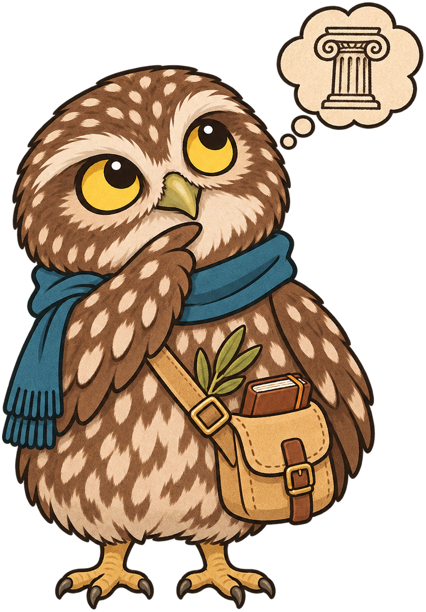

# About This Guide

!!! mascot-welcome "Welcome, Fellow Traveler"
    { class="mascot-admonition-img" }
    I'm Glaux, a little owl from Athens, and I'll be walking the route with you from the Bosphorus to the Acropolis. The monuments will wait for us; they have waited for thousands of years. The people won't, and that includes the ones who lived here long ago. Look closer.

**Mediterranean Travels** is a day-by-day guide for a thirteen-day journey from
Istanbul to Athens in November 2026: three days on our own in Istanbul, a
seven-night cruise past Troy, Ephesus, Rhodes, and Crete, and three days in
Athens with a trip to Delphi. It covers the history of civilization, culture,
and food along the way. Underneath all of that, it has one larger purpose: to
use travel as **practice in empathy**.

## Why This Guide: Travel as Empathy Practice

It is easy to visit Hagia Sophia, Ephesus, or the Acropolis, take a photograph,
and move on. Travel offers something rarer than a photograph: a daily chance to
stand where other people stand and ask what the world looks like from there.
**Empathy** is the ability to understand and share another person's feelings
and point of view. Like any skill, it improves with practice, and a trip like
this one puts us in front of people who are different from us in a new way
every day.

Empathy is easy when the other person is like us. When someone shares our
language, our schooling, our assumptions about how the world works, and our
sense of what is normal, imagining their point of view takes almost no effort,
because it is mostly our own point of view. Psychologists have found that
empathy fails most often across group lines, toward people we see as different
from ourselves.[^1] The real exercise starts when the other person does not
share what we know.

### Three Pairs of Shoes

This guide asks us to step into three kinds of shoes, each harder than the
last.

| Whose shoes | What we share | What we don't | How we close the gap |
|---|---|---|---|
| A fellow traveler on the ship | Language, schooling, a modern worldview, the same trip | Very little | Almost no effort needed |
| A spice merchant in Istanbul today | The modern world: phones, prices, weather, family | Language, faith, livelihood, the city's long memory | Ask, listen, and watch |
| A citizen of Athens in 430 BCE | Being human: fear, hope, love, grief, pride in a home | Almost every explanation of how the world works | Read the sources and imagine with care |

**The merchant.** At the Spice Bazaar in Istanbul, we bought saffron and Turkish
delight from merchants who sell to thousands of visitors a week. From our side
of the counter, the merchant's offer of a taste and a glass of tea can look like
a sales tactic. From the merchant's side, it can be all of these at once:
hospitality that is a point of honor, a living for a family, and a shop that may
have been in the family for generations, in a building that has stood since the
1660s. November is the quiet season, so every customer counts, and so does the
tea. The gap between us is real, but it can be crossed. The merchant lives in
the same century we do, worries about the same rent and weather, and is
standing right in front of us. We can ask.

**The ancient Athenian.** Now picture a potter in Athens in the summer of 430
BCE, the second year of the war with Sparta. The city is packed with refugees
from the countryside, and a plague is killing people faster than they can be
buried. The potter has never heard of germs. As far as anyone knows, disease
can be the anger of a god. So he does what any sensible person in his world
would do: he prays, makes offerings at the temples, and listens for what the
oracle at Delphi has said. The historian Thucydides, who caught the plague and
survived it, records that the prayers and oracles did no good, and that people
finally gave them up in despair.[^2]

Stepping into these shoes is much harder than stepping into the merchant's. We
can't ask the potter anything. Worse, the tools we would use to make sense of
his choices, such as germ theory, the scientific method, and the habit of
testing a claim against evidence, are exactly what he did not have. Our first
instinct is to feel superior: *how could people believe Zeus threw lightning,
or that Athena guarded their city?* That instinct is the trap
historians call **presentism**, judging the past by the knowledge and values of
the present. The historian Sam Wineburg argues that understanding people in
the past is an "unnatural act," because our minds keep turning them into
versions of ourselves.[^3]

!!! mascot-thinking "Not Less Intelligent, Differently Equipped"
    { class="mascot-admonition-img" }
    Notice that the Athenians were not less intelligent than we are; they lived with a different set of explanations. If we had grown up where the gods were the best account anyone had of storms, harvests, and plague, most of us would have prayed to Athena too.

### Why Ancient Athens Is the Hardest Case

Athens makes the exercise especially sharp because it holds both worlds at
once. It is the city where Socrates taught people to question everything, where
democracy was invented, and where philosophers argued about whether the gods
behaved as the stories said. It is also the city that, in 399 BCE, put Socrates
on trial for not recognizing the gods the city recognized, and voted to put him
to death. In 413 BCE, an Athenian army in Sicily was ready to retreat when an
eclipse of the moon darkened the sky. The general Nicias, following the advice
of his seers, refused to move for twenty-seven days, and the army was
destroyed.[^4]

From the present, both stories look like failures of reason. **Historical
empathy** asks for something harder. Educators describe it as three moves made
together: understanding the context of the time, taking the perspective of the
people in it, and making an honest emotional connection to what they
faced.[^5] Applied to Nicias, the three moves sound like this. An eclipse was a
terrifying sign from the gods in a world without astronomy that anyone on that
beach could use. His soldiers, whose courage he depended on, believed it too.
And a general who led them into a fight against the gods' warning, and lost,
would be blamed for both. None of this makes his choice right. It makes it
understandable, and that is the goal.

The guide practices this kind of understanding without pretending that belief
in the gods was simple ignorance. For most Greeks, the gods were not a theory
to be tested. They were part of being a citizen, the way a flag, a holiday, and
a national anthem are part of belonging today. Paul understood this when he
stood on the Areopagus and began his speech by praising the Athenians as "very
religious" and pointing to their altar "to an unknown god." He met them where
they were before asking them to go anywhere new.

### Taking a Perspective Versus Getting One

One more finding shapes how this guide works. In a long series of experiments,
the psychologists Tal Eyal, Mary Steffel, and Nicholas Epley found that simply
trying to imagine another person's point of view did not make people more
accurate about what that person thought or felt. What worked was **getting**
the perspective, by asking the person directly and listening to the
answer.[^6]

For the people we meet on this trip, that means asking: a waiter about the
olive harvest, a guide about growing up in Selçuk, a merchant about how long
the shop has been in the family. For the people of the past, it means reading
what they wrote themselves, such as Herodotus, Thucydides, Sophocles, and the
inscriptions they cut into stone, rather than relying only on what later
writers said about them.

!!! mascot-tip "Ask Someone Who Lives Here"
    { class="mascot-admonition-img" }
    When a moment in a market or a museum puzzles you, swap "Why would anyone do that?" for "What would I need to believe for that to make sense?" Then ask someone who lives here, or find the oldest source that tells the story in the people's own words.

### Where We Practice on the Route

Each stop offers a different pair of shoes. Here are some of the people this
guide asks us to understand from the inside:

- **A Grand Bazaar shopkeeper**, closed on Sunday and open late on a quiet
  November weekday, in [Chapter 6: Bazaars, Scripts, and
  Presses](chapters/06-bazaars-scripts-presses/index.md).
- **A worshipper at Friday prayer**, for whom the mosque we tour is a place of
  worship first and a monument second, in [Chapter 5: Ottoman
  Istanbul](chapters/05-ottoman-istanbul/index.md).
- **Families uprooted by the 1923 population exchange**, Greek Orthodox and
  Muslim alike, in [Chapter 7](chapters/07-end-of-empire-modern-turkey/index.md)
  and the [Who Was Exchanged in 1923?](sims/population-exchange-1923-cases/index.md)
  MicroSim.
- **Soldiers on both sides at Gallipoli**, in [Chapter 8: Troy and
  Gallipoli](chapters/08-troy-and-gallipoli/index.md) and the story [The
  Soldier Who Carried His Enemy](stories/soldier-who-carried-his-enemy/index.md).
- **Demetrius the silversmith**, who led a riot against Paul because his
  livelihood and his goddess were both at stake, in [Chapter
  11](chapters/11-paul-ideas-leadership/index.md) and the story [Great Is
  Artemis!](stories/great-is-artemis/index.md).
- **A citizen of Athens** at the Assembly and in the jury that tried Socrates,
  in [Chapter 16](chapters/16-athens-agora-democracy/index.md) and the [Who
  Could Vote in Athens?](sims/athens-who-could-vote/index.md) MicroSim.
- **A farmer climbing to Delphi** to ask Apollo's priestess what to do, in
  [Chapter 17: The Oracle](chapters/17-oracle/index.md) and the [A Day at the
  Oracle](sims/delphi-consultation-steps/index.md) MicroSim.

[Chapter 2: Traveling Well](chapters/02-traveling-well/index.md) sets out the
habits behind all of this: the thoughtful traveler's six principles, and the
difference between cognitive empathy (understanding what someone thinks) and
emotional empathy (feeling something of what they feel).

### Why This Matters After the Trip

The same skill matters at home, especially in teaching. A teacher who knows a
subject well finds it hard to remember what it was like not to know it, just as
we find it hard to imagine not knowing about germs. Good teachers, and good AI
tutors, start from what the learner already believes and build from there,
the way Paul did on the Areopagus. That idea runs through the guide's
**Learning for All** thread and connects it to our companion book, [AI-Native
Schools](https://dmccreary.github.io/ai-native-schools/), about bringing a good
education to every child on Earth.

## How to Use This Guide

This guide is built to be read **one chapter a day**, at breakfast or the night
before, from November 11 to November 23, 2026. It includes:

- **21 chapters**, one for each day of the trip plus orientation chapters
  before we leave, two deep dives (Paul at Ephesus, and The Oracle and the
  Algorithm), and a closing chapter for the trip home
- **68 interactive MicroSims**: maps, timelines, sorting games, and
  simulations that run in the browser, from the
  [Viking Cruise Map](sims/viking-cruise-map/index.md) to
  [Crack Linear B Like Ventris](sims/crack-linear-b-like-ventris/index.md)
- **22 illustrated stories** in graphic-novel style, starting with
  [Glaux and the Gods Who Moved In](stories/gods-who-moved-in/index.md), which
  introduces the Greek gods before we meet them on the route
- A **[Glossary](glossary.md)** of 666 terms, places, people, and foods, with
  pronounce buttons for the hard-to-say names
- An **[FAQ](faq.md)** with 94 questions and answers
- A **[Learning Graph](learning-graph/index.md)** of 598 connected concepts,
  showing which ideas each chapter builds on
- **Search** (top right) for any person, place, or dish

Read [Chapter 1](chapters/01-long-timeline/index.md) and
[Chapter 2](chapters/02-traveling-well/index.md) before departure. They set out
the big timeline of the region, a few words of Turkish and Greek, and the
habits of a thoughtful traveler. And keep a journal: a few lines each evening
about whose shoes we stood in that day is worth more than a hundred
photographs.

Cruise port times come from cruise-agency listings and can change. Confirm them
with Viking, and check opening hours locally, since November is off-season.

## Color Theme: Terracotta and Olive

The site's colors come from the places on the trip: roof tiles, amphorae, and
olive groves. Terracotta, the color of fired clay, runs through the header and
the links. Olive green, the color of the groves along the Aegean coast and of
Glaux the owl's satchel, highlights a link when you point at it. Together they
make a warm, earthy palette that belongs to both Turkey and Greece.

## About the Author

{ width="150px" align="right" }

Dan McCreary is a semi-retired AI researcher, solution architect, and educator
who has spent more than three decades helping Fortune 100 organizations reason
over massive datasets. At Optum he founded the Generative AI Center of
Excellence and led the team that built one of the world's largest healthcare
knowledge graphs, spanning over 25 billion vertices, to unify member,
provider, and patient insights. His background in knowledge representation and
systems thinking underpins the learning graph and intelligent-textbook workflow
used to build this guide.

He is the co-author of *Making Sense of NoSQL* (Manning Publications), the
founding chair of the NoSQL Now! conference, and a frequent keynote speaker on
semantic search, ontology strategy, and AI hardware. He has mentored students
as a STEM volunteer since 2014 and describes his current work as evangelism for
AI in the democratization of education for all children on Earth. You can
visit the [Intelligent Textbooks Case
Studies](https://dmccreary.github.io/intelligent-textbooks/case-studies/) to
see more than 125 textbooks he has created or co-created with other authors.

**Selected Credentials**

- B.A. in Physics and Computer Science from Carleton College
- M.S.E.E. from the University of Minnesota
- MBA coursework at the University of St. Thomas
- Patent holder in semantic search and ontology management techniques
- Advocate for large-scale Enterprise Knowledge Graph adoption across
  healthcare and education
- Long-time promoter of accessible, low-cost AI-powered learning experiences

## How to Cite This Guide

If you reference this guide in a lesson plan, a travel-program proposal, or
other writing, please use one of the following formats.

**APA (7th edition)**

McCreary, D. (2026). *Mediterranean Travels*. https://dmccreary.github.io/mediterranean-travels/

**Chicago (17th edition)**

McCreary, Dan. 2026. *Mediterranean Travels*. https://dmccreary.github.io/mediterranean-travels/.

**MLA (9th edition)**

McCreary, Dan. *Mediterranean Travels*. 2026, dmccreary.github.io/mediterranean-travels/.

**BibTeX**

```bibtex
@book{mccreary2026mediterranean,
  title     = {Mediterranean Travels},
  author    = {McCreary, Dan},
  year      = {2026},
  url       = {https://dmccreary.github.io/mediterranean-travels/},
  note      = {Interactive intelligent textbook}
}
```

To cite a specific chapter, add its number and title, for example:

McCreary, D. (2026). Chapter 2: Before We Go, Part 2: Traveling Well and the
Learning for All Thread. In *Mediterranean Travels*.
https://dmccreary.github.io/mediterranean-travels/chapters/02-traveling-well/

## License

This work is released under the [Creative Commons
Attribution-NonCommercial-ShareAlike 4.0 International License (CC BY-NC-SA
4.0)](license.md). You are free to share and adapt the material for
non-commercial purposes as long as you give appropriate credit and share your
adaptations under the same license.

## References

[^1]: Cikara, M., Bruneau, E. G., & Saxe, R. R. (2011). Us and them: Intergroup failures of empathy. *Current Directions in Psychological Science*, 20(3), 149–153. https://doi.org/10.1177/0963721411408713

[^2]: Thucydides, *History of the Peloponnesian War*, 2.47–54, on the plague at Athens in 430 BCE. https://en.wikipedia.org/wiki/Plague_of_Athens

[^3]: Wineburg, S. (2001). *Historical Thinking and Other Unnatural Acts: Charting the Future of Teaching the Past*. Temple University Press. On presentism, see https://en.wikipedia.org/wiki/Presentism_(literary_and_historical_analysis)

[^4]: Thucydides, *History of the Peloponnesian War*, 7.50, on the lunar eclipse of 413 BCE and Nicias' decision to wait "thrice nine days." https://en.wikipedia.org/wiki/Sicilian_Expedition

[^5]: Endacott, J., & Brooks, S. (2013). An updated theoretical and practical model for promoting historical empathy. *Social Studies Research and Practice*, 8(1), 41–58.

[^6]: Eyal, T., Steffel, M., & Epley, N. (2018). Perspective mistaking: Accurately understanding the mind of another requires getting perspective, not taking perspective. *Journal of Personality and Social Psychology*, 114(4), 547–571. https://doi.org/10.1037/pspa0000115
