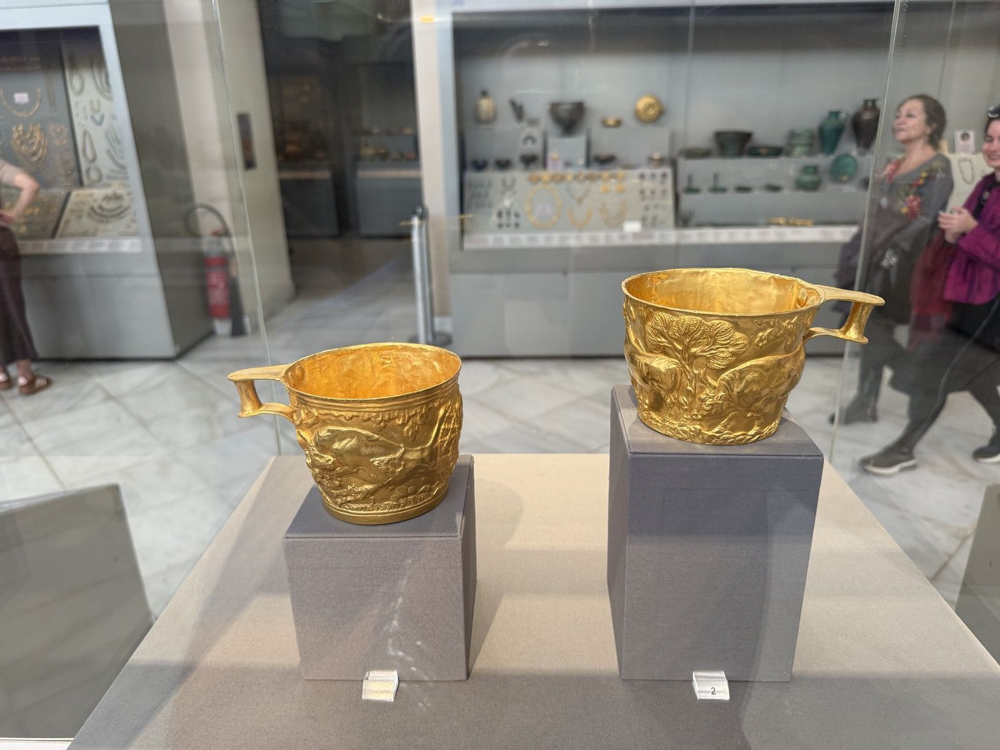
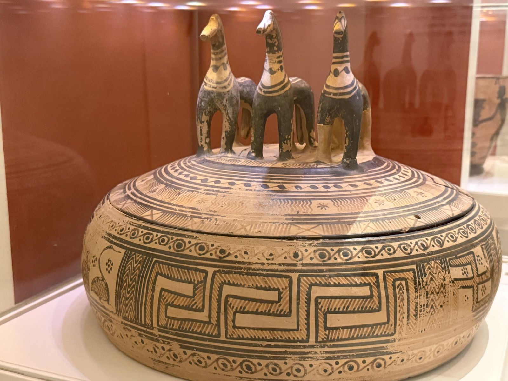
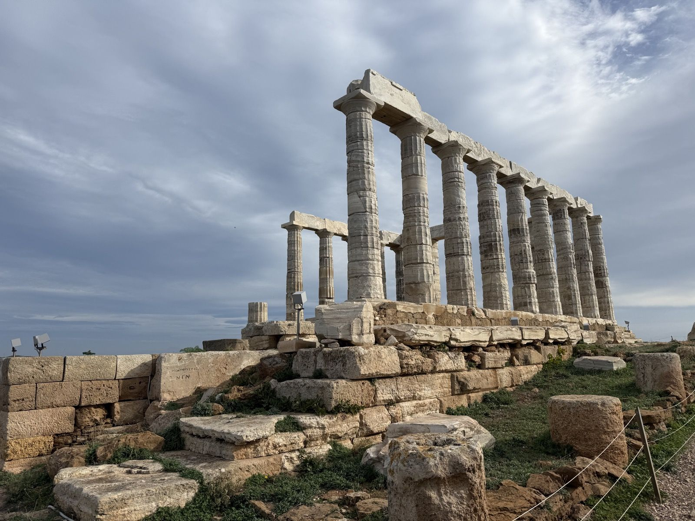
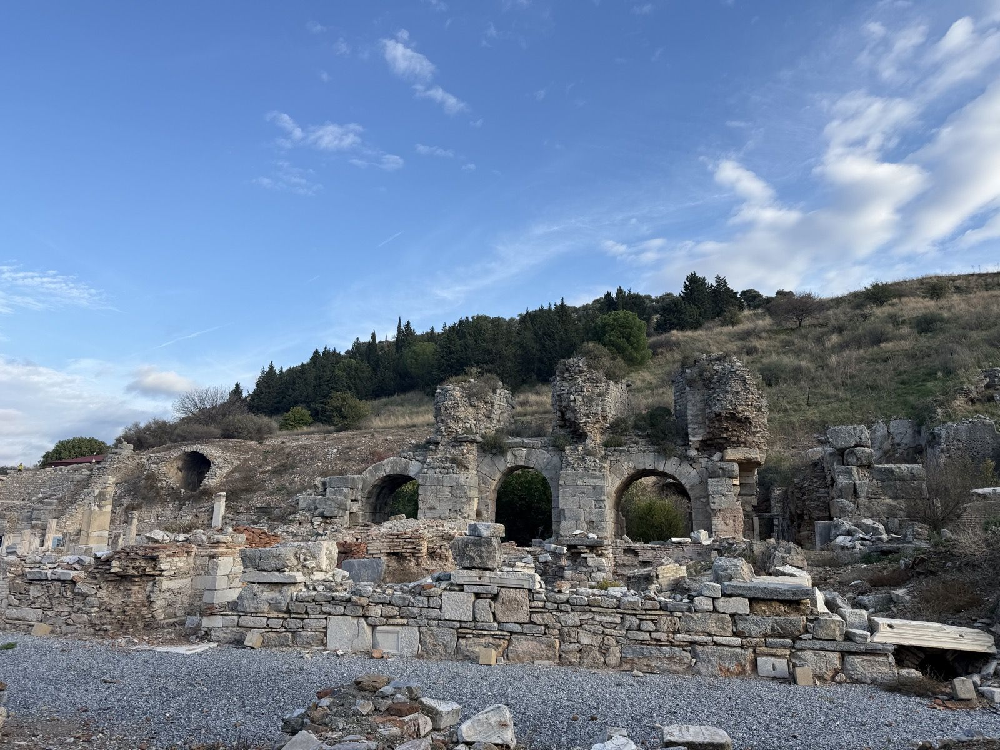
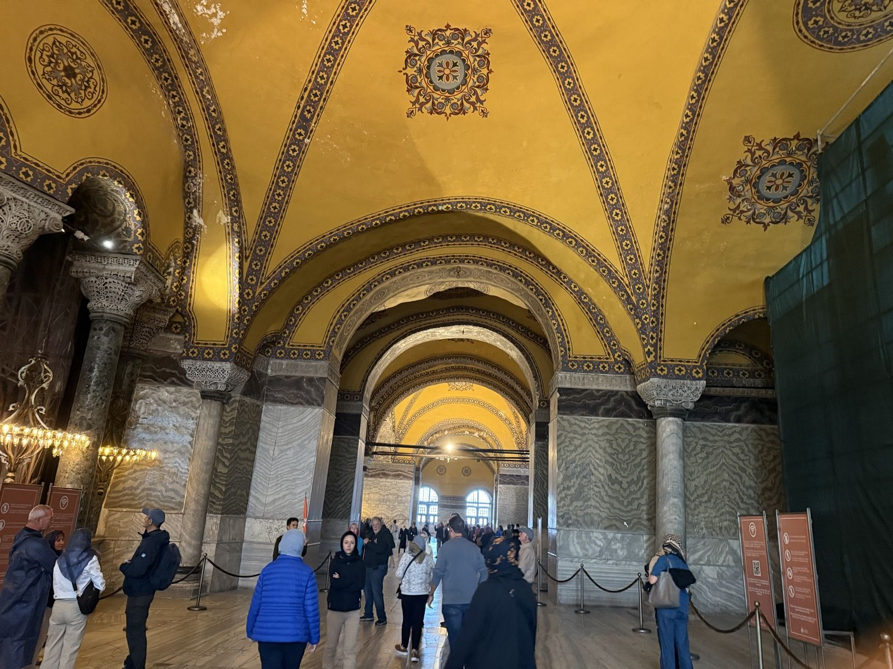
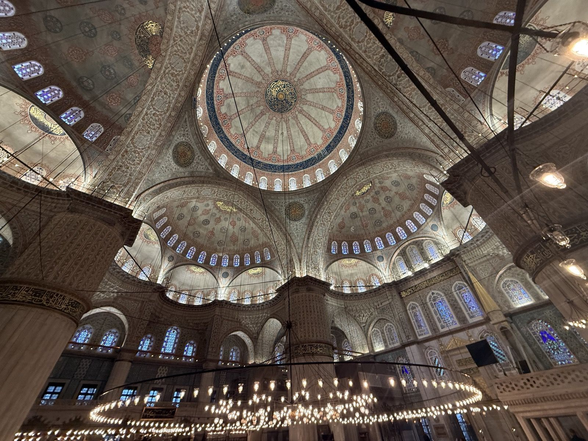

# Before We Go, Part 1: The Long Timeline of the Eastern Mediterranean

## Summary

This chapter lays out the map and the timeline for the whole trip. It places the Eastern Mediterranean, Anatolia, the Aegean, and Crete on the map, then walks the eras in order from the Bronze Age through the Archaic, Classical, Hellenistic, Roman, Byzantine, and Ottoman periods. It introduces the civilizations and faiths every later chapter builds on: the Minoans and Mycenaeans, the Greek city-states, the Roman Empire and the Pax Romana, and Judaism, Christianity, and Islam. Read it before departure; afterward we should be able to place any site on the route in its era.

## Concepts Covered

This chapter covers the following 27 concepts from the learning graph:

| Concept | Concept Impact Score |
|---------|-----------------------|
| Eastern Mediterranean | 749 |
| Historical Timeline | 881 |
| Civilization | 1600 |
| Archaeology | 183 |
| Ancient Greece | 1771 |
| Roman Empire | 1031 |
| Christianity | 288 |
| Judaism | 336 |
| Islam | 82 |
| Anatolia | 269 |
| Aegean Sea | 102 |
| Greek Islands | 100 |
| Crete | 73 |
| BCE and CE Dating | 3 |
| Bronze Age | 809 |
| Iron Age | 705 |
| Archaic Period | 692 |
| Classical Period | 690 |
| Hellenistic Period | 500 |
| Roman Period | 400 |
| Byzantine Period | 62 |
| Ottoman Period | 2 |
| City-State | 465 |
| Trade Routes | 155 |
| Minoan Civilization | 48 |
| Mycenaean Greeks | 34 |
| Pax Romana | 176 |

## Prerequisites

This chapter assumes only the prerequisites listed in the [trip description](../../course-description.md).

---

## Why Start With a Map and a Timeline

In thirteen days we will stand inside a Byzantine <audio id="audio-byzantine" src="../../audio/byzantine.mp3" preload="none"></audio><button onclick="document.getElementById('audio-byzantine').play()" class="pronounce-btn">🔊 Pronounce</button> *BIZ-un-teen* cathedral that became a mosque, walk a Roman marble street where a Greek goddess was worshipped, climb a Bronze Age palace on Crete, and look up at a temple built by the first democracy. The trouble is that the route runs backward and forward through time. Istanbul, our first stop, is mostly Byzantine and Ottoman. Troy and Knossos <audio id="audio-knossos" src="../../audio/knossos.mp3" preload="none"></audio><button onclick="document.getElementById('audio-knossos').play()" class="pronounce-btn">🔊 Pronounce</button> *NOSS-us*, in the middle of the cruise, are far older than anything in Istanbul. Classical Athens comes at the end. Without a map and a timeline in our heads, the stops blur into one long afternoon of "very old stones."

This chapter is that map and timeline. It is the longest chapter in the guide because almost every later chapter leans on it, so it is worth reading slowly, perhaps in two sittings before we fly. Everything here gets a fuller story later, at the place where it happened. The goal now is only to know where each place sits on the map and where each site sits in time.

!!! mascot-welcome "Hello, I'm Glaux"
    { class="mascot-admonition-img" }
    <audio id="audio-glaux" src="../../audio/glaux.mp3" preload="none"></audio>
    <button onclick="document.getElementById('audio-glaux').play()" class="pronounce-btn">🔊 Pronounce</button> *GLOWKS*, with the "ow" of "owl"

    I'm Glaux, a little owl, the same small owl that sat on Athena's shoulder and on every silver coin of ancient Athens. I've been watching people build on top of each other's ruins here for a very long time, and I'm still curious about who lived in each layer. On this trip I'll turn up for six jobs:

    1. **Welcome** you to each day and say why the place is worth our attention.
    2. **Think** with you when an idea changes how we see everything around it.
    3. **Tip** you off to a shortcut or a question that saves time on site.
    4. **Warn** you about a common mix-up before it trips us.
    5. **Encourage** you when a stretch of history gets tangled.
    6. **Celebrate** what you can do at the end of each chapter.

    If I'm not doing one of those six things, I'm not in the chapter. Look closer.

## Part One: The Map

Every place named in this part of the chapter is on the map below. Hover over a region, sea, or strait to see what it is and which of our stops it holds, then click each of the 12 key regions to check it off. Once all 12 are explored, try **Find the Region**, which hides the names and asks us to find each one.

#### Map: Regions of the Eastern Mediterranean

<iframe src="../../sims/eastern-med-regions-map/main.html" height="746px" width="100%" scrolling="no"></iframe>

[Run the Regions of the Eastern Mediterranean Map MicroSim Fullscreen](../../sims/eastern-med-regions-map/main.html){ .md-button .md-button--primary }

Regions of the Eastern Mediterranean Map

Type: map
**sim-id:** eastern-med-regions-map 
**Library:** D3.js 
**Status:** Built 
**Bloom Level:** Remember 
**Bloom Verb:** locate 
**Learning Objective:** The learner will locate the 12 key regions, island groups, seas, and straits of the Eastern Mediterranean on an unlabeled map, finding at least 9 of 12 on the first try.

**Key regions:** Eastern Mediterranean, Aegean Sea, Bosphorus, Dardanelles, Thrace (European Turkey), Anatolia, Ionia, Attica and Central Greece, Crete, Cyclades, Dodecanese, North Aegean Islands. Context labels: Greece, Turkey, Black Sea, Sea of Marmara, Ionian Sea, Sporades, Saronic Islands, Ionian Islands, Cyprus, the Levant, Egypt.

**Interaction:** Hover shows an infobox. In Explore mode, clicking a key region checks it off, with a confetti burst, and exploring all 12 fires a confetti cannon. Find the Region hides the key names, names any wrong choice with a hint, and reveals the answer after two misses.

**Evidence of Mastery:** First-try score in Find the Region, emitted as an xAPI `completed` statement. Each click is an `answered` statement with its attempt number.

### The Eastern Mediterranean

The **Mediterranean** is the sea almost enclosed by Europe, Asia, and Africa; its name comes from the Latin for "in the middle of the land." The **Eastern Mediterranean** is the half of that sea east of Italy and Libya, together with the lands around it: Greece and its islands, Turkey, Cyprus, the coast of Syria, Lebanon, Israel, and Palestine (often called the *Levant*), and Egypt. It is the one place on Earth where three continents come within sight, or a short sail, of one another. Istanbul itself sits on two of them.

That geography explains most of the history in this book. The Eastern Mediterranean is a crossroads. Grain, metal, wine, olive oil, ideas, alphabets, armies, and faiths all moved across it, and they moved most easily by sea. Overland travel in antiquity was slow and expensive: a cart of grain could double in price after about a hundred miles of road. A ship could carry the same grain the length of the Aegean for a fraction of that. So the cities that mattered most were the ones with good harbors at the right places on the sea lanes.

The Turks and the Greeks give the sea different names, and the names are a small lesson in point of view. In Turkish the Mediterranean is *Akdeniz*, the "White Sea," and the Black Sea is *Karadeniz*, the "Black Sea." One explanation is an old Turkic habit of naming directions by color, with white for the west and black for the north. In Greek the Mediterranean is simply *Mesógeios*, the "middle of the earth." Each name puts its speakers at the center.

**Worked example: three continents in one trip.** Let's place our stops by continent. Istanbul is split by the Bosphorus <audio id="audio-bosphorus" src="../../audio/bosphorus.mp3" preload="none"></audio><button onclick="document.getElementById('audio-bosphorus').play()" class="pronounce-btn">🔊 Pronounce</button> *BOS-fer-us* strait: our hotel and the old city are in Europe, and the ferry to Kadıköy lands in Asia. Çanakkale <audio id="audio-canakkale" src="../../audio/canakkale.mp3" preload="none"></audio><button onclick="document.getElementById('audio-canakkale').play()" class="pronounce-btn">🔊 Pronounce</button> *chah-NAHK-kah-leh*, Kuşadası <audio id="audio-kusadasi" src="../../audio/kusadasi.mp3" preload="none"></audio><button onclick="document.getElementById('audio-kusadasi').play()" class="pronounce-btn">🔊 Pronounce</button> *koo-SHAH-dah-suh*, and Ephesus <audio id="audio-ephesus" src="../../audio/ephesus.mp3" preload="none"></audio><button onclick="document.getElementById('audio-ephesus').play()" class="pronounce-btn">🔊 Pronounce</button> *EF-uh-sus* are in Asia, on the western edge of Turkey. Rhodes lies in Europe politically, as part of Greece, but it is only about 18 km from the Turkish coast. Crete is in Europe, yet its south coast is only about 300 km from Libya, in Africa. Athens and Delphi are in mainland Europe. The point is not the labels. The point is that the "continents" here are a few hours apart by boat, which is why this one sea held so many different peoples together.

The map below follows our cruise from Istanbul to Athens and the day trip to Delphi. Click each port to see its date, its key sights, and a tip for the day.

<iframe src="../../sims/viking-cruise-map/main.html" width="100%" height="644px" scrolling="no"></iframe>

[Run the Viking Cruise Map fullscreen](../../sims/viking-cruise-map/main.html){ .md-button }

The countries and regions we will pass through, in the order we meet them, are summarized here.

| Region | Modern country | Our stops | Continent |
|---|---|---|---|
| Thrace and the Bosphorus | Turkey | Istanbul (European side) | Europe |
| Anatolia | Turkey | Istanbul (Asian side), Çanakkale, Kuşadası, Ephesus | Asia |
| Dodecanese islands | Greece | Rhodes | Europe (by politics) |
| Crete | Greece | Heraklion, Knossos | Europe (by politics) |
| Attica and central Greece | Greece | Athens, Piraeus, Delphi | Europe |

### Anatolia

**Anatolia** <audio id="audio-anatolia" src="../../audio/anatolia.mp3" preload="none"></audio><button onclick="document.getElementById('audio-anatolia').play()" class="pronounce-btn">🔊 Pronounce</button> *an-uh-TOH-lee-uh* is the great peninsula of land that makes up the Asian part of Turkey, about 97 percent of the country. Its name comes from the Greek *anatolē*, "sunrise," because to Greeks it was the land toward the rising sun; the Turkish name, *Anadolu*, comes from the same word. Older books call it **Asia Minor**, "lesser Asia." It is bordered by the Black Sea to the north, the Aegean to the west, and the Mediterranean to the south. Its center is a high, dry plateau around 1,000 meters above sea level, cold in winter, ringed by mountains. Its western coast is the opposite: green river valleys that open onto deep bays and sheltered harbors.

That western coast matters enormously for us. In the minds of many travelers, "ancient Greece" means the country of Greece. But some of the most important Greek cities were in Anatolia. Troy guarded the entrance to the Dardanelles <audio id="audio-dardanelles" src="../../audio/dardanelles.mp3" preload="none"></audio><button onclick="document.getElementById('audio-dardanelles').play()" class="pronounce-btn">🔊 Pronounce</button> *dar-duh-NELZ*. Ephesus and Miletus <audio id="audio-miletus" src="../../audio/miletus.mp3" preload="none"></audio><button onclick="document.getElementById('audio-miletus').play()" class="pronounce-btn">🔊 Pronounce</button> *my-LEE-tus* were among the largest Greek cities in the world. Greek philosophy began in this region, called **Ionia** <audio id="audio-ionia" src="../../audio/ionia.mp3" preload="none"></audio><button onclick="document.getElementById('audio-ionia').play()" class="pronounce-btn">🔊 Pronounce</button> *eye-OH-nee-uh*, with thinkers like Thales of Miletus, around 600 BCE. Homer may have been an Ionian Greek.

Anatolia was never only Greek, though. It has been a land of many peoples for thousands of years. Before the Greeks, the **Hittites** ruled a Bronze Age empire from central Anatolia. Later came the Phrygians, whose King Midas lives on in legend, and the Lydians, whose King Croesus <audio id="audio-croesus" src="../../audio/croesus.mp3" preload="none"></audio><button onclick="document.getElementById('audio-croesus').play()" class="pronounce-btn">🔊 Pronounce</button> *KREE-sus* was so rich that "rich as Croesus" is still an English phrase. Persians, Macedonians, Romans, Byzantines, Seljuk Turks, and Ottomans followed. Today Anatolia is the heartland of the Turkish Republic, home to most of Turkey's roughly 85 million people.

**Worked example: "Is Ephesus Greek or Turkish?"** We'll hear both answers on Day 7, and both are correct for different questions. If we ask *where is it now*, Ephesus is in Turkey, near the town of Selçuk <audio id="audio-selcuk" src="../../audio/selcuk.mp3" preload="none"></audio><button onclick="document.getElementById('audio-selcuk').play()" class="pronounce-btn">🔊 Pronounce</button> *SEL-chook*. If we ask *who founded it*, Greek settlers did, around the 10th century BCE, on land already lived on by Anatolian peoples. If we ask *who built most of what we see*, it was Romans, mostly in the 1st and 2nd centuries CE. If we ask *who protects it now*, it is the Turkish state and Austrian and Turkish archaeologists. A careful traveler names the question before choosing the answer. The table below shows how many hands have held the Anatolian stops on our route.

| Stop | Greek city? | Roman city? | Byzantine city? | Ottoman city? | Today |
|---|---|---|---|---|---|
| Istanbul (Byzantium) | Yes, from c. 657 BCE | Yes | Capital, 330–1453 | Capital, 1453–1922 | Turkey's largest city |
| Troy (Ilion) | Yes, after c. 700 BCE | Yes (Ilium) | Faded away | Ruins | Turkish national park |
| Ephesus | Yes, from c. 1000 BCE | Capital of the province of Asia | Yes, a church center | Village of Ayasuluk (Selçuk) | Turkish archaeological site |

### The Aegean Sea

The **Aegean Sea** is the arm of the Mediterranean between Greece and Turkey. It covers about 214,000 square kilometers, a little smaller than the island of Great Britain, and it is crowded with islands. To the north, a narrow channel called the **Dardanelles** (the ancient *Hellespont*) leads to the small Sea of Marmara, and from there the even narrower **Bosphorus** runs past Istanbul to the Black Sea. These two straits are the only sea passage between the Black Sea and the rest of the world. Whoever held them could tax, feed, or starve the cities on either side.

Greek myth explains the name with a sad story. King Aegeus of Athens watched for the return of his son Theseus, who had sailed to Crete to fight the Minotaur. Theseus forgot to change his black sail to a white one as a signal of victory, and Aegeus, thinking his son dead, threw himself into the sea. It is a myth, but it already links Athens, Crete, and the sea in a single tale, which is exactly how the ancient Greeks experienced the Aegean.

Sailors loved and feared this sea. It is full of islands, so on a clear day a ship is rarely out of sight of land, and early sailors could hop from island to island without charts or compasses. That made it a natural nursery for seafaring and trade. But winter storms are real. The Roman writer Vegetius, around 400 CE, said that the seas were "closed" from November 11 to March 10, and most ancient shipping waited out those months in port.

**Worked example: our trip and the closed sea.** We fly into Istanbul on Wednesday, November 11, 2026, which is exactly the day Vegetius said the sailing season ended. Our cruise sails from November 14 to 21, the first week of the "closed" season. A modern ship with radar and stabilizers can do what an ancient merchant would have refused to try. That gives us a useful question to ask at every harbor: *when, in the year, could this place actually be reached?* The answer explains why ancient festivals, wars, and trading fairs clustered in the summer, and why Paul's letters sometimes say he will wait for spring.

The table summarizes the Aegean's key waterways, all of which we will pass through or near.

| Waterway | Connects | Length | Why it mattered |
|---|---|---|---|
| Bosphorus | Black Sea to Sea of Marmara | About 31 km | Istanbul grew up on it; tolls on passing ships |
| Sea of Marmara | Bosphorus to Dardanelles | About 280 km long | A protected inland sea |
| Dardanelles (Hellespont) | Sea of Marmara to Aegean | About 61 km | Troy and Gallipoli guard its mouth |
| Aegean Sea | Dardanelles to the open Mediterranean | About 214,000 km² | Island-hopping routes between Greece and Anatolia |

### The Greek Islands

The **Greek Islands** are the thousands of islands that belong to Greece, most of them in the Aegean. Greece counts roughly 6,000 islands and islets, but only a little over 200 have people living on them. Geographers sort them into groups, and the group names appear on ferry schedules, museum labels, and menus.

The groups follow the shape of the sea. The **Cyclades** <audio id="audio-cyclades" src="../../audio/cyclades.mp3" preload="none"></audio><button onclick="document.getElementById('audio-cyclades').play()" class="pronounce-btn">🔊 Pronounce</button> *SIK-luh-deez* form a rough circle around the tiny holy island of Delos; Santorini and Mykonos are Cycladic. The **Dodecanese** <audio id="audio-dodecanese" src="../../audio/dodecanese.mp3" preload="none"></audio><button onclick="document.getElementById('audio-dodecanese').play()" class="pronounce-btn">🔊 Pronounce</button> *doh-dek-uh-NEEZ*, "twelve islands," lie along the Turkish coast in the southeast; Rhodes is the largest. The **North Aegean** islands, such as Lesbos, Chios, and Samos, also sit just off Turkey. The **Sporades** lie off the mainland to the northwest. **Crete** stands alone at the southern edge of the Aegean, so large that it is usually treated as its own region. The **Ionian** islands, such as Corfu, are on the other side of Greece, in the Ionian Sea, and we will not see them.

Not every island near Greece is Greek. Two islands near Çanakkale, Gökçeada (Imbros) and Bozcaada (Tenedos), belong to Turkey. And not every Greek island has been Greek for long. The Dodecanese, Rhodes included, were ruled by the Ottomans until 1912, then by Italy, and were handed to Greece only in 1947, with formal union in 1948. Their streets carry Ottoman fountains, Italian administrative buildings, and Greek churches side by side.

**Worked example: placing Rhodes.** Suppose we see a museum label in Rhodes that says "Dodecanese, Italian period, 1936." We can unpack it with the island groups: Rhodes is the chief island of the Dodecanese, which lies off the southwest corner of Turkey, which explains why Rhodes was a natural stepping stone between Anatolia and Egypt. "Italian period" tells us the building is from the 1912–1943 Italian occupation, a layer that most visitors mistake for something medieval. One label, read with a map in mind, places the object in space and time.

| Island group | Where | Islands we might hear about | Our stop |
|---|---|---|---|
| Cyclades | Center of the Aegean, around Delos | Santorini, Mykonos, Naxos, Delos | None, but Santorini's Bronze Age eruption matters to Crete |
| Dodecanese | Southeast, along the Turkish coast | Rhodes, Kos, Patmos | Rhodes (Day 8) |
| North Aegean | Northeast, off Turkey | Lesbos, Chios, Samos | Passed at sea |
| Crete | Southern edge of the Aegean | Crete | Heraklion and Knossos (Day 9) |
| Saronic | Near Athens | Aegina, Salamis | Salamis is visible from Piraeus |

### Crete

**Crete** is the largest Greek island and the fifth largest in the Mediterranean. It is about 260 km long and rarely more than 60 km wide, a long mountainous wall at the southern edge of the Aegean. Its highest peak, Psiloritis (the ancient Mount Ida), rises to 2,456 meters and often wears snow in late November. About 620,000 people live on Crete today, around a quarter of them in Heraklion <audio id="audio-heraklion" src="../../audio/heraklion.mp3" preload="none"></audio><button onclick="document.getElementById('audio-heraklion').play()" class="pronounce-btn">🔊 Pronounce</button> *heh-RAH-klee-on*, the port where we will dock.

Crete's position made it a prize. It sits on the sea lane between Greece, Anatolia, Egypt, and the Levant, so whoever held its harbors could watch the traffic of the whole eastern sea. As a result, the island has passed through more hands than almost any place on our route. The list of its rulers is itself a summary of this chapter.

| Period | Who ruled Crete | What remains near Heraklion |
|---|---|---|
| c. 3100–1450 BCE | Minoans | The palace of Knossos |
| c. 1450–1100 BCE | Mycenaean Greeks | Linear B tablets in the Heraklion museum |
| c. 1100–67 BCE | Greek city-states (Dorian Greeks) | Inscriptions and small temples |
| 67 BCE–4th century CE | Rome | The Roman capital at Gortyn, in the south |
| 4th century–820s CE | Byzantine Empire | Churches |
| 820s–961 CE | Arab emirate | Few traces; Heraklion's name *Candia* comes from the Arab *Khandaq*, "moat" |
| 961–1204 CE | Byzantine Empire again | Churches and icons |
| 1211–1669 CE | Venice | The harbor fortress (Koules) and the city walls |
| 1669–1898 CE | Ottoman Empire | Fountains and converted mosques |
| 1898–1913 CE | Autonomous Cretan State | Government buildings |
| 1913–today | Greece | The modern city |

**Worked example: two eras five kilometers apart.** On Day 9 we will spend the morning at Knossos and the afternoon in the old center of Heraklion, about 5 km apart. The table lets us predict what we will see. Knossos belongs to the first row, so it is roughly 3,500 to 4,000 years old. The walls and harbor fort of Heraklion belong to the Venetian row, so they are about 400 to 500 years old. Between the two, the island changed rulers at least eight times. When a Cretan tells us that Crete has "always been invaded," this table is what they mean, and it helps explain the island's fierce sense of its own identity.

## Part Two: How We Know

### Civilization

Before walking the eras, we need two ideas that the rest of the book uses constantly. The first is **civilization**. In everyday speech "civilized" means polite or advanced, and that meaning carries a judgment about who counts. Historians use the word in a narrower, more neutral sense: a **civilization** is a complex society built around cities, in which a food surplus supports people in specialized jobs, a government organizes large projects, people keep written or systematic records, and monumental buildings express shared beliefs.

That definition is a checklist, not a ranking. A society without cities can have rich art, music, medicine, and moral wisdom. What a civilization has is *scale*: enough organized people and stored food to build a palace, field an army, or keep accounts for thousands of households. The five features usually come together because each makes the others possible. A food surplus frees potters, scribes, and priests from farming. Specialists need someone to coordinate them. Coordination needs records. Records and a surplus make it possible to raise temples and palaces, which in turn proclaim who is in charge.

Before we try the checklist on real places, here is what each feature looks like in the ground, so we know what to look for at a site.

| Feature | What archaeologists find |
|---|---|
| Cities | Dense housing, streets, defensive walls |
| Food surplus and specialists | Storerooms, giant storage jars, workshops for pottery and metal |
| Government | Palaces, seals, administrative buildings |
| Records | Clay tablets, inscriptions, seal impressions |
| Monumental building and shared beliefs | Temples, shrines, tombs, large public spaces |

**Worked example: Çatalhöyük and Knossos.** Let's score two Anatolian and Cretan places against the checklist. Çatalhöyük, on the Anatolian plateau, was a large town of several thousand people from about 7100 to 5700 BCE. It had dense housing (yes), stored grain (partly), shrines and wall paintings (partly), but no palace, no writing, and little sign of specialized classes or a ruler. Most historians call it a remarkable early town, not a civilization. Knossos, around 1700 BCE, had a town of thousands around a palace (yes), huge storerooms with jars taller than a person (yes), a ruling palace administration (yes), clay tablets in the Linear A script (yes), and grand halls and shrines (yes). Knossos passes all five, which is why the Minoans <audio id="audio-minoan" src="../../audio/minoan.mp3" preload="none"></audio><button onclick="document.getElementById('audio-minoan').play()" class="pronounce-btn">🔊 Pronounce</button> *mih-NOH-un* are often called Europe's first civilization. Notice that the checklist says nothing about which society was wiser or happier.

!!! mascot-thinking "Civilization Is a Shape, Not a Grade"
    { class="mascot-admonition-img" }
    Think of "civilization" as a description of how a society is organized, like "city" or "village," not as a score of how good its people were. A palace with scribes and storerooms tells us a few people were collecting a lot from many others. Who lived here, and who did the carrying?

### Archaeology

The second tool is **archaeology**, the study of the human past through the physical things people left behind: buildings, tools, pottery, bones, seeds, and the soil around them. Written history tells us what some people chose to record. Archaeology tells us about everyone, including the farmers, slaves, and children who never wrote anything.

The most important idea in archaeology is **stratigraphy**, the study of layers. When people live in one place for a long time, they build on the rubble of earlier buildings, and the ground slowly rises. Each layer, or *stratum*, holds the remains of one period, and in undisturbed ground the deeper layers are older. Digging down is like reading a book backward, from the last page to the first. Archaeologists date layers in several ways: by the style of pottery found in them, since pottery styles changed quickly and were widely traded; by **radiocarbon dating**, which measures the slow decay of carbon in once-living material like seeds and charcoal; by tree rings in surviving timbers; and by coins and inscriptions in later periods.

Archaeology is also a human activity with its own history, and two of the most famous excavators worked on our route. Heinrich Schliemann <audio id="audio-schliemann" src="../../audio/schliemann.mp3" preload="none"></audio><button onclick="document.getElementById('audio-schliemann').play()" class="pronounce-btn">🔊 Pronounce</button> *SHLEE-mahn*, a wealthy German businessman, began digging at Troy in 1871, determined to find Homer's city. Arthur Evans, a British archaeologist, began excavating Knossos in 1900 and rebuilt parts of the palace in reinforced concrete. Both made spectacular discoveries. Both also made mistakes that later archaeologists still argue about, and both shape what we will see.

**Worked example: reading the layers at Troy.** Troy is the classic case of stratigraphy, and on Day 6 we will walk through a cut in the mound where the layers show. Archaeologists number the cities from the bottom up, Troy I through Troy IX.

| Layer | Approximate dates | What it was |
|---|---|---|
| Troy I–II | c. 3000–2300 BCE | Early Bronze Age citadels; Troy II held "Priam's Treasure" |
| Troy III–V | c. 2300–1750 BCE | Smaller settlements |
| Troy VI | c. 1750–1300 BCE | A large, wealthy Late Bronze Age city with fine walls |
| Troy VIIa | c. 1300–1180 BCE | Rebuilt city destroyed by fire; a leading candidate for Homer's Troy |
| Troy VIIb | c. 1180–950 BCE | Poorer settlements after the destruction |
| Troy VIII | c. 950–85 BCE | The Greek city of Ilion |
| Troy IX | c. 85 BCE–500 CE | The Roman city of Ilium |

Now we can see Schliemann's famous error. He dug a huge trench straight down toward what he assumed were the deepest, oldest layers, believing Homer's Troy would be there. He found a hoard of gold and called it "Priam's Treasure," after Homer's king of Troy. But the hoard came from Troy II, about a thousand years before any plausible date for the Trojan War, and his trench destroyed parts of the very layers, Troy VI and VII, that were closer to Homer's world. The lesson for us as visitors: when a guide says "this is the Troy of the *Iliad*," the honest answer is "this layer might be."

!!! mascot-tip "Ask Which Layer"
    { class="mascot-admonition-img" }
    At any ruin, ask the guide one question: "Which layer are we standing on, and what is underneath?" It turns a pile of stones into a sequence, and guides usually love answering it.

## Part Three: The Timeline

### The Historical Timeline

A **historical timeline** is a line that places events and periods in the order they happened, spaced according to how much time lay between them. Its value is less in any single date than in proportion: seeing that one period lasted two thousand years and another fewer than two hundred. Historians also divide long stretches of time into named **periods**, or eras, such as the Bronze Age or the Classical period. A period name is a label of convenience. People living through it did not know they were "Hellenistic"; scholars chose the names later to group centuries that share a style of art, a kind of government, or a technology.

This chapter uses nine periods for the Eastern Mediterranean, from the start of the Bronze Age to today. The dates are rounded and, as we will see, the boundaries shift from place to place. But they give us a shared timeline. Eight of the nine get their own sections below; the ninth, the modern era, belongs to later chapters.

The hardest thing about this timeline is its length. More than five thousand years separate the first Bronze Age villages from our trip, and our minds are not built to feel that span. One useful trick is to squeeze it into a single day.

**Worked example: five thousand years on a 24-hour clock.** From 3200 BCE to 2026 CE is 5,225 years. (We subtract one because there was no year zero, a point the next section explains.) If those 5,225 years were one day starting at midnight, each hour would hold about 218 years, and each minute about 3.6 years. Here is where each period falls.

| Period | Dates used in this guide | Length in years | On the 24-hour clock |
|---|---|---|---|
| Bronze Age | c. 3200–1100 BCE | 2,100 | Midnight to 9:39 AM |
| Iron Age | c. 1100–800 BCE | 300 | 9:39 AM to 11:01 AM |
| Archaic Period | c. 800–480 BCE | 320 | 11:01 AM to 12:30 PM |
| Classical Period | 480–323 BCE | 157 | 12:30 PM to 1:13 PM |
| Hellenistic Period | 323–31 BCE | 292 | 1:13 PM to 2:33 PM |
| Roman Period | 31 BCE–330 CE | 360 | 2:33 PM to 4:13 PM |
| Byzantine Period | 330–1453 CE | 1,123 | 4:13 PM to 9:22 PM |
| Ottoman Period | 1453–1922 CE | 469 | 9:22 PM to 11:31 PM |
| Modern era | 1922–2026 CE | 104 | 11:31 PM to midnight |

Two things jump out. The Bronze Age fills the whole morning, while the Classical period, the age of the Parthenon and Socrates that most people mean by "ancient Greece," lasts only 43 minutes of the afternoon. And the Byzantine period, which many travelers have barely heard of, takes more than five hours of the evening. One more comparison: when Pericles built the Parthenon in 447 BCE, the first palace at Knossos (c. 1900 BCE) was about 1,450 years old. That is roughly how old Hagia Sophia <audio id="audio-hagia-sophia" src="../../audio/hagia-sophia.mp3" preload="none"></audio><button onclick="document.getElementById('audio-hagia-sophia').play()" class="pronounce-btn">🔊 Pronounce</button> *HAH-yuh soh-FEE-uh* (537 CE) is to us.

The timeline below draws these nine periods to scale and nothing else, so the lengths of the bands are the one thing to look at. Before reading the descriptions, try to answer its six questions; each one tests a sense of proportion that the 24-hour clock just built. Once the eras feel familiar, the [Timeline of Events](../../appendices/timeline-of-events.md) appendix adds 29 events on our route to the same scale.

#### Diagram: Eras of the Eastern Mediterranean Timeline

<iframe src="../../sims/eastern-med-eras-timeline/main.html" height="444px" width="100%" scrolling="no"></iframe>

[Run the Eras of the Eastern Mediterranean Timeline MicroSim Fullscreen](../../sims/eastern-med-eras-timeline/main.html){ .md-button .md-button--primary }

Eras of the Eastern Mediterranean Timeline

Type: timeline
**sim-id:** eastern-med-eras-timeline 
**Library:** vis-timeline 
**Status:** Built 
**Bloom Level:** Understand 
**Bloom Verb:** compare 
**Learning Objective:** The learner will compare the order and length of the nine periods of Eastern Mediterranean history by answering six proportion questions before the answers are revealed, scoring at least 5 of 6.

**Prerequisites:** historical timeline, period (era), BCE and CE dating, no year zero, and the names of the nine periods (all defined in "The Historical Timeline" and "BCE and CE Dating" above).

**Evidence of Mastery:** The learner commits an answer to each of six multiple-choice questions before the timeline highlights the relevant bands and shows their lengths. An answer is correct when it matches the answer column in Content. Mastery is 5 of 6 correct on the first attempt. Panning the timeline and clicking bands to read their descriptions are exploration, not evidence.

**Misconceptions:** (1) The Classical period was long because it is famous. (2) The Byzantine period was a short epilogue to Rome. (3) Spans across the BCE/CE line are found by subtracting the two numbers. (4) Writing in Greece was continuous from the Bronze Age onward.

**Instructional Rationale:** An Understand-level comparison of durations needs the learner to commit a judgment of proportion and then see it checked against a to-scale display. Asking before revealing turns the timeline from a picture into a test of the learner's mental model, and the infoboxes supply the explanation that makes the correction stick. Events are left out so that nothing competes with the band lengths; one or two sites per period appear only in the infobox, and the full set of events is a separate appendix MicroSim (eastern-med-events-timeline).

**Content:**

Period bands (shown to scale; BCE dates as negative years), with the sites on our route named in each band's infobox:

| # | Period | Start | End | One-line description | On our route |
|---|---|---|---|---|---|
| 1 | Bronze Age | c. 3200 BCE | c. 1100 BCE | Tools of bronze; palaces, scribes, and long-distance metal trade; Minoans, Mycenaeans, Hittites, and Troy. | First palace at Knossos (c. 1900 BCE); Troy VI (c. 1750–1300 BCE) |
| 2 | Iron Age | c. 1100 BCE | c. 800 BCE | After the palaces fell; iron replaces bronze; writing disappears from Greece. | Greek speakers settle Ionia, the coast around Ephesus |
| 3 | Archaic Period | c. 800 BCE | 480 BCE | The alphabet, Homer, city-states, colonies, the first coins, and the first democracy. | First Olympic Games (776 BCE); Byzantium founded (c. 657 BCE) |
| 4 | Classical Period | 480 BCE | 323 BCE | From the Persian Wars to Alexander's death: Athens's Parthenon, theater, and philosophy. | The Parthenon (447–432 BCE) |
| 5 | Hellenistic Period | 323 BCE | 31 BCE | Alexander's successor kingdoms spread Greek language and culture from Egypt to Afghanistan. | Colossus of Rhodes (c. 280 BCE) |
| 6 | Roman Period | 31 BCE | 330 CE | Rome rules the whole Mediterranean; the Pax Romana; Christianity spreads. | Paul in Ephesus (c. 52–55 CE) |
| 7 | Byzantine Period | 330 CE | 1453 CE | The Christian, Greek-speaking Roman Empire ruled from Constantinople. | Hagia Sophia (537 CE) |
| 8 | Ottoman Period | 1453 CE | 1922 CE | The Ottoman Empire rules from Istanbul over a multi-faith population. | Topkapı Palace begun (1459 CE) |
| 9 | Modern era | 1922 CE | 2026 CE | The Republic of Turkey and modern Greece. | Republic of Turkey founded (1923 CE) |

Questions, in fixed order:

| # | Question | Choices | Correct | Why (shown as feedback) |
|---|---|---|---|---|
| 1 | Which lasted longer: the Bronze Age or the Classical period? | Bronze Age; Classical Period | Bronze Age | The Bronze Age lasted about 2,100 years; the Classical period lasted 157 years. |
| 2 | About how much of the whole timeline, 3200 BCE to 2026 CE, does the Bronze Age fill? | About a tenth; About a quarter; About two-fifths; About three-quarters | About two-fifths | The Bronze Age lasted about 2,100 of the 5,225 years, or about 40 percent: the whole morning on the 24-hour clock. |
| 3 | Which lasted longer: the Byzantine period or the Ottoman period? | Byzantine Period; Ottoman Period | Byzantine Period | The Byzantine period lasted 1,123 years (330–1453); the Ottoman period in Istanbul lasted 469 years (1453–1922). |
| 4 | Which lasted longer: the Classical, Hellenistic, and Roman periods put together, or the Byzantine period alone? | Classical + Hellenistic + Roman; Byzantine alone | Byzantine alone | 157 + 292 + 360 = 809 years for the three together, against 1,123 years for the Byzantine period alone. |
| 5 | The Roman period ran from 31 BCE to 330 CE. How many years is that? | 299; 330; 360; 361 | 360 | Across the BCE/CE line we add the two numbers and subtract one, because there was no year zero: 31 + 330 − 1 = 360. |
| 6 | In which period was writing almost unknown in Greece? | Bronze Age; Iron Age; Archaic Period; Hellenistic Period | Iron Age | After the palaces fell around 1200–1100 BCE, Linear B was forgotten; Greeks did not write again until they adopted the alphabet around 800 BCE. |

**Provenance:** Period boundaries and site dates are from this chapter's sections "The Historical Timeline" through "The Ottoman Period," which use conventional rounded dates. Durations are computed from the Rules.

**Rules:** Duration of a span that crosses from BCE to CE = BCE year + CE year − 1. Duration of a span within BCE = earlier year − later year. Duration within CE = later year − earlier year. All "c." dates are displayed with "c." and treated as their stated number for calculations. Period bands are shown to scale and do not overlap; the chapter's note that boundaries differ by place is shown in each band's infobox as "Boundaries vary by place; see the chapter." The learner can zoom from the full span (3200 BCE–2026 CE) to a 200-year window and back.

**Learner Activity:**

1. The learner sees the full timeline with the nine period bands labeled and question 1 shown.
2. The learner chooses an answer. The bands named in the question are highlighted, their durations are shown, the timeline zooms to them, and the feedback appears.
3. The learner presses Next; the view returns to the full span and the next question appears.
4. After question 6, the learner can click any band to read its dates, length, description, and the sites on our route from that period.
5. The learner should notice that the morning-long Bronze Age and the evening-long Byzantine period dwarf the famous Classical period.

**Feedback:** Six questions in fixed order, one attempt each. Correct: "Correct." followed by the Why text. Incorrect: "Not quite." followed by the Why text. The correct answer is shown after every answer. A running score "Correct: n of 6" is shown, and at the end "5 or more: you have the timeline" or "Fewer than 5: reread the 24-hour clock table, then try again"; a Restart button clears the score.

**Starting State:** The nine period bands on one screen, from 3200 BCE to 2026 CE, with question 1: "Which lasted longer: the Bronze Age or the Classical period?"

**Chapter Anchors:** 3200 BCE to 2026 CE is 5,225 years. Bronze Age 2,100 years (about 40 percent of the timeline); Classical period 157 years; Hellenistic period 292 years; Roman period 360 years (31 + 330 − 1); Byzantine period 1,123 years; Ottoman period 469 years.

### BCE and CE Dating

**BCE** means "Before the Common Era" and **CE** means "Common Era." They are the same years as the older labels **BC** ("Before Christ") and **AD** (*Anno Domini*, "in the year of the Lord"), renamed so that people of every faith can use them. Years BCE count *down* toward the start of the era, so 480 BCE came before 399 BCE. Years CE count *up*. There is no year zero: 1 BCE is followed directly by 1 CE.

That missing zero matters when we measure a span across the line. From 480 BCE to 2026 CE is not 480 + 2026 = 2,506 years but 2,505, because we add the two numbers and subtract one. The same rule gave us the 5,225 years in the 24-hour clock.

It also helps to remember that this is only one calendar among several on our route. In November 2026 the Hebrew calendar is in the year 5787, and the Islamic calendar, which counts from Muhammad's journey to Medina in 622 CE, is in the year 1448.

!!! mascot-warning "Signs Use Other Letters"
    { class="mascot-admonition-img" }
    Site signs rarely say BCE. In Turkey look for **MÖ** (*Milattan Önce*, "before the birth," meaning BC) and **MS** (*Milattan Sonra*, AD); in Greece, **π.Χ.** (BC) and **μ.Χ.** (AD). Mixing them up flips a date by centuries, so check the letters before you trust the number.

## Part Four: Walking the Eras

Nine periods in a row is a lot to carry, and the names are easy to mix up on a first reading. The sections below take them one at a time, each with a story we can attach the dates to.

!!! mascot-encourage "One Era at a Time"
    { class="mascot-admonition-img" }
    If the periods start to blur, that is normal; most people need two passes. Hang each era on one place we will actually visit, Knossos for the Bronze Age, the Parthenon for the Classical period, Hagia Sophia for the Byzantine, and the dates will follow the places.

### The Bronze Age

The **Bronze Age** is the period when the most important tools and weapons were made of **bronze**, a metal made by melting together about nine parts copper and one part tin. In the Aegean it lasted from about 3200 BCE to about 1100 BCE. Bronze is harder than copper and holds a sharper edge, and it can be cast in molds, so it changed farming, carpentry, and especially war. But bronze had a built-in problem. Copper was fairly common; Cyprus was so famous for it that the Latin word for copper, *cuprum*, comes from the island's name. Tin was rare, and much of it came from very far away, perhaps as far as Central Asia. Making bronze meant joining a trade network that stretched across the known world.

That network built the first civilizations of our route. Great kingdoms ruled the Bronze Age Eastern Mediterranean: Egypt, the Hittites in Anatolia, city-kingdoms in the Levant, and, around the Aegean, the Minoans on Crete, the Mycenaean Greeks <audio id="audio-mycenaean" src="../../audio/mycenaean.mp3" preload="none"></audio><button onclick="document.getElementById('audio-mycenaean').play()" class="pronounce-btn">🔊 Pronounce</button> *my-suh-NEE-un* on the mainland, and the city of Troy. Their kings wrote letters to one another, calling each other "brother," and exchanged gifts of gold, horses, and fine cloth. Their palaces employed scribes who kept accounts on clay tablets.

**Worked example: the Uluburun shipwreck.** In 1982 a Turkish sponge diver named Mehmet Çakır reported strange "metal biscuits with ears" on the seabed off Uluburun <audio id="audio-uluburun" src="../../audio/uluburun.mp3" preload="none"></audio><button onclick="document.getElementById('audio-uluburun').play()" class="pronounce-btn">🔊 Pronounce</button> *oo-loo-boo-ROON*, near the town of Kaş on Turkey's southern coast. They turned out to be copper ingots from a merchant ship that sank around 1300 BCE. Over eleven seasons, archaeologists raised about 10 tons of copper, mostly in the form of 354 flat "oxhide" ingots, and about 1 ton of tin. Let's read that cargo as evidence. Ten tons of copper to one ton of tin is a ratio of 10 to 1, almost exactly the recipe for bronze. This was a floating bronze kit, enough to make about 11 tons of bronze, perhaps thousands of weapons and tools. The ship also carried glass ingots, African ebony, hippopotamus ivory, Canaanite jars of resin, and a gold scarab with the name of the Egyptian queen Nefertiti. One small ship carried goods from at least seven cultures. Its remains are in the Bodrum Museum of Underwater Archaeology, and the ship tells us more about Bronze Age trade than any written text does.

Around 1200 to 1150 BCE, that whole interlocking world fell apart. Within a few generations, Mycenae, Pylos, Troy, the Hittite capital of Hattusa, and many Levantine cities were burned or abandoned. Egyptian inscriptions blame raiders they called the "Sea Peoples." Historians today see a chain of causes: drought, earthquakes, raids, revolts, and the breakdown of the trade that brought tin. When one link of a tightly connected system broke, the others followed. Historians call this the **Late Bronze Age collapse**, and it opens the next period.

The table summarizes the Bronze Age powers we will meet on this trip.

| Bronze Age power | Where | Our stop or museum |
|---|---|---|
| Minoans | Crete | Knossos and the Heraklion Archaeological Museum (Day 9) |
| Mycenaeans | Mainland Greece | National Archaeological Museum, Athens (Day 13) |
| Troy | Northwest Anatolia | Troy (Day 6) |
| Hittites | Central Anatolia | Not on our route; their objects are in Ankara |

### The Minoan Civilization

The **Minoan civilization** flourished on Crete from about 3100 BCE until about 1450 BCE, and it reached its height in the age of the great palaces, roughly 1900 to 1450 BCE. Nobody knows what the Minoans called themselves. The name was invented by Arthur Evans, who excavated Knossos and named the culture after Minos, the legendary king of Crete in Greek myth. In that myth, Minos kept the Minotaur, a monster half man and half bull, in a labyrinth built beneath his palace, and Athens had to send young men and women to be devoured until Theseus killed it.

The real Minoans left no monsters, but they did leave remarkable palaces at Knossos, Phaistos <audio id="audio-phaistos" src="../../audio/phaistos.mp3" preload="none"></audio><button onclick="document.getElementById('audio-phaistos').play()" class="pronounce-btn">🔊 Pronounce</button> *feh-STOS*, Malia, and Zakros. A Minoan "palace" was more than a royal home. It was a center for storing and redistributing food, a workshop, a shrine, and an office, built around a large central court. The walls were painted with vivid frescoes of dolphins, lilies, processions of young people, and the dangerous sport of **bull-leaping**, in which young men and women seem to vault over a charging bull. The Minoans wrote in a script called **Linear A**, which no one has yet deciphered. So we can see their world but not read their words.

**Worked example: why Knossos looks the way it does.** On Day 9 we will see bright red columns that taper downward, painted walls, and a reconstructed throne room. It is tempting to take all of it as Minoan. Let's sort it with what we know. The floor plan, the storerooms with their giant jars, the central court, and the stones of the lower walls are Minoan. Many of the upper stories, the red columns, and the painted "restorations" were built by Arthur Evans in reinforced concrete in the 1920s and 1930s, based on his best guesses. Some frescoes on the walls are modern copies of fragments, painted with large invented sections. The originals are in the Heraklion museum. So Knossos is really two layers: a Minoan palace and Evans's interpretation of it. Both are worth seeing, as long as we know which is which.

Two big puzzles remain open. The first is the volcanic eruption of Thera <audio id="audio-thera" src="../../audio/thera.mp3" preload="none"></audio><button onclick="document.getElementById('audio-thera').play()" class="pronounce-btn">🔊 Pronounce</button> *THEER-uh* (modern Santorini), around 1600 BCE, one of the largest in human history. It buried a Minoan-style town on Santorini, but Minoan Crete carried on for more than a century afterward, so the eruption weakened the Minoans rather than destroying them. The second is what happened around 1450 BCE, when most Minoan palaces were destroyed and Knossos came under the control of Greek speakers from the mainland, the Mycenaeans.

### The Mycenaean Greeks

The **Mycenaean Greeks** were the Bronze Age people of mainland Greece, from about 1600 to 1100 BCE, named after their greatest citadel, Mycenae. They are the earliest people in Europe whose words we can actually read, and those words are Greek. They wrote in a script called **Linear B**, borrowed and adapted from the Minoans' Linear A. In 1952 an English architect named Michael Ventris, building on years of careful work by the American classicist Alice Kober, showed that Linear B was an early form of Greek.

Mycenaean society looked very different from Minoan Crete. Its centers were hilltop fortresses with walls of enormous stone blocks; later Greeks thought only the one-eyed giants called Cyclopes could have lifted them. The Lion Gate at Mycenae, carved around 1250 BCE, is the most famous of these. Mycenaean kings were buried with gold masks, weapons, and drinking cups. In Homer's *Iliad*, written down centuries later, Agamemnon, king of Mycenae, leads the Greeks against Troy. Homer's heroes are a poet's memory of this world, blurred and rearranged.

<figure markdown="span" class="trip-photo">
  { loading=lazy }
  <figcaption>Gold cups from Vapheio, Mycenaean Greece, about 1500 BCE. Photo by Dan McCreary</figcaption>
</figure>

**Worked example: tablets baked by disaster.** Linear B tablets were made of unbaked clay, used for the year's accounts and then reused. They should have crumbled long ago. They survived because the palaces that stored them burned, and the fires baked the clay hard. So the records we have are the records of each palace's last months. What do they say? They are not poems or laws but inventories: sheep, wool, chariot wheels, bronze, olive oil, and offerings to gods. Some of those gods are familiar, including Zeus, Hera, and Poseidon. We read the Mycenaeans, in other words, through their bookkeeping, frozen at the moment of their destruction.

The two Bronze Age Aegean civilizations are easy to confuse, so it helps to set them side by side.

| | Minoans | Mycenaeans |
|---|---|---|
| Where | Crete | Mainland Greece |
| When | c. 3100–1450 BCE | c. 1600–1100 BCE |
| Language | Unknown | Greek |
| Script | Linear A (undeciphered) | Linear B (deciphered 1952) |
| Typical center | Open palace around a central court | Walled hilltop citadel |
| Famous site | Knossos | Mycenae |

### The Iron Age

The **Iron Age** is the period when iron replaced bronze as the main metal for tools and weapons. In the Aegean it began around 1100 BCE, as the Bronze Age world collapsed. Iron has one huge advantage over bronze: its ore is found almost everywhere, and it needs no tin. Once smiths learned how to work it, a village with iron ore and charcoal no longer depended on a long chain of distant traders and palace officials. The archaeologist V. Gordon Childe argued that cheap iron "democratized" farming, industry, and war, because ordinary people could now afford metal tools.

For Greece, the first centuries of the Iron Age, about 1100 to 800 BCE, were hard. The population fell, many settlements were abandoned, and long-distance trade shrank. Above all, writing disappeared. Linear B had been a tool of palace scribes, and when the palaces fell, nobody needed it. For about three to four hundred years, nobody in Greece wrote anything at all. Older books call this the Greek **Dark Age**, a name that describes our lack of written sources more than the people's lives. Archaeology shows that some communities did well, and that stories of the heroic past were passed down orally by poets.

Around 800 BCE, two things ended that silence. Greek traders met the **Phoenicians** <audio id="audio-phoenician" src="../../audio/phoenician.mp3" preload="none"></audio><button onclick="document.getElementById('audio-phoenician').play()" class="pronounce-btn">🔊 Pronounce</button> *fuh-NEE-shun*, a seafaring people of the Levant coast, and borrowed their alphabet of 22 letters, all for consonants. The Greeks reused some of those letters for vowels: Phoenician *aleph* became Greek *alpha*. For the first time, a script could write down the sounds of a language with a small set of letters that almost anyone could learn. And among the first things the Greeks wrote down, probably in the 8th or 7th century BCE, were the two great poems of Homer, the *Iliad* and the *Odyssey*.

<figure markdown="span" class="trip-photo">
  { loading=lazy }
  <figcaption>A Geometric-period lidded box (pyxis) with horses on the lid, 8th century BCE. Photo by Dan McCreary</figcaption>
</figure>

**Worked example: why iron spread when bronze had ruled.** Compare the Uluburun ship with an Iron Age village smith. To make one ton of bronze, a Bronze Age kingdom needed about 900 kg of copper from Cyprus and about 100 kg of tin from perhaps thousands of kilometers away, carried by ships like the one that sank at Uluburun. When the trade network collapsed around 1200 BCE, the tin stopped coming. Iron ore, by contrast, could be dug from local bogs and hillsides. The smith needed a hot fire, skill, and a lot of charcoal, but no foreign suppliers and no king. That is why the Iron Age took hold just when the palaces fell. The table sums up the difference.

| | Bronze | Iron |
|---|---|---|
| Made from | Copper and tin, about 9 to 1 | Iron ore, found widely |
| Supply depends on | Long-distance trade, usually controlled by palaces | Local mines and skilled smiths |
| Who could make it | Specialists serving kings | Many village smiths |
| Main period on our route | c. 3200–1100 BCE | From c. 1100 BCE onward |

Strictly speaking, the Iron Age never ended; we still use iron. But from about 800 BCE onward, historians stop naming Greek periods after metals and start naming them after styles of art and government, beginning with the Archaic period.

### Ancient Greece

**Ancient Greece** means the world of Greek-speaking peoples from the Archaic period to the Roman conquest, roughly 800 to 146 BCE, and in a wider sense their culture, which lasted much longer. It was never a single country. It was a civilization shared by hundreds of independent communities that spoke dialects of one language, worshipped the same family of gods on Mount Olympus, competed in the same games, and called themselves **Hellenes**. Everyone who did not speak Greek they called *barbaroi*, because their speech sounded like "bar-bar" to Greek ears; the word gives us "barbarian."

The most important fact about ancient Greece for this trip is that it did not match the borders of modern Greece. Greek cities ringed the Aegean, including the whole western coast of Anatolia. Between about 750 and 550 BCE, Greek cities sent out settlers who founded new cities around the Black Sea, in Sicily and southern Italy, in Libya, and as far west as Marseille in France and the coast of Spain. Plato wrote that the Greeks lived around the sea "like frogs around a pond."

What the Greeks left behind is hard to overstate. Western ideas of democracy, history, philosophy, tragedy and comedy, geometry, medicine, and athletic competition took their first recognizable form in Greek. So did the alphabet that English uses, through Latin. The Christian New Testament was written in Greek. That is why ancient Greece has the highest impact score of any concept in this guide: almost every later chapter depends on it.

**Worked example: Greek cities on our route.** Let's use the idea that Greece was a civilization, not a country, to find the Greek cities we will visit.

| City | Founded by Greeks? | Now in | What survives that is Greek |
|---|---|---|---|
| Byzantium (Istanbul) | Yes, by settlers from Megara, c. 657 BCE | Turkey | The name and the site; almost no buildings |
| Ilion (Troy) | Greek city on an older site, after c. 700 BCE | Turkey | Temple foundations of Athena |
| Ephesus | Yes, c. 1000 BCE, on an older Anatolian site | Turkey | The site of the Temple of Artemis |
| Rhodes | Yes; unified city founded 408 BCE | Greece | The acropolis of Lindos; the street plan |
| Knossos | No; a Minoan center, later a Greek town | Greece | Little; most of the site is Minoan |
| Athens | Yes, continuously Greek since the Bronze Age | Greece | The Acropolis, the Agora |
| Delphi | A sanctuary shared by all Greeks | Greece | The temple, treasuries, theater, stadium |

Three of the seven are in Turkey. When we stand in Ephesus, we are standing in one of the great cities of ancient Greece, even though the Greek flag has never flown there.

!!! mascot-warning "Ancient Greece Is Not a Modern Country"
    { class="mascot-admonition-img" }
    A common trap is to read modern borders back into the past, as if Ephesus was "really" Greek and now "belongs" in Greece. Both Greeks and Turks have strong feelings here. Say "an ancient Greek city in today's Turkey"; it is accurate and it respects both.

### The City-State

The basic unit of ancient Greece was the **city-state**, in Greek the ***polis*** (plural *poleis*), which gives us "politics" and "police." A city-state was a single city together with the farmland and villages around it, governed as an independent state with its own laws, army, coins, calendar, and gods. Scholars have counted more than 1,000 Greek city-states. Most were small, with a few thousand citizens. A few, like Athens, Sparta, and Corinth, became powers.

A typical polis had an **acropolis**, a fortified hilltop ("high city") with temples to its protecting gods, and an **agora**, an open square below it that served as marketplace, meeting ground, and civic center. Its people were divided into **citizens**, usually adult men born to citizen families, who could vote, hold office, and fight; and non-citizens, including women, children, foreign residents, and enslaved people, who could not. Citizenship was the heart of the polis, and Greeks were fiercely loyal to their own city. They were also constantly at war with neighbors.

City-states governed themselves in strikingly different ways, which is one reason Greek political thought is so rich. Before reading the table, here are the four forms of government the Greeks named. In a **monarchy** one king rules, usually by inheritance. In an **oligarchy** a small group of wealthy families rules. A **tyranny** was rule by one man who seized power outside the normal rules; in Greek a "tyrant" was not always cruel, only unconstitutional. In a **democracy**, "rule by the people," the assembly of citizens made the decisions directly.

| Form of government | Greek meaning | Example |
|---|---|---|
| Monarchy | Rule of one by inheritance | Macedon; Sparta's two hereditary kings |
| Oligarchy | Rule of the few | Corinth for much of its history |
| Tyranny | Rule of one who seized power | Athens under Peisistratos, 6th century BCE |
| Democracy | Rule of the people | Athens after 508 BCE |

**Worked example: how big was Athens's democracy?** Athens is the most famous democracy in history, so let's estimate who could actually vote. In the 5th century BCE, the whole territory of Athens, called Attica, was about 2,500 square kilometers, a little smaller than the U.S. state of Rhode Island. Its total population may have been a quarter of a million or more, though every estimate is uncertain. Of those, perhaps 30,000 to 50,000 were adult male citizens. Doing the rough division, citizens with a vote were somewhere between one in eight and one in five of the people living in Attica. Women, enslaved people, and foreign residents, many of whom had lived there for generations, had no vote at all. Athenian democracy was a radical idea and a narrow reality at the same time, a point we will come back to on Day 11 at the Pnyx <audio id="audio-pnyx" src="../../audio/pnyx.mp3" preload="none"></audio><button onclick="document.getElementById('audio-pnyx').play()" class="pronounce-btn">🔊 Pronounce</button> *PNIKS*.

### The Archaic Period

The **Archaic period** runs from about 800 BCE to 480 BCE, from the end of the Greek Dark Age to the Persian invasion of Greece. "Archaic" means "old-fashioned," a label given by later art historians who saw its stiff statues as a rough draft for Classical art. That is unfair. The Archaic period is when almost every lasting Greek institution was invented.

In these three centuries the Greeks adopted the alphabet and wrote down Homer. They organized themselves into city-states and sent colonists across the Mediterranean. They held the first Olympic Games, traditionally in 776 BCE, and built their first stone temples, including the enormous Temple of Artemis at Ephesus, begun around 550 BCE and later counted, in one form or another, among the Seven Wonders of the World. In Ionia, on the Anatolian coast, thinkers such as Thales of Miletus began to explain the world by natural causes instead of myths. And in 508 BCE, at the very end of the period, an Athenian aristocrat named Cleisthenes reorganized his city so that the assembly of citizens held power: the beginning of Athenian democracy.

**Worked example: the first coins.** Our trip passes close to the place where coins were invented. Around 600 BCE, the kingdom of Lydia, with its capital at Sardis, about 100 km inland from Ephesus, began stamping lumps of electrum, a natural mix of gold and silver, with a royal symbol. Why would that matter? Before coins, every trade meant weighing metal and testing its purity. A stamped coin carried a guarantee of weight and purity from the king, so it could pass from hand to hand without a scale. Some of the earliest coins ever found were buried as offerings under the Temple of Artemis at Ephesus. Lydia's most famous king, Croesus, paid for many of that temple's columns, and his name became a byword for wealth. Within a century, almost every Greek city struck its own coins. Athens put Glaux's ancestor, the little owl of Athena, on its silver four-drachma coin, which became the most trusted currency in the Greek world.

The period ended in fire. The Persian Empire, the largest the world had seen, had conquered Lydia and the Ionian Greek cities by about 540 BCE. When the Ionians revolted and Athens helped them, Persia invaded Greece. The Athenians won at Marathon in 490 BCE, but in 480 BCE a much larger Persian army marched south, overwhelmed the Spartans at Thermopylae, and burned the temples on the Athenian Acropolis. That same year the Greek fleet destroyed the Persian navy at Salamis, within sight of Piraeus <audio id="audio-piraeus" src="../../audio/piraeus.mp3" preload="none"></audio><button onclick="document.getElementById('audio-piraeus').play()" class="pronounce-btn">🔊 Pronounce</button> *pie-REE-us*, where our ship will dock. Historians use 480 BCE as the line between the Archaic and Classical periods.

| Archaic "first" | Approximate date | Where |
|---|---|---|
| Greek alphabet | c. 800 BCE | Across the Greek world |
| First Olympic Games | 776 BCE (traditional) | Olympia |
| First coins | c. 600 BCE | Lydia, near Ephesus |
| First natural philosophy | c. 600 BCE | Miletus, Ionia |
| Democracy | 508 BCE | Athens |

### The Classical Period

The **Classical period** runs from 480 BCE, the year of Salamis, to 323 BCE, the death of Alexander the Great. It is only about 157 years long, yet it is what most people picture when they hear "ancient Greece": the Parthenon, the tragedies of Aeschylus, Sophocles, and Euripides, the histories of Herodotus <audio id="audio-herodotus" src="../../audio/herodotus.mp3" preload="none"></audio><button onclick="document.getElementById('audio-herodotus').play()" class="pronounce-btn">🔊 Pronounce</button> *heh-ROD-uh-tus* and Thucydides, the philosophy of Socrates, Plato, and Aristotle, and the sculpture that later artists, from the Romans to the Renaissance, treated as the model of beauty. "Classical" itself means "of the first rank," a judgment made by later admirers.

<figure markdown="span" class="trip-photo">
  { loading=lazy }
  <figcaption>Temple of Poseidon at Cape Sounion, about 440 BCE. Photo by Dan McCreary</figcaption>
</figure>

The period divides into two halves. In the first, after defeating Persia, Athens led a naval alliance of Aegean cities called the **Delian League**. Over time Athens turned the alliance into an empire, collecting yearly payments from its allies and using its fleet to keep them in line. That money paid for the age of Pericles, the building of the Parthenon, and a golden age of drama and thought. In the second half, Athens and Sparta fought the long Peloponnesian War (431–404 BCE), which Athens lost. In 399 BCE the restored Athenian democracy put Socrates to death. Over the next decades, the kingdom of **Macedon**, in the north, rose under Philip II, who defeated Athens and Thebes at Chaeronea in 338 BCE. Philip's son Alexander, tutored by Aristotle, then conquered the Persian Empire.

**Worked example: who paid for the Parthenon?** On Day 10 we will look up at the Parthenon, built between 447 and 432 BCE, fifteen years for one of the most perfect buildings in the world. Let's follow the money. In 454 BCE Athens moved the Delian League's treasury from the island of Delos to Athens, saying it would be safer from Persia. Pericles then used part of the allies' payments, meant for defense, to rebuild the temples the Persians had burned. The biographer Plutarch reports that Pericles' opponents accused him of decking out Athens with money that belonged to its allies. So the Parthenon is a monument both to Athenian genius and to Athenian empire: the democracy at home was paid for, in part, by power over others abroad. Both things are true, and both are worth thinking about as we climb the Acropolis.

The table lists the dates of the Classical period that later chapters use.

| Date | Event | Chapter |
|---|---|---|
| 480 BCE | Battle of Salamis | 15 |
| 454 BCE | Delian League treasury moved to Athens | 15 |
| 447–432 BCE | Parthenon built | 15 |
| 431–404 BCE | Peloponnesian War | 16 |
| 399 BCE | Trial and death of Socrates | 16 |
| 338 BCE | Philip II of Macedon defeats Athens at Chaeronea | 16 |
| 334 BCE | Alexander crosses the Dardanelles into Anatolia | 8 |
| 323 BCE | Death of Alexander in Babylon | 1 |

### The Hellenistic Period

The **Hellenistic period** runs from Alexander's death in 323 BCE to 31 BCE, when the last great Greek kingdom fell under Roman control. "Hellenistic" means "Greek-like," and it captures what happened: Greek language, cities, and culture spread across a vast area, mixing with Egyptian, Persian, Jewish, and Indian traditions. In about ten years, from 334 to 323 BCE, Alexander had conquered an empire from Egypt to the edge of India. When he died at 32, his generals fought over it and divided it into kingdoms ruled by Greek-speaking dynasties.

A few of those kingdoms matter for us. The **Ptolemies** ruled Egypt from Alexandria, where they built the famous Library and Museum, a research institute for scholars; the last Ptolemy was Cleopatra. The **Seleucids** ruled Syria and Mesopotamia. The **Antigonids** ruled Macedon and much of mainland Greece. The **Attalids** ruled from Pergamon, in western Anatolia, not far from our route. Between these great powers, a few independent city-states thrived, above all Rhodes, which grew rich as a trading and banking hub.

The most lasting gift of the Hellenistic world was a language. Across all these kingdoms, people from different backgrounds needed a shared tongue for trade and government. The result was **Koine** <audio id="audio-koine" src="../../audio/koine.mp3" preload="none"></audio><button onclick="document.getElementById('audio-koine').play()" class="pronounce-btn">🔊 Pronounce</button> *KOY-nay* Greek, "common" Greek, a simpler form of the Athenian dialect. Koine became the everyday language of the Eastern Mediterranean for centuries. Jewish scholars in Alexandria translated the Hebrew Bible into it, and later Christians wrote the New Testament in it.

**Worked example: why Paul wrote to Romans in Greek.** Here's a puzzle we will meet in the Paul chapters. Paul was a Jew from Tarsus, in southern Anatolia, writing to communities in cities ruled by Rome, including Rome itself. Why did he write all his letters in Greek and not in Latin, Hebrew, or Aramaic? The Hellenistic period answers it. Three centuries before Paul, Alexander's conquests had made Greek the shared language of the eastern half of the Mediterranean. Even when Rome took over, the East kept speaking Koine, and many people in Rome itself, traders, freed slaves, immigrants from the East, spoke it too. A letter in Koine could be read aloud in Ephesus, Corinth, Thessaloniki <audio id="audio-thessaloniki" src="../../audio/thessaloniki.mp3" preload="none"></audio><button onclick="document.getElementById('audio-thessaloniki').play()" class="pronounce-btn">🔊 Pronounce</button> *thess-uh-loh-NEE-kee*, and Rome. Greek was the lingua franca, the way English is today.

| Hellenistic kingdom or city | Capital | Founded by | Ended |
|---|---|---|---|
| Ptolemaic Egypt | Alexandria | Ptolemy I, a general of Alexander | 30 BCE, death of Cleopatra |
| Seleucid Empire | Antioch (in today's Turkey) | Seleucus I | 63 BCE, absorbed by Rome |
| Antigonid Macedon | Pella | Antigonus II | 168 BCE, defeated by Rome |
| Attalid Pergamon | Pergamon (in today's Turkey) | Philetaerus | 133 BCE, left to Rome by will |
| Rhodes (independent city-state) | Rhodes | Its own citizens | Absorbed into the Roman Empire in the 1st century CE |

Rhodes built the most famous symbol of the age. In 305–304 BCE the city survived a year-long siege, and it sold the enemy's abandoned siege machines to pay for a bronze statue of its sun god Helios, about 33 meters tall: the **Colossus of Rhodes**, completed around 280 BCE. An earthquake toppled it around 226 BCE, after standing only about 54 years. Nothing of it survives, and it almost certainly did not straddle the harbor, despite the pictures. We will talk about it on Day 8.

### The Roman Empire

The **Roman Empire** was the state that grew from the city of Rome, in Italy, to rule the entire Mediterranean and much of Europe and the Middle East. Rome's own tradition dated its founding to 753 BCE. It was a kingdom at first, then from 509 BCE a **republic** governed by elected officials and a senate of aristocrats. Over centuries of war it conquered Italy, then Carthage in North Africa, then the Greek East. Civil wars ended the republic, and in 27 BCE Octavian, the great-nephew of Julius Caesar, took the title **Augustus** and became the first emperor. At its largest, around 117 CE, the empire ruled perhaps 50 to 70 million people.

Rome conquered the Greek world, but Greek culture conquered Rome. Educated Romans learned Greek, studied in Athens and Rhodes, copied Greek statues, and borrowed Greek gods under Latin names: Zeus became Jupiter and Artemis became Diana. The poet Horace put it neatly: "Captive Greece took captive her savage conqueror." As a result, the empire had two halves. In the West, the language of daily life and government was Latin. In the East, including every stop on our route, it stayed Greek, and Rome governed through Greek cities rather than replacing them.

The empire eventually split along that line. In 395 CE it was permanently divided into western and eastern halves, each with its own emperor. The western half collapsed in 476 CE. The eastern half, ruled from Constantinople, survived for nearly another thousand years and still called itself the Roman Empire. That eastern empire is what we now call Byzantine.

**Worked example: Ephesus as a Roman capital.** In 133 BCE the last king of Pergamon, Attalus III, died and left his kingdom to Rome in his will. Rome made it the province of **Asia**, and Ephesus became its capital and main port, home of the Roman governor. That one fact explains most of what we will see on Day 7. The marble-paved Curetes Street <audio id="audio-curetes" src="../../audio/curetes.mp3" preload="none"></audio><button onclick="document.getElementById('audio-curetes').play()" class="pronounce-btn">🔊 Pronounce</button> *kyoo-REE-teez*, the public toilets, the terrace houses of the rich, and the great theater, enlarged to hold some 25,000 people, are Roman-era building. The Library of Celsus, the most photographed facade in Turkey, was built in the early 2nd century CE by a son, Tiberius Julius Aquila <audio id="audio-aquila" src="../../audio/aquila.mp3" preload="none"></audio><button onclick="document.getElementById('audio-aquila').play()" class="pronounce-btn">🔊 Pronounce</button> *AK-wih-luh*, in honor of his father Celsus, a Greek-speaking provincial who had risen to be a Roman consul and governor of Asia. A Greek city, run by Roman officials, many of them local Greeks with Roman citizenship, building in a Roman style: that is the Roman Empire in the East in a single building.

| Date | Event in the Roman East |
|---|---|
| 146 BCE | Rome destroys Corinth; mainland Greece comes under Roman rule |
| 133 BCE | Pergamon left to Rome; the province of Asia, capital Ephesus |
| 86 BCE | The Roman general Sulla sacks Athens |
| 67 BCE | Rome conquers Crete |
| 31 BCE | Octavian defeats Antony and Cleopatra at Actium |
| 27 BCE | Octavian becomes Augustus, the first emperor |
| 330 CE | Constantine dedicates Constantinople as his new capital |
| 395 CE | The empire is permanently divided into East and West |
| 476 CE | The last western emperor is deposed |

### The Roman Period

The **Roman period** is not quite the same thing as the Roman Empire. The Roman Empire is a *state*, with a beginning and an end. The Roman period is an *era label* that archaeologists and museums use for a *place*: the years when that place was under Roman rule and Roman styles dominated. In this guide, the Roman period runs from 31 BCE, the Battle of Actium, when Rome became master of the whole Eastern Mediterranean, to 330 CE, the founding of Constantinople.

The trouble is that Rome arrived at different places at different times. So museum labels on our route may call something "Roman period" even if it is older than 31 BCE, because Rome got there first. The Hellenistic and Roman periods overlap on the ground, even though they do not overlap on our tidy timeline.

<figure markdown="span" class="trip-photo">
  { loading=lazy }
  <figcaption>Roman-era ruins at Ephesus. Photo by Dan McCreary</figcaption>
</figure>

**Worked example: when did the Roman period start at each stop?** Let's apply the definition, using the dates in the Roman Empire table above.

| Stop | Roman rule began | Why |
|---|---|---|
| Ephesus and Troy | 133 BCE | Inherited from the kingdom of Pergamon |
| Athens and Delphi | 146 BCE | After the destruction of Corinth |
| Crete | 67 BCE | Conquered by the Roman general Metellus |
| Rhodes | 1st century CE | A free ally of Rome for two centuries before being absorbed into a province |
| Byzantium (Istanbul) | 1st century CE | A free city allied with Rome before being absorbed |

So a guide in Ephesus might call a building from 100 BCE "Roman," while our timeline would still call it "Hellenistic." Neither is wrong. The site guide is using the local definition, and our timeline is using a region-wide one. When labels disagree, the first question is always which definition the label is using.

!!! mascot-thinking "Periods Are Local"
    { class="mascot-admonition-img" }
    Notice that every period boundary is really a date when something changed *in one place*. Rome reached Ephesus a century before it reached Rhodes, and the Ottomans took Istanbul in 1453 but Crete only in 1669. The timeline is shared; each city keeps its own time on it.

### The Pax Romana

The **Pax Romana**, "Roman peace," is the period of about two centuries, from Augustus becoming emperor in 27 BCE to the death of the emperor Marcus Aurelius in 180 CE, when the Mediterranean world enjoyed unusual internal peace and stability. There were wars on the frontiers and violent revolts inside, but for most people in most provinces, armies did not march through their fields for generations. That had never happened before across so large an area.

The peace had practical foundations. In 67 BCE, the general Pompey had cleared the Mediterranean of pirates in a single campaign, so ships could sail safely between any two ports. Rome built tens of thousands of kilometers of paved highways, including the Via Egnatia, which ran across northern Greece to Byzantium. A single currency, a single law, and a single government made trade and travel simpler than they had ever been. Cities across the East grew rich and filled with marble: the theaters, baths, libraries, and colonnaded streets we will see at Ephesus mostly date from these two centuries. Estimates of Ephesus's population at its height range widely, from about 30,000 to over 200,000; even the low figure made it a major city.

The peace also had a price. It was imposed and kept by force. Provinces paid heavy taxes to support the army and Rome itself, and those who resisted were crushed. In Judea, a Jewish revolt in 66 CE ended in 70 CE with the destruction of the Temple in Jerusalem. The word "peace" described the view from Rome; it did not describe every province.

**Worked example: Paul's travels.** The Pax Romana made one of the most influential journeys in history possible. Around 50 to 58 CE, Paul traveled thousands of kilometers between Anatolia, Macedonia, and Greece, on foot along Roman roads and by ship on pirate-free sea lanes. He was a Roman citizen, which gave him legal protection. He wrote letters that couriers could carry from Ephesus to Corinth in a few days to a week by sea, in the sailing season. And because Koine Greek was spoken everywhere, he could preach in every city he reached. Take away the Pax Romana and each piece breaks: no safe roads, no safe sea, no shared law, no regular couriers. The movement Paul helped spread grew inside the infrastructure of the empire that would later persecute it.

| What the Pax Romana made possible | Who paid for it |
|---|---|
| Safe sea travel, after pirates were cleared in 67 BCE | Provinces paid taxes for the fleet and the army |
| Roads like the Via Egnatia | Conquered peoples, often through forced labor and taxes |
| Booming cities like Ephesus | Rural farmers, whose crops fed the cities |
| One law and one currency | Those who resisted, such as Judea in 66–70 CE |

### Judaism, Christianity, and the Byzantine Period

Three religions shaped every stop on our route, and they are related. All three are **monotheistic**: they worship a single God. All three trace themselves back to the patriarch Abraham. And all three appeared on our route in the order we will meet them in the timeline: Judaism first, then Christianity, then Islam.

#### Judaism

**Judaism** is the religion of the Jewish people, the oldest of the three. It centers on a covenant, a binding agreement, between one God and the people of Israel, recorded in the Hebrew Bible, whose first five books are the **Torah**. Jews worship and study in a **synagogue**, observe the Sabbath from Friday sunset to Saturday sunset, and follow religious laws about daily life. Judaism took shape in the land of Israel and Judea over the first millennium BCE, and its central institution, the Temple in Jerusalem, stood until the Romans destroyed it in 70 CE.

Jews were also part of the Greek and Roman Mediterranean from early on. By the Hellenistic period there were Jewish communities in Alexandria, Antioch, Ephesus, Rhodes, Athens, and many other cities, a spread called the **diaspora**, or "scattering." Alexandria's Jews translated the Hebrew Bible into Koine Greek, a translation called the Septuagint. Greek-speaking Jews who lived around the Aegean for more than two thousand years are called **Romaniote** Jews. Both Jesus and Paul were Jews, and when Paul arrived in a new city, he went first to the synagogue.

**Worked example: why Spanish was spoken in Rhodes.** In 1492, Spain expelled all Jews who would not convert to Christianity. The Ottoman sultan Bayezid II invited many of them into his empire, and tens of thousands of these **Sephardic** <audio id="audio-sephardic" src="../../audio/sephardic.mp3" preload="none"></audio><button onclick="document.getElementById('audio-sephardic').play()" class="pronounce-btn">🔊 Pronounce</button> *seh-FAR-dik* Jews ("Sepharad" is Hebrew for Spain) settled in Istanbul, Thessaloniki, Izmir, and Rhodes. They brought their language, **Ladino** <audio id="audio-ladino" src="../../audio/ladino.mp3" preload="none"></audio><button onclick="document.getElementById('audio-ladino').play()" class="pronounce-btn">🔊 Pronounce</button> *lah-DEE-noh*, a form of medieval Spanish written in Hebrew letters, and kept it alive for more than four hundred years. On Day 8 we will visit the Kahal Shalom <audio id="audio-kahal-shalom" src="../../audio/kahal-shalom.mp3" preload="none"></audio><button onclick="document.getElementById('audio-kahal-shalom').play()" class="pronounce-btn">🔊 Pronounce</button> *kah-HAHL shah-LOHM* synagogue in Rhodes, built in 1577 and considered the oldest synagogue in Greece. Its community spoke Ladino until July 1944, when the German occupiers deported about 1,700 Jews of Rhodes to Auschwitz; only about 150 survived. One building holds three layers of this chapter: Spain's expulsion, the Ottoman welcome, and the destruction of a community in the 20th century. Chapter 12 tells the full story.

#### Christianity

**Christianity** is the religion that grew from the life and teaching of **Jesus of Nazareth**, a Jewish teacher in Roman Judea who was crucified around 30 to 33 CE and whom his followers proclaimed the Christ, or Messiah, raised from the dead. The early movement spread through the Greek-speaking cities of the Eastern Mediterranean, carried by missionaries like Paul. Its scriptures are the Hebrew Bible, which Christians call the Old Testament, and the New Testament, written in Koine Greek. Christians gather to worship in a **church**, usually on Sunday.

Anatolia was one of the first centers of the new faith. Followers were first called "Christians" in Antioch, now Antakya in southern Turkey. The Book of Revelation is addressed to seven churches in western Anatolia, beginning with Ephesus. For nearly three centuries Christians were a minority, sometimes tolerated, sometimes persecuted, most harshly under the emperor Diocletian after 303 CE. Then everything changed. In 313 the emperor Constantine granted Christians freedom of worship, and in 380 the emperor Theodosius made Christianity the official religion of the empire. Christianity later split: the Great Schism of 1054 divided the Orthodox Church of the East from the Catholic Church of the West. Today most Greeks are Orthodox Christians, and the Ecumenical Patriarch, the senior bishop of the Orthodox world, still lives in Istanbul.

**Worked example: why a Christian creed is named after a Turkish town.** Millions of Christians around the world recite the **Nicene Creed**, a short statement of belief. The name comes from Nicaea, the town where it was first agreed in 325 CE. Nicaea is İznik, a lakeside town in Turkey about 130 km southeast of Istanbul, famous today for its painted tiles. Why there? Constantine called the first council of bishops from across the empire to settle a dispute about the nature of Christ, and he chose a city near his eastern court. Later councils met at Constantinople and Ephesus, the latter in 431 at a church we will visit on Day 7. So many of the defining decisions of Christian belief were made at places that are now in Turkey, a predominantly Muslim country. That is a fact both Turkish and Greek guides will mention, often with different emphasis.

#### The Byzantine Period

The **Byzantine period** runs from 330 CE, when Constantine dedicated his new capital Constantinople on the site of old Byzantium, to 1453, when the city fell to the Ottomans. The **Byzantine Empire** is the name historians give to the eastern Roman Empire in these centuries: Christian, increasingly Greek-speaking, and ruled from Constantinople. It lasted 1,123 years, longer than any other period on our timeline except the Bronze Age.

Its people never called themselves "Byzantine." That name was popularized by a German scholar, Hieronymus Wolf, in 1557, a century after the empire ended. They called themselves *Rhomaioi*, "Romans," and their state the Roman Empire. Latin faded from government in the 600s, and Greek took over. Their culture produced Hagia Sophia, completed in 537 under the emperor Justinian, gold mosaics, icons, and a legal code that still shapes European law. They also survived repeated sieges: Persians and Avars in 626, Arab armies in the 670s and again in 717–718.

<figure markdown="span" class="trip-photo">
  { loading=lazy }
  <figcaption>Gilded vaults in the galleries of Hagia Sophia, completed 537 CE. Photo by Dan McCreary</figcaption>
</figure>

The empire's worst blow came from fellow Christians. In 1204 the knights of the **Fourth Crusade**, diverted from a campaign to the Holy Land and deeply in debt to Venice, captured and looted Constantinople. The empire was carved into pieces. The Byzantines retook their capital in 1261, but the empire never recovered its strength, and Venetians, Genoese, crusader knights, and Turks took over much of the Aegean.

**Worked example: when did the Byzantine period end at each stop?** The timeline says 1453, but as with the Roman period, the date was different on the ground.

| Stop | Byzantine rule ended | Who came next |
|---|---|---|
| Athens | 1204–1205 | Frankish (French) crusader dukes, then the Ottomans in 1458 |
| Crete | 1204, with Venice in control by 1211 | Venice, until 1669 |
| Rhodes | 1309–1310 | The Knights Hospitaller, until 1522 |
| Ephesus | Early 1300s | Turkish emirs, then the Ottomans |
| Constantinople | May 29, 1453 | The Ottoman Empire |

So the Palace of the Grand Master in Rhodes, built by crusader knights in the 1300s, falls in the "Byzantine period" by date, but it was not built by Byzantines. A period name tells us *when*. It does not always tell us *who*.

### Islam and the Ottoman Period

#### Islam

**Islam** is the religion founded in the 7th century CE by the **Prophet Muhammad** in Arabia. Muslims believe that God (in Arabic, *Allah*, the same word Arabic-speaking Christians use) revealed the **Quran** to Muhammad, beginning around 610 CE, as the final message in a line of prophets that includes Abraham, Moses, and Jesus. The core practices are the **Five Pillars**: the declaration of faith, prayer five times a day facing Mecca, giving to the poor, fasting in the month of Ramadan, and, for those able, the pilgrimage to Mecca. Muslims pray in a **mosque**, and the main communal prayer is at midday on Friday.

Within a few decades of Muhammad's death in 632, Arab Muslim armies conquered Syria, Egypt, and Persia and reached the borders of Anatolia; they besieged Constantinople but could not take it, and for a century they held Crete. Later, Turkish-speaking Muslims from Central Asia, the **Seljuk Turks**, defeated a Byzantine army at Manzikert in eastern Anatolia in 1071 and settled across the plateau. Over the following centuries Anatolia slowly became Turkish-speaking and mostly Muslim. Today Turkey is a secular republic whose population is overwhelmingly Muslim, and we will hear the call to prayer five times a day in Istanbul.

**Worked example: what year is it in the Islamic calendar?** The Islamic calendar counts years from the **Hijra**, Muhammad's move from Mecca to Medina in 622 CE, and it is lunar: twelve months of 29 or 30 days, adding up to about 354 days, 11 days shorter than the solar year. So it does not line up with our calendar, and its months drift through the seasons. The Islamic year 1448 began around June 16, 2026, so our trip in November falls in 1448. We can check the rough size: about 2026 − 622 = 1,404 solar years have passed since the Hijra, and because lunar years are shorter, more of them fit in the same time, about 1,404 × 365 ÷ 354 ≈ 1,448. The practical payoff: Ramadan, the month of fasting, falls about 11 days earlier each year. In 2026 it began around February 18, so in November restaurants and daily routines in Istanbul will be on their ordinary schedule.

#### The Ottoman Period

The **Ottoman period** is the era of the **Ottoman Empire**, a Muslim Turkish state founded around 1299 by a chieftain named Osman in northwest Anatolia. For our route it runs from the conquest of Constantinople in 1453 to the end of the empire in 1922. At its height under Suleiman the Magnificent (1520–1566), the empire ruled Anatolia, the Balkans, the Middle East, Egypt, and North Africa. It was a multi-faith empire: Muslims, Orthodox Christians, Armenians, and Jews lived under its rule, each community with its own religious courts and leaders.

Like the earlier periods, the Ottoman period came and went at different times in different places. Athens was Ottoman from 1458 until the Greek War of Independence, which began in 1821; Greece was recognized as independent in 1830. Rhodes was Ottoman from 1522 to 1912, and Crete from 1669 to 1898. The empire ended after defeat in the First World War. The sultanate was abolished in 1922, and the Republic of Turkey was founded in 1923. Chapters 5 through 7 tell that story.

<figure markdown="span" class="trip-photo">
  { loading=lazy }
  <figcaption>Domes of the Sultan Ahmed (Blue) Mosque, completed 1616. Photo by Dan McCreary</figcaption>
</figure>

### Three Faiths Side by Side

Now that we have met all three faiths in their place on the timeline, the table below gathers what we need to be respectful guests in each house of worship we will visit.

| | Judaism | Christianity | Islam |
|---|---|---|---|
| Founding figure | Abraham and Moses (in tradition) | Jesus of Nazareth | The Prophet Muhammad |
| Appears on the timeline | Took shape in the 1st millennium BCE | 1st century CE | 7th century CE |
| Scripture | Hebrew Bible (Torah) | Old and New Testaments | Quran |
| House of worship | Synagogue | Church | Mosque |
| Weekly holy day | Sabbath, Friday sunset to Saturday sunset | Sunday | Friday midday prayer |
| On our route | Kahal Shalom, Rhodes; synagogues of Istanbul and Athens | Hagia Sophia's mosaics; Ephesus; Orthodox churches across Greece | Süleymaniye and the Blue Mosque, Istanbul; the Mosque of Suleiman, Rhodes |

## Trade Routes: The Thread Through Every Era

We have walked the eras one at a time. One idea runs through all of them and explains why the same few places keep reappearing: **trade routes**, the regular paths by land and sea along which goods, people, and ideas moved between regions. In the Eastern Mediterranean the most important routes were sea lanes, and they were shaped by geography. Ships hugged coasts and hopped between islands. They had to pass through a few narrow places, **chokepoints**, where the land squeezes the sea: the Bosphorus, the Dardanelles, the Isthmus of Corinth, the channel between Rhodes and Anatolia. A city that controlled a chokepoint could charge tolls, protect friendly ships, or block enemies.

The goods changed from era to era, but the logic did not. In the Bronze Age, ships carried copper, tin, glass, and luxury goods between palaces. In the Classical period, the most important cargo was grain: Athens could not grow enough wheat for its population and depended on ships bringing grain from the Black Sea through the Bosphorus and the Dardanelles. In the Roman period, grain ships from Alexandria fed Rome, and the same sea lanes carried travelers like Paul. In the Byzantine and Ottoman centuries, Constantinople stood at the western end of the overland Silk Roads, and Venetian and Genoese merchants carried silk, spices, and wine around the Aegean. Spices still give Istanbul's Spice Bazaar its scent; saffron, which painters on Bronze Age Santorini showed women gathering about 3,600 years ago, is one of the spices we carried home from it.

**Worked example: two wars over a strait.** Here are two stories that show the power of a chokepoint. In 405 BCE, near the end of the Peloponnesian War, the Spartan admiral Lysander caught the Athenian fleet on the beach at Aegospotami, on the Dardanelles, and destroyed it. With no fleet to protect the grain ships coming through the strait, Athens faced starvation, and it surrendered the next spring. Two centuries later, in 220 BCE, Byzantium began charging a toll on every ship passing through the Bosphorus. Rhodes, whose wealth came from free trade, declared war on Byzantium and won: the tolls were dropped. In both cases the decisive weapon was not an army but a narrow strip of water. Holding that water is the reason Byzantium became Constantinople, and the reason Istanbul is still Turkey's richest city.

The map below lets us test this idea before seeing the routes. Each question asks us to predict something about a route; answering it draws that route on the map.

#### Diagram: Trade Routes of the Eastern Mediterranean

<iframe src="../../sims/eastern-med-trade-routes-map/main.html" height="710px" width="100%" scrolling="no"></iframe>

[Run the Trade Routes of the Eastern Mediterranean MicroSim Fullscreen](../../sims/eastern-med-trade-routes-map/main.html){ .md-button .md-button--primary }

Trade Routes of the Eastern Mediterranean

Type: map
**sim-id:** eastern-med-trade-routes-map 
**Library:** Leaflet 
**Status:** Built 
**Bloom Level:** Understand 
**Bloom Verb:** infer 
**Learning Objective:** The learner will infer why places on chokepoints and sea lanes became rich or fought over, by predicting the outcome of five route-based questions before each route is revealed, scoring at least 4 of 5.

**Prerequisites:** trade route, chokepoint, the Bosphorus and the Dardanelles, the Uluburun shipwreck, the Bronze Age, Classical, Roman, and Byzantine periods (all defined in the chapter above this block).

**Evidence of Mastery:** For each of five questions, the learner commits one multiple-choice answer before the related route is drawn. An answer is correct when it matches the Correct column in Content. Mastery is 4 of 5 correct on the first attempt. Clicking places to read their infoboxes and panning or zooming the map are exploration, not evidence.

**Misconceptions:** (1) Ancient trade went overland as much as by sea. (2) Wars were fought only over land and religion, not over sea passages. (3) Athens fed itself from Attica. (4) Crete mattered to Venice only for its farmland.

**Instructional Rationale:** Inferring the role of geography is an Understand-level skill that needs the learner to reason from the map before seeing the answer. Hiding each route until the prediction is locked in makes the learner use the chokepoint idea, and drawing the route immediately afterward shows whether the inference held.

**Content:**

Places (marker always visible and clickable; the infobox shows the name, the role text, and the trip day if any):

| # | Place | Latitude | Longitude | Role (infobox text) | Trip day |
|---|---|---|---|---|---|
| 1 | Byzantium / Constantinople / Istanbul | 41.01 | 28.98 | Controls the Bosphorus, the only sea gate between the Black Sea and the Mediterranean. | Days 1–5 |
| 2 | Troy (Hisarlik) | 39.96 | 26.24 | Overlooks the entrance to the Dardanelles. | Day 6 |
| 3 | Chersonesos (Crimea) | 44.61 | 33.49 | Greek colony and Black Sea grain port. | none |
| 4 | Ephesus | 37.94 | 27.34 | Harbor city and capital of the Roman province of Asia. | Day 7 |
| 5 | Sardis | 38.49 | 28.04 | Capital of Lydia, where the first coins were struck. | none |
| 6 | Rhodes | 36.44 | 28.22 | Island trading city on the sea lane between the Aegean and Egypt. | Day 8 |
| 7 | Uluburun shipwreck | 36.13 | 29.68 | A merchant ship that sank c. 1300 BCE with about 10 tons of copper and 1 ton of tin. | none |
| 8 | Enkomi (Cyprus) | 35.17 | 33.87 | Bronze Age port of Cyprus, the great source of copper. | none |
| 9 | Byblos | 34.12 | 35.65 | Phoenician port; papyrus traded through it gave the Greeks their word for book, *biblos*. | none |
| 10 | Alexandria | 31.20 | 29.92 | Hellenistic and Roman port that shipped Egyptian grain. | none |
| 11 | Knossos | 35.30 | 25.16 | Center of the Minoan palace civilization. | Day 9 |
| 12 | Heraklion (Candia) | 35.34 | 25.13 | Venetian harbor fortress, 1211–1669. | Day 9 |
| 13 | Mycenae | 37.73 | 22.76 | Citadel of the Mycenaean Greeks. | none |
| 14 | Corinth | 37.91 | 22.88 | City on the isthmus between two seas. | none |
| 15 | Piraeus (port of Athens) | 37.94 | 23.64 | The harbor that received Athens's grain ships. | Day 10 |
| 16 | Venice | 45.44 | 12.34 | Medieval trading republic that ruled Crete. | none |

Routes (each a line through the listed places in order; hidden until its question is answered):

| Route | Era | Path | Cargo (infobox text) |
|---|---|---|---|
| A | Bronze Age, c. 1300 BCE | Byblos → Enkomi → Uluburun shipwreck → Rhodes → Knossos → Mycenae | Copper, tin, glass, ivory, ebony |
| B | Classical, 5th century BCE | Chersonesos → Byzantium → Troy → Piraeus | Black Sea wheat for Athens |
| C | Hellenistic, 3rd century BCE | Byzantium → Troy → Rhodes → Alexandria | Grain, wine, and goods passing Rhodes's harbor |
| D | Byzantine and Venetian, 13th–15th centuries CE | Venice → Heraklion → Byzantium | Silk and spices from the Silk Roads; Cretan wine and grain |

Questions, in fixed order:

| # | Question | Choices | Correct | Route revealed | Why (shown as feedback) |
|---|---|---|---|---|---|
| 1 | The Uluburun ship carried about 10 tons of copper. Where did most of that copper probably come from? | Cyprus; Crete; Athens; Venice | Cyprus | A | Cyprus was the Bronze Age's great copper source, and chemical tests link most of the ingots to it; the Latin word for copper comes from the island's name. |
| 2 | A grain ship leaves Chersonesos for Athens. Which places must it pass? | The Bosphorus at Byzantium and the Dardanelles at Troy; Rhodes and Crete; Corinth and Mycenae; Cyprus and Byblos | The Bosphorus at Byzantium and the Dardanelles at Troy | B | The only sea exit from the Black Sea runs through the Bosphorus and then the Dardanelles. |
| 3 | In 405 BCE Sparta destroyed Athens's fleet at Aegospotami on the Dardanelles. Why did Athens surrender the next spring? | Its grain route was cut; Sparta had captured the Acropolis; a plague had begun; Persia invaded | Its grain route was cut | B (stays visible) | Athens could not feed itself; without a fleet it could not protect the grain ships coming through the strait. |
| 4 | In 220 BCE Rhodes went to war with Byzantium. What was the most likely cause? | Byzantium began charging tolls on ships in the Bosphorus; a religious quarrel; Byzantium attacked Crete; Rhodes wanted to rule Troy | Byzantium began charging tolls on ships in the Bosphorus | C | Rhodes lived by free trade, and a toll at the Bosphorus taxed every ship trading with the Black Sea. |
| 5 | Why did Venice want Crete after 1204? | Its harbors sat on the sea lane between Venice and Constantinople and the Levant; Crete had the only tin mines; it controlled the Bosphorus; it was the closest island to Venice | Its harbors sat on the sea lane between Venice and Constantinople and the Levant | D | Crete lay midway on Venice's eastern sea lanes, so its harbors protected and supplied Venetian ships; Venice ruled it from 1211 to 1669. |

**Provenance:** Coordinates are approximate, rounded to 0.01°, taken from the Wikipedia article for each place; the generator must check each against that article before publishing and correct any that differ by more than 0.05°. The Uluburun cargo figures, Aegospotami (405 BCE), the Rhodes–Byzantium war (220 BCE, reported by the historian Polybius), and the dates of Venetian Crete are from this chapter's sections "The Bronze Age," "Crete," and "Trade Routes." Route paths are simplified illustrations of typical routes, not records of single voyages; the map must label them "simplified routes."

**Rules:** Routes are drawn as straight segments between the listed places, in the listed order, each with an arrow showing direction. A route is revealed only after its question is answered and then stays visible. Route B appears after question 2 and stays visible for question 3. Clicking a revealed route opens its era and cargo text. The map opens showing all 16 places, from Venice to Alexandria and from Chersonesos to Byblos; zoom and pan use the map's buttons and dragging, not the mouse wheel.

**Learner Activity:**

1. The learner sees the 16 places and question 1, with no routes drawn.
2. The learner chooses an answer. The feedback appears, and route A is drawn with its arrows.
3. The learner presses Next for question 2, and so on through question 5. After each answer, the relevant route is drawn.
4. After question 5, all four routes are visible. The learner can click any place or route to read its infobox.
5. The learner should notice that the Bosphorus and the Dardanelles lie on routes from three different eras, and that Rhodes and Crete sit where routes cross.

**Feedback:** Five questions in fixed order, one attempt each. Correct: "Correct." plus the Why text. Incorrect: "Not quite." plus the Why text. The correct choice is shown after every answer. A running score "Correct: n of 5" is shown. At the end: "4 or more: you can read the sea like a merchant" or "Fewer than 4: reread 'Trade Routes: The Thread Through Every Era' and try again." A Restart button hides the routes and clears the score.

**Starting State:** All 16 place markers with names, no routes, and question 1: "The Uluburun ship carried about 10 tons of copper. Where did most of that copper probably come from?"

**Chapter Anchors:** The Uluburun ship sank c. 1300 BCE with about 10 tons of copper and 1 ton of tin. Aegospotami, 405 BCE; Athens surrendered the next spring. Rhodes went to war with Byzantium in 220 BCE over Bosphorus tolls. Venice ruled Crete from 1211 to 1669. Byzantium founded c. 657 BCE.

## Putting It Together: Placing a Site in Its Era

The summary of this chapter promised that afterward we would be able to place any site on the route in its era. We now have all the pieces: a map, a timeline of nine periods, the civilizations that filled them, and the warning that period boundaries are local. Placing a site is a matter of asking the right questions in the right order.

!!! mascot-tip "Three Questions at Every Site"
    { class="mascot-admonition-img" }
    Want to place any site in under a minute? Ask three things in order: when it was *built* (not restored), which period on our timeline holds that date, and who ruled *this* place then. The first two give the era; the third reminds us that the era name may not be the builder's name.

**Worked example: Hagia Sophia's four lives.** Let's run the three questions on the most layered building of the trip. *When was it built?* Hagia Sophia was completed in 537 CE. *Which period holds that date?* 537 falls between 330 and 1453, so it is a Byzantine building. *Who ruled the place then?* The Byzantine emperor Justinian, in his capital, so here the era name and the builder match. But the building then kept living. It was a cathedral for 916 years, from 537 to 1453. Mehmed II <audio id="audio-mehmed" src="../../audio/mehmed.mp3" preload="none"></audio><button onclick="document.getElementById('audio-mehmed').play()" class="pronounce-btn">🔊 Pronounce</button> *MEH-met* converted it into a mosque in 1453, adding a minaret; during the Ottoman period it was a mosque for 481 years. The Turkish Republic made it a museum in 1934, opening to visitors in 1935, and in 2020 it became a mosque again. So Hagia Sophia is a Byzantine building with Ottoman and modern layers, and the Christian mosaics and Islamic calligraphy we will see side by side on Day 2 are each from a different era. Placing the building's *construction* in its era is the start; reading the later layers is the rest of the visit.

The MicroSim below gives us practice with fifteen objects and buildings we will see on the trip. For each one, we read when it was built and choose its period.

#### Diagram: Place the Site in Its Era

<iframe src="../../sims/place-the-site-in-its-era/main.html" height="464px" width="100%" scrolling="no"></iframe>

[Run the Place the Site in Its Era MicroSim Fullscreen](../../sims/place-the-site-in-its-era/main.html){ .md-button .md-button--primary }

Place the Site in Its Era

Type: microsim
**sim-id:** place-the-site-in-its-era 
**Library:** p5.js 
**Status:** Built 
**Bloom Level:** Apply 
**Bloom Verb:** apply 
**Learning Objective:** The learner will apply the chapter's nine period boundaries to assign each of 15 sites and objects on the trip to the period in which it was built, with at least 12 of 15 correct on the first attempt.

**Prerequisites:** historical timeline, BCE and CE dating, the nine periods and their dates, and the idea that a period name tells when, not always who (all defined in the chapter above this block).

**Evidence of Mastery:** For each card, the learner assigns it to one of eight period bins (the Modern era is not used). An assignment is correct when it matches the Correct period column in Content. Mastery is 12 of 15 correct on the first attempt. Reading a card's description is not evidence; the committed assignment is.

**Misconceptions:** (1) A period name always names the builder (the Palace of the Grand Master is "Byzantine" by date but was built by crusader knights). (2) A rebuilt or reconstructed monument belongs to the date of its reconstruction (the Stoa of Attalos was rebuilt in the 1950s but is Hellenistic). (3) Everything at Troy is from the time of the Trojan War. (4) The Iron Age left nothing to see.

**Instructional Rationale:** Applying date boundaries to new cases is an Apply-level skill that improves with practice and immediate feedback. Each card gives a construction date and a short description, so the learner must use the period boundaries rather than recognize famous names; the two "trap" cards force the distinction between period and builder, and between original and reconstruction.

**Content:**

Period bins (with the boundaries the learner must apply): Bronze Age (c. 3200–1100 BCE); Iron Age (c. 1100–800 BCE); Archaic Period (c. 800–480 BCE); Classical Period (480–323 BCE); Hellenistic Period (323–31 BCE); Roman Period (31 BCE–330 CE); Byzantine Period (330–1453 CE); Ottoman Period (1453–1922 CE).

Cards, presented in shuffled order:

| # | Card text shown to the learner | Built | Correct period | Why (shown as feedback) |
|---|---|---|---|---|
| 1 | The first palace at Knossos, Crete | c. 1900 BCE | Bronze Age | 1900 BCE falls between 3200 and 1100 BCE; the Minoans were a Bronze Age civilization. |
| 2 | The gold "Mask of Agamemnon" from Mycenae, now in Athens | c. 1550–1500 BCE | Bronze Age | It is Mycenaean and about three centuries older than any date proposed for the Trojan War. |
| 3 | The walls of Troy VI | c. 1750–1300 BCE | Bronze Age | Troy VI is a Late Bronze Age city; not everything at Troy is from the time of the Trojan War, but this layer is close. |
| 4 | Painted jars from graves in the Kerameikos cemetery, Athens | c. 1000 BCE | Iron Age | 1000 BCE falls in the Iron Age (c. 1100–800 BCE); people kept living, and burying their dead, even without writing. |
| 5 | The archaic Temple of Artemis at Ephesus | Begun c. 550 BCE | Archaic Period | 550 BCE falls between 800 and 480 BCE. |
| 6 | The Athenian Treasury at Delphi | c. 500–490 BCE | Archaic Period | It was built before 480 BCE, so it is Archaic even though it looks Classical. |
| 7 | The Parthenon on the Acropolis of Athens | 447–432 BCE | Classical Period | 447–432 BCE falls between 480 and 323 BCE. |
| 8 | The Colossus of Rhodes (nothing survives) | Completed c. 280 BCE | Hellenistic Period | 280 BCE falls between 323 and 31 BCE. |
| 9 | The Stoa of Attalos in the Athenian Agora, rebuilt in the 1950s | c. 150 BCE | Hellenistic Period | It was first built by King Attalos II of Pergamon around 150 BCE; a modern reconstruction keeps the period of the original. |
| 10 | The Library of Celsus, Ephesus | Early 2nd century CE | Roman Period | The early 2nd century CE falls between 31 BCE and 330 CE. |
| 11 | Hadrian's Arch, Athens | 131 CE | Roman Period | 131 CE falls between 31 BCE and 330 CE. |
| 12 | Hagia Sophia, Istanbul | 537 CE | Byzantine Period | 537 CE falls between 330 and 1453 CE. |
| 13 | The Palace of the Grand Master, Rhodes, built by crusader knights | 14th century CE | Byzantine Period | By date it falls in the Byzantine period (330–1453), even though it was built by the Knights Hospitaller, not by Byzantines: a period name tells when, not always who. |
| 14 | Topkapı Palace, Istanbul | Begun 1459 CE | Ottoman Period | 1459 falls between 1453 and 1922 CE. |
| 15 | The Süleymaniye Mosque, Istanbul | 1550–1557 CE | Ottoman Period | 1550–1557 falls between 1453 and 1922 CE. |

**Provenance:** Dates for cards 1, 3, 5, 7, 8, 10, 12, and 13 are stated in this chapter's prose (sections "Archaeology," "The Minoan Civilization," "The Archaic Period," "The Classical Period," "The Hellenistic Period," "The Roman Empire," "The Byzantine Period," and "Putting It Together"). Dates for cards 2 (Mask of Agamemnon), 4 (Kerameikos Protogeometric burials), 6 (Athenian Treasury), 9 (Stoa of Attalos), 11 (Arch of Hadrian), 14 (Topkapı Palace), and 15 (Süleymaniye Mosque) are standard dates from each monument's Wikipedia article; the generator must check each against that article and keep the period assignment only if the checked date still falls inside it.

**Rules:** A card whose date range lies entirely inside one period belongs to that period. "c." dates are treated as their stated number. A card dated "early 2nd century CE" or "14th century CE" belongs to the period containing that whole century. A boundary year belongs to the period it begins (480 BCE is Classical, 1453 CE is Ottoman). The Modern era bin is not shown because no card needs it.

**Learner Activity:**

1. The learner sees the first card and the eight period bins in timeline order.
2. The learner assigns the card to a bin. The card's correctness and the Why text appear, and the card settles into its correct bin.
3. The learner presses Next for the next card, until all 15 are placed.
4. At the end, the learner sees all 15 cards sorted in their correct bins along the timeline, with the cards they missed marked.
5. The learner should notice that the two trap cards (13 and 9) turn on "when built" rather than "who built" or "when rebuilt."

**Feedback:** Fifteen cards, shuffled once at the start, one attempt each. Correct: "Correct: <period>." plus the Why text. Incorrect: "Not quite: this belongs in the <correct period>." plus the Why text. The correct bin is shown after every answer. A running score "Correct: n of 15" is shown. At the end: "12 or more: you can place the route in time" or "Fewer than 12: review the 24-hour clock table and try again." A Restart button reshuffles the cards and clears the score.

**Starting State:** Eight empty bins labeled with period names and dates, one card showing "The first palace at Knossos, Crete — built c. 1900 BCE" (or whichever card the shuffle puts first), and the prompt "Which period was this built in?"

**Chapter Anchors:** Nine periods with the dates in the 24-hour clock table (eight used here). Hagia Sophia completed 537 CE. The Palace of the Grand Master in Rhodes was built by crusader knights in the 1300s and falls in the Byzantine period by date. Parthenon 447–432 BCE. Colossus completed c. 280 BCE. Knossos first palace c. 1900 BCE. Troy VI c. 1750–1300 BCE.

## Key Takeaways

- The **Eastern Mediterranean** is a crossroads of three continents, held together by a sea. Our route runs along its northern half: **Anatolia** in Turkey, the island-filled **Aegean Sea**, the **Greek Islands** of the Dodecanese, and **Crete** at the Aegean's southern edge.
- A **civilization** is a way of organizing society, with cities, surplus, government, records, and monuments; it is not a ranking. **Archaeology** reads the past from layers in the ground, as at Troy.
- A **historical timeline** gives a sense of proportion. Squeezed into one day, the **Bronze Age** fills the morning, the **Classical period** lasts 43 minutes, and the **Byzantine period** fills the evening. **BCE and CE** spans are found by adding and subtracting one.
- The eras in order: **Bronze Age** (Minoans, Mycenaeans, Troy), **Iron Age** (collapse, iron, the alphabet), **Archaic period** (city-states, coins, democracy), **Classical period** (Athens and the Parthenon), **Hellenistic period** (Alexander's kingdoms and Koine Greek), **Roman period** (the **Roman Empire** and the **Pax Romana**), **Byzantine period** (Constantinople and Hagia Sophia), and **Ottoman period**.
- **Ancient Greece** was a civilization of more than 1,000 independent **city-states**, not a country, and three of our Greek cities are in today's Turkey.
- **Judaism**, **Christianity**, and **Islam** arrived on the route in that order, and each left houses of worship we will visit.
- **Trade routes** and their chokepoints explain why Troy, Byzantium, Rhodes, and Crete were rich, and why they were fought over.
- Period boundaries are local, and a period name tells *when*, not always *who*.

!!! mascot-celebration "You Have the Map and the Timeline"
    { class="mascot-admonition-img" }
    You can now place any stop on our route in space and any site in one of nine periods, and you know to ask which layer, which definition, and who ruled here. That's the hardest groundwork of the whole trip done before we board a plane. Next, in [Part 2](../02-traveling-well/index.md), we pack for November and start the Learning for All thread.
