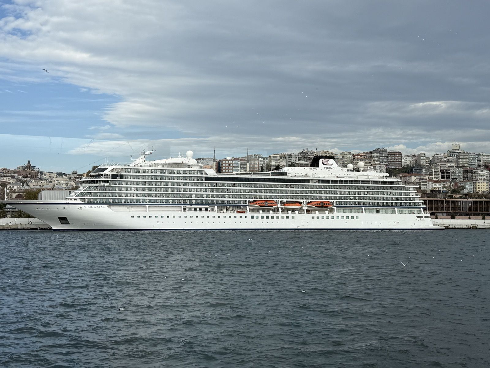
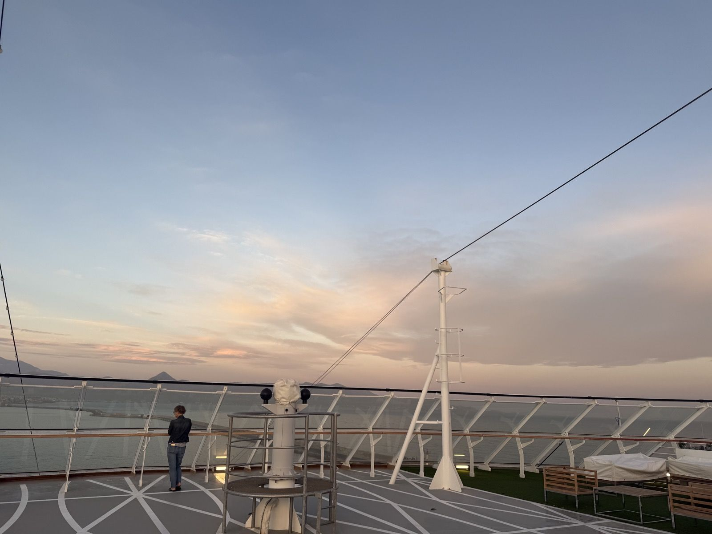
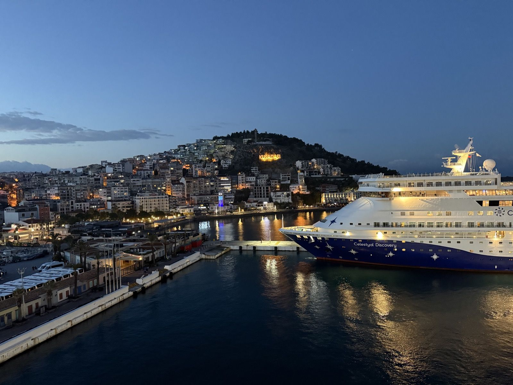
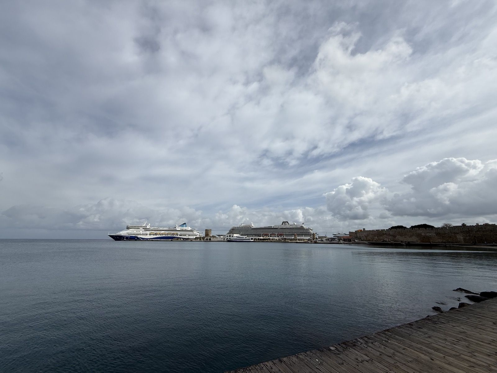
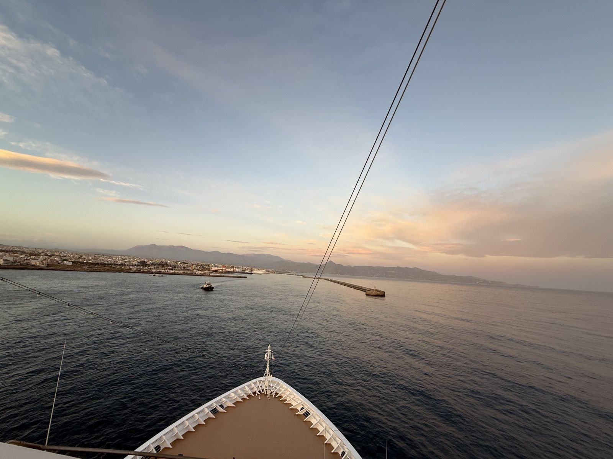

# Before We Go, Part 2: Traveling Well and the Learning for All Thread

## Summary

This chapter covers the practical shape of the journey: the Viking Star cruise, the itinerary, November weather and packing, shorter off-season opening hours, and the daily habit of reading a chapter and keeping a travel journal. It sets out what it means to be a thoughtful, empathetic traveler. It also opens the Learning for All thread that closes every daily chapter, starting with writing systems, the alphabet, and literacy, and asking how artificial intelligence could bring a good education to every child. Read it before departure, after Part 1.

## Concepts Covered

This chapter covers the following 20 concepts from the learning graph:

| Concept | Concept Impact Score |
|---------|-----------------------|
| Mediterranean Climate | 12 |
| Writing Systems | 155 |
| Alphabet | 98 |
| Greek Language | 84 |
| Thoughtful Traveler | 59 |
| Empathy in Travel | 18 |
| Viking Star Cruise | 25 |
| Ancient Mediterranean Treasures | 21 |
| Trip Itinerary | 20 |
| Off-Season Travel | 13 |
| November Weather | 2 |
| Packing for November | 1 |
| Opening Hours and Closures | 1 |
| Daily Chapter Routine | 5 |
| Travel Journal | 4 |
| Artificial Intelligence | 74 |
| Literacy | 44 |
| Learning for All | 39 |
| Democratization of Education | 15 |
| AI in Education | 14 |

## Prerequisites

This chapter builds on concepts from:

- [Chapter 1: Before We Go, Part 1: The Long Timeline of the Eastern Mediterranean](../01-long-timeline/index.md)

---

## From the Map to the Suitcase

Part 1 gave us the map and the timeline: where each stop sits, and which era each site belongs to. This chapter is about the trip itself, and about the kind of travelers we want to be on it. It has three jobs. First, the practical one: how the cruise and the days on our own fit together, what November will feel like, and what to check before we walk across a city to find a gate locked. Second, the human one: what it means to travel thoughtfully, with empathy for people who live where we are visiting. Third, it opens a thread that runs through the whole guide, called **Learning for All**, which starts here with the oldest learning technology on our route, the alphabet.

These three jobs belong together. A traveler who reads the opening hours shows up when the guard is not about to close the gate. A traveler who can sound out a Greek sign can ask a stranger for help in a way that shows respect. And the alphabet is the reason any of us could read a travel guide in the first place.

!!! mascot-welcome "Packing More Than a Suitcase"
    { class="mascot-admonition-img" }
    Today we get ready for the road: rain, short afternoons, a ship, and a script that looks strange until we notice it is mostly our own letters. We'll also start a conversation that will follow us from Istanbul to Athens, about who gets to learn and how that circle has widened. By the end, a sign that says ΚΛΕΙΣΤΟ will tell you to come back tomorrow. Look closer.

## Part One: Traveling Well

### The Thoughtful Traveler

A **thoughtful traveler** is someone who visits a place to understand it and its people, not only to see its sights, and who tries to leave the people they meet better off, or at least no worse off, for the visit. The idea is simple to state and hard to practice. Travel makes us tired, hurried, and a little self-absorbed. We are paying for an experience, and it is easy to start treating everything around us as part of the product: the view, the ruin, the waiter, the woman selling bread on the corner.

The thoughtful traveler resists that habit. Six principles describe what that looks like in practice, and we will use them all through the guide.

1. **Curiosity.** Ask questions and look closer. The interesting thing is usually the one most visitors walk past.
2. **Humility.** We are guests. Our way of doing things is one way among many, not the default the rest of the world has failed to adopt.
3. **Consent.** People and sacred places are not scenery. We ask before we photograph a person, and we step back when a place is being used for its first purpose, such as prayer.
4. **Reciprocity.** Exchange should be fair. We spend money with local people, pay a fair price, and do not make promises we will not keep.
5. **Patience.** A place has its own pace and its own limits, especially in the off-season. A short menu or a closed gate is information, not an insult.
6. **Many stories.** Every place on our route is remembered differently by different people. We look for more than one account and listen before we judge.

None of these principles asks us to be saints. They ask us to notice that the person in front of us has a whole life that our visit touches for a few minutes. That noticing is the difference between consuming a place and visiting it.

**Worked example: the tourist script.** Every popular site has a **tourist script**, the standard story told to visitors in the standard order. At Hagia Sophia it might be "a church for a thousand years, a mosque for five hundred, a museum, and a mosque again." The script is not false. It is simply the shortest story that sells, told the same way to every group. Suppose we run the six principles against it on Day 2. *Curiosity* asks which mosaics survived and why. *Humility* reminds us that for the worshippers present, this is not a historic exhibit but their mosque. *Consent* says we dress modestly and keep the camera away from people praying. *Reciprocity* says we buy our lunch from the family café on the side street rather than the chain by the gate. *Patience* says that if the building closes to visitors for noon prayer, we sit in the park and come back. *Many stories* says we ask a Turkish guide what the 2020 reconversion means to them, and later ask a Greek friend the same question. None of this takes longer than the script. It just makes the visit ours.

The table below gathers the six principles and the question each one puts to us on site.

| Principle | The question it asks on site |
|---|---|
| Curiosity | What is here that most visitors miss? |
| Humility | Whose home, workplace, or holy place is this? |
| Consent | Did this person, or this community, agree to be part of my photo or my visit? |
| Reciprocity | Who earns money from my visit, and is the exchange fair? |
| Patience | What is the place's own rhythm today, and can I fit into it? |
| Many stories | Who might tell this story differently, and have I heard them? |

### Empathy in Travel

**Empathy** is the ability to understand and share another person's feelings and point of view. Psychologists often split it into two parts. *Cognitive empathy* is understanding what someone else is thinking: seeing the situation from their side. *Emotional empathy* is feeling something of what they feel. **Empathy in travel** is putting both parts to work with the people we meet on the road, especially the people whose work makes our trip possible.

Empathy is harder on a trip than at home for a simple reason: we meet people at their work, and we see only the few minutes when they serve us. A taxi driver in Istanbul, a waiter in Rhodes, a guard at Knossos, and a cabin steward on the ship are each in the middle of a long day, a long season, and a long life we know nothing about. The tourist experience tends to flatten them into roles. Empathy restores the person.

!!! mascot-thinking "Their Day, Not Our Day"
    { class="mascot-admonition-img" }
    Notice how every travel complaint is told from inside our own day: the slow lunch, the early closing, the short menu. Try telling the same moment from inside theirs. The question "what is this person's day like?" turns most irritations into understanding.

**Worked example: a November waiter.** Picture a waiter in a taverna in the Old Town of Rhodes on Wednesday, November 18. He has worked six or seven days a week since April, through a summer of crowded cruise days. Most of the beach hotels have now closed for the winter, so many of his summer coworkers have gone home to the villages or to the mainland. Tonight the kitchen is short-staffed, the menu has shrunk to what is fresh, and he is thinking about his family's olive trees, because November is olive-harvest month across Greece and Turkey. From our side of the table, the service is slow and the menu is short. From his side, a quiet November evening is the reward for a hard summer, and we are among the last visitors of the year. The empathetic move is easy once we see it: ask what is good today, ask about the harvest, and say thank you in Greek (*efcharistó*, "thank you").

Empathy also applies aboard. On the Viking Star, as on most cruise ships, many of the crew come from countries far from both Turkey and Greece, and they work contracts of several months away from their families. Learning a cabin steward's name, and using it, costs us nothing.

Before we practice these ideas, it helps to remember that they are judgments, not rules. In each scenario below, more than one answer is defensible, and the point is to pick the one that best fits the six principles, then read why.

#### Diagram: Thoughtful Traveler Choices

Thoughtful Traveler Choices

Type: microsim
**sim-id:** thoughtful-traveler-choices 
**Library:** p5.js 
**Status:** Specified 
**Bloom Level:** Evaluate 
**Bloom Verb:** judge 
**Learning Objective:** The learner will judge which of three responses best fits the six thoughtful-traveler principles in each of eight situations on our route, choosing the best response in at least 7 of 8 situations on the first attempt.

**Prerequisites:** thoughtful traveler, the six principles (curiosity, humility, consent, reciprocity, patience, many stories), tourist script, empathy, cognitive and emotional empathy (all defined in the sections "The Thoughtful Traveler" and "Empathy in Travel" above).

**Evidence of Mastery:** For each situation the learner commits to one of three responses. A choice is correct when it matches the Best response column in Content. Mastery is 7 of 8 correct on the first attempt. Reading the principle list is exploration, not evidence; the committed choice is the evidence.

**Misconceptions:** (1) Being polite means avoiding contact (keeping conversations brief, refusing tea). (2) Photographing someone from a distance is harmless because they do not notice. (3) Correcting a local guide with "the real story" is helpful. (4) Off-season limits are poor service rather than a normal part of the season. (5) A kind lie ("I'll come back later") is kinder than an honest no.

**Instructional Rationale:** Evaluate-level judgment needs cases where several answers are plausible and the learner must weigh them against stated criteria. Each situation offers one weak, one tempting and one best response, and the feedback names the principle that decides it, so the learner practices applying criteria rather than recalling rules.

**Content:**

The six principles, shown on screen for reference throughout: Curiosity (ask and look closer); Humility (we are guests); Consent (people and sacred places are not scenery); Reciprocity (fair exchange, no false promises); Patience (fit the place's rhythm); Many stories (listen to more than one account).

| # | Situation shown to the learner | Response A | Response B | Response C | Best response | Principle | Why (shown as feedback) |
|---|---|---|---|---|---|---|---|
| 1 | Day 1, Istanbul. A woman selling simit (sesame bread rings) from a red cart would make a perfect photo. | Take a quick photo from across the street so you do not bother her. | Buy a simit, smile, raise the camera with a questioning look, and accept a shake of the head. | Photograph only the cart, but frame her at the edge of the shot. | B | Consent | A person is not scenery; asking, and accepting a no, treats her as someone at work rather than part of the view. |
| 2 | Day 3, Istanbul. You reach a mosque just as the call to prayer begins. | Slip in quietly at the back to watch the prayer. | Go in, but keep the camera down. | Wait outside or visit somewhere nearby, and come back after the prayer ends. | C | Consent | During prayer the mosque is doing its first job, worship; visitors return when it reopens to them. |
| 3 | Day 6, Gallipoli. The Turkish guide's account of the battle differs from an Australian film you have seen. | Listen, then ask what the battle means to the guide's own family. | Politely point out what the film said. | Tune out, since you already know the story. | A | Many stories | The guide is telling the story as Turks remember it; asking about family turns a script into a conversation. |
| 4 | Day 8, Rhodes. In November the taverna's menu is short and the kitchen closes early. | Ask for the full summer menu anyway. | Leave and post a review about the limited menu. | Ask what is good today and what is in season. | C | Patience | Off-season staff and supplies are cut back; asking what is fresh gets the best meal and respects a hard season. |
| 5 | Day 4, Istanbul. A carpet seller invites you in for tea, and you know you will not buy. | Accept the tea, enjoy the talk, and say kindly and clearly that you are not buying today. | Refuse firmly, because tea is a sales trick. | Accept, and promise to come back later even though you will not. | A | Reciprocity | Hospitality is real even in trade; an honest no respects his time more than a false promise. |
| 6 | Day 11, Athens. The café has no English menu and the waiter speaks little English. | Speak English slowly and loudly. | Say *kaliméra* ("good morning"), then point, smile, or use a phone translation. | Leave for a café with an English menu. | B | Humility | A greeting in the local language shows we know we are the guests; the rest can be worked out together. |
| 7 | On the ship. Your cabin steward mentions this is the eighth month away from home. | Keep it brief and polite, because the steward is working. | Leave a larger tip at the end instead of talking. | Ask about their family, learn their name, and use it. | C | Curiosity | The crew are travelers too, far from home for months; a name and a question say we see them as people, not service. |
| 8 | Day 5, Istanbul. You arrive at the Grand Bazaar on Sunday and find it closed. | Complain that a tourist site should not close. | Accept it as the merchants' day off, and plan the bazaar for an open day. | Ask the hotel to find a way in. | B | Patience | The bazaar is a working market whose people need a day off; the closure is in the guide, so the fix is planning. |

**Provenance:** All eight situations are illustrative, written for this chapter. The Grand Bazaar's Sunday closing and Friday as the main day of congregational prayer come from the trip itinerary in the trip description. The six principles come from the section "The Thoughtful Traveler."

**Rules:** Exactly one best response per situation. The position of the best response is fixed as listed (it varies across A, B and C). A situation counts as correct only on the learner's first choice. There are no partial credits.

**Learner Activity:**

1. The learner reads the situation and the three responses, with the six principles visible.
2. The learner chooses one response. The choice is locked, the best response is marked, and the Principle and Why text appear.
3. The learner moves to the next situation, until all eight are done.
4. At the end, the learner sees a summary: each situation with the principle that decided it, the learner's choices marked right or wrong, and a count of how many times each principle appeared.
5. The learner should notice that every principle decides at least one situation, and that the tempting wrong answers are usually polite-sounding ways of avoiding contact.

**Feedback:** Eight situations in fixed order, one attempt each. Correct: "Good judgment. Principle: <principle>." plus the Why text. Incorrect: "A thoughtful traveler would choose <best response letter>. Principle: <principle>." plus the Why text. The best response is shown after every choice. A running score "Best choices: n of 8" is shown. At the end: "7 or more: you are ready to travel thoughtfully" or "Fewer than 7: reread the six principles and try again." A Restart button clears all answers and the score.

**Starting State:** Situation 1 with its three responses, the six principles listed, and the prompt "Which response best fits a thoughtful traveler?"

**Chapter Anchors:** Six principles named exactly Curiosity, Humility, Consent, Reciprocity, Patience, Many stories. Eight situations. The Day 8 waiter and the cabin steward appear in the section "Empathy in Travel." The Grand Bazaar is closed on Sundays (Day 5).

## Part Two: The Shape of the Journey

### The Viking Star Cruise

The middle seven nights of our trip are on the **Viking Star**, an ocean cruise ship operated by Viking. She entered service in 2015 as the first of the company's ocean ships, and she is small by modern cruise standards: about 930 guests, compared with five or six thousand on the largest ships at sea. Viking's ocean ships take only adult guests and have no casino, and they are designed for port-intensive itineraries where the destinations, not the ship, are the main event. A guided shore excursion is included in each port, with optional excursions at extra cost.

<figure markdown="span" class="trip-photo">
  { loading=lazy }
  <figcaption>Our ship docked on the Bosphorus in Istanbul. Photo by Dan McCreary</figcaption>
</figure>

For a thoughtful traveler, a cruise is a real trade-off, and it is worth being honest about both sides. On the plus side, a cruise solves the hardest problem in this part of the world: moving between ports that are a night's sail apart, without repacking a suitcase six times. It also lets us reach places, like Rhodes and Crete, in a week that would take two weeks by ferry. On the minus side, a cruise ship can make every port feel like the same day: off the ship at 8, into a coach, through the site with a crowd of shipmates, back aboard by 5. Cruise passengers also spend less money ashore than overnight visitors, because they sleep and eat aboard.

**Worked example: a port day that is ours.** Let's plan Rhodes, Day 8, two ways. In the default plan, we take a morning coach excursion and return to the ship for lunch. In the thoughtful plan, we still take the excursion, but we eat lunch in the Old Town instead of aboard, at a family taverna our guide recommends, and we spend the afternoon walking the Jewish Quarter, which coach tours often skip. The ship docks at the edge of the Old Town walls, so it is a short walk back. The second plan costs one lunch and gives a local family some of the money our visit brings. It also gives us one of the most important stories on the island, which comes back in the Day 8 Learning for All note.

### Ancient Mediterranean Treasures

Our cruise is the Viking Star's seven-night **Ancient Mediterranean Treasures** voyage, sailing from Istanbul on November 14, 2026, and arriving at Piraeus, the port of Athens, on November 20, with a final night aboard before we disembark on November 21. The name is a fair description: in seven days the ship stops at sites from nearly every era on our timeline in Part 1. The ports are Istanbul (two days), Çanakkale for Troy and Gallipoli <audio id="audio-gallipoli" src="../../audio/gallipoli.mp3" preload="none"></audio><button onclick="document.getElementById('audio-gallipoli').play()" class="pronounce-btn">🔊 Pronounce</button> *guh-LIP-uh-lee*, Kuşadası for Ephesus, Rhodes, Heraklion for Knossos, and Piraeus for Athens.

The voyage's order is the order of the sea lanes, not the order of history. Ships sail from Istanbul down through the Sea of Marmara and the Dardanelles, then south along the Turkish coast, then west across the southern Aegean to Crete and north to Athens. As Part 1 warned, that means our route jumps back and forth in time. We meet Byzantine and Ottoman Istanbul first, the Bronze Age at Troy and Knossos in the middle, and Classical Athens at the end.

<figure markdown="span" class="trip-photo">
  { loading=lazy }
  <figcaption>Early morning on deck as the ship reaches Heraklion. Photo by Dan McCreary</figcaption>
</figure>

**Worked example: reading the route as a timeline.** Using the periods from Part 1, here is the "oldest thing we will see" at each port in voyage order. Istanbul: the Hippodrome's Egyptian obelisk, carved about 1450 BCE but brought to Constantinople in 390 CE. Çanakkale: the walls of Troy, the oldest layers about 3000 BCE. Kuşadası: Ephesus, mostly Roman, 1st and 2nd centuries CE. Rhodes: the Hellenistic acropolis and the medieval knights' city. Heraklion: Knossos, first palace about 1900 BCE. Piraeus: the Acropolis of Athens, the Parthenon from 447–432 BCE. The dates swing by more than three thousand years from one morning to the next, which is exactly why each daily chapter begins by placing its site on the clock.

### The Trip Itinerary

The **trip itinerary** is the day-by-day plan for all thirteen days, from arrival in Istanbul on Wednesday, November 11, to our last day in Athens on Monday, November 23. It has three parts: three days on our own in Istanbul, the seven-night cruise, and three days on our own in Athens, one of them a day trip to Delphi. The port times come from cruise-agency listings and can change, so they are worth confirming with Viking a few days before each port.

| Day | Date | Place | Plan |
|-----|------|-------|------|
| 1 | Wed Nov 11 | Istanbul, Turkey | Arrive; on our own |
| 2 | Thu Nov 12 | Istanbul, Turkey | On our own |
| 3 | Fri Nov 13 | Istanbul, Turkey | On our own; Friday is the main day of congregational prayer |
| 4 | Sat Nov 14 | Istanbul, Turkey | Embark the Viking Star (overnight in port) |
| 5 | Sun Nov 15 | Istanbul, Turkey | In port until 6:00 PM; the Grand Bazaar is closed on Sundays |
| 6 | Mon Nov 16 | Çanakkale (Troy and Gallipoli), Turkey | 9:00 AM – 4:00 PM |
| 7 | Tue Nov 17 | Kuşadası (Ephesus), Turkey | 7:00 AM – 6:00 PM |
| 8 | Wed Nov 18 | Rhodes, Greece | 7:00 AM – 6:00 PM |
| 9 | Thu Nov 19 | Heraklion (Knossos), Crete, Greece | 7:00 AM – 6:00 PM |
| 10 | Fri Nov 20 | Athens (Piraeus), Greece | Arrive 7:00 AM; final night aboard |
| 11 | Sat Nov 21 | Athens, Greece | Disembark; on our own |
| 12 | Sun Nov 22 | Delphi, Greece | Day trip by road from Athens, about 2½ hours each way |
| 13 | Mon Nov 23 | Athens, Greece | On our own |

The [Viking Cruise Map](../../sims/viking-cruise-map/index.md) from Part 1 shows the same route on a map, with a tip for each stop.

There is one hidden detail in this table that catches travelers every year. Turkey stays on a single clock all year, three hours ahead of Greenwich (UTC+3). Greece moves its clocks back at the end of October, so in November it is two hours ahead of Greenwich (UTC+2). When we sail from Kuşadası to Rhodes on the night of Day 7, we cross a time zone.

!!! mascot-warning "The Hour We Gain at Sea"
    { class="mascot-admonition-img" }
    Greece is one hour behind Turkey in November, and the ship changes its clocks overnight between Kuşadası and Rhodes. A phone usually updates itself, but an alarm set the night before, or a watch, may not. Check the ship's daily program for the clock change and the all-aboard time, and set the watch back before bed on Day 7.

**Worked example: Tuesday, November 17.** Let's read Day 7 off the itinerary. We are in Kuşadası, on the Turkish coast, from 7:00 AM to 6:00 PM, Turkish time. Ephesus is about 20 km inland, so the morning goes to the site and the museum in nearby Selçuk. The sun sets around 6:00 PM, about when the ship sails, so we should be back aboard before dark. Before bed we set our watches back one hour for Greece. And the daily chapter tells us to read Paul at Ephesus, Part 2 that evening, while the Great Theater is still fresh.

<figure markdown="span" class="trip-photo">
  { loading=lazy }
  <figcaption>Kuşadası at first light, with the ship at the pier. Photo by Dan McCreary</figcaption>
</figure>

## Part Three: Traveling in November

### The Mediterranean Climate

A **climate** is the typical pattern of weather in a place over many years, as opposed to the weather on any one day. The **Mediterranean climate** is a climate with hot, dry summers and mild, wet winters. It is named for the lands around this sea, but it also occurs in California, central Chile, the Western Cape of South Africa, and southwestern Australia: places on the west side of continents, roughly 30 to 45 degrees from the equator.

The pattern has a simple cause. In summer, a belt of high pressure settles over the region and blocks the storms coming in from the Atlantic, so months can pass without rain. In autumn that belt slides south, and the storms return. November is the hinge of the year, the month when the dry season ends and the wet season begins. That is exactly the shift the Roman writer Vegetius described when he called the seas "closed" from November 11, as we saw in Part 1.

The climate shaped everything else on our route. The Mediterranean "triad" of wheat, olives, and grapes is a list of crops that can survive a rainless summer: wheat grows over the wet winter and is harvested in early summer, and olive trees and vines have deep roots and tough leaves. The olive tree is so closely tied to this climate that geographers sometimes use it to draw the climate's boundary: where olives grow, the climate is Mediterranean.

**Worked example: why the Parthenon looks the way it does.** Part of the answer is geology: Mount Pentelikon, about 16 km from Athens, is made of fine white marble. But the climate matters too. A dry summer and a mild winter mean little frost to crack stone, so Greek marble buildings weathered slowly for centuries. Compare a cathedral in northern Europe, which needs steep roofs to shed snow and rain. The flat, open Greek temple, with its shallow roof and colonnade for shade, is a building designed for hot summer sun and gentle winter rain. When we stand on the Acropolis on Day 10, the climate that shaped the building will be the climate around us: probably mild, with a chance of a shower.

### November Weather

**November weather** on our route means mild days, cool evenings, short afternoons, and the first real rains of the wet season. Istanbul and Çanakkale, on the Turkish straits in the north, are the coolest stops, with typical November afternoons around 15–16 °C (59–61 °F). Athens, Rhodes, and Heraklion are milder, with afternoons around 19–21 °C (66–70 °F). Nights are about 6–8 °C cooler than afternoons. Delphi, high on the slope of Mount Parnassus, is several degrees colder than Athens and can be foggy, and Mount Ida on Crete may already have snow. Rain comes in bursts, a stormy day followed by clear ones, so a rainy forecast rarely means a lost day.

The days are also short. In mid-November the sun sets around 5:10 PM in Athens and Heraklion. In Turkey, which keeps its summer clock all year, the sun sets later by the clock, around 5:45 PM in Istanbul, but rises late too, close to 8:00 AM.

The chart below lets us compare our stops month by month and predict what November will feel like before we see the answer.

#### Diagram: November Weather at Our Stops

November Weather at Our Stops

Type: chart
**sim-id:** november-weather-at-our-stops 
**Library:** Chart.js 
**Status:** Specified 
**Bloom Level:** Understand 
**Bloom Verb:** interpret 
**Learning Objective:** The learner will interpret monthly temperature and rainfall charts for six stops on our route to predict November conditions, answering at least 3 of 4 prediction questions correctly before the answer is revealed.

**Prerequisites:** climate, Mediterranean climate (hot dry summers, mild wet winters), November as the start of the wet season, mean daily high and low temperature (defined in the sections "The Mediterranean Climate" and "November Weather" above).

**Evidence of Mastery:** The learner answers four prediction questions, each locked in before the chart reveals the answer. An answer is correct when it matches the value computed from the data under Rules. Mastery is 3 of 4 correct. Switching stops and hovering over bars is exploration, not evidence.

**Misconceptions:** (1) The Mediterranean is warm and sunny all year. (2) Istanbul has the same weather as Athens because both are "Mediterranean." (3) Winter rain means it rains every day. (4) Summer is the wet season, as in many northern climates.

**Instructional Rationale:** Interpreting a climate chart is an Understand-level skill; predicting before the reveal makes the learner read the chart's pattern rather than look up a number, and the four questions target the four misconceptions.

**Content:**

Six stops and the Wikipedia article whose climate table supplies their data:

| Stop | Days on our trip | Source article |
|---|---|---|
| Istanbul | 1–5 | https://en.wikipedia.org/wiki/Istanbul |
| Çanakkale (Troy and Gallipoli) | 6 | https://en.wikipedia.org/wiki/%C3%87anakkale |
| İzmir (nearest major station to Ephesus) | 7 | https://en.wikipedia.org/wiki/%C4%B0zmir |
| Rhodes | 8 | https://en.wikipedia.org/wiki/Rhodes |
| Heraklion | 9 | https://en.wikipedia.org/wiki/Heraklion |
| Athens | 10–13 | https://en.wikipedia.org/wiki/Athens |

For each stop, twelve monthly values of mean daily maximum temperature (°C), mean daily minimum temperature (°C), and mean monthly precipitation (mm). Temperatures are also shown in °F. November is visibly marked on every chart as "our month."

Prediction questions, in this order:

| # | Question | Choices | How the correct answer is found |
|---|---|---|---|
| 1 | Which stop has the coolest November afternoons? | Istanbul; Çanakkale; İzmir; Rhodes; Heraklion; Athens | The stop with the lowest November mean daily maximum |
| 2 | In Athens, is November wetter or drier than August? | Wetter; Drier; About the same | Compare Athens November and August precipitation |
| 3 | Which is the hottest month in Athens? | June; July; August; September | The month with the highest Athens mean daily maximum |
| 4 | How much colder is a November night in Istanbul than a November afternoon in Heraklion? | 0–4 °C; 5–9 °C; 10–14 °C; 15 °C or more | Heraklion November mean daily maximum minus Istanbul November mean daily minimum |

**Provenance:** From each source article, take the first "Climate data for ..." table, and copy into the sim folder the station name, the normal period (1991–2020 where the table gives it), and the twelve monthly values of mean daily maximum, mean daily minimum, and mean precipitation. Record the station and period under each chart. If the İzmir article's first table is not for İzmir itself, use the one that is. Do not fill in any value from memory.

**Rules:** °F = °C × 9/5 + 32, rounded to the nearest whole degree. Question 2: "About the same" is correct when the two values differ by less than 10 mm; otherwise "Wetter" or "Drier" by the comparison. Question 3: if two months tie to 0.1 °C, both are accepted. Question 4: the difference is rounded to the nearest whole degree before choosing its band; a band's lower bound is inclusive (10.0 °C is in 10–14 °C).

**Learner Activity:**

1. The learner reads question 1 and chooses an answer before any chart is shown.
2. The chart appears with all six stops' November highs side by side, and the correct answer is marked.
3. For questions 2–4, the learner chooses an answer, then the relevant chart is revealed (Athens monthly rainfall; Athens monthly highs; Istanbul and Heraklion November values).
4. After the four questions, free exploration unlocks: the learner chooses any stop and sees its twelve-month temperature lines and rainfall bars, with November marked.
5. The learner should notice the near-rainless summer and the jump in rain from October to November at every stop.

**Feedback:** Four questions, fixed order, one attempt each. Correct: "Right. <one-sentence explanation using the stop's actual values>." Incorrect: "Not quite. <the correct answer> — <one-sentence explanation using the actual values>." Each explanation names the misconception the question targets: (1) the northern stops on the Turkish straits are cooler than the Aegean and Cretan stops; (2) the Mediterranean summer is dry and November starts the wet season; (3) the hottest month comes after the summer solstice; (4) a cool evening in Istanbul and a warm afternoon on Crete need different layers. A score "Predictions correct: n of 4" is shown.

**Starting State:** Question 1 with its six choices and no chart yet, under the prompt "We'll be in all six places in November. Where should we pack the warmest layer for?"

**Chapter Anchors:** Six stops. Istanbul and Çanakkale are the coolest, with November afternoons around 15–16 °C (59–61 °F); Athens, Rhodes and Heraklion around 19–21 °C (66–70 °F); nights about 6–8 °C cooler than afternoons. If the copied data disagree with any of these prose values, flag the difference to the author rather than changing the data.

### Packing for November

**Packing for November** on this route means packing for a range of about 8 to 21 °C (46 to 70 °F), for a few rainy days, and for places of worship and long walks on uneven stone. The rule of thumb is layers, not bulk: a few thin layers can be added or removed as we move from a cold morning on the ship's deck to a warm noon at Ephesus.

- **A light waterproof jacket with a hood.** An umbrella is awkward on a crowded site and useless in wind.
- **A warm layer**, such as a fleece or light sweater, for Istanbul evenings, the deck, and Delphi.
- **Comfortable shoes with good grip.** Ancient marble is polished slippery by millions of feet, and it is worse when wet.
- **Modest clothing for mosques, churches, and monasteries**: covered shoulders and knees for everyone, and a scarf for a woman to cover her hair in a mosque. Shoes come off in a mosque, so easy shoes and clean socks help.
- **A small daypack** for a water bottle, a snack, and the layers we take off.
- **A plug adapter** for Turkey and Greece, which both use the European two-round-pin plugs (Type C and F) at 230 volts.

### Off-Season Travel

**Off-season travel** means traveling outside the months when most visitors come, which on our route are roughly May to October. Every trip in November is an off-season trip, and that cuts both ways. The crowds are thinner, the light is soft, prices are lower, and the people we meet have more time to talk. On the other hand, opening hours are shorter, some sites and restaurants close for the winter, ferries run less often, and the sea can be rough enough to change a ship's schedule.

The off-season matters most on the islands, where many jobs depend on summer visitors. In Rhodes, many beach hotels and seasonal restaurants close by November, and their workers go home or move to other work, often the olive harvest. Big working cities like Istanbul, Athens, and Heraklion change much less, because most of their people never worked in tourism at all. The scale of tourism in Greece makes the season matter: the country of about ten million people receives more than thirty million foreign visitors a year, about three for every resident, and most of them come in summer.

<figure markdown="span" class="trip-photo">
  { loading=lazy }
  <figcaption>Cruise ships anchored off Rhodes. Photo by Dan McCreary</figcaption>
</figure>

**Worked example: what the off-season gives Delphi.** On a summer day, coaches arrive at Delphi from Athens by mid-morning and the Sacred Way fills with groups. On Sunday, November 22, we can expect a quieter site, mist on the mountain, and perhaps a few other cars in the lot. But winter hours mean the site and museum close earlier in the afternoon, and the drive is about 2½ hours each way. So the off-season plan is to leave Athens early, see the site first while it is open, the museum next, and lunch in the village or in Arachova <audio id="audio-arachova" src="../../audio/arachova.mp3" preload="none"></audio><button onclick="document.getElementById('audio-arachova').play()" class="pronounce-btn">🔊 Pronounce</button> *ah-RAH-kho-vah* after. As the Oracle chapters will explain, the off-season even has an ancient meaning here: in myth, Apollo left Delphi in the winter months.

### Opening Hours and Closures

**Opening hours and closures** are the times when a site, museum, market, or house of worship is open to visitors, and the days or hours when it is not. In November they are the most common reason a well-planned day goes wrong. Greek state archaeological sites and museums switch to shorter winter hours from November 1, and many of them close in mid-afternoon. Turkish museums also close earlier in winter. Mosques close to visitors during the five daily prayers, longest at the Friday noon prayer, and markets keep their own days off. Hours change from year to year, so the daily chapters point to what to check rather than promise a time.

| What to check | Why it matters for us | Day |
|---|---|---|
| Grand Bazaar | Closed on Sundays | 5 |
| Mosques we visit | Closed to visitors during prayers; Friday noon is the longest | 1–5, especially 3 |
| Greek winter hours | Many state sites and museums close in mid-afternoon from November 1 | 8–13 |
| Acropolis entry | Timed entry slots and a daily visitor limit; book a slot ahead | 10–13 |
| Delphi site and museum | Winter hours plus 2½ hours of driving each way | 12 |
| The ship's all-aboard time | Earlier than the listed departure; the ship will not wait | 4–10 |

!!! mascot-tip "Three Checks the Night Before"
    { class="mascot-admonition-img" }
    Here's a two-minute habit that saves a wasted morning: the night before, check tomorrow's sites on their official pages for (1) today's hours and last entry, (2) the weekly closing day, and (3) any prayer, holiday, or strike closures. Last entry is often 30 minutes or more before closing, so plan around that time, not the closing time.

## Part Four: A Daily Habit

### The Daily Chapter Routine

The **daily chapter routine** is the habit this guide is built around: one chapter for each day, read at breakfast or the night before, so that each morning we arrive knowing what happened at the place, what to look for, what to eat, and who lives there now. The guide has twenty-one chapters: these two before we go, fourteen daily chapters for the thirteen days (Day 9 has two, for Knossos in the morning and Heraklion in the afternoon), four deep-dive chapters, and a short chapter for the flight home.

Each daily chapter follows the same order, so we always know where to look: what we will see, the history behind it, things to notice, food and drink, the people who live there now, etiquette and a few useful words, practical notes, and a short Learning for All note at the end. The deep-dive chapters are different. They are longer, slower reads about Paul of Tarsus and the Oracle of Delphi, and they are scheduled for quiet evenings and the long drive back from Delphi.

| When | Read |
|---|---|
| Before we go | Part 1 (the timeline) and Part 2 (this chapter) |
| Day 1, on the flight or the first evening | Day 1: Istanbul, a City on Two Continents |
| Days 2–5, at breakfast | The Istanbul chapters for Days 2, 3, 4, and 5 |
| Day 6, at breakfast | Day 6: Troy and Gallipoli |
| Day 6, evening, sailing to Kuşadası | Paul at Ephesus, Part 1 |
| Day 7, at breakfast | Day 7: Ephesus |
| Day 7, evening, sailing to Rhodes | Paul at Ephesus, Part 2 |
| Days 8–10, at breakfast | Rhodes; Knossos (and Venetian Heraklion at lunch); the Acropolis |
| Day 11, at breakfast | Day 11: The Agora and Democracy |
| Day 11, night | The Oracle and the Algorithm, Part 1 |
| Day 12, at breakfast, then the drive back | Day 12: Delphi; then The Oracle and the Algorithm, Part 2 |
| Day 13, at breakfast | Day 13: Athens Museums and the City Today |
| The flight home | Going Home |

**Worked example: a breakfast plan for Day 9.** Day 9 is our longest reading day, so let's plan it. The ship docks in Heraklion at 7:00 AM and leaves at 6:00 PM. Knossos is about 5 km from the port and opens in the morning, so the Knossos chapter is the one to read over breakfast. The Venetian Heraklion chapter covers the harbor fortress and the old town, which we will see in the afternoon, so it can wait for a coffee at lunchtime near the Morosini Fountain. Splitting the reading this way puts each chapter as close as possible to the place it describes, which is the whole point of the routine.

<figure markdown="span" class="trip-photo">
  { loading=lazy }
  <figcaption>Sunrise from the bow, approaching Heraklion. Photo by Dan McCreary</figcaption>
</figure>

### The Travel Journal

A **travel journal** is a short written record we keep each day of what we noticed, ate, and learned from the people we met. It does not need to be long or literary. Its job is to slow us down at the end of the day and turn a blur of impressions into a few things we chose to remember. Writing about an experience the same day, in our own words, is one of the most reliable ways to remember it, and the act of choosing what to write is itself a kind of noticing.

The journal is also the "Create" outcome of this trip: by the end, we will have our own story of the journey, not a copy of the guidebook's. Three prompts, the same every day, keep it quick.

1. **I noticed…** one thing most visitors probably walked past.
2. **I ate…** one dish or drink, and what it tasted like.
3. **I learned from…** one person we met: who they were and what they told us.

**Worked example: a journal entry for Day 2.** Here is what a five-minute entry might look like after Hagia Sophia. *I noticed:* the worn hollows in the stone ramp to the upper gallery, made by fifteen centuries of feet. *I ate:* a simit <audio id="audio-simit" src="../../audio/simit.mp3" preload="none"></audio><button onclick="document.getElementById('audio-simit').play()" class="pronounce-btn">🔊 Pronounce</button> *see-MEET* and a glass of tea on a bench in Sultanahmet Park <audio id="audio-sultanahmet" src="../../audio/sultanahmet.mp3" preload="none"></audio><button onclick="document.getElementById('audio-sultanahmet').play()" class="pronounce-btn">🔊 Pronounce</button> *sool-TAHN-ah-met*, the tea in a tulip-shaped glass, too hot to hold at the top. *I learned from:* the man who sold us the tea, who said his grandfather sold tea at the same spot, and that tourists ask him about the building but never about his family. Three sentences, written on the ship or in the hotel, and that day will come back years from now in a way photographs alone cannot bring back.

## Part Five: Letters

### Writing Systems

A **writing system** is a set of visible signs, together with the rules for using them, that records a spoken language so that someone else can read it later. Writing is not the same as language. People spoke for tens of thousands of years before anyone wrote, and many languages are still rarely written. Writing is a technology: a way of storing words outside a person's memory, so they can travel across distance and time.

As far as we know, writing was invented independently at least four times: in Mesopotamia (modern Iraq) around 3400–3100 BCE, in Egypt around 3200 BCE, in China by about 1200 BCE, and in Mesoamerica in the first millennium BCE. Every other script in the world, including all the ones we will see on this trip, descends from or was inspired by one of these.

Writing systems differ most in what one basic sign stands for. Linguists sort them into four main kinds, and the kind decides how hard a script is to learn.

- In a **logographic** script, most signs stand for whole words or parts of words, with some signs for sounds mixed in. Egyptian hieroglyphs and Chinese characters work this way. A reader needs to know hundreds or thousands of signs.
- In a **syllabary**, each sign stands for a syllable, usually a consonant plus a vowel (*ka*, *ko*, *ku*). Linear B, the script of the Mycenaean palaces we met in Part 1, is a syllabary of about 90 signs.
- In an **abjad**, each sign stands for a consonant, and readers fill in most vowels from their knowledge of the language. Phoenician, Hebrew, and Arabic are abjads of 22 to 28 letters.
- In an **alphabet**, signs stand for vowels and consonants alike, so a reader can sound out a word they have never seen. Greek, Latin, and Cyrillic are alphabets of a few dozen letters.

**Worked example: who could read at Knossos?** Linear B shows why the kind of script matters. A syllabary of about 90 signs, plus dozens of word-signs for things like sheep, wine, and chariots, took years to learn, and only professional scribes learned it. The tablets found at Knossos were written by a few dozen scribes, whose individual handwriting scholars have learned to tell apart. Everyone else in the palace, from the king to the shepherds, depended on those scribes. So when the palaces fell around 1200–1100 BCE, as we saw in Part 1, the script died with the scribes. Writing that only a few people can use is fragile. Writing that many people can use survives.

That leads to a useful habit for reading any unfamiliar script.

!!! mascot-tip "Count the Signs"
    { class="mascot-admonition-img" }
    Want to guess what kind of script you're looking at without reading a word? Count its different signs. Under about 40 suggests an alphabet or an abjad, about 40 to 100 suggests a syllabary, and hundreds or more suggests a logographic script. That's how scholars guessed Linear A was a syllabary long before anyone could read it.

The sorting activity below puts the four kinds to work on twelve scripts, most of which we will meet somewhere on our route.

#### Diagram: Sort the Scripts

Sort the Scripts

Type: microsim
**sim-id:** sort-the-scripts 
**Library:** p5.js 
**Status:** Specified 
**Bloom Level:** Understand 
**Bloom Verb:** classify 
**Learning Objective:** The learner will classify twelve writing systems as logographic, syllabary, abjad, or alphabet from what one basic sign stands for and how many signs the script uses, with at least 10 of 12 correct on the first attempt.

**Template:** https://github.com/dmccreary/computer-science/tree/main/docs/sims/symbol-character-quiz 

**Prerequisites:** writing system, logographic script, syllabary, abjad, alphabet, the sign-count rule of thumb (all defined in the section "Writing Systems" above); Linear A and Linear B (introduced in Part 1).

**Evidence of Mastery:** For each script card, the learner assigns it to one of four bins. An assignment is correct when it matches the Correct kind column in Content. Mastery is 10 of 12 correct on the first attempt. Reading a card is exploration; the committed assignment is the evidence.

**Misconceptions:** (1) Egyptian hieroglyphs are an alphabet because some signs stand for single sounds. (2) Hebrew and Arabic are alphabets in the same sense as Greek. (3) A script nobody can read cannot be classified. (4) Alphabets are always older than syllabaries.

**Instructional Rationale:** Classifying new cases by a defining rule is Understand-level work. Each card gives the learner the two pieces of evidence the chapter teaches (what one sign stands for, and how many signs there are), so the learner must apply the definitions rather than recognize names; three cards target the three most common confusions.

**Content:**

Four bins: Logographic (most signs stand for words or parts of words); Syllabary (each sign stands for a syllable); Abjad (each sign stands for a consonant; most vowels are left to the reader); Alphabet (signs for vowels and consonants alike).

Cards, presented in shuffled order:

| # | Card text shown to the learner | Correct kind | Why (shown as feedback) |
|---|---|---|---|
| 1 | Egyptian hieroglyphs: several hundred signs; most stand for words or ideas, and some stand for one or two consonant sounds. | Logographic | A few sound-signs do not make an alphabet; with hundreds of signs mostly standing for words, it is logographic. |
| 2 | Chinese characters: a newspaper reader needs about 3,000 to 4,000; each usually stands for a syllable that is also a word or part of a word. | Logographic | Thousands of signs, each tied to a meaning, mark a logographic script. |
| 3 | Linear A (Minoan Crete, undeciphered): about 90 signs, many shared with Linear B. | Syllabary | We cannot read it, but about 90 signs fits a syllabary, and its signs match Linear B's syllable signs. |
| 4 | Linear B (Mycenaean Greek): about 90 sound-signs, each a consonant plus a vowel, plus word-signs for goods. | Syllabary | Each sound-sign stands for a whole syllable: Knossos is spelled *ko-no-so*. |
| 5 | Japanese hiragana: 46 basic signs, each a vowel or a consonant plus a vowel. | Syllabary | Each sign is a whole syllable: か is *ka* and み is *mi*. |
| 6 | Cherokee: 85 signs, created by Sequoyah around 1821, each a syllable. | Syllabary | Each of the 85 signs stands for a syllable. |
| 7 | Phoenician: 22 letters, all for consonants. | Abjad | Only consonants are written; the reader supplies the vowels. |
| 8 | Hebrew: 22 letters for consonants; vowel marks are optional and usually left out. | Abjad | Without the optional marks, vowels are left to the reader. |
| 9 | Arabic, as used for Ottoman Turkish until 1928: 28 letters, with most short vowels not written. | Abjad | Most vowels are not written, which made it a poor fit for Turkish, a language with eight vowels. |
| 10 | Greek: 24 letters, with separate letters for vowels, including alpha and omicron. | Alphabet | Vowels and consonants each have their own letters. |
| 11 | Latin, as used for English: 26 letters for vowels and consonants. | Alphabet | It came from Greek, through the Etruscans, and kept the vowel letters. |
| 12 | Modern Turkish: 29 Latin letters, including ı, ö, ü, ç, ş, and ğ. | Alphabet | It writes all eight Turkish vowels with their own letters. |

**Provenance:** Sign counts for Linear A and Linear B and the Linear B description come from Part 1 and the section "Writing Systems" in this chapter. Counts for hieroglyphs, Chinese characters, hiragana, Cherokee, Phoenician, Hebrew, Arabic, Greek, Latin, and Turkish are standard figures from each script's Wikipedia article; the generator must check each count against that article and keep the card text only if it still matches. The eight vowels of Turkish are from the Wikipedia article "Turkish alphabet."

**Rules:** Each card has exactly one correct kind. Classification is by what most basic signs stand for, not by the presence of a few signs of another kind. An undeciphered script is classified by its sign count and its relation to known scripts.

**Learner Activity:**

1. The learner sees the first card and the four bins with their definitions.
2. The learner assigns the card to a bin. The card's correctness and the Why text appear, and the card moves to its correct bin.
3. The learner continues until all twelve cards are placed.
4. At the end, the learner sees the four bins filled, with each script's sign count shown, sorted from most signs to fewest.
5. The learner should notice that sign counts fall into the bands of the chapter's rule of thumb: hundreds or more for logographic, about 40 to 100 for syllabaries, under 40 for abjads and alphabets.

**Feedback:** Twelve cards, shuffled once at the start, one attempt each. Correct: "Correct: <kind>." plus the Why text. Incorrect: "Not quite: this is a(n) <correct kind>." plus the Why text. The correct bin is shown after every answer. A running score "Correct: n of 12" is shown. At the end: "10 or more: you can tell scripts apart" or "Fewer than 10: reread the four kinds of writing system and try again." A Restart button reshuffles and clears the score.

**Starting State:** Four empty bins with their definitions, one card face up, and the prompt "What does one sign stand for in this script?"

**Chapter Anchors:** Four kinds of writing system. Linear B has about 90 signs. Phoenician, Hebrew and Arabic have 22 to 28 letters. Under about 40 signs suggests an alphabet or abjad, about 40 to 100 a syllabary, hundreds or more a logographic script. Writing was invented independently at least four times.

### The Alphabet

An **alphabet** is a writing system with a small set of letters, usually 20 to 40, in which signs stand for both consonants and vowels. The English word comes from the first two Greek letters, *alpha* and *beta*. In everyday speech "alphabet" is used for any set of letters, including Hebrew or Arabic, but in the strict sense used here, a true alphabet writes the vowels too.

The alphabet's story runs right along our route. Nearly four thousand years ago, Semitic-speaking workers in Egypt and Sinai borrowed a few dozen Egyptian pictures and used each one for the first sound of its name: a picture of an ox's head, *aleph* in their language, stood for the sound at the start of "aleph." That was the first known abjad. By about 1000 BCE the Phoenicians, the sea traders of the Levant coast, had standardized it into 22 consonant letters and carried it to every port they traded with.

Around 800 BCE, as we saw in Part 1, Greeks adopted the Phoenician letters and made one decisive change. Greek, unlike Phoenician, could not be read without its vowels, so the Greeks took Phoenician letters for consonant sounds Greek did not have and turned them into vowels. *Aleph*, a throat sound, became *alpha*, the vowel *a*. *He* became *epsilon*, *yod* became *iota*, and *ayin* became *omicron*. For the first time, a script recorded every sound of a language with letters a child could learn in a season.

!!! mascot-thinking "The Vowel That Opened the Door"
    { class="mascot-admonition-img" }
    Notice how small the Greek change was: no new invention, just a few borrowed letters put to a new use. Yet it meant a reader no longer needed to know the word already in order to read it. Lowering what a learner must know before they can start is the oldest way of widening who can learn.

From Greece, the alphabet spread in every direction. Greek colonists in Italy passed it to the Etruscans, who passed it to the Romans, whose Latin alphabet is the one in this sentence. In the 9th century CE, followers of two Byzantine missionaries from Thessaloniki, the brothers Cyril and Methodius, built a script for the Slavic languages, and the version based on Greek capitals became Cyrillic, now used from Bulgaria to Russia. In 1928 Turkey moved from the Arabic script to a Latin-based alphabet of 29 letters, a story we will meet in Istanbul on Day 5.

**Worked example: following the letter A.** Let's trace one letter from start to finish. The table below shows the same letter at each step of the journey we just described.

| Stage | Date | Letter | What it meant |
|---|---|---|---|
| Egyptian hieroglyph | Before 2000 BCE | An ox's head | A word-sign for "ox" |
| Early Semitic (Sinai and Egypt) | c. 1900–1800 BCE | A simple ox's head | The sound at the start of *aleph*, "ox" |
| Phoenician | c. 1000 BCE | 𐤀, an ox head on its side | A consonant, a catch in the throat |
| Greek | c. 800 BCE | Α, the ox head upside down | *Alpha*, now the vowel *a* |
| Latin | c. 600 BCE onward | A | The vowel *a*, as in Rome |

Turn a capital A upside down and the ox's horns are still there. The first letter we learned in school is a 4,000-year-old picture of an animal, turned into a sound by travelers and traders on the shores we are about to visit. In the National Archaeological Museum in Athens on Day 13, we can look for one of the oldest known Greek alphabetic inscriptions, scratched on a wine jug from the Dipylon cemetery around 740 BCE, promising the jug as a prize to the best dancer.

### The Greek Language

The **Greek language** is the language of the Greeks, spoken today by about 13 million people, mainly in Greece and Cyprus. It has the longest written history of any living European language: about 3,400 years, from the Linear B tablets of the Mycenaean palaces to this morning's newspapers in Athens. Over that time it has changed, as all languages do. Scholars divide its history into stages: Mycenaean Greek in Linear B; Ancient Greek, the language of Homer and of Classical Athens; Koine, the "common" Greek of the Hellenistic and Roman world that we met in Part 1; Medieval or Byzantine Greek; and Modern Greek. Modern Greek, in its everyday form called *Dimotikí*, "the people's language," became the official language of the Greek state only in 1976, after more than a century of argument with a more formal, old-fashioned version.

A Greek speaker today can read many ancient words, but would need study to read Plato, much as an English speaker needs help with *Beowulf*. The good news for us is that English is full of Greek. *Democracy*, *history*, *theater*, *music*, *philosophy*, *alphabet*, and *school* are all Greek words. *School* is a lovely one: it comes from the Greek *scholē*, which meant "leisure," because study was something only people with free time could do. That word alone holds most of the Learning for All story.

The letters are less strange than they look. Many are the same as ours, a few look like ours but stand for different sounds, and the rest are familiar from mathematics. The table below gives each capital letter, the Latin letter used for it on Greek road and site signs, and how it sounds in Modern Greek.

| Greek | Name | On signs | Sounds like | Greek | Name | On signs | Sounds like |
|---|---|---|---|---|---|---|---|
| Α α | alfa | a | *a* in father | Ν ν | ni | n | *n* |
| Β β | vita | v | *v* | Ξ ξ | xi | x | *ks* |
| Γ γ | gamma | g | a soft *gh*; *y* before e and i | Ο ο | omikron | o | *o* |
| Δ δ | delta | d | *th* in *this* | Π π | pi | p | *p* |
| Ε ε | epsilon | e | *e* in pet | Ρ ρ | ro | r | a rolled *r* |
| Ζ ζ | zita | z | *z* | Σ σ ς | sigma | s | *s* |
| Η η | ita | i | *ee* | Τ τ | taf | t | *t* |
| Θ θ | thita | th | *th* in *thin* | Υ υ | ypsilon | y | *ee* |
| Ι ι | iota | i | *ee* | Φ φ | fi | f | *f* |
| Κ κ | kappa | k | *k* | Χ χ | chi | ch | a throaty *h*, as in Scottish *loch* |
| Λ λ | lamda | l | *l* | Ψ ψ | psi | ps | *ps* |
| Μ μ | mi | m | *m* | Ω ω | omega | o | *o* |

A few letter pairs make single sounds: ΟΥ sounds like *oo*; ΑΙ like *e*; ΕΙ and ΟΙ like *ee*; and ΜΠ and ΝΤ at the start of a word sound like *b* and *d*. On signs, these pairs are usually written letter by letter, so ΔΕΛΦΟΙ appears as "Delfoi" but sounds like *del-FEE*. In lowercase writing, an accent mark shows which syllable to stress, and putting the stress in the right place matters more than getting each sound perfect.

**Worked example: reading two signs.** At the port on Day 10 we may see ΠΕΙΡΑΙΑΣ. Letter by letter: Π is *p*, Ε *e*, Ι *i*, Ρ *r* (not *p*), Α *a*, Ι *i*, Α *a*, Σ *s*. The sign says "Peiraias," and with the pairs ΕΙ (*ee*) and ΑΙ (*e*) it sounds like *pee-reh-AHS*: Piraeus, the port of Athens. Now a harder, more useful one, seen on a museum door at 3:35 PM in November: ΚΛΕΙΣΤΟ. Κ *k*, Λ *l*, Ε *e*, Ι *i*, Σ *s*, Τ *t*, Ο *o*: "Kleisto," sounding like *klee-STO*. It means "closed." Its opposite, ΑΝΟΙΧΤΟ (*a-nee-KHTO*), means "open."

!!! mascot-warning "Yes Sounds Like No"
    { class="mascot-admonition-img" }
    A common trap: in Greek, *nai* (ναι), which sounds like "neh," means **yes**, and *óchi* (όχι) means **no**. Greeks and Turks alike often say no with a small upward nod of the head and raised eyebrows, not a shake. And on a Greek menu or sign, the semicolon (;) is a question mark.

The activity below gives practice with twelve signs we are likely to see in Greece, from place names to the two words that matter most in the off-season.

#### Diagram: Read a Greek Sign

Read a Greek Sign

Type: microsim
**sim-id:** read-a-greek-sign 
**Library:** p5.js 
**Status:** Specified 
**Bloom Level:** Apply 
**Bloom Verb:** use 
**Learning Objective:** The learner will use the Greek letter table to transliterate twelve Greek signs from our route into Latin letters, with at least 10 of 12 correct within two attempts each.

**Prerequisites:** alphabet, Greek language, the Greek capital letters and their sign transliterations, the letter pairs ΟΥ, ΑΙ, ΕΙ, ΟΙ (all defined in the section "The Greek Language" above).

**Evidence of Mastery:** For each sign, the learner types a transliteration in Latin letters. An answer is correct when, after the normalization in Rules, it matches one of the Accepted answers in Content. Mastery is 10 of 12 signs correct within two attempts. Viewing the letter key is support, not evidence; the typed answer is the evidence.

**Misconceptions:** (1) Η is the consonant h (it is the vowel i). (2) Ρ is p (it is r). (3) Χ is x (it is a throaty h, written ch). (4) Υ is u (alone it is y, sounding ee). (5) Ω is w (it is o). (6) Λ is an upside-down v (it is l). (7) Greek signs must be read letter by letter for pronunciation (pairs like ΕΙ and ΟΥ make one sound).

**Instructional Rationale:** Transliteration is an Apply-level procedure: the learner must use the letter table on new words. Typing the answer rather than choosing it forces the learner to map every letter, and the per-sign trap letters make each misconception surface where it is most likely.

**Content:**

The full letter table from the chapter section "The Greek Language" (24 capitals with their sign transliteration) is available from a "Letter key" button at all times.

Signs, in this fixed order:

| # | Sign shown | Accepted answers | Meaning | Sounds like | Trap letters (named in feedback) |
|---|---|---|---|---|---|
| 1 | ΑΘΗΝΑ | athina | Athens | a-THEE-na | Θ is th; Η is i, not h |
| 2 | ΠΕΙΡΑΙΑΣ | peiraias; pireas | Piraeus, the port of Athens | pee-reh-AHS | Ρ is r, not p |
| 3 | ΡΟΔΟΣ | rodos | Rhodes | RO-thos | Ρ is r; Δ is d, sounding like th in this |
| 4 | ΗΡΑΚΛΕΙΟ | irakleio; iraklio | Heraklion | ee-RA-klee-o | Η is i; Λ is l |
| 5 | ΚΝΩΣΟΣ | knosos; knossos | Knossos | kno-SOS | Ω is o, not w |
| 6 | ΔΕΛΦΟΙ | delfoi; delfi; delphi | Delphi | del-FEE | Λ is l; Φ is f |
| 7 | ΑΚΡΟΠΟΛΗ | akropoli | Acropolis | a-KRO-po-lee | Ρ is r; Η is i |
| 8 | ΜΟΥΣΕΙΟ | mouseio; mousio | Museum | moo-SEE-o | ΟΥ is ou, sounding oo |
| 9 | ΕΙΣΟΔΟΣ | eisodos; isodos | Entrance | EE-so-thos | ΕΙ sounds ee; Σ is s |
| 10 | ΕΞΟΔΟΣ | exodos; eksodos | Exit | EX-o-thos | Ξ is x, sounding ks |
| 11 | ΚΛΕΙΣΤΟ | kleisto; klisto | Closed | klee-STO | Λ is l; ΕΙ sounds ee |
| 12 | ΑΝΟΙΧΤΟ | anoichto; anichto; anihto | Open | a-nee-KHTO | Χ is ch, not x; ΟΙ sounds ee |

**Provenance:** Sign words are standard Modern Greek. Transliterations follow the ELOT 743 standard used on Greek road and site signs (https://en.wikipedia.org/wiki/Romanization_of_Greek), with common informal spellings added as accepted answers. Meanings and pronunciations are from the chapter section "The Greek Language"; the generator must check each pronunciation's stressed syllable against the word's Wiktionary entry and keep it only if it matches.

**Rules:** Normalize the learner's answer by converting to lowercase and removing spaces, hyphens and accent marks before comparing. An answer is correct if the normalized text equals any accepted answer for that sign. No partial credit.

**Learner Activity:**

1. The learner sees sign 1 in capitals, styled as a sign, with a text box and a Letter key button.
2. The learner types a transliteration and submits it.
3. If correct, the meaning and pronunciation appear, and the learner moves on.
4. If wrong on the first attempt, the trap-letter note appears and the learner tries again. If wrong on the second attempt, the sign is shown letter by letter with each Greek letter above its Latin letter, then the meaning and pronunciation, and the sign counts as missed.
5. After all twelve signs, the learner sees a summary of all twelve with meanings, and the letters they missed most often.
6. The learner should notice that most of the letters are the same as ours, and that a handful of look-alikes (Η, Ρ, Χ, Υ) cause most mistakes.

**Feedback:** Twelve signs in fixed order, two attempts each. Correct: "Correct: <sign> is <first accepted answer>, '<meaning>', sounding like <sounds like>." First incorrect: "Not yet. Watch the trap letters: <trap letters>." Second incorrect: the letter-by-letter breakdown plus "This sign says <first accepted answer>: <meaning>." A running score "Signs read: n of 12" is shown. At the end: "10 or more: you can read Greek signs" or "Fewer than 10: review the letter table and try again." A Restart button clears all answers.

**Starting State:** Sign 1, ΑΘΗΝΑ, with an empty answer box and the prompt "Sound it out: what does this sign say?"

**Chapter Anchors:** 24 Greek capital letters. ΠΕΙΡΑΙΑΣ reads "Peiraias," sounding pee-reh-AHS. ΚΛΕΙΣΤΟ reads "Kleisto," klee-STO, "closed." ΑΝΟΙΧΤΟ, a-nee-KHTO, "open." ΔΕΛΦΟΙ appears as "Delfoi" and sounds like del-FEE. Twelve signs.

## Part Six: The Learning for All Thread

### Literacy

**Literacy** is the ability to read and write a language with understanding. It is not all-or-nothing. Someone who can sign their name, someone who can read a bus timetable, and someone who can read a contract and argue with it all have some literacy. Educators often speak of **functional literacy**: reading and writing well enough to manage the demands of daily life and work, such as following medicine instructions or filling in a form.

For most of history, literacy was rare. Here is a rough sketch of who could read, using places and times on our route. All of the older figures are estimates, and historians argue about them.

- **Knossos, around 1400 BCE:** a few dozen palace scribes.
- **Classical Athens, 5th century BCE:** most estimates put it well under half of citizen men, and far fewer women and enslaved people.
- **The Roman and Byzantine cities:** officials, clergy, merchants, and some townspeople; most farmers could not read.
- **The whole world, around 1820:** fewer than one person in eight.
- **Turkey before the 1928 alphabet reform:** roughly one person in ten, an estimate we will look at more closely on Day 5.
- **The whole world today:** close to nine in ten adults.

The great widening, in other words, is recent: most of it happened in the last century and a half. That change, driven by cheap printing, public schools, and in some countries simpler scripts, may be the largest expansion of learning in human history. But it is not finished. UNESCO estimates that roughly three-quarters of a billion adults still cannot read, nearly two-thirds of them women. The World Bank estimates that about 70 percent of ten-year-olds in low- and middle-income countries cannot read and understand a simple story.

**Worked example: what literacy means for a traveler.** Let's turn the definition on ourselves. On Day 1 in Istanbul, we can read every sign, because modern Turkish uses the Latin alphabet, but we understand almost none of them. On Day 8 in Rhodes, we can sound out signs after practicing with the Greek letters, and understand a few. If we had arrived in 1900, most of Ottoman Istanbul's signs would have been in the Arabic script, which we could neither read nor sound out. Each case is a different level of literacy: decoding the letters, understanding the words, and using them to do something. For a week we will be, in a small way, the people the Learning for All thread is about, and we will feel how much depends on being able to read the world around us.

The chart below lets us test our sense of how fast that great widening happened.

#### Diagram: World Literacy Over Two Centuries

World Literacy Over Two Centuries

Type: chart
**sim-id:** world-literacy-over-time 
**Library:** Chart.js 
**Status:** Specified 
**Bloom Level:** Understand 
**Bloom Verb:** interpret 
**Learning Objective:** The learner will interpret a line chart of the share of the world's people who could read from 1820 to today, answering at least 2 of 3 prediction questions correctly before each answer is revealed.

**Prerequisites:** literacy, functional literacy, the 1820 and present-day literacy estimates, the UNESCO estimate of adults who cannot read (all defined in the section "Literacy" above).

**Evidence of Mastery:** The learner answers three prediction questions, each locked in before the relevant part of the chart is revealed. An answer is correct when it matches the value computed from the data under Rules. Mastery is 2 of 3 correct. Hovering over data points after the reveal is exploration, not evidence.

**Misconceptions:** (1) Most people have been able to read since the invention of printing. (2) Mass literacy is centuries old in most of the world. (3) Illiteracy is now so rare it no longer matters.

**Instructional Rationale:** A prediction before the reveal exposes the learner's mental timeline of literacy, and seeing the gap between prediction and data is what makes the steep 20th-century rise memorable. Three questions cover the starting level, the timing of the change, and the size of what remains.

**Content:**

A single line: share of the world population that is literate (percent), for every year the source provides from 1820 to the latest year. The share that is not literate is shown as the area above the line. Two labeled event markers: 1821, Sequoyah completes the Cherokee syllabary; 1928, Turkey adopts the Latin-based alphabet (Day 5).

Prediction questions, in this order:

| # | Question | Choices | How the correct answer is found |
|---|---|---|---|
| 1 | In 1820, what share of the world's people could read? | Under 25%; 25–50%; 50–75%; Over 75% | The 1820 value in the data |
| 2 | In which period did more than half the world first become literate? | 1820–1869; 1870–1919; 1920–1969; 1970–2020 | The period containing the first data year whose value is >= 50% |
| 3 | Today about 750 million adults cannot read. Roughly what share of the world's adults is that? | About 5%; About 10–15%; About 30%; About 50% | 750 million divided by 6.1 billion adults (aged 15 and over) is about 12%, so "About 10–15%" |

**Provenance:** Literacy shares from Our World in Data, "Literate and illiterate world population" (https://ourworldindata.org/grapher/literate-and-illiterate-world-population); download its CSV and copy the World series into the sim folder, keeping the source and download date with the data. The 750 million figure is UNESCO's estimate of adults lacking basic literacy (chapter section "Literacy," "roughly three-quarters of a billion"). The 6.1 billion adults aged 15 and over is an approximate figure derived from the UN World Population Prospects 2024; the sim labels it "approximate." Event dates come from the chapter sections "Writing Systems" (Cherokee, about 1821) and "The Alphabet" (1928).

**Rules:** Question 1 uses the 1820 value; if the source has no 1820 value, use its earliest year and name that year in the question. Question 2 uses the first data year whose literate share is >= 50%; a year that falls exactly on a period boundary belongs to the period it begins. Question 3's answer is fixed as "About 10–15%" from the arithmetic shown.

**Learner Activity:**

1. The learner sees an empty chart frame from 1820 to today and question 1. They choose an answer; the 1820 point appears and is marked correct or not.
2. For question 2, the learner chooses a period; the full line draws, and the year it crosses 50% is marked.
3. For question 3, the learner chooses a share; the remaining gap above the latest point is labeled with the UNESCO estimate.
4. After all three, the learner can hover over any point to see its year and value, and over the two event markers.
5. The learner should notice how flat the line is for the 19th century and how steep it becomes in the 20th.

**Feedback:** Three questions, fixed order, one attempt each. Correct: "Right." plus a one-sentence explanation using the data value. Incorrect: "Not quite: <correct choice>." plus the same explanation, which names the misconception: (1) printing made books cheaper, but most people still had no school; (2) mass literacy is mostly a 20th-century achievement; (3) the share is small but the number is about three-quarters of a billion people, nearly two-thirds of them women. A score "Predictions correct: n of 3" is shown.

**Starting State:** Empty axes (years 1820 to today, 0–100%), the two event markers, and question 1 with the prompt "Before we look: how many people could read two hundred years ago?"

**Chapter Anchors:** Fewer than one person in eight could read around 1820; close to nine in ten adults today. UNESCO: roughly three-quarters of a billion adults cannot read, nearly two-thirds of them women. 1928 Turkish alphabet reform. If the downloaded 1820 value is not between 10% and 13%, flag the difference to the author.

### Learning for All

**Learning for All** is the name of the thread that runs through this guide, the short note at the end of every daily chapter that ties one story from that day's place to the effort to bring a good education to every child on Earth. It is there because almost every stop on our route holds a story about who got to learn, who was shut out, and what widened the circle.

The stories follow a pattern, and once we have seen it, we will notice it everywhere.

1. **Learning is locked up.** It belongs to a palace, a temple, a guild of scribes, or a royal household.
2. **A new technology or institution opens it.** A simpler script, a printing press, a public library, a free teacher in the marketplace, or a charitable endowment brings learning to many more people.
3. **Someone resists.** Usually it is the people whose living or power depended on the old way, such as the scribes, the copyists, or the gatekeepers.
4. **The circle widens, but never all the way.** Someone is always left out the first time: women, enslaved people, the poor, a minority, a language.

**Worked example: running the pattern on the alphabet.** Let's apply the four steps to this chapter's story. *Locked up:* in the Bronze Age, writing belonged to palace scribes who spent years learning Linear B. *Opened:* the Greek alphabet, with its vowels, could be learned by a merchant, a potter, or a soldier; the Dipylon jug was scratched by someone celebrating a dance, not by a palace official. *Resisted:* the resistance came later and in a surprising form, when Socrates, in Plato's dialogue *Phaedrus*, warned that writing would weaken memory, a story we will meet in Athens. *Never all the way:* Greek literacy remained largely a privilege of free men with leisure, the people *scholē* was named for. One story, four steps, and a lesson that will repeat at every stop.

The table below previews where each Learning for All story falls on our route. Each will be told at the place where it happened.

| Day | Place | The story we will meet |
|---|---|---|
| 3–5 | Istanbul | Endowed mosque schools, the late arrival of printing, and the 1928 alphabet reform |
| 6 | Troy | Homer memorized for generations, then written in the new alphabet |
| 7 | Ephesus | The Library of Celsus, a son's gift of 12,000 scrolls to his city |
| 8 | Rhodes | A famous school of rhetoric, and the deported Jewish children of 1944 |
| 9 | Crete | Linear B lost with the palaces, deciphered by an outsider; Cretan scholars and cheap printed classics |
| 10–11 | Athens | Socrates teaching free in the Agora; a democracy that left most people out |
| 12 | Delphi | Trust, prediction, and "Know thyself" |
| 13 | Athens | Aristotle tutoring Alexander, and a bronze prediction machine |

### Democratization of Education

To **democratize** something is to make it available to everyone rather than to a privileged few. The **democratization of education** is the long effort to make good learning available to every person, whatever their wealth, birthplace, gender, language, or ability. The word is borrowed from politics, and it fits our route: the same Athens that invented democracy limited it to a minority of its people, just as it limited education.

Two distinctions keep the idea honest. The first is between **access** and **quality**. Building a school, opening a library, or putting a course online gives access. Whether learners actually learn depends on quality: good teaching, materials in a language they understand, and time and support to practice. Many children who are enrolled in school have been reached by access alone and still cannot read. The second distinction is between doing it **with** a community and doing it **to** a community. A reform designed far away and imposed from the top can widen literacy fast, but it can also cut people off from their own history and leave them feeling that learning belongs to someone else.

**Worked example: a library and a reform.** Compare two stories from our route. The Library of Celsus in Ephesus, which we will see on Day 7, was built by a son as a gift to his city and opened its scrolls to the educated public of Ephesus, a real widening of access, though only for those who could already read. The 1928 Turkish alphabet reform reached much further: within a few years, huge numbers of adults had attended free classes to learn the new letters. But it was imposed from the top, and it cut a generation off from books in the old script. Both widened learning. Neither reached everyone, and each had a cost. Democratizing education is less a single act than a long series of trade-offs, and the daily notes will try to show both sides.

### Artificial Intelligence

**Artificial intelligence**, or **AI**, is the field of computer science that builds systems able to do tasks that normally require human intelligence, such as understanding language, recognizing images, translating, and making predictions. Most of today's AI is built by **machine learning**: rather than being given step-by-step rules, a computer program is shown a huge number of examples and adjusts itself until it can find the patterns in them. A spam filter learns from millions of emails which ones people marked as junk. A phone's camera translator learns from millions of translated texts.

The AI that most people now meet is a **large language model**, the kind of system behind chatbots like ChatGPT and Claude. A large language model is trained on an enormous amount of written text, and what it learns to do, at its core, is predict which word is likely to come next. From that simple skill, applied at enormous scale, come abilities that surprise even their builders: answering questions, explaining ideas at different levels, translating, summarizing, and holding a conversation. But because the model predicts likely words rather than looking facts up, it can produce an answer that sounds confident and is wrong.

!!! mascot-thinking "Likely Is Not the Same as True"
    { class="mascot-admonition-img" }
    Think of a language model as a traveler who has read every guidebook ever written but has never been to the place. It knows what is usually said about the Grand Bazaar, but not what the gatekeeper is doing this Sunday. That one idea explains both why it is so helpful and when to check it.

**Worked example: asking a chatbot about our Istanbul days.** Suppose the night before Day 5 we ask a chatbot: "Is the Grand Bazaar open on Sunday, November 15, 2026?" A good answer would say that the Grand Bazaar is usually closed on Sundays and suggest we check its official site. That answer is useful because it matches a stable, widely reported pattern. Now suppose we ask "When will Hagia Sophia close to visitors for Friday prayer on November 13?" Here the model has no way to know the actual schedule; it can only predict a typical answer, and it may state a time that sounds precise but is a guess. The lesson for the trip, and for AI in general, is to use it for what it is good at, explaining, translating, and suggesting questions, and to check anything time-sensitive or high-stakes against an official source. The Delphi chapters will come back to this, because asking a machine about the future is a very old human habit in a new form.

The table below summarizes what AI tends to do well and where it needs a human check.

| Task on the trip | How well AI tends to do it | What to check |
|---|---|---|
| Translating a Greek menu from a photo | Usually well | A dish name it leaves untranslated |
| Explaining what an inscription or mosaic shows | Often well, at any level we ask for | Specific dates and names, against a museum label |
| Summarizing a site's history before we go | Well for the main story | Whether it repeats the tourist script |
| Today's opening hours or a ship time | Poorly; it cannot know | Always the official site or the ship's program |
| Telling us how locals feel about a contested event | Poorly; it averages many voices | Ask someone who lives here |

### AI in Education

**AI in education** is the use of artificial intelligence to support teaching and learning: tutoring students, giving feedback on their work, adapting lessons to each learner's pace, translating materials, and helping teachers plan. Its great promise is the oldest one in this chapter. For most of history, the best education was one-on-one tutoring, and only princes could afford it: on Day 13 we will meet Aristotle tutoring the young Alexander the Great. Research by Benjamin Bloom in the 1980s found that students tutored one-on-one performed far better than students taught in a conventional class. An AI tutor that is patient, available at any hour, and speaks a child's own language could bring something like that advantage to every child, not only to the children of the rich.

The risks are just as real, and the stories on our route anticipate most of them. A tutor that does a child's thinking for them can weaken the very skills it is meant to build, which is Socrates' warning about writing in a new form. AI systems are built and owned by a small number of companies, and knowledge held by a few can be lost or controlled, as the scribes of Knossos showed. More than two billion people still have no internet access, so AI tutoring could widen the gap between connected and unconnected children before it narrows it. And AI trained mostly on English text can serve speakers of smaller languages poorly.

**Worked example: an AI tutor in a village school.** Imagine a ten-year-old in a rural school who cannot yet read a simple story, one of the 70 percent the World Bank counts. An AI reading tutor on a shared tablet listens to her read aloud in her own language, notices that she stumbles on two letter combinations, and gives her short practice on exactly those, every day, with patience no overworked teacher of fifty children can match. That is the promise. Now apply the thoughtful traveler's questions. *Whose language* was the tutor trained on? *Who owns* her reading data? *Who was consulted*: her teacher, her parents, her community? *What happens* when the electricity fails or the grant ends? The same tool can widen the circle or narrow it, depending on whether it is built with that village or delivered to it. The companion textbook [AI-Native Schools](https://dmccreary.github.io/ai-native-schools/) takes up these questions in depth, especially in its chapters on [mastery learning](https://dmccreary.github.io/ai-native-schools/chapters/11-mastery-learning-case-compressed-morning/) and [AI guardrails](https://dmccreary.github.io/ai-native-schools/chapters/12-ai-guardrails-teaching-thinking-without/).

### Learning for All: Two Dozen Letters

Each daily chapter will end with a note like this one: one story, one parallel, one link.

The Greeks who borrowed the Phoenician letters around 800 BCE were not trying to democratize anything. They were traders who wanted to write down their own language, and they needed vowels to do it. But the result was a script that a merchant, a potter, or a dancer could learn, rather than a professional skill locked in a palace. For the first time, the main cost of learning to read was a season of practice, not a career. That is the oldest kind of democratization: lowering the price of the first step. Every later story on our route, from the library to the press to the 1928 reform, is a variation on it.

AI could be the next lowering of that first step: a tutor that meets each child where they are, in their own language, as the alphabet met each Greek in theirs. *AI-Native Schools* describes how textbooks themselves can become interactive and adaptive in [The Five-Level Model of Intelligent Textbooks](https://dmccreary.github.io/ai-native-schools/chapters/06-five-level-model-intelligent-textbooks/). The word for spreading good news like this is *evangelism*, from the Greek *euangelion* <audio id="audio-euangelion" src="../../audio/euangelion.mp3" preload="none"></audio><button onclick="document.getElementById('audio-euangelion').play()" class="pronounce-btn">🔊 Pronounce</button> *yoo-an-GEL-ee-on*, "good news," a word that took its lasting meaning on this route and whose story we will meet with Paul at Ephesus. The caution comes with it. The alphabet spread because people chose it for their own purposes, not because it was imposed on them. Good news about learning travels best the same way.

## Key Takeaways

- A **thoughtful traveler** visits to understand a place and its people, guided by six principles: curiosity, humility, consent, reciprocity, patience, and many stories. **Empathy in travel** means imagining the day from the other person's side, especially the people at work around us.
- The **Viking Star cruise** is the seven-night **Ancient Mediterranean Treasures** voyage from Istanbul to Piraeus, November 14–21, a small ship whose port order jumps across three thousand years of history.
- The **trip itinerary** runs thirteen days: Istanbul on our own, the cruise, then Athens and Delphi. Greece is one hour behind Turkey in November.
- The **Mediterranean climate** has hot, dry summers and mild, wet winters, and November is when the rains return. **November weather** means mild days, cool nights, and early sunsets; **packing for November** means layers, a hooded rain jacket, grippy shoes, and modest clothes.
- **Off-season travel** trades crowds for shorter hours and closures. **Opening hours and closures** are worth checking the night before, along with last entry and prayer times.
- The **daily chapter routine** puts one chapter at breakfast and the deep dives on quiet evenings; the **travel journal** records what we noticed, ate, and learned from the people we met.
- **Writing systems** come in four main kinds: logographic, syllabary, abjad, and alphabet. The **alphabet**, made when Greeks added vowels to Phoenician letters, made reading learnable by almost anyone. The **Greek language** has 3,400 years of written history, and its 24 letters are mostly familiar.
- **Literacy** rose from fewer than one in eight people around 1820 to nearly nine in ten adults today, but about three-quarters of a billion adults still cannot read.
- **Learning for All** follows a pattern: learning locked up, opened by a new technology, resisted, and widened but never all the way. The **democratization of education** depends on quality as well as access, and on working *with* communities.
- **Artificial intelligence**, especially large language models, predicts likely answers rather than looking up facts. **AI in education** could bring one-on-one tutoring to every child, if it is built with the communities it serves.

!!! mascot-celebration "Ready for the Road"
    { class="mascot-admonition-img" }
    You can now read a Greek sign, plan a November day around closing times and a time-zone change, and judge a travel moment by six principles. You also know why an upside-down ox head became the first letter of the alphabet that opened reading to the world. Next stop: [Istanbul, a City on Two Continents](../03-istanbul-two-continents/index.md).
