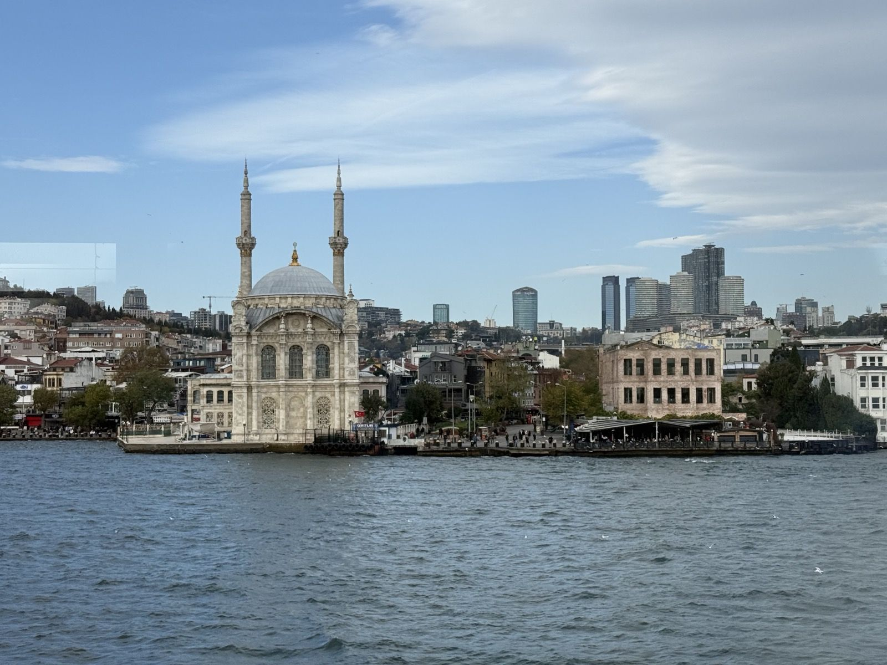
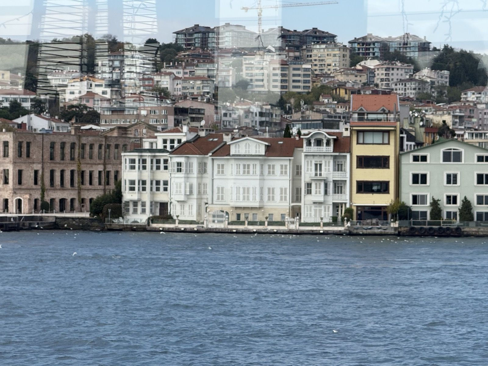
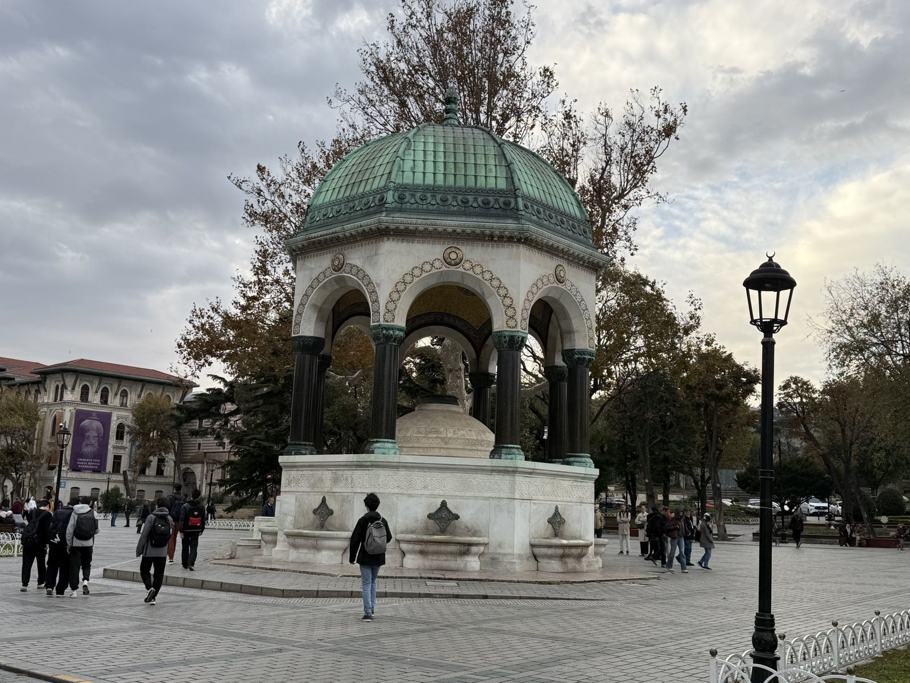
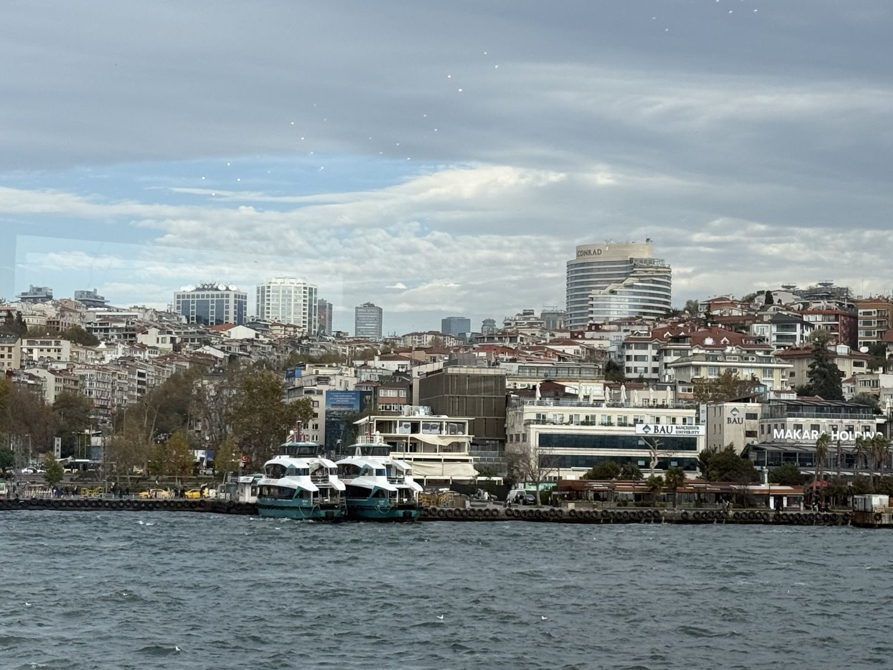
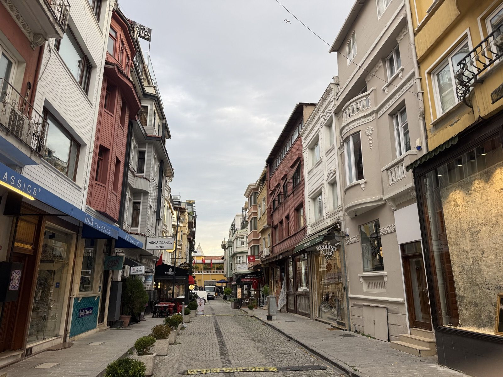
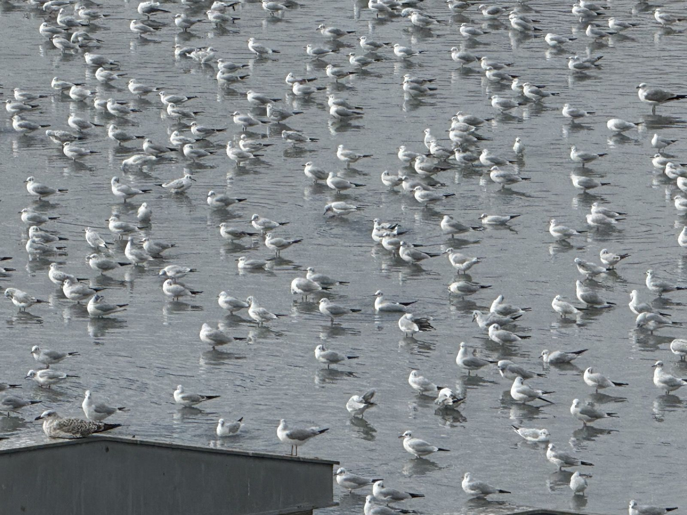
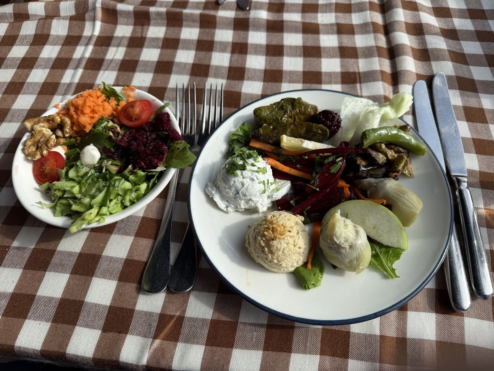
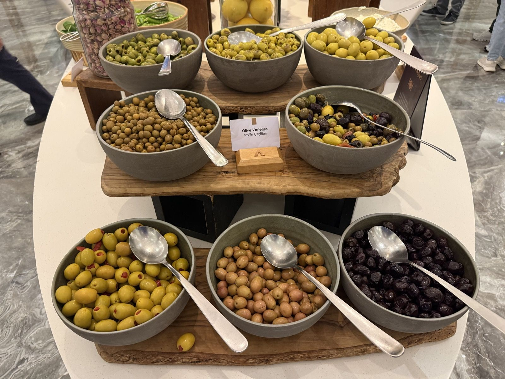
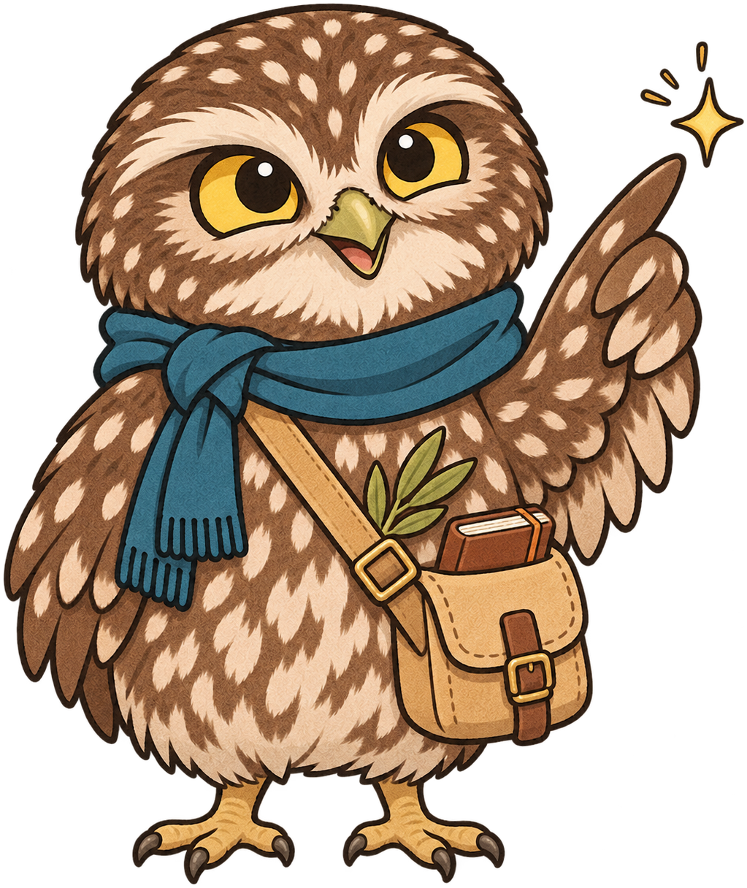

# Day 1: Istanbul, a City on Two Continents

## Summary

Day 1 (Wednesday, November 11) is arrival day, so this chapter tells the city's big story in one sitting. It follows Byzantium from a Greek city-state on the Bosphorus to Constantine's Constantinople, through the Theodosian Walls to Mehmed the Conqueror's siege of 1453, and into the Istanbul that grew around the Golden Horn. It introduces Turkish cuisine at its most everyday, with breakfast, simit, tea, coffee, and balık ekmek, along with Turkish hospitality, tipping, currency, and a first handful of Turkish phrases.

## Concepts Covered

This chapter covers the following 28 concepts from the learning graph:

| Concept | Concept Impact Score |
|---------|-----------------------|
| Bosphorus Strait | 145 |
| Empire | 15 |
| Turkish Language | 20 |
| Basic Turkish Phrases | 3 |
| Turkish Hospitality | 2 |
| Tipping Customs | 1 |
| Currency and Payments | 1 |
| Byzantium | 141 |
| Constantine the Great | 147 |
| Constantinople | 140 |
| Byzantine Empire | 58 |
| Theodosius I | 5 |
| Theodosian Decrees | 4 |
| Theodosian Walls | 77 |
| Ottoman Empire | 314 |
| Sultan | 110 |
| Mehmed the Conqueror | 86 |
| Fall of Constantinople | 76 |
| Istanbul | 21 |
| Golden Horn | 3 |
| Galata Tower | 1 |
| Food as History | 47 |
| Turkish Cuisine | 16 |
| Turkish Breakfast | 3 |
| Simit | 1 |
| Turkish Tea | 1 |
| Turkish Coffee | 2 |
| Balik Ekmek | 1 |

## Prerequisites

This chapter builds on concepts from:

- [Chapter 1: Before We Go, Part 1: The Long Timeline of the Eastern Mediterranean](../01-long-timeline/index.md)
- [Chapter 2: Before We Go, Part 2: Traveling Well and the Learning for All Thread](../02-traveling-well/index.md)

---

## Arriving in a City With Three Names

We land on Wednesday, November 11, tired, a little disoriented, and in one of the oldest continuously inhabited capitals on Earth. Over 2,600 years this city has been called Byzantium, Constantinople, and Istanbul. It was the capital of the Roman Empire in the east for more than a thousand years and of the Ottoman Empire for nearly five hundred. Its skyline of domes and minarets is the result of those two empires, one Christian and one Muslim, building on the same seven hills.

Arrival day is the wrong day for a museum and the right day for the big picture. We will not try to see Hagia Sophia today; that is tomorrow's chapter. Today we want the story that makes every later day make sense: why anyone built a city here, why one emperor made it the center of the world, why its walls held for a thousand years, and why they finally fell in 1453. Along the way we will learn how to order breakfast, how to thank the man selling bread rings from a red cart, and what to do with the change in our pocket.

!!! mascot-welcome "A City Built on Water"
    { class="mascot-admonition-img" }
    Tonight we can eat a fish sandwich by the water where Greek fishermen once netted tuna, and cross from Europe to Asia for the price of a ferry ticket. By the end of this chapter, the view from the Galata Bridge <audio id="audio-galata" src="../../audio/galata.mp3" preload="none"></audio><button onclick="document.getElementById('audio-galata').play()" class="pronounce-btn">🔊 Pronounce</button> *GAH-lah-tah* will read like a history book: the Greek harbor, the emperor's city, the Conqueror's mosques. Every story here starts with the water, so that is where we start. Look closer.

The chapter has six parts. Part One explains the water: the strait and the harbor that made the city possible. Part Two tells the story of Greek Byzantium becoming Roman Constantinople. Part Three is the story of the walls. Part Four follows the Ottomans to the siege of 1453. Part Five turns to the city of today and to food, and Part Six covers the words, money, and manners we need from the first hour.

## Part One: The Water That Made the City

### The Bosphorus Strait

A **strait** is a narrow channel of sea that connects two larger bodies of water. The **Bosphorus Strait** (in Turkish, *İstanbul Boğazı*, "the Istanbul throat") is the strait that runs about 31 km from the Black Sea in the north to the Sea of Marmara in the south. It is between about 700 m and 3.7 km wide, and it divides Istanbul between two continents: the western shore is in Europe and the eastern shore is in Asia. Together with the Dardanelles to the southwest, which we will sail through on the night of Day 5, it is the only sea route between the Black Sea and the rest of the world's oceans.

The name is Greek and comes from a myth. *Bosporos* means roughly "ox ford" or "cow's crossing." In the story, the god Zeus fell in love with a young woman named Io and turned her into a white heifer to hide her from his jealous wife Hera. Hera sent a gadfly to torment the heifer, and Io fled across the world, swimming across this strait on the way. The Greeks who named the channel were saying that it was narrow enough for a cow to swim.

The Bosphorus is also a strange piece of water. It is really two rivers, one on top of the other. The Black Sea receives huge rivers, the Danube, the Dnieper, and the Don, so its surface water is less salty and slightly higher than the Mediterranean's. That lighter water pours south along the top of the strait as a surface current, fast enough near the narrows that ferries and fishing boats steer to account for it. Underneath, a denser, saltier current flows the opposite way, north from the Sea of Marmara into the Black Sea. Ancient fishermen knew about the lower current; they would lower a weighted net and feel it pull the other way. The southward surface current also carries migrating fish, especially bonito and bluefish, past the city every autumn. We arrive in November, at the height of that run.

For 2,600 years, whoever held the Bosphorus could tax, feed, or blockade every city on the Black Sea, and could block the grain ships that fed the Mediterranean. Today about 40,000 ships pass through each year, tankers and freighters gliding between the ferries and the fishing boats past the city's front windows. Under the Montreux Convention of 1936, Turkey must let merchant ships pass freely in peacetime, but it can limit warships, which is why the strait shows up in the news whenever there is a war around the Black Sea.

<figure markdown="span" class="trip-photo">
  { loading=lazy }
  <figcaption>Ortaköy Mosque on the European shore of the Bosphorus. Photo by Dan McCreary</figcaption>
</figure>

Before the strait was bridged, the only way across was by boat. The table below shows how the crossing works now, in the order the links were built.

| Crossing | Opened | What it is | Useful to us? |
|---|---|---|---|
| City ferries (Şehir Hatları and others) | Steam ferries from the 1850s; boats since antiquity | Passenger ferries between the European and Asian piers | Yes: the classic crossing, about 20 minutes from Eminönü or Karaköy to Kadıköy |
| 15 July Martyrs Bridge (first Bosphorus Bridge) | 1973 | Road suspension bridge between Ortaköy and Beylerbeyi | Seen from the water; no pedestrians |
| Fatih Sultan Mehmet Bridge | 1988 | Road bridge at the narrows, beside the fortress of Rumeli Hisarı | Seen on a Bosphorus cruise |
| Marmaray | 2013 | Rail tunnel under the strait, from Sirkeci to Üsküdar | Yes: Europe to Asia in about four minutes underground |
| Yavuz Sultan Selim Bridge | 2016 | Road and rail bridge near the Black Sea mouth | Seen from the air on arrival, if the flight path allows |
| Eurasia Tunnel | 2016 | Road tunnel for cars under the southern end | Taxis may use it on the way to the Asian side |

**Worked example: crossing a continent before dinner.** Suppose we have the late afternoon of Day 1 free. From the old city we walk down to the ferry piers at Eminönü <audio id="audio-eminonu" src="../../audio/eminonu.mp3" preload="none"></audio><button onclick="document.getElementById('audio-eminonu').play()" class="pronounce-btn">🔊 Pronounce</button> *eh-MEE-nuh-new*, tap a transit card (the *İstanbulkart*, sold at machines by the piers) and board a ferry to Kadıköy, on the Asian shore. The trip takes about twenty minutes. On the way, look north up the strait: the European shore is on the left, the Asian shore on the right, and the first bridge hangs between them in the distance. Look back and see the old city's skyline from the water, which is how every sailor and invader saw it for two millennia: Topkapı Palace <audio id="audio-topkapi" src="../../audio/topkapi.mp3" preload="none"></audio><button onclick="document.getElementById('audio-topkapi').play()" class="pronounce-btn">🔊 Pronounce</button> *TOP-kah-puh* on the point, Hagia Sophia's dome behind it, then the minarets of the Süleymaniye <audio id="audio-suleymaniye" src="../../audio/suleymaniye.mp3" preload="none"></audio><button onclick="document.getElementById('audio-suleymaniye').play()" class="pronounce-btn">🔊 Pronounce</button> *sue-lay-MAH-nee-yeh* on the next hill. In Kadıköy, which was the Greek city of Chalcedon (we will meet it again in a moment), we can walk through the food market, have tea, and take the ferry back as the lights come on. We will have crossed from Europe to Asia and back for a couple of transit fares, which, on our first day, is a fine way to feel what "a city on two continents" means.

<figure markdown="span" class="trip-photo">
  { loading=lazy }
  <figcaption>Waterfront mansions (yalı) along the Bosphorus. Photo by Dan McCreary</figcaption>
</figure>

Before we look at the map, three place names need defining, because the map sorts places by them. The **historic peninsula** is the triangle of land on the European side between the Golden Horn and the Sea of Marmara, where the Greek, Roman, Byzantine, and early Ottoman city stood; it holds Hagia Sophia, Topkapı, and most of the sights of Days 2 to 4. **Galata** (today part of the district of Beyoğlu) is the hill on the European side across the Golden Horn, where foreign merchants lived. The **Asian shore** is everything on the far side of the Bosphorus, including Kadıköy and Üsküdar <audio id="audio-uskudar" src="../../audio/uskudar.mp3" preload="none"></audio><button onclick="document.getElementById('audio-uskudar').play()" class="pronounce-btn">🔊 Pronounce</button> *EWS-kew-dar*. The **Golden Horn** itself is the curved inlet that separates the historic peninsula from Galata; Part Five tells its story.

#### Diagram: Istanbul's Three Shores

<iframe src="../../sims/istanbul-three-shores-map/main.html" height="680px" width="100%" scrolling="no"></iframe>

[Run the Istanbul's Three Shores MicroSim Fullscreen](../../sims/istanbul-three-shores-map/main.html){ .md-button .md-button--primary }

Istanbul's Three Shores

Type: map
**sim-id:** istanbul-three-shores-map 
**Library:** Leaflet 
**Status:** Specified 
**Bloom Level:** Understand 
**Bloom Verb:** classify 
**Learning Objective:** The learner will classify twelve Istanbul places by the shore they stand on (the historic peninsula, Galata, or the Asian shore), classifying at least 10 of 12 correctly on the first attempt.

**Prerequisites:** strait, Bosphorus Strait, historic peninsula, Galata, Asian shore, Golden Horn (all defined in the section "The Bosphorus Strait" above).

**Evidence of Mastery:** For each of the twelve places, the learner commits to one of three shores before the place's marker is revealed on the map. A classification is correct when it matches the Correct shore column in Content. Mastery is 10 of 12 correct on the first attempt. Panning the map and opening place infoboxes after the quiz is exploration, not evidence.

**Misconceptions:** (1) All of Istanbul is in Europe. (2) The Golden Horn is part of the Bosphorus, so Galata is in Asia. (3) The old Greek city of Byzantium stood where the modern city center (Taksim) is. (4) The walls of Constantinople run along the Bosphorus.

**Instructional Rationale:** Classifying places by shore makes the learner build a mental model of the city's three parts and the two bodies of water that divide them. Committing to a shore before the marker appears is a prediction, and the reveal on the real map corrects the model immediately.

**Content:**

The map shows the Bosphorus, the Golden Horn and the northern edge of the Sea of Marmara, with three labeled regions: Historic peninsula (European side, south of the Golden Horn), Galata (European side, north of the Golden Horn), Asian shore (east of the Bosphorus). Region labels are shown; place markers are hidden until each is answered.

| # | Place | Latitude | Longitude | Correct shore | Infobox text (shown after answering) |
|---|---|---|---|---|---|
| 1 | Sarayburnu (Seraglio Point) | 41.0157 | 28.9850 | Historic peninsula | The tip of the peninsula, where Greek Byzantium stood and Topkapı Palace stands now. |
| 2 | Hagia Sophia | 41.0086 | 28.9802 | Historic peninsula | Built 537 as a cathedral; Day 2's chapter. |
| 3 | Column of Constantine (Çemberlitaş) | 41.0084 | 28.9711 | Historic peninsula | Raised for the dedication of Constantinople in 330; still standing on Divan Yolu. |
| 4 | Golden Gate (Yedikule) | 40.9935 | 28.9223 | Historic peninsula | The ceremonial entrance at the southern end of the Theodosian land walls. |
| 5 | Edirnekapı (Gate of Adrianople) | 41.0310 | 28.9370 | Historic peninsula | A gate of the land walls; Mehmed II rode in near here on May 29, 1453. |
| 6 | Fatih Mosque | 41.0195 | 28.9497 | Historic peninsula | Built by Mehmed II on the site of the Church of the Holy Apostles, where Constantine was buried. |
| 7 | Eminönü ferry piers | 41.0170 | 28.9740 | Historic peninsula | The balık ekmek boats and the ferries to Asia leave from here. |
| 8 | Galata Tower | 41.0256 | 28.9741 | Galata | Built by the Genoese in 1348; the sunset view over the Golden Horn. |
| 9 | Rumeli Hisarı | 41.0846 | 29.0563 | Galata | Mehmed II's 1452 fortress at the narrows. It stands on the European shore north of Galata; for this quiz, all of the European side north of the Golden Horn counts as Galata. |
| 10 | Kadıköy ferry pier | 40.9925 | 29.0240 | Asian shore | Ancient Chalcedon, "the city of the blind." |
| 11 | Üsküdar | 41.0260 | 29.0150 | Asian shore | Ancient Chrysopolis, where Constantine defeated Licinius in 324. |
| 12 | Maiden's Tower (Kız Kulesi) | 41.0211 | 29.0041 | Asian shore | A small tower on an islet just off the Asian shore, opposite the peninsula. |

**Provenance:** Coordinates are approximate and taken from OpenStreetMap; the generator should verify each against OpenStreetMap before building and correct any that are off by more than 200 m. The infobox facts come from this chapter's sections "The Bosphorus Strait," "Byzantium," "Constantine the Great," "The Theodosian Walls," "Mehmed the Conqueror" and "The Golden Horn."

**Rules:** Each place has exactly one correct shore. For this quiz, the European shore north of the Golden Horn, including Rumeli Hisarı, counts as Galata; the infobox for place 9 says so. Places are asked in the fixed order listed. A place counts as correct only on the learner's first answer.

**Learner Activity:**

1. The learner sees the map with the three regions labeled and the prompt for place 1.
2. The learner chooses a shore. The place's marker appears at its true location, the correct shore is shown, and the infobox opens.
3. The learner continues through all twelve places.
4. After place 12, every marker is shown together and the learner can open any infobox and pan the map.
5. The learner should notice that everything Byzantine and early Ottoman (places 1 to 7) is on the historic peninsula, while the foreign merchants' tower and the Asian-side towns sit across water from it.

**Feedback:** Twelve places, fixed order, one attempt each. Correct: "Right: <place> is on the <shore>." plus the infobox text. Incorrect: "Not quite: <place> is on the <correct shore>." plus the infobox text; for place 8 add "The Golden Horn separates Galata from the old city, but both are in Europe." A running score "Shores correct: n of 12" is shown. At the end: "10 or more: you know your way around" or "Fewer than 10: look again at where the Golden Horn meets the Bosphorus, then try again." A Restart button clears answers and hides the markers.

**Starting State:** The map centered on the meeting of the Bosphorus and the Golden Horn, the three regions labeled, no markers, and the question "Sarayburnu (Seraglio Point): which shore?"

**Chapter Anchors:** The Bosphorus is about 31 km long and between about 700 m and 3.7 km wide. The ferry from Eminönü to Kadıköy takes about twenty minutes. Galata Tower, 1348. Rumeli Hisarı, 1452. Column of Constantine, 330. Chalcedon is "the city of the blind."

### Empire

The city we have just crossed was the capital of two empires, so it is worth being precise about the word. An **empire** is a large state in which one ruler or ruling people governs many different peoples and territories, usually brought together by conquest, from a single center of power. A kingdom can be small and made up of one people; an empire is, by definition, a collection of peoples ruled from elsewhere. That is what made empires powerful, because they could draw soldiers, taxes, and grain from huge areas, and also what made them fragile, because the conquered rarely forgot that they had been conquered.

Empires share a few working parts. They need a capital where power and wealth gather, roads or sea lanes that let armies and tax collectors reach the provinces, a common administrative language, and some story that makes their rule seem legitimate: the will of the gods, the law of Rome, the defense of the faith. They also need a way to rule people who pray, speak, and live differently from the rulers. The Romans gave citizenship to provincials over time; the Ottomans let each religious community run its own courts and schools. How well an empire handled that diversity often decided how long it lasted.

**Worked example: counting the empires of one city.** Let's count how many empires ruled this city and for how long, using dates we will meet in this chapter.

1. **Persia** briefly controlled Byzantium in the late 500s BCE, when King Darius marched his army across the Bosphorus on a bridge of boats.
2. **Rome** absorbed the city gradually, and by 73 CE it was formally part of the Roman Empire.
3. **The Roman Empire in the east**, which historians call the Byzantine Empire, ruled from here from 330 to 1453, except for one break.
4. **The Latin Empire** was the break: crusaders held the city from 1204 to 1261.
5. **The Ottoman Empire** ruled from here from 1453 until the sultanate was abolished in 1922.

From 330 to 1922, then, Istanbul was an imperial capital for almost 1,600 years. When the Republic of Turkey moved its capital to Ankara in 1923, it was making a deliberate break with that imperial past. Turkey's government still sits in Ankara, while Istanbul remains the country's largest city and the center of its trade and culture.

## Part Two: From Byzantium to Constantinople

### Byzantium

**Byzantium** (in Greek, *Byzantion*) is the Greek city founded on the tip of the historic peninsula around 657 BCE by colonists from Megara <audio id="audio-megara" src="../../audio/megara.mp3" preload="none"></audio><button onclick="document.getElementById('audio-megara').play()" class="pronounce-btn">🔊 Pronounce</button> *MEG-uh-ruh*, a city-state near Athens. Like every Greek colony, it was a city-state of its own, with its own assembly, coins, and gods, and it kept that independence for centuries. Ancient writers said the founder's name was Byzas, and the city's name may come from him, though the story may also have been invented later to explain the name. The Latin form *Byzantium* is the one historians use, and it later gave its name to a whole empire.

There is a better story about the founding, and it ties our first day to Delphi, the oracle we will visit on Day 12. Across the Bosphorus, on the Asian shore, stood an older Greek colony called **Chalcedon**, where Kadıköy is today. The historian Herodotus, writing in the 400s BCE, reports that a Persian general named Megabazus heard that Chalcedon had been founded seventeen years before Byzantium, and said its founders must have been blind, since they had passed up the far better site across the water. Later Roman writers, Strabo and Tacitus, told the story differently: the Megarians had asked the oracle at Delphi where to settle, and Apollo told them to build "opposite the city of the blind." The Delphi version is almost certainly a later embellishment. But it shows that by Roman times everyone agreed on the point: Byzantium had the better site.

**Worked example: why the "blind" chose the worse site.** We can test the insult by comparing the two sites the way a Greek colonist would.

| What a colonist needed | Byzantium (historic peninsula) | Chalcedon (Kadıköy) |
|---|---|---|
| A safe harbor | The Golden Horn: a deep, sheltered inlet about 7.5 km long, protected from storms | An open shore facing the Sea of Marmara, with smaller harbors |
| Defense | Water on three sides; only the western land side needs a wall | Open to the land behind it |
| Fish | The southward current carries migrating fish toward the European shore and into the Golden Horn | Fewer fish come close to shore |
| Control of shipping | Ships coming down from the Black Sea pass close to the point and must work around it | Farther from the main shipping lane |
| Hinterland (farmland behind the city) | Thrace, poorer farmland | Bithynia, richer farmland |

Chalcedon's founders were not fools. They had better farmland, which is what most Greek colonists looked for first. Byzantium won because its strengths were the sea's strengths: a harbor, a natural fortress, the fish, and the toll on passing ships. The city grew rich by charging ships to pass, and by salting and exporting fish, especially tuna and bonito, whose image appears on some of its coins.

!!! mascot-thinking "The Site Is the Story"
    { class="mascot-admonition-img" }
    Notice that the same four advantages, harbor, water on three sides, fish, and control of the strait, explain nearly everything that happens to this city for the next two thousand years. Emperors chose it, invaders wanted it, and walls only had to be built on one side. When a story in this guide seems surprising, ask what the water was doing.

Byzantium's location also made it a prize in every war. Philip II of Macedon, the father of Alexander the Great, besieged it in 340 BCE and failed. In 196 CE the Roman emperor Septimius Severus destroyed it after it backed his rival in a civil war, then rebuilt it and began the great racecourse, the **Hippodrome**, that we will walk tomorrow. It remained a middling provincial city until a Roman emperor looked at the map and saw what the Megarians had seen.

### Constantine the Great

**Constantine the Great** (Constantine I, ruled 306–337 CE) was the Roman emperor who became the first emperor to embrace Christianity and who refounded Byzantium as Constantinople, the new capital of the Roman world. Few individuals changed the history of this region more. His conversion turned a persecuted minority faith into the religion of the empire, and his choice of capital decided where the center of the Christian, and later the Muslim, world would be for 1,600 years.

Constantine came to power in an empire that had been split among several rulers. Around 300 CE the emperor Diocletian had divided the empire among four co-emperors, a system that soon collapsed into civil war. Constantine was born around 272 in Naissus (now Niš, in Serbia), the son of one of those co-emperors. When his father died in 306 at Eboracum (York, in Britain), the army there proclaimed Constantine emperor, and he spent the next eighteen years fighting his way to sole rule.

The turning point came in 312, outside Rome. Before the Battle of the Milvian Bridge, Constantine reported seeing a sign in the sky, which Christian writers later described as the Chi-Rho, the first two Greek letters of *Christos* (Χ and Ρ). He had the sign painted on his soldiers' shields, won the battle, and credited the Christian God. The next year, he and his co-emperor Licinius issued the agreement usually called the **Edict of Milan**, which granted freedom of worship to Christians and returned their confiscated property. Constantine was not baptized until he lay dying in 337, and he kept some older imperial customs all his life, but from 312 he favored the church with money, buildings, and law.

The table below follows his career by place, with what we can still see of each moment on our route.

| Year | Where | What happened | What we can see on this trip |
|---|---|---|---|
| c. 272 | Naissus (Niš, Serbia) | Born, son of a Roman officer who became co-emperor | Not on our route |
| 306 | Eboracum (York, Britain) | Proclaimed emperor by his father's army | Not on our route |
| 312 | Milvian Bridge, Rome | Wins under the Christian sign | The Chi-Rho appears in Byzantine art in Istanbul and Ephesus |
| 313 | Milan | Edict of Milan grants Christians freedom of worship | Churches built openly from now on, including the ones we will visit |
| 324 | Chrysopolis (Üsküdar, Istanbul's Asian shore) | Defeats Licinius and becomes sole emperor | Üsküdar is a short ferry ride from the old city |
| 325 | Nicaea (İznik, Turkey) | Calls the first council of bishops, which agrees the Nicene Creed | Chapter 1's worked example; İznik tiles cover Istanbul's mosques |
| 330 | Constantinople | Dedicates his new capital on May 11 | The Column of Constantine, on Divan Yolu |
| 337 | Near Nicomedia (İzmit, Turkey) | Baptized and dies; buried in the Church of the Holy Apostles | The Fatih Mosque now stands on the church's site |

**Worked example: why move the capital?** Rome had been the capital for a thousand years. Why would an emperor build a new one on the far side of the empire? Put the reasons side by side and the choice makes sense.

- **The frontiers were in the east.** The empire's most dangerous enemies were the Goths beyond the Danube and the Persian Empire beyond the Euphrates. Byzantium sits between those two fronts. Rome was weeks away from both.
- **The wealth was in the east.** Egypt, Syria, and Anatolia were richer and more populous than Italy and the western provinces.
- **The crossroads.** The main land road from Europe to Asia crossed the Bosphorus here, and the sea lane from the Black Sea to the Mediterranean ran past the point. An emperor based here could move armies and grain in every direction.
- **The site.** It had the harbor and water on three sides that the Megarians had chosen, which meant one strong wall could protect it.
- **A fresh start.** Rome was full of temples and old senatorial families attached to the old gods. A new capital could be built as a Christian city from its foundations.

Constantine had considered other sites, including the area near Troy, which we will visit on Day 6. He chose Byzantium after defeating Licinius just across the strait, so he had seen the site through a general's eyes.

### Constantinople

**Constantinople** (in Greek, *Konstantinoupolis*, "the city of Constantine") is the name Constantine gave to Byzantium when he refounded it as the new capital of the Roman Empire. He marked out the new boundaries in 324 and dedicated the city on May 11, 330. Officially it was also called *Nova Roma*, New Rome, and Constantine furnished it like one: a senate, a palace beside the Hippodrome, forums, public baths, and a grain dole, free bread for citizens, as in old Rome. He drew a new land wall about 3 km west of the old Greek wall, roughly quadrupling the city's area. That wall is gone, because his successors outgrew it within a century.

Constantine also stripped the empire of statues to decorate his city. Bronzes and marbles from Greek sanctuaries, including Delphi, were carted to Constantinople and set up in its streets and in the Hippodrome. One survivor stands there today: the bronze Serpent Column, originally dedicated at Delphi after the Greek victory over Persia at Plataea in 479 BCE. We will see it tomorrow, and on Day 12 we will stand where it first stood.

The city grew fast. By the 500s it may have held around half a million people, and for most of the next six centuries it was the largest and richest city in Europe, a place western visitors described with something like disbelief. Its main street, the **Mese** ("Middle Street"), ran west from the palace through a chain of forums toward the land walls. Its starting point was the **Milion**, a monument from which distances throughout the empire were measured, the "zero mile marker" of the Roman east.

**Worked example: walking Constantine's main street.** The modern avenue called **Divan Yolu**, where the tram runs from Sultanahmet toward the Grand Bazaar, follows the line of the Mese. That means a ten-minute walk on our first evening can trace the spine of Constantine's city. The table pairs what stood along the route with what we can see now, in walking order from east to west.

| Stop on the walk | In Constantine's city | What we see now |
|---|---|---|
| Start, by the Basilica Cistern | The Milion, the marker from which the empire's roads were measured | A single weathered stone fragment of it, beside the street near the Basilica Cistern entrance |
| Sultanahmet tram stop | The edge of the imperial palace and the Hippodrome | Sultanahmet Square, laid over the Hippodrome; the Blue Mosque on part of the palace site |
| Along Divan Yolu | The Mese, lined with colonnades and shops | Tram tracks, shops, and Ottoman tombs and fountains along the same line |
| Çemberlitaş tram stop | The oval Forum of Constantine, with his statue on a porphyry column | The Column of Constantine (Çemberlitaş, "the hooped stone"), about 35 m tall today, blackened by fires and held together with iron hoops |
| Beyazıt, near the Grand Bazaar | The Forum of Theodosius, a later emperor's forum | Beyazıt Square and Istanbul University's gate |

The Column of Constantine is easy to walk past, a blackened stump among traffic and shops. It is also the most direct physical link to the founding of the city: a column that stood at the center of Constantine's dedication ceremony in 330, still standing where he put it nearly seventeen centuries ago.

<figure markdown="span" class="trip-photo">
  { loading=lazy }
  <figcaption>The German Fountain in Sultanahmet Square, a gift from Kaiser Wilhelm II, built in 1900. Photo by Dan McCreary</figcaption>
</figure>

### The Byzantine Empire

Chapter 1 defined the **Byzantine Empire** as the eastern Roman Empire ruled from Constantinople from 330 to 1453: Christian, increasingly Greek-speaking, and calling itself simply Roman. Here we want to understand what that empire did, because the city we walk through for the next four days is its capital and its monument. The question that most visitors never ask is how a state could survive 1,123 years with enemies on every side, when the western half of the same empire collapsed in 476.

The answer is a combination of tools, most of which we can see in the city. The table below sets them out. Each row is a reason historians give for the empire's long survival, and each is something we will see later in the trip.

| Tool of survival | What it was | Where we meet it |
|---|---|---|
| The walls | The Theodosian land walls and the sea walls made the capital almost impregnable | Part Three of this chapter |
| The site | Supplies could arrive by sea even when an army camped outside the walls | The Golden Horn, below the Galata Bridge |
| Greek fire | A liquid incendiary weapon sprayed from ships, used from the 670s, whose recipe is still unknown | Byzantine history; no physical trace survives |
| A stable gold coin | The *solidus*, trusted across three continents | Museum cases in Istanbul and Athens |
| Diplomacy and money | Byzantium often paid, married, or converted its enemies rather than fight them | The story of the Rus, who arrived as raiders and left as Orthodox Christians |
| Faith | The emperor ruled as God's representative and protector of Orthodox Christianity | Hagia Sophia and the mosaics, Day 2 |
| Law and administration | A trained civil service, taxes collected in gold, and Justinian's law code | The Byzantine legacy in European law |

The empire's size changed enormously over those eleven centuries. Under the emperor Justinian in the 500s, it ruled from Italy and North Africa to Egypt and Syria. In the 600s Arab armies took Egypt, Syria, and North Africa, and the empire shrank to Anatolia, the Balkan coasts, and the islands. It recovered in the 900s and early 1000s, then lost most of central Anatolia to the Seljuk Turks after the Battle of Manzikert in 1071. The Fourth Crusade broke it apart in 1204. By the 1440s, the "Roman Empire" was little more than the city itself, a few Aegean islands, and part of the Peloponnese in southern Greece. Only the city's walls and its sea access kept it alive.

**Worked example: a coin that kept its value for 700 years.** Constantine introduced a gold coin called the *solidus* (in Greek, *nomisma*) around 309. It contained about 4.5 grams of nearly pure gold, and it was struck at 72 coins to the Roman pound. The remarkable fact is that Byzantine emperors kept that weight and purity essentially unchanged for about seven hundred years, until financial crisis forced debasement in the mid-1000s. For comparison, the United States dollar has existed for about 230 years and has lost more than 95 percent of its purchasing power. A merchant in Venice, Cairo, or Kyiv in 900 would accept a solidus without weighing it, which made it something like the US dollar of the medieval world. That trust was a source of power: it let the empire pay soldiers, buy peace, and attract trade. When we see a small gold Byzantine coin in a museum case, we are looking at one of the reasons the empire lasted.

!!! mascot-encourage "So Many Emperors"
    { class="mascot-admonition-img" }
    If the emperors and dates are starting to run together, that is normal: Byzantium had about ninety emperors over eleven centuries. For our four days in Istanbul we need only four names, Constantine who founded the city, Theodosius who gave it its faith and its walls, Justinian who built Hagia Sophia, and Mehmed who conquered it. Hang everything else on those four.

### Theodosius I

**Theodosius I** (ruled 379–395), also called Theodosius the Great, was the emperor who made Nicene Christianity the official religion of the Roman Empire and the last emperor to rule both its eastern and western halves. When he became emperor, Christianity was favored but not required, pagan temples were still open, and Christians themselves were bitterly divided over the nature of Christ. In 380, in a decree issued at Thessalonica, he declared that all peoples of the empire should follow the faith agreed at Nicaea in 325, and that anyone who did not was a heretic. In 381 he called the Council of Constantinople, the second great council of bishops, to confirm it. That is the form of Christianity that the Orthodox churches of Greece and Turkey still follow.

His other lasting legacy was the division of the empire. When Theodosius died in 395, he left the east to his son Arcadius, ruling from Constantinople, and the west to his son Honorius. The two halves were never again ruled by one man. The western half collapsed within a century; the eastern half, the Byzantine Empire, lasted another thousand years.

**Worked example: an emperor on an obelisk.** Tomorrow, in the Hippodrome, we will see a pink granite **obelisk**, a tall four-sided pillar tapering to a point, carved in Egypt for the pharaoh Thutmose III around 1450 BCE and later shipped to Constantinople. Theodosius had it raised in the Hippodrome in 390. The obelisk's hieroglyphs are about 3,500 years old. But look closer at the marble base, which is Roman. Its reliefs show Theodosius himself in the imperial box, surrounded by his family and guards, watching the races and receiving tribute from kneeling foreigners. One side even shows the machines used to raise the obelisk. It is a portrait of power: an emperor who could move an Egyptian monument across the sea and have himself carved beneath it, presiding over his city. The obelisk is the oldest object we will see in Istanbul, and its base is the best surviving portrait of Theodosius.

### The Theodosian Decrees

The **Theodosian Decrees** <audio id="audio-theodosian" src="../../audio/theodosian.mp3" preload="none"></audio><button onclick="document.getElementById('audio-theodosian').play()" class="pronounce-btn">🔊 Pronounce</button> *thee-uh-DOH-shun* are a series of laws issued by Theodosius I in 391 and 392 that banned pagan sacrifice, closed the temples of the old gods, and finally forbade pagan worship even in private homes. Earlier Christian emperors had restricted sacrifice, but these laws went further: visiting a temple became a crime, and worship of the gods who had been honored on our route for two thousand years became illegal. Bishops, soldiers, and mobs sometimes enforced them with violence. The most famous case was the destruction of the Serapeum, the great temple of Serapis in Alexandria, in 391.

We know the exact wording of these laws because a later emperor, Theodosius II, had all the imperial laws since Constantine collected into the **Theodosian Code**, published in 438. That makes the decrees a primary source we can still read, which is unusual for something this old.

**Worked example: tracing one decree along our route.** The decrees reach almost every ancient site we will visit, so it helps to follow their effects forward.

- **Delphi (Day 12).** The oracle of Apollo had been consulted for more than a thousand years. With sacrifice banned and temples closed, the Pythia <audio id="audio-pythia" src="../../audio/pythia.mp3" preload="none"></audio><button onclick="document.getElementById('audio-pythia').play()" class="pronounce-btn">🔊 Pronounce</button> *PITH-ee-uh* fell silent by the end of the 300s. A famous "last oracle," supposedly delivered to the emperor Julian, is a later legend, but the silence was real. Chapter 17 picks up this story.
- **Olympia.** The ancient Olympic Games, held in honor of Zeus, are traditionally said to have ended after 393. Historians debate whether the end came under Theodosius I or his grandson in the 420s, but either way, it was a religious festival that no longer had a legal place.
- **Athens (Days 10 to 13).** The Parthenon survived because it was converted into a church, which is why it was still standing for the Venetians to blow up in 1687.
- **Ephesus (Day 7).** The Temple of Artemis, already damaged, lost its worship; its stones were reused in churches.

The decrees are one reason why so many ancient temples on our route survive only as foundations, or survive because they became churches. They also mark the moment when this region's religious life changed most sharply before the Ottoman conquest. We will see what was lost, and what was kept by being converted, at nearly every stop.

## Part Three: The Walls

### The Theodosian Walls

The **Theodosian Walls** are the triple line of land fortifications that protected Constantinople's western, landward side, about 5.7 km from the Sea of Marmara to the Golden Horn. They were built under the emperor Theodosius II, the grandson of Theodosius I, and completed in 413. For more than a thousand years no army broke through them by force; the crusaders who took the city in 1204 got in from the harbor side, along the Golden Horn. The walls were finally breached in 1453, by cannon. Long stretches still stand, and they are part of the UNESCO World Heritage listing for Istanbul's historic areas.

!!! mascot-warning "Two Emperors Named Theodosius"
    { class="mascot-admonition-img" }
    Watch out: the Theodosian Walls are named for Theodosius II (ruled 408–450), not for Theodosius I, the emperor of the decrees and the obelisk. Guides and signs often just say "Theodosius," so check the date: anything from 379 to 395 is the grandfather, and anything from 408 to 450, including the walls and the Theodosian Code, is the grandson.

Before we look at the walls in cross-section, a few terms. A **moat** is a ditch in front of a wall, often filled with water, that keeps attackers and their siege machines at a distance. A **terrace** here means the flat strip of ground between two lines of wall, where defenders could move and fight. A **tower** projects out from the wall, so archers inside can shoot along its face at anyone trying to climb or dig. A **breach** is a gap broken through a wall.

An attacker coming from the west, from Thrace, met five layers in turn. First came a **moat** about 20 m wide and several meters deep, with a low battlemented wall along its inner edge. Behind that was the **outer terrace**, a strip of open ground exposed to fire from above. Then came the **outer wall**, about 8.5 m high and about 2 m thick, with smaller towers of its own. Behind it was the **inner terrace**, the *peribolos*, about 15 to 20 m wide, where the defenders gathered. Last came the **inner wall**, the main wall, about 12 m high and nearly 5 m thick, with 96 towers up to about 20 m tall, set so that each one covered the gap between two outer towers. From the edge of the moat to the inner wall, the whole system was about 60 m deep. An attacker who crossed the moat and climbed the outer wall found himself on a terrace overlooked by an even higher wall, with defenders shooting down from two levels. These measurements are approximate; they vary along the walls, and sources give slightly different figures.

The walls were nearly lost once without an enemy in sight. In January 447, an earthquake brought down long stretches, including 57 towers, just as Attila the Hun was marching south through the Balkans. The prefect of the city, also named Constantine, organized the citizens, including the rival racing fans of the Hippodrome, the Blues and the Greens, to rebuild them. An inscription that still survives at one of the gates boasts that the work was done in less than two months. Attila turned away.

**Worked example: the walls versus the sieges.** Here is the record the walls built up, using the dates we have met. In 626, a Persian army camped on the Asian shore while the Avars attacked the land walls; the walls held, and the Byzantine fleet kept the two armies from joining across the Bosphorus. In the 670s and again in 717–718, Arab armies and fleets besieged the city; the walls held, and Greek fire burned the fleets. Bulgarians, Rus, and Pechenegs all came and left. In 1204, the Fourth Crusade attacked from the Golden Horn, where the sea walls were lower, and broke in there. In 1422 the Ottoman sultan Murad II besieged the land walls and failed. Only in 1453, when Mehmed II brought cannon powerful enough to smash the walls, did the land walls finally give way. Each time, the walls bought the defenders time, and time was usually enough: invaders ran short of food, or disease broke out in their camps, or trouble at home called them back.

The interactive cross-section below lets us take the attacker's route through the five layers. It ends by asking why the design worked.

#### Diagram: Layers of the Theodosian Walls

<iframe src="../../sims/theodosian-walls-layers/main.html" height="450px" width="100%" scrolling="no"></iframe>

[Run the Layers of the Theodosian Walls MicroSim Fullscreen](../../sims/theodosian-walls-layers/main.html){ .md-button .md-button--primary }

Layers of the Theodosian Walls

Type: infographic
**sim-id:** theodosian-walls-layers 
**Library:** html 
**Status:** Specified 
**Bloom Level:** Remember 
**Bloom Verb:** identify 
**Learning Objective:** The learner will identify the five layers of the Theodosian land walls in the order an attacker from the west meets them, with no more than one placement error.

**Prerequisites:** moat, terrace, tower, breach, outer wall, inner wall, peribolos (all defined in the section "The Theodosian Walls" above).

**Evidence of Mastery:** Part 1: the learner places five unlabeled layer names into five positions on the cross-section, from outside (west) to inside (east), and submits. A position is correct when it matches the Order column in Content. Mastery is at least 4 of 5 positions correct on the first submission. Part 2: three multiple-choice questions, each correct when it matches the Answer column. Clicking callouts after submission is exploration, not evidence.

**Misconceptions:** (1) The walls were one thick wall. (2) The moat was the strongest defense. (3) The outer wall was taller than the inner wall. (4) The walls were named for Theodosius I. (5) The walls were never breached before 1453 (the crusaders broke in from the harbor in 1204, not through the land walls).

**Instructional Rationale:** At the Remember level, the learner must be able to retrieve the layers and their order without support. Placing the names on a cross-section before the callouts are revealed is that retrieval; the three questions that follow check the reason for the order.

**Content:**

A schematic cross-section of the land walls, west (outside, toward Thrace) on one side and east (inside, the city) on the other. Each layer is drawn with relative heights correct (inner wall taller than outer wall, moat below ground level). The drawing is labeled "Schematic; not to scale."

| Order (outside to inside) | Layer | Approximate size | Callout text (revealed after submission) |
|---|---|---|---|
| 1 | Moat | About 20 m wide, several meters deep, with a low battlemented wall on its inner edge | Kept siege towers, rams and miners at a distance. |
| 2 | Outer terrace | A narrow strip between the moat and the outer wall | Open ground where attackers were exposed to fire from both walls. |
| 3 | Outer wall | About 8.5 m high and 2 m thick, with smaller towers of its own | The first wall an attacker had to climb or break. |
| 4 | Inner terrace (peribolos) | About 15 to 20 m wide | Where defenders gathered; any attacker who crossed the outer wall was trapped here under fire from above. |
| 5 | Inner wall | About 12 m high and nearly 5 m thick, with 96 towers up to about 20 m tall | The main wall. Its towers were set to cover the gaps between the outer towers. |

Total depth from moat edge to inner wall: about 60 m. Length of the land walls: about 5.7 km. Completed in 413 under Theodosius II; rebuilt in less than two months after the earthquake of 447.

Questions in Part 2:

| # | Question | Choices | Answer | Why (shown as feedback) |
|---|---|---|---|---|
| 1 | Why is the inner wall taller than the outer wall? | So defenders on it could shoot over the outer wall at attackers; So it could be seen from the sea; Because it was built later; It is not taller | So defenders on it could shoot over the outer wall at attackers | Two heights let defenders fire from two levels at once. |
| 2 | Which emperor completed the land walls in 413? | Constantine I; Theodosius I; Theodosius II; Justinian | Theodosius II | Theodosius I died in 395; his grandson Theodosius II completed the walls in 413. |
| 3 | How did the crusaders get into the city in 1204? | Through a breach in the land walls; From the Golden Horn, over the sea walls; Through a tunnel; The gates were opened by treaty | From the Golden Horn, over the sea walls | The land walls held; the attack came from the harbor, where the sea walls were lower. |

**Provenance:** All dimensions and dates are from this chapter's section "The Theodosian Walls," which uses commonly cited approximate figures; the sim must label the dimensions "approximate."

**Rules:** Part 1 is scored per position: 5 positions, one point each. A layer name may be placed in only one position. Submission is allowed only when all five positions are filled. Part 2 is scored per question, one attempt each.

**Learner Activity:**

1. The learner sees the cross-section with five empty positions and five layer names in random order.
2. The learner places each name in a position, can rearrange freely, and submits.
3. Each position is marked correct or incorrect, the correct names are shown, and all five callouts become available.
4. The learner opens any callout to read its size and purpose.
5. The learner answers the three questions in Part 2, one at a time.
6. The learner should notice that the defense depended on depth and height working together, not on any single wall.

**Feedback:** Part 1: one submission. Correct position: "Correct: <layer>." Incorrect: "This position is the <correct layer>." After submission: "n of 5 layers placed correctly." Part 2: three questions in fixed order, one attempt each; correct "Right." plus the Why text; incorrect "Not quite." plus the Why text, with the answer revealed. Final score: "Layers n of 5, questions m of 3." A Restart button clears both parts and reshuffles the layer names.

**Starting State:** The empty cross-section with "West: Thrace" on the outside and "East: the city" on the inside, five layer names to place, and the question "An army arrives from the west. What does it meet first, and what last?"

**Chapter Anchors:** Five layers: moat, outer terrace, outer wall, inner terrace (peribolos), inner wall. Moat about 20 m wide; outer wall about 8.5 m high, 2 m thick, with smaller towers; inner terrace 15 to 20 m wide; inner wall about 12 m high, nearly 5 m thick, 96 towers up to about 20 m tall; total depth about 60 m; length about 5.7 km; completed 413; earthquake January 447, rebuilt in less than two months.

The best place to feel the walls is at their southern end, where the **Golden Gate**, the triumphal entrance through which emperors rode in after victories, is enclosed inside the Ottoman fortress of Yedikule. Another good stretch is near Edirnekapı, close to the Chora <audio id="audio-chora" src="../../audio/chora.mp3" preload="none"></audio><button onclick="document.getElementById('audio-chora').play()" class="pronounce-btn">🔊 Pronounce</button> *KOR-ah* Church, which Chapter 4 describes. Both are out of the center, and on a short November afternoon they are better saved for a day with time to spare than squeezed into arrival day. From the Bosphorus ferry, though, we can already see why the city needed walls only on its western side: everywhere else, the water was the wall.

## Part Four: The Ottomans and 1453

### The Ottoman Empire

The **Ottoman Empire** was a Muslim Turkish state founded around 1299 in northwest Anatolia that grew into one of the largest and longest-lasting empires in history, ruling from this city from 1453 until 1922. Its name comes from its founder, a frontier chieftain named **Osman**; in Turkish the dynasty and its people are the *Osmanlı*, "of Osman," which became "Ottoman" in European languages. At its height in the 1500s it ruled Anatolia, the Balkans, Hungary, the Middle East, Egypt, the holy cities of Arabia, and North Africa from Algeria to the Persian Gulf. It lasted about 623 years, longer than the Roman Empire in the west.

The Ottomans began small. Around 1300, Anatolia was a patchwork of Turkish principalities, called *beyliks*, that had grown up after the Seljuk victory over Byzantium at Manzikert in 1071. Osman's was one of the smallest, but it had one great advantage: it sat on the border with what was left of Byzantine Anatolia, a few days' ride from Constantinople. War along that frontier brought warriors, plunder, and land. Osman's son Orhan took the Byzantine city of Bursa in 1326 and made it his capital. In the 1350s the Ottomans crossed the Dardanelles into Europe, and in the 1360s they took Adrianople, now Edirne, and moved their capital there. By 1400 they ruled most of the Balkans and western Anatolia.

Three things set the Ottomans apart from the other beyliks and help explain their growth. They were pragmatic: they recruited Christian Byzantine nobles, soldiers, and administrators and let conquered peoples keep their faith in return for taxes and loyalty. They built a standing army loyal only to the ruler, including the **Janissaries**, infantry recruited as boys from Christian families in the Balkans, converted to Islam, and trained as the sultan's own soldiers. And they kept the state in one family: the empire was never divided among heirs, as many Turkish states had been. Chapter 5 tells how this empire ran at its height, and Chapter 6 how its many faiths lived side by side.

The empire nearly ended almost as soon as it began. In 1402 the Central Asian conqueror Timur (Tamerlane) crushed the Ottoman army at Ankara and captured the sultan, Bayezid I, who died in captivity. For eleven years his sons fought one another for what was left. Constantinople, which Bayezid had been besieging, was saved by an invader from the east. The Ottomans recovered within a generation, and by the 1440s the Byzantine capital was an island in an Ottoman sea: Ottoman land on the European side, Ottoman land on the Asian side, and Ottoman ships in the strait.

**Worked example: following the Ottoman capitals.** One way to see how the empire grew is to follow its capital city, each one closer to Constantinople.

| Capital | Years | Where it is | What it tells us |
|---|---|---|---|
| Söğüt | c. 1299–1326 | A small town in northwest Anatolia, about 150 km southeast of Istanbul | A frontier chieftain's base on the Byzantine border |
| Bursa | 1326–c. 1365 | A former Byzantine city at the foot of Mount Uludağ, across the Sea of Marmara from Istanbul | The first major city taken; the early sultans are buried here |
| Edirne (Adrianople) | c. 1365–1453 | In Thrace, in Europe, about 230 km west of Istanbul | The Ottomans are now a European power, and Constantinople is surrounded |
| Istanbul (Constantinople) | 1453–1922 | The city we are standing in | The empire takes over the Roman imperial capital and its prestige |
| (Ankara) | From 1923 | Central Anatolia | The Republic of Turkey deliberately chose a new capital, away from the empire's city |

Read top to bottom, the table is a spiral closing in on the Bosphorus. In 150 years the Ottomans went from a border town to the walls of Constantinople, conquering everything around the city before they took the city itself.

### Sultan

A **sultan** is a Muslim sovereign ruler; the word is Arabic for "power" or "authority," and it was the title of the Ottoman rulers. The early Ottoman leaders called themselves *bey*, a Turkish word for a chief or lord. By the late 1300s, as they ruled more land and more people, they had taken the grander title sultan, and after 1453 they added older imperial titles as well: *padişah* (a Persian word for emperor) and, from Mehmed II, *Kayser-i Rum*, "Caesar of Rome," a claim to be the heir of the Roman emperors whose city they now held.

The sultan was the head of the state, the army, and the law, and from the 1500s the Ottoman sultans also claimed the title of **caliph**, the leader of the whole Muslim community, which Chapter 5 explains. Every decree carried his **tughra**, an elaborate calligraphic monogram of his name and titles that served as his signature. Once we learn to spot it, we will see tughras on palace gates, fountains, coins, and documents all over the city, each one a different sultan's.

To see what was new about the office, it helps to compare the sultan with the Byzantine emperor he replaced. Both claimed to rule by God's will; they differed in almost everything else, as the table shows.

| | Byzantine emperor | Ottoman sultan |
|---|---|---|
| Title | *Basileus* (king) and Roman emperor | Sultan, *padişah*, and after 1453 "Caesar of Rome" |
| Source of legitimacy | Chosen by God, crowned in Hagia Sophia, protector of the Orthodox Church | Chosen by God, member of the house of Osman, defender of Islam |
| Succession | No fixed rule; often a son, but generals and usurpers frequently seized the throne | Only a man of Osman's family could rule, but any son could claim the throne |
| Religious role | Protector of the church; could call councils but was not a priest | Protector of Islam and the holy cities; from the 1500s, also caliph |
| Signature | Signed in purple ink | The tughra |
| Language of government | Greek | Ottoman Turkish, written in Arabic script |

**Worked example: why sultans had to fight for the throne.** The succession row hides a hard story. Because any son of a sultan could claim the throne, a sultan's death often set off a war among his sons, as happened after 1402. Mehmed II's law code, compiled later in his reign, made the brutal solution explicit: whichever of his sons became sultan could put his brothers to death "for the order of the world." Mehmed himself, on taking the throne in 1451, had his infant half-brother killed. The practice continued for more than a century; in 1595 Mehmed III's nineteen brothers were executed on his accession. From the early 1600s the Ottomans replaced it with the *kafes*, the "cage": princes were kept confined in the palace, and the throne passed to the oldest living male of the family. This is not a comfortable history, but it explains something we will see at Topkapı on Day 3: the palace was designed around the problem of who would rule next.

### Mehmed the Conqueror

**Mehmed the Conqueror** (Mehmed II, born 1432, ruled 1444–1446 and 1451–1481) was the Ottoman sultan who captured Constantinople in 1453 and made it the capital of his empire. In Turkish he is *Fatih Sultan Mehmet*, Mehmed the Conqueror; the district of Fatih in the old city, the Fatih Mosque, and the second Bosphorus bridge are all named for him. He was 21 years old when he took the city.

Mehmed was the son of Sultan Murad II and grew up in Edirne. His father briefly handed him the throne at age twelve, in 1444, then took it back two years later when war threatened and the court and the Janissaries proved hard for a boy to control. When Murad died in 1451, Mehmed returned as sultan at nineteen, determined to do what his ancestors had failed to do. He was well educated, studied history, and is said to have spoken several languages, including Greek; he admired Alexander the Great and had the story of Alexander's campaigns read to him. Western writers of his time portrayed him as a monster, Ottoman writers as a hero of the faith. Both were partly right. He was ruthless in war and in politics, and he was also curious, patient, and a patron of scholars, artists, and architects from both East and West. Near the end of his life he invited the Venetian painter Gentile Bellini to Istanbul, and Bellini's portrait of him, dated 1480, now hangs in the National Gallery in London.

**Worked example: a castle built to strangle a city.** In the spring of 1452, a year before the siege, Mehmed began building a fortress at the narrowest point of the Bosphorus, about 700 m across, on the European shore north of the city. Across the water stood a smaller fortress his great-grandfather Bayezid I had built in the 1390s, **Anadolu Hisarı**, the "Anatolian castle." The new one, **Rumeli Hisarı**, the "castle of Rumelia" (the Ottoman name for their European lands), went up in about four and a half months. Contemporaries called it *Boğazkesen*, which means both "strait-cutter" and "throat-cutter." With cannon on both shores, the Ottomans could now stop any ship coming down from the Black Sea, which is where much of Constantinople's grain and any help from the Genoese colonies there would come from. In November 1452, a Venetian ship that refused to stop was sunk by the castle's guns; its captain was executed and his body displayed as a warning. Mehmed had closed the strait before firing a shot at the walls. Today Rumeli Hisarı is a museum, and from a Bosphorus ferry we can see both castles facing each other across the narrows, under the Fatih Sultan Mehmet Bridge.

The table summarizes Mehmed's preparations and what each one was meant to defeat. Part of the reason the siege succeeded is that he spent two years attacking the city's advantages before he attacked its walls.

| When | Preparation | What it was meant to defeat |
|---|---|---|
| 1451 | Makes peace treaties with Venice, Hungary, and others | Help from Christian powers in the West |
| Spring–summer 1452 | Builds Rumeli Hisarı at the narrows | The city's supply by sea from the Black Sea |
| Late 1452 | Hires **Orban**, a Hungarian cannon-founder whom the Byzantine emperor could not afford, to cast giant bronze cannon | The Theodosian land walls |
| Winter 1452–1453 | Assembles a fleet of more than a hundred ships | The city's control of the sea around it |
| Spring 1453 | Gathers an army that modern historians estimate at 50,000 to 80,000 men | The defenders' small numbers |

### The Fall of Constantinople

The **Fall of Constantinople** is the capture of the city by the Ottoman army of Mehmed II on May 29, 1453, after a siege of 53 days, which ended the Byzantine Empire. It is one of the turning points of world history: many historians use it to mark the end of the Middle Ages. For Turks it is *İstanbul'un Fethi*, "the Conquest of Istanbul," a national anniversary celebrated every May 29. For Greeks it is *i Álosi*, "the Capture," remembered as a catastrophe. Both names describe the same day.

The last emperor was **Constantine XI Palaiologos**, who shared his name with the city's founder, a coincidence that both sides noticed. His city was a shadow of the one Constantine I had built. Its population had fallen from perhaps half a million in the 500s to perhaps 50,000, living in villages and gardens scattered inside the old walls. His army was tiny. His secretary George Sphrantzes counted 4,983 Greek men able to fight, plus about 2,000 foreigners, mostly Venetians and Genoese, including about 700 soldiers brought by a Genoese commander named **Giovanni Giustiniani Longo**, who took charge of the land walls. Roughly 7,000 defenders had to man nearly 20 km of land and sea walls.

The siege began on April 6, 1453. Orban's great bombard, a bronze cannon about 8 m long, fired stone balls weighing more than half a ton. It could fire only a few times a day and had to be cooled with oil after each shot, but each hit brought down sections of wall that the defenders rebuilt at night with timber, earth, and barrels. The heaviest bombardment fell on the stretch of wall where the little Lycus stream flowed into the city, near the Gate of St. Romanus, where the ground was lowest.

Across the mouth of the Golden Horn, the defenders had stretched a great **chain** (a floating boom of iron links on wooden floats) from the city to the walls of Galata, so Ottoman ships could not enter the harbor and attack the weaker sea walls, the ones the crusaders had broken through in 1204. On April 20, four Christian ships carrying supplies fought their way through the Ottoman fleet and into the harbor while Mehmed watched from the shore. It was the defenders' best day of the siege.

**Worked example: the ships that crossed a hill.** Mehmed's answer came two days later, and it is the most famous episode of the siege. If his ships could not pass the chain, he would go around it over land. On the night of April 21 and the morning of April 22, his men hauled about seventy ships out of the Bosphorus, onto a track of greased logs, and over the hill behind Galata, then slid them down into the upper Golden Horn, inside the chain. Let's trace why this mattered. The Galata hill rises about 60 m above the water, and the route was a few kilometers long, so this was a feat of engineering and of sheer human muscle. Militarily, it did not break the sea walls; the Ottoman ships in the Golden Horn never stormed them. What it did was force the defenders to move men from the land walls to guard the sea walls along the harbor, thinning a garrison that was already too small. It also ended the defenders' hope of using the harbor as a safe base. From the Galata Tower tonight, we can look down on the slope those ships came down.

By late May, the defenders were exhausted. A Venetian relief fleet had been promised but had not arrived; on May 23 a small scouting ship slipped back into the harbor to report that it had found no fleet in the Aegean. Before dawn on May 29, Mehmed launched a final assault in three waves, first irregular troops, then Anatolian regulars, then the Janissaries. Giustiniani was badly wounded and carried away from the walls, and the defenders at the breach lost heart when they saw him go. According to one Byzantine historian, a small gate called the Kerkoporta had also been left open, and Ottoman soldiers got onto the walls through it; historians still debate the story. The Janissaries broke through. Constantine XI died fighting, and his body was never certainly identified.

Mehmed rode into the city later that day, entering near the Edirnekapı gate. He went to Hagia Sophia and ordered it converted into a mosque; the first Friday prayer was held there on June 1. Chapter 4 continues that story inside the building.

Because the siege has so many moving parts, the step-through below asks a single question about each turning point: which of the city's defenses did this event defeat?

#### Diagram: The Siege of 1453, Step by Step

<iframe src="../../sims/siege-of-1453-step-through/main.html" height="450px" width="100%" scrolling="no"></iframe>

[Run the Siege of 1453, Step by Step MicroSim Fullscreen](../../sims/siege-of-1453-step-through/main.html){ .md-button .md-button--primary }

The Siege of 1453, Step by Step

Type: microsim
**sim-id:** siege-of-1453-step-through 
**Library:** p5.js 
**Status:** Specified 
**Bloom Level:** Analyze 
**Bloom Verb:** attribute 
**Learning Objective:** The learner will attribute each of eight turning points of the 1453 siege to the defense of Constantinople it overcame, or recognize that the defenders held, matching at least 6 of 8 correctly on the first attempt.

**Prerequisites:** Bosphorus Strait, Golden Horn, Theodosian Walls, moat, breach, Rumeli Hisarı, the chain across the Golden Horn, Janissaries, Mehmed II, Constantine XI, Giovanni Giustiniani Longo (all defined in Parts One, Three and Four of this chapter).

**Evidence of Mastery:** At each of eight steps, the learner reads the event and commits to one of six answers before the outcome is shown. An answer is correct when it matches the Correct answer column in Content. Mastery is 6 of 8 correct on the first attempt. Moving the map or replaying steps after answering is exploration, not evidence.

**Misconceptions:** (1) The city fell only because of the cannon. (2) The ships dragged overland broke into the city from the harbor. (3) Everything in the siege went Mehmed's way. (4) The West sent help that was defeated. (5) The defenders were a large army.

**Instructional Rationale:** Analysis means breaking an outcome into its parts and attributing each part to a cause. Asking, before each reveal, which defense an event overcame makes the learner treat the fall as the result of several defenses failing in turn, and including two events where the defenders held prevents the learner from treating every event as an Ottoman success.

**Content:**

The six answer choices, the same at every step: (A) The strait: supply from the Black Sea. (B) The chain across the Golden Horn. (C) The land walls. (D) Help from the West. (E) The defenders' numbers and morale. (F) None: the defenders held this time.

A schematic map shows the historic peninsula, the land walls, the Golden Horn with the chain across its mouth, Galata, the Bosphorus with Rumeli Hisarı and Anadolu Hisarı, and the Sea of Marmara. Each step highlights its location on the map.

| Step | Date | Event shown to the learner | Map location | Correct answer | Why (shown as feedback) |
|---|---|---|---|---|---|
| 1 | Spring–summer 1452 | Mehmed builds the fortress of Rumeli Hisarı in about four and a half months at the narrows, about 700 m across, opposite Anadolu Hisarı. In November a Venetian ship that refuses to stop is sunk by its guns. | Rumeli Hisarı | A | With guns on both shores, no ship can bring grain or help down from the Black Sea. |
| 2 | Late 1452 | Orban, a Hungarian cannon-founder the emperor could not afford, casts a bronze bombard about 8 m long for Mehmed. | Edirne (off-map arrow to the west) | C | The cannon was built to smash the Theodosian land walls, which no army had broken for a thousand years. |
| 3 | From April 6, 1453 | The bombardment brings down sections of wall near the Gate of St. Romanus, where the Lycus stream enters the city. | Land walls, central section | C | Each hit opens a breach; the walls are losing for the first time. |
| 4 | April 20 | Four Christian supply ships fight through the Ottoman fleet and into the Golden Horn while Mehmed watches from the shore. | Mouth of the Golden Horn | F | The ships get through and the chain holds; this is the defenders' best day. |
| 5 | April 21–22 | About seventy Ottoman ships are hauled overland on greased logs from the Bosphorus over the hill behind Galata and slid into the upper Golden Horn. | Galata hill to the upper Golden Horn | B | The ships go around the chain, and defenders must leave the land walls to guard the harbor walls. |
| 6 | Nightly, April–May | After each day's bombardment, defenders rebuild the breaches with timber, earth and barrels. | Land walls, central section | F | The repairs hold the line for seven weeks; cannon alone did not take the city. |
| 7 | May 23 | A scouting ship returns: it has found no Venetian relief fleet in the Aegean. | Sea of Marmara | D | The help that was promised never came in time. |
| 8 | May 29, before dawn | In the final assault, Giustiniani is badly wounded and carried away from the walls; the defenders at the breach lose heart, and the Janissaries break through. About 7,000 defenders had been holding nearly 20 km of walls. | Land walls, Gate of St. Romanus | E | Too few men, exhausted after 53 days, lost their commander at the decisive moment. |

**Provenance:** All events, dates and numbers are from this chapter's sections "Mehmed the Conqueror" and "The Fall of Constantinople," which follow standard modern accounts of the siege. The map is schematic and must be labeled "Schematic map."

**Rules:** Exactly one correct answer per step. Steps are shown in the fixed order listed. A step counts as correct only on the learner's first answer. After answering, the learner may revisit earlier steps but cannot change their answers.

**Learner Activity:**

1. The learner reads step 1's date and event, with its location highlighted on the map.
2. The learner chooses one of the six answers. The answer locks, the correct answer is shown, and the Why text appears.
3. The learner moves to the next step, until all eight are done.
4. At the end, the learner sees a summary that lists the eight steps with their correct answers, the learner's answers marked right or wrong, and how many steps fell under each defense.
5. The learner should notice that four different defenses (the strait, the chain, the land walls, help from the West) failed before the final assault, and that the defenders won two rounds.

**Feedback:** Eight steps, fixed order, one attempt each. Correct: "Right: <answer>." plus the Why text. Incorrect: "Not quite. The answer is <correct answer>." plus the Why text; for a wrong answer of C at step 5 add "The ships never broke the walls; they forced the defenders to spread out." A running score "Turning points: n of 8" is shown. At the end: "6 or more: you can explain why the city fell" or "Fewer than 6: reread 'The Fall of Constantinople' and try again." A Restart button clears all answers.

**Starting State:** The schematic map with Rumeli Hisarı highlighted, step 1's text, the six answer choices, and the question "Which of the city's defenses does this defeat?"

**Chapter Anchors:** Siege of 53 days, April 6 to May 29, 1453. About 7,000 defenders (Sphrantzes: 4,983 Greeks plus about 2,000 foreigners). Nearly 20 km of walls. Rumeli Hisarı built in about four and a half months at a strait about 700 m wide. Orban's bombard about 8 m long. Four ships on April 20. About seventy ships hauled overland on April 21–22. Scouting ship returned May 23. Mehmed II was 21.

The conquest was also a story of what came after. Mehmed had promised his soldiers the traditional three days of plunder, and the city suffered terribly: thousands were killed or enslaved, and churches were looted. Then he set about rebuilding. He brought in settlers, Muslims, Christians, and Jews, from across his empire to repopulate the half-empty city. In January 1454 he installed a scholar-monk, Gennadios Scholarios, as the new Orthodox Patriarch, and the Patriarchate has remained in Istanbul ever since. He built palaces, first near today's Beyazıt Square and then on the old acropolis point at Topkapı, and a great mosque complex on the site of the Church of the Holy Apostles, where Constantine and many later emperors had been buried. Within a century, the city had grown back to several hundred thousand people.

!!! mascot-thinking "One Day, Two Memories"
    { class="mascot-admonition-img" }
    Think of May 29, 1453 as a door that opens onto two different rooms. A Turkish guide may describe a brilliant young sultan who founded a great capital, while a Greek friend may remember the death of an empire and still call Tuesday, the day of the week the city fell, an unlucky day. Both are telling the truth about the same events, so the best question to ask either one is "what does this day mean to your family?"

## Part Five: The City Around the Golden Horn

### Istanbul

**Istanbul** is the Turkish name of the city, in official use since the Republic, and today it is Turkey's largest city, with about 15.7 million people, nearly one Turk in five. The name has an unexpected origin. It comes from medieval Greek: *eis tin polin* (εἰς τὴν πόλιν), "into the city" or "to the City," which is what Greeks in the countryside said when they were going to Constantinople, because there was only one City. Turkish speakers heard it as one word. The Ottomans used it in everyday speech for centuries, while their official documents usually called the city *Kostantiniyye*, the Arabic form of Constantinople.

<figure markdown="span" class="trip-photo">
  { loading=lazy }
  <figcaption>Istanbul seen from the water. Photo by Dan McCreary</figcaption>
</figure>

**Worked example: one city, many names.** Who calls the city what tells us who was looking at it, and from where.

| Name | Language | Meaning | Who used it |
|---|---|---|---|
| Byzantion / Byzantium | Greek / Latin | Probably from the founder Byzas | The Greek city, c. 657 BCE to 330 CE |
| Constantinople (Konstantinoupolis) | Greek | City of Constantine | The Byzantines, and most of Europe until the 20th century |
| Nova Roma | Latin | New Rome | Constantine's official title for the city |
| Mikligarðr | Old Norse | The Great City | Viking traders and the Varangian Guard |
| Tsargrad | Slavic | City of the Caesar | Russians, Bulgarians, and Serbs |
| Kostantiniyye | Ottoman Turkish (Arabic form) | City of Constantine | Ottoman official documents and coins |
| Istanbul | Turkish, from Greek | "To the City" | Ottoman everyday speech, and officially since the Republic |
| *I Póli* | Modern Greek | The City | Greeks today, who still often call it simply "the City" |

The change of name was finally fixed for foreigners in 1930, when the Turkish postal service began asking that letters be addressed to İstanbul rather than Constantinople. Seven years earlier, in 1923, Ankara had become the capital of the new Republic. Istanbul lost its government but kept its trade, its port, its universities, and its importance, and it has grown more than fifteen-fold since then. Most of its people today were born elsewhere in Turkey or are the children of people who were, which is one reason the city's food and accents come from every corner of Anatolia.

<figure markdown="span" class="trip-photo">
  { loading=lazy }
  <figcaption>A quiet residential street in Istanbul. Photo by Dan McCreary</figcaption>
</figure>

### The Golden Horn

The **Golden Horn** (in Turkish, *Haliç*, "the inlet") is the curved, horn-shaped inlet of the Bosphorus, about 7.5 km long, that separates the historic peninsula from Galata and formed the city's natural harbor. Its name, *Chrysokeras* in Greek, is old and may describe its shape and the golden light on the water at sunset, or the wealth that passed through it. Its deep, calm water sheltered the fleets of every empire that ruled here, which is why the defenders of 1453 guarded its mouth with a chain. Today the **Galata Bridge** crosses it near the mouth, with a row of fishermen along its rails at every hour and fish restaurants on its lower deck, and the view from the bridge at dusk, mosques on one side and Galata Tower on the other, is the classic first evening in Istanbul.

<figure markdown="span" class="trip-photo">
  { loading=lazy }
  <figcaption>Gulls rafting on the Bosphorus. Photo by Dan McCreary</figcaption>
</figure>

### Galata Tower

**Galata Tower** is the stone tower, about 63 m tall, that the Genoese built in 1348 on the hill north of the Golden Horn, as the high point of the walls of their trading colony of Galata. The Genoese, merchants from the Italian city of Genoa, held Galata as a semi-independent colony under Byzantine permission, and they called the tower *Christea Turris*, the Tower of Christ. After 1453 the Ottomans used it as a watchtower for fires and a prison. A famous story, told by the 17th-century Ottoman travel writer Evliya Çelebi, says that a man named Hezarfen Ahmed Çelebi strapped on wings, jumped from the tower, and glided across the Bosphorus to Üsküdar; it is almost certainly a legend. Today the tower is a museum with a viewing balcony that circles the top. The view of the Golden Horn and the old city at sunset is superb, and so is the line to get in, so going in the late afternoon of Day 1, before sunset at about 5:45 PM, is worth trying.

### Food as History

**Food as history** is the idea that a dish is a historical record: its ingredients, its techniques, and the words we use for it preserve traces of migration, trade, conquest, religion, and climate. Every plate we eat on this trip can be read the way an archaeologist reads a wall, in layers. That is one of the great pleasures of travel, and it is especially rewarding in Istanbul, a city that has sat at the meeting point of continents and empires for 2,600 years.

Reading food as history means asking four questions of any dish. *Where did each ingredient first grow?* Tomatoes, peppers, and corn, for example, came from the Americas and reached the Ottoman Empire only after 1492. *Who brought it here, and when?* Coffee came up the Red Sea trade routes from Yemen in the 1500s. *What do the words say?* The Turkish word for corn, *mısır*, is also the Turkish word for Egypt, because corn arrived via Egypt. *What does it tell us about how people lived?* Yogurt, which is a Turkish word, is the way herders on the move kept milk from spoiling. The answers often surprise us, because dishes that feel ancient may be recent, and many foods we think of as one country's are shared by a whole region.

**Worked example: reading a Turkish breakfast table.** Let's read tomorrow morning's breakfast in layers. The **olives** and **olive oil** are the oldest layer: olive trees have been cultivated around the eastern Mediterranean for thousands of years, long before Byzantium was founded. The **white cheese**, the **yogurt**, and the **kaymak** (thick clotted cream) carry the culture of Turkic herders who moved west from Central Asia into Anatolia after 1071, a dairy culture built on sheep, goats, and cattle; *yoğurt* and *kaymak* are Turkic words. The **sliced tomatoes** and the **green peppers** come from the Americas, a gift of the Columbian Exchange, the transfer of crops between the Americas and the rest of the world that began after 1492; tomatoes did not become common in Ottoman cooking until the 1800s. The **tea** is the newest layer of all. The Ottomans were coffee drinkers, and Turkey only became a nation of tea drinkers in the 20th century, after tea plantations were planted on the Black Sea coast at Rize in the 1930s and 1940s. One breakfast table, then, holds the ancient Mediterranean, the Turkish migration, the age of exploration, and the early Republic. The sorting activity below lets us practice reading these layers.

#### Diagram: Reading Food in Layers

<iframe src="../../sims/food-history-layers-sorter/main.html" height="450px" width="100%" scrolling="no"></iframe>

[Run the Reading Food in Layers MicroSim Fullscreen](../../sims/food-history-layers-sorter/main.html){ .md-button .md-button--primary }

Reading Food in Layers

Type: microsim
**sim-id:** food-history-layers-sorter 
**Library:** p5.js 
**Status:** Specified 
**Bloom Level:** Understand 
**Bloom Verb:** classify 
**Learning Objective:** The learner will classify fourteen foods found in Istanbul by the historical layer they came from, classifying at least 11 of 14 correctly on the first attempt.

**Prerequisites:** food as history, Columbian Exchange, kaymak, Turkic herders, Rize (all defined in the section "Food as History" above).

**Evidence of Mastery:** For each of fourteen food cards, the learner places the card in one of five layers and the placement is checked immediately. A placement is correct when it matches the Correct layer column in Content. Mastery is 11 of 14 correct on the first attempt. Reading the layer descriptions is exploration, not evidence.

**Misconceptions:** (1) Tomatoes and peppers have always been part of Mediterranean cooking. (2) Tea is an ancient Ottoman drink. (3) Turkish cooking is essentially the same as Arab cooking. (4) Everything on a Turkish table came with the Turks from Central Asia. (5) Coffee was always part of life in Istanbul.

**Instructional Rationale:** Classifying foods by origin makes the learner apply the "where did it first grow and who brought it" questions to items they will actually eat. Immediate feedback with a reason turns each card into a short history lesson, and the mix of familiar and surprising items exposes the misconception that a food's familiarity means it is old.

**Content:**

The five layers, shown as labeled bins with these descriptions:

1. Ancient Mediterranean and Anatolia: grown or caught here since long before Byzantium.
2. Turkic herders from Central Asia: brought by Turkish-speaking herders who moved into Anatolia after 1071.
3. Ottoman trade and court: arrived through the empire's trade routes and palace kitchens, often from the Arab and Persian worlds.
4. The Americas, after 1492: arrived through the Columbian Exchange.
5. The Turkish Republic, after 1923: a 20th-century change.

| # | Food card | Correct layer | Why (shown as feedback) |
|---|---|---|---|
| 1 | Olives and olive oil | 1 | Olive trees have been cultivated around the eastern Mediterranean for thousands of years. |
| 2 | Bonito and bluefish from the Bosphorus | 1 | Greek Byzantium grew rich salting and exporting the fish that migrate through the strait. |
| 3 | Chickpeas | 1 | Chickpeas were first farmed in what is now southeastern Turkey, thousands of years before the Greeks arrived. |
| 4 | Yogurt | 2 | Yogurt is a Turkic word, and souring milk was how herders on the move kept it from spoiling. |
| 5 | Ayran (salted yogurt drink) | 2 | A herders' drink made from yogurt and water, now Turkey's everyday drink with kebab. |
| 6 | Kaymak (clotted cream) | 2 | Kaymak is a Turkic word for a herders' dairy food, eaten at breakfast with honey. |
| 7 | Mantı (tiny meat dumplings with yogurt) | 2 | Dumplings came west with Turkic and Mongol peoples across the Central Asian steppe. |
| 8 | Coffee | 3 | Coffee came up the Red Sea from Yemen, and the first coffeehouses opened in Istanbul in the 1550s. |
| 9 | Pilaf (pilav) | 3 | Pilav is a Persian word; rice pilaf was a dish of the Persian and Ottoman courts. |
| 10 | Şerbet (sweet fruit drink) | 3 | Şerbet comes from an Arabic word for a drink; the Ottoman court served it cooled with mountain snow. |
| 11 | Tomatoes | 4 | Tomatoes came from the Americas and became common in Ottoman cooking only in the 1800s. |
| 12 | Pul biber (red pepper flakes) | 4 | All chili peppers are American plants that reached the Ottoman Empire after 1492. |
| 13 | Corn (mısır) roasted on a street cart | 4 | Corn is American; its Turkish name, mısır, also means Egypt, the route by which it arrived. |
| 14 | Black tea (çay) | 5 | Turks drank coffee until the 20th century; tea plantations at Rize on the Black Sea date from the 1930s and 1940s. |

**Provenance:** All origins and dates are from this chapter's sections "Food as History," "Turkish Cuisine," "Turkish Tea" and "Turkish Coffee," which follow standard food histories of the region.

**Rules:** Each card has exactly one correct layer. Cards are presented one at a time in a shuffled order that is the same for every learner (seed 1453). A card counts as correct only on the learner's first placement; after feedback the card moves to its correct layer.

**Learner Activity:**

1. The learner sees the five layer bins with their descriptions and the first food card.
2. The learner places the card in a bin. The placement is marked correct or incorrect, the Why text appears, and the card settles into its correct bin.
3. The learner continues through all fourteen cards.
4. At the end, the learner sees all five bins filled, with the cards in each, and a score.
5. The learner should notice that the breakfast table they will eat on Day 2 includes cards from four different layers.

**Feedback:** Fourteen cards, one attempt each. Correct: "Right: <food> belongs to <layer name>." plus the Why text. Incorrect: "Not quite: <food> belongs to <correct layer name>." plus the Why text. A running score "Layers read: n of 14" is shown. At the end: "11 or more: you can read a menu like a history book" or "Fewer than 11: reread 'Food as History' and try again." A Restart button clears the bins and starts over in the same order.

**Starting State:** Five empty bins with their descriptions, the first card showing, and the question "When did this food arrive on Istanbul's table?"

**Chapter Anchors:** Turkic herders arrived after 1071. The Columbian Exchange began after 1492. Tomatoes common in Ottoman cooking only from the 1800s. First Istanbul coffeehouses in the 1550s. Rize tea plantations in the 1930s and 1940s. Mısır means both corn and Egypt.

### Turkish Cuisine

**Turkish cuisine** is the cooking of Turkey, built from the herding traditions of the Turkic peoples of Central Asia, the farming and fishing of Anatolia and the Mediterranean, the court cooking of Persia and the Arab world, and the palace kitchens of the Ottoman Empire, which drew all of these together. Chapter 5 visits the Topkapı kitchens, which at their height fed several thousand people a day, and Chapter 6 covers meze, kebab, and the sweets. Here we need the overall shape.

Three features are worth knowing on our first day. First, Turkish cooking is **regional**. The Black Sea coast is known for anchovies and corn bread, the southeast for spicy kebabs and pistachios, the Aegean for olive-oil vegetable dishes, central Anatolia for meat, bread, and dumplings. Istanbul, full of migrants from all of them, has restaurants from every region. Second, much of it is shared with neighbors. Greeks, Armenians, Arabs, Balkan peoples, and Turks eat many of the same dishes under similar names, and arguments over who invented baklava or stuffed grape leaves are best enjoyed rather than settled. Third, a great deal of it is **vegetable cooking**: a whole family of dishes called *zeytinyağlılar*, "those with olive oil," are vegetables slow-cooked in olive oil and served cool.

<figure markdown="span" class="trip-photo">
  { loading=lazy }
  <figcaption>A Turkish lunch of meze. Photo by Dan McCreary</figcaption>
</figure>

**Worked example: menemen, a breakfast in five layers.** *Menemen* is a skillet dish of eggs scrambled softly with tomatoes, green peppers, and often onion, cooked in olive oil or butter and eaten straight from the pan with bread. It looks simple. Read it as food history: the olive oil is ancient Mediterranean; the butter, if used, belongs to the herders' dairy tradition; the tomatoes and peppers are American, which means this "traditional" dish can be no older than the 1800s in its current form; the bread is the staple of every period; and the tea served alongside is 20th-century Republic. Istanbul cafés argue over whether menemen should include onions, a question with no historical answer but a lot of passion. Ordering it tomorrow is a good way to start a conversation with the waiter.

### Turkish Breakfast

**Turkish breakfast** (*kahvaltı* <audio id="audio-kahvalti" src="../../audio/kahvalti.mp3" preload="none"></audio><button onclick="document.getElementById('audio-kahvalti').play()" class="pronounce-btn">🔊 Pronounce</button> *kah-vahl-TUH*) is the traditional morning meal of many small dishes eaten with bread and tea. Its name means "before coffee" (*kahve altı*), from the old custom of eating something before the morning coffee. A full breakfast spread, sometimes called *serpme kahvaltı*, can cover the table: white cheese and aged cheeses, black and green olives, tomatoes and cucumbers, honey and kaymak, jams, butter, boiled eggs or menemen, sometimes spicy sausage (*sucuk*), and baskets of bread and simit, with tea refilled until we stop it. Our hotel will likely serve a version of it. On a weekend, many Istanbul families make a long breakfast the main social meal of the day.

<figure markdown="span" class="trip-photo">
  { loading=lazy }
  <figcaption>Olives at a Turkish breakfast. Photo by Dan McCreary</figcaption>
</figure>

### Simit

**Simit** is a ring of bread, crisp outside and chewy inside, dipped in grape molasses and coated in sesame seeds before baking. It is Istanbul's street breakfast: sold from glass-sided red carts and from trays carried on vendors' heads, eaten on the walk to work or with tea and cheese. Istanbul records mention simit by the early 1500s. It costs less than a dollar, and buying one from a cart on our first morning is a small, cheap act of reciprocity, money spent with a local vendor rather than a chain.

### Turkish Tea

**Turkish tea** (*çay*, pronounced "chai") is strong black tea, grown on the Black Sea coast around Rize and brewed in a stacked double teapot, the *çaydanlık*: a strong concentrate in the top pot, boiling water in the bottom one. It is served in small, clear, tulip-shaped glasses, so the drinker can see the color, and we choose *açık* (light) or *koyu* (dark). By most counts Turks drink more tea per person than anyone else in the world. Tea is offered constantly, in shops, offices, and carpet stores, and it is part of hospitality, not a sales trick. To signal that we have had enough, we lay the spoon across the top of the glass.

### Turkish Coffee

**Turkish coffee** (*Türk kahvesi*) is very finely ground coffee simmered with water, and with sugar if wanted, in a small long-handled pot called a *cezve*, then poured unfiltered into a small cup so the grounds settle at the bottom. Because the sugar goes in while it brews, we order the sweetness up front: *sade* (no sugar), *az şekerli* (a little), *orta* (medium), or *şekerli* (sweet). Coffee reached Istanbul from Yemen in the 1550s, and coffeehouses quickly became places for conversation, news, and occasional political trouble. In 2013 UNESCO added Turkish coffee culture and tradition to its list of the world's intangible cultural heritage. A Turkish proverb says that a single cup of coffee is remembered for forty years, meaning that a small kindness creates a lasting bond. Sip slowly, stop before the grounds, and if a friend offers to read our fortune in them, accept.

### Balık Ekmek

**Balık ekmek** ("fish bread") is a grilled fish sandwich, usually a fillet of mackerel with onion, lettuce, and a squeeze of lemon in a split half-loaf of bread. It is sold beside the Galata Bridge at Eminönü, traditionally from boats rocking at the quay that grill the fish on board, and it is the city's best-known cheap meal by the water. Ask for it with a cup of *turşu suyu*, sour pickle juice, from the nearby pickle stands, a local pairing. One honest note: much of the mackerel is now imported, because the Bosphorus is overfished. November is the start of the season for local fish such as *hamsi* (Black Sea anchovies) and *lüfer* (bluefish), so a fish restaurant will have the freshest catch on its menu this month. Balık ekmek at Eminönü, then a walk across the Galata Bridge toward the tower, makes a fine first evening.

## Part Six: Being a Good Guest From the First Hour

### The Turkish Language

**Turkish** is the official language of Turkey, spoken as a first language by more than 80 million people. It belongs to the **Turkic** language family, together with Azerbaijani, Uzbek, Kazakh, Turkmen, and Uyghur, languages spoken across a belt from the Balkans to western China. Its ancestor came west with the Turkic herders who moved into Anatolia after 1071. It is not related to Arabic, Persian, or Greek, although it borrowed thousands of words from all three. Under the Ottomans, the written language of the court, **Ottoman Turkish**, was written in Arabic script and so full of Arabic and Persian words that ordinary people found it hard to read. In 1928 the Republic replaced the Arabic script with a Latin alphabet of 29 letters, one of the most dramatic language reforms in history, whose story Chapter 7 tells.

Two features make Turkish feel very different from English. The first is that it is **agglutinative**, from the Latin for "glued on": instead of using separate small words like "my," "in," and "the," Turkish glues suffixes onto the end of a word, one after another, each with one job. The second is **vowel harmony**: the vowels in those suffixes change to match the vowels of the word they are attached to, so the same suffix can appear as *-ler* or *-lar*, *-de* or *-da*. That is why Turkish words can get very long, and why they have a pleasant, rolling rhythm.

**Worked example: building a word.** Start with *ev*, "house."

- *ev* — house
- *ev + ler* = *evler* — houses (*-ler* makes a plural)
- *evler + im* = *evlerim* — my houses (*-im* means "my")
- *evlerim + de* = *evlerimde* — in my houses (*-de* means "in" or "at")
- *evlerimde + ki* = *evlerimdeki* — the ones in my houses

Now try a word we will see on every menu. *Kahvaltı*, breakfast, is *kahve* (coffee) + *altı* (under, before). And on signs: *çıkış* means exit, *giriş* means entrance. A traveler does not need to learn the grammar. But knowing that the end of a word carries the meaning helps us pick out the root, and that is often enough to guess what a sign is about.

Turkish spelling is wonderfully regular: each letter has one sound, and words are pronounced the way they are written. The letters that trip English speakers are few.

| Letter | Sounds like | Example | Say it |
|---|---|---|---|
| c | j in "jam" | *cami* (mosque) | JAH-mee |
| ç | ch in "church" | *çay* (tea) | chai |
| ş | sh in "ship" | *şeker* (sugar) | sheh-KEHR |
| ğ | silent; it lengthens the vowel before it | *Doğu* (east) | DOH-oo |
| ı (no dot) | the "uh" sound of the e in "taken" | *ılık* (lukewarm) | uh-LUHK |
| i (with dot) | ee in "see" | *iyi* (good) | ee-YEE |
| ö | ur in "fur", lips rounded | *göz* (eye) | like "gurz", no r |
| ü | French u, or "ee" with rounded lips | *üç* (three) | like "ewch" |

!!! mascot-tip "Read It Like It's Spelled"
    { class="mascot-admonition-img" }
    Here's a shortcut: Turkish has no silent letters except ğ, so once we learn that c is "j" and ç is "ch," we can read any sign aloud. Try it on the first mosque sign we see, *Cami*, and on our first menu, where *çorba* is soup.

### Basic Turkish Phrases

**Basic Turkish phrases** are the dozen or so greetings, courtesies, and questions that let a visitor be polite and get through a day. A Turk does not expect a visitor to speak Turkish, which is exactly why a few words mean so much: they say that we noticed whose country we are in. Most people will answer in English if they can, and smile either way.

| Phrase | Say it | Meaning | When to use it |
|---|---|---|---|
| *Merhaba* | MEHR-hah-bah | Hello | Any time, to anyone |
| *Günaydın* | gün-eye-DUHN | Good morning | Until about late morning |
| *İyi akşamlar* | ee-YEE ahk-shahm-LAHR | Good evening | Arriving or leaving in the evening |
| *Teşekkür ederim* | teh-shek-KÜR eh-deh-REEM | Thank you | The all-purpose thanks |
| *Sağ olun* | SAAH oh-loon | Thanks (literally "be healthy") | A warm, everyday thanks |
| *Lütfen* | LÜT-fen | Please | With any request |
| *Evet* / *Hayır* | eh-VET / HAH-yuhr | Yes / No | |
| *Ne kadar?* | neh kah-DAHR | How much? | Asking the price of something |
| *Hesap, lütfen* | heh-SAHP LÜT-fen | The bill, please | At the end of a meal |
| *Affedersiniz* | ahf-feh-DEHR-see-neez | Excuse me | Getting attention or getting past someone |
| *Hoş geldiniz* | HOSH gel-dee-NEEZ | Welcome | What shopkeepers and hosts say to us |
| *Hoş bulduk* | HOSH bool-DOOK | Glad to be here (literally "we found it pleasant") | The reply to *Hoş geldiniz* |
| *Afiyet olsun* | ah-fee-YET ol-SOON | Enjoy your meal | Said by the host or waiter to the person eating |
| *Elinize sağlık* | eh-lee-nee-ZEH saah-LUHK | Health to your hands | A compliment to whoever cooked |
| *Kolay gelsin* | koh-LIE gel-SEEN | May it come easy | Said to anyone working: a shopkeeper, a cleaner, a fisherman |

*Kolay gelsin* deserves a special mention. It has no English equivalent, and it is one of the most useful things a visitor can learn, because it recognizes that the person in front of us is at work. Say it to the man grilling fish at Eminönü or the woman sweeping the hotel steps, and watch the reaction.

The activity below puts the phrases into the situations we will actually meet on our Istanbul days.

#### Diagram: The Right Words at the Right Moment

<iframe src="../../sims/turkish-phrase-situations/main.html" height="450px" width="100%" scrolling="no"></iframe>

[Run the Right Words at the Right Moment MicroSim Fullscreen](../../sims/turkish-phrase-situations/main.html){ .md-button .md-button--primary }

The Right Words at the Right Moment

Type: microsim
**sim-id:** turkish-phrase-situations 
**Library:** p5.js 
**Status:** Specified 
**Bloom Level:** Apply 
**Bloom Verb:** use 
**Learning Objective:** The learner will use the appropriate Turkish phrase in ten everyday situations from our Istanbul days, choosing the best phrase in at least 8 of 10 situations on the first attempt.

**Prerequisites:** basic Turkish phrases and their meanings, Turkish pronunciation of c, ç, ş, ğ and ı (all defined in the sections "The Turkish Language" and "Basic Turkish Phrases" above).

**Evidence of Mastery:** For each situation, the learner chooses one of three phrases. A choice is correct when it matches the Best phrase column in Content. Mastery is 8 of 10 correct on the first attempt. Playing a phrase's pronunciation guide is exploration, not evidence.

**Misconceptions:** (1) *Ne kadar?* is how to ask for the bill. (2) *Afiyet olsun* is what the diner says to the cook. (3) *Hoş geldiniz* is answered with *Hoş geldiniz*. (4) *Teşekkür ederim* fits every situation, so the others are unnecessary. (5) Greeting a working person is an interruption.

**Instructional Rationale:** Applying phrases means choosing the one that fits a context, not reciting a translation. Each situation offers the right phrase and two plausible near-misses, so the learner must use the meaning and the social context to decide.

**Content:**

Every phrase is shown with its pronunciation guide from the table in "Basic Turkish Phrases."

| # | Situation shown to the learner | Phrase A | Phrase B | Phrase C | Best phrase | Why (shown as feedback) |
|---|---|---|---|---|---|---|
| 1 | 8 AM, you walk into a café for breakfast. | *İyi akşamlar* | *Günaydın* | *Afiyet olsun* | B | *Günaydın* is "good morning"; *İyi akşamlar* is for evenings. |
| 2 | The simit seller hands you your simit. | *Teşekkür ederim* | *Lütfen* | *Hoş bulduk* | A | *Teşekkür ederim* is the all-purpose "thank you." |
| 3 | You want to know the price of a bag of tea at a stall. | *Hesap, lütfen* | *Evet* | *Ne kadar?* | C | *Ne kadar?* asks "how much?" about an item. |
| 4 | You have finished dinner and want to pay. | *Ne kadar?* | *Hesap, lütfen* | *Günaydın* | B | *Hesap, lütfen* asks for the bill; *Ne kadar?* asks the price of one thing. |
| 5 | A shopkeeper greets you with "*Hoş geldiniz!*" | *Hoş bulduk* | *Hoş geldiniz* | *Lütfen* | A | The set reply to "welcome" is *Hoş bulduk*, "we found it pleasant." |
| 6 | You pass a fisherman at work on the Galata Bridge and want to greet him. | *Afiyet olsun* | *Hoş bulduk* | *Kolay gelsin* | C | *Kolay gelsin*, "may it come easy," is said to anyone working. |
| 7 | A family has served you a home-cooked meal, and you want to praise the cook. | *Elinize sağlık* | *Afiyet olsun* | *Kolay gelsin* | A | *Elinize sağlık*, "health to your hands," thanks the cook; *Afiyet olsun* is what the cook says to you. |
| 8 | You need to get past someone in a crowded tram. | *Sağ olun* | *Affedersiniz* | *Lütfen* | B | *Affedersiniz* is "excuse me." |
| 9 | You are leaving a restaurant at 9 PM. | *Günaydın* | *Hoş geldiniz* | *İyi akşamlar* | C | *İyi akşamlar* is "good evening," for arriving or leaving. |
| 10 | Your host offers more tea, and you would like some. | *Evet, lütfen* | *Hayır, teşekkürler* | *Ne kadar?* | A | *Evet, lütfen* is "yes, please"; tea from a host is never for sale. |

**Provenance:** Phrases, pronunciations and meanings are from this chapter's table in "Basic Turkish Phrases." The situations are illustrative, written for this chapter.

**Rules:** Exactly one best phrase per situation; the position of the best phrase is fixed as listed. A situation counts as correct only on the learner's first choice. Situations are shown in the fixed order listed.

**Learner Activity:**

1. The learner reads the situation and the three phrases, each with its pronunciation guide.
2. The learner chooses a phrase. The choice locks, the best phrase is marked, and the Why text appears.
3. The learner continues through all ten situations.
4. At the end, the learner sees a summary of the ten situations, each with its best phrase and meaning, which can be kept as a phrase sheet for the trip.
5. The learner should notice that most mistakes come from phrases that are correct Turkish but belong to the other person in the exchange, such as the host's *Afiyet olsun* or the shopkeeper's *Hoş geldiniz*.

**Feedback:** Ten situations, fixed order, one attempt each. Correct: "Right: <phrase> (<pronunciation>), '<meaning>'." plus the Why text. Incorrect: "A better choice is <best phrase> (<pronunciation>)." plus the Why text. A running score "Right words: n of 10" is shown. At the end: "8 or more: you are ready for Day 1" or "Fewer than 8: review the phrase table and try again." A Restart button clears all answers.

**Starting State:** Situation 1 with its three phrases and the question "What do you say?"

**Chapter Anchors:** Fifteen phrases in the chapter's phrase table, of which this activity uses fourteen (*Merhaba* is not used). *Kolay gelsin* means "may it come easy." *Hoş bulduk* is the reply to *Hoş geldiniz*.

### Turkish Hospitality

**Turkish hospitality** (*misafirperverlik*, "guest-loving") is the strong tradition of welcoming and caring for guests, including strangers, which is a matter of personal and family honor in Turkey. An old saying calls an unexpected visitor a *Tanrı misafiri*, a "guest of God." In practice this means we will be offered tea in shops whether or not we buy, directions that turn into a walk to the door, and, if we are lucky enough to be invited to a home, more food than anyone could eat. The thoughtful traveler's reciprocity applies: accept what is offered when we can, because refusing can feel like rejecting the person; take off our shoes at the door of a home; praise the food with *Elinize sağlık*; and, if we are not going to buy, say so kindly rather than promising to come back. Hospitality in a shop is real, even when the shop also hopes to sell.

### Tipping Customs

**Tipping customs** in Turkey, where a tip is called *bahşiş*, are modest and mostly done in cash. In restaurants, about 10 percent is usual for good service, a little less in simple places; check the bill first for a service charge (*servis ücreti*), and if one is included, a small extra is a kindness rather than an obligation. Card machines often cannot add a tip, so leave it in cash on the table even when paying by card. For taxis, rounding up the fare is enough. Hotel porters, cleaners, and Turkish-bath attendants appreciate a small cash tip, and private guides are usually tipped at the end of the day. On the ship, Viking's own policy applies, so we should check it at embarkation.

### Currency and Payments

**Currency and payments** in Turkey means the **Turkish lira** (symbol ₺, code TRY), divided into 100 *kuruş*, and a country where cards are accepted almost everywhere in the city but cash still matters for small things. The lira has lost much of its value since 2021, with inflation peaking above 80 percent a year in 2022, so prices in lira change from month to month and any price we read in a guide, this one included, may already be out of date. That is why this chapter avoids lira prices. Check the exchange rate the day we arrive, and use a phone calculator rather than memory.

Practical habits for Day 1: withdraw lira from a bank ATM at the airport or in the city, rather than changing dollars at a hotel desk. Carry small notes and coins for simit, tea, public toilets, tips, and the İstanbulkart transit card, which is topped up with cash or card at machines by the tram stops and ferry piers. Cards work in restaurants, shops, and museums.

!!! mascot-warning "Pay in Lira, Not Dollars"
    { class="mascot-admonition-img" }
    A common trap: card machines and ATMs often offer to charge us in dollars "for convenience," a service called dynamic currency conversion, and its exchange rate is usually worse than our own bank's. Whenever a screen asks which currency to use, choose Turkish lira, and if a waiter's machine does not ask, it is fine to ask them to charge in lira.

## Practical Notes for Day 1

- **Arrival.** Istanbul Airport (IST) is on the European side, north of the city; allow about an hour to reach the old city by taxi or transfer, more at rush hour. If our flight lands at Sabiha Gökçen (SAW), we are on the Asian side, farther out, and will cross a Bosphorus bridge on the way in.
- **Time.** Turkey stays on UTC+3 all year, which in November is one hour ahead of Greece.
- **Weather.** Expect mild afternoons around 15–16 °C (59–61 °F), cooler evenings, and possible rain. Sunset is at about 5:45 PM; because Turkey stays on UTC+3 all year, mornings are dark until about 7:45 AM.
- **The call to prayer.** We will hear it five times a day from the city's minarets, including around sunset. It is a call to worship, and Chapter 5 explains it.
- **A gentle first afternoon.** Rather than starting with a museum, walk down to Eminönü, eat balık ekmek by the Galata Bridge, cross the bridge on foot with the fishermen, and climb to Galata Tower for the sunset view. Or take the ferry to Kadıköy and back to cross from Europe to Asia. Either way, we will have seen the Golden Horn, the Bosphorus, and the skyline that the rest of this chapter describes.
- **Tomorrow.** Day 2 is the Byzantine day: the Hippodrome, Hagia Sophia, and the Basilica Cistern. Read Chapter 4 tonight or at breakfast.

## Learning for All: The Emperor Who Built Walls and Paid Teachers

The emperor who completed the Theodosian Walls, Theodosius II, also made a less famous decision. In 425 he set up a public school of higher learning in Constantinople, sometimes called the **Pandidakterion**, with 31 teachers paid by the state: ten grammarians teaching Latin and ten teaching Greek, three Latin and five Greek teachers of rhetoric, one philosopher, and two teachers of law. The same law forbade them to teach privately on the side. It was not open to everyone. Most students were the sons of families who could afford to send them to the capital, and girls were not admitted. But it was one of the first times a state paid teachers so that learning could be offered as a public institution in the capital, rather than bought privately from whichever teacher a family could afford.

The walls protected that learning for a thousand years. What finally carried it through the fall of the city was not stone but copies. In the decades before and after 1453, Byzantine scholars carried Greek manuscripts to Italy. The most famous was Cardinal Bessarion, a Greek scholar from Trebizond who had moved to Italy, and who in 1468 gave his collection of about 750 manuscripts, most of them Greek, to Venice on the condition that it be open to scholars. It became the core of the Biblioteca Marciana, one of the first public libraries of the Renaissance. The gains came with costs. Constantinople lost much of its Greek scholarly community, and some of its libraries were destroyed. Mehmed himself, though, collected Greek manuscripts and employed Greek scribes, so the story is not simply one of loss.

The parallel for AI and education is about resilience. A single great school behind strong walls can be lost in one day; learning that has been copied, shared, and spread across many places survives. Open educational resources, freely licensed so anyone can copy them, are the modern version of Bessarion's gift, and AI tools built on them can carry them further. The companion textbook *AI-Native Schools* takes up this argument in [Content Economics and Open Educational Resources](https://dmccreary.github.io/ai-native-schools/chapters/07-content-economics-open-educational/). The caution from 425 still applies: a public school paid for by the state was a real step forward, but it served the sons of the capital first. "For all" has to be checked, every time, against who actually walks through the door.

## Key Takeaways

- The **Bosphorus Strait**, about 31 km long and 700 m to 3.7 km wide, divides Istanbul between Europe and Asia and is the only sea route from the Black Sea to the world. Its currents, fish, and shipping explain why a city grew here and why every empire wanted it.
- An **empire** rules many peoples from one center; Istanbul was an imperial capital for almost 1,600 years, from 330 to 1922.
- **Byzantium** was founded by Greeks from Megara around 657 BCE on a site so much better than Chalcedon's that its neighbors were called "the city of the blind."
- **Constantine the Great** embraced Christianity and refounded the city as **Constantinople**, dedicated May 11, 330; Divan Yolu still follows his main street, and his column still stands.
- The **Byzantine Empire** survived 1,123 years thanks to walls, the sea, Greek fire, diplomacy, and a gold coin that held its value for about seven centuries.
- **Theodosius I** made Nicene Christianity the state religion and split the empire between his sons in 395; the **Theodosian Decrees** of 391–392 banned pagan worship and silenced sites like Delphi.
- The **Theodosian Walls**, completed in 413 under Theodosius II, used five layers to hold the city's land side for a thousand years.
- The **Ottoman Empire**, founded around 1299 by Osman, moved its capital from Söğüt to Bursa to Edirne, closing in on Constantinople. Its ruler, the **sultan**, had to be a member of Osman's family, and any son could claim the throne.
- **Mehmed the Conqueror** closed the Bosphorus with Rumeli Hisarı, broke the walls with cannon, and took the city on May 29, 1453, after a 53-day siege. The **Fall of Constantinople** is the Conquest for Turks and the Capture for Greeks.
- **Istanbul**'s name comes from the Greek for "to the City." The **Golden Horn** is its harbor, and **Galata Tower**, built by the Genoese in 1348, overlooks both.
- **Food as history** reads a dish in layers. **Turkish cuisine** blends herder, Mediterranean, Persian and Arab, and Ottoman traditions; **Turkish breakfast**, **simit**, **Turkish tea**, **Turkish coffee**, and **balık ekmek** are its everyday pleasures.
- The **Turkish language** is Turkic and agglutinative, with a regular Latin spelling since 1928. A few **basic Turkish phrases**, especially *kolay gelsin*, go a long way with **Turkish hospitality**. **Tipping customs** are modest and in cash, and for **currency and payments** we pay in lira, not dollars.

!!! mascot-celebration "Two Continents, One Story"
    { class="mascot-admonition-img" }
    You can now stand on the Galata Bridge and name what you see: the Greek harbor, Constantine's peninsula, the Genoese tower, and the domes Mehmed's city built. You also know why the walls held for a thousand years, and how they fell in 53 days. Next stop: [Byzantine Constantinople](../04-byzantine-constantinople/index.md), and the building that has been a cathedral, a mosque, a museum, and a mosque again.
