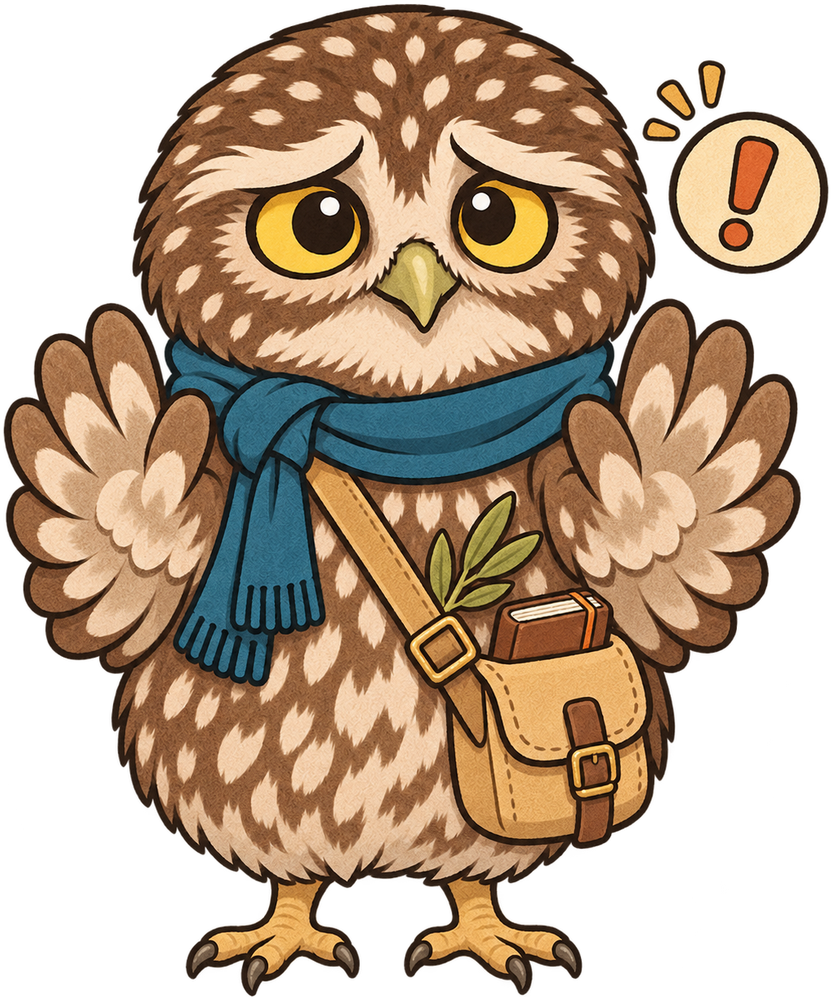
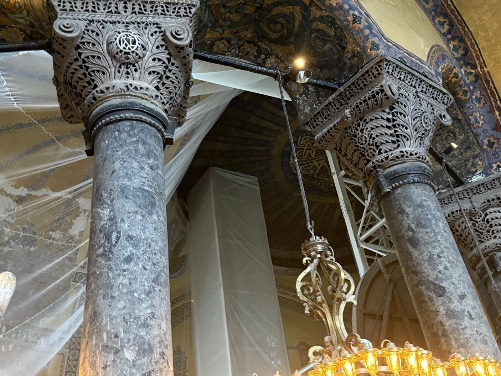
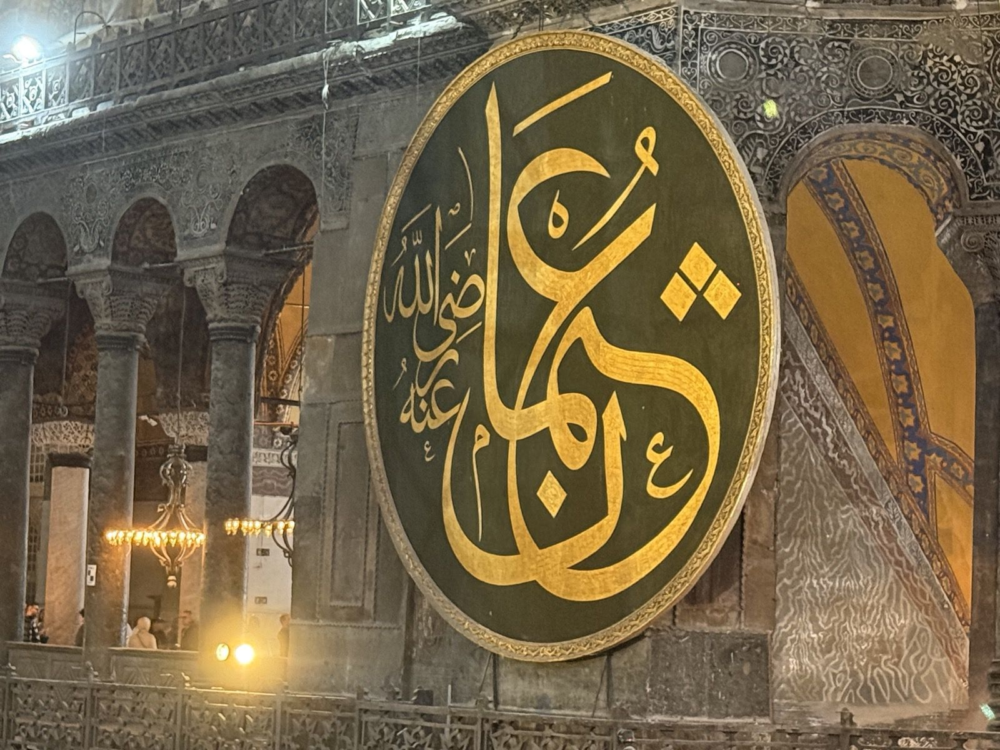
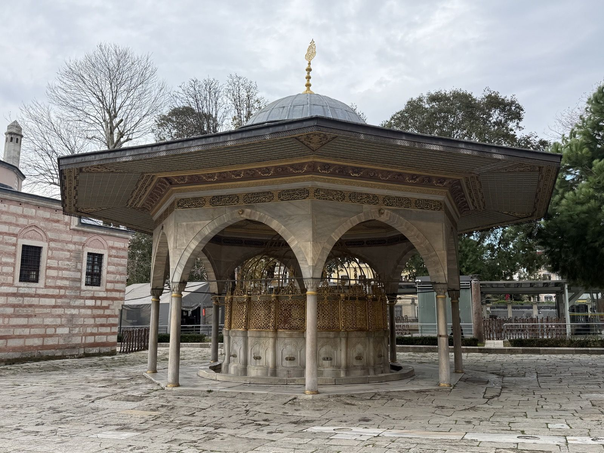
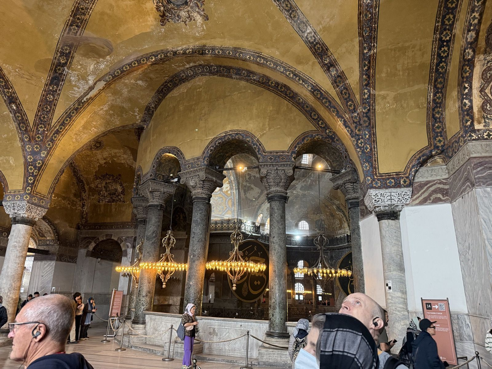
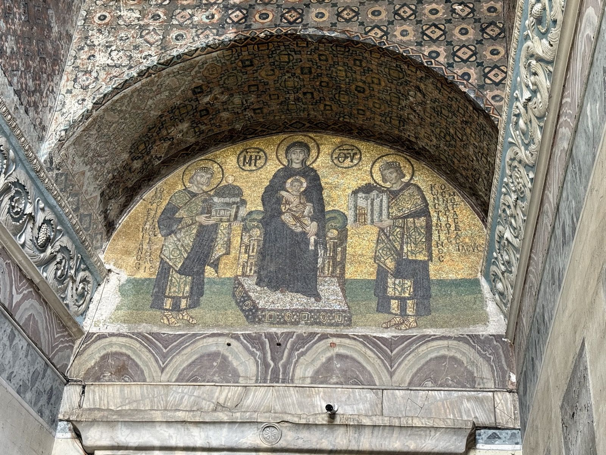
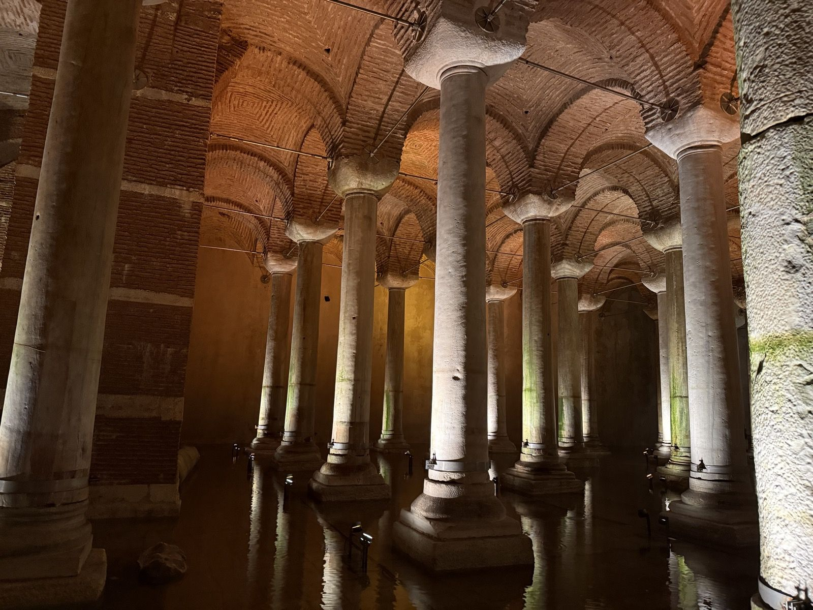
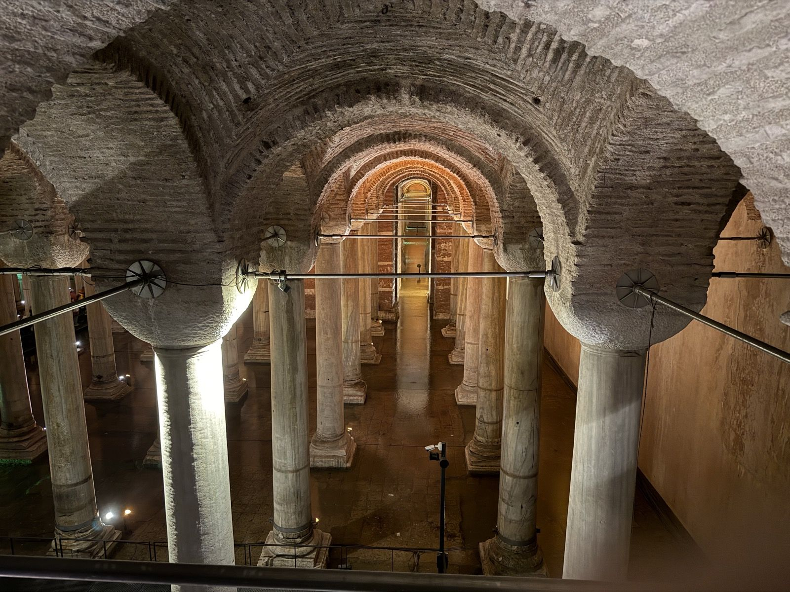

# Day 2: Byzantine Constantinople and Hagia Sophia

## Summary

Day 2 (Thursday, November 12) is the Byzantine day. It walks from the Hippodrome to Hagia Sophia and down into the Basilica Cistern, telling the stories of Justinian, the Nika Riots, the great dome, and the mosaics. Because Istanbul is a city of layers, this chapter also teaches how to read a ruin: layers of a city, reused stone (spolia), restoration, and the difference between myth, primary sources, and contested history. It closes with the Eastern Orthodox Church, the Great Schism of 1054, the Crusades, and the Fourth Crusade's sack of the city by Venice and the crusaders.

## Concepts Covered

This chapter covers the following 29 concepts from the learning graph:

| Concept | Concept Impact Score |
|---------|-----------------------|
| Primary Source | 18 |
| Myth Versus History | 10 |
| Contested History | 6 |
| Layers of a City | 68 |
| Reading a Ruin | 64 |
| Mosaic | 5 |
| Spolia | 2 |
| Restoration and Reconstruction | 2 |
| UNESCO World Heritage Site | 17 |
| Dress at Sacred Sites | 2 |
| Hippodrome | 3 |
| Justinian | 18 |
| Nika Riots | 1 |
| Hagia Sophia | 14 |
| Hagia Sophia Dome | 10 |
| Byzantine Mosaics | 3 |
| Deesis Mosaic | 1 |
| Basilica Cistern | 2 |
| Medusa Heads | 1 |
| Eastern Orthodox Church | 30 |
| Orthodox Icons | 3 |
| Iconoclasm | 1 |
| Great Schism of 1054 | 24 |
| Chora Church | 1 |
| Ecumenical Patriarchate | 1 |
| Byzantine Manuscript Copying | 6 |
| Crusades | 43 |
| Fourth Crusade | 23 |
| Republic of Venice | 22 |

## Prerequisites

This chapter builds on concepts from:

- [Chapter 1: Before We Go, Part 1: The Long Timeline of the Eastern Mediterranean](../01-long-timeline/index.md)
- [Chapter 2: Before We Go, Part 2: Traveling Well and the Learning for All Thread](../02-traveling-well/index.md)
- [Chapter 3: Day 1: Istanbul, a City on Two Continents](../03-istanbul-two-continents/index.md)

---

## A Day in Three Layers

Day 2, Thursday, November 12, is spent in a few hundred meters of one neighborhood, Sultanahmet, and in three very different spaces. In the morning we walk the long, open square that was once the Hippodrome, Constantinople's racetrack. At midday we climb into the galleries of Hagia Sophia, for nine centuries the largest church in Christendom and now a mosque again. In the afternoon we go down a flight of steps into the Basilica Cistern, an underground forest of columns built to hold the city's water. Up on the racetrack, up in the galleries, down in the cistern: by the end of the day we will have seen the Byzantine city from three heights.

Day 2 is also where this guide teaches a skill we will use for the rest of the trip. Istanbul is a city of layers. Almost nothing we see today stands as its first builders left it. Columns were carried in from older temples, mosaics were plastered over and uncovered again, a church became a mosque, then a museum, then a mosque. Stories about these places have grown in the telling. So before we tell Justinian's story, we will learn how to read a ruin: how to tell a primary source from a later legend, how to spot reused stone, and how to notice the history that is still being argued about.

!!! mascot-welcome "A Building With Four Lives"
    { class="mascot-admonition-img" }
    Today we stand under a dome that has been holding up the sky over Istanbul since 562, and we look at mosaic faces that have looked back at visitors for almost nine hundred years. By the end of this chapter, Hagia Sophia will read like a book with many authors: an emperor, a doge, a sultan, a restorer, and a president. Look closer, and every column has a story about where it came from.

The chapter has seven parts. Part One gives us the tools for judging stories: primary sources, myths, and contested history. Part Two gives us the tools for reading buildings: layers, spolia <audio id="audio-spolia" src="../../audio/spolia.mp3" preload="none"></audio><button onclick="document.getElementById('audio-spolia').play()" class="pronounce-btn">🔊 Pronounce</button> *SPOH-lee-uh*, restoration, and World Heritage status. Part Three is the Hippodrome and the emperor Justinian. Part Four is Hagia Sophia. Part Five takes us underground to the Basilica Cistern. Part Six explains the Eastern Orthodox Church, whose cathedral Hagia Sophia was. Part Seven tells how the Crusades, and finally Venice, brought disaster to the city in 1204.

## Part One: Whose Story Is This?

### Primary Source

Chapter 1 introduced archaeology, the study of the past through the things people left behind. Historians add a second kind of evidence: what people wrote. A **primary source** is evidence created at the time being studied, by someone who was there or close to it: a letter, a chronicle, an inscription, a law, a coin, a building. A **secondary source** is a later work that interprets primary sources, such as a modern history book or this guide.

A primary source is not the same as a true source. Every author had a point of view, an audience, and often an employer. The first thing to ask of any primary source is therefore not "is it true?" but "who wrote this, for whom, and why?"

**Worked example: two books by the same man.** The most important primary source for Day 2 is the historian **Procopius** <audio id="audio-procopius" src="../../audio/procopius.mp3" preload="none"></audio><button onclick="document.getElementById('audio-procopius').play()" class="pronounce-btn">🔊 Pronounce</button> *pruh-KOH-pee-us* of Caesarea, who lived in Constantinople under Justinian. He wrote three works, and they disagree with each other. *The Wars* is a detailed military history. *Buildings*, written in the 550s, is pure praise: it describes Hagia Sophia's dome as seeming to hang "from heaven by a golden chain" and credits Justinian with almost every good thing in the empire. *The Secret History*, written at about the same time but kept hidden, calls Justinian a demon in human form and repeats the most scandalous gossip about the empress Theodora. Same author, same years, opposite verdicts. The lesson is not that Procopius was a liar. It is that *Buildings* was written for the emperor and *The Secret History* was written against him, and we need both, read with their purposes in mind, to come close to the man.

The table below sorts the main primary sources for today's sites by when and why they were written.

| Source | Author and date | Written for | Most useful for |
|---|---|---|---|
| *Buildings* | Procopius, 550s | The emperor; written to praise | What Hagia Sophia and the Cistern looked like when new |
| *The Secret History* | Procopius, 550s | Kept hidden; written to attack | The court's enemies' view of Justinian and Theodora |
| Poem on Hagia Sophia | Paul the Silentiary, 563 | Read aloud at the rededication after the dome was rebuilt | The lighting, marbles, and furnishings of the 6th-century church |
| *History* | Niketas Choniates, Byzantine official, after 1204 | Fellow Byzantines | The sack of 1204 seen by a victim |
| *The Conquest of Constantinople* | Geoffrey of Villehardouin, crusade leader, about 1207 | Western nobles | The crusade leaders' justification for attacking the city |
| *The Conquest of Constantinople* | Robert de Clari, a poor knight, about 1216 | Western readers | What an ordinary crusader saw and was amazed by |

### Myth Versus History

A **myth**, in the sense we use in this guide, is a story told about the past that is not supported by evidence from the time, though it may carry a real truth about how people felt. **History** is an account built from evidence that can be checked. The difference between them is not that myths are worthless. It is that they answer a different question: a myth tells us what people later *believed* or *wanted* about a place, while history tries to tell us what happened.

The test is simple to state. Find the earliest source for the story, and ask how long after the event it was written and by whom. The longer the gap, the more room for the story to grow.

**Worked example: "Solomon, I have outdone thee."** Almost every tour of Hagia Sophia includes the line Justinian is said to have spoken when he first entered the finished church: "Solomon, I have outdone thee," comparing his building with Solomon's Temple in Jerusalem. Let's run the test. Procopius, who wrote in the 550s and praised every detail of the building, does not mention it. Neither does Paul the Silentiary in 563. The earliest source is an anonymous Greek text called the *Diēgēsis* (the "Narration" of how the church was built), written around the 8th or 9th century, roughly three hundred years later. The same text says an angel told a boy where to find gold for the building and that the plan was revealed in a dream. So the Solomon line belongs to the myth of Hagia Sophia, not to its history. What the myth does tell us is real: within a few centuries, people in Constantinople believed their great church had surpassed the most sacred building of the Bible, and they were proud of it.

Istanbul is full of stories like this. We will meet several today: the column in Hagia Sophia that "weeps" and grants wishes, the green columns said to come from the Temple of Artemis at Ephesus, and the Medusa heads in the Cistern said to be placed upside down to cancel her deadly gaze. Each one is worth hearing, as long as we know which kind of story it is.

### Contested History

Some history is not a myth and not unknown, yet it is still argued over. **Contested history** is history whose basic facts are largely agreed, but whose meaning, ownership, or proper use is disputed, usually because different communities today feel it belongs to them in different ways. Contested history is not a puzzle that more evidence will solve. It is a disagreement about values, and the thoughtful traveler's job is to hear more than one side, not to settle it.

**Worked example: one building, five dates, many readings.** The facts of Hagia Sophia's status are not in doubt. It was dedicated as a cathedral in 537. Mehmed II made it a mosque in 1453. The government of Mustafa Kemal Atatürk <audio id="audio-ataturk" src="../../audio/ataturk.mp3" preload="none"></audio><button onclick="document.getElementById('audio-ataturk').play()" class="pronounce-btn">🔊 Pronounce</button> *ah-tah-TEWRK* made it a museum by a cabinet decision of November 24, 1934, and it opened to visitors in February 1935. In July 2020, Turkey's highest administrative court annulled the 1934 decision, a presidential decree returned the building to use as a mosque, and Friday prayers were held there on July 24, 2020. What is contested is what those facts mean. For many Turkish Muslims the 2020 decision restored Mehmed's mosque and was a day of joy. For many Orthodox Christians, in Greece and around the world, it was a day of mourning for their mother church. Many secular Turks saw it as the reversal of a deliberate gesture of the young republic. UNESCO, which lists the building as part of a World Heritage Site, asked Turkey to report on how the building's universal value would be protected. Each of these readings is held sincerely, and each is built on the same set of dates.

!!! mascot-thinking "Three Kinds of Story"
    { class="mascot-admonition-img" }
    Notice that the three ideas in this part ask three different questions. A primary source asks "who saw it, and why did they write?", a myth asks "when did this story first appear?", and contested history asks "who is this past important to now?" Sorting a story into the right kind is half the work of understanding it.

The MicroSim below gives us practice with those three questions, using statements we will hear today.

#### Diagram: Source, Myth, or Contested?

<iframe src="../../sims/source-myth-or-contested/main.html" height="494px" width="100%" scrolling="no"></iframe>

[Run the Source, Myth, or Contested? MicroSim Fullscreen](../../sims/source-myth-or-contested/main.html){ .md-button .md-button--primary }

Source, Myth, or Contested?

Type: microsim
**sim-id:** source-myth-or-contested 
**Library:** p5.js 
**Status:** Specified 
**Bloom Level:** Understand 
**Bloom Verb:** classify 
**Learning Objective:** The learner will classify ten statements about Byzantine Constantinople as a primary source, a myth, contested history, or settled history, classifying at least 8 of 10 correctly on the first attempt.

**Prerequisites:** primary source, secondary source, myth, history, contested history (all defined in Part One, "Whose Story Is This?", above).

**Evidence of Mastery:** For each statement, the learner chooses one of four categories before seeing feedback. An answer is correct when it matches the Correct category column in Content. Mastery is 8 of 10 correct on the first attempt.

**Misconceptions:** (1) A primary source is a true source. (2) A myth is a lie and has no value. (3) Any disagreement means the facts are unknown, when in contested history the facts are agreed and the meaning is disputed. (4) A story told by every tour guide must be history.

**Instructional Rationale:** Classifying real statements from the day's sites forces the learner to apply the three definitions to the kind of claim they will actually hear in Hagia Sophia, rather than to textbook examples. Immediate feedback with the reason corrects each misconception at the moment it appears.

**Content:**

The four categories, shown with these one-line definitions:

- Primary source: evidence written or made at the time, by someone who was there or close to it.
- Myth: a story first recorded long after the event, with no support from the time.
- Contested history: the facts are agreed, but their meaning or proper use is disputed today.
- Settled history: a fact agreed by the sources and by modern historians.

| # | Statement shown to the learner | Correct category | Reason shown after answering |
|---|---|---|---|
| 1 | Procopius, writing in the 550s for Justinian, says the dome seems to hang from heaven by a golden chain. | Primary source | Procopius saw the building new; his praise was written for the emperor, so we read it with that purpose in mind. |
| 2 | On entering the finished church, Justinian cried, "Solomon, I have outdone thee!" | Myth | The line first appears in the *Diēgēsis*, written about three hundred years later; Procopius and Paul the Silentiary do not mention it. |
| 3 | Hagia Sophia was dedicated in December 537. | Settled history | The date is agreed by the sources of the time and by modern historians. |
| 4 | The green marble columns in Hagia Sophia were taken from the Temple of Artemis at Ephesus. | Myth | It is a later tradition with no support from the 6th century; the stone is a green marble quarried in Thessaly, in Greece. |
| 5 | Procopius, who lived through the Nika Riots, says more than 30,000 people were killed in the Hippodrome. | Primary source | It is an eyewitness-era number from one writer; the figure may be exaggerated, but the source is from the time. |
| 6 | Hagia Sophia should be a mosque today. | Contested history | The dates of its conversions are agreed; whether it should be a mosque, a church, or a museum is a disagreement about values. |
| 7 | The Medusa heads in the Basilica Cistern were set upside down to cancel the gaze of the Gorgon. | Myth | No source from the time explains their position; using them as column bases to make up the height is the simpler explanation. |
| 8 | Niketas Choniates, a Byzantine official, wrote that crusaders seated a woman on the patriarch's throne in Hagia Sophia in 1204. | Primary source | Choniates lived through the sack; he was a bitter victim, so his account is vivid and one-sided. |
| 9 | The army of the Fourth Crusade captured and sacked Constantinople in April 1204. | Settled history | Byzantine and crusader sources agree on the event and its date. |
| 10 | The four bronze horses taken from the Hippodrome in 1204 belong in Venice. | Contested history | Where the horses came from is agreed; who should keep them today is a matter of opinion. |

**Provenance:** Statements 1, 2, 3, 5, 6 and 8 to 10 come from Part One and Part Seven of this chapter. Statement 4 comes from Part Two ("Spolia"); statement 7 from Part Five ("Medusa Heads").

**Rules:** Each statement is answered once for scoring. A first-attempt answer is correct if and only if it equals the Correct category. Score is the count of correct first attempts, 0 to 10. Mastery is score >= 8.

**Learner Activity:**

1. The learner reads the four category definitions.
2. The learner sees statement 1 and chooses a category.
3. Feedback appears; the learner moves to the next statement.
4. After statement 10, the learner sees their score and a list of any statements they missed, each with its reason.
5. The learner should notice that two statements by eyewitnesses (1 and 8) are primary sources even though each is one-sided.

**Feedback:** Statements appear in the order listed. After each first attempt, the sim shows "Correct" or "Not quite: this is [correct category]", followed by the reason from the table. The learner may not change a scored answer. At the end: score >= 8 shows "You can tell a source from a story. That skill works at every stop on this trip."; score < 8 shows "Try the set again; watch for who wrote each statement and when." A Try Again option reshuffles the order of the same ten statements.

**Starting State:** The four category definitions and statement 1, with the question "What kind of statement is this?"

**Chapter Anchors:** Procopius wrote in the 550s; the Solomon line first appears about three hundred years later; Hagia Sophia dedicated December 537; Nika Riots death toll "more than 30,000" per Procopius; sack of April 1204; ten statements; mastery 8 of 10.

## Part Two: Reading a City of Layers

### Layers of a City

Chapter 1 laid out the timeline: Greek, Roman, Byzantine, Ottoman, and modern. In a place like Istanbul, those eras do not sit side by side in neat districts. They are stacked. The **layers of a city** are the deposits that each era leaves on top of, inside, and beside the work of earlier eras. A layer can be literal: in old cities the ground rises over centuries as rubble, rebuilding, and rubbish pile up, so the Byzantine street level in Sultanahmet lies several meters below our feet. A layer can also be a change of use, a later addition, a reused stone, or even a gap where something was taken away.

It helps to name the four ways a layer gets added, because each one leaves a different clue.

1. **Built over.** A new building rises on the ruins of an old one. Clue: old walls in basements, or ground that rises above old doorways.
2. **Reused.** Stones, columns, or statues from an older building are carried to a new one. Clue: columns that do not match, or carved stone set in at odd angles.
3. **Converted.** A building keeps its walls but changes its use. Clue: things added for the new use, such as minarets on a church.
4. **Removed.** Something is taken away, by looters, collectors, or later builders. Clue: empty niches, bare stone, holes where fixings once held metal.

**Worked example: standing in the Hippodrome.** Let's read Sultanahmet Square, where we begin Day 2, layer by layer. The long, narrow shape of the square is itself the oldest layer: it follows the racetrack begun under the Roman emperor Septimius Severus around 203 CE and enlarged by Constantine. Down the middle stand three monuments that once decorated the track's central barrier. The first is an Egyptian obelisk carved for the pharaoh Thutmose III around 1450 BCE, but it is not a 1450 BCE layer here: the emperor Theodosius I had it raised in this spot in 390 CE, on a marble base carved with his own portrait. The second is the bronze Serpent Column, cast at Delphi after the Greek victory over Persia at Plataea in 479 BCE and brought here when Constantine was building his capital. It stands in a pit, because the ground has risen several meters since; the bottom of the pit is about the level of the Byzantine track. The third, the rough stone Walled Obelisk, was restored by the emperor Constantine VII in the 10th century and once sheathed in gilded bronze plates, which the soldiers of the Fourth Crusade stripped and melted down in 1204; its bare stone is a layer of removal. At the north end, an octagonal domed fountain was a gift of the German Kaiser Wilhelm II in 1900, an Ottoman-era layer that looks European. Along the east side the Blue Mosque, built 1609 to 1616, stands on part of the site of the Byzantine Great Palace. Five eras, one square, and every layer added by one of the four methods.

| What we see | Made | Placed here | Layer it belongs to | How it was added |
|---|---|---|---|---|
| Shape of the square | about 203 CE | about 203 CE, enlarged by 330 | Roman | Built over by everything since |
| Obelisk of Thutmose III | about 1450 BCE, Egypt | 390 CE | Byzantine | Reused |
| Serpent Column | 479 BCE, Delphi | by 330 CE | Byzantine | Reused |
| Walled Obelisk, bare stone | 10th-century restoration | Bronze removed 1204 | Latin occupation | Removed |
| German Fountain | 1900 | 1900 | Ottoman | Built over |
| Blue Mosque | 1609–1616 | 1609–1616 | Ottoman | Built over the Great Palace |

!!! mascot-warning "An Old Object Is Not an Old Layer"
    { class="mascot-admonition-img" }
    A common trap is to date a layer by how old the object is. The obelisk was carved 3,400 years ago, but it joined *this* place in 390 CE, so here it is a Byzantine layer. To place anything in the city's layers, ask "when did it arrive here?", not "when was it made?"

### Spolia

**Spolia** (Latin for "spoils," singular *spolium*) are building materials, especially columns, capitals, carved blocks, and statues, taken from older structures and reused in new ones. Late Roman and Byzantine builders used spolia constantly, partly to save the labor of quarrying and carving and partly for prestige: a column from a famous old temple carried some of its glory into the new building. The Basilica Cistern is a museum of spolia, with columns and capitals of many styles and heights, some plainly pulled from earlier buildings. In Hagia Sophia, a later tradition claims the eight green columns of the side aisles were brought from the Temple of Artemis at Ephesus, which we visit on Day 7. No 6th-century source says so, and the stone itself is a green marble from Thessaly, so the story belongs with the myths of Part One. The Serpent Column in the Hippodrome is spolia on a grand scale: a Greek victory monument made to decorate a Roman racetrack.

### Restoration and Reconstruction

**Restoration** is work that repairs and conserves the surviving material of a building or object, so it lasts and can be understood, without inventing what is lost. **Reconstruction** rebuilds missing parts, from evidence or from a best guess, so a visitor sees something closer to the original whole. The line between them matters, because a reconstruction can look as old as the original and quietly turn a guess into a fact.

Hagia Sophia has had both. When its first dome collapsed in 558, the builders rebuilt it higher, a reconstruction that changed the design. Between 1847 and 1849, the Swiss-Italian brothers Gaspare and Giuseppe Fossati restored the building for Sultan Abdülmecid, straightening columns, repairing the dome, and briefly uncovering some mosaics, which they recorded and then covered again. The Basilica Cistern was restored between 2017 and 2022, mainly to strengthen it against earthquakes, and reopened with new walkways and lighting. When we see a crisp, complete-looking surface today, it is worth asking which kind of work produced it.

### UNESCO World Heritage Site

A **UNESCO World Heritage Site** is a place listed by the United Nations Educational, Scientific and Cultural Organization as having "outstanding universal value" to humanity, under the World Heritage Convention of 1972. A country nominates a site, expert bodies evaluate it, and the World Heritage Committee decides. Listing brings prestige and tourism, and it comes with obligations: the country agrees to protect the site's values and to report on changes. Listing does not transfer ownership to UNESCO, and UNESCO cannot overrule a government; it can only ask questions, send missions, and, in serious cases, place a site on its List of World Heritage in Danger.

Hagia Sophia is part of the **Historic Areas of Istanbul**, listed in 1985. The listing covers four areas: the Sultanahmet archaeological park (the Hippodrome, Hagia Sophia, Hagia Irene, Topkapı Palace, the Blue Mosque, and the Cistern), the Süleymaniye quarter, the Zeyrek quarter, and the Theodosian land walls from Chapter 3.

**Worked example: our route as a World Heritage itinerary.** Let's count how many of our stops carry the listing. The table shows the World Heritage Sites on our route, with the year each was listed.

| Day | Site | Listed |
|---|---|---|
| 1–4 | Historic Areas of Istanbul | 1985 |
| 6 | Archaeological Site of Troy | 1998 |
| 7 | Ephesus | 2015 |
| 8 | Medieval City of Rhodes | 1988 |
| 9 | Minoan Palatial Centres of Crete, including Knossos | 2025 |
| 10–11, 13 | Acropolis, Athens | 1987 |
| 12 | Archaeological Site of Delphi | 1987 |

Seven listed sites in thirteen days. Notice that the dates tell their own story: the famous classical sites were listed early, while Ephesus waited until 2015 and the Minoan palaces until 2025. Listing depends on nominations and politics as well as merit, and that is a useful reminder that even "universal value" is decided by people.

### Reading a Ruin

We now have the parts, and can put them together. **Reading a ruin** is the practice of working out a site's history from the evidence in front of us, by asking a fixed set of questions about what it is made of, what was added and removed, who described it, and who restored it. It turns sightseeing from "this is old" into "this is how it became what it is." The method works on a whole city, a building, or a single carved stone.

1. **What is it made of, and is any of it reused?** Look for mismatched columns, odd carved blocks, and inscriptions upside down: spolia.
2. **What was added, and when?** Minarets, buttresses, calligraphy, new floors. Each addition belongs to a layer.
3. **What was taken away?** Bare stone, empty niches, holes for metal fixings, plaster over images.
4. **Who described it at the time?** Find the primary sources, and remember why each author wrote.
5. **Which stories about it are myths?** Ask when each story first appears.
6. **Who restored or rebuilt it, and what did they choose to show?** Separate restoration from reconstruction.
7. **Who uses it now, and what does it mean to them?** That is where contested history lives.

**Worked example: reading Hagia Sophia's exterior in five minutes.** Before we go in, let's stand across the park and run the questions on the outside of the building. *Made of:* brick and mortar, with stone; the brick is Byzantine, and so is the huge central dome. *Added:* four minarets, each different, because they were built by different sultans: the earliest dates from soon after 1453, and the two matching ones to the west were added by the architect Sinan <audio id="audio-sinan" src="../../audio/sinan.mp3" preload="none"></audio><button onclick="document.getElementById('audio-sinan').play()" class="pronounce-btn">🔊 Pronounce</button> *see-NAHN* in the 1570s, whom we meet in Chapter 5. Also added: massive sloping buttresses, built from the Byzantine period onward to stop the walls spreading under the dome's weight; Sinan added more. *Taken away:* the gilded cross on the dome, replaced by the Ottoman crescent finial. *Described at the time:* Procopius and Paul the Silentiary. *Myths:* the Solomon line. *Restored:* the Fossati brothers, 1847 to 1849. *Used now:* as a mosque, with a visitor route through the galleries. In five minutes, from a park bench, we can tell that this is a 6th-century Byzantine church wrapped in Ottoman additions, still in daily use. The MicroSim below practices the same skill on twelve things we see during the day.

!!! mascot-thinking "A Building Is a Document"
    { class="mascot-admonition-img" }
    Think of Hagia Sophia as a document with many authors, each writing on the same page in a different ink. Justinian wrote the dome, a 12th-century emperor wrote a mosaic, Mehmed wrote a minaret, and a 19th-century calligrapher wrote the great roundels. Reading a ruin means telling the inks apart.

#### Diagram: Read the Ruin: Which Layer?

<iframe src="../../sims/read-the-ruin-layers/main.html" height="584px" width="100%" scrolling="no"></iframe>

[Run the Read the Ruin: Which Layer? MicroSim Fullscreen](../../sims/read-the-ruin-layers/main.html){ .md-button .md-button--primary }

Read the Ruin: Which Layer?

Type: microsim
**sim-id:** read-the-ruin-layers 
**Library:** p5.js 
**Status:** Specified 
**Bloom Level:** Apply 
**Bloom Verb:** classify 
**Learning Objective:** The learner will apply the rule "a thing belongs to the layer in which it arrived at this place" to assign twelve things seen on Day 2 to one of five historical layers, assigning at least 10 of 12 correctly on the first attempt.

**Prerequisites:** layers of a city, spolia, the four ways a layer is added (built over, reused, converted, removed), and the eras Roman, Byzantine, Ottoman and Republic (defined in Part Two, "Layers of a City", and in Chapter 1).

**Evidence of Mastery:** For each card, the learner places it in one of the five layers before feedback. A placement is correct when it matches the Correct layer column in Content. Mastery is 10 of 12 correct on the first attempt, including at least 2 of the 3 cards marked "trap" (cards 2, 3 and 9), which are the ones where the object is much older than its arrival.

**Misconceptions:** (1) An object belongs to the era in which it was made (cards 2, 3 and 9 expose this). (2) Anything that looks European and modern must be from the Republic (card 8 exposes this). (3) Removal is not a layer (cards 4 and 5 expose this). (4) Everything in Hagia Sophia is Byzantine (cards 10 and 11 expose this).

**Instructional Rationale:** Placing real objects into layers under one explicit rule is an Apply task: the learner uses a procedure on new cases. The trap cards make the learner choose between the made date and the arrival date, which is where most visitors go wrong.

**Content:**

The five layers, each with its date range and one-line description:

- Roman (before 330 CE): the city before Constantine's capital.
- Byzantine (330–1453, except 1204–1261): the Christian imperial capital.
- Latin occupation (1204–1261): rule by the crusaders and Venice after the Fourth Crusade.
- Ottoman (1453–1922): the sultans' capital.
- Republic (1923–today): the Turkish Republic.

The rule, shown at the top throughout: "A thing belongs to the layer in which it arrived at this place, or, for a removal, the layer in which it was taken away."

| # | Card | Made | Arrived or happened here | Correct layer | Reason shown after answering |
|---|---|---|---|---|---|
| 1 | The long, narrow shape of Sultanahmet Square | about 203 CE | about 203 CE | Roman | It follows the racetrack begun under Septimius Severus, before Constantine's capital. |
| 2 | Obelisk of Thutmose III (trap) | about 1450 BCE, Egypt | raised here in 390 CE | Byzantine | Carved in ancient Egypt, but raised in the Hippodrome by Theodosius I in 390. |
| 3 | Serpent Column (trap) | 479 BCE, Delphi | brought by 330 CE | Byzantine | Cast at Delphi after Plataea, but brought here when Constantine built his capital. |
| 4 | Bare stone of the Walled Obelisk | 10th-century restoration | bronze plates stripped 1204 | Latin occupation | The bare stone is the trace of a removal by Fourth Crusade soldiers. |
| 5 | Burial place of Enrico Dandolo, Doge of Venice, in Hagia Sophia's gallery | 1205 | 1205 | Latin occupation | The Venetian leader of the Fourth Crusade was buried in the church in 1205; the inscribed slab seen today is a later marker. |
| 6 | Hagia Sophia's main dome | 562 | 562 | Byzantine | Rebuilt by Isidore the Younger after the first dome collapsed in 558. |
| 7 | Mosaic of the Virgin and Child with Emperor John II Komnenos and Empress Irene | about 1122 | about 1122 | Byzantine | Made for the emperor and empress during the Komnenian dynasty. |
| 8 | Octagonal German Fountain in the Hippodrome | 1900 | 1900 | Ottoman | A gift of Kaiser Wilhelm II to Sultan Abdülhamid II, before the Republic. |
| 9 | Medusa heads under two columns in the Basilica Cistern (trap) | Roman, date unknown | 532 CE | Byzantine | Roman carvings reused as column bases when Justinian built the Cistern. |
| 10 | Large calligraphic roundels naming God, the Prophet Muhammad and the first caliphs | about 1850 | about 1850 | Ottoman | Painted by the calligrapher Kazasker Mustafa İzzet Efendi after the Fossati restoration. |
| 11 | Ablution fountain in Hagia Sophia's courtyard | 1740 | 1740 | Ottoman | Built for Sultan Mahmud I so worshippers could wash before prayer. |
| 12 | Walkways and lighting in the Basilica Cistern | 2017–2022 | 2022 | Republic | Added in the earthquake-strengthening restoration, reopened in 2022. |

**Provenance:** Cards 1 to 4, 6 and 8 come from Part Two, "Layers of a City"; card 5 from Part Seven, "The Fourth Crusade"; card 7 from Part Four, "Mosaic"; cards 9 and 12 from Part Five; cards 10 and 11 from Part Four, "Hagia Sophia" and its photos. Dates follow standard references (Wikipedia articles on each monument).

**Rules:** Each card is placed once for scoring. A first-attempt placement is correct if and only if it equals the Correct layer. Score is 0 to 12; mastery is score >= 10 with at least 2 of the 3 trap cards correct. Cards appear in a fixed shuffled order with seed 4, the same for every learner.

**Learner Activity:**

1. The learner reads the rule and the five layer descriptions.
2. The learner places a card in a layer.
3. Feedback shows the Made and Arrived dates and the reason; the card settles into its correct layer.
4. After all twelve cards, the learner sees the finished layer stack, with the count of cards in each layer (Roman 1, Byzantine 5, Latin occupation 2, Ottoman 3, Republic 1).
5. The learner should notice that the Byzantine layer holds three objects much older than Byzantium.

**Feedback:** After each first attempt: correct shows "Correct" and the reason; incorrect shows "This one arrived in [correct layer]: [reason]". After card 12: if mastery is met, "You read the ruin. Try the same rule on the Library of Celsus at Ephesus on Day 7."; otherwise, "Look again at the trap cards: ask when each arrived, not when it was made." A Try Again option repeats the same twelve cards in a new order.

**Starting State:** Five empty layers stacked from Roman at the bottom to Republic at the top, the rule, and card 1, with the question "In which layer did this arrive?"

**Chapter Anchors:** Hippodrome begun about 203 CE; obelisk carved about 1450 BCE and raised in 390 CE; Serpent Column from 479 BCE; Walled Obelisk stripped in 1204; dome rebuilt 562; Komnenos mosaic about 1122; German Fountain 1900; Cistern built 532 and reopened 2022; Fossati restoration 1847–1849; ablution fountain 1740; twelve cards; mastery 10 of 12.

## Part Three: The Hippodrome and the Emperor Justinian

### The Hippodrome

A **hippodrome** (Greek *hippos*, horse, and *dromos*, course) is an arena for horse and chariot racing. Constantinople's Hippodrome was about 450 m long and 130 m wide, with stands that may have held up to 100,000 people. It ran beside the Great Palace, and the emperor watched from the *kathisma*, an imperial box connected directly to the palace, which made the races the one place where emperor and people faced each other in public. The racing teams were known by their colors, and two of them, the **Blues** and the **Greens**, became something like political parties and street gangs at once, with their own seats, chants, and grudges. Under the Ottomans the space became the At Meydanı, "Horse Square," and today it is Sultanahmet Square, its shape the only clue to what it was.

### Justinian

**Justinian I** ruled the Byzantine Empire from 527 to 565 and left a larger mark on today's Istanbul than any other emperor except Constantine. Born to a peasant family in the Balkans, he rose through the patronage of his uncle, the emperor Justin I. He married **Theodora**, a former actress, which required a change in the law, and she became one of the most powerful empresses in Byzantine history. Justinian had four great ambitions. He codified Roman law in the *Corpus Juris Civilis*, the basis of the civil law used in much of Europe and Latin America today. He reconquered North Africa, Italy, and part of Spain, briefly rebuilding the old Roman Mediterranean. He enforced a single Orthodox Christianity. And he built, on a scale no emperor had matched.

**Worked example: a Day 2 walk through Justinian's building program.** Let's count how much of today's route is his. The Hippodrome's racetrack is older, but the riot of 532 that we meet next happened there in his reign. Hagia Sophia, built 532 to 537, is his. The Basilica Cistern, 532, is his. Hagia Irene, the red-brick church inside the outer court of Topkapı Palace, was rebuilt by him after the same riot. Little Hagia Sophia, a smaller domed church a short walk south of the Hippodrome, was built under him in the 530s and is often described as a trial run for the great dome. Four of the five buildings on our Day 2 map are Justinian's, and all of them were begun within a few years of 532. That date is the key to the day, and the reason is a riot.

!!! mascot-tip "Find the Emperor's Signature"
    { class="mascot-admonition-img" }
    In the galleries of Hagia Sophia, look up at the carved capitals at the top of the columns. Many carry monograms, Greek letters woven into a single symbol, that spell the names of Justinian and Theodora. Finding one takes a minute and is the closest thing we will see to the builders' signature.

<figure markdown="span" class="trip-photo">
  { loading=lazy }
  <figcaption>Column capitals in Hagia Sophia. Photo by Dan McCreary</figcaption>
</figure>

### The Nika Riots

The **Nika Riots** of January 532 were a week-long uprising in Constantinople that nearly overthrew Justinian and burned the center of the city. It began in the Hippodrome, when the Blues and the Greens, normally enemies, united against the emperor's unpopular tax officials and his refusal to pardon two of their members. Their rallying cry was *Nika!*, "Conquer!", the shout normally used to cheer a charioteer. Fires destroyed much of the city center, including the second church of Hagia Sophia. The rioters proclaimed a rival emperor, Hypatius. According to Procopius, Justinian was ready to flee by ship until Theodora told the council that she would rather die an empress than live as a fugitive. Justinian stayed. His generals Belisarius and Narses trapped the crowd inside the Hippodrome and killed, by Procopius's count, more than 30,000 people. Five weeks later, on February 23, 532, construction of the new Hagia Sophia began on the ashes of the old one.

## Part Four: Hagia Sophia

### Hagia Sophia

**Hagia Sophia** (Greek for "Holy Wisdom," dedicated to Christ as the Wisdom of God, not to a saint named Sophia) is the domed building at the heart of Sultanahmet, built as the cathedral of Constantinople by Justinian between 532 and 537. It was the third church on the site; the first, from 360, burned in a riot in 404, and the second burned in the Nika Riots. Justinian chose not a builder but two scholars to design the third: **Anthemius of Tralles**, a mathematician, and **Isidore of Miletus**, a geometer. The church was dedicated on December 27, 537, less than six years after the work began. For nearly a thousand years it was the largest cathedral in the world, until Seville Cathedral was finished in 1520.

The building's life since 537 can be told in four lives, which the table summarizes.

| Life | Years | What it was | Signs we can still see |
|---|---|---|---|
| Cathedral | 537–1453 (Catholic cathedral under the Latins, 1204–1261) | Seat of the Patriarch of Constantinople; coronation church of emperors | Dome, marble walls, gallery mosaics |
| Mosque | 1453–1934 | Imperial mosque of the Ottoman sultans | Minarets, mihrab, minbar, calligraphic roundels, ablution fountain |
| Museum | 1935–2020 | Museum of the Turkish Republic | Uncovered mosaics, restoration work |
| Mosque | 2020–today | Mosque, with a visitor route through the galleries | Carpets on the ground floor, curtains or lighting over some images during prayers |

<figure markdown="span" class="trip-photo">
  { loading=lazy }
  <figcaption>Calligraphic roundel naming the caliph Uthman, Hagia Sophia. Photo by Dan McCreary</figcaption>
</figure>

The eight great roundels, each about 7.5 m across, are among the largest pieces of calligraphy in the Islamic world. They name God, the Prophet Muhammad, the first four caliphs (Abu Bakr, Umar, Uthman, and Ali), and the Prophet's grandsons Hasan and Husayn. They were painted by the calligrapher Kazasker Mustafa İzzet Efendi around 1850, after the Fossati restoration. Chapter 6 explains the art of calligraphy behind them.

In the courtyard stands a domed ablution fountain, built for Sultan Mahmud I in 1740, where worshippers wash before prayer, a ritual Chapter 5 explains. It is a small Ottoman building in a Byzantine setting, and one more layer to read on the way in.

<figure markdown="span" class="trip-photo">
  { loading=lazy }
  <figcaption>Ottoman ablution fountain in the Hagia Sophia courtyard. Photo by Dan McCreary</figcaption>
</figure>

Since January 2024, foreign visitors enter Hagia Sophia through a separate entrance, pay an entry fee, and follow a route through the upper galleries, while the ground floor is kept for worshippers. The galleries are where the best mosaics are, so the route suits us well.

<figure markdown="span" class="trip-photo">
  { loading=lazy }
  <figcaption>Arcades of the Hagia Sophia gallery. Photo by Dan McCreary</figcaption>
</figure>

### The Hagia Sophia Dome

The **Hagia Sophia dome** is the central dome of the building, about 31 m across and rising about 55 m above the floor, and for its time it was a daring piece of engineering. The problem it solved is geometric: how do you set a round dome on top of a square space? The answer was the **pendentive**, a curved triangle of masonry that fills each corner between two arches and turns the square plan into a circle at the top. Four great arches rise from four piers; four pendentives curve up and inward between them; and the dome sits on the ring they make. To the east and west, two half-domes extend the space, so the interior feels like one enormous, continuous room.

Around the base of the dome runs a ring of 40 windows. Seen from below, the light pouring through them hides the supports, and the dome seems to float. That is what Procopius meant by his golden chain.

**Worked example: why the dome fell, and why it is still up.** The first dome, finished in 537, was shallower than the one we see. Earthquakes in 553 and 557 weakened it, and in May 558 the eastern part collapsed. Isidore the Younger, the nephew of Isidore of Miletus, rebuilt it about 6 to 7 m higher, so its curve was steeper and pushed outward less, and the new dome was dedicated in 562. Partial collapses followed after earthquakes in 989 and 1346, and each time it was repaired. Each repair added a layer, and the buttresses outside are part of the same story: every builder after Justinian, Byzantine and Ottoman, has been holding the walls in against the dome's outward thrust. Sinan's buttresses in the 1570s were so effective that, as Chapter 5 shows, he learned from this building how to build his own great domes. When we stand under it, we are looking at a 562 design that has survived about fifteen centuries of earthquakes because generations of builders kept it standing.

### Dress at Sacred Sites

**Dress at sacred sites** means the clothing that places of worship ask visitors to wear as a sign of respect. Because Hagia Sophia is a working mosque, the rules are those of any mosque in Turkey: women cover their hair, and everyone covers shoulders and knees; shorts and sleeveless tops are not appropriate. Head scarves and wraps are usually provided at the door, but our own are more comfortable. Shoes come off wherever there are prayer carpets. The same idea applies to Orthodox churches and monasteries in Greece, where shoulders and knees should be covered. Chapter 5 gives the full mosque etiquette.

!!! mascot-tip "One Scarf for the Whole Trip"
    { class="mascot-admonition-img" }
    Pack a light scarf or shawl in the daypack every day in Istanbul. It covers hair in a mosque, shoulders in a Greek church, and a cold neck on a November ferry, and it saves waiting in line for a borrowed wrap.

### Mosaic

A **mosaic** is a picture or pattern made by setting many small pieces of colored stone, glass, or other hard material into a bed of mortar or plaster. Each piece is called a **tessera** (plural *tesserae*), from a Greek word meaning "four-cornered." Floor mosaics, made mostly of stone, were common across the Greek and Roman world. Byzantine wall mosaics added glass tesserae in many colors and, most famously, gold tesserae: a thin sheet of gold leaf sealed between two layers of glass. Mosaicists set the tesserae at slightly different angles, so the surface catches light unevenly and shimmers as we move. Because of this, a mosaic seen in a photograph looks flat, and the same mosaic seen in person seems to glow.

**Worked example: reading the Komnenos mosaic.** In the south gallery, find the mosaic of the Virgin and Child flanked by an emperor and empress. Let's read it with the ruin questions. *Who and when?* The emperor is **John II Komnenos** <audio id="audio-komnenos" src="../../audio/komnenos.mp3" preload="none"></audio><button onclick="document.getElementById('audio-komnenos').play()" class="pronounce-btn">🔊 Pronounce</button> *kom-NEE-nos*, who ruled from 1118 to 1143, and the empress is Irene, born a Hungarian princess. It was made around 1122. *What does it show?* The Virgin holds the Christ Child at the center. John offers a bag of gold, a donation to the church; Irene offers a scroll, a charter of privileges. The imperial couple stand on equal terms with the holy figures, in the same golden space, which is the point: the emperor's rule is shown as part of the order of heaven. *Look closer:* Irene's fair, braided hair and rosy cheeks may record her real appearance, and on the adjoining wall their son Alexios appears, his face thin and pale; he died young, in 1142. *What happened to it?* After 1453 it was eventually covered with plaster, which protected it, and it was uncovered in the 1930s. One panel, read slowly, tells us about Byzantine politics, faith, family, and the city's later history.

<figure markdown="span" class="trip-photo">
  { loading=lazy }
  <figcaption>Mosaic of the Virgin and Child with Emperor John II Komnenos and Empress Irene, 12th century, Hagia Sophia. Photo by Dan McCreary</figcaption>
</figure>

### Byzantine Mosaics

**Byzantine mosaics** are the wall and vault mosaics of the Byzantine Empire, recognizable by their gold backgrounds, frontal figures, and solemn faces. The gold is not sky; it stands for the light of heaven, a space outside ordinary time. Justinian's Hagia Sophia had no figures at all in its first mosaics, only crosses and patterns in gold; nearly all the figures we see now were made after 843, when the iconoclasm controversy described in Part Six ended. The great Virgin and Child in the apse was unveiled in 867. Others followed over four centuries: an emperor kneeling before Christ above the Imperial Door, Constantine and Justinian offering the city and the church to the Virgin at the southwest entrance, and in the south gallery a panel of the empress Zoe, whose emperor's face and name were changed when she married again, a mosaic that was itself edited. After 1453 the Ottomans left the figural mosaics visible for a long time and only gradually covered them with plaster, most fully in the 18th century. The plaster preserved them, and the Byzantine Institute of America uncovered them from the 1930s onward.

### The Deesis Mosaic

The **Deesis mosaic** <audio id="audio-deesis" src="../../audio/deesis.mp3" preload="none"></audio><button onclick="document.getElementById('audio-deesis').play()" class="pronounce-btn">🔊 Pronounce</button> *dee-EE-sis* is a large mosaic in the south gallery of Hagia Sophia showing Christ in the center, with the Virgin Mary on his right and John the Baptist on his left, both turned toward him and pleading for humanity at the Last Judgment. *Deēsis* is Greek for "supplication." It was probably made around 1261, soon after the Byzantines recovered the city from the Latins, as an act of thanksgiving. The lower half is lost, but the faces survive, and they are its glory: soft, shaded, and deeply human, with a tenderness that historians of art often compare to Italian painting of a generation later. Many visitors find it the most moving thing in the building. Stand in front of it for a full minute.

## Part Five: Under the Street

### The Basilica Cistern

The **Basilica Cistern** (in Turkish, *Yerebatan Sarayı* <audio id="audio-yerebatan" src="../../audio/yerebatan.mp3" preload="none"></audio><button onclick="document.getElementById('audio-yerebatan').play()" class="pronounce-btn">🔊 Pronounce</button> *yeh-reh-bah-TAHN*, "the Sunken Palace") is a vast underground reservoir built under Justinian in 532, across the street from Hagia Sophia. It is about 138 m long and 65 m wide, and its roof rests on 336 columns, each about 9 m tall, in 12 rows of 28. Full, it held about 80,000 cubic meters of water, brought by aqueducts from forests north of the city, to supply the Great Palace and the buildings around it. A cistern was a city's insurance: in a siege, it could hold out as long as its water did. The Cistern takes its name from the Basilica, a great public square with law courts that stood above it. After 1453 it was largely forgotten by the city above, and the story goes that people living over it drew water, and even fish, through holes in their basements. Its many mismatched columns and capitals are spolia, carried from older buildings. Today it is walked on raised platforms over shallow water, in low light.

<figure markdown="span" class="trip-photo">
  { loading=lazy }
  <figcaption>Columns of the Basilica Cistern, 532 CE. Photo by Dan McCreary</figcaption>
</figure>

### The Medusa Heads

The **Medusa heads** are two large Roman stone carvings of the Gorgon Medusa, the monster of Greek myth whose gaze turned people to stone, used as the bases of two columns in the northwest corner of the Basilica Cistern. One lies on its side and one is upside down. Nobody knows which earlier building they came from. Guides often say they were placed this way to cancel Medusa's power. The simpler explanation is practical: the builders needed blocks of the right height to bring two short columns up to the roof, and sideways and upside down were the positions that fit. Here is our myth-versus-history test again: no source from 532 explains them, and the practical explanation fits the evidence of the rest of the Cistern, where spolia were used wherever they would fit.

<figure markdown="span" class="trip-photo">
  { loading=lazy }
  <figcaption>Lit columns of the Basilica Cistern. Photo by Dan McCreary</figcaption>
</figure>

## Part Six: The Church of the Empire

### The Eastern Orthodox Church

The **Eastern Orthodox Church** is the communion of Christian churches that grew from the Greek-speaking churches of the Byzantine Empire. It is the second-largest Christian communion in the world, with somewhere between 220 and 260 million members, most of them in Eastern Europe, Greece, Cyprus, and the Middle East. *Orthodox* means "right belief" or "right worship." The Orthodox Church is not one organization under one leader, as the Catholic Church is under the pope. It is a family of self-governing churches, each with its own head, which share the same faith and worship and recognize one another. Among their leaders, the **Ecumenical Patriarch of Constantinople** holds a primacy of honor: he is "first among equals," not a ruler over the others.

Several things make Orthodox worship distinctive to a visitor: the **Divine Liturgy**, sung rather than spoken; icons everywhere, venerated with candles and kisses; the **iconostasis**, a screen covered with icons that separates the altar from the nave; and, in traditional churches, standing rather than sitting through the service.

**Worked example: which church governs our stops?** It is easy to assume that every Orthodox church in Greece answers to the Church of Greece. Let's check our route. In Istanbul, the Orthodox community is led by the Ecumenical Patriarch himself. In Rhodes (Day 8), the churches belong to the Metropolis of Rhodes, which reports directly to the Ecumenical Patriarchate, because the Dodecanese islands were under Italian rule in 1928 when the other dioceses of the newer Greek territories were placed under the Church of Greece. In Crete (Day 9), the Church of Crete is semi-autonomous, also under the Ecumenical Patriarchate. Only in Athens and Delphi (Days 10 to 13) are we in the territory of the Church of Greece, which Constantinople recognized as self-governing in 1850. So three of our stops look to the same patriarch in Istanbul, a quiet survival of the Byzantine map into the present.

### Orthodox Icons

An **icon** (Greek *eikōn*, "image") is a sacred image of Christ, the Virgin Mary, a saint, or a biblical scene, usually painted on a wooden panel, used in Orthodox worship and prayer. Orthodox Christians **venerate** icons, honoring them with candles, incense, bows, and kisses, but they do not worship them: the honor is understood to pass through the image to the person it shows. Icons follow strict traditions of pose, color, and composition, so a saint can be recognized across centuries, and icon painters speak of *writing* an icon rather than painting it. The Byzantine mosaics of Hagia Sophia are icons in glass and gold. When we visit Greek churches on Days 8 to 13, we will see people stop in the doorway to light a candle and kiss the icon of the church's saint; it is fine to watch quietly, and visitors may light a candle too.

### Iconoclasm

**Iconoclasm** (Greek for "image-breaking") was the Byzantine policy, in two periods from about 726 to 787 and from 815 to 843, of banning religious images and destroying or covering them, on the belief that venerating images was idolatry. It split the empire: emperors and many in the army supported it, while many monks and much of the population resisted. The Second Council of Nicaea, held in 787 in the town we know as İznik, restored icons; a second ban followed, and in 843 the empress Theodora (not Justinian's wife, but a 9th-century regent with the same name) restored them for good. Orthodox churches still celebrate the restoration every year as the **Triumph of Orthodoxy**, on the first Sunday of Lent. The word has outlived the controversy: an *iconoclast* is now anyone who attacks cherished beliefs.

### The Great Schism of 1054

The **Great Schism of 1054** is the break in communion between the Church of Rome, led by the pope, and the Church of Constantinople, led by the patriarch, conventionally dated to 1054. *Schism* is Greek for "split." The two halves of the church had been drifting apart for centuries over language (Latin in the West, Greek in the East), authority, and practice. The main disputes were these.

- **Authority.** The pope claimed supreme authority over the whole church; the Eastern churches accepted Rome's honor as first among the great churches, but not its power to rule them.
- **The Creed.** The Western church had added the word *filioque*, "and the Son," to the Nicene Creed, saying the Holy Spirit proceeds from the Father "and the Son." The East objected both to the theology and to changing a creed agreed by a council.
- **Practice.** The West used unleavened bread in the Eucharist and required priests to be celibate; the East used leavened bread and allowed married priests.

**Worked example: the scene in Hagia Sophia, July 16, 1054.** The break happened in the building we visit today. Pope Leo IX sent legates to Constantinople, led by Cardinal Humbert of Silva Candida, to settle the disputes with Patriarch Michael Keroularios. The talks went badly. On July 16, 1054, as the afternoon liturgy was about to begin, Humbert walked into Hagia Sophia and laid a bull of excommunication on the altar, then walked out, shaking the dust from his feet. Days later Keroularios and his synod excommunicated the legates in return. Two details complicate the story. Pope Leo had died in April, so whether his legates still had authority is doubtful. And the excommunications were aimed at individuals, not at whole churches. Many historians therefore see 1054 less as the moment of the split than as a symbol of a long separation that only became final, in the hearts of ordinary believers, after the crusaders sacked Constantinople in 1204. In 1965, Pope Paul VI and Patriarch Athenagoras lifted the mutual excommunications of 1054, though the two churches remain separate.

!!! mascot-thinking "A Split of Leaders, Then of Hearts"
    { class="mascot-admonition-img" }
    Notice the two dates. In 1054, a cardinal and a patriarch quarreled, and most Christians did not know or care. In 1204, Western soldiers looted the church where that quarrel took place, and every Greek Christian knew. A schism of leaders became a schism of peoples, which is why Part Seven matters so much to this one.

### The Ecumenical Patriarchate

The **Ecumenical Patriarchate** is the office and see of the Patriarch of Constantinople, the senior bishop of the Eastern Orthodox Church. After 1453, Mehmed II recognized a patriarch as head of the Orthodox community of his empire, an arrangement Chapter 6 explains as the millet system. Since 1601 the Patriarchate has been based at the Church of St. George in the Fener (Greek *Phanar*) district, on the Golden Horn. The current patriarch, Bartholomew I, has served since 1991. The Turkish state recognizes him only as the religious leader of Turkey's Greek Orthodox citizens, who now number a few thousand, and requires the patriarch to be a Turkish citizen. Its seminary on the island of Heybeliada (Greek *Halki*) has been closed since 1971, when Turkey placed private higher education under state control. The Fener is a quiet neighborhood with a few tour groups; a visit, out of service times and modestly dressed, is welcome.

### The Chora Church

The **Chora Church** (in Turkish, *Kariye*) is a Byzantine church near the land walls, famous for the finest late Byzantine mosaics and frescoes anywhere. *Chora* means "country," because the first church stood outside Constantine's walls. Its present decoration was paid for between about 1315 and 1321 by **Theodore Metochites**, a statesman and scholar, who appears in a mosaic offering the church to Christ. The masterpiece is the fresco of the **Anastasis** (Resurrection) in the side chapel, where Christ pulls Adam and Eve from their tombs. The building became a mosque around 1511, a museum after 1945, and a mosque again; it reopened for worship and to visitors in May 2024. It is a taxi ride from Sultanahmet, close to the Edirnekapı gate of the walls from Chapter 3, and best saved for a free afternoon.

### Byzantine Manuscript Copying

Before printing, every book existed only as a handwritten copy, and every copy had to be made by hand. **Byzantine manuscript copying** was the work of scribes, most of them monks, who copied religious and classical texts onto parchment in monastery workshops called **scriptoria**. Parchment was made from animal skin, cleaned, stretched, and scraped thin; a large book could take the skins of a whole flock. Constantinople's greatest copying center was the **Stoudios Monastery**, whose 5th-century church still stands, much altered, near the Golden Gate of the land walls.

The scribes made one change around 800 that shaped what we can read today. Until then, Greek books were written in **uncial**, a script of separate capital letters, without spaces between words. In the 9th century, scribes adopted **minuscule**, a smaller, joined-up lowercase script, which was faster to write and fitted more text on each expensive page. Scholars then copied the old books from uncial into minuscule, and that project became a filter. Most of the ancient Greek literature we have survived because a Byzantine scribe copied it into minuscule in the 9th or 10th century; what was not copied then was mostly lost.

**Worked example: following Plato to our bookshelf.** Let's trace one book. Plato wrote his dialogues in Athens in the 4th century BCE, on papyrus rolls. Those rolls were copied and recopied for twelve centuries, and none of the originals survive. In 895, a scribe named John the Calligrapher copied the dialogues into minuscule for Arethas, a scholar who later became Archbishop of Caesarea; that manuscript, now in Oxford's Bodleian Library, is one of the oldest complete copies of Plato we have. After 1453, Greek manuscripts like it were carried to Italy, as Chapter 3 described. In Venice in 1513, the printer Aldus Manutius <audio id="audio-manutius" src="../../audio/manutius.mp3" preload="none"></audio><button onclick="document.getElementById('audio-manutius').play()" class="pronounce-btn">🔊 Pronounce</button> *muh-NOO-shee-us* printed the first edition of Plato in Greek, working from such manuscripts. Every modern translation descends from that chain: papyrus, Byzantine minuscule, Italian print. If the Byzantine link had failed, we would know Plato only by name, as we know many of his contemporaries. Chapter 6 picks up the story where print takes over.

## Part Seven: Crusaders and Venetians

### The Crusades

The **Crusades** were a series of religious wars, preached by the popes and fought mainly by Western European Christians between 1096 and 1291, with the goal of taking and holding Jerusalem and the Holy Land, which had been under Muslim rule since the 7th century. Crusaders took a vow, wore a cloth cross on their clothes, and were promised forgiveness of their sins. The word *crusade* comes from that cross.

The Crusades began with a request from Constantinople. In 1071, the Seljuk Turks defeated the Byzantine army at Manzikert, in eastern Anatolia, and over the next decades Turkish forces took much of Anatolia. In 1095, the emperor Alexios I Komnenos sent envoys to Pope Urban II asking for Western soldiers to help him recover his lost lands. Urban answered with far more than Alexios wanted. At Clermont, in France, in November 1095, he called on Western knights to march to the East and free Jerusalem. Tens of thousands answered, and in 1096 and 1097 their armies arrived outside Constantinople, uninvited guests in a city that had expected a few hundred mercenaries. Alexios ferried them across the Bosphorus as quickly as he could. In 1099 they took Jerusalem, killing much of its population, and founded four crusader states along the eastern Mediterranean coast.

With that background, the table below summarizes the main crusades in order. Numbers were given to them later by historians, and the line between one crusade and the next is not sharp.

| Crusade | Years | Trigger | Outcome |
|---|---|---|---|
| First | 1096–1099 | Urban II's call at Clermont, 1095 | Jerusalem taken, 1099; four crusader states founded |
| Second | 1147–1149 | Fall of the crusader county of Edessa, 1144 | Failed siege of Damascus |
| Third | 1189–1192 | Saladin took Jerusalem, 1187 | Acre retaken; Jerusalem stayed under Saladin, with access for pilgrims; Frederick Barbarossa drowned in a river in Anatolia on the way |
| Fourth | 1202–1204 | Innocent III's call to attack Egypt | Diverted to Zara and Constantinople; sack of Constantinople, 1204 |
| Later crusades | 1217–1272 | Repeated attempts on Egypt and the Holy Land | Mostly failures; Jerusalem briefly regained by treaty, 1229–1244 |
| End | 1291 | Mamluk siege of Acre | Fall of Acre; end of the crusader states on the mainland |

**Worked example: three witnesses to one crusade.** Let's read the First Crusade through primary sources from three sides, as Part One taught. **Anna Komnene**, Alexios's daughter, wrote the *Alexiad*, one of the first histories written by a woman. She saw the crusaders arrive as a teenager and remembered them as greedy, rough, and dangerous, more like an invasion than an answer to her father's request. Western chroniclers such as the anonymous author of the *Deeds of the Franks* told the same march as a holy pilgrimage, guided by God, and saw the Byzantines as unreliable allies. Arabic historians writing later, such as **Ibn al-Athir**, described the fall of Jerusalem as a catastrophe and the crusaders as invaders from a distant land. Each witness tells the truth as their own people lived it. Putting them side by side is how we arrive at history, and it is why the Crusades remain contested history today: for some in the West they still carry a romance of chivalry, while for many in the Middle East they are remembered as the first Western invasion.

!!! mascot-encourage "So Many Crusades"
    { class="mascot-admonition-img" }
    If the Crusades blur together, that is normal; even historians argue about how to number them. For Day 2 we need only three dates: 1095, when Constantinople asked for help; 1099, when Jerusalem fell; and 1204, when the crusaders turned on Constantinople. The timeline below lets us hang everything else on those three.

#### Diagram: From the Schism to the Sack, 1054–1261

<iframe src="../../sims/schism-to-sack-timeline/main.html" height="450px" width="100%" scrolling="no"></iframe>

[Run the From the Schism to the Sack, 1054–1261 MicroSim Fullscreen](../../sims/schism-to-sack-timeline/main.html){ .md-button .md-button--primary }

From the Schism to the Sack, 1054–1261

Type: timeline
**sim-id:** schism-to-sack-timeline 
**Library:** vis-timeline 
**Status:** Specified 
**Bloom Level:** Understand 
**Bloom Verb:** explain 
**Learning Objective:** The learner will explain how earlier events from 1054 to 1203 led to the sack of Constantinople in 1204, by choosing the earlier event that best explains each of four later events, with at least 3 of 4 correct.

**Prerequisites:** Crusades, Great Schism of 1054, Fourth Crusade, Republic of Venice, Byzantine Empire, Seljuk Turks (defined in Parts Six and Seven above, and in Chapter 3).

**Evidence of Mastery:** After exploring the timeline, the learner answers four cause questions in the Feedback section. An answer is correct when it matches the correct option listed. Mastery is 3 of 4 correct on the first attempt.

**Misconceptions:** (1) The Fourth Crusade set out to attack Constantinople. (2) The Great Schism of 1054 was a single clean break that all Christians felt at once. (3) The Crusades were a single war. (4) Venice and Byzantium were always enemies.

**Instructional Rationale:** Explaining causes requires seeing events in order and in relation. A clickable timeline lets the learner read each event's description in sequence, and the cause questions require the learner to connect a later event to its most direct earlier cause rather than recall dates.

**Content:**

Each event has a date, a title, a description shown when the event is clicked, and a group. Groups: "Church" (Ch), "Crusades" (Cr), "Byzantium and Venice" (BV).

| # | Date | Group | Title | Description shown on click |
|---|---|---|---|---|
| 1 | 1054-07-16 | Ch | Excommunication in Hagia Sophia | Cardinal Humbert lays a bull of excommunication on the altar; Patriarch Keroularios replies in kind. A symbol of the long drift between Rome and Constantinople. |
| 2 | 1071-08-26 | BV | Battle of Manzikert | The Seljuk Turks defeat the Byzantine army in eastern Anatolia; much of Anatolia is lost over the next decades. |
| 3 | 1082 | BV | Venice's trading privileges | Alexios I grants Venice tax-free trade and a quarter on the Golden Horn in return for naval help (some historians date the grant to 1092). |
| 4 | 1095-11-27 | Cr | Urban II at Clermont | Answering Alexios I's request for soldiers, the pope calls for an armed pilgrimage to Jerusalem. |
| 5 | 1096 to 1097 | Cr | Crusaders at Constantinople | Crusader armies camp outside the city; Alexios ferries them across the Bosphorus. |
| 6 | 1099-07-15 | Cr | Jerusalem taken | The First Crusade captures Jerusalem; crusader states are founded. |
| 7 | 1147 to 1149 | Cr | Second Crusade | Fails at Damascus. |
| 8 | 1171-03-12 | BV | Venetians arrested | Emperor Manuel I arrests Venetians across the empire and seizes their goods; relations break down. |
| 9 | 1182 | BV | Massacre of the Latins | A mob in Constantinople kills or drives out most of the city's Western merchants. |
| 10 | 1187-10-02 | Cr | Saladin takes Jerusalem | After his victory at Hattin, Saladin takes Jerusalem. |
| 11 | 1189 to 1192 | Cr | Third Crusade | Acre retaken; Jerusalem remains under Saladin. |
| 12 | 1202-11 | Cr | Zara taken | Unable to pay Venice for its fleet, the crusaders capture the Christian city of Zara for Venice; the pope excommunicates them. |
| 13 | 1203-07 | Cr | First attack on Constantinople | The crusaders restore Isaac II and his son Alexios IV, who has promised them 200,000 marks he cannot pay. |
| 14 | 1204-04-12 to 1204-04-15 | Cr | Sack of Constantinople | The crusaders storm the city and sack it for three days; churches, palaces and Hagia Sophia are looted. |
| 15 | 1204-05-16 | BV | Latin emperor crowned | Baldwin of Flanders is crowned emperor in Hagia Sophia; Venice takes three-eighths of the city and empire. |
| 16 | 1205 | BV | Dandolo buried in Hagia Sophia | The Doge of Venice dies and is buried in the church's gallery. |
| 17 | 1261-07-25 | BV | Constantinople recovered | Forces of Michael VIII Palaiologos retake the city; the Latin Empire ends. |

**Provenance:** Dates and descriptions from Part Six and Part Seven of this chapter, cross-checked against the Wikipedia articles "Crusades", "Fourth Crusade", "East–West Schism" and "Massacre of the Latins". The 1082 date is given with its alternative because historians disagree.

**Rules:** The timeline spans 1050 to 1265. All 17 events are present from the start. Clicking an event shows its title, date and description. Point events (1, 2, 3, 4, 6, 8, 9, 10, 12, 13, 15, 16, 17) are shown as points; events with a date range (5, 7, 11, 14) are shown as ranges.

**Learner Activity:**

1. The learner reads the three groups and sees the full span from 1054 to 1261.
2. The learner clicks events in date order and reads each description.
3. The learner answers the four cause questions.
4. The learner should notice that the Church, Crusades, and Byzantium-and-Venice groups converge in 1202 to 1204.

**Feedback:** Four multiple-choice questions, shown in this order, each answered once for scoring:

1. "Why did crusader armies first come to Constantinople in 1096?" Options: (a) Alexios I had asked the pope for soldiers after losing Anatolia to the Seljuks [correct]; (b) They planned to capture the city; (c) Venice hired them. Correct message: "Yes: the Crusades began as an answer to Byzantium's request for help." Incorrect message: "Look at events 2 and 4: Manzikert, then Alexios's request."
2. "Why did the crusaders attack Zara, a Christian city, in 1202?" Options: (a) To pay their debt to Venice for the fleet [correct]; (b) Because of the Schism of 1054; (c) The pope ordered it. Correct: "Right: the debt to Venice redirected the crusade." Incorrect: "Look at event 12: the pope in fact excommunicated them for it."
3. "Why were many Byzantines hostile to Westerners in the city by 1203?" Options: (a) The arrests of 1171 and the massacre of 1182 had poisoned relations [correct]; (b) The First Crusade had taken Jerusalem; (c) Saladin had taken Jerusalem. Correct: "Yes: a generation of conflict over trade came before the crusade." Incorrect: "Look at events 8 and 9."
4. "Why did the crusaders storm the city in April 1204?" Options: (a) Alexios IV could not pay the 200,000 marks he had promised them [correct]; (b) The pope ordered the attack; (c) Constantinople had attacked Venice. Correct: "Right: a broken promise of money, on top of Venice's debts, led to the assault." Incorrect: "Look at event 13."

Score >= 3 shows "You can explain how a crusade to Egypt ended in Constantinople." Score < 3 shows "Click events 8 to 14 again, in order, and try the questions once more." Answers are revealed after each question.

**Starting State:** The whole span 1050 to 1265 is visible with all 17 events, and a prompt: "The Fourth Crusade set out for Egypt. How did it end in Constantinople?"

**Chapter Anchors:** 1054 excommunication on July 16; Manzikert 1071; Clermont November 1095; Jerusalem 1099; Saladin 1187; Zara 1202; sack April 12 to 15, 1204; Venice's three-eighths share; Dandolo buried 1205; recovery 1261; Alexios IV's promise of 200,000 marks; four questions; mastery 3 of 4.

### The Fourth Crusade

The **Fourth Crusade** (1202–1204) was the crusade, called by Pope Innocent III to attack Muslim Egypt, that instead captured and sacked Christian Constantinople. It went wrong because of money. The crusade leaders contracted with Venice in 1201 for a fleet to carry 33,500 men, for 85,000 silver marks. Far fewer crusaders arrived in Venice, and they could not pay. The Venetian doge, **Enrico Dandolo**, then in his nineties and nearly blind, offered a deal: the debt could wait if the crusaders helped Venice capture Zara, a rival port on the Adriatic coast. They took Zara, a Christian city, in November 1202, and the pope excommunicated them.

At Zara a second offer arrived. Alexios Angelos, son of the deposed Byzantine emperor Isaac II, promised the crusaders 200,000 marks, soldiers for the crusade, and the submission of the Greek church to Rome if they would put his father back on the throne. In July 1203 they attacked Constantinople, the usurper fled, and Isaac II and his son, now Alexios IV, were crowned. Alexios IV could not raise the money. In early 1204 he was overthrown and killed, and the new emperor refused to pay. On April 12, 1204, the crusaders and Venetians stormed the sea walls along the Golden Horn and sacked the city for three days.

**Worked example: what Hagia Sophia saw in April 1204.** Let's use the primary sources from Part One to look inside the building during the sack. Niketas Choniates, a Byzantine official who escaped the city, wrote that soldiers smashed the silver-covered altar screen and the altar itself to divide the pieces, led mules into the church to carry off the treasure, and seated a prostitute on the patriarch's throne. Robert de Clari, a poor knight, wrote with wonder about the relics and riches he saw, and with bitterness that the great lords took the best of the loot. Villehardouin, one of the leaders, admitted that the plunder was beyond counting and defended the attack as justified by the Byzantines' broken promises. A month later, on May 16, Baldwin of Flanders was crowned the first Latin emperor in the same church. In 1205 Dandolo died and was buried in its gallery. Three witnesses, three motives, and a building that became, for 57 years, a Catholic cathedral. In 2001, Pope John Paul II expressed his sorrow to the Orthodox for the events of 1204, and in 2004, on the 800th anniversary, he spoke to the Ecumenical Patriarch of the pain and disgust Catholics should feel at the sack.

The Latin Empire lasted until July 25, 1261, when Byzantine forces from the successor state of Nicaea retook the city. The empire that returned was poorer, smaller, and never recovered its strength; in many historians' view, 1204 made 1453 possible.

!!! mascot-warning "The Ramp Is Fifteen Centuries Old"
    { class="mascot-admonition-img" }
    Watch your footing on the way up to the galleries where Dandolo lies. The visitor route climbs a ramp of stone polished smooth by fifteen centuries of feet, and it is dim and slippery, especially on a wet November day. Wear shoes with grip, keep a hand on the wall, and take it slowly on the way down.

### The Republic of Venice

The **Republic of Venice** was a maritime state centered on the lagoon city of Venice, in northeastern Italy, which lasted more than a thousand years until Napoleon ended it in 1797. It was ruled by a council of merchant families and an elected leader for life, the **doge**. Venice lived by trade between Europe and the East, and Constantinople was its most important market. Venice began as a distant part of the Byzantine world, and Byzantine artists decorated its great church, St. Mark's. In 1082 (or, by some accounts, 1092), Alexios I granted Venice tax-free trade throughout the empire and a quarter of its own on the Golden Horn, in return for naval help against the Normans. The privileges made Venice rich and made Byzantine merchants resentful, and the resentment built through the arrests of 1171 and the massacre of 1182 toward 1204.

After the sack, Venice took three-eighths of the city and the empire, and the doge took the title "lord of a quarter and half a quarter of the Roman Empire." What Venice wanted was not land but ports and sea lanes. It bought Crete and held it until 1669, and Chapter 14 walks its fortifications in Heraklion.

**Worked example: following four horses.** Let's trace the Venetian layer of the Hippodrome to its present home. Four gilded bronze horses, cast in the Greek or Roman world sometime between the 4th century BCE and the 2nd century CE (their date is still debated), stood in the Hippodrome, probably above the starting gates. In 1204 the Venetians took them home, and by the 1250s they stood on the front of St. Mark's Basilica, a sign of Venice's triumph. In 1797 Napoleon took them to Paris and set them on a triumphal arch; in 1815, after his defeat, they returned to Venice. In the 1980s, to protect them from air pollution, the originals were moved inside the basilica's museum, and copies took their place outside. So the Hippodrome we stand in has an empty space where they stood, Venice has the originals indoors, and its facade shows copies: one set of horses, three layers in two cities, and a good example of contested history in Statement 10 of the MicroSim above.

## Practical Notes for Day 2

- **Order of the day.** Start early at the Hippodrome, which is an open square and free; go into Hagia Sophia before the tour groups build up in mid-morning; take lunch nearby; and go down into the Cistern in the afternoon, when the low light below makes up for the short daylight above. Sunset is about 5:45 PM.
- **Hagia Sophia.** Foreign visitors use a separate entrance and pay an entry fee; the route goes through the upper galleries. As a working mosque, the building may restrict visits around prayer times; check the day's hours before setting out. Dress as described in Part Four, with a scarf for women.
- **Basilica Cistern.** Paid entry; it is cool and damp below, so bring a layer. The walkways can be slippery.
- **If there is time.** Little Hagia Sophia, a short walk south, is quieter than its big sister. The Great Palace Mosaic Museum, beside the Arasta Bazaar behind the Blue Mosque, shows floor mosaics of hunters, animals, and children's games from the palace that once stood here, a layer that lies beneath the street.
- **Lunch.** The streets behind the Cistern have small *lokanta*, cafeterias of home-style cooking where we point at what we want. A plate of vegetables in olive oil, a bowl of lentil soup, and bread cost far less than the restaurants facing the square.
- **Tomorrow.** Day 3 is the Ottoman day and a Friday: Topkapı Palace, Süleymaniye, the Blue Mosque, and Friday prayer. Read Chapter 5 tonight.

## Learning for All: The Bottleneck of the Copyists

Two stories from Justinian's Constantinople show both how learning is locked up and how fragile it is when only a few hands can copy it.

The first is a door closing. In 529, Justinian issued a law forbidding pagans to teach. The Neoplatonist school in Athens, the heir of Plato's Academy that had taught philosophy for centuries, came to an end soon afterward, and its last head, Damascius, and several colleagues left for Persia around 532. Historians still debate how directly the law caused the closure, but the meaning was clear: who could teach was now decided by belief. *Locked up* is the first step of the pattern from Chapter 2.

The second is a narrowing. When Byzantine scribes switched from uncial to minuscule in the 9th century, every book had to be copied again in the new script to stay readable and useful. Copying was slow and parchment expensive, so scribes and their patrons chose. Plato, Aristotle, Homer, and the playwrights most often read in schools were copied; hundreds of other works were not, and most of those are gone. Of the roughly 90 plays Aeschylus is said to have written, 7 survive; of Sophocles's more than 120, 7. A small group of copyists, working from a school reading list, decided what the future could read. That is the "gatekeeper" step, and Chapter 6 gives it a name.

The parallel for our own time is direct. Today's bottleneck is not parchment but data. AI tutors learn from text that has been digitized, and most of the world's digitized text is in a handful of languages. A child who speaks one of the world's many languages with little written material online risks being on the wrong side of the same filter the Byzantine copyists ran: what is not copied into the new medium is left behind. The companion textbook *AI-Native Schools* looks at the groups that schooling has long left behind, including children of a different language background, in [School Structures, Equity, and the Industrial-Era Legacy](https://dmccreary.github.io/ai-native-schools/chapters/03-school-structures-equity-industrial-era/). The Byzantine lesson is that deciding what gets copied is deciding who gets to learn, so the choice should be made widely and on purpose, not by accident.

## Key Takeaways

- A **primary source** comes from the time it describes; ask who wrote it, for whom, and why. Procopius praised Justinian in *Buildings* and attacked him in *The Secret History* in the same years.
- **Myth versus history**: find the earliest source for a story. "Solomon, I have outdone thee" first appears about three hundred years after Justinian.
- **Contested history** has agreed facts and disputed meanings, as with Hagia Sophia's conversions in 1453, 1934, and 2020.
- **Layers of a city** are added in four ways: built over, reused, converted, and removed. Date a thing by when it arrived, not when it was made.
- **Spolia** are reused building materials; **restoration** conserves what survives, while **reconstruction** rebuilds what is lost.
- **Reading a ruin** means asking a fixed set of questions about materials, additions, removals, sources, myths, restorers, and present use.
- The **Historic Areas of Istanbul** became a **UNESCO World Heritage Site** in 1985; seven listed sites lie on our route.
- The **Hippodrome**, about 450 m long, was where emperor and people met; the **Nika Riots** of 532 began there and burned the center of the city.
- **Justinian** (527–565) rebuilt the city after the riots: **Hagia Sophia** (532–537), the **Basilica Cistern** (532), and more.
- **Hagia Sophia's dome**, about 31 m across on four pendentives, collapsed in 558 and was rebuilt higher in 562.
- **Mosaics** are pictures in tesserae. **Byzantine mosaics**, mostly after 843, include the Komnenos panel and the **Deesis mosaic** of about 1261.
- **Dress at sacred sites**: women cover their hair in mosques, and everyone covers shoulders and knees in mosques and churches.
- The Cistern's 336 columns include spolia, among them the **Medusa heads**, set sideways and upside down.
- The **Eastern Orthodox Church** is a family of self-governing churches; the **Ecumenical Patriarchate** in the Fener is first among equals. **Orthodox icons** are venerated, not worshipped; **iconoclasm** banned them from about 726 to 843.
- The **Great Schism of 1054** was symbolized by an excommunication laid on Hagia Sophia's altar, and made popular and lasting by 1204.
- The **Chora Church** holds the finest late Byzantine mosaics and frescoes. **Byzantine manuscript copying** into minuscule preserved most of the ancient Greek literature we have.
- The **Crusades** (1096–1291) began with Byzantium's request for help. The **Fourth Crusade**, in debt to the **Republic of Venice**, sacked Constantinople in April 1204.

!!! mascot-celebration "You Can Read a Ruin"
    { class="mascot-admonition-img" }
    You can now stand in Hagia Sophia and tell Justinian's dome from Mehmed's minaret, a 12th-century mosaic from a 19th-century roundel, and a primary source from a guide's legend. That skill will work at every ruin from Troy to Delphi. Next stop: [Ottoman Istanbul](../05-ottoman-istanbul/index.md), where the sultans built their palace and Sinan answered Hagia Sophia's dome with his own.
