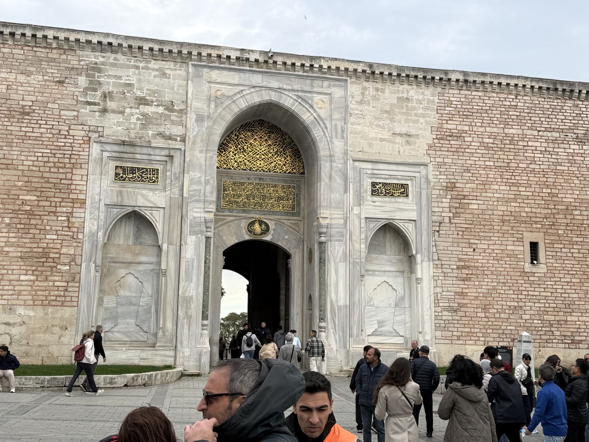
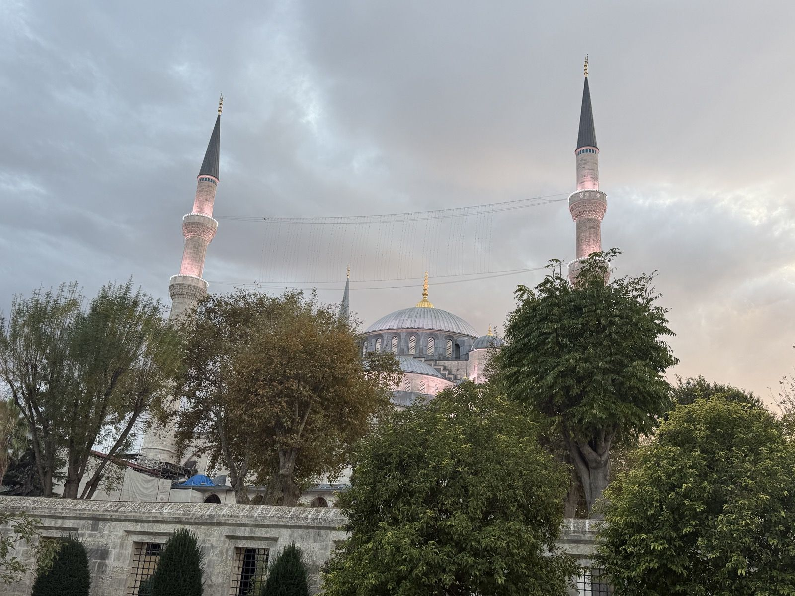
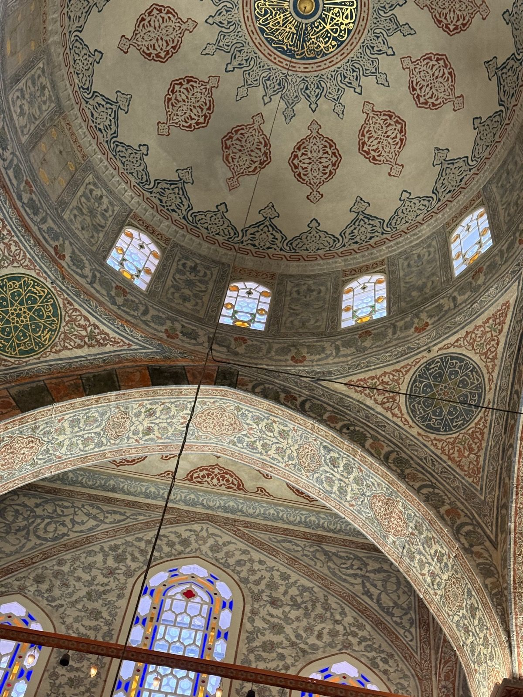
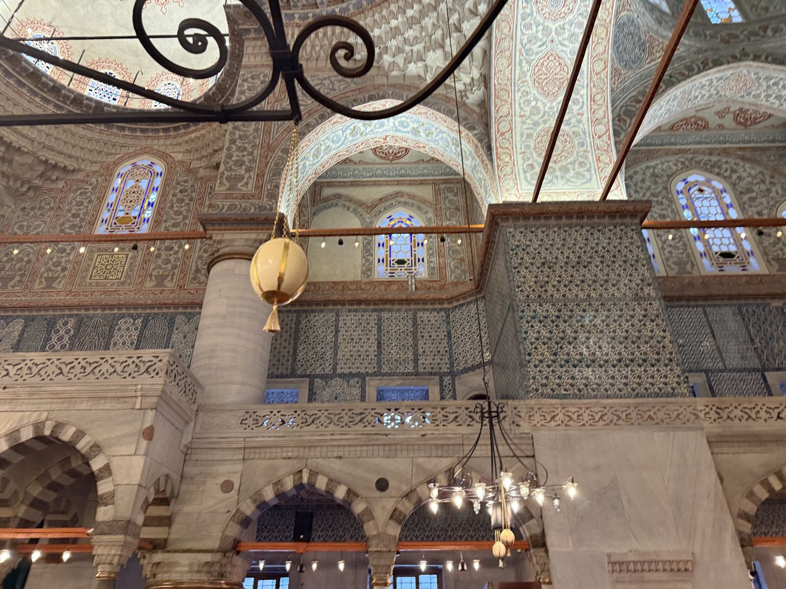
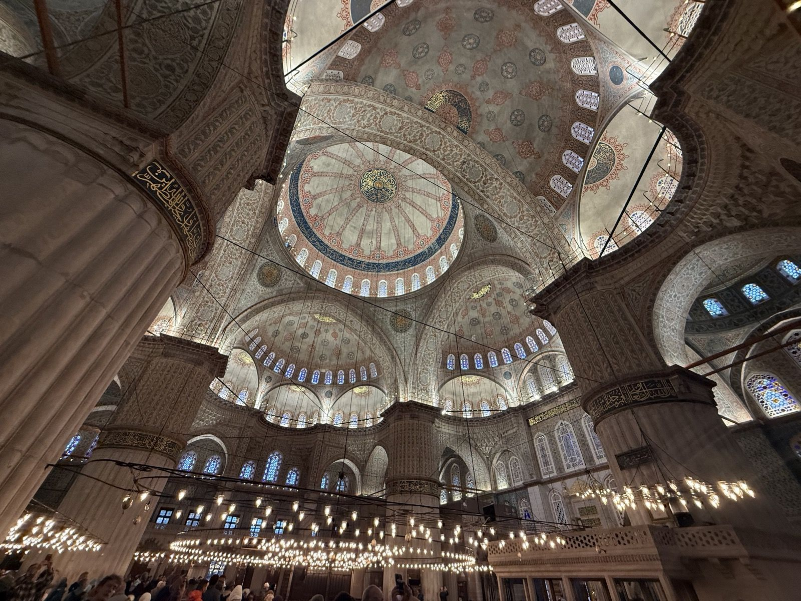
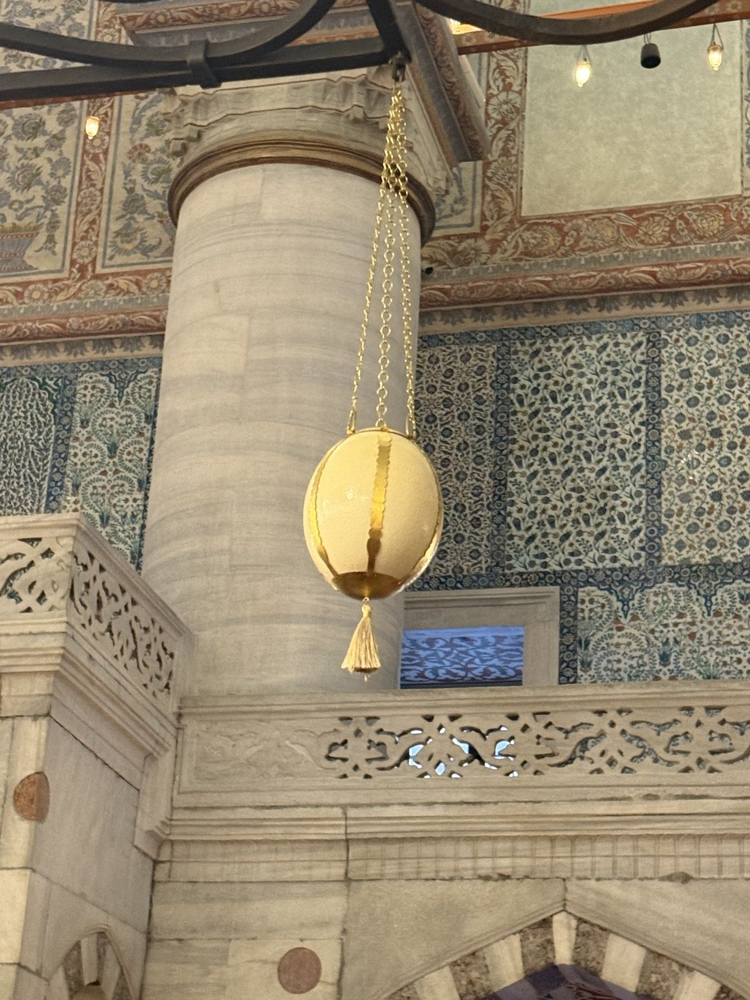

# Day 3: Ottoman Istanbul, Topkapı, and Friday Prayer

## Summary

Day 3 (Friday, November 13) falls on the main day of congregational prayer, so this chapter pairs Ottoman imperial Istanbul with Islam as it is lived. It visits Topkapı Palace and its harem, treasury, and relics, then follows Suleiman the Magnificent and the architect Mimar Sinan to the Süleymaniye and the Blue Mosque. It explains the Five Pillars, daily and Friday prayer, the call to prayer, and mosque etiquette so we can be good guests. Its Learning for All note looks at the vakıf endowments that funded schools, libraries, and soup kitchens for centuries.

## Concepts Covered

This chapter covers the following 30 concepts from the learning graph:

| Concept | Concept Impact Score |
|---------|-----------------------|
| Photography Etiquette | 1 |
| Suleiman the Magnificent | 22 |
| Mimar Sinan | 15 |
| Caliphate | 1 |
| Topkapi Palace | 9 |
| Harem of Topkapi | 1 |
| Topkapi Treasury | 1 |
| Sacred Relics Chamber | 1 |
| Gulhane Park | 2 |
| Ottoman Mosque Architecture | 9 |
| Blue Mosque | 1 |
| Suleymaniye Mosque | 5 |
| Vakif Endowment | 6 |
| Kulliye Mosque Complex | 4 |
| Medrese | 2 |
| Imaret Soup Kitchen | 1 |
| Iznik Tiles | 1 |
| Five Pillars of Islam | 10 |
| Quran | 1 |
| Daily Prayer | 9 |
| Prayer Times | 3 |
| Call to Prayer | 2 |
| Minaret | 1 |
| Friday Prayer | 1 |
| Ablution | 1 |
| Mihrab and Minbar | 1 |
| Mosque Etiquette | 1 |
| Ottoman Palace Kitchen | 3 |
| Baklava | 1 |
| Endowed Free Education | 1 |

## Prerequisites

This chapter builds on concepts from:

- [Chapter 1: Before We Go, Part 1: The Long Timeline of the Eastern Mediterranean](../01-long-timeline/index.md)
- [Chapter 2: Before We Go, Part 2: Traveling Well and the Learning for All Thread](../02-traveling-well/index.md)
- [Chapter 3: Day 1: Istanbul, a City on Two Continents](../03-istanbul-two-continents/index.md)
- [Chapter 4: Day 2: Byzantine Constantinople and Hagia Sophia](../04-byzantine-constantinople/index.md)

---

## A Friday in the Sultans' City

Day 3, Friday, November 13, is the Ottoman day, and it falls on the most important day of the Muslim week. Friday is the day of congregational prayer, when men gather at midday in the great mosques to pray together and hear a sermon. That makes it the right day to see Ottoman Istanbul as a living city and not a museum: in the morning we walk through the gates of Topkapı Palace, where the sultans lived and ruled for nearly four hundred years; at noon the city stops, or at least slows, for prayer; and in the afternoon we visit the mosques that the greatest sultan, Suleiman the Magnificent, and his architect, Mimar Sinan, built on the city's hills.

Yesterday's chapter showed how Christian Constantinople built Hagia Sophia. Today's shows how the Ottomans answered it. The answer was not only a dome. Around each great mosque the Ottomans built schools, kitchens, hospitals, and baths, paid for forever by charitable endowments, so that a mosque was the center of a small city of public services. To understand those buildings we need to understand the faith they were built for, so this chapter also explains, as simply and respectfully as we can, how Muslims pray, why the call to prayer sounds five times a day, and how to be good guests in a mosque.

!!! mascot-welcome "The Sultan's Kitchen and the People's Soup"
    { class="mascot-admonition-img" }
    Today we walk through a palace where an emperor's dagger has three emeralds the size of eggs, and then up a hill to a soup kitchen that fed students and strangers free for centuries. Both were built by the same empire, and the second may teach us more. By the end of this chapter, the call to prayer will no longer be background noise, and a mosque courtyard will read like a map of a whole society. Look closer.

The chapter has four parts. Part One is Topkapı Palace, its treasures, and its kitchens. Part Two explains Islam as it is lived on a Friday: the Five Pillars, daily prayer, the call to prayer, and mosque etiquette. Part Three follows Suleiman and Sinan to the Süleymaniye and the Blue Mosque. Part Four explains the charitable endowments that built and ran the mosque complexes, which lead to this chapter's Learning for All note.

## Part One: The Sultan's Palace

### Topkapı Palace

**Topkapı Palace** is the palace on the tip of the historic peninsula, at Seraglio Point, that was the residence of the Ottoman sultans and the center of their government from the 1460s until 1856. Mehmed II began building it in 1459, six years after he took the city, on the site of the ancient Greek acropolis of Byzantium. The name means "Cannon Gate Palace" and was given only in the 19th century, after a seaside gate; the Ottomans called it the New Palace. In 1856 Sultan Abdülmecid moved the court to the European-style Dolmabahçe Palace <audio id="audio-dolmabahce" src="../../audio/dolmabahce.mp3" preload="none"></audio><button onclick="document.getElementById('audio-dolmabahce').play()" class="pronounce-btn">🔊 Pronounce</button> *dol-MAH-bah-cheh* on the Bosphorus, and in 1924 the young Turkish Republic made Topkapı a museum.

Topkapı is not one building but a sequence of courtyards and pavilions, each more private than the last, entered through a series of gates. At its height several thousand people lived and worked here: soldiers, officials, pages, cooks, gardeners, and the sultan's household.

**Worked example: walking through the gates.** Let's walk in the way an Ottoman official would have, and notice how each gate filters who may pass. We enter through the **Imperial Gate** (*Bab-ı Hümayun*), built in 1478, into the First Court, which was open to the public; Justinian's Hagia Irene stands here, used by the Ottomans as an arsenal. The **Gate of Salutation** (*Bab-üs Selam*), with its two towers, leads to the Second Court; here only officials on business could enter, and everyone except the sultan dismounted from their horses. On the left is the **Imperial Council Hall**, where the grand vizier and ministers met four days a week; above them is a grilled window, through which the sultan could listen without being seen. On the right is the long row of kitchens. The **Gate of Felicity** (*Bab-üs Saadet*) leads to the Third Court, the sultan's private world, where only the palace household and invited guests went; just inside it is the Audience Chamber, where the sultan received ambassadors. Beyond lie the Treasury, the Sacred Relics, the palace school, and the Harem. The Fourth Court is a garden of pavilions with views over the Bosphorus and the Golden Horn. Four courts, three gates, and at each gate fewer people allowed through: the architecture itself is a diagram of power.

<figure markdown="span" class="trip-photo">
  { loading=lazy }
  <figcaption>The Imperial Gate (Bab-ı Hümayun), entrance to Topkapı Palace. Photo by Dan McCreary</figcaption>
</figure>

The table summarizes the walk we just took.

| Court | Entered through | Who could enter | What to see |
|---|---|---|---|
| First Court | Imperial Gate (1478) | The public | Hagia Irene, the ticket office |
| Second Court | Gate of Salutation | Officials on business, on foot | Imperial Council Hall, kitchens, the Harem entrance |
| Third Court | Gate of Felicity | The sultan's household and invited guests | Audience Chamber, Treasury, Sacred Relics |
| Fourth Court | Passages from the Third Court | The sultan and his family | Garden pavilions, views of the water |

!!! mascot-thinking "Gates as Layers of Trust"
    { class="mascot-admonition-img" }
    Notice that Topkapı is not designed to impress from outside, as a European palace is; it is designed to filter people. Each gate is a decision about who may come closer to the sultan, so the deeper we walk, the more trusted we would have had to be. Think of it as a building made of access rules.

### The Harem of Topkapı

The **Harem of Topkapı** is the private residential section of the palace, where the sultan's mother, wives, concubines, children, and their servants lived. *Harem* comes from the Arabic *ḥaram*, meaning "forbidden" or "sacred," because it was closed to outsiders. It is a maze of more than 300 rooms, courtyards, baths, and corridors, guarded by eunuchs. Western painters imagined it as a place of idle pleasure, an image that tells us more about European fantasies than about the Ottomans. In reality it was a household, a training school, and a center of politics. Its most powerful figure was the **valide sultan**, the sultan's mother, and from the mid-1500s to the mid-1600s, a period called the "Sultanate of Women," mothers and wives such as Hürrem <audio id="audio-hurrem" src="../../audio/hurrem.mp3" preload="none"></audio><button onclick="document.getElementById('audio-hurrem').play()" class="pronounce-btn">🔊 Pronounce</button> *hew-REM* and Kösem shaped policy and succession. The Harem has its own ticket and is well worth it, especially the tiled Imperial Hall and the twin pavilions of the crown princes.

### The Topkapı Treasury

The **Topkapı Treasury** is the collection of imperial jewels, thrones, arms, and gifts displayed in the Conqueror's Pavilion in the Third Court. Two objects draw the crowds. The **Topkapı Dagger**, made in 1747 with three large emeralds in its handle, was sent as a gift to the Persian ruler Nadir Shah, who was assassinated before it arrived, so it came back to the palace. The **Spoonmaker's Diamond** is a pear-shaped diamond of 86 carats ringed by 49 smaller diamonds; the legend that a fisherman found it and traded it to a spoon maker for three spoons is the kind of story Chapter 4 taught us to enjoy without believing. The Treasury is often crowded; going early or late in the day helps.

### The Sacred Relics Chamber

The **Sacred Relics Chamber** is the suite of domed rooms in the Third Court that holds relics associated with the Prophet Muhammad and other figures revered in Islam. Most came to the palace after Sultan Selim I conquered Egypt in 1517 and took control of the holy cities of Mecca and Medina. They include a mantle said to have belonged to the Prophet, his banner and swords, hairs from his beard, and objects associated with earlier prophets. An imam recites the Quran here continuously, and his voice fills the rooms. For many Muslim visitors this is not a museum room but one of the holiest places in Turkey, so we enter quietly and keep the camera away.

### The Caliphate

The **caliphate** is the office of the **caliph** (Arabic *khalīfa*, "successor"), the leader of the whole Muslim community after the death of the Prophet Muhammad in 632. The first four caliphs, Abu Bakr, Umar, Uthman, and Ali, whose names we saw in the roundels of Hagia Sophia, are honored by Sunni Muslims as the "rightly guided." Later the title passed to dynasties, the Umayyads and the Abbasids. When Selim I conquered Egypt in 1517, the Ottomans took over the claim, along with the relics and the protection of the holy cities, and later sultans used the title to speak for Muslims far beyond their borders. The Turkish Republic abolished the caliphate on March 3, 1924, a story Chapter 7 tells.

### Photography Etiquette

**Photography etiquette** is the set of courtesies about when, where, and whom we may photograph. In Istanbul the rules are mostly common sense, but a few are firm.

- **No photos where signs forbid them**, including the Sacred Relics Chamber.
- **Never photograph people praying**, and never use a flash in a mosque.
- **Ask before photographing a person**, including vendors and craftspeople, and accept a "no" with a smile.
- **No drones** over the historic peninsula without a permit.

This guide follows the same rules: its photos show buildings, food, and objects, not strangers.

!!! mascot-warning "The Camera Goes Down Before the Door"
    { class="mascot-admonition-img" }
    A common slip is to walk into the Sacred Relics Chamber, or a mosque during prayer, with the phone still raised from the last room. Put the camera away before the doorway, not after the guard points at you. If you forget, simply lower it and apologize with a nod.

### The Ottoman Palace Kitchen

The **Ottoman palace kitchen** was the vast cooking complex of Topkapı, which at its height fed several thousand people a day, and many more on festival days and days when the Council met and the soldiers were paid. It stands along the right side of the Second Court, a long row of domed halls topped by tall chimneys, rebuilt by the architect Sinan after a fire in 1574. Each section had its specialty: separate kitchens for the sultan, the Harem, and the household, and a *helvahane*, a sweets kitchen that made halva, jams, syrups, and medicines. The kitchens now display the palace's collection of Chinese porcelain, one of the largest outside China, which the sultans prized partly because celadon was believed to change color if it touched poisoned food.

Palace cooking became the high cuisine of the empire, and many of its dishes are still on Istanbul menus. One of them is a favorite of ours: **hünkâr beğendi**, "the sultan liked it," a stew of lamb served on a smooth purée of smoked eggplant whipped with butter, flour, milk, and cheese. The story says it was created for the French Empress Eugénie when she visited in 1869; the story is late and unproven, but the dish is very real, and eggplant cooked over a flame until smoky is one of the great flavors of the Turkish table.

### Baklava

**Baklava** is a pastry made of many thin layers of dough (*yufka*, or phyllo), brushed with butter, filled with chopped nuts, usually pistachios or walnuts, baked, and soaked in syrup. The Ottoman palace refined it into an art, and it carried a ceremony: on the fifteenth day of Ramadan, the sultan sent trays of baklava to the Janissaries, one tray for every ten soldiers, and they carried them back to their barracks in a parade called the Baklava Procession. Where baklava was invented is disputed among Turks, Greeks, and Arabs, a small example of contested history on a plate. Today the most famous baklava comes from Gaziantep in southeastern Turkey, whose pistachio baklava has protected status in the European Union. A good piece should crackle when cut and not swim in syrup.

### Gülhane Park

**Gülhane Park** <audio id="audio-gulhane" src="../../audio/gulhane.mp3" preload="none"></audio><button onclick="document.getElementById('audio-gulhane').play()" class="pronounce-btn">🔊 Pronounce</button> *gewl-hah-NEH* ("Rose House Park") is the public park that occupies the outer gardens of Topkapı Palace, sloping down from the palace walls toward the Bosphorus. It was opened to the public in 1912. In 1839 the Gülhane Edict, the reform decree that began the Ottoman modernization known as the Tanzimat, was read aloud here. At its far end stands the Column of the Goths, a Roman column older than Constantinople, and on its edge are the Istanbul Archaeology Museums, which hold the upper jaw of one of the three bronze serpent heads from the Serpent Column in the Hippodrome. On a November afternoon it is a quiet place to sit between the palace and the mosques.

## Part Two: Islam as It Is Lived

### The Five Pillars of Islam

Chapter 1 introduced **Islam**, the faith founded on the revelations to the Prophet Muhammad in 7th-century Arabia. A Muslim's life is organized around five basic acts of worship known as the **Five Pillars of Islam**. Seeing them as a set helps us understand nearly everything we will see in a mosque, and much of what we see in the streets.

1. **Shahada**, the profession of faith: "There is no god but God, and Muhammad is the messenger of God." Saying it sincerely is what makes a person a Muslim.
2. **Salat**, ritual prayer five times a day (in Turkish, *namaz*).
3. **Zakat**, the obligatory giving of alms: each year, a Muslim with savings above a minimum gives 2.5 percent of them to the poor (Turkish *zekât*).
4. **Sawm**, fasting from dawn to sunset during the month of Ramadan (Turkish *oruç*).
5. **Hajj**, the pilgrimage to Mecca, required once in a lifetime of every Muslim who is physically and financially able (Turkish *hac*).

**Worked example: finding the pillars on one Friday.** Let's see how many of the five we can actually notice on Day 3. *Shahada:* its words appear in calligraphy on mosque walls, and they are part of the call to prayer we will hear five times. *Salat:* we will see worshippers going to noon prayer, and the city's rhythm will shape our schedule. *Zakat:* the charitable endowments in Part Four are the same impulse, giving made permanent, and outside some old mosques stand *sadaka taşı*, "charity stones," stone pillars where donors once left coins in a hollow on top and people in need took only what they needed, without either seeing the other. *Sawm:* Ramadan fell in late winter in 2026, so we will not see the fast, but bakeries sell the special Ramadan bread for weeks in that season. *Hajj:* an older man addressed respectfully as *hacı* has made the pilgrimage. Four of the five pillars are visible on one ordinary Friday, if we look closer.

The table below summarizes the five pillars with their Turkish names, which are the words we will hear.

| Pillar | Arabic | Turkish | How often |
|---|---|---|---|
| Profession of faith | Shahada | Kelime-i şehadet | Said sincerely; repeated daily in prayer |
| Prayer | Salat | Namaz | Five times a day |
| Almsgiving | Zakat | Zekât | Once a year, 2.5 percent of savings |
| Fasting | Sawm | Oruç | Every day of Ramadan, dawn to sunset |
| Pilgrimage | Hajj | Hac | Once in a lifetime, if able |

### The Quran

The **Quran** (Arabic for "recitation") is the holy book of Islam, which Muslims believe is the word of God revealed to Muhammad through the angel Gabriel over about 23 years, from 610 to 632. It has 114 chapters, called *suras*. Muslims recite it in Arabic, the language of revelation, even where, as in Turkey, few people speak Arabic; translations are treated as interpretations rather than the Quran itself. Because its words are sacred, writing them beautifully became one of the highest arts of the Islamic world, which is why mosques are decorated with calligraphy rather than pictures. Chapter 6 tells that story. A copy of the Quran is handled with respect, never placed on the floor.

### Daily Prayer

**Daily prayer** (*salat* in Arabic, *namaz* in Turkish) is the ritual prayer Muslims perform five times a day, at times set by the sun. Each prayer is made up of repeated cycles called *rak'ah* (Turkish *rekât*). In each cycle the worshipper stands and recites from the Quran, bows with hands on knees, stands again, prostrates with forehead, nose, palms, knees, and toes on the ground, and sits back on the heels. Every Muslim prays facing the **qibla**, the direction of the Kaaba in Mecca, which from Istanbul is south-southeast. Prayer can be made anywhere clean, alone or together, but men are encouraged to pray in a mosque in congregation, standing shoulder to shoulder in rows behind the imam, the person leading the prayer.

**Worked example: counting a day's prayers.** Let's add up what a practicing Muslim in Istanbul does on Day 3. The obligatory cycles are 2 at dawn, 4 at noon, 4 in the afternoon, 3 at sunset, and 4 at night: 17 cycles in all. Each cycle takes about a minute, so the obligatory prayers take roughly a quarter of an hour a day, plus the washing beforehand, though many people add optional prayers. The five times are spread from before sunrise to well after dark, so the day is divided into sections by prayer, much as monastic bells once divided the day in a Christian town. On a Friday, the noon prayer is replaced by the congregational Friday prayer, described below. Once we know this rhythm, the timing of mosque closures, busy streets, and quiet moments in the city starts to make sense.

| Prayer | Arabic | Turkish | When | Obligatory cycles |
|---|---|---|---|---|
| Dawn | Fajr | Sabah | Between first light and sunrise | 2 |
| Noon | Dhuhr | Öğle | Just after the sun passes its highest point | 4 |
| Afternoon | Asr | İkindi | Mid-afternoon, when shadows lengthen | 4 |
| Sunset | Maghrib | Akşam | Just after sunset | 3 |
| Night | Isha | Yatsı | After the last light has gone | 4 |

!!! mascot-thinking "A City That Keeps Time by the Sun"
    { class="mascot-admonition-img" }
    Notice that prayer times are set by the sun, not the clock, so they move a few minutes every day and shift through the year. A visitor's schedule built on a clock keeps colliding with a city built on the sun. Once we plan around the sun as well, the collisions stop.

### Prayer Times

**Prayer times** are the exact clock times of the five daily prayers for a particular place and date, calculated from the position of the sun. In Turkey they are published by the Presidency of Religious Affairs (the *Diyanet*), printed on calendars, shown on screens in mosques, and available in phone apps. For Istanbul on November 13, the five times come out roughly as follows: dawn prayer from about 6:15 AM, sunrise about 7:50 AM, noon about 12:55 PM, afternoon about 3:25 PM, sunset prayer about 5:50 PM, and night prayer about 7:15 PM. These are our own calculation from the sun's position; the Diyanet's official times differ by a few minutes, so check them on the day.

### The Call to Prayer

The **call to prayer** (Arabic *adhan*, Turkish *ezan* <audio id="audio-ezan" src="../../audio/ezan.mp3" preload="none"></audio><button onclick="document.getElementById('audio-ezan').play()" class="pronounce-btn">🔊 Pronounce</button> *eh-ZAHN*) is the chanted announcement, made from each mosque five times a day, that the time for prayer has come. It is sung by a **muezzin** (*müezzin*) in Arabic and lasts a few minutes. Its words, in translation, are: "God is the greatest" (four times); "I bear witness that there is no god but God" (twice); "I bear witness that Muhammad is the messenger of God" (twice); "Come to prayer" (twice); "Come to success" (twice); "God is the greatest" (twice); and "There is no god but God." At dawn it adds "Prayer is better than sleep." Istanbul's muezzins sing in the traditional musical modes, called *makam*, and many mosques coordinate so that the calls ripple across the city rather than drowning each other out. From 1932 to 1950, the Turkish state required the call to be sung in Turkish, part of the reforms Chapter 7 describes; the Arabic call was restored in 1950, and it is still remembered as one of the most emotional changes of that era.

### Minaret

A **minaret** is the tall, slender tower beside a mosque from which the call to prayer was traditionally made. Ottoman minarets are pencil-shaped, with a pointed conical cap and one to three balconies, called *şerefe*, from which the muezzin called. Today the call is usually amplified through loudspeakers mounted on the balconies, but the muezzin still sings it live, inside the mosque. Ordinary neighborhood mosques have one minaret. Only a mosque built by a sultan or a member of his family could have more, so counting minarets is a quick way to spot an imperial foundation.

<figure markdown="span" class="trip-photo">
  { loading=lazy }
  <figcaption>The Blue Mosque's minarets in the late afternoon. Photo by Dan McCreary</figcaption>
</figure>

### Ablution

**Ablution** (Arabic *wudu*, Turkish *abdest*) is the ritual washing a Muslim performs before prayer. It is done in a fixed order, usually three times each: hands, mouth, nose, face, arms up to the elbows, a wet hand passed over the head, ears, and finally the feet up to the ankles. Every mosque has a place for it, often a row of taps along an outside wall or a domed fountain in the courtyard, the *şadırvan*, like the one we saw at Hagia Sophia. Visitors do not perform ablution, but it is polite not to stand in front of the taps photographing people washing.

### Friday Prayer

**Friday prayer** (Arabic *jumu'ah*, Turkish *cuma namazı*) is the congregational prayer held at midday on Fridays, in place of the ordinary noon prayer. It includes a **sermon** (*hutbe*) given by the imam, and it is required of adult Muslim men and optional for women. On Friday the big mosques fill well before noon, and worshippers who cannot fit inside pray on mats in the courtyard and the street. Friday is not a day off in Turkey, though: a law of 1935 moved the weekly day of rest from Friday to Sunday, so many people slip out of work for an hour and go back afterward. For visitors, Friday prayer is the longest closure of the week; plan to be in a museum, a bazaar, or a café at midday rather than outside a mosque door.

### Mosque Etiquette

**Mosque etiquette** is the set of customs that let visitors enter a mosque respectfully. Mosques in Istanbul welcome non-Muslim visitors outside prayer times, and following a few simple customs is all that is asked.

- **Time.** Visit outside prayer times. Most mosques close to visitors for about an hour around each prayer, longer at Friday noon.
- **Dress.** As in Chapter 4: women cover their hair; everyone covers shoulders and knees.
- **Shoes.** Take them off before stepping on the carpet. There are racks inside the door, or plastic bags to carry them.
- **Where to walk.** Use the visitors' entrance and stay in the visitors' area. Never walk directly in front of someone who is praying.
- **Voice and camera.** Speak quietly, keep phones silent, take no photos of people, and use no flash.
- **Giving.** A donation box by the door helps maintain the mosque; giving is welcome, not required.

!!! mascot-tip "Let an App Plan the Day"
    { class="mascot-admonition-img" }
    Here's a shortcut: install a free prayer-times app, or open the Diyanet's website, and set Istanbul as the city. Glance at it each morning, and schedule mosque visits for the windows between prayers. Ten seconds of planning saves standing outside a closed door.

The MicroSim below lets us practice exactly that: fitting Day 3's visits into the windows between prayers.

#### Diagram: Planning Day 3 Around the Prayer Times

Planning Day 3 Around the Prayer Times

Type: microsim
**sim-id:** day-3-prayer-time-planner 
**Library:** p5.js 
**Status:** Specified 
**Bloom Level:** Apply 
**Bloom Verb:** solve 
**Learning Objective:** The learner will solve the Day 3 scheduling problem by placing five activities into a 9:00 AM to 6:00 PM day so that every mosque visit falls inside a window when mosques are open to visitors, producing a valid schedule within three attempts.

**Prerequisites:** daily prayer, prayer times, Friday prayer, mosque etiquette (defined in Part Two above), and the locations of Topkapı Palace, the Blue Mosque, the Süleymaniye, and the Rüstem Pasha Mosque (Parts One and Three).

**Evidence of Mastery:** The learner places all five activities on the day grid and presses Check. A schedule is valid when every rule in Rules is satisfied. Mastery is a valid schedule within three Checks. More than one valid schedule exists; any schedule that satisfies the rules is correct.

**Misconceptions:** (1) Mosques are open all day like museums. (2) Friday noon is a good time to visit a famous mosque because "everyone will be there." (3) Prayer times are the same every day, so last week's times will do. (4) Moving between neighborhoods takes no time.

**Instructional Rationale:** Scheduling against real constraints is an Apply task: the learner uses the prayer-time pattern to solve a problem they will actually face on Day 3. Checking a whole schedule, with the broken rule named, teaches the closure windows faster than reading them.

**Content:**

Prayer times for Istanbul, Friday November 13, 2026, shown on the grid: noon (Friday prayer) 12:55 PM; afternoon 3:25 PM; sunset 5:50 PM.

Mosque visitor closures for this exercise (illustrative, shown on the grid as shaded bands):

- Friday prayer closure: 11:30 AM to 2:30 PM.
- Afternoon prayer closure: 3:00 PM to 4:00 PM.
- Sunset prayer closure: 5:30 PM to 6:00 PM (end of the grid).

Activities to place (each card shows name, area, and duration):

| # | Activity | Area | Duration | Kind |
|---|---|---|---|---|
| 1 | Topkapı Palace, including the Harem | Sultanahmet | 3 h | Palace (not affected by prayer closures; open 9:00 AM to 5:00 PM) |
| 2 | Blue Mosque | Sultanahmet | 1 h | Mosque |
| 3 | Süleymaniye Mosque and its courtyard | Süleymaniye | 1 h | Mosque |
| 4 | Rüstem Pasha Mosque | Süleymaniye | 30 min | Mosque |
| 5 | Lunch | Either area | 1 h | Meal (may be placed in either area) |

**Provenance:** Prayer times are this chapter's own calculation from the sun's position for Istanbul on November 13, 2026 (section "Prayer Times"), rounded to 5 minutes. Closure windows and opening hours are illustrative, chosen to match the typical pattern described in "Mosque Etiquette"; the sim labels them "Illustrative times: check the Diyanet and site hours on the day."

**Rules:**

- The day grid runs from 9:00 AM to 6:00 PM in 30-minute slots (18 slots). Activities snap to slots.
- Activities may not overlap.
- A mosque activity (2, 3, 4) is valid only if every slot it occupies lies outside all three closure bands.
- Topkapı Palace must lie entirely between 9:00 AM and 5:00 PM.
- Moving between areas costs one 30-minute slot of walking: if two consecutive scheduled activities are in different areas, there must be at least one empty slot between them. Lunch takes the area of the activity before it.
- All five activities must be placed.
- Example of a valid schedule (not shown to the learner until revealed): Blue Mosque 9:00–10:00; Topkapı 10:00–1:00; lunch 1:00–2:00; walk 2:00–2:30; Rüstem Pasha 2:30–3:00; break or bazaar 3:00–4:00; Süleymaniye 4:00–5:00.

**Learner Activity:**

1. The learner sees the empty day grid with the three closure bands and the five activity cards.
2. The learner drags each card onto the grid.
3. The learner presses Check.
4. The sim reports whether the schedule is valid; if not, it names each broken rule and the activity that breaks it.
5. The learner adjusts and checks again.
6. The learner should notice that the morning and the 4:00 to 5:30 PM window are the only long mosque-visiting windows on a Friday.

**Feedback:** On Check, a valid schedule shows "Valid: every mosque visit falls in an open window. This is a real plan for Day 3." An invalid schedule lists every broken rule using these messages: "[Activity] overlaps the Friday prayer closure (11:30 AM to 2:30 PM).", "[Activity] overlaps the afternoon prayer closure (3:00 to 4:00 PM).", "[Activity] overlaps the sunset prayer closure (5:30 PM).", "Topkapı must finish by 5:00 PM.", "Allow 30 minutes to walk between Sultanahmet and Süleymaniye before [Activity].", "[Activity] and [Activity] overlap.", "Place all five activities." After the third invalid Check, a Show One Solution option reveals the example schedule in Rules.

**Starting State:** The grid from 9:00 AM to 6:00 PM, the three shaded closure bands, the five unplaced cards, and the question "It's Friday. When can we visit the mosques?"

**Chapter Anchors:** Noon prayer about 12:55 PM, afternoon about 3:25 PM, sunset prayer about 5:50 PM on November 13; mosques close for about an hour around each prayer and longer at Friday noon; five activities; mastery within three Checks.

## Part Three: Suleiman and Sinan

### Suleiman the Magnificent

**Suleiman I**, called **the Magnificent** in Europe and *Kanuni*, "the Lawgiver," in Turkish, ruled the Ottoman Empire from 1520 to 1566, the longest reign in its history. He came to the throne at 25, the only surviving son of Selim I, so for once there was no war of succession. His reign is remembered as the height of Ottoman power. His armies took Belgrade in 1521 and crushed the Hungarian army at Mohács in 1526; they besieged Vienna in 1529 but could not take it; in the east they took Baghdad in 1534. His admiral, Hayreddin Barbarossa, made the Ottoman navy master of the Mediterranean. At home, his name *Kanuni* recalls the law codes issued in his reign, which organized taxes, land, and justice across an empire of perhaps 15 to 20 million people. He was also a poet, writing under the pen name Muhibbi, "the loving friend."

His private life was as dramatic as his conquests. He married **Hürrem**, a woman from what is now Ukraine who had entered his harem as an enslaved captive; Europeans called her Roxelana. Making a concubine his legal wife broke centuries of Ottoman custom, and she became his closest adviser. The reign also had its darkness: Suleiman had his grand vizier and boyhood friend Ibrahim Pasha executed in 1536, and his eldest son, Mustafa, in 1553.

**Worked example: Suleiman on our route.** Let's find Suleiman on the rest of our trip, which shows how wide his empire reached. On Day 8 we will walk through the Old Town of Rhodes, which the Knights of St. John held for more than two centuries. Suleiman besieged it with a huge army and fleet from June to December 1522. When the knights finally surrendered, he let them leave with honor on January 1, 1523, and they eventually settled on Malta. Inside the walls stands the Mosque of Suleiman, founded to mark the conquest and rebuilt in 1808. So one sultan connects today's Süleymaniye in Istanbul with a pink-domed mosque in a Greek island town five days later, and Chapter 12 picks up the story from the knights' side.

### Mimar Sinan

**Mimar Sinan** (*mimar* means "architect") was the chief architect of the Ottoman Empire for almost fifty years and the greatest architect in its history. He was born around 1490 to a Christian family in Ağırnas, a village near Kayseri in central Anatolia, and was taken as a young man through the **devşirme**, the levy of Christian boys for the sultan's service that Chapter 3 described. He converted to Islam, became a Janissary, and served as a military engineer on Suleiman's campaigns, building bridges and, famously, boats to carry troops across Lake Van. Around 1539, at about 50, he was appointed chief architect, and he held the post under Suleiman, Selim II, and Murad III until he died in 1588, aged about 98. His office designed more than 300 buildings: mosques, schools, hospitals, kitchens, baths, bridges, aqueducts, and tombs.

**Worked example: apprentice, journeyman, master.** Sinan himself described his career in three buildings, and they make a neat lesson in how a master learns. He called the **Şehzade Mosque** in Istanbul (1543–1548), built for Suleiman's dead son Mehmed, his work as an apprentice: a central dome surrounded by four half-domes, perfectly symmetrical but a little heavy. He called the **Süleymaniye** (1550–1557) his work as a journeyman: a return to Hagia Sophia's plan, with two half-domes, but with the supports hidden and the interior flooded with light. He called the **Selimiye Mosque** in Edirne (1568–1575), built for Selim II, his masterpiece: a single dome about 31 m across, as wide as Hagia Sophia's, resting on eight piers so slim that the interior seems to be all dome. Three buildings over 32 years, each solving a problem the one before left open. Seeing the Süleymaniye today, we are looking at the middle step of that education.

### Ottoman Mosque Architecture

**Ottoman mosque architecture** is the building style of the Ottoman imperial mosques, which reached its classic form under Sinan in the 16th century. Its defining idea is a single, unified prayer hall covered by a great central dome. Before we look at the table below, a few terms. A **semi-dome** (half-dome) is half of a dome, used to extend the space under the main dome. A **buttress** is a mass of masonry that props up a wall against the outward push of a dome. The **courtyard** (*avlu*) is an arcaded open court in front of the prayer hall, usually with an ablution fountain in the middle.

The Ottomans learned the central-dome idea partly from Hagia Sophia, which they had been using as their imperial mosque since 1453. But a mosque has different needs from a church. A church leads the eye along a long axis toward the altar; a mosque needs a wide hall where long rows of worshippers can stand side by side facing Mecca. So Ottoman architects took the dome and changed the space beneath it.

| Feature | Hagia Sophia (537) | Ottoman imperial mosque (Süleymaniye, 1557) |
|---|---|---|
| Plan | Long hall; the eye travels east to the altar | Nearly square hall; long rows face the qibla wall |
| Supports | Huge piers and buttresses, partly visible inside | Piers slimmed and buttresses hidden in walls and galleries |
| Light | 40 windows around the dome; a dim, golden interior | Many more windows; a bright interior |
| Decoration | Gold mosaics and figures | Calligraphy, painted patterns, İznik tiles; no figures |
| Setting | A cathedral among palace buildings | A mosque at the center of a complex of schools, kitchens, and hospitals |
| Towers | None originally | Two to six minarets, a sign of imperial patronage |

**Worked example: comparing the two great domes.** Let's put numbers on the comparison. Hagia Sophia's dome is about 31 m across and about 55 m above the floor. The Süleymaniye's dome is about 26.5 m across and about 53 m high. So Sinan's dome is a little narrower and almost as high, which means it is proportionally steeper and pushes outward less, the same lesson Isidore the Younger learned after 558. Sinan did not try to beat Hagia Sophia's width here; he waited for Edirne to do that. What he beat was the feeling of the space: in the Süleymaniye, the piers that hold the dome are partly built into the side walls, and the side galleries are light, so we see one great room rather than a center surrounded by aisles.

<figure markdown="span" class="trip-photo">
  { loading=lazy }
  <figcaption>Painted dome and stained-glass windows, Blue Mosque. Photo by Dan McCreary</figcaption>
</figure>

### Mihrab and Minbar

Two pieces of furniture stand at the front of every mosque. The **mihrab** <audio id="audio-mihrab" src="../../audio/mihrab.mp3" preload="none"></audio><button onclick="document.getElementById('audio-mihrab').play()" class="pronounce-btn">🔊 Pronounce</button> *MEE-rahb* is a niche in the **qibla wall**, the wall that faces Mecca, marking the direction of prayer; the imam leads the prayer standing in front of it. The **minbar** is a tall, narrow staircase pulpit to the right of the mihrab, from which the imam gives the Friday sermon; out of respect, the preacher stands on a lower step, leaving the top step for the Prophet. In Hagia Sophia, the mihrab stands in the old Christian apse, but it is set slightly off-center, turned a few degrees to the south. That small angle is the difference between the direction of Justinian's altar, east, and the direction of Mecca, south-southeast: a layer we can read without a guide.

### The Süleymaniye Mosque

The **Süleymaniye Mosque** is the imperial mosque Sinan built for Suleiman between 1550 and 1557 on Istanbul's third hill, above the Golden Horn. It is the largest mosque of Sinan's in the city and, for many visitors, the most beautiful. Its four minarets carry ten balconies; tradition says the four stand for Suleiman as the fourth sultan to rule from Istanbul and the ten for his place as the tenth sultan of the dynasty. Inside, the light is clear and even, the decoration restrained, and the acoustics good enough that a voice at the mihrab carries without strain.

A favorite story about the mosque is a good test case for Chapter 4's method. It says Sinan designed the airflow so that soot from the thousands of oil lamps collected in a single room over the entrance, where it was scraped up and made into ink for the calligraphers. A room over the entrance exists, and soot-based ink was standard, so the story is plausible; but the earliest written versions are modern, so we treat it as a lovely possibility rather than a fact.

Behind the mosque, in a walled garden, are the domed tombs of Suleiman and of Hürrem. Sinan's own small tomb stands just outside the complex wall, at the corner nearest the street where he lived. From the terrace on the mosque's north side, the view down over the Golden Horn to Galata is one of the best in the city.

### İznik Tiles

**İznik tiles** are the glazed ceramic tiles made in the town of İznik (ancient Nicaea, where the council that restored icons met in 787) that decorate Ottoman mosques and palaces. Their great age ran from about 1550 to the early 1600s. They are made of **fritware**, a white body of ground quartz and glass, painted with cobalt blue, turquoise, green, and, from about 1557, a raised tomato red that potters elsewhere could not match. The designs are mostly flowers: tulips, carnations, hyacinths, roses, and spring blossoms on sprays of leaves. Quality declined in the 17th century as the court's orders and money shrank, and the best old tiles are now irreplaceable.

<figure markdown="span" class="trip-photo">
  { loading=lazy }
  <figcaption>İznik-tiled galleries of the Blue Mosque. Photo by Dan McCreary</figcaption>
</figure>

!!! mascot-tip "The Best Tiles Are Above a Market"
    { class="mascot-admonition-img" }
    Want the finest İznik tiles in the city without the crowds? Climb the stairs from the market street to Sinan's small Rüstem Pasha Mosque, near the Spice Bazaar, where nearly every surface inside is tiled. It takes twenty minutes and fits neatly between the Süleymaniye and Day 4's bazaars.

### The Blue Mosque

The **Blue Mosque**, officially the **Sultan Ahmed Mosque**, is the imperial mosque built for Sultan Ahmed I between 1609 and 1616, facing Hagia Sophia across the park. Its architect, Sedefkâr Mehmed Ağa, had trained under Sinan. Ahmed was only 19 when he began it, and he built it without the war victories that had traditionally paid for imperial mosques, which made it controversial in his day. It is the only mosque in Istanbul with six minarets. Inside, more than 20,000 hand-painted İznik tiles line the walls and galleries, and their blue and green floral patterns gave the building its English name. Light comes in through more than 200 windows.

<figure markdown="span" class="trip-photo">
  { loading=lazy }
  <figcaption>Prayer hall and domes of the Sultan Ahmed (Blue) Mosque. Photo by Dan McCreary</figcaption>
</figure>

Look up at the great rings of lamps that hang low over the prayer hall. Ottoman lamp frames often had ostrich eggs or egg-shaped ornaments hung among the lamps; one explanation is that they kept spiders away, though that, too, is a story rather than a recorded fact. The Blue Mosque is a working mosque, open to visitors outside prayer times, and it reopened in 2023 after a five-year restoration.

<figure markdown="span" class="trip-photo">
  { loading=lazy }
  <figcaption>A hanging egg-shaped ornament in the Blue Mosque. Photo by Dan McCreary</figcaption>
</figure>

## Part Four: Charity in Stone

### The Vakıf Endowment

A **vakıf** <audio id="audio-vakif" src="../../audio/vakif.mp3" preload="none"></audio><button onclick="document.getElementById('audio-vakif').play()" class="pronounce-btn">🔊 Pronounce</button> *vah-KUHF* (Arabic *waqf*, plural *awqāf*) is an Islamic charitable endowment: a founder permanently dedicates property, such as shops, farmland, houses, or baths, so that its income pays forever for a stated purpose, such as a mosque, a school, a fountain, or a soup kitchen. Once property is dedicated, it can never be sold or inherited; legally it belongs to God, and its income must be spent as the founder directed. The founder's instructions are written in a deed called a **vakfiye**, and a trustee, the *mütevelli*, manages the property and pays the staff.

Vakıfs were the Ottoman Empire's public services. There was no ministry of education or health; schools, hospitals, water fountains, bridges, and soup kitchens were built and run by endowments set up by sultans, their mothers and wives, viziers, merchants, and ordinary people of modest means. Women founded a large share of them. Hürrem's own foundation, set up in the 1530s, built a mosque, a school, a hospital, and a soup kitchen in Istanbul, and her soup kitchen in Jerusalem is still serving food today.

**Worked example: reading a deed.** Let's look at what a typical Ottoman vakfiye actually specifies, because the detail is surprising. The deed for a mosque complex might name the shops and villages whose rents and taxes fund it. It lists every staff position and its daily pay: imams, muezzins, teachers, students' stipends, cooks, the doorkeeper, the lamp lighter, the person who sweeps the courtyard. It sets the soup kitchen's menu, often down to the ingredients: rice or wheat soup with bread every day, and on Friday nights or holy days a meat pilaf and *zerde*, a sweet rice pudding colored gold with saffron. It says who eats first, usually the staff and students, then travelers, then the poor. And it ends with a curse on anyone who changes the founder's terms. The deed is half budget, half constitution, written to run without the founder for centuries. Many did: some Ottoman vakıfs ran for four hundred years.

!!! mascot-thinking "Charity That Outlives Its Founder"
    { class="mascot-admonition-img" }
    Think of a vakıf as charity with an engine. A gift of money runs out, but a gift of shops that pay rent forever keeps paying the teacher's salary long after the donor, and the sultan, are gone. That one design choice is why a 16th-century school could still be teaching in the 19th.

### The Külliye Mosque Complex

A **külliye** <audio id="audio-kulliye" src="../../audio/kulliye.mp3" preload="none"></audio><button onclick="document.getElementById('audio-kulliye').play()" class="pronounce-btn">🔊 Pronounce</button> *kewl-lee-YEH* is a complex of public buildings grouped around a mosque and run as a single charitable endowment. The word comes from the Arabic *kull*, "all": a külliye provided all of a neighborhood's public needs in one place. A large imperial külliye might include schools at several levels, a hospital, a soup kitchen, a guesthouse for travelers, a bath, a library, fountains, the founder's tomb, and rows of shops whose rents helped pay for everything else.

**Worked example: walking around the Süleymaniye.** Let's walk around the outside of the Süleymaniye and identify the buildings of its külliye, which survive almost complete. Flanking the mosque's outer courtyard are **four medreses** <audio id="audio-medrese" src="../../audio/medrese.mp3" preload="none"></audio><button onclick="document.getElementById('audio-medrese').play()" class="pronounce-btn">🔊 Pronounce</button> *med-reh-SEH* for advanced study, ranked among the highest in the empire, and a school for the study of the Prophet's sayings. Nearby is a small **primary school** for children. Further along the streets around the complex are a **medical school** and a **hospital**, the **imaret** <audio id="audio-imaret" src="../../audio/imaret.mp3" preload="none"></audio><button onclick="document.getElementById('audio-imaret').play()" class="pronounce-btn">🔊 Pronounce</button> *ee-mah-RET*, or soup kitchen, with a **guesthouse** for travelers beside it, and a **public bath**. Behind the mosque are the **tombs** of Suleiman and Hürrem. Beneath the medreses on the slope toward the Golden Horn ran **rows of shops**, whose rents went to the foundation. Today the medreses hold a famous manuscript library, the Süleymaniye Library, the old imaret is a restaurant, and a row of small restaurants along the street on the north side serve the white bean stew, *kuru fasulye*, that students have eaten here for generations. A walk of twenty minutes takes us around a whole Ottoman welfare state.

The MicroSim below lets us sort the buildings of the Süleymaniye complex by the need each one served.

#### Diagram: What Did the Külliye Do?

What Did the Külliye Do?

Type: microsim
**sim-id:** suleymaniye-kulliye-sorter 
**Library:** p5.js 
**Status:** Specified 
**Bloom Level:** Understand 
**Bloom Verb:** classify 
**Learning Objective:** The learner will classify twelve buildings of the Süleymaniye külliye by the public need each one served (worship, learning, health, food and shelter, income, or remembrance), classifying at least 10 of 12 correctly on the first attempt.

**Prerequisites:** vakıf, vakfiye, külliye, medrese, imaret (defined in Part Four above).

**Evidence of Mastery:** For each building card, the learner chooses one of six needs before feedback. A choice is correct when it matches the Correct need column in Content. Mastery is 10 of 12 correct on the first attempt, including the medical school (card 5) and the bath (card 9), the two cards where the obvious guess is wrong.

**Misconceptions:** (1) A mosque complex is just a mosque with some extra buildings for worship. (2) A medical school is a hospital (card 5). (3) The bath was a free public service, when the complex's bath was run to earn income for the foundation (card 9). (4) Charity buildings paid for themselves without any income-producing property (cards 9 and 10).

**Instructional Rationale:** Classifying each building by function makes the learner reconstruct the külliye as a system of public services and see that some buildings existed to fund the others. The two trap cards target the most common wrong assumptions about medicine and baths.

**Content:**

The six needs, each with its definition:

- Worship: buildings for prayer.
- Learning: buildings for teaching and study.
- Health: buildings for treating the sick.
- Food and shelter: buildings that fed or housed people.
- Income: property whose rent or fees paid for the foundation.
- Remembrance: tombs of the founder and family.

| # | Building card | Correct need | Reason shown after answering |
|---|---|---|---|
| 1 | The mosque | Worship | The center of the complex, built 1550–1557. |
| 2 | Four medreses | Learning | Colleges for advanced study of Islamic law and theology, among the highest-ranked in the empire. |
| 3 | School of hadith (the Prophet's sayings) | Learning | A specialized college for studying the sayings and practice of the Prophet. |
| 4 | Primary school (*sıbyan mektebi*) | Learning | A free school where children learned to read the Quran and basic writing. |
| 5 | Medical school (trap) | Learning | It trained physicians; the hospital next door is where patients were treated. |
| 6 | Hospital (*darüşşifa*) | Health | It treated the sick free of charge, paid for by the endowment. |
| 7 | Soup kitchen (*imaret*) | Food and shelter | It fed staff, students, travelers, and the poor every day. |
| 8 | Guesthouse (*tabhane*) | Food and shelter | It gave travelers and visiting scholars free lodging. |
| 9 | Public bath (trap) | Income | Bathers paid a fee, and the income went to the foundation. |
| 10 | Rows of shops on the slope below the medreses | Income | Their rents paid salaries, stipends, and the kitchen's food. |
| 11 | Tomb of Suleiman | Remembrance | The founder's tomb, behind the mosque. |
| 12 | Tomb of Hürrem | Remembrance | The tomb of Suleiman's wife, beside his. |

**Provenance:** Building list and functions from Part Four of this chapter ("The Külliye Mosque Complex"), checked against the Wikipedia article "Süleymaniye Mosque", section on the complex. The functions of the bath and shops as income sources follow the general pattern of Ottoman endowments described in "The Vakıf Endowment".

**Rules:** Each card is answered once for scoring. A first-attempt answer is correct if and only if it equals the Correct need. Score is 0 to 12. Mastery is score >= 10 with cards 5 and 9 both correct. Cards appear in the order listed.

**Learner Activity:**

1. The learner reads the six needs.
2. For each card, the learner chooses a need.
3. Feedback appears, and the building joins a growing summary grouped by need.
4. After card 12, the learner sees the summary: Worship 1, Learning 4, Health 1, Food and shelter 2, Income 2, Remembrance 2.
5. The learner should notice that four buildings served learning and two existed only to pay for the rest.

**Feedback:** After each first attempt: correct shows "Correct" and the reason; incorrect shows "This one served [correct need]: [reason]". After card 12: if mastery is met, "You can read a külliye as a whole system of public services."; otherwise, "Look again at the medical school and the bath: who used each one, and who paid?" A Try Again option repeats all twelve cards.

**Starting State:** The six needs, an empty summary, and card 1, with the question "What need did this building serve?"

**Chapter Anchors:** Süleymaniye built 1550–1557; four medreses; twelve buildings; summary counts Worship 1, Learning 4, Health 1, Food and shelter 2, Income 2, Remembrance 2; mastery 10 of 12.

### Medrese

A **medrese** (Arabic *madrasa*) is a college for advanced Islamic learning, chiefly law, theology, Arabic, and the study of the Quran and the Prophet's sayings, with some logic, mathematics, and astronomy. An Ottoman medrese was usually a courtyard surrounded by small domed rooms, each a student's cell, with a larger domed classroom on one side. Teachers were called *müderris*. Students received free tuition, a room, meals from the imaret, and a small stipend. The medreses were ranked, and a graduate of a top-ranked imperial medrese like the Süleymaniye's could become a judge (*kadı*), a mufti, or a senior teacher. Medreses were for boys and men; their curriculum was largely religious and legal; and they did not teach in the vernacular Turkish of the street. Within those limits, they offered a talented poor boy a free path into the empire's educated class.

### The İmaret Soup Kitchen

An **imaret** is the public kitchen of a mosque complex, which served free meals every day to the complex's staff and students, travelers, and the poor. Imarets cooked on a large scale in huge copper cauldrons, and their menus, rules of service, and staff were set out in the founder's deed. Bread and soup were the daily staples; meat and sweets, such as saffron-colored *zerde*, were reserved for Fridays and holy days. Each imaret was also a public statement: the sultan or founder fed whoever came, in their name, every day. The Süleymaniye's imaret is now a restaurant, so we can eat lunch where the students once lined up for soup.

## Practical Notes for Day 3

- **Order of the day.** Go to Topkapı at opening time, while the Treasury is still quiet, and allow at least three hours with the Harem. Spend the Friday noon closure, roughly 11:30 AM to 2:30 PM, at Topkapı, at lunch, or in Gülhane Park. Walk up to the Süleymaniye and the Rüstem Pasha Mosque in the afternoon, between prayers, or fit the Blue Mosque in first thing in the morning.
- **Topkapı.** It is closed on Tuesdays; on Friday it is open. The Harem needs a separate ticket or the combined one. Lines for the Treasury and Sacred Relics are shortest early.
- **Prayer times.** Check the day's times in an app or on the Diyanet's website. For November 13, expect noon prayer about 12:55 PM, afternoon about 3:25 PM, and sunset prayer about 5:50 PM.
- **Mosque visits.** Carry a scarf, wear socks you don't mind showing, and keep a plastic bag for shoes.
- **Lunch and a sweet.** Try *kuru fasulye* (white bean stew) with rice on the street beside the Süleymaniye, or an Ottoman-style lunch with *hünkâr beğendi*. For baklava, any good shop in Sultanahmet or Eminönü will do; order a portion and a glass of tea.
- **Tomorrow.** Day 4 is the bazaar day, and the Grand Bazaar is closed on Sunday, so Saturday is our last chance. Read Chapter 6 tonight.

## Learning for All: Soup, Stipends, and Schools That Lasted Centuries

The külliye was more than a set of buildings. It was a design for **endowed free education**: teaching provided at no cost to students, paid for permanently by the income of a charitable endowment rather than by fees or by the state's budget. A boy who entered a primary school in a mosque complex learned to read without paying. If he went on to a medrese, he received a room, his meals from the imaret next door, and a monthly stipend, so a family's poverty did not decide whether he could study. The money came from shops, baths, and villages that the founder had given away forever, and the deed protected the arrangement from later rulers.

Run the four-step pattern from Chapter 2, and the vakıf fits it closely. *Locked up:* advanced learning required years of study that poor families could not afford. *Opened:* the endowment paid for tuition, food, and lodging, and the primary schools taught children of every neighborhood, often girls as well as boys. *Resisted:* this time the resistance came less from gatekeepers than from inertia: the same deeds that kept the schools running made them hard to change, so the curriculum stayed largely what the founders had specified while the world outside, as Chapter 6 shows, moved on to print. *Never all the way:* medreses admitted only boys and men, taught in Arabic, and served the empire's Muslim subjects; Christians and Jews ran their own schools through their own communities.

The lesson for AI and education is about funding. Most educational technology, including free online courses and open textbooks, is paid for by grants or by investors who expect a return, and much of it disappears when the money stops. The vakıf solved that problem with a permanent engine of income, separated from the whims of any one ruler. Some historians argue that the medieval endowments of Oxford and Cambridge colleges borrowed from the same idea, though that link is debated. The companion textbook *AI-Native Schools* takes up how free, shareable learning materials can be paid for sustainably in [Content Economics and Open Educational Resources](https://dmccreary.github.io/ai-native-schools/chapters/07-content-economics-open-educational/). An AI tutor that could teach any child for free would need its own version of the Süleymaniye's shops below the hill: an income that lasts longer than enthusiasm. And it would need what the vakıf lacked, a way to keep changing what it teaches.

## Key Takeaways

- **Topkapı Palace**, begun by Mehmed II in 1459, was the sultans' home and government until 1856. Its gates filter access, court by court.
- The **Harem** was the sultan's household, school, and political center. The **Treasury** holds the Topkapı Dagger and the Spoonmaker's Diamond. The **Sacred Relics Chamber** holds relics of the Prophet, with the Quran recited continuously.
- The Ottomans claimed the **caliphate**, leadership of the Muslim community, from 1517 until 1924.
- **Photography etiquette**: no photos of people praying, none where signs forbid them, and ask before photographing anyone.
- The **Ottoman palace kitchen** fed several thousand people a day. **Baklava** was sent to the Janissaries every Ramadan, and *hünkâr beğendi* puts lamb on smoked eggplant.
- **Gülhane Park** was the palace's outer garden, a public park since 1912.
- The **Five Pillars of Islam** are profession of faith, prayer, almsgiving, fasting, and pilgrimage. The **Quran**, recited in Arabic, has 114 suras.
- **Daily prayer** happens five times a day facing Mecca, 17 obligatory cycles in all. **Prayer times** follow the sun. The **call to prayer** sounds from each **minaret**, and **ablution** comes before every prayer.
- **Friday prayer** replaces the noon prayer with a sermon. **Mosque etiquette** means visiting between prayers, dressing modestly, taking off shoes, and never walking in front of someone praying.
- **Suleiman the Magnificent** (1520–1566), *Kanuni*, ruled at the empire's height and took Rhodes in 1522. **Mimar Sinan** (about 1490–1588) designed more than 300 buildings.
- **Ottoman mosque architecture** unifies the prayer hall under a central dome. The **mihrab** points to Mecca, and the **minbar** is the Friday pulpit.
- The **Süleymaniye** (1550–1557) is Sinan's "journeyman" work. The **Blue Mosque** (1609–1616) has six minarets and more than 20,000 **İznik tiles**.
- A **vakıf** endowment funds a purpose forever. A **külliye** groups a mosque with a **medrese**, an **imaret**, a hospital, and more, providing **endowed free education** to students who could not otherwise afford it.

!!! mascot-celebration "A Society in a Courtyard"
    { class="mascot-admonition-img" }
    You can now walk around the Süleymaniye and name its schools, kitchen, hospital, and shops, and explain how a 16th-century deed kept them all paid. You also know why the city pauses five times a day, and how to visit a mosque as a welcome guest. Next stop: [Bazaars, Scripts, and Presses](../06-bazaars-scripts-presses/index.md), where we shop for saffron and ask why printing took so long to reach this city.
