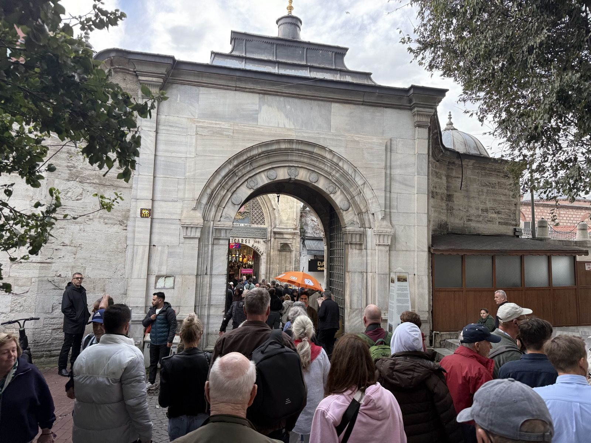
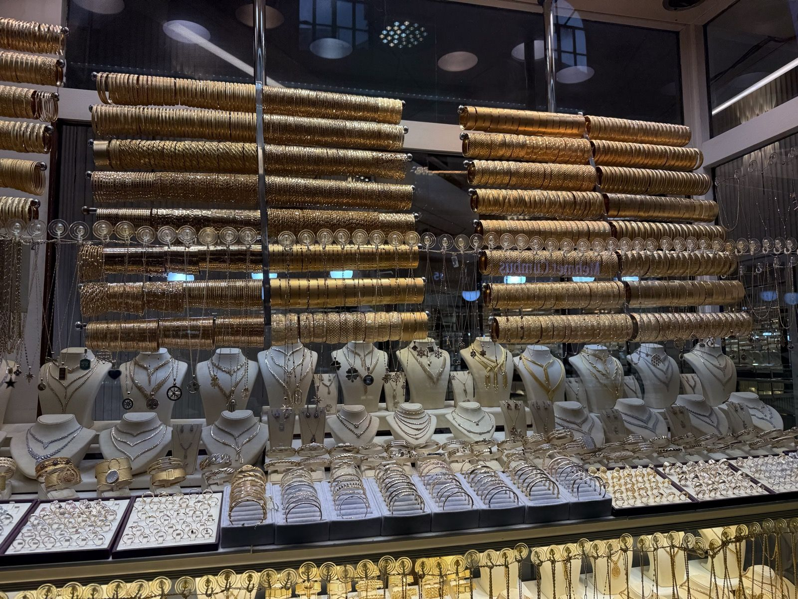
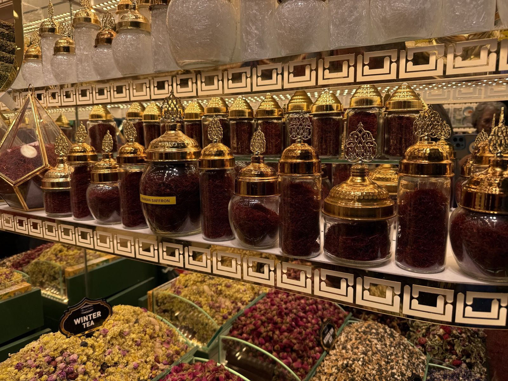
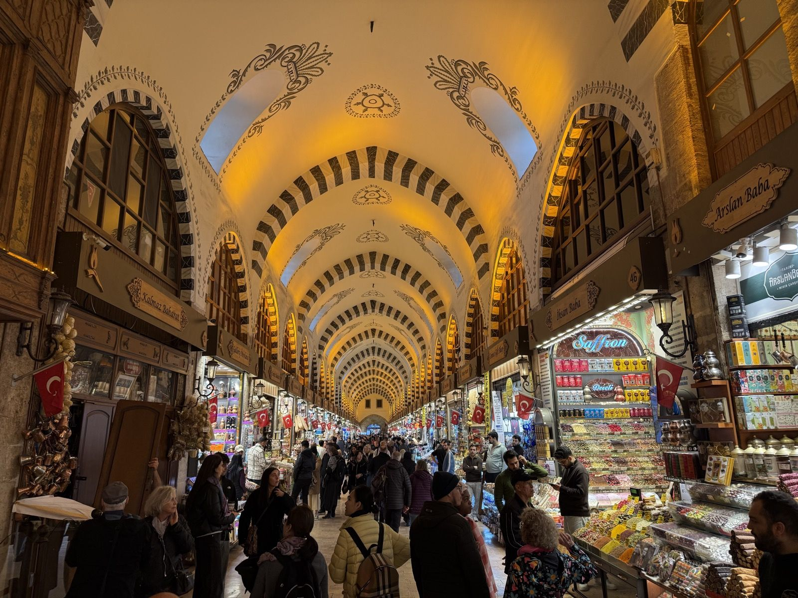
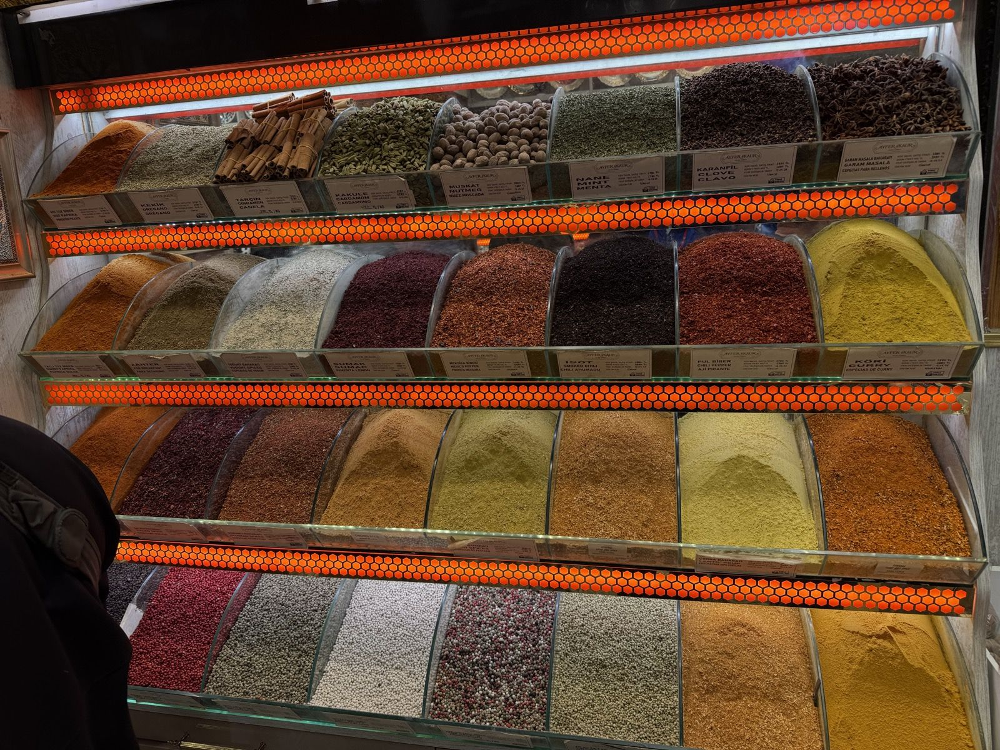
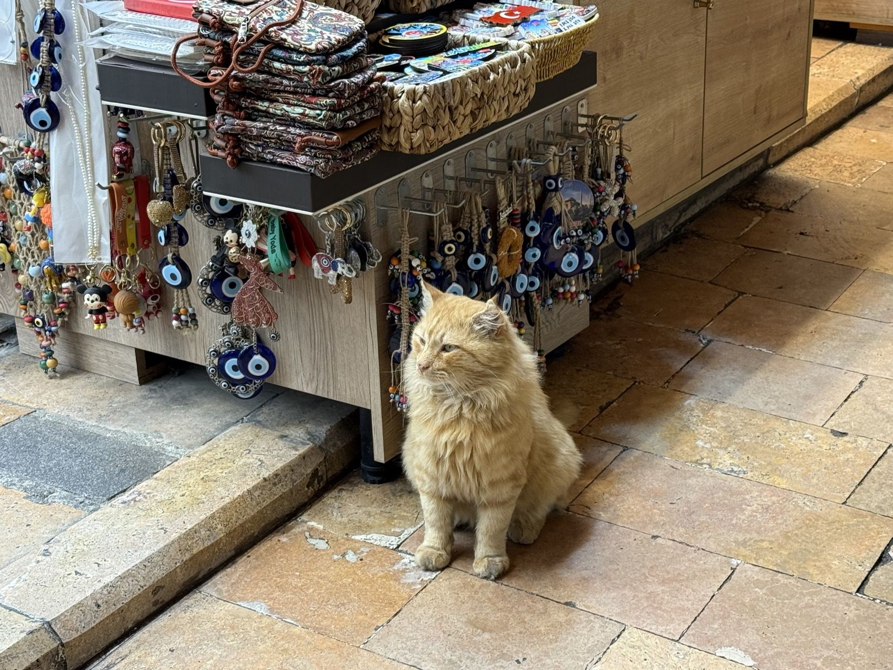
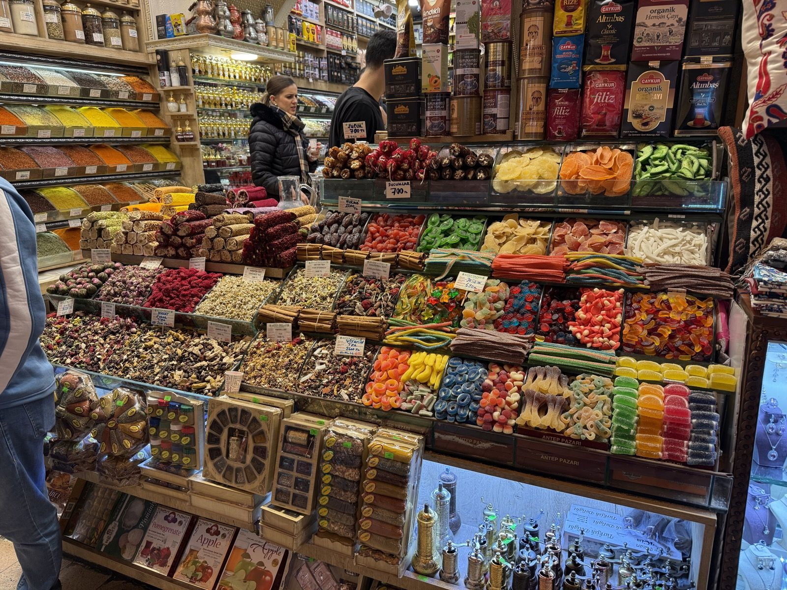
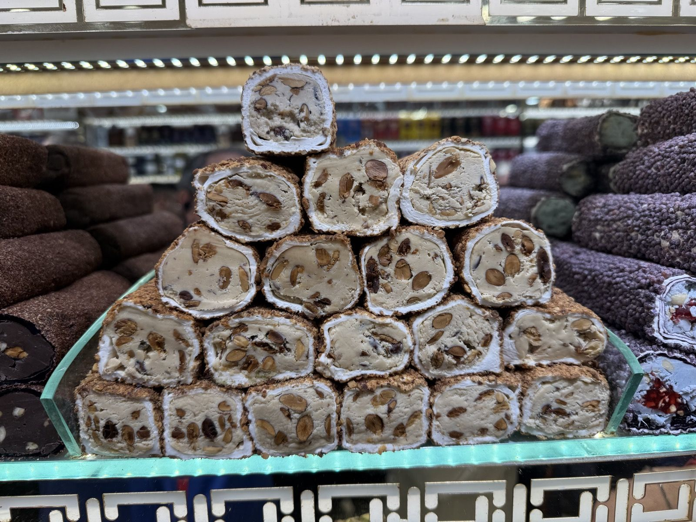

# Day 4: Bazaars, Scripts, and Presses

## Summary

Day 4 (Saturday, November 14) is our last chance at the Grand Bazaar, which is closed on Sunday, before we embark the Viking Star. The chapter covers the bazaars and the spice trade, bargaining, meze, kebab, Turkish delight, saffron, and the Turkish bath. It then turns to the multi-faith empire: the millet system, the Sephardic Jewish refugees of 1492, and their Hebrew press of 1493. Its Learning for All note follows Islamic calligraphy, the scribes and copyists, and İbrahim Müteferrika's press of 1727, asking who controls knowledge and why printing in Arabic script came so late.

## Concepts Covered

This chapter covers the following 25 concepts from the learning graph:

| Concept | Concept Impact Score |
|---------|-----------------------|
| Port Times | 3 |
| Bargaining in Bazaars | 1 |
| Roman Bath Culture | 3 |
| Islamic Calligraphy | 17 |
| Ottoman Turkish Script | 16 |
| Scribes and Copyists | 4 |
| Grand Bazaar | 4 |
| Turkish Bath | 1 |
| Millet System | 2 |
| Multi-Faith Empire | 1 |
| Sephardic Jewish Refugees | 6 |
| Meze | 2 |
| Raki | 1 |
| Kebab | 1 |
| Spice Trade | 5 |
| Spice Bazaar | 3 |
| Turkish Delight | 1 |
| Knowledge Gatekeepers | 5 |
| Widening the Circle | 4 |
| Gutenberg | 11 |
| Printing Press | 10 |
| Hebrew Press of 1493 | 1 |
| Ibrahim Muteferrika | 3 |
| Delayed Arabic-Script Printing | 2 |
| Saffron | 1 |

## Prerequisites

This chapter builds on concepts from:

- [Chapter 1: Before We Go, Part 1: The Long Timeline of the Eastern Mediterranean](../01-long-timeline/index.md)
- [Chapter 2: Before We Go, Part 2: Traveling Well and the Learning for All Thread](../02-traveling-well/index.md)
- [Chapter 3: Day 1: Istanbul, a City on Two Continents](../03-istanbul-two-continents/index.md)
- [Chapter 5: Day 3: Ottoman Istanbul, Topkapı, and Friday Prayer](../05-ottoman-istanbul/index.md)

---

## The Last Day Ashore

Day 4, Saturday, November 14, is a day of two kinds of exchange. In the morning and early afternoon we trade: through the covered streets of the Grand Bazaar, which closes on Sundays, so today is our last chance, and through the Spice Bazaar by the Golden Horn, where the air smells of cumin, mint, and roasting coffee. In the afternoon we board the Viking Star, which stays in port tonight. Between the two we can sit down to a long Turkish lunch of meze, or spend an hour in a Turkish bath, a tradition that goes back through the Ottomans to the Romans.

The other exchange is of ideas. The Ottoman Empire was home to Muslims, Orthodox Christians, Armenians, and Jews, each with its own faith, language, and script. In 1492 thousands of Jews expelled from Spain found refuge here, and within a year or two they set up Istanbul's first printing press. Yet Muslim Ottomans did not print books in their own script until 1729, almost three centuries after Gutenberg. This chapter's Learning for All note asks why, and what the long reign of the scribes tells us about who controls knowledge today.

!!! mascot-welcome "Saffron, Sweets, and a Printing Mystery"
    { class="mascot-admonition-img" }
    Today we bargain for a carpet we may not buy, sniff our way through towers of spice, and carry home a box of Turkish delight and a little packet of saffron, as we did. By the end of this chapter, a bazaar will read like a map of the old spice routes, and a page of beautiful Arabic calligraphy will raise a real question: what happens when the people who copy books decide who may read them? Look closer.

The chapter has five parts. Part One walks the Grand Bazaar and the Spice Bazaar, with the spice trade behind them. Part Two is lunch: meze, rakı <audio id="audio-raki" src="../../audio/raki.mp3" preload="none"></audio><button onclick="document.getElementById('audio-raki').play()" class="pronounce-btn">🔊 Pronounce</button> *rah-KUH*, and kebab. Part Three explains the bath, Roman and Turkish. Part Four describes the multi-faith empire and the Sephardic Jews who arrived in 1492. Part Five covers boarding the ship. The Learning for All note then follows calligraphy, scribes, and printing presses.

## Part One: Bazaars and Spices

### The Grand Bazaar

The **Grand Bazaar** (in Turkish, *Kapalıçarşı* <audio id="audio-kapalicarsi" src="../../audio/kapalicarsi.mp3" preload="none"></audio><button onclick="document.getElementById('audio-kapalicarsi').play()" class="pronounce-btn">🔊 Pronounce</button> *kah-PAH-luh-char-shuh*, "covered market") is the great covered market in the center of the historic peninsula, one of the oldest and largest in the world. Its core is a stone hall called the **bedesten**, built on Mehmed II's orders soon after 1453, where the most valuable goods, jewels, weapons, and fine cloth, were sold and stored behind iron doors. The bedesten was built for a reason we learned in Chapter 5: its rents went to the charitable endowment of Hagia Sophia, newly converted into a mosque. Over the next centuries the shops around it were roofed over, until the market grew into a covered city of about 60 streets and some 4,000 shops, entered through more than a dozen gates. Around it stand the old *hans*, two-story courtyard buildings where merchants stored goods and craftsmen worked, many of them still workshops today.

<figure markdown="span" class="trip-photo">
  { loading=lazy }
  <figcaption>An Ottoman stone gateway near the Grand Bazaar. Photo by Dan McCreary</figcaption>
</figure>

**Worked example: finding our way by trade.** The Grand Bazaar looks like a maze, but it was laid out by trade, and the street names still say which. Let's use that to navigate. The widest street, *Kalpakçılar Caddesi*, "street of the fur-hat makers," runs straight between the Beyazıt gate on the west and the Nuruosmaniye gate on the east; today it is lined with jewelers. If we lose our way, we look for its gold-filled windows and follow it to either gate. Side streets carry names such as *Yorgancılar* (quilt makers), *Fesçiler* (fez makers), and *Kuyumcular* (goldsmiths), and the bedesten sits near the middle, with antiques, old silver, and the most expensive carpets. Just outside the Beyazıt gate is the **Sahaflar Çarşısı**, the old book market, which we will come back to in the Learning for All note. Three landmarks, the main street, the bedesten, and the book market, and the maze becomes a map.

<figure markdown="span" class="trip-photo">
  { loading=lazy }
  <figcaption>Gold jewelry in the Grand Bazaar. Photo by Dan McCreary</figcaption>
</figure>

### Bargaining in Bazaars

**Bargaining** is negotiating a price between buyer and seller rather than paying a fixed, marked price. In the Grand Bazaar it is expected for carpets, kilims, jewelry, leather, lamps, ceramics, and souvenirs. It is not expected for food, spices sold by weight, or anything with a printed price tag. The sellers are professionals, and bargaining with them is a polite game with simple rules: be friendly, know roughly what the thing is worth, never name a price you would not pay, and do not bargain at all if you do not intend to buy. Paying in cash, or buying several items, usually earns a better price. Walking away politely is always allowed, and sometimes brings a better offer. Accepting a glass of tea creates no obligation, as Chapter 2's carpet-seller example showed.

!!! mascot-tip "Set Your Price Before You Ask Theirs"
    { class="mascot-admonition-img" }
    Here's a shortcut that saves an afternoon of nerves: before asking a price, decide the most you would happily pay, and keep that number to yourself. Then the whole conversation is just a friendly walk toward your number, and if the seller won't come to it, you can thank them and leave with no regret.

### The Spice Trade

The **spice trade** was the long-distance commerce in spices, such as pepper, cinnamon, cloves, nutmeg, and ginger, from South and Southeast Asia to the Middle East and Europe, which ran for more than two thousand years and shaped empires, cities, and voyages of discovery. Spices were light, valuable, and did not spoil, which made them ideal goods for long journeys. They were used to flavor food, but also as medicines, perfumes, preservatives, and signs of wealth.

Before 1500 the spices traveled by sea from India to the Persian Gulf or the Red Sea, and then overland by caravan to ports on the eastern Mediterranean, such as Alexandria, Beirut, and the cities of Syria. There Venetian and Genoese merchants bought them and shipped them to Europe. Every hand along the way added a tax or a profit, so pepper that was cheap on the Malabar Coast of India was expensive in Venice.

**Worked example: following a sack of pepper, before and after 1498.** Let's trace one sack of black pepper around 1450. It is grown on the Malabar Coast of southwest India and sold at the port of Calicut to Arab merchants, who ship it across the Arabian Sea to Aden, at the mouth of the Red Sea. It sails up the Red Sea, crosses the desert to the Nile by camel, travels down the river to Cairo, and reaches Alexandria, where the Mamluk sultan of Egypt taxes it and a Venetian merchant buys it. A Venetian galley carries it to Venice, and from there it goes over the Alps to the markets of Germany and Flanders. At least five sets of merchants and three sets of rulers have taken a share. In 1498, the Portuguese navigator Vasco da Gama sailed around Africa and reached Calicut, opening a sea route that skipped every middleman between India and Lisbon. The Ottomans, who conquered Egypt in 1517, fought the Portuguese in the Indian Ocean for decades to keep the old route alive, and for a time the Red Sea trade recovered. But the long-term winners were the Atlantic nations, and the eastern Mediterranean slowly lost its place at the center of world trade. The bazaar we walk through today is a survivor of that older world.

<figure markdown="span" class="trip-photo">
  { loading=lazy }
  <figcaption>Jars of spices and teas. Photo by Dan McCreary</figcaption>
</figure>

### The Spice Bazaar

The **Spice Bazaar** (in Turkish, *Mısır Çarşısı*, "Egyptian Bazaar") is the L-shaped covered market beside the New Mosque at Eminönü, by the Golden Horn. It was built in the 1660s as part of the New Mosque's complex, and, like the Grand Bazaar's bedesten, its shop rents paid for the mosque's endowment. Its name is usually explained by its link to Egypt: either the goods that arrived on ships from Cairo, or the Egyptian taxes that helped pay for the building.

<figure markdown="span" class="trip-photo">
  { loading=lazy }
  <figcaption>The vaulted main hall of the Spice Bazaar. Photo by Dan McCreary</figcaption>
</figure>

Today its high vaulted hall holds stalls of ground spices piled in cones, dried fruits, nuts, teas, Turkish delight, and the blue glass beads of the **nazar**, the charm against the evil eye. The streets around it sell cheese, olives, coffee, and kitchen goods to Istanbul households, and they are as much fun as the hall itself. This is where we bought our Turkish delight and our saffron.

<figure markdown="span" class="trip-photo">
  { loading=lazy }
  <figcaption>Towers of ground spices in the Spice Bazaar. Photo by Dan McCreary</figcaption>
</figure>

!!! mascot-thinking "Every Market Paid for a Mosque"
    { class="mascot-admonition-img" }
    Notice that both of today's bazaars were built to fund a mosque, just like the shops below the Süleymaniye in Chapter 5. In Ottoman Istanbul, trade and charity were not opposites: the merchant's rent paid the imam, the teacher, and the soup kitchen. Every time we buy something here, we are standing inside that old engine.

Istanbul's street cats are everywhere in the bazaar district, sleeping on carpets and supervising the stalls. They belong to everyone and no one; shopkeepers feed them, and nobody shoos them away.

<figure markdown="span" class="trip-photo">
  { loading=lazy }
  <figcaption>A bazaar cat among evil-eye (nazar) charms. Photo by Dan McCreary</figcaption>
</figure>

### Saffron

**Saffron** is the spice made from the dried red stigmas of the saffron crocus (*Crocus sativus*), a purple flower that blooms in autumn. Each flower has only three stigmas, picked by hand, so a kilogram of saffron takes around 150,000 flowers, which is why it is the most expensive spice in the world by weight. It gives food a golden color, a honey-like scent, and a slightly bitter taste, and it colors the saffron rice pudding, *zerde*, that the soup kitchens of Chapter 5 served on Fridays. The Turkish town of Safranbolu is named after it, and in Greece the saffron of Kozani is a protected product. Minoan painters on Crete loved the crocus too: a wall painting from Knossos, now in the Heraklion Archaeological Museum, was first restored as "the Saffron Gatherer," a boy picking crocuses, until later scholars realized the figure was a blue monkey, a lesson in reconstruction from Chapter 4.

!!! mascot-warning "Cheap Saffron Usually Isn't"
    { class="mascot-admonition-img" }
    Watch out for big, cheap bags labeled "Turkish saffron": they usually hold safflower petals, a different plant that colors food but has none of saffron's flavor. Real saffron is sold by the gram in small sealed packets, its threads are deep red with lighter tips and shaped like tiny trumpets, and in warm water it releases its color slowly. If the price seems too good, ask to see the threads.

<figure markdown="span" class="trip-photo">
  { loading=lazy }
  <figcaption>A dried-fruit and spice stall. Photo by Dan McCreary</figcaption>
</figure>

### Turkish Delight

**Turkish delight** (*lokum* <audio id="audio-lokum" src="../../audio/lokum.mp3" preload="none"></audio><button onclick="document.getElementById('audio-lokum').play()" class="pronounce-btn">🔊 Pronounce</button> *loh-KOOM*) is a soft, chewy sweet made by cooking sugar and starch, usually with rosewater, lemon, or fruit, and often with pistachios or hazelnuts, then cutting it into cubes dusted with powdered sugar. Its Turkish name comes from the Arabic for "morsels." It is closely linked with **Hacı Bekir**, a confectioner who opened a shop in Eminönü in 1777; his family's shop still trades near the Spice Bazaar. He is often said to have invented lokum, though sweets of this kind are older, so it is safer to say he made it famous. A box of pistachio and rose lokum was one of our Spice Bazaar purchases; ask the seller to let you taste before you choose, and to box it fresh from the tray.

<figure markdown="span" class="trip-photo">
  { loading=lazy }
  <figcaption>Rolls of pistachio Turkish delight. Photo by Dan McCreary</figcaption>
</figure>

## Part Two: A Long Lunch

### Meze

**Meze** are small dishes served together at the start of a meal, or as the meal itself, for sharing at the table, usually with drinks. The word comes from the Persian for "taste," and the same tradition, called *mezedes*, runs through Greece, so we will meet it again on every island. Cold meze come first, carried to the table on a tray for us to choose from; hot meze follow.

- **Cold:** *haydari* (thick yogurt with garlic and dill), *acılı ezme* (a spicy paste of tomato, pepper, and onion), *fava* (broad-bean purée), *yaprak sarma* (stuffed vine leaves), *patlıcan salatası* (smoky eggplant salad), and *imam bayıldı*.
- **Hot:** *sigara böreği* (thin pastry rolls filled with cheese), fried calamari, and fried mussels.

*Imam bayıldı*, "the imam fainted," is a whole eggplant split and stuffed with onions, tomatoes, and garlic, slowly cooked in olive oil and served cold, and it is one of our favorite things in Turkish cooking. There are two stories about why the imam fainted: from pleasure at the taste, or from shock at how much expensive olive oil his wife had used. Neither is history, but both are true to the dish. In Greece we will meet its cousins, *melitzanosalata* and moussaka.

### Rakı

**Rakı** is Turkey's national spirit: a clear brandy distilled from grapes and flavored with aniseed, about 45 percent alcohol. Mixed with water, it turns cloudy white, which is why it is called "lion's milk." It is meant to be sipped slowly over a long meal of meze and fish, a custom called the *rakı sofrası*, the rakı table, where the conversation matters as much as the food. Pour the rakı first, add cold water, and add ice last, if at all. The toast is *Şerefe!*, "to honor." Many Turks do not drink alcohol, for religious or personal reasons, and declining is perfectly polite. Rakı's Greek cousin is ouzo.

### Kebab

**Kebab** is the general word for meat, usually lamb, beef, or chicken, grilled or roasted over fire. It comes in many regional styles. *Şiş kebab* is cubes of meat on a skewer. *Adana kebab* is spicy hand-minced lamb pressed onto a wide flat skewer; the milder version is *Urfa*. *Döner* is meat stacked on a vertical rotisserie and sliced as it turns; the vertical spit is credited to a cook named İskender Efendi in 19th-century Bursa, and his name lives on in *İskender kebab*, thin slices of döner over bread with tomato sauce, yogurt, and browned butter. For eggplant lovers, *patlıcan kebabı* alternates slices of eggplant and meatballs on the skewer. The best place to try them is an *ocakbaşı*, a grill restaurant where the cook works over charcoal in front of the diners.

## Part Three: From the Roman Bath to the Hamam

### Roman Bath Culture

**Roman bath culture** was the Roman habit of bathing together in large public bathhouses, the *thermae*, which were social centers as much as places to get clean. A Roman bather moved through a sequence of rooms: a changing room, a cold room (*frigidarium*), a warm room (*tepidarium*), and a hot room (*caldarium*), heated by hot air from furnaces circulating under raised floors and inside the walls, a system called the **hypocaust**. Baths had exercise courts, gardens, libraries, and snack sellers. Constantinople inherited the custom: the great Baths of Zeuxippus stood beside the Hippodrome, decorated by Constantine with ancient statues, until they burned in the Nika Riots of 532. We will walk through the ruins of Roman baths at Ephesus on Day 7.

### The Turkish Bath

The **Turkish bath** (*hamam* <audio id="audio-hamam" src="../../audio/hamam.mp3" preload="none"></audio><button onclick="document.getElementById('audio-hamam').play()" class="pronounce-btn">🔊 Pronounce</button> *hah-MAHM*) is the Ottoman form of the public bath, descended from the Roman and Byzantine baths but adapted to Islamic ideas of cleanliness, which prefer flowing water to sitting in a shared pool. A hamam has three main rooms: a cool domed hall for changing and resting, a warm room, and a hot steam room. At the center of the hot room is the **göbek taşı**, the "navel stone," a heated marble platform where bathers lie to sweat before an attendant scrubs them with a rough mitt, the *kese*, and washes them in clouds of soap foam. Bathers wrap themselves in a thin cotton cloth, the *peştemal*. Men and women bathe separately, in separate sections or at separate times. For centuries the hamam was where neighbors met, brides were prepared for weddings, and news was shared. Several historic hamams, including two by Sinan, are open to visitors in the old city.

!!! mascot-tip "A Hamam Before Boarding"
    { class="mascot-admonition-img" }
    If we try a hamam, book a time slot the day before, choose the "traditional bath" with scrub and foam, and leave valuables in the locker. Go at least two hours before we need to board the ship; you will want time afterward to sit with a glass of tea, because you will feel too relaxed to hurry.

## Part Four: An Empire of Many Faiths

### The Millet System

The **millet system** was the Ottoman way of organizing the empire's non-Muslim subjects into religious communities, called *millets*, each led by its own religious head and largely responsible for its own affairs. The three main millets were the Greek Orthodox, under the Ecumenical Patriarch whom Chapter 4 introduced; the Armenians, under the Armenian Patriarch of Constantinople; and the Jews, under the chief rabbi. Each community ran its own worship, schools, charities, and courts for marriage, divorce, and inheritance, and its leaders collected its taxes and answered for it to the sultan. In return, non-Muslims paid a special poll tax, the *cizye*, and lived under some restrictions: they could not normally carry arms or serve as soldiers, and building or repairing churches and synagogues required permission. Historians debate how much of a "system" it was before the 19th century, when reforms gave the millets formal constitutions; earlier it was more a set of arrangements made case by case. Either way, it allowed different peoples to live their own religious lives under one ruler, with real limits on equality.

### The Multi-Faith Empire

A **multi-faith empire** is a state that rules peoples of several religions and builds the differences into how it governs, rather than requiring everyone to share the ruler's faith. The Ottoman Empire was one for most of its history. In Istanbul itself, an Ottoman count of households in 1477, a generation after the conquest, found about 58 percent Muslim, about a fifth Greek Orthodox, and about a tenth Jewish, with Armenians, Europeans, and others making up the rest. That mix lasted into the 20th century. A walk along the Golden Horn still shows it: the Ecumenical Patriarchate in Fener, old synagogues in Balat, Armenian and Bulgarian churches, and mosques, all within a couple of kilometers. Chapter 7 tells how the empire's end, and the population exchanges that followed, emptied most of that mix within a few decades.

### Sephardic Jewish Refugees

The **Sephardic Jews** (from *Sefarad*, the Hebrew name for Spain) are the Jews whose ancestors lived in Spain and Portugal. On March 31, 1492, King Ferdinand and Queen Isabella ordered every Jew in Spain to convert to Christianity or leave within four months. Tens of thousands left; estimates range widely, and historians still argue over the numbers. Portugal forced its Jews to convert in 1497. Many of the refugees found a welcome in the Ottoman Empire, where Sultan Bayezid II allowed them to settle and practice their faith. A saying attributed to Bayezid, that the Spanish king had impoverished his own country and enriched the sultan's, is repeated in almost every account; it first appears in later sources, so we treat it as a story, but the welcome itself is history. The refugees settled in Istanbul, in Edirne, in İzmir, and above all in Salonica, today's Thessaloniki, which became a majority-Jewish city for four centuries. They brought skills in medicine, finance, textiles, and printing, and they kept their own language, **Ladino** or Judeo-Spanish, a form of 15th-century Spanish written in Hebrew letters.

**Worked example: following a Sephardic path across our route.** Let's trace the journey that many Sephardic families made, using places on our map. A family from Toledo leaves Spain in the summer of 1492 and reaches Istanbul, perhaps after years in Italy or North Africa. They settle near the Golden Horn, in Balat or across the water in Hasköy, among other Spanish-speaking Jews, and pray in a synagogue named for the Spanish city they came from. Within a year or two, two brothers from the same community start the first printing press in the Ottoman Empire, described in the Learning for All note below. In 1522 Suleiman takes Rhodes, and over the following decades Sephardic families settle in its walled town, in the quarter we will walk on Day 8; for four centuries Ladino is spoken in its streets. The story on Rhodes ends in tragedy in 1944, which Chapter 12 tells. Today about 15,000 Jews live in Turkey, most of them in Istanbul and most of Sephardic descent, and the Jewish Museum of Turkey, in the Galata district near the cruise port, tells their story.

## Part Five: Boarding the Viking Star

### Port Times

**Port times** are the scheduled times when a cruise ship arrives in and departs from each port, together with the **all-aboard time**, the deadline by which every passenger must be back on board, usually 30 minutes to an hour before departure. The ship will not wait for late passengers on independent outings, so the all-aboard time is the one number to remember every port day. Port times are printed in the ship's daily program and can change with weather or harbor traffic.

**Worked example: an hour that disappears.** Today the Viking Star docks at Istanbul's cruise terminal at Galataport, in Karaköy, and stays overnight, so there is no all-aboard rush on Day 4. The catch comes later. Turkey stays on UTC+3 all year, while Greece is on UTC+2 in November. When we sail from Kuşadası to Rhodes on the night of Day 7, the ship's clocks go back one hour. Phones usually change on their own when they find a Greek network, but at sea they may not, and they sometimes pick up a Turkish tower near the coast. The rule is simple: always use **ship's time** as announced in the daily program, and check it against the program on the first morning in Greece.

## Practical Notes for Day 4

- **Order of the day.** Grand Bazaar first, before the crowds and while we still have energy for bargaining; the Sahaflar book market at its west gate; lunch; then a walk down through the market streets to the Spice Bazaar and Eminönü. Allow time to return to the hotel, collect luggage, and reach Galataport by the embarkation time given by Viking.
- **Opening hours.** The Grand Bazaar opens in the morning and closes in the early evening, Monday to Saturday; it is closed on Sundays and on the first day of religious holidays. The Spice Bazaar opens daily.
- **Shopping.** Carry cash in lira for bargaining. Have larger purchases, such as carpets, shipped by the shop, and keep the receipt for customs. Spices and lokum travel well; ask for them vacuum-packed.
- **Lunch.** A meze lunch near the Spice Bazaar, or a kebab at an ocakbaşı. Keep the rakı for the evening.
- **Sunset.** About 5:45 PM. Sailaway is not until Day 5, so tonight we can watch the lights come on over the Bosphorus from the ship's deck.
- **Tomorrow.** Day 5 is our last day in Istanbul and the story of the empire's end. Read Chapter 7.

## Learning for All: Who Controls Knowledge?

The Spice Bazaar and the book market lie less than two kilometers apart, and they hold opposite stories. Spices moved freely, and the bazaar grew rich by moving them. Books, for almost three centuries after the printing press was invented, moved only as fast as a scribe's hand. This note follows that second story from beautiful writing to the printing press, and asks who decided how knowledge would travel.

### Islamic Calligraphy

**Islamic calligraphy** is the art of beautiful writing in the Arabic script, practiced across the Islamic world as one of its highest arts. Because the Quran is believed to be the word of God, writing it beautifully was an act of devotion, and because mosques avoid images of people, calligraphy became their chief decoration. Calligraphers developed a family of scripts, each with its own proportions and purposes: the monumental *thuluth* (Turkish *sülüs*) for inscriptions and roundels, the clear *naskh* (*nesih*) for copying books, and the chancery script *divani* for imperial decrees. They wrote with a reed pen cut at an angle, ink made from lamp soot, and paper polished smooth with egg white and starch so the pen would glide.

Istanbul became the capital of this art. An old saying holds that the Quran was revealed in Mecca, recited in Cairo, and written in Istanbul. Its great masters include **Şeyh Hamdullah** (1436–1520), the teacher of Sultan Bayezid II, and **Hafız Osman** (1642–1698), whose *naskh* became the model for printed Qurans centuries later. A calligrapher learned for years under a master and could sign their own work only after receiving an *icazet*, a written license from that master.

**Worked example: reading a roundel.** On Day 2 we photographed one of the great roundels in Hagia Sophia, the one naming the caliph Uthman. Let's read it as a calligrapher would. The name is written عثمان, five letters from right to left: *ʿayn*, *thā'*, *mīm*, *alif*, and *nūn*. Notice that only one vowel, the long *ā*, is written, as the letter *alif*; the short *u* after the first letter is left for the reader to supply, as Arabic writing normally does. The calligrapher, working in *thuluth*, did not simply write the five letters in a line. He stacked and stretched them to fill a circle 7.5 m across, so the tall upright *alif* rises like a column and the sweeping *nūn* curves along the bottom. The art lies in turning a five-letter name into a balanced composition that can be read from the floor of the prayer hall.

### Ottoman Turkish Script

**Ottoman Turkish script** is the Arabic alphabet as used to write Ottoman Turkish, the language of the Ottoman state and its educated class, from the empire's beginnings until 1928. It added a few letters from Persian for sounds Arabic lacks, such as *p*, *ç*, and the hard *g*, and its vocabulary was full of Arabic and Persian words. It was a beautiful and prestigious script, but it fitted Turkish poorly. Turkish has eight vowels, and the Arabic script has only three letters that can stand for vowels, and normally leaves short vowels unwritten.

**Worked example: five words, two spellings.** Let's see the problem in action. The table shows five ordinary Turkish words, as they are written today in the Latin alphabet and as they were written in Ottoman script.

| Modern Turkish | Meaning | Ottoman spelling |
|---|---|---|
| kol | arm | قول |
| kul | servant | قول |
| kör | blind | كور |
| gör | see! | كور |
| gür | thick, abundant | كور |

The first two share the same three letters, *qāf*, *wāw*, and *lām*; the last three share *kāf*, *wāw*, and *rā'*. The letter *wāw* has to stand for any of four vowels, *o*, *ö*, *u*, or *ü*, and *kāf* for either *k* or *g*. A fluent reader chose the right word from the context, but a learner had to know the language well before they could read it, which made reading hard to learn. This is one reason literacy stayed low, and one reason the Turkish Republic replaced the script with a Latin alphabet in 1928, the story of Chapter 7.

!!! mascot-encourage "Two Scripts, One Afternoon"
    { class="mascot-admonition-img" }
    If the Arabic letters feel impossible, remember that Ottoman schoolchildren found them hard too, and that is the point of the example. We don't need to read Ottoman Turkish; we only need to see why three words could share one spelling. Spot the long upright *alif* in the next inscription you see, and you've already read a letter.

### Scribes and Copyists

A **scribe** is a person whose profession is writing, whether keeping records, drafting documents, or copying books; a **copyist** is a scribe who reproduces existing texts by hand. Before printing, scribes and copyists were the only way to make a book or an official document, and the Ottoman state ran on them. The government's offices employed hundreds of clerks, the *kâtip*, to draft decrees, keep tax registers, and record court decisions, all by hand. Book copyists, the *müstensih*, copied Qurans, law books, poetry, and histories for buyers, and the best of them were calligraphers. Copyists sold their work at the **Sahaflar Çarşısı**, the book market beside the Grand Bazaar, which stands on or near the site of the Byzantine *Chartoprateia*, the paper and book market of Constantinople, a layer of the city that has been selling books for more than a thousand years. A figure of tens of thousands of copyists in Istanbul is often quoted, though no reliable count exists.

**Worked example: how many Qurans in a lifetime?** Let's estimate how slowly a book moved by hand. A complete Quran in a standard Ottoman copy runs to roughly 600 pages. Hafız Osman, one of the most admired calligraphers who ever lived, is said to have copied 25 complete Qurans in a working life of about forty years. That is one Quran every year and a half, alongside teaching and other commissions. An ordinary copyist working in a plainer hand could go faster, but even a busy copyist produced only a handful of large books a year. Every copy was a work of skill and a large expense, and the number of books in circulation was limited by the number of trained hands. That limit is what the printing press broke.

### Gutenberg

**Johannes Gutenberg** (about 1400–1468) was a goldsmith from Mainz, in Germany, who developed a system for printing with movable metal type in Europe around 1440 to 1450. Movable type means that each letter is a separate piece, which can be arranged into lines and pages, printed, and then taken apart and reused. Gutenberg did not invent printing, or even movable type: printing from carved wooden blocks was ancient in China, the Chinese craftsman Bi Sheng made movable clay type in the 1040s, and Korean printers used movable metal type by the 1300s. What Gutenberg created was a complete system that made printing fast and cheap in an alphabetic script.

1. **A hand mold** that could cast thousands of identical letters quickly.
2. **A metal alloy** of lead, tin, and antimony that melted easily and set hard.
3. **An oil-based ink** that stuck to metal type.
4. **A screw press**, adapted from the presses used for wine and paper, to press paper evenly onto the type.

**Worked example: why the alphabet helped Gutenberg.** Let's count the pieces he needed. Latin uses 26 letters, which with capitals, punctuation, numbers, and abbreviations came to a few hundred different pieces of type, called **sorts**; Gutenberg's Bible used about 290, to imitate the look of a handwritten book. A Chinese printer needed thousands of different characters. Arabic script, as we will see, was in between: its letters join, and most change shape depending on whether they come at the start, middle, or end of a word, so an Arabic font needed several hundred sorts and great skill to look right. Gutenberg's famous Bible, finished around 1455, was printed in about 180 copies, of which about 49 survive. A scribe would have needed years for a single copy.

### The Printing Press

The **printing press**, in the sense used in this guide, is the whole technology of printing with movable type, which spread from Mainz across Europe in the decades after Gutenberg. By 1500 there were presses in more than 250 European towns, and they had printed perhaps 30,000 editions. Venice, the city we met in Chapter 4, became the printing capital of Europe; there the printer Aldus Manutius published Greek classics, including the first printed Plato in 1513, from Byzantine manuscripts.

The key to the press's power is a simple economic fact. A scribe's cost is almost all **marginal cost**: each new copy takes as long as the last. A press has a large **fixed cost**, casting type, building the press, and setting every page, but each additional copy costs very little. So for one copy, the scribe is cheaper; for a hundred copies, the press wins overwhelmingly. The MicroSim below lets us find where the two lines cross.

!!! mascot-thinking "Expensive to Start, Cheap to Copy"
    { class="mascot-admonition-img" }
    Think of the press as a machine with a high entry fee and a tiny price per ticket. That shape, a large fixed cost and almost no cost per copy, is why printing changed the world, and it is exactly the shape of digital learning today: a good online course or AI tutor is expensive to build and nearly free to share.

#### Diagram: Scribe or Press?

Scribe or Press?

Type: microsim
**sim-id:** scribe-or-press 
**Library:** p5.js 
**Status:** Specified 
**Bloom Level:** Apply 
**Bloom Verb:** calculate 
**Learning Objective:** The learner will calculate the number of copies at which printing a 200-page book becomes cheaper than copying it by hand, for an ordinary copyist and for a master calligrapher, predicting each crossover within one copy.

**Prerequisites:** scribe, copyist, movable type, printing press, fixed cost, marginal cost (defined in the sections "Scribes and Copyists", "Gutenberg" and "The Printing Press" above).

**Evidence of Mastery:** For each scribe type, the learner enters a predicted crossover number of copies before moving the slider to check it. A prediction is correct if it is within 1 of the true crossover in Rules (15 for the ordinary copyist, 4 for the master calligrapher). Mastery is both predictions correct within two attempts each.

**Misconceptions:** (1) The press was cheaper for every job, even a single copy. (2) The press's advantage was only speed, not cost per copy. (3) Making books more beautiful by hand always made them better value. (4) The cost of a press is mostly in running it, rather than in setting it up.

**Instructional Rationale:** Calculating the crossover requires the learner to apply the fixed-cost and marginal-cost model to numbers, and comparing two scribe types shows how the crossover moves when hand-copying gets slower. Predicting before checking turns the slider into a test of the model rather than a toy.

**Content:**

All costs are in workdays, one person's day of skilled work. The book has 200 pages. The sim labels all numbers "Illustrative model, not historical prices."

| Method | Rate | Fixed cost | Cost per copy |
|---|---|---|---|
| Ordinary copyist | 8 pages per day | 0 | 200 ÷ 8 = 25 workdays |
| Master calligrapher | 2 pages per day | 0 | 200 ÷ 2 = 100 workdays |
| Printing press | Casting type, building the press, and setting 200 pages | 350 workdays | 0.2 workdays (printing, paper handling, binding labor) |

**Provenance:** Illustrative model written for this chapter. The rates are round numbers chosen to show the shape of the comparison, consistent with the chapter's description of slow hand-copying (section "Scribes and Copyists") and Gutenberg's high setup cost (section "Gutenberg"); they are not historical prices.

**Rules:**

- Copies slider: min 1, max 500, step 1, default 1, unit copies.
- Scribe type selector: "Ordinary copyist" (default) or "Master calligrapher".
- Scribe cost = copies × (200 ÷ pages per day). Press cost = 350 + 0.2 × copies.
- The crossover is the smallest whole number of copies for which press cost < scribe cost. Ordinary copyist: 25 × N > 350 + 0.2 × N gives N > 14.1, so the crossover is 15 copies. Master calligrapher: 100 × N > 350 + 0.2 × N gives N > 3.51, so the crossover is 4 copies.
- At the current slider value, the sim shows both costs in workdays, rounded to one decimal place, and states which method is cheaper; at equal cost (which does not occur at whole copy numbers with these values) it would state "equal".
- Reference values at default and at 200 copies: 1 copy, ordinary copyist 25.0 vs press 350.2; 200 copies, ordinary copyist 5,000.0 vs press 390.0.

**Learner Activity:**

1. The learner reads the three methods and their costs.
2. With "Ordinary copyist" selected, the learner types a predicted crossover and presses Check Prediction.
3. The learner moves the copies slider and watches both cost lines; the sim marks the crossover.
4. The learner switches to "Master calligrapher", predicts again, and checks.
5. The learner moves the slider to 200 copies and compares the two costs.
6. The learner should notice that the slower and more beautiful the handwriting, the sooner the press wins.

**Feedback:** After each prediction: within 1 of the true crossover shows "Correct: from [true crossover] copies, the press is cheaper." Otherwise, "Not quite. Try setting scribe cost equal to press cost: [scribe cost per copy] × N = 350 + 0.2 × N." A learner gets two attempts per scribe type; after the second miss the sim reveals the crossover with the worked equation from Rules. When both scribe types are done, the sim shows "The press costs more to start and less to copy. That is why it won for any book wanted by more than a handful of readers."

**Starting State:** Copies set to 1, "Ordinary copyist" selected, both costs shown (25.0 vs 350.2 workdays, scribe cheaper), and the question "How many copies before the press is cheaper?"

**Chapter Anchors:** 200-page book; ordinary copyist 8 pages a day; master calligrapher 2 pages a day; press fixed cost 350 workdays and 0.2 per copy; crossovers at 15 and 4 copies; illustrative numbers.

### The Hebrew Press of 1493

The **Hebrew press of 1493** was the first printing press in the Ottoman Empire, set up in Istanbul by two Sephardic refugees from Spain, the brothers **David and Samuel ibn Nahmias**. Their first known book, a code of Jewish law called the *Arba'ah Turim*, carries a date in its closing note that corresponds to December 1493; some scholars argue that the book was actually printed about ten years later, so the exact year is debated. Either way, Istanbul had a working press within a few decades of Gutenberg, run by refugees who had brought the craft with them from Spain and Portugal. Ottoman authorities allowed the empire's non-Muslim communities to print in their own scripts, and they did: Armenians in Istanbul from 1567, and Greeks from 1627.

### İbrahim Müteferrika

**İbrahim Müteferrika** <audio id="audio-muteferrika" src="../../audio/muteferrika.mp3" preload="none"></audio><button onclick="document.getElementById('audio-muteferrika').play()" class="pronounce-btn">🔊 Pronounce</button> *mew-teh-feh-ree-KAH* (about 1674–1745) was the founder of the first Ottoman printing press for books in the Arabic script. He was born in Kolozsvár (today Cluj, in Romania), probably into a Unitarian Christian family, came to Istanbul as a young man, converted to Islam, and served the state as a diplomat and translator. In 1726, with Said Efendi, the son of an Ottoman ambassador who had seen printing in Paris, he presented the government with a treatise on the benefits of printing. In 1727 Sultan Ahmed III issued a decree allowing them to print, supported by a ruling from the chief religious scholar, with conditions: no religious books, so no Qurans; and a panel of scholars to proofread every book. The first book, an Arabic–Turkish dictionary, appeared in 1729 in an edition of 1,000 copies. By his death Müteferrika had printed 17 works, among them dictionaries, histories, a grammar, and a geography with maps. Some of his editions were still being sold decades later.

### Delayed Arabic-Script Printing

**Delayed Arabic-script printing** refers to the roughly 275-year gap between Gutenberg's press, around 1455, and the first Ottoman book printed in Arabic script, in 1729, even though the Ottomans knew of printing and allowed it to minorities in the capital. Historians have proposed several explanations, and most now think several worked together.

- **Calligraphy and the sacred text.** Handwriting the Quran was an act of devotion, and many felt a mechanically printed Quran would be disrespectful. Printed Qurans were not officially permitted in Istanbul until the 1870s.
- **The script itself.** Joined letters that change shape need hundreds of sorts, and early European Arabic printing looked crude to readers used to fine calligraphy.
- **The scribes.** Copyists, calligraphers, and the book trade lived by handwriting, and the craft's prestige and jobs were at stake.
- **A working system.** Manuscript copying met the needs of a small reading public, so the demand that drove printing in Europe was weaker.
- **Authority.** The state and religious scholars controlled what was written and taught, and printing was a way to escape that control.

A popular version says that Sultan Bayezid II banned Arabic-script printing in 1485 on pain of death. No copy of such a decree survives, and many historians now doubt it was ever issued, which makes this a fine final test for Chapter 4's method. The chart below shows how long the gap was.

#### Diagram: When Printing Arrived

When Printing Arrived

Type: chart
**sim-id:** when-printing-arrived 
**Library:** Chart.js 
**Status:** Specified 
**Bloom Level:** Understand 
**Bloom Verb:** interpret 
**Learning Objective:** The learner will interpret a chart of the years between Gutenberg's Bible and the first printing in ten scripts and places, answering at least 3 of 4 questions correctly.

**Prerequisites:** Gutenberg, printing press, Hebrew press of 1493, İbrahim Müteferrika, delayed Arabic-script printing, millet system (defined in this chapter above).

**Evidence of Mastery:** The learner answers four multiple-choice questions by reading the chart. An answer is correct when it matches the correct option in Feedback. Mastery is 3 of 4 correct on the first attempt.

**Misconceptions:** (1) There were no printing presses in Istanbul before 1727. (2) Arabic script could not be printed at all before the 18th century. (3) The delay applied to everyone in the Ottoman Empire, rather than to printing in Arabic script for Muslim readers. (4) The ban of 1485 is established fact.

**Instructional Rationale:** A chart of years-after-Gutenberg makes the length of each gap visible and lets the learner compare communities in the same city. Questions that require reading specific bars expose the misconception that Istanbul had no presses, which the chapter's prose alone may not dislodge.

**Content:**

A horizontal bar chart. Each bar is the number of years from 1455 (Gutenberg's Bible) to the first printing named. Bars are grouped as "Western Europe" or "Ottoman Empire". Clicking or hovering a bar shows its infobox text.

| # | Bar label | Group | First printing | Years after 1455 | Infobox text |
|---|---|---|---|---|---|
| 1 | Latin, Mainz | Western Europe | about 1455 | 0 | Gutenberg's 42-line Bible, about 180 copies. |
| 2 | Latin, Venice | Western Europe | 1469 | 14 | The first press in Venice, soon the printing capital of Europe. |
| 3 | Hebrew, Italy | Western Europe | 1475 | 20 | The first dated Hebrew books, printed in southern and northern Italy. |
| 4 | Greek, Milan | Western Europe | 1476 | 21 | The first book printed entirely in Greek, a grammar. |
| 5 | Hebrew, Istanbul | Ottoman Empire | 1493 | 38 | The ibn Nahmias brothers, Sephardic refugees, print a code of Jewish law; some scholars date it about ten years later. |
| 6 | Arabic script, Italy | Western Europe | 1514 | 59 | A Christian prayer book in Arabic printed in Italy for Arabic-speaking Christians. |
| 7 | Armenian, Istanbul | Ottoman Empire | 1567 | 112 | The first Armenian press in the Ottoman capital. |
| 8 | Greek, Istanbul | Ottoman Empire | 1627 | 172 | A Greek press set up with the support of the Ecumenical Patriarch. |
| 9 | Arabic script, Aleppo | Ottoman Empire | 1706 | 251 | An Arabic press for Christian books in Ottoman Syria. |
| 10 | Ottoman Turkish (Arabic script), Istanbul | Ottoman Empire | 1729 | 274 | İbrahim Müteferrika's first book, a dictionary, 1,000 copies. |

The chart title is "Years from Gutenberg's Bible to the first printing", and the axis is labeled "Years after 1455".

**Provenance:** Bars 1, 5, 7, 8 and 10 come from this chapter's sections "Gutenberg", "The Hebrew Press of 1493" and "İbrahim Müteferrika". Bars 2, 3, 4, 6 and 9 come from the Wikipedia articles "Global spread of the printing press", "Hebrew printing" (Italy, 1475), "Constantine Lascaris" (Milan, 1476), "Kitab Salat al-Sawai" (1514) and "Athanasius III Dabbas" (Aleppo, 1706). Years after 1455 are computed as the first-printing year minus 1455.

**Rules:** Bars are ordered by year, earliest at the top. Years after 1455 = first-printing year − 1455. All ten bars are shown from the start.

**Learner Activity:**

1. The learner reads the chart title and axis.
2. The learner opens the infobox for several bars.
3. The learner answers the four questions below.
4. The learner should notice that every Ottoman bar before 1729 belongs to a non-Muslim community or to Christians printing Arabic.

**Feedback:** Four multiple-choice questions, in this order, one attempt each:

1. "Which community printed first in Istanbul?" Options: (a) Jewish [correct]; (b) Greek; (c) Muslim Ottoman. Correct: "Yes: the ibn Nahmias brothers, about 1493." Incorrect: "Look at bar 5."
2. "About how many years after Gutenberg's Bible did the first Ottoman Turkish book in Arabic script appear?" Options: (a) about 40; (b) about 170; (c) about 275 [correct]. Correct: "Right: 1729, about 274 years after 1455." Incorrect: "Look at bar 10."
3. "Which statement fits the chart?" Options: (a) Istanbul had no printing presses before 1727; (b) Presses ran in Istanbul for more than two centuries before Arabic-script printing for Muslim readers began [correct]; (c) Arabic script was first printed in Istanbul. Correct: "Yes: Jewish, Armenian and Greek presses came first." Incorrect: "Look at bars 5, 7 and 8."
4. "What does bar 6 show about the delay?" Options: (a) Arabic script could be printed by 1514, so the delay was not only technical [correct]; (b) Italy banned Arabic printing; (c) Arabic printing began in Aleppo. Correct: "Right: the technology existed; the reasons for waiting were also cultural, economic and political." Incorrect: "Compare bar 6 with bar 10."

At the end: 3 or 4 correct shows "You can read the gap and explain what it does and doesn't mean."; fewer shows "Open the Ottoman bars again and check who did the printing."

**Starting State:** The full chart with all ten bars, and the question "Who printed first in Istanbul?"

**Chapter Anchors:** Gutenberg's Bible about 1455, about 180 copies; Hebrew press dated 1493 (possibly about ten years later); Armenian press in Istanbul 1567; Greek press in Istanbul 1627; Müteferrika's decree 1727 and first book 1729, 1,000 copies; gap of about 275 years; ten bars; mastery 3 of 4.

### Knowledge Gatekeepers

A **knowledge gatekeeper** is a person, group, or institution that controls who can create, copy, approve, or reach knowledge. Gatekeepers are not always villains; a gate can protect quality as well as power. But they always shape who learns what. Chapter 2's pattern names them in its third step, "someone resists," and today's story is full of them.

**Worked example: counting the gates on one Ottoman book.** Let's follow a history book from the 1730s and count the gates it passed. To be written at all, its author needed years of education in a medrese, a gate opened mainly to Muslim boys who could spend years in study. To be printed, it needed the sultan's permission, given only for non-religious books. Before printing, a panel of religious scholars proofread it, a gate of approval. If it had been copied by hand instead, the copyists and calligraphers decided what was worth their time and charged accordingly, a gate of price. And to read it, a person had to have learned the difficult Ottoman script, which most people never did, the last and widest gate. Five gates on one book: education, permission, approval, price, and literacy. Each was kept by someone with reasons, some good and some self-interested, and together they kept the circle of readers small.

!!! mascot-thinking "Who Holds the Gate Now?"
    { class="mascot-admonition-img" }
    Notice that every one of those five gates still exists in some form: schools, licenses, reviewers, prices, and the skills a reader needs. With AI, a new gate appears, whoever builds and controls the model. The useful question is never "is there a gate?" but "who holds it, and in whose interest?"

### Widening the Circle

**Widening the circle** is the last step of Chapter 2's Learning for All pattern: the process by which access to learning spreads to more people than before, usually because a gatekeeper is bypassed or a gate is opened. Each new technology on our route, the alphabet, the endowed school, and the printing press, widened the circle, and each one also left someone outside it.

**Worked example: measuring the circle.** Let's compare how many people one effort could reach. Hafız Osman's lifetime of copying made about 25 Qurans, each a masterpiece, each read by one family or one mosque at a time. Gutenberg's single edition made about 180 Bibles. Müteferrika's first dictionary was printed in 1,000 copies, and Ottoman newspapers, which began in 1831, would soon print thousands of copies of every issue. Yet even with presses, the circle stayed small in the Ottoman lands, because most people could not read the script; by one estimate, roughly one person in ten could read on the eve of the alphabet reform of 1928, as Chapter 2 noted. Printing made copies cheap, but it did not make readers. The circle widened for real only when schooling and a simpler script came together, which is the story of Day 5.

That lesson is the one to carry into the age of AI. An AI tutor, like the press, has a high cost to build and almost no cost per learner, so it could reach every child on Earth. But copies were never the whole problem. Müteferrika's books sat unsold because too few people could read them, and an AI tutor will reach only the children who have a device, a connection, a language it speaks well, and a reason to trust it. The companion textbook *AI-Native Schools* looks at why new technologies spread quickly among some groups and stall among others in [Technology Adoption and the Diffusion of Innovation](https://dmccreary.github.io/ai-native-schools/chapters/15-technology-adoption-diffusion-innovation/). The Ottoman scribes remind us to ask, of every new tool, who controls it, who it leaves out, and what else, besides the tool, the circle needs in order to widen.

## Key Takeaways

- The **Grand Bazaar**, begun around Mehmed II's bedesten, has about 4,000 shops and funded Hagia Sophia's endowment; it is closed on Sundays. **Bargaining** is expected for carpets and souvenirs: set your price first.
- The **spice trade** carried pepper and cinnamon from Asia through many hands to the Mediterranean, until the Portuguese sea route of 1498 skipped the middlemen.
- The **Spice Bazaar**, built in the 1660s to fund the New Mosque, sells **saffron**, the hand-picked stigmas of a crocus, and **Turkish delight**, made famous by Hacı Bekir from 1777.
- **Meze** are shared small dishes, including eggplant's *imam bayıldı*; **rakı** is the anise spirit that turns white with water; **kebab** ranges from Adana to İskender.
- **Roman bath culture** moved through cold, warm, and hot rooms; the **Turkish bath** adapted it with steam, the navel stone, and the scrub.
- The **millet system** let Greek Orthodox, Armenian, and Jewish communities run their own affairs inside a **multi-faith empire**, with real limits on equality.
- **Sephardic Jewish refugees**, expelled from Spain in 1492, were welcomed by Bayezid II and spoke Ladino; Rhodes and Thessaloniki became Sephardic centers.
- **Port times** and the all-aboard time rule every cruise day; use ship's time, especially when clocks go back an hour on entering Greece.
- **Islamic calligraphy** turned the Arabic script into high art; **Ottoman Turkish script** wrote eight vowels with three letters; **scribes and copyists** made every book by hand.
- **Gutenberg**'s system of movable metal type (about 1455) made the **printing press** cheap to copy and expensive to start.
- The **Hebrew press of 1493** was Istanbul's first; **İbrahim Müteferrika** printed the first Ottoman book in Arabic script in 1729, about 275 years after Gutenberg. **Delayed Arabic-script printing** had several causes, and the famous 1485 ban is doubtful.
- **Knowledge gatekeepers** control who creates and reaches knowledge; **widening the circle** needs readers as well as copies, a lesson for AI in education.

!!! mascot-celebration "From Spice Stall to Printing Press"
    { class="mascot-admonition-img" }
    You can now walk the Grand Bazaar by its trades, spot fake saffron, read the five letters of a roundel, and explain why a city with presses in 1493 waited until 1729 to print in its own script. That is the whole arc from scribe to press, and it sets up tomorrow's story. Next stop: [The End of Empire and the Birth of Modern Turkey](../07-end-of-empire-modern-turkey/index.md), where a new alphabet finally widens the circle.
