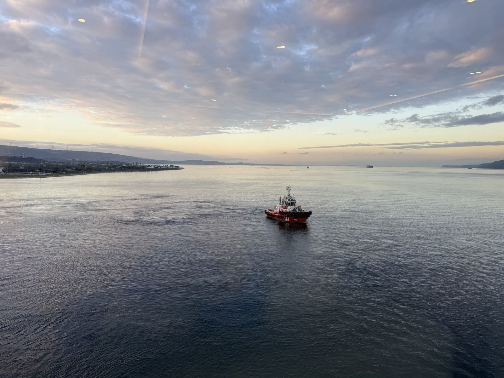
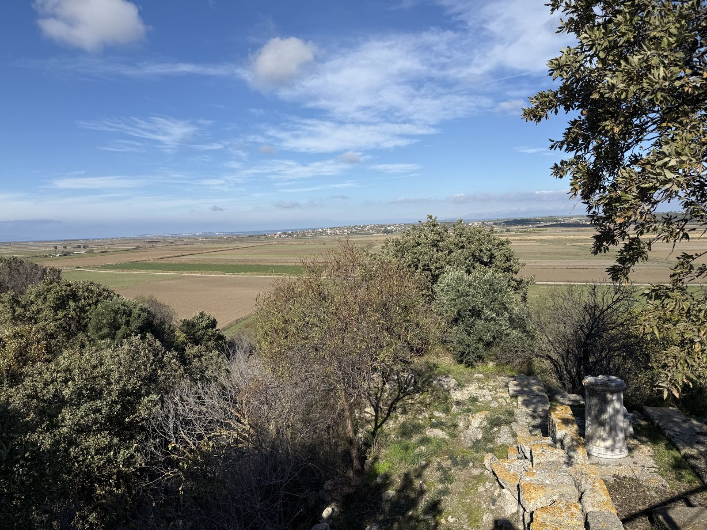
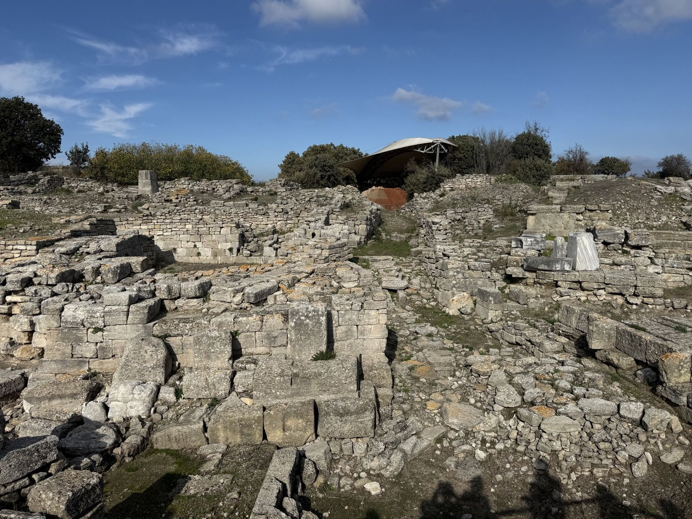
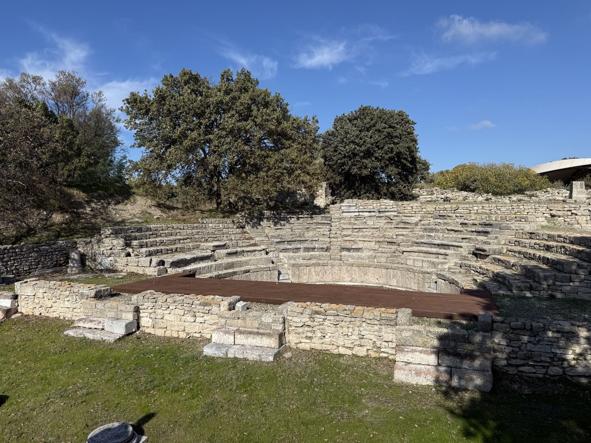
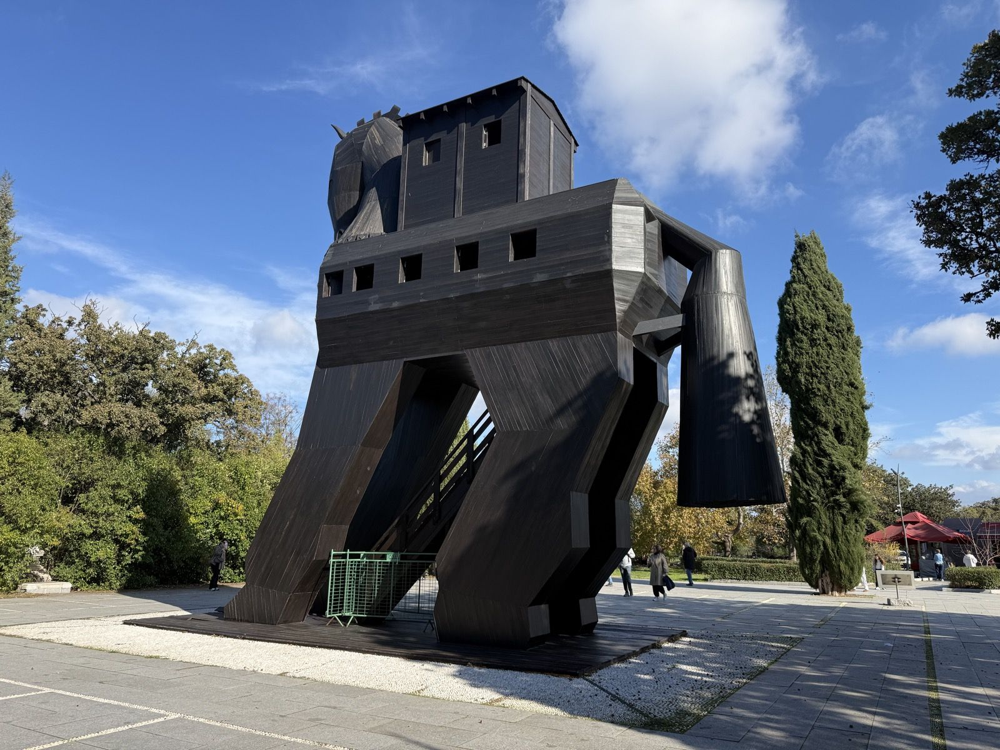
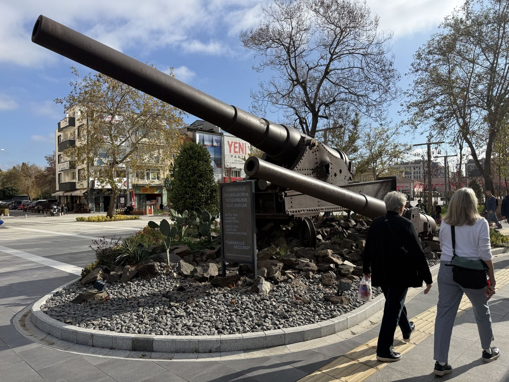
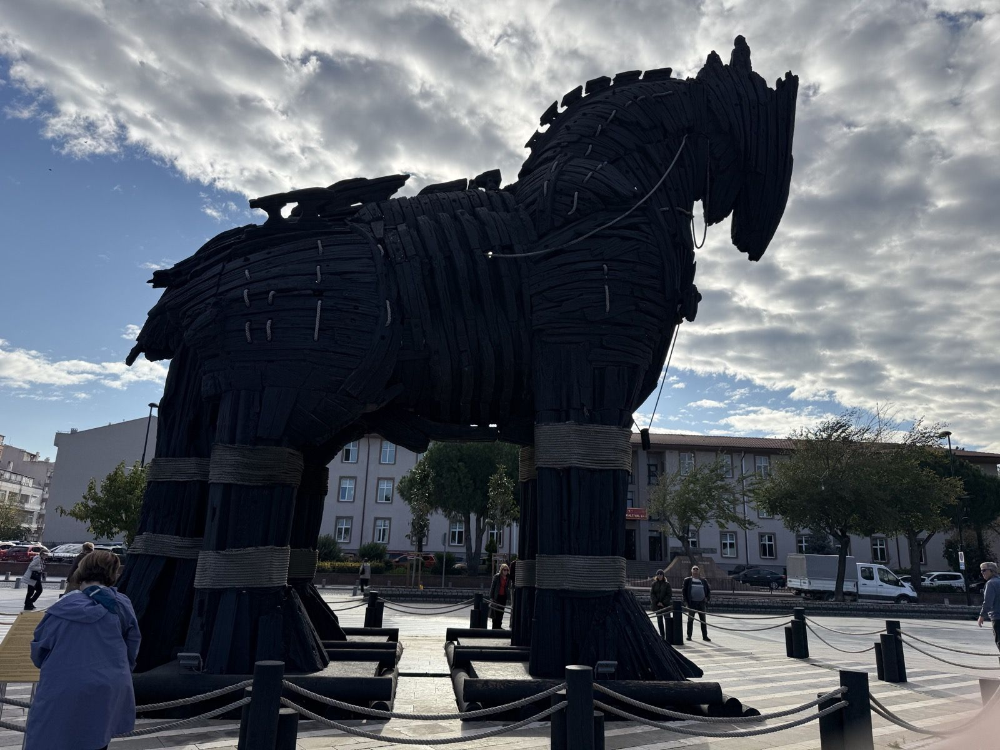

# Day 6: Troy and Gallipoli

## Summary

Day 6 (Monday, November 16) docks at Çanakkale. The morning at Troy covers the Bronze Age collapse, the Hittites and Wilusa, the nine cities of the Hisarlik mound, Calvert and Schliemann, and how Homer's oral epics blend myth and history. Its Learning for All note follows the Greek alphabet, which added vowels and made reading easier to learn, so that Homer could finally be written down. The afternoon turns to Gallipoli, the Anzac forces, the Çanakkale Martyrs' Memorial, Atatürk's 'Johnnies and Mehmets' words, and how cultural memory shapes a battlefield today.

## Concepts Covered

This chapter covers the following 37 concepts from the learning graph:

| Concept | Concept Impact Score |
|---------|-----------------------|
| Cultural Memory | 2 |
| Olympian Gods | 120 |
| Greek Mythology | 20 |
| Stratigraphy | 10 |
| Site Museum | 11 |
| Shore Excursion | 1 |
| Tourism Economy | 9 |
| Off-Season Livelihoods | 6 |
| Bronze Age Collapse | 15 |
| Greek Dark Age | 12 |
| Troy | 18 |
| Hisarlik Mound | 9 |
| Frank Calvert | 3 |
| Heinrich Schliemann | 2 |
| Priam's Treasure | 1 |
| Nine Cities of Troy | 3 |
| Troy VI and VIIa | 2 |
| Hittite Empire | 3 |
| Wilusa | 2 |
| Trojan War | 5 |
| Oral Tradition | 7 |
| Homer | 6 |
| Iliad | 3 |
| Odyssey | 2 |
| Trojan Horse | 1 |
| Troy Museum | 1 |
| Historicity of Troy | 1 |
| Phoenician Alphabet | 5 |
| Greek Alphabet | 4 |
| Homer Written Down | 1 |
| ANZAC Forces | 3 |
| Anzac Cove | 1 |
| Canakkale Martyrs Memorial | 1 |
| Johnnies and Mehmets Words | 1 |
| Canakkale Today | 1 |
| Lowering the Cost of Reading | 2 |
| Simpler Interface to Knowledge | 1 |

## Prerequisites

This chapter builds on concepts from:

- [Chapter 1: Before We Go, Part 1: The Long Timeline of the Eastern Mediterranean](../01-long-timeline/index.md)
- [Chapter 2: Before We Go, Part 2: Traveling Well and the Learning for All Thread](../02-traveling-well/index.md)
- [Chapter 4: Day 2: Byzantine Constantinople and Hagia Sophia](../04-byzantine-constantinople/index.md)
- [Chapter 6: Day 4: Bazaars, Scripts, and Presses](../06-bazaars-scripts-presses/index.md)
- [Chapter 7: Day 5: The End of Empire and the Birth of Modern Turkey](../07-end-of-empire-modern-turkey/index.md)

---

## A Day on Both Shores of the Hellespont

Day 6, Monday, November 16, begins in the narrows of the Dardanelles. The Viking Star docks at Çanakkale at 9:00 AM and sails again at 4:00 PM, which gives us seven hours on the strait that Chapter 7 crossed in the dark. From the ship we can see both continents at once: Çanakkale and the Asian shore on one side, and across water little more than a kilometer and a half wide, the hills of the Gallipoli Peninsula in Europe. About 30 km south of the town, on a low ridge above a farming plain, lies Troy.

<figure markdown="span" class="trip-photo">
  { loading=lazy }
  <figcaption>Early morning on the Dardanelles, just after sunrise. Photo by Dan McCreary</figcaption>
</figure>

The two halves of the day sit more than three thousand years apart, but they ask the same question. At Troy, which we visit in the morning, a city burned around 1180 BCE, and Greek singers carried the memory of a war there for five centuries before anyone wrote it down. At Gallipoli, in the afternoon, two empires and two young nations fought in 1915, and the memory of that fight is still being shaped, carved into stone, and argued over. In both places we will be asking how a war becomes a story, and what happens to the truth on the way.

!!! mascot-welcome "Windy Ilios and the Cove of the Anzacs"
    { class="mascot-admonition-img" }
    Today we climb a mound with nine cities inside it, meet the gods who took sides in the most famous war ever sung, and stand on a beach where former enemies now share the same graves. By sailaway, we will know why Homer called Troy windy, and why an inscription on that beach is both treasured and doubted. Look closer.

The chapter has five parts. Part One climbs the mound at Hisarlık <audio id="audio-hisarlik" src="../../audio/hisarlik.mp3" preload="none"></audio><button onclick="document.getElementById('audio-hisarlik').play()" class="pronounce-btn">🔊 Pronounce</button> *hih-sar-LUHK* and meets the people who dug it. Part Two places Troy in the Bronze Age world of the Hittites and follows that world through its collapse into the Greek Dark Age. Part Three turns to the gods, the war of legend, and Homer, and asks how much of the story is history. Part Four crosses the strait to Gallipoli, the Anzacs, and the memorials. Part Five looks at how Çanakkale lives today from all this memory. The Learning for All note then follows Homer from the singer's memory to the written page.

## Part One: The Mound at Hisarlık

### Shore Excursion

A **shore excursion** is an organized trip ashore sold or included by a cruise line during a port call, usually by coach with a licensed local guide, timed to bring passengers back before the ship sails. Chapter 6 showed how port times frame a cruise day; the excursion is how most passengers fill them. Its strengths are real on a day like this one: Troy and Gallipoli are on opposite shores of a strait, neither is in walking distance of the pier, and a guide who knows the sites turns rubble into a story. Its weakness is the one Chapter 2 named. Everyone arrives at the same gate at the same hour, and the day runs to the coach's clock, not to our curiosity. Seven hours is not enough to see Troy, cross to Gallipoli, and come back without hurrying, so whatever we choose, today rewards reading ahead. Check the ship's daily program for which sites each excursion visits and when its coaches return.

### Troy

**Troy** is the Bronze Age city in northwest Anatolia, near the mouth of the Dardanelles, that Greek legend remembers as the city besieged by the Greeks in the Trojan War. The ancient Greeks called it both *Ilios* (or *Ilion*) and *Troia*; the Romans called it *Ilium*. It sat on the last ridge before the sea, overlooking a plain crossed by the river Scamander (today the Karamenderes) and, in the Bronze Age, a bay that reached much closer to the city than the coast does now. Over the centuries the river filled that bay with silt, and the shoreline moved several kilometers away.

<figure markdown="span" class="trip-photo">
  { loading=lazy }
  <figcaption>The Trojan plain seen from the citadel. Photo by Dan McCreary</figcaption>
</figure>

**Worked example: why a city here?** Let's read the map the way Chapter 1 taught us. Troy stands a few kilometers from the entrance to the Dardanelles, a chokepoint between the Aegean and the Black Sea. A strong current flows out of the strait, and for much of the sailing season the wind blows from the north-northeast, straight down it. A Bronze Age ship, with a square sail and oars, could not easily beat upstream against both. So ships waiting to enter had good reason to shelter in the bay below Troy, sometimes for weeks, until the wind turned. The excavator Manfred Korfmann argued that Troy grew rich from those waiting ships: water, food, repairs, and perhaps tolls. That is a theory, not a recorded fact, but the wind is real. Homer gave Troy a fixed epithet, *ēnemoessa*, "windy," and on a November afternoon on the citadel, we will probably understand why.

### Stratigraphy

Chapter 1 introduced **stratigraphy**, the study of the layers that build up where people live in one place for a long time, and Chapter 4 taught us to read a city's layers and a ruin's history. At Troy we get to apply both on the most famous stratified site in the world. Two rules do most of the work. The first, the law of superposition, says that in undisturbed ground a layer lies above anything older and below anything younger. The second is that people dig: a later foundation, pit, or trench can cut down through earlier layers, so a cut must be dated by the youngest layer it cuts through, not by the oldest material it exposes.

**Worked example: reading a trench wall.** Let's stand at the great north-south trench through the middle of the mound and read the earth wall in front of us from the top down. At the top lie loose soil and the marble fragments of Roman Ilium. Below them, stone house walls run in and out of the cut, each set resting on the rubble of the one before. Here and there a band of dark ash or burned mud brick runs across the section: a fire, the end of one settlement. Near the bottom, the walls are smaller and made of rough stone and mud brick, the houses of the first Troy, around 3000 BCE. Now the second rule: the trench itself is a layer. It cuts through all the others, so it is younger than all of them, and we know its date exactly, because Heinrich Schliemann dug it in the early 1870s. Seen this way, even the damage at Troy is evidence.

!!! mascot-tip "Find the Trench First"
    { class="mascot-admonition-img" }
    Here's a shortcut for the whole site: find Schliemann's great trench early on the walking route and spend two minutes reading its walls from the top down. It is the one place where all the cities appear in a single cross-section, and every stop after it will make more sense.

### The Hisarlık Mound

The **Hisarlık Mound** is the artificial hill near the village of Tevfikiye that holds the ruins of Troy. Its Turkish name means "place of the fortress." A mound like this is what archaeologists call a **tell**, from an Arabic word for hill: a hill made by people, built up over thousands of years of houses, walls, and rubbish, each generation leveling the ruins of the last and building on top. At Hisarlık the layers of human life inside the mound span roughly 3,500 years, from about 3000 BCE to about 500 CE.

For most of its history, nobody doubted that this hill was Ilion. Greek settlers lived on it from about 700 BCE; Alexander the Great sacrificed here in 334 BCE at what he was shown as the tomb of Achilles; and Roman emperors, who claimed descent from the Trojan prince Aeneas, rebuilt it as Ilium. Only in the 18th and 19th centuries, when the site had long been abandoned, did scholars begin to argue over where Troy had been, and several other hills were proposed. The case for Hisarlık was made with a spade.

<figure markdown="span" class="trip-photo">
  { loading=lazy }
  <figcaption>Excavated walls of Troy. Photo by Dan McCreary</figcaption>
</figure>

### The Nine Cities of Troy

The **Nine Cities of Troy** are the nine main settlement layers that archaeologists number from the bottom up, Troy I through Troy IX, each with sub-phases marked by letters (Troy VIIa, VIIb, and so on). Chapter 1's table gave their dates, from about 3000 BCE for Troy I to about 500 CE for the last of Roman Ilium. Today we see them not in order but as a walk, because the site's path loops through the citadel and passes the layers wherever they happen to be exposed. The table below reorganizes them as the route meets them.

| What we see on the route | Layer | Approximate date |
|---|---|---|
| The sloping, finely fitted stone wall and the East Gate | Troy VI | c. 1750–1300 BCE |
| The great stone tower on the northeast corner | Troy VI | c. 1750–1300 BCE |
| Small, crowded houses built against the inside of the Troy VI walls | Troy VIIa | c. 1300–1180 BCE |
| The stone ramp Schliemann took for Homer's Scaean Gate | Troy II | c. 2550–2300 BCE |
| The deep trench through the middle of the mound | Cut in the 1870s | Exposes Troy I to IX |
| Marble pieces of the Temple of Athena | Troy VIII–IX | Hellenistic and Roman |
| The sanctuary below the southwest wall | Troy VIII–IX, with older roots | c. 700 BCE onward |
| The odeon (small theater) and the council house | Troy IX | Roman, 1st–2nd century CE |

The same walk is a lesson from Chapter 4: an old object is not an old layer. The odeon is the newest thing in the citadel, though it is the most complete, and the oldest walls, at the bottom of the trench, are the hardest to see.

<figure markdown="span" class="trip-photo">
  { loading=lazy }
  <figcaption>The odeon (small theater) at Troy. Photo by Dan McCreary</figcaption>
</figure>

### Troy VI and VIIa

**Troy VI and VIIa** are the two layers of Late Bronze Age Troy that are the leading candidates for Homer's city. Troy VI, from about 1750 to 1300 BCE, was the grandest Troy: a citadel ringed by a sloping limestone wall about 5 m thick, built in neat sections with shallow offsets, and large houses on terraces inside. Excavations from 1988 onward, led by Manfred Korfmann, found a lower town below the citadel, protected by a defensive ditch cut into the rock, which suggests a city of several thousand people. Not every scholar accepts that the lower town was so large; the historian Frank Kolb argued in 2001 and 2002 that Korfmann had made Troy sound grander than the evidence allowed. Troy VI ended around 1300 BCE in damage that looks like an earthquake: collapsed walls, but no great fire. The survivors rebuilt, cramming small houses against the walls and burying storage jars in the floors, the look of a city expecting a siege. That city, Troy VIIa, was destroyed around 1180 BCE by fire, and in its ruins excavators found arrowheads and human remains. Whether that destruction was the work of Greeks, or of raiders, or of a war we cannot name, the stones do not say.

### Frank Calvert

**Frank Calvert** (1828–1908) was a member of an English family living at the Dardanelles, where he served as a consular agent, and the first person to dig at Hisarlık in search of Homer's Troy. The Calverts owned a farm near the site and part of the mound itself. From the 1850s, Frank studied the Trojan plain, and in the early 1860s he dug trial trenches on his part of Hisarlık and found ancient walls. He became convinced that Troy lay inside, but he lacked the money for a full excavation. In 1868 a wealthy visitor came to see him, listened, and took up the idea. That visitor wrote Calvert almost out of the story for a century, until historians, using the two men's letters, gave him back his share of the credit.

### Heinrich Schliemann

**Heinrich Schliemann** (1822–1890) was the German businessman who excavated Troy from 1871 to 1890 and made it world famous. He had grown rich in trade, in Russia and, briefly, in gold-rush California, and spent his fortune proving that Homer's world was real. He dug in big seasons with large crews, and his huge trench through the mound, as Chapter 1 explained, destroyed parts of the layers closest to Homer's age. He also learned: from 1882 the architect Wilhelm Dörpfeld worked beside him and brought careful recording, and before Schliemann died he had begun to suspect that the Troy of the legend lay higher up the mound than he first thought.

Schliemann's own life story deserves the myth-versus-history test of Chapter 4. In his later books he wrote that, as a boy of eight, he saw a picture of Troy burning and promised his father he would find it. His letters and diaries from his early life, which historians have studied closely, say nothing of the kind; the story appears only after he was famous. Like the line about Solomon at Hagia Sophia, it tells us what Schliemann wanted his life to mean.

### Priam's Treasure

**Priam's Treasure** is the hoard of gold, silver, and bronze objects, including two gold diadems made of thousands of small gold pieces, that Schliemann found at Troy in 1873 and named after Homer's king of Troy. It came from Troy II, about a thousand years too early for Priam. Schliemann smuggled it out of the Ottoman Empire, breaking his agreement to share finds, and the Ottoman government sued him; he paid a settlement. He gave most of it to Berlin in 1881. At the end of the Second World War, Soviet troops took it from Berlin to Moscow, and it vanished until 1993, when Russia confirmed that it was in the Pushkin Museum, where it remains. Some pieces are in the Istanbul Archaeology Museums. Schliemann published a famous photograph of his wife, Sophia, wearing the diadems, and wrote that she had carried the treasure away in her shawl; he later admitted she had been in Athens at the time.

!!! mascot-warning "The Name on the Label Is Not a Date"
    { class="mascot-admonition-img" }
    A common trap at Troy is to trust a name: "Priam's Treasure," "the Scaean Gate," "the tomb of Achilles." Each was named by someone who hoped to find Homer, before the layers were dated. When you meet a Homeric name on a label, look for the layer number beside it, and believe the number.

### Site Museum

A **site museum** is a museum built at or beside an archaeological site to display the objects found there, so that visitors can see the finds and the place together. Its great advantage is context. A pot in a national museum is one pot among thousands; the same pot a few hundred meters from the house where it was buried tells the story of that house. A site museum also keeps some of the benefit of a site's fame in its own region, in jobs and visitors. Its limits are practical: it holds only what has stayed nearby, and the most famous finds from the oldest excavations are often far away, in national capitals or foreign museums.

**Worked example: where are Troy's finds?** Let's follow the objects from the mound and count the countries.

- **Russia:** Schliemann's gold, taken from Berlin to Moscow in 1945.
- **Germany:** other finds from Schliemann's digs that stayed in Berlin.
- **Turkey:** the Ottoman government's share of Schliemann's finds, in Istanbul, and everything excavated since.
- **United States:** some finds from Carl Blegen's American excavations of 1932 to 1938, divided under the rules of the time; and, until 2012, a group of gold jewelry said to come from the Troy region, bought by the University of Pennsylvania Museum in 1966 and sent back to Turkey in 2012.

So a visitor who wanted to see "Troy" in one room would need tickets in four countries. A site museum cannot reunite all of that, but it can show what the region still holds, and that is what Troy finally built.

### The Troy Museum

The **Troy Museum** (*Troya Müzesi*) opened in 2018 just outside the archaeological site, after decades in which Troy's finds were scattered among other museums. Its building is a large square block clad in rust-colored steel, a color chosen to echo the earth of the excavations. Its collections come from Troy and the surrounding region, the Troad, and its most striking piece is the Polyxena Sarcophagus, a marble coffin of about 520–500 BCE found in the region in 1994, carved with the sacrifice of the Trojan princess Polyxena at the end of the war. The jewelry returned from Philadelphia is here too. Allow an hour, and if time is short, go after the site, so that the objects land on places you have just walked.

## Part Two: Troy in a Bronze Age World

### The Hittite Empire

The **Hittite Empire** was the great Bronze Age state of central Anatolia, which ruled from its capital, Hattusa, near today's village of Boğazkale, about 150 km east of Ankara, from about 1650 to about 1180 BCE. At its height it reached from the Aegean coast to northern Syria. The Hittites spoke an Indo-European language, the oldest one we can read, and wrote it in cuneiform, wedge-shaped signs pressed into clay tablets. Their palace archives, found from 1906 onward, hold tens of thousands of tablets: laws, prayers, letters to other kings, and treaties. The most famous is the peace treaty made in 1259 BCE with the Egyptian pharaoh Ramesses II after the battle of Kadesh, one of the oldest peace treaties known; a copy hangs at the United Nations headquarters in New York. To the Hittites, western Anatolia was a frontier of small kingdoms to be bound by treaty, and that is where Troy comes in.

### Wilusa

**Wilusa** <audio id="audio-wilusa" src="../../audio/wilusa.mp3" preload="none"></audio><button onclick="document.getElementById('audio-wilusa').play()" class="pronounce-btn">🔊 Pronounce</button> *wih-LOO-sah* is a kingdom in northwest Anatolia named in Hittite texts, which most scholars now identify with Troy. The link starts with a sound. Homer's *Ilios* was once *Wilios*: early Greek had a *w* sound, written with a letter called *digamma*, that later dropped out. Wilusa fits *Wilios* closely, and a place called Taruisa, named once in a Hittite list, may be *Troia*. The texts add more. Around 1280 BCE the Hittite king Muwatalli II made a treaty with Alaksandu, king of Wilusa, a name strikingly like *Alexandros*, the other name of Homer's Paris. Another letter, from a Hittite king to the king of a land called **Ahhiyawa** <audio id="audio-ahhiyawa" src="../../audio/ahhiyawa.mp3" preload="none"></audio><button onclick="document.getElementById('audio-ahhiyawa').play()" class="pronounce-btn">🔊 Pronounce</button> *ah-khee-YAH-wah* (most likely the Mycenaean Greeks, Homer's *Achaioi*), mentions an earlier quarrel between the two of them over Wilusa. And a later letter speaks of a king of Wilusa named Walmu who had been driven out and whom the Hittite king meant to restore.

None of this proves a Trojan War. It does show that in the 13th century BCE a kingdom at Troy's location was a Hittite ally, that Greeks from Ahhiyawa were active on that coast, and that Wilusa was a place where great powers quarreled. The table lists the main texts.

| Hittite text | Approximate date | What it says about Wilusa |
|---|---|---|
| A list of western lands under Tudhaliya I | c. 1400 BCE | Names Wilusiya and Taruisa among a coalition of western lands the Hittite king defeated |
| Treaty with Alaksandu | c. 1280 BCE | Wilusa is a Hittite vassal; Alaksandu is its king |
| Letter to the king of Ahhiyawa | c. 1250 BCE | The Hittite and Ahhiyawan kings had quarreled over Wilusa |
| Letter about Walmu | Late 13th century BCE | Walmu, king of Wilusa, was driven out; the Hittite king plans to restore him |

!!! mascot-encourage "Three Names, Three Matches"
    { class="mascot-admonition-img" }
    If Wilusa, Ahhiyawa, and Alaksandu feel like a tongue-twister, that is normal; even specialists keep a cheat sheet. Hold on to just three matches: Wilusa for Ilios, Ahhiyawa for the Achaeans, Alaksandu for Alexandros. With those three, the table above reads like a news report from Homer's world.

### The Bronze Age Collapse

Chapter 1 described the **Bronze Age collapse**, also called the Late Bronze Age collapse: the breakdown of the connected palace world of the Eastern Mediterranean between about 1200 and 1150 BCE. Troy lets us see it from one city and then look outward. Troy VIIa burned around 1180 BCE. At about the same time, Hattusa was abandoned and the Hittite Empire disappeared from history. The great trading city of Ugarit on the Syrian coast was destroyed; its last letters speak of enemy ships. On the Greek mainland the Mycenaean palaces at Pylos and elsewhere burned, and their scribes' records stop. Egypt survived, barely: around 1177 BCE Pharaoh Ramesses III recorded on the walls of his temple at Medinet Habu a battle against invaders from the sea, the people modern historians call the Sea Peoples.

**Worked example: one link breaks, then the next.** Let's trace how a failure could spread, using causes historians have proposed. Suppose several years of drought, which tree rings and lake sediments suggest for parts of the region, cut harvests in Anatolia. The Hittite king, short of grain, depends on shipments from Egypt and Ugarit. Ugarit, meanwhile, is sending its ships and soldiers to help its Hittite overlord, so its own coast is undefended when raiders arrive. Palaces that ran on stored grain and bronze cannot pay their soldiers and craftsmen; the tin trade that Chapter 1's Uluburun ship carried stops; earthquakes strike cities already short of labor to rebuild. No single cause explains it, and historians still argue over which mattered most. What the dates show is that the systems were tied together, so a shock in one place became a crisis everywhere. Troy did not fall alone.

!!! mascot-thinking "A Network Fails as a Network"
    { class="mascot-admonition-img" }
    Notice that the Bronze Age palaces were strong precisely because they were connected, and fragile for the same reason. Think of it like a row of ships tied together in a storm: the ropes that steady them in calm weather drag them down together when one ship goes under. That idea comes back on Crete, where a whole script died with the palaces that used it.

On Day 9, Chapter 13 tells that story at Knossos, where the Linear B tablets were baked hard by the fires that ended the palace world, and explains how they were finally read.

### The Greek Dark Age

The **Greek Dark Age** is the period from about 1100 to about 800 BCE, after the collapse of the Mycenaean palaces, when Greece had fewer people, poorer settlements, little long-distance trade, and no writing at all. Chapter 1 introduced it and warned that "dark" describes our lack of written sources more than the lives of the people. At Troy the period shows as Troy VIIb: poorer settlements on the old citadel after 1180 BCE, then, by about 950 BCE, a site nearly empty. Around 700 BCE Greek-speaking settlers from across the Aegean moved onto the hill and founded Ilion, Troy VIII, a Greek town living on top of a legend.

**Worked example: what crossed the dark?** Let's ask what survived three centuries without writing. Archaeology answers part of it. At Lefkandi on the island of Euboea, excavators found a building about 45 m long, from about 950 BCE, with the burials of a warrior and a richly dressed woman and four horses: a community wealthy and organized enough to honor its leaders lavishly, in the depth of the "dark." The gods crossed too: Zeus, Hera, and Poseidon are named on Mycenaean tablets before the collapse and worshipped by Greeks after it. And the epics themselves carry objects from before the dark. In the *Iliad*, Odysseus is given a helmet covered with rows of boars' tusks. No Greek of Homer's own day wore such a helmet, but archaeologists have found boars'-tusk helmets in Mycenaean graves of the Bronze Age. The description could only have reached Homer through song, passed from singer to singer for about five hundred years. That is our first evidence of how much an oral tradition could carry.

The end of the Dark Age also brought new places where Greeks from many communities met: Olympia, where the Games were traditionally founded in 776 BCE, and Delphi, whose sanctuary began to grow in the 8th century BCE. Chapter 18 walks through Delphi on Day 12.

## Part Three: Gods, Heroes, and the Song of Troy

### The Olympian Gods

The **Olympian gods** are the twelve principal gods of the ancient Greeks, imagined as a single family living on Mount Olympus, the highest mountain in Greece, under the rule of Zeus. They were not distant abstractions. Greeks pictured them in human form, with human passions, quarrels, favorites, and grudges, but immortal and far more powerful. Each had particular domains (the sea, the harvest, war, love, crafts), favorite places and animals, and a symbol by which an artist could show them. Each city had its own special patron, which is why Athens is named for Athena, and each god had many local festivals and sanctuaries. Chapter 1 described the Greeks as a people who "worshipped the same family of gods," and that family is one of the things that made scattered city-states feel like one civilization.

The list of twelve varied a little between places and periods, but the usual one is below. The table also shows where we meet each god on our own route.

| God | Domains | Symbol to look for | Where we meet them |
|---|---|---|---|
| Zeus | King of the gods; sky, weather, justice | Thunderbolt, eagle | Temple of Olympian Zeus, Athens (Day 13) |
| Hera | Queen of the gods; marriage, women | Crown, peacock | Many sanctuaries; at Troy in the *Iliad* |
| Poseidon | Sea, earthquakes, horses | Trident | Temple at Cape Sounion |
| Demeter | Grain, harvest | Sheaf of wheat, torch | Eleusis, near Athens |
| Athena | Wisdom, strategy in war, crafts | Owl, helmet, shield (*aegis*) | Temple of Athena at Troy; the Parthenon (Day 10) |
| Apollo | Light, music, prophecy, healing, archery | Lyre, bow, laurel | Delphi (Days 11–12) |
| Artemis | Hunting, wild animals, childbirth | Bow, deer | Ephesus (Day 7) |
| Ares | War and violence | Spear, helmet | Few temples of his own |
| Aphrodite | Love and beauty | Dove, mirror | Statues in the Athens museums |
| Hephaestus | Fire, metalwork, smiths | Hammer, tongs | Temple of Hephaestus, Athens Agora (Day 11) |
| Hermes | Messenger; travelers, trade, thieves | Winged sandals, herald's staff | Boundary markers called herms |
| Dionysus | Wine, theater, ecstasy | Vine, ivy, wine cup | Theater of Dionysus, Athens (Day 10) |

Some lists put Hestia, goddess of the hearth, in place of Dionysus.

**Worked example: the gods go to war at Troy.** Let's see the Olympians in action, because the *Iliad* is the oldest place we can watch them. In Book 20, as the fighting reaches its peak, Zeus lifts his ban on the gods joining the battle and stays on Olympus to watch. The others go down to the plain we can see from the citadel. Hera, Athena, Poseidon, Hermes, and Hephaestus <audio id="audio-hephaestus" src="../../audio/hephaestus.mp3" preload="none"></audio><button onclick="document.getElementById('audio-hephaestus').play()" class="pronounce-btn">🔊 Pronounce</button> *heh-FESS-tus* go to the Greek ships. Ares, Apollo, Artemis, and Aphrodite go to the Trojans, along with Leto, the mother of Apollo and Artemis, and Xanthos, the god of the river. Now look for reasons. Three of the choices follow from a single story, the Judgment of Paris, told in the next section: Hera and Athena lost a beauty contest that Aphrodite won by promising Paris the most beautiful woman in the world. Poseidon has an old grievance: in the *Iliad* he recalls that an earlier Trojan king cheated him of his wages for building the city's walls. Apollo has his own: in Book 1 the Greek commander Agamemnon insults Apollo's priest, and Apollo answers with a plague on the Greek camp. So the gods take sides for the most human reasons there are: wounded pride, old debts, and favorites. Of the twelve Olympians, that makes five for the Greeks, four for the Trojans, and three outside the fight: Zeus above it, and Demeter and Dionysus, who play no part in the *Iliad*.

!!! mascot-tip "Read the Hands, Not the Faces"
    { class="mascot-admonition-img" }
    Want to name a god on a vase or a relief in seconds? Ignore the face, which artists made almost alike, and look at what the figure holds or wears: a trident is Poseidon, a helmet with a spear on a woman is Athena, a bow on a woman is Artemis, winged sandals are Hermes. Ancient viewers read the same symbols.

The MicroSim below asks us to sort all twelve by the side they took, using each god's domain and story.

#### Diagram: The Olympian Gods at Troy

<iframe src="../../sims/olympian-gods-at-troy/main.html" height="624px" width="100%" scrolling="no"></iframe>

[Run The Olympian Gods at Troy MicroSim Fullscreen](../../sims/olympian-gods-at-troy/main.html){ .md-button .md-button--primary }

The Olympian Gods at Troy

Type: microsim
**sim-id:** olympian-gods-at-troy 
**Library:** p5.js 
**Status:** Specified 
**Bloom Level:** Understand 
**Bloom Verb:** classify 
**Learning Objective:** The learner will classify each of the twelve Olympian gods by the side they take in Homer's Iliad (helped the Greeks, helped the Trojans, or stayed above or outside the fight), using each god's domain and story, with at least 10 of 12 correct on the first check.

**Prerequisites:** Olympian gods, Mount Olympus, the Iliad, the Judgment of Paris, and the Trojan War, all defined in Part Three of this chapter.

**Evidence of Mastery:** The learner places all 12 god cards into the three bins and presses Check. A placement is correct when it matches the Correct bin column in Content. Mastery is at least 10 of 12 correct on the first Check. Flipping a card to read its domain and symbol is exploration, not evidence. The prediction in Learner Activity step 2 is recorded but not scored.

**Misconceptions:** (1) The gods acted as impartial judges of right and wrong. (2) The god of war must have been on the winning side. (3) Every Olympian fought at Troy. (4) Zeus was simply a Trojan partisan.

**Instructional Rationale:** Classifying the gods by side forces the learner to connect each god's story (the Judgment of Paris, Poseidon's unpaid wages, Apollo's insulted priest) to a choice, which is an Understand task rather than recall of a list. A committed prediction of the totals before sorting exposes misconception 3.

**Content:**

Three bins, labeled exactly: "Helped the Greeks", "Helped the Trojans", "Above or outside the fight".

Twelve cards. Each card's front shows the god's name, domains, and symbol, as in the chapter's table.

| # | God (front of card) | Correct bin | Why (shown as feedback) |
|---|---|---|---|
| 1 | Zeus: king of the gods; sky, weather, justice; thunderbolt, eagle | Above or outside the fight | In Book 20 Zeus stays on Olympus to watch; he favors the Trojans for a time only to keep a promise to Achilles' mother, Thetis. |
| 2 | Hera: queen of the gods; marriage, women; crown, peacock | Helped the Greeks | Paris judged Aphrodite more beautiful than Hera, and Hera never forgave Troy. |
| 3 | Poseidon: sea, earthquakes, horses; trident | Helped the Greeks | In the Iliad he recalls that an earlier Trojan king cheated him of his wages for building Troy's walls. |
| 4 | Demeter: grain, harvest; sheaf of wheat, torch | Above or outside the fight | Demeter plays no part in the Iliad's battles. |
| 5 | Athena: wisdom, strategy in war, crafts; owl, helmet, aegis | Helped the Greeks | Athena also lost the Judgment of Paris, and she guides Greek heroes such as Achilles and Odysseus. |
| 6 | Apollo: light, music, prophecy, healing, archery; lyre, bow | Helped the Trojans | In Book 1 Agamemnon insults Apollo's priest, and Apollo sends a plague on the Greek camp. |
| 7 | Artemis: hunting, wild animals, childbirth; bow, deer | Helped the Trojans | Apollo's twin sister joins the Trojan side with him and their mother, Leto. |
| 8 | Ares: war and violence; spear, helmet | Helped the Trojans | Ares fights for Troy; in Book 5 a Greek hero wounds him with Athena's help. |
| 9 | Aphrodite: love and beauty; dove, mirror | Helped the Trojans | She won the Judgment of Paris by promising him Helen, and she rescues Paris from a duel in Book 3. |
| 10 | Hephaestus: fire, metalwork, smiths; hammer, tongs | Helped the Greeks | He forges new armor for Achilles in Book 18 and fights the Trojan river god with fire. |
| 11 | Hermes: messenger; travelers, trade, thieves; winged sandals, herald's staff | Helped the Greeks | He goes to the Greek ships in Book 20, although in Book 24 he guides old Priam safely to Achilles. |
| 12 | Dionysus: wine, theater, ecstasy; vine, ivy, wine cup | Above or outside the fight | Dionysus barely appears in the Iliad and takes no side. |

Totals shown after the final Check: Helped the Greeks 5; Helped the Trojans 4; Above or outside the fight 3.

**Provenance:** Sides from Homer's Iliad, Book 20, where Zeus allows the gods into the battle and names who goes to each side; supporting episodes from Books 1, 3, 5, 18, 21, and 24 as cited in the Why column. Domains and symbols from the chapter's table in "The Olympian Gods". The Judgment of Paris from the chapter section "Greek Mythology".

**Rules:** Each card goes in exactly one bin. Check is available only when all 12 cards are placed. Score = number of cards in their correct bin. Mastery when the first-Check score >= 10. Cards may be moved between bins at any time before the final Check.

**Learner Activity:**

1. The learner sees the 12 shuffled cards and the three empty bins.
2. Before sorting, the learner enters a prediction: how many gods helped the Greeks, how many the Trojans, and how many stayed out (three whole numbers from 0 to 12 that sum to 12). The sim stores the prediction.
3. The learner drags each card into a bin.
4. The learner presses Check. Each card is marked correct or not, and the score "n of 12" is shown.
5. The learner may move incorrectly placed cards and press Check again.
6. After the final Check, the sim shows the true totals (5, 4, 3) next to the learner's prediction and highlights Hera, Athena, and Aphrodite, whose sides follow the Judgment of Paris.

**Feedback:** Twelve cards, one sort. Up to three Checks; only the first counts for mastery. On each Check, a correct card shows "Correct: [Why]." and an incorrect card shows "Not quite. [Why]" after the second Check; after the first Check incorrect cards are only marked, with the hint "Think about the Judgment of Paris and old debts." After the third Check, all incorrect cards move to their correct bins with their Why text. The final message is: "Five helped the Greeks, four the Trojans, three stayed out. The gods took sides for human reasons: pride, old debts, and favorites."

**Starting State:** Twelve shuffled cards, three empty bins, and the question "When the gods went down to the plain of Troy, whose side was each one on?"

**Chapter Anchors:** Twelve Olympian gods. In Iliad Book 20, five Olympians go to the Greeks (Hera, Athena, Poseidon, Hermes, Hephaestus), four to the Trojans (Ares, Apollo, Artemis, Aphrodite), and three stay out (Zeus above the fight; Demeter and Dionysus not in the Iliad). Mastery 10 of 12.

### Greek Mythology

**Greek mythology** is the body of traditional stories the ancient Greeks told about their gods, heroes, and the origins of the world, of cities, and of customs. Chapter 4 defined a myth as a story about the past not supported by evidence from the time, which may still carry a real truth about how people felt. Greek mythology is that kind of story on a vast scale, and it did several jobs at once: it explained the world (why the seasons change, in the story of Demeter's lost daughter), justified institutions (why a city honored a particular god), told families where they came from, and gave every Greek a shared stock of characters to think with. There was no single sacred book and no official version. Poets, painters, and local storytellers each told the stories their own way, so most myths come down to us in several versions that contradict one another.

**Worked example: the Judgment of Paris.** Let's follow one myth through its versions, because it starts the Trojan War. At the wedding of the hero Peleus and the sea goddess Thetis, the future parents of Achilles, the goddess Strife, who had not been invited, threw a golden apple among the guests, inscribed "for the fairest." Hera, Athena, and Aphrodite each claimed it. Zeus sent them to a Trojan prince, Paris, tending flocks on Mount Ida, south of Troy, to judge. Each offered a bribe: Hera, power; Athena, victory in war; Aphrodite, the most beautiful woman in the world. Paris chose Aphrodite, and the most beautiful woman was Helen, wife of King Menelaus of Sparta. Now check the sources. The *Iliad* mentions the judgment only once, near the end, in two lines. The full story was told in a lost epic called the *Cypria*, which we know from a later summary, and the golden apple's inscription appears in still later writers. So the myth grew in the telling, exactly as Chapter 4's test predicts, while doing an important job: it explains, in one scene, why the gods took the sides they did.

### The Trojan War

The **Trojan War** is the legendary ten-year war in which an alliance of Greek kings, led by Agamemnon of Mycenae, besieged and destroyed Troy to win back Helen, who had left Sparta with the Trojan prince Paris. It is the central story of Greek legend. Its heroes include, on the Greek side, Achilles, the greatest warrior; Odysseus, the cleverest; Ajax; and Agamemnon's brother Menelaus; and on the Trojan side, King Priam, his son Hector, the city's defender, and the Trojan prince Aeneas, who escapes the burning city and whom the Romans later claimed as their ancestor.

**Worked example: where the Iliad falls in the war.** Let's lay the legend out in order, because the most famous poem about it covers very little of it.

1. **Before the war:** the Judgment of Paris and the taking of Helen.
2. **Years 1 to 9:** the Greeks gather a great fleet, sail to Troy, and besiege it without success.
3. **Year 10, about 50 days:** Achilles quarrels with Agamemnon, withdraws from the fighting, returns in fury when his friend Patroclus is killed by Hector, kills Hector, and finally gives Hector's body back to his father, Priam. This episode is the whole *Iliad*.
4. **The fall:** Achilles is killed by an arrow from Paris, and the Greeks take the city with the wooden horse.
5. **After:** the survivors scatter, Odysseus on a ten-year voyage home, told in the *Odyssey*, and Aeneas toward Italy.

The two Homeric epics cover a few weeks of the war and one hero's return; the rest comes from other poems, many now lost.

### Oral Tradition

An **oral tradition** is a body of knowledge, stories, or poetry passed from one generation to the next by speech and memory rather than by writing. Every society had one before it had writing, and many still do. The question for Homer is how a tradition of songs could hold epics of more than 15,000 lines without anyone writing them down.

The answer came from an American scholar, Milman Parry, in the 1920s and 1930s. Studying the Homeric poems, he noticed that their famous repeated phrases follow strict rules. Achilles is "swift-footed Achilles" or "brilliant Achilles," Odysseus is "much-enduring" or "of many counsels," the sea is "wine-dark," and the dawn is "rosy-fingered." The line "When early-born, rosy-fingered Dawn appeared" occurs about twenty times in the *Odyssey*. Parry showed that the choice between phrases depends less on meaning than on meter. Homer's verse is **dactylic hexameter**, a line of six beats built on long and short syllables, and each name phrase, or **formula**, fills a different-sized space in that line. "Brilliant Odysseus" (*dios Odysseus*) fills the last five syllables, "Odysseus of many counsels" (*polymētis Odysseus*) the last seven, "much-enduring, brilliant Odysseus" (*polytlas dios Odysseus*) the last eight. Achilles has a matching set, and that is why he is "swift-footed" even while sitting in his tent.

To test the idea, Parry and his student Albert Lord went in 1933 to 1935 to Yugoslavia, where singers called *guslari* still performed long heroic songs, accompanying themselves on a one-stringed instrument. They recorded hundreds of performances. They found that the singers did not memorize a fixed text at all. A singer learned, through years of listening and practice, a stock of formulas and typical scenes (an arming, a feast, a journey), and recomposed the song each time he sang it, faster or slower, longer or shorter, for his audience. One singer, Avdo Međedović, who could not read, performed for them a single song of more than 12,000 lines. Lord's book on their findings, *The Singer of Tales*, appeared in 1960, after Parry's early death in 1935.

!!! mascot-thinking "Memorizing a Method, Not a Text"
    { class="mascot-admonition-img" }
    Notice what the singer actually stored in memory: not 15,000 lines in order, but a toolkit of ready-made phrases and scenes, plus the rules for fitting them into a line. Think of it as knowing a language rather than memorizing a book. That is how a tradition could carry a boars'-tusk helmet for five centuries while changing everything around it.

**Worked example: composing a line like a bard.** Let's try it. A singer reaching the end of a line about Achilles has a space left: say seven syllables with the pattern short-short-long-short-short-long-long. He does not stop to choose an adjective. Only one formula for Achilles fits that space, *podas ōkus Achilleus*, "swift of feet, Achilles," and out it comes: "And answering him spoke swift-footed Achilles," a line that recurs again and again in the *Iliad*. If the space is eight syllables, out comes *podarkēs dios Achilleus*, "swift-footed, brilliant Achilles." If it is five, *dios Achilleus*. The system is economical: for each hero and each space there is usually just one formula. That is what lets a singer compose at the speed of performance. The MicroSim below gives us six lines to finish the same way.

#### Diagram: Finish the Line Like a Homeric Singer

<iframe src="../../sims/homeric-formula-builder/main.html" height="564px" width="100%" scrolling="no"></iframe>

[Run the Finish the Line Like a Homeric Singer MicroSim Fullscreen](../../sims/homeric-formula-builder/main.html){ .md-button .md-button--primary }

Finish the Line Like a Homeric Singer

Type: microsim
**sim-id:** homeric-formula-builder 
**Library:** p5.js 
**Status:** Specified 
**Bloom Level:** Apply 
**Bloom Verb:** use 
**Learning Objective:** The learner will use the size of the metrical space left at the end of a line to choose the Homeric name formula that completes it, for six lines naming Achilles or Odysseus, with at least 5 of 6 correct on the first attempt.

**Prerequisites:** oral tradition, formula, dactylic hexameter, long and short syllables, Achilles and Odysseus (all defined in the sections "The Trojan War" and "Oral Tradition" above).

**Evidence of Mastery:** For each of six lines, the learner selects one of the three formulas for the named hero before the line is completed. A choice is correct when the formula's syllable count and rhythm pattern equal the space left in the line. Mastery is at least 5 of 6 correct on the first attempt. Listening to a formula or reading its translation is exploration.

**Misconceptions:** (1) Homer chose each epithet for its meaning at that moment, so "swift-footed" means Achilles is running. (2) The singers memorized a fixed text word for word. (3) Any adjective could fill any gap.

**Instructional Rationale:** Applying Parry's rule to real formulas makes the learner perform the singer's choice, so the economy of the system is discovered rather than told. The rule is mechanical enough to check exactly, and the closing step confronts misconception 1 with the sitting Achilles.

**Content:**

The six formulas, each shown with its transliteration, translation, syllable count, and rhythm pattern (– long, ⏑ short):

| Hero | Formula | Translation | Syllables | Pattern |
|---|---|---|---|---|
| Achilles | dios Achilleus | brilliant Achilles | 5 | – ⏑ ⏑ – – |
| Achilles | podas ōkus Achilleus | swift of feet, Achilles | 7 | ⏑ ⏑ – ⏑ ⏑ – – |
| Achilles | podarkēs dios Achilleus | swift-footed, brilliant Achilles | 8 | ⏑ – – – ⏑ ⏑ – – |
| Odysseus | dios Odysseus | brilliant Odysseus | 5 | – ⏑ ⏑ – – |
| Odysseus | polymētis Odysseus | Odysseus of many counsels | 7 | ⏑ ⏑ – ⏑ ⏑ – – |
| Odysseus | polytlas dios Odysseus | much-enduring, brilliant Odysseus | 8 | ⏑ – – – ⏑ ⏑ – – |

The six lines, in this fixed order. Each shows an English opening and the space left, as a syllable count and pattern:

| # | Opening shown (English paraphrase) | Hero | Space left | Correct formula | Feedback when wrong |
|---|---|---|---|---|---|
| 1 | "And answering him spoke ..." | Achilles | 7: ⏑ ⏑ – ⏑ ⏑ – – | podas ōkus Achilleus | Count the space: seven syllables. Only "podas ōkus Achilleus" has seven. |
| 2 | "And answering him spoke ..." | Odysseus | 7: ⏑ ⏑ – ⏑ ⏑ – – | polymētis Odysseus | Same space as line 1, different hero: Odysseus's seven-syllable formula is "polymētis Odysseus". |
| 3 | "So there he lay asleep, ..." | Odysseus | 8: ⏑ – – – ⏑ ⏑ – – | polytlas dios Odysseus | Eight syllables left: the longest formula, "polytlas dios Odysseus", fits exactly. |
| 4 | "Then answered him ..." | Achilles | 8: ⏑ – – – ⏑ ⏑ – – | podarkēs dios Achilleus | Eight syllables left: "podarkēs dios Achilleus" is Achilles's eight-syllable formula. |
| 5 | "The son of Atreus, lord of men, and ..." | Achilles | 5: – ⏑ ⏑ – – | dios Achilleus | Only five syllables remain, so only the shortest formula, "dios Achilleus", fits. |
| 6 | "Swiftly beside him stood ..." | Odysseus | 5: – ⏑ ⏑ – – | dios Odysseus | Five syllables left: "dios Odysseus". |

Closing question (exploration, not scored), shown after line 6: "In line 1, Achilles is sitting in his tent. Why is he 'swift of feet'?" Options: "He has just been running"; "The space in the line called for that formula"; "Homer forgot where he was". Answer: "The space in the line called for that formula." Explanation shown: "Parry's discovery: the epithet belongs to the hero and fits the meter. It describes who Achilles always is, not what he is doing."

**Provenance:** The formulas, their syllable counts, and patterns follow Milman Parry's analysis of Homeric noun-epithet formulas (1928). Lines 1, 3, 4, and 5 are real Homeric lines given in the chapter's own English paraphrase: Iliad 1.84, Odyssey 6.1, Iliad 1.121, and Iliad 1.7. Lines 2 and 6 use real formulas with paraphrased openings typical of Homer; the sim labels them "pattern examples". The long and short marks are simplified for learners, and the sim says so.

**Rules:** A choice is correct when the formula's syllable count equals the space's syllable count; in this content, equal counts always mean equal patterns. Order fixed, lines 1 to 6. Each line offers exactly the three formulas of the hero named. Two attempts per line. Score = lines correct on the first attempt; mastery when score >= 5.

**Learner Activity:**

1. The learner reads the line opening, the hero's name, and the space left, shown as a row of long and short marks.
2. The learner picks one of three formulas. Each formula shows its own row of marks when selected.
3. On a correct choice, the line completes, the marks align, and the full English line is shown. On a wrong choice, the marks visibly fail to fit (too many or too few), and the Feedback when wrong text appears.
4. After six lines, the learner answers the closing question.
5. The learner should notice that the hero never changes, only the space, and the space alone decides the formula.

**Feedback:** Six lines, fixed order, two attempts each. Correct: "Correct: [formula] fills [n] syllables exactly." Incorrect, first attempt: the Feedback when wrong text for that line. After a second wrong attempt, the correct formula is placed, the line counts as missed, and the next line opens. A running count "Lines composed on the first try: n of 6" is shown. Final message at 5 or 6: "You composed like a singer: the meter chose the words." At 4 or fewer: "Count the syllables left, then pick the formula with that many."

**Starting State:** Line 1, with its opening, the hero Achilles, seven empty metrical slots, and three formula buttons. The question on screen is "Which name fits the space?"

**Chapter Anchors:** Each hero has three formulas, of 5, 7, and 8 syllables. "And answering him spoke swift-footed Achilles" uses the seven-syllable formula. Achilles is "swift-footed" even while sitting in his tent. Six lines; mastery 5 of 6.

### Homer

**Homer** is the name the ancient Greeks gave to the poet of the *Iliad* and the *Odyssey*. Almost nothing about him is certain. Greeks of later centuries told stories of a blind singer, and seven cities claimed to be his birthplace, among them Smyrna, today's İzmir, and the island of Chios; the poems' dialect is mainly Ionic, the Greek of the Anatolian coast, which fits Chapter 1's suggestion that Homer may have been an Ionian. Most scholars date the poems to the late 8th or the 7th century BCE. Some think one great poet, working at the end of the oral tradition, composed both; others think the *Odyssey* is somewhat later, by a different hand; and some think "Homer" is a name for the tradition itself. What Parry and Lord's work makes clear is that the poems stand at the meeting of two worlds: built from the formulas of centuries of oral singers, but shaped into works of a size and design that may have needed writing to fix them.

**Worked example: how far back is Homer from his war?** Let's put the dates side by side. If the war remembered in the *Iliad* happened, its likeliest setting is the destruction of Troy VIIa, around 1180 BCE. Homer composed around 700 BCE. That is a gap of about 480 years, as far as we are today from the 1540s, a few years before Suleiman the Magnificent began the Süleymaniye. And Homer did not have a single document from the Bronze Age, because Greeks of his day could not read Linear B. Everything he knew came from songs. So when the *Iliad* describes a boars'-tusk helmet, a world of bronze weapons, and kings ruling from great citadels, it is remembering across nearly five centuries, and when it also mixes in iron tools, cremation, and the battle tactics of Homer's own century, it is doing what every oral tradition does: updating as it goes.

### The Iliad

The **Iliad** is the epic poem, about 15,700 lines long in 24 books, that tells of the wrath of Achilles during the tenth year of the Trojan War. Its first word in Greek is *mēnin*, "wrath," and its subject is what that anger costs: Achilles's quarrel with Agamemnon, the deaths it causes among the Greeks, the death of his friend Patroclus, his revenge on Hector, and, in the last book, his meeting by night with Hector's father, Priam, who has come to beg for his son's body. The two enemies weep together, each for his own dead. The poem ends not with Troy's fall but with Hector's funeral. It is a war poem that never lets us forget the cost of war, which is one reason it still speaks to readers who have stood on a battlefield.

### The Odyssey

The **Odyssey** is Homer's second epic, about 12,100 lines in 24 books, telling of the Greek hero Odysseus's ten-year voyage home from Troy to his island kingdom of Ithaca, and of his return, in disguise, to reclaim his house from the suitors who are courting his wife, Penelope. Where the *Iliad* is a poem of war and fate, the *Odyssey* is a poem of travel, cleverness, homecoming, and hospitality: the Cyclops, the witch Circe, the Sirens, and Odysseus's long struggle to get home. For travelers on a cruise around the Aegean, it is the first great travel book in Western literature, and its Greek word for the duty of welcoming strangers, *xenia*, is still the measure of a good host in the places we visit.

The table sets the two epics side by side.

| | *Iliad* | *Odyssey* |
|---|---|---|
| Length | About 15,700 lines, 24 books | About 12,100 lines, 24 books |
| Time covered | About 50 days in the war's tenth year | Ten years of wandering, told mostly in the last weeks |
| Hero | Achilles, the greatest warrior | Odysseus, the cleverest |
| Subject | Wrath, war, and its cost | Travel, cunning, and homecoming |
| Ends with | Hector's funeral | Odysseus home with Penelope |

### The Trojan Horse

The **Trojan Horse** is the hollow wooden horse in which, in Greek legend, the Greeks hid soldiers and took Troy: the rest of the army pretended to sail away, the Trojans dragged the horse into the city as a trophy, and at night the soldiers climbed out and opened the gates. It does not appear in the *Iliad*, which ends before Troy falls. The *Odyssey* mentions it three times, briefly, as a stratagem of Odysseus. The fullest version is the Roman poet Virgil's *Aeneid*, written around 19 BCE, more than eleven centuries after Troy VIIa burned, where the Trojan priest Laocoön warns, in a line still quoted in Latin, *timeo Danaos et dona ferentes*, "I fear the Greeks, even bearing gifts." Historians have suggested that the horse might remember a siege engine or an earthquake (Poseidon was the god of both horses and earthquakes), but there is no evidence for either.

<figure markdown="span" class="trip-photo">
  { loading=lazy }
  <figcaption>The wooden horse replica at the archaeological site of Troy. Photo by Dan McCreary</figcaption>
</figure>

The big wooden horse by the site entrance is a modern replica that visitors can climb inside. It is a symbol, not an artifact, and the town has a second one, as Part Five shows.

### The Historicity of Troy

The **historicity of Troy** is the question of how much of the Troy legend reflects real events, places, and people. It is really three questions, and they have different answers. Was there a real city? Yes: Hisarlık is a large Late Bronze Age city in exactly the place the Greeks remembered, and the Hittite texts very probably name it. Was it destroyed by violence? Probably, at least Troy VIIa, around 1180 BCE, though Troy VI seems to have fallen to an earthquake. Was it destroyed by a Greek coalition led by a king of Mycenae, after a ten-year siege, over a woman named Helen? No evidence from the time says so, and the earliest source, Homer, comes about five centuries later. Most historians today accept a real Troy and real conflicts between Greeks and Anatolian kingdoms over this coast, and leave the war of the *Iliad* as a poet's memory: a story built on real places, shaped by song.

That is Chapter 4's myth-versus-history test at full stretch, and we can make it a habit with a simple rule based on the gap between an event and the earliest surviving evidence for it. If the evidence was made at the time or within about ten years, by someone with no known reason to invent it, we can call the story **firm history**. If the evidence is that early but its author had a reason to shape it, or one detail is known to be invented, we have a **real core with a shaped telling**. If the earliest evidence comes more than ten years later, we have a **late or unsupported** story, which may be true but cannot be shown to be. The MicroSim below applies the rule to eight stories from today's two sites, including one from Gallipoli that we meet in Part Four.

#### Diagram: Mind the Gap: How Old Is the Evidence?

<iframe src="../../sims/troy-gallipoli-evidence-gap/main.html" height="720px" width="100%" scrolling="no"></iframe>

[Run the Mind the Gap: How Old Is the Evidence? MicroSim Fullscreen](../../sims/troy-gallipoli-evidence-gap/main.html){ .md-button .md-button--primary }

Mind the Gap: How Old Is the Evidence?

Type: timeline
**sim-id:** troy-gallipoli-evidence-gap 
**Library:** vis-timeline 
**Status:** Specified 
**Bloom Level:** Evaluate 
**Bloom Verb:** judge 
**Learning Objective:** The learner will judge each of eight stories about Troy and Gallipoli as firm history, a real core with a shaped telling, or late or unsupported, by comparing the date of the event with the date and author of its earliest surviving evidence, with at least 7 of 8 correct.

**Prerequisites:** primary source, myth versus history (Chapter 4); Troy VIIa, Wilusa, the Iliad, the Odyssey, the Trojan Horse, Priam's Treasure (this chapter, Parts One to Three); the Gallipoli naval attack of March 18, 1915 (Chapter 7); the Johnnies and Mehmets words (this chapter, Part Four); and the three verdicts defined in "The Historicity of Troy" above.

**Evidence of Mastery:** For each story the learner first predicts the date of its earliest surviving evidence, then, after the evidence marker is revealed, assigns one of the three verdicts. A verdict is correct when it matches the Verdict column in Content. Mastery is at least 7 of 8 verdicts correct on the first attempt. The date prediction is recorded but not scored.

**Misconceptions:** (1) A famous story told everywhere must have an early source. (2) A source written by an eyewitness, or soon after, is automatically reliable. (3) A real place proves the story told about it. (4) A story with a late source must be false.

**Instructional Rationale:** Evaluate-level judgment needs a stated criterion applied to evidence; the timeline makes the gap between event and evidence visible as a distance, and the author's stake adds the second criterion. Predicting the evidence date before it appears exposes misconception 1.

**Content:**

The three verdicts, shown with their rules: "Firm history" (evidence within 10 years, no known reason to invent); "Real core, shaped telling" (evidence within 10 years, but the author had a reason to shape it or a detail is known to be invented); "Late or unsupported" (earliest evidence more than 10 years after the event).

| # | Story shown | Event date | Earliest surviving evidence (revealed) | Evidence date | Gap | Author's stake (revealed) | Verdict | Why (feedback) |
|---|---|---|---|---|---|---|---|---|
| 1 | A city on the Hisarlık mound burned around 1180 BCE. | c. 1180 BCE | The burned destruction layer of Troy VIIa, excavated 1932–1938 | c. 1180 BCE | 0 years | None: physical evidence | Firm history | The ash and fallen walls were made by the event itself. |
| 2 | A Hittite king made a treaty with Alaksandu, king of Wilusa. | c. 1280 BCE | The treaty tablet from the Hittite archives at Hattusa | c. 1280 BCE | 0 years | A state record with no known reason to invent the treaty | Firm history | The tablet is a document of the time; that Wilusa is Troy is a separate, widely accepted identification. |
| 3 | A Greek army under Agamemnon besieged Troy for ten years to win back Helen. | c. 1180 BCE, if it happened | Homer's Iliad | c. 700 BCE | About 480 years | A poet shaping a tradition of songs | Late or unsupported | The place is real, but the earliest account of the war comes nearly five centuries later. |
| 4 | The Greeks took Troy by hiding soldiers in a wooden horse. | c. 1180 BCE, if it happened | Brief mentions in Homer's Odyssey | c. 700 BCE | About 480 years | A poet; the full story comes from Virgil, c. 19 BCE | Late or unsupported | The horse appears only in poems written centuries later. |
| 5 | Mehmed II visited the ruins of Troy in 1462 and spoke of avenging the Trojans. | 1462 CE | The history of Mehmed's reign by his Greek courtier Kritoboulos | c. 1467 CE | About 5 years | An admirer writing for the sultan | Real core, shaped telling | The visit is recorded within a few years, but by an author with every reason to flatter. |
| 6 | Schliemann found Priam's Treasure in 1873, and Sophia carried it off in her shawl. | 1873 CE | Schliemann's own published account | 1874 CE | 1 year | Schliemann promoting his discovery; he later admitted Sophia was in Athens | Real core, shaped telling | The treasure is real; the shawl scene was invented by the man who told it. |
| 7 | An Allied fleet lost three battleships to mines in the Dardanelles on March 18, 1915. | 1915 CE | Naval reports and ship records of both sides | 1915 CE | 0 years | Both sides recorded the losses | Firm history | Records of the time on both sides agree. |
| 8 | Atatürk wrote the "Johnnies and Mehmets" words in 1934. | 1934 CE | A newspaper interview with the former minister Şükrü Kaya | 1953 CE | 19 years | A former colleague recalling a speech; no record from 1934 has been found | Late or unsupported | The earliest evidence comes 19 years later, and historians still debate whether the words are Atatürk's. |

Timeline items: for each story, an event marker at its Event date and, once revealed, an evidence marker at its Evidence date, joined by a bar labeled with the gap. The timeline spans 1300 BCE to 2000 CE.

**Provenance:** Rows 1–4 from this chapter, sections "Troy VI and VIIa", "Wilusa", "Homer", and "The Trojan Horse". Row 5 from "Cultural Memory" (Kritoboulos's history of Mehmed II). Row 6 from "Priam's Treasure". Row 7 from Chapter 7, "The Gallipoli Campaign". Row 8 from this chapter, "The Johnnies and Mehmets Words". Dates as stated there.

**Rules:** Gap = Evidence date minus Event date, in years. Verdict rule: if Gap > 10, "Late or unsupported"; if Gap <= 10 and the Author's stake column names a reason to shape the story or an invented detail, "Real core, shaped telling"; otherwise "Firm history". A date prediction counts as close when within 50 years for stories with BCE events and within 5 years for CE events; closeness is reported but not scored. Stories are presented in a shuffled order, each once.

**Learner Activity:**

1. The learner selects a story card; its event marker appears on the timeline.
2. The learner predicts when the earliest surviving evidence was made by placing a marker on the timeline.
3. The sim reveals the evidence marker, the gap bar, and the author's stake, and says how close the prediction was.
4. The learner assigns one of the three verdicts and presses Check.
5. After all eight, the timeline shows every story with its gap bar, and the learner should notice that the longest bars belong to the most famous stories.

**Feedback:** Eight stories, shuffled, two attempts each at the verdict. Correct: "Correct: [Why]." Incorrect, first attempt: "Look at the gap ([Gap]) and the author's stake, then try again." After the second wrong attempt: "The verdict is [Verdict]. [Why]", and the story counts as missed. A running count "Verdicts correct on the first try: n of 8" is shown. Final message: "A real place does not prove a story, and an early source is not always an honest one. The gap and the author's stake together tell us how far to trust it."

**Starting State:** An empty timeline from 1300 BCE to 2000 CE, eight story cards, and the question "How long after each event was the story first written down, and by whom?"

**Chapter Anchors:** Troy VIIa destroyed c. 1180 BCE; Homer c. 700 BCE, a gap of about 480 years; Virgil's Aeneid c. 19 BCE; Alaksandu treaty c. 1280 BCE; Mehmed's visit 1462; Priam's Treasure found 1873; three battleships lost on March 18, 1915; the earliest evidence for the Johnnies and Mehmets words is 1953, 19 years after 1934; verdict threshold 10 years; eight stories; mastery 7 of 8.

## Part Four: Gallipoli

Chapter 7 told the campaign's story, from the naval defeat at the Narrows on March 18, 1915, to the landings of April 25 and the withdrawal eight months later. Here we cross the strait to the ground itself, now the protected Çanakkale Wars Gallipoli Historical Site, about 35 km of hills, trenches, cemeteries, and memorials from the Anzac beaches in the north to Cape Helles at the tip. The quickest way across is the car ferry from Çanakkale to Eceabat <audio id="audio-eceabat" src="../../audio/eceabat.mp3" preload="none"></audio><button onclick="document.getElementById('audio-eceabat').play()" class="pronounce-btn">🔊 Pronounce</button> *eh-JEH-ah-baht*, about half an hour on the water.

### The ANZAC Forces

The **ANZAC forces** were the soldiers of the Australian and New Zealand Army Corps, formed in Egypt in late 1914 from the first volunteers of the two countries, under the British general William Birdwood. The initials, ANZAC, began as a code name for the corps and soon became the name of the men themselves. Australia and New Zealand were young, self-governing dominions of the British Empire, and most of their soldiers were volunteers who had never seen a war. About 50,000 Australians and about 15,000 New Zealanders served at Gallipoli. About 8,700 Australians and about 2,800 New Zealanders died there, a very heavy loss for a country of fewer than five million and one of about one million.

**Worked example: counting the dead.** Let's put the Anzac losses beside the others, because the numbers change the picture an English-speaking visitor often brings. Estimates vary, but in round numbers, the Ottoman army lost somewhere between about 57,000 and 87,000 dead. The rest of the British Empire, including Indian and Newfoundland soldiers, lost about 35,000, and France about 10,000. Australia lost about 8,700 and New Zealand about 2,800. So Australians and New Zealanders together were about one in ten of the dead, while Ottoman soldiers were half or more. The campaign is a founding story for two Pacific nations, but it was fought and died mainly by Turks, Britons, and Frenchmen, and by soldiers from Arab provinces of the empire and from India.

| Force | Approximate deaths at Gallipoli | Memorial to look for |
|---|---|---|
| Ottoman Empire | 57,000–87,000 | Çanakkale Martyrs' Memorial; 57th Regiment Memorial |
| Britain, with India and Newfoundland | About 35,000 | Helles Memorial at Cape Helles |
| France | About 10,000 | French cemetery at Morto Bay |
| Australia | About 8,700 | Lone Pine Memorial |
| New Zealand | About 2,800 | Chunuk Bair Memorial |

!!! mascot-warning "One Beach Is Not the Whole Battle"
    { class="mascot-admonition-img" }
    A common trap for English-speaking visitors is to see Gallipoli only through the Anzac story, because most of what we have read in English tells it that way. The fix is simple: visit at least one Turkish memorial as well as Anzac Cove, and read the numbers on the table above before you go.

### Anzac Cove

**Anzac Cove** is the small bay on the west coast of the Gallipoli Peninsula, near the headland of Arıburnu, where the Anzacs landed before dawn on April 25, 1915. They came ashore about 2 km north of their intended beach, probably because of the current or a navigation error, and found themselves below steep, scrub-covered ridges instead of a gentle slope. Within hours they were pinned in a strip of ground a few hundred meters deep, and there they stayed for eight months, until they slipped away, almost without loss, on the nights before December 20, 1915. Turkey officially gave the bay the name Anzac Cove (*Anzak Koyu*) on Anzac Day 1985. Every April 25, thousands of Australians and New Zealanders come for a dawn service at a commemorative site on North Beach nearby, and Anzac Day is a national day of remembrance in both countries.

From the cove, the road climbs to the ridges of the August offensive: Lone Pine, where Australians fought for four days from August 6 and won seven Victoria Crosses, and Chunuk Bair (*Conkbayırı*), the summit New Zealanders of the Wellington Battalion took on August 8 and lost two days later to a counterattack led by Mustafa Kemal. The New Zealand memorial and a statue of Atatürk now stand there a short walk apart.

!!! mascot-tip "Choose One Sector"
    { class="mascot-admonition-img" }
    Want to see Gallipoli well on a short port day? Choose one sector and stay with it: the Anzac sector (the cove, Lone Pine, Chunuk Bair) is a compact loop from the Eceabat ferry, while the Helles sector (the Martyrs' Memorial and the Helles Memorial) is farther south. Trying to do both in an afternoon means seeing the peninsula through a coach window.

### The Çanakkale Martyrs' Memorial

The **Çanakkale Martyrs' Memorial** (*Çanakkale Şehitleri Anıtı*) is the Turkish national memorial to the Ottoman soldiers who fought and died in the campaign, standing on a hill above Morto Bay, near the southern tip of the peninsula. It is a giant stone table: four square pillars, each 7.5 m wide, supporting a concrete slab 25 m square, 41.7 m high in all, visible from ships entering the strait. Its design won an architectural competition in 1944; its foundation stone was laid in 1954, and it opened in 1960. A museum lies beneath it, and nearby is a cemetery holding the remains of 600 Turkish soldiers. In Turkish, a soldier who dies for his country is a *şehit*, a martyr, a word with religious as well as national meaning, and every March 18, the anniversary of the naval victory, Turkey holds its main commemoration here.

### Cultural Memory

**Cultural memory** is the way a community remembers its past together: through monuments, anniversaries, songs, school lessons, place names, and stories retold until they become part of who the community thinks it is. It builds on Chapter 4's idea of contested history. The facts of an event may be agreed, but each community keeps its own memory of it, chooses what to stress, and passes that memory on in its own ceremonies. Cultural memory is not the same as history: it is less interested in what happened than in what the past means to us now.

**Worked example: one campaign, four memories.** Let's read Gallipoli as four communities remember it. For Turks, *Çanakkale geçilmez*, "Çanakkale cannot be passed," is a phrase every child learns: the defense of the homeland at the gate of the capital, where the nation that became the Republic first stood firm and Atatürk's story began. The ordinary Turkish soldier is remembered by the affectionate name *Mehmetçik* <audio id="audio-mehmetcik" src="../../audio/mehmetcik.mp3" preload="none"></audio><button onclick="document.getElementById('audio-mehmetcik').play()" class="pronounce-btn">🔊 Pronounce</button> *meh-MET-chik*, "little Mehmet." For Australians and New Zealanders, it is a coming of age, where young nations proved themselves, and Anzac Day is a sacred date. For Britain, it is often remembered as a failure of command, a blot on the career of Winston Churchill, who as First Lord of the Admiralty had championed the naval attack. For France, India, and Newfoundland, it is largely forgotten, overshadowed by the Western Front. Same hills, same months, four memories, each sincerely held, and each leaving something out.

!!! mascot-thinking "The Same Beach, Remembered Four Ways"
    { class="mascot-admonition-img" }
    Notice that cultural memory works like the oral tradition we met at Troy. Each community keeps the parts of the story that help it, retells them every year, and lets the rest fade. Asking "who remembers this, and how?" is as useful at a memorial as asking "which layer?" is at a ruin.

Troy, too, has been remembered this way for nearly three thousand years: by the Greeks who built Ilion on the legend, by Alexander, and by the Romans who claimed Aeneas as an ancestor. In 1462, according to his Greek courtier and biographer Kritoboulos, Sultan Mehmed II, the conqueror of Constantinople from Chapter 3, visited the ruins, asked about the tombs of the heroes, and declared that by taking the city of the Greeks he had avenged the Trojans. Kritoboulos wrote within a few years and wanted to present his sultan as a hero of the old stories, so we hear it through a flatterer; but even as flattery, it shows an Ottoman sultan placing himself inside Homer's memory.

### The Johnnies and Mehmets Words

The **Johnnies and Mehmets words** are a short message of reconciliation, traditionally attributed to Mustafa Kemal Atatürk in 1934 and addressed to the families of the Allied soldiers buried at Gallipoli. In it, the fallen are told that they now lie in the soil of a friendly country, that there is "no difference between the Johnnies and the Mehmets" lying side by side, and that the mothers who sent their sons from far away may wipe away their tears, because those sons have become Turkey's sons as well. "Johnny" was the British and Dominion soldier; "Mehmet," the Turkish one. The words are carved on a memorial at Anzac Cove and on Atatürk memorials in Canberra, unveiled in 1985, and in Wellington, dedicated in 1990, and they are read at many Anzac Day services. For many Australians, New Zealanders, and Turks, they are the heart of the friendship that grew up between former enemies.

Whether Atatürk wrote them is debated. Run Chapter 4's tests on them.

- **Primary source:** no newspaper, speech record, or biography from 1934 has been found that contains them, and they were not mentioned in his obituaries in 1938.
- **Earliest source:** a 1953 newspaper interview with Şükrü Kaya, Atatürk's former interior minister, who recalled a message Atatürk had written in 1934 for visitors to the battlefield. That is a gap of 19 years, through a person remembering it.
- **Growth of the story:** researchers, among them the Turkish writer Cengiz Özakıncı and the Australian group Honest History, have argued that the most famous line, the one about the Johnnies and the Mehmets, does not appear in the earliest Turkish versions and was added in English in the late 1970s, during correspondence between an Australian veteran planning a memorial and the Turkish Historical Society.

Others reply that a message of this kind fits what Atatürk is known to have said and done toward the former Allies, and that its meaning to the people who read it at dawn on April 25 does not depend on the authorship of every sentence.

So the words sit in two of Chapter 4's categories at once. As a historical claim about what Atatürk wrote in 1934, they are late and unsupported. As cultural memory, they are real and powerful: since the 1980s, governments, veterans, and families on both sides have chosen these words to say what they wanted Gallipoli to mean. The honest way to read them on the stone at Anzac Cove is to hold both: we cannot be sure whose words these are, and we can see why so many people have made them their own.

## Part Five: A Town That Lives With Its Past

### Tourism Economy

A **tourism economy** is the part of a place's economy that depends on visitors' spending: on transport, guides, tickets, meals, lodging, and souvenirs, and on all the businesses that supply them. Chapter 2 asked us to imagine the day from the other side of the counter. At Çanakkale, that day is shaped by two very different kinds of visitor. Foreign visitors come for Troy, for the Anzac sites, and in large numbers for Anzac Day each April. But the biggest flow is Turkish: families, school groups, and organized trips to the Gallipoli battlefields, especially around March 18. Few places in Turkey draw more domestic visitors to a history site.

**Worked example: where a cruise passenger's money goes.** Let's follow one illustrative day, with round numbers chosen only to show the pattern. Suppose a passenger spends the equivalent of 150 US dollars ashore. If it goes on an excursion bought aboard, much of it goes first to the cruise line and its contracted tour operator; the local share is the coach, the guide's fee, the tickets, and a souvenir stop. If instead the passenger hires a licensed local guide, eats lunch in a family restaurant on the waterfront, and buys a ceramic bowl from a local workshop, nearly all of it stays in Çanakkale. The excursion buys convenience and the certainty of getting back to the ship; the thoughtful traveler of Chapter 2 knows the difference and, given a free hour, chooses the second kind of spending on purpose.

### Off-Season Livelihoods

**Off-season livelihoods** are the ways people who depend on tourism earn a living in the months when visitors are few. Chapter 2 described off-season travel from the visitor's side; this is the other side. On the Dardanelles the seasons are uneven. Spring brings the two great anniversaries, March 18 and April 25, and summer brings beach visitors to the coast and to the island of Bozcaada. In November, Troy is quiet, the cruise ships are among the last of the year, and many guides, drivers, and restaurant staff are near the end of their working year.

**Worked example: a guide's year.** Let's sketch an illustrative year for a licensed guide in Çanakkale. Spring, with the anniversaries and school trips, fills every day; summer and early autumn are steady; and from late November to February there may be only a few groups a month, so the guide teaches, translates, studies a new language, or works in a family olive grove or business. The region's older economy fills the same gap for many families: farming on the plains around Troy, olives, the white cheese of nearby Ezine, fishing in the strait, and the university, whose students keep the town busy all winter. Visiting in November, we are among the customers who stretch the season, which is worth remembering when we tip and choose where to eat. The table summarizes the illustrative year.

| Months | Who comes | The guide's work |
|---|---|---|
| March–May | Anniversary visitors, school trips, Anzac Day crowds | Full days, often two groups |
| June–August | Cruise passengers, foreign tours, beach visitors | Long days |
| September–October | Steady foreign and Turkish groups | Regular work |
| Late November–February | A few groups a month | Teaching, family farm or business, translating, studying |

### Çanakkale Today

**Çanakkale today** is a lively provincial capital and university town on the Asian shore of the Narrows, facing the fortress of Kilitbahir across the water. Its name means "pottery castle," from *çanak*, a clay bowl, and *kale*, a castle: the town grew around the castle Mehmed II built here in the 1460s to close the strait, and it was long known for its pottery. The castle, called Çimenlik, now holds a naval museum, and beside it is a replica of the *Nusret*, the small minelayer whose line of mines, laid secretly in the days before March 18, 1915, sank the Allied battleships Chapter 7 described. The university, Çanakkale Onsekiz Mart University, is named for that date: *Onsekiz Mart* means "March 18."

<figure markdown="span" class="trip-photo">
  { loading=lazy }
  <figcaption>A heavy artillery gun on display in Çanakkale. Photo by Dan McCreary</figcaption>
</figure>

Our own day began on the waterfront promenade, the Kordon, a short walk from the ship, where cafés face the strait and the town shows both of its pasts at once. Guns stand on display in its streets, and on the seafront stands a second Trojan horse, this one made for the 2004 Hollywood film *Troy* and given to the town after filming, now one of the most photographed objects in the province. A Bronze Age legend, a Roman poem, a Hollywood film, and a Turkish town square: the horse is a layer of cultural memory all by itself.

<figure markdown="span" class="trip-photo">
  { loading=lazy }
  <figcaption>The horse from the 2004 film Troy, on the Çanakkale waterfront. Photo by Dan McCreary</figcaption>
</figure>

## Practical Notes for Day 6

- **Order of the day.** The ship docks at 9:00 AM and sails at 4:00 PM; check the all-aboard time in the daily program, usually 30 minutes to an hour before sailing. Troy is about 30 km south, roughly 40 minutes by road. Gallipoli is across the strait: the car ferry to Eceabat takes about half an hour, and the Anzac sector is about 20 minutes' drive beyond. Seeing Troy in the morning and one sector of Gallipoli in the afternoon is possible on an organized excursion, but tight; seeing everything is not.
- **Troy.** Allow about two hours for the site's walking route and an hour for the Troy Museum. The path is uneven, with some steps; wear grippy shoes. Turkish museums and sites keep shorter winter hours, so check the hours on the day.
- **Gallipoli.** The sites are open-air and spread out, with little shade or shelter and few cafés in the Anzac sector. The cemeteries are places of mourning: speak quietly, and do not climb on memorials.
- **Weather and light.** Expect highs around 15–17 °C (59–63 °F) and a steady wind; Troy really is windy. Sunrise is about 8:00 AM and sunset about 6:00 PM, so the 4:00 PM sailaway is in daylight. From the deck, watch the castle of Kilitbahir slide past at the Narrows and, at the mouth of the strait, the Martyrs' Memorial on the European shore.
- **Food.** Try the white cheese of Ezine at breakfast or lunch, fresh fish on the Kordon, and *peynir helvası*, a warm sweet made with cheese, a local specialty.
- **Tomorrow.** Day 7 docks at Kuşadası at 7:00 AM for Ephesus. Tonight, as we sail south along the Turkish coast, read Chapter 9, the deep dive on Paul's life and letters, so that Ephesus tomorrow has its people in it.

## Learning for All: From the Singer's Memory to the Written Page

For about five hundred years, the story of Troy lived only in the memories of singers. Chapter 2's route table promised that Day 6's note would follow Homer from memory to writing, and the oral tradition we met in Part Three is the starting point. A singer's art took years to learn and lived in one person at a time; when he died, his version died with him. Then, sometime in the 8th or 7th century BCE, the songs were written down in a new alphabet, and two of them, out of many, survived. This note asks what writing gave the story, what it cost, and what that has to do with AI.

### The Phoenician Alphabet

The **Phoenician alphabet** is the script of 22 letters, all for consonants, used by the Phoenician traders of the Levant coast from about 1050 BCE. Chapter 2 traced how it grew from earlier Semitic letters and how *aleph*, an ox's head, became our A. Two details matter here. It was written from right to left, and its letters had names that were ordinary Phoenician words, *aleph* "ox," *beth* "house," which the Greeks kept as *alpha*, *beta* even though in Greek the names meant nothing. And it was a traders' script: small, fast, and learnable, carried by ships to every port, including Greek ones.

### The Greek Alphabet

The **Greek alphabet** is the alphabet the Greeks made from the Phoenician letters around 800 BCE, adding vowels so that every sound of the language could be written. Chapter 2 told how the Greeks turned unneeded Phoenician consonants into vowels. The earliest Greek inscriptions, from the 8th century BCE, still sometimes run right to left, like Phoenician, or turn back at the end of each line like an ox plowing a field, a style called *boustrophedon*, "ox-turning." Local versions differed from city to city. The Ionian version added separate letters for long *e* (*eta*) and long *o* (*omega*), and in 403 BCE Athens adopted it officially; it is essentially the alphabet on Greek signs today. The table compares the two scripts.

| | Phoenician alphabet | Greek alphabet |
|---|---|---|
| Letters | 22, all consonants | 24 in the Ionian form, vowels and consonants |
| Direction | Right to left | At first either way, then left to right |
| First two letters | *Aleph* ("ox"), *beth* ("house") | *Alpha*, *beta* (names with no meaning in Greek) |
| Can it show a verse's rhythm? | No: the vowels are missing | Yes: every vowel is written, and from the Ionian form, long *e* and *o* too |

### Homer Written Down

**Homer written down** is the turning point at which the songs of the oral tradition were recorded in the Greek alphabet, producing the fixed texts of the *Iliad* and the *Odyssey*. How and when it happened is debated. Albert Lord thought a singer dictated the poems to a scribe, as singers in Yugoslavia dictated songs to Parry's team, perhaps in the 8th century BCE. Others think the text was fixed later, in 6th-century Athens, where tradition says the ruler Peisistratus had an official text made for the festival of Athena, or that it settled gradually over centuries.

**Worked example: why the vowels mattered for Homer.** Let's see why the new alphabet, and not the Phoenician one, could hold Homer. Hexameter verse is built on the length of syllables, and the length of a syllable depends on its vowel. Write the line "And answering him spoke swift-footed Achilles" in consonants only, and the reader sees the words' skeletons but not their rhythm: whether *podas* begins short-short, whether *ōkus* opens with a long *o*. A consonant-only text might record the story, but not the song. The Greek alphabet wrote every vowel, so it could record the meter itself, and some of the earliest Greek inscriptions we have are lines of verse. A clay cup from the island of Ischia, off Naples, made around 740 to 720 BCE and now called Nestor's Cup, carries three lines, two of them in hexameter, joking that whoever drinks from it will be seized by desire for Aphrodite. Its name comes from the cup of the old king Nestor in the *Iliad*, which it seems to echo. Within a generation or two of the alphabet's arrival, Greeks were already writing hexameter. One scholar, Barry Powell, has even argued that the Greek alphabet was invented in order to record Homer; most specialists find that too strong, but the fit between the vowels and the verse is real.

### Lowering the Cost of Reading

**Lowering the cost of reading** means reducing the time, money, and training a person needs before they can read, which widens who is able to. Chapter 2 called this the oldest kind of democratization, lowering the price of the first step, and Chapter 7 showed it again in the 1928 Turkish alphabet. For Homer it worked in two stages. First, the alphabet made learning to read possible in a season, not a career. Second, once the poems were written, a person no longer needed a living singer to hear them. By the 5th century BCE, Athenian boys learned to read and recite on Homer, and the *Iliad* became the schoolbook of the Greek world for a thousand years.

Run Chapter 2's four-step pattern, and the story fits with a twist.

1. *Locked up:* the epics lived in the memories of trained singers who performed for patrons at feasts.
2. *Opened:* the alphabet fixed the text, so anyone who could read, or could listen to someone reading, had it.
3. *Resisted:* professional reciters, the *rhapsodes*, kept their prestige for centuries, and Socrates, as Chapter 20 tells, warned that writing would weaken memory.
4. *Never all the way:* reading remained a skill of those with time to learn it.

And writing had a hidden cost. The Trojan War was told in many other epics, which survive only in later summaries. The tradition that recomposed the song with every performance came to an end, and we kept two great poems in place of a living art.

### A Simpler Interface to Knowledge

A **simpler interface to knowledge** is any change that lets more people reach what is known with less specialized skill: a script with fewer signs, a printed page instead of a manuscript, a library open to the public, a sign in letters everyone learned at school. Each one removes a gatekeeper between a learner and what they want to know.

The Homer story holds a surprise for AI in education. In one sense the singer was the simplest interface of all: anyone could listen, no reading required, and a good singer shaped each performance for the listeners in front of him. Writing made the knowledge permanent and checkable, but it added a new first step, literacy. Conversational AI brings back something of the singer. We ask in our own words, by voice if we like, and the answer is composed for us, at our level, in our language, with the whole library behind it. That is a real lowering of the cost of the first step, especially for learners who read slowly or not at all.

But the singer's lesson cuts both ways. Like a Homeric singer, an AI model recomposes its answer every time from patterns it has absorbed, so two answers to the same question are never quite the same, and a fluent answer is not a checked one; that is why Chapter 2 said that likely is not the same as true, and why fixed, written sources still matter. And the singer became a singer through years of effortful practice. A tool that does all the composing for us can take away the practice that makes us able to compose. *AI-Native Schools* reports a randomized study in Turkish high schools in which students with open chatbot access did better on practice problems and worse on later exams without it, while a version that gave hints instead of answers removed most of the harm; its chapter [AI Guardrails: Teaching Thinking Without Over-Reliance](https://dmccreary.github.io/ai-native-schools/chapters/12-ai-guardrails-teaching-thinking-without/) explains how to build a tutor that helps the learner sing rather than singing for them.

## Key Takeaways

- A **shore excursion** buys convenience and a guide at the cost of the coach's clock; at Çanakkale, Troy and Gallipoli lie on opposite shores.
- **Troy** guarded the mouth of the Dardanelles; Homer called it windy. The **Hisarlık Mound** is a tell built up over about 3,500 years, read by **stratigraphy**, where a trench is younger than every layer it cuts.
- The **nine cities of Troy** run from about 3000 BCE to about 500 CE. **Troy VI and VIIa** are the candidates for Homer's city: Troy VI fell to an earthquake around 1300 BCE, Troy VIIa to fire around 1180 BCE.
- **Frank Calvert** dug first and identified the site; **Heinrich Schliemann** excavated from 1871 to 1890, and **Priam's Treasure**, from Troy II, is now mostly in Moscow.
- A **site museum** shows finds beside their place; the **Troy Museum** opened in 2018.
- The **Hittite Empire** ruled central Anatolia until about 1180 BCE. Its texts name **Wilusa**, very probably Troy, and its king Alaksandu.
- The **Bronze Age collapse** of about 1200–1150 BCE brought down Troy, Hattusa, and the Mycenaean palaces together. The **Greek Dark Age** (about 1100–800 BCE) had no writing, but song carried memories across it.
- The **Olympian gods** are twelve, ruled by Zeus; in the *Iliad*, five help the Greeks, four the Trojans, and three stay out. **Greek mythology** has no single version, and the Judgment of Paris starts the **Trojan War**.
- **Oral tradition** stored formulas, not texts, as Parry and Lord showed. **Homer** composed around 700 BCE, about 480 years after Troy VIIa; the **Iliad** tells the wrath of Achilles and the **Odyssey** the voyage home. The **Trojan Horse** is not in the *Iliad*.
- The **historicity of Troy**: a real city, probably destroyed by violence; the war of the *Iliad* is a poet's memory.
- The **ANZAC forces** landed at **Anzac Cove** on April 25, 1915. About 8,700 Australians and 2,800 New Zealanders died, and between about 57,000 and 87,000 Ottoman soldiers. The **Çanakkale Martyrs' Memorial** (1954–1960) honors the Ottoman dead.
- **Cultural memory** keeps different Gallipolis for Turks, Anzacs, Britons, and the French. The **Johnnies and Mehmets words**, attributed to Atatürk in 1934, are first recorded in 1953 and are debated as history while treasured as memory.
- The **tourism economy** of Çanakkale rests heavily on Turkish visitors; **off-season livelihoods** fill the quiet months. **Çanakkale today** is a university town named for its pottery and its castle.
- The **Phoenician alphabet** of 22 consonants became the **Greek alphabet**, whose vowels could record hexameter, and **Homer written down** fixed the epics. **Lowering the cost of reading** and a **simpler interface to knowledge** widened who could know Homer, and AI may be the next such interface, if it helps learners practice rather than doing the practice for them.

!!! mascot-celebration "From Windy Ilios to Anzac Cove"
    { class="mascot-admonition-img" }
    You can now read the trench at Troy from the top down, match Wilusa to Ilios, and name which gods fought for which side. You can also judge a story by the gap between the event and its evidence, and hold the Johnnies and Mehmets words honestly as both doubtful history and real memory. Next stop: [Paul's Life and Letters](../09-paul-life-letters/index.md), the evening read for our sail south to Ephesus.
