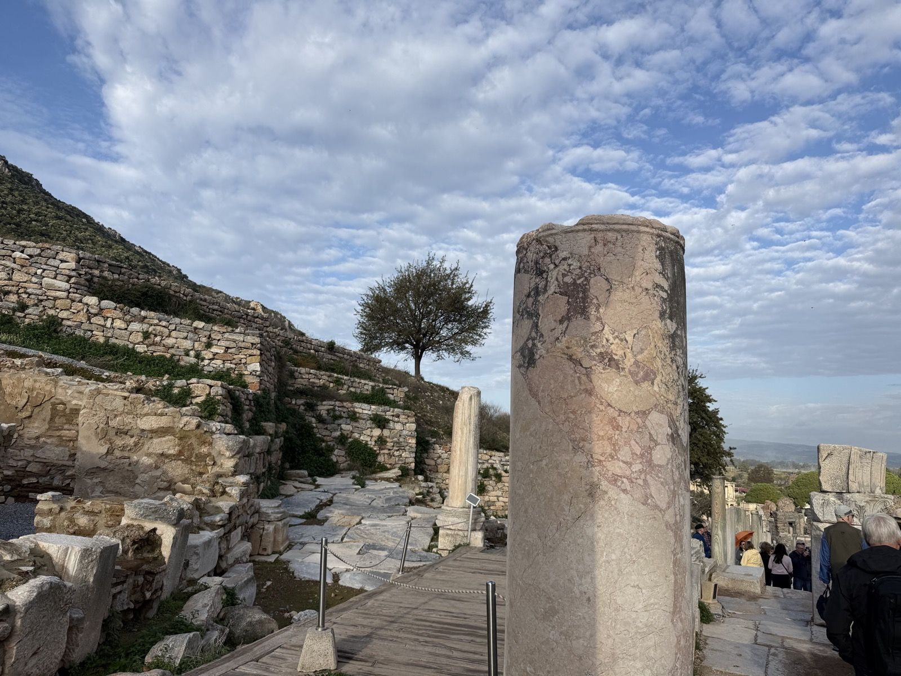
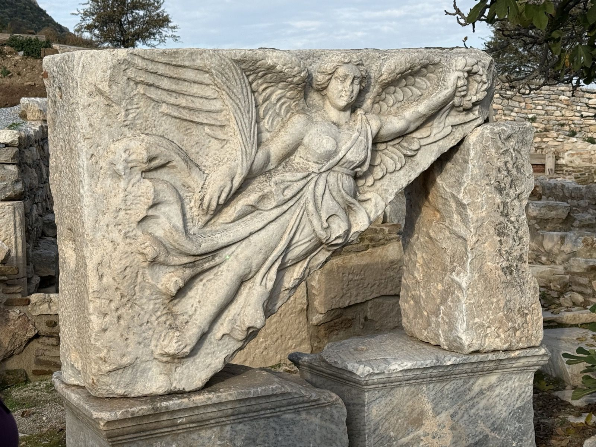
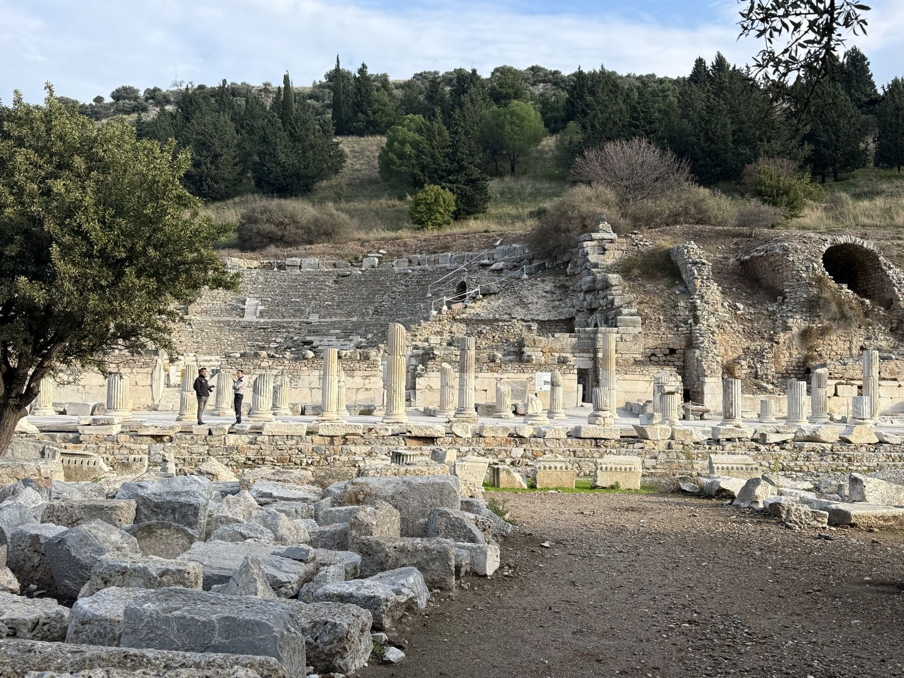

# Paul at Ephesus, Part 1: The Apostle's Life, Letters, and Ephesian Years

## Summary

Read this deep-dive chapter the evening of Day 6, sailing from Çanakkale to Kuşadası. It sets the scene with the Greek philosophers, Alexander, Koine Greek, and the Roman province of Asia, then follows Paul from Tarsus and his Pharisee training through the road to Damascus and his missionary journeys. It explains the Pauline letters, the seven undisputed letters, the disputed ones, and how the Book of Acts tells his story. It ends in Ephesus with the hall of Tyrannus, Priscilla and Aquila, Apollos, and the farewell at Miletus, and with the word euangelion, the origin of 'evangelist.'

## Concepts Covered

This chapter covers the following 44 concepts from the learning graph:

| Concept | Concept Impact Score |
|---------|-----------------------|
| Athens | 234 |
| Greek Philosophy | 132 |
| Socrates | 114 |
| Socratic Method | 6 |
| Plato | 101 |
| Plato's Academy | 96 |
| Aristotle | 95 |
| Alexander the Great | 88 |
| Hellenistic Kingdoms | 82 |
| Koine Greek | 80 |
| Roman Province of Asia | 56 |
| Roman Citizenship | 152 |
| Roman Roads | 113 |
| Ephesus | 55 |
| Jesus of Nazareth | 156 |
| Early Jesus Movement | 155 |
| Tarsus | 152 |
| Pharisees | 152 |
| Jewish Law | 11 |
| Gentiles | 8 |
| Paul of Tarsus | 151 |
| Paul as Persecutor | 116 |
| Road to Damascus | 115 |
| Paul's Missionary Journeys | 112 |
| Book of Acts | 1 |
| Pauline Letters | 69 |
| New Testament | 1 |
| Seven Undisputed Letters | 39 |
| Disputed Pauline Letters | 11 |
| Letter to the Ephesians | 1 |
| First Corinthians | 12 |
| Letter to the Galatians | 10 |
| Letter to the Romans | 7 |
| Paul in Ephesus | 22 |
| Hall of Tyrannus | 3 |
| Priscilla and Aquila | 4 |
| Apollos | 1 |
| Timothy and Titus | 4 |
| Phoebe | 3 |
| Farewell at Miletus | 7 |
| Paul's Death in Rome | 1 |
| Euangelion | 7 |
| Evangelist | 6 |
| Shared Language Spreads Ideas | 3 |

## Prerequisites

This chapter builds on concepts from:

- [Chapter 1: Before We Go, Part 1: The Long Timeline of the Eastern Mediterranean](../01-long-timeline/index.md)
- [Chapter 2: Before We Go, Part 2: Traveling Well and the Learning for All Thread](../02-traveling-well/index.md)
- [Chapter 4: Day 2: Byzantine Constantinople and Hagia Sophia](../04-byzantine-constantinople/index.md)
- [Chapter 6: Day 4: Bazaars, Scripts, and Presses](../06-bazaars-scripts-presses/index.md)

---

## Sailing South Along Paul's Coast

Day 6, Monday, November 16, ends at sea. The Viking Star leaves Çanakkale at 4:00 PM, runs down the Dardanelles past the Gallipoli memorials, and turns south into the Aegean as the sun sets at about 6:00 PM. Overnight the ship follows the coast of Anatolia, with Lesbos and Chios somewhere off to the west, and at 7:00 AM it docks at Kuşadası, the port for Ephesus. In the dark we pass the old coast of Ionia, where Greek philosophy began. We also sail, almost mile for mile, a voyage told in the Book of Acts. In the spring of about 57 CE, Paul's ship left Troas, near the mouth of the strait, and worked south along this shore: to Assos, where he joined it after walking overland, then to Mitylene on Lesbos, to a point opposite Chios, to Samos, and on the fourth day to Miletus, less than 40 km south of where we will dock. We will cover in one night what took his ship four days.

We would not have been sailing at all in Paul's day. The Roman writer Vegetius, around 400 CE, recorded the old seafaring rule: the sea was "closed" from November 11 to March 10, and only the months from late May to mid-September were truly safe. We sail five days after the closing date. Paul knew the danger well. In one letter he lists three shipwrecks, and a night and a day adrift on the open sea, before the famous wreck on Malta that Acts describes.

Tomorrow we walk through Ephesus, where Paul lived for two or three years, and Chapter 10 is our guide to the city itself. Tomorrow night, Chapter 11 takes up his ideas and what a modern leader can learn from him. Tonight is for the man: the world that made him, the life he lived, the letters he wrote, and his years in Ephesus. For more than two billion Christians, Paul's letters are scripture. For historians, they are also the earliest Christian writings that survive. This chapter tries to serve both kinds of reader by labeling what kind of statement each one is: what Paul's own letters say, what the Book of Acts says, what scholars infer, and what later tradition tells.

!!! mascot-welcome "A Night Voyage on an Apostle's Route"
    { class="mascot-admonition-img" }
    Tonight we sail the same coast an apostle sailed nineteen centuries ago, and by breakfast Ephesus will have people in it: a tentmaking couple, a borrowed lecture hall, a crowd of friends weeping on a beach. We will also learn to tell a man's own words from what others later said about him, the most useful skill a traveler can bring to an ancient site. Look closer.

The chapter has eight parts. Part One meets the philosophers whose city, Athens, still set the intellectual tone of Paul's world. Part Two follows Alexander and the common Greek language his conquests spread. Part Three looks at the Roman province of Asia, its capital Ephesus, and the roads and citizenship that held the empire together. Part Four describes the Jewish world and the new movement around Jesus. Part Five follows Paul's life, from Tarsus to the road to Damascus and the journeys, and asks how we know it. Part Six reads the letters, Part Seven the Ephesian years, and Part Eight ends with a single Greek word, *euangelion*, "good news," and what it means to be an evangelist, then and now.

## Part One: The Philosophers' City

### Athens

**Athens** is the city on the plain of Attica, on the Greek mainland, that led the Greek world in the Classical period and gave it democracy, tragedy, and philosophy. Chapter 1 met it at its height, when the Delian League's money paid for the Parthenon, and Chapters 15, 16, and 20 walk its streets on Days 10, 11, and 13. Tonight we need Athens for a narrower reason. By the time Paul was born, Athens had lost its power but kept its prestige, and the prestige rested on philosophy.

The fall from power was gradual. Philip II of Macedon defeated Athens in 338 BCE, Alexander's successors garrisoned it, and in 86 BCE the Roman general Sulla sacked it for siding with Rome's enemy, King Mithridates. Under Augustus it became part of the Roman province of Achaia, whose governor sat not in Athens but in Corinth. Rome still treated Athens as a free city and honored it as the school of the Mediterranean. Young Romans of good family came to study there, among them Cicero in 79 BCE and the poet Horace a generation later, and Roman patrons paid for new buildings, including a second marketplace, the Roman Agora, begun with money from Julius Caesar and Augustus.

**Worked example: Athens at two dates.** Let's compare the city at the height of its power, in 430 BCE, with the city Paul passed through around 50 CE.

| | Athens in 430 BCE | Athens in about 50 CE |
|---|---|---|
| Political status | Independent city-state at the head of a naval empire | A free city inside the Roman province of Achaia, governed from Corinth |
| Source of wealth | Tribute from allies, silver mines, trade through Piraeus | Roman patrons, students, visitors, olive oil |
| Famous for | Its navy, its democracy, the new Parthenon | Its philosophical schools, its monuments, its past |
| Who came | Allied envoys bringing tribute | Students, scholars, and sightseers |
| What Paul's letters say about it | Nothing; it is five centuries before him | One line: he stayed behind in Athens alone and sent Timothy north (1 Thessalonians 3:1–2) |

Read across the rows, and Athens in Paul's day looks like a university town with a glorious past: still the place to argue about ideas, no longer the place where decisions were made. That is why Acts sets one of Paul's most famous speeches there, among philosophers on the Areopagus <audio id="audio-areopagus" src="../../audio/areopagus.mp3" preload="none"></audio><button onclick="document.getElementById('audio-areopagus').play()" class="pronounce-btn">🔊 Pronounce</button> *air-ee-OP-uh-gus*, a scene Chapter 16 reads on the spot. It is also why Paul's real base in Greece became Corinth, the busy Roman capital about 75 km to the west.

### Greek Philosophy

**Greek philosophy** (from *philosophia*, "love of wisdom") is the tradition of trying to explain the world, and how to live in it, by reason and argument rather than by myth or authority alone. It did not begin in Athens. It began around 600 BCE on the coast we are passing tonight, in the Greek trading cities of Ionia, where merchants met Lydians, Persians, Phoenicians, and Egyptians and could compare their stories about the world. The first name in the traditional list is Thales of Miletus, who is said to have predicted a solar eclipse that fell in 585 BCE and who proposed that everything comes from water. The answer was wrong. The question, "what is everything made of?", asked without calling on the gods, was new.

**Worked example: philosophers along tonight's coast.** Let's list the early thinkers who were born or taught within a day's sail of our route, and see where Greek philosophy really started.

| Thinker | Where | When | Remembered for |
|---|---|---|---|
| Thales | Miletus | c. 585 BCE | Everything comes from water |
| Anaximander | Miletus | c. 610–546 BCE | Everything comes from "the boundless"; said to have drawn the first Greek map of the world |
| Pythagoras | Born on Samos, later taught in southern Italy | c. 570–490 BCE | Number underlies the order of the world |
| Heraclitus | Ephesus | c. 500 BCE | Everything flows; no one steps into the same river twice |
| Anaxagoras | Clazomenae, near İzmir, then Athens | c. 500–428 BCE | Mind set the world in order |
| Epicurus | Born on Samos; taught at Mytilene and Lampsacus before founding his school in Athens | 341–270 BCE | The good life is freedom from pain and fear |

Every name on the list belongs to the eastern side of the Aegean. Philosophy moved to Athens in the 5th century BCE, when Anaxagoras taught there and Socrates turned it from questions about nature to questions about how a person should live. By Paul's time four great schools taught in Athens: Plato's Academy, Aristotle's Lyceum, the Stoics, who met in the Painted Stoa in the Agora, and the Epicureans, who met in their founder's Garden. Acts says Paul argued with Stoics and Epicureans in Athens, and Chapter 16 takes up that debate.

A philosophical school was more than a set of ideas. It had a founder, a community of students who often lived by its rules, and texts the members studied and memorized. Epicurus kept in touch with his friends in Lampsacus, on the Asian shore of the Dardanelles we sailed this afternoon, by writing them letters, and his followers kept those letters for centuries.

!!! mascot-thinking "A School Was a Way of Life"
    { class="mascot-admonition-img" }
    Think of an ancient philosophical school less as a university department and more as a community with a founder, a way of life, and a mailbag of letters. When people in Ephesus or Corinth first saw Paul's small groups meeting in houses, studying texts, and receiving letters from an absent teacher, a philosophical school was one of the nearest things they had seen. Chapter 11 asks what Paul did with that model.

### Socrates

**Socrates** (469–399 BCE) was the Athenian who turned philosophy toward the question of how to live, and who is remembered for questioning his fellow citizens in the marketplace. Tradition makes him the son of a stonemason and a midwife. He served as a foot soldier in Athens' wars, went barefoot, owned little, and charged no fees. He also wrote nothing. Everything we know about him comes from other people, which makes him a perfect first case for tonight's method: how do we know a teacher who left no writings of his own? In 399 BCE Athens tried him for impiety and for corrupting the young and sentenced him to death by poison; Chapter 16 tells the trial in the Agora where it happened, and Chapter 17 tells how the oracle at Delphi declared that no one was wiser.

**Worked example: three portraits of one man.** Let's apply Chapter 4's first question about any primary source, "who wrote this, for whom, and why?", to the three earliest writers on Socrates.

| Source | Author and date | Written for | The Socrates it shows |
|---|---|---|---|
| *The Clouds* | Aristophanes, a comic playwright, 423 BCE, while Socrates was alive | A festival audience that wanted to laugh | A crank who hangs in a basket to study the sky and teaches young men to win arguments dishonestly |
| *Memorabilia* ("Memoirs") | Xenophon, a former follower and a soldier, after 399 BCE | Readers who half believed the charges | A practical, pious adviser who gave sensible counsel on friendship and duty |
| The dialogues | Plato, a devoted student, from after 399 to about 348 BCE | Students of philosophy | A brilliant questioner who, in the later dialogues, speaks Plato's own ideas |

One man, three portraits, and none of them neutral. Historians call the difficulty of recovering the real Socrates "the Socratic problem." Paul's case is easier. We have his own letters, in his own voice, and a later account by an admirer, the Book of Acts. Paul is far easier to know than Socrates, as long as we keep those two kinds of source apart.

### The Socratic Method

The **Socratic method** is teaching by questions: instead of telling a learner the answer, the teacher asks a series of questions that lead the learner to test, and often to give up, what they thought they knew. In Plato's dialogues it usually runs in four steps.

1. Socrates asks for a definition: "What is courage?"
2. He tests the answer against a case it does not fit.
3. The learner revises the definition, and the new one is tested in turn.
4. The conversation ends in honest puzzlement, which Socrates treats as the beginning of wisdom rather than a failure.

**Worked example: what is courage?** Let's follow the pattern in Plato's dialogue *Laches*, paraphrased. The general Laches answers that courage is standing firm in the battle line. Socrates asks about soldiers who fight bravely while retreating, as the Scythian horsemen did, and Laches admits his definition is too narrow. He tries again: courage is endurance of the soul. Socrates asks whether a foolish, stubborn endurance is courage too, and Laches has to say no, so courage must be *wise* endurance. Then Socrates asks whether the man who endures in battle because he knows reinforcements are coming is braver than the one who endures without knowing it. The conversation ends with no definition at all, but with two generals who now know they did not understand a virtue they had practiced all their lives.

The method outlived Athens. Popular teachers in the Roman world used a related style, called **diatribe**, in which the speaker raises an imagined objection and answers it. Paul uses it often. In his letter to the Romans he asks, in effect, "What shall we say, then? Should we go on doing wrong so that grace may increase?" and answers his own question with "By no means!" His first readers would have heard the voice of a teacher of philosophy. Today the same instinct shapes good tutoring, including AI tutors designed to ask a student the next question rather than hand over the answer.

### Plato

**Plato** (about 428–348 BCE) was Socrates' student and the author of the dialogues that made Socrates famous. He came from an aristocratic Athenian family, watched his teacher's execution in 399 BCE, traveled, and returned to found a school. Unusually for an ancient author, all his known works survive: about thirty-five dialogues and a set of letters. His most famous idea is that the things we see are imperfect copies of eternal, unchanging **Forms**, such as Justice, Beauty, or the Good, which only the mind can grasp. In the *Republic* he illustrates it with prisoners chained in a cave who mistake shadows on the wall for reality, until one is freed and sees the sun. The table lists the dialogues this book returns to.

| Dialogue | What happens in it | Where this book uses it |
|---|---|---|
| *Laches* | Two generals try to define courage | The Socratic method, above |
| *Apology* | Socrates' defense speech at his trial | Chapter 16, in the Agora |
| *Republic* | A long search for justice, with the allegory of the cave | Here, on the Forms |
| *Phaedrus* | A conversation outside the walls about love, speech, and writing | Chapter 20, on whether writing weakens memory |

Plato mattered in Paul's world because his ideas were in the air that educated people breathed. In Paul's lifetime, the Jewish philosopher Philo of Alexandria (about 20 BCE to 50 CE) wrote in Greek to show that the Torah and Plato pointed to the same truths. Later Christian thinkers, above all Augustine, whom Chapter 11 meets, built on Plato in the same way.

**Worked example: which works are really Plato's?** Let's look at a question that will come back, almost word for word, when we reach Paul's letters. In the 1st century CE, the scholar Thrasyllus arranged the works that circulated under Plato's name into nine groups of four. Modern scholars accept most of them but doubt several, along with most of the letters, because their style, vocabulary, or ideas do not match the dialogues everyone agrees are Plato's. Ancient schools often produced works in their founder's name, as a way of carrying on his teaching rather than as a fraud. So by Paul's day, readers already knew that a text bearing a famous teacher's name might have been written by a student. The same tools, style, vocabulary, and ideas, are what scholars use on the letters that bear Paul's name, in Part Six.

### Plato's Academy

**Plato's Academy** was the school Plato founded around 387 BCE in a sacred grove of olive trees named after the hero Akademos, about 1.5 km outside the walls of Athens. It was not a university with buildings and degrees. Students and older philosophers gathered at the grove's gymnasium and at Plato's nearby house to talk, study mathematics and astronomy, and argue. Aristotle studied there for twenty years. The Academy outlived Plato by centuries, and our words *academy* and *academic* come from it. Its long life ended in stages: Sulla's soldiers cut down the grove's trees for siege engines in 86 BCE, the school's last head had already fled to Rome, and a later revival of Platonist teaching in Athens closed in the 6th century CE, traditionally dated to an order of Justinian in 529. The site is now a public park in an ordinary Athens neighborhood, Akadimia Platonos.

The table below sets the Academy beside the other three schools that Paul's educated contemporaries would have known.

| School | Founder | Founded | Met at |
|---|---|---|---|
| The Academy | Plato | c. 387 BCE | The grove of Akademos, outside the city walls |
| The Lyceum | Aristotle | 335 BCE | A gymnasium sacred to Apollo Lykeios, east of the city |
| The Stoa | Zeno of Citium | c. 300 BCE | The Painted Stoa, on the north side of the Agora |
| The Garden | Epicurus | 306 BCE | Epicurus' own house and garden in Athens |

**Worked example: "Let no one ignorant of geometry enter."** Guides in Athens often say these words were carved over the Academy's door. Let's run the myth-versus-history test from Chapter 4: find the earliest source and measure the gap. Plato never mentions such an inscription, and neither does Aristotle, nor any writer of the next several centuries. The earliest sources are commentators on Aristotle writing in the 6th century CE, more than 900 years after the Academy opened. By the book's test, the inscription belongs to the myth of the Academy, not its history. What the myth tells us is real enough: later Platonists saw mathematics as the gateway to philosophy, and they imagined their founder saying so in stone.

### Aristotle

**Aristotle** (384–322 BCE) was Plato's most famous student and the most wide-ranging thinker of the ancient world. Born in Stagira in northern Greece, the son of a physician to the Macedonian king, he came to the Academy at 17 and stayed twenty years. He then wrote, or lectured, on almost everything: logic, physics, biology, astronomy, ethics, politics, poetry, and **rhetoric**, the art of persuasion. Our words *ethics*, *politics*, *physics*, and *logic* reach us through his works. In 343 BCE Philip II of Macedon hired him to tutor his son Alexander, a story Chapter 20 tells, and in 335 BCE he opened his own school, the Lyceum, in Athens.

Aristotle's *Rhetoric* names three ways a speaker persuades: by the speaker's character (*ethos*), by the hearers' emotions (*pathos*), and by argument (*logos*). Every educated person in the Roman East learned some version of this, and modern scholars read Paul's letters with the same categories. His short letter to Philemon, under 350 Greek words, uses all three to ask Philemon to welcome back Onesimus, a man of his household who has been with Paul:

- *Ethos*, character: Paul writes as "an old man, and now also a prisoner," a request that is hard to refuse.
- *Pathos*, emotion: he calls Onesimus "my own heart" and asks Philemon to refresh Paul's heart.
- *Logos*, argument: perhaps Onesimus was parted from Philemon for a while so that he could have him back for good, no longer as a slave but as a beloved brother.

**Worked example: two visitors to Assos.** Let's put two men on the same stretch of tonight's coast, four centuries apart. After Plato died in 347 BCE, Aristotle left Athens and spent about two years at Assos, a hilltop town in the Troad facing Lesbos, as the guest of its ruler, Hermias. He married Hermias' niece, Pythias, then crossed to Lesbos, where he studied the sea creatures of its great lagoon, work that makes him the first great field biologist. In about 57 CE, according to Acts, Paul's companions sailed from Troas around the cape to Assos while Paul went on foot, about 30 km in a straight line, and joined the ship there. Neither man left a word about the view. But the town that sheltered the greatest Greek philosopher after his teacher's death was the town where Paul set out on the voyage we are repeating tonight.

## Part Two: Alexander and the Common Tongue

### Alexander the Great

**Alexander the Great** (356–323 BCE) was the king of Macedon who, between 334 and 323 BCE, conquered the Persian Empire and carried Greek rule from Egypt to the edge of India. He was born at Pella, became king at 20 after his father, Philip II, was murdered, and in the spring of 334 BCE crossed the Dardanelles into Anatolia, close to where we were this morning. He visited Troy and honored the tomb of Achilles, his hero from the *Iliad*, then defeated a Persian army at the Granicus River, east of Çanakkale. In the months that followed he took the Greek cities of this coast from Persia one after another.

**Worked example: Alexander's offer at Ephesus.** Let's look at what happened when Alexander reached Ephesus, using the earliest source we have. In 356 BCE the great Temple of Artemis had burned down, set on fire by a man who wanted to be famous. The Ephesians were rebuilding it when Alexander arrived in 334 BCE, and he offered to pay all the costs, past and future, if his name were inscribed on the temple. The geographer Strabo, writing while Paul was a boy and drawing on an earlier local writer, reports the Ephesians' polite refusal: it was not fitting, they said, for one god to dedicate offerings to other gods. The flattery let them keep their temple their own. A second story, that the temple burned on the very night Alexander was born because Artemis was busy attending his birth, comes from the biographer Plutarch, writing about 450 years later; by Chapter 4's test it is a myth, a witty one. Chapter 10 tells the temple's story on the site.

The table follows Alexander along the part of his route we share.

| Date | Place | What happened | Chapter |
|---|---|---|---|
| Spring 334 BCE | The Dardanelles and Troy | Crosses into Asia; honors Achilles at Troy | 8 |
| May 334 BCE | Granicus River, east of Çanakkale | First victory over a Persian army | 9 |
| Summer 334 BCE | Ephesus | Restores democracy; offers to rebuild the Temple of Artemis | 9, 10 |
| Summer 334 BCE | Miletus | Takes the city after a siege | 9 |
| Autumn 334 BCE | Halicarnassus (Bodrum) | Takes the city after a long siege | — |
| 331 BCE | Egypt | Founds Alexandria | 1 |
| June 323 BCE | Babylon | Dies at 32 | 1 |

### The Hellenistic Kingdoms

The **Hellenistic kingdoms** were the Greek-ruled states that Alexander's generals carved out of his empire after his death. Chapter 1 listed them: the Ptolemies in Egypt, the Seleucids in Syria and Mesopotamia, the Antigonids in Macedon, the Attalids at Pergamon. Two of them shaped the world Paul grew up in. The Ptolemies made Alexandria the greatest Greek city of the age, and there, in the 3rd century BCE, Jewish scholars translated the Torah into Greek, the translation called the **Septuagint**. The Seleucids founded Antioch, on the Orontes River, which became the base from which Paul set out on his journeys.

| Kingdom | Capital | What it gave Paul's world |
|---|---|---|
| Ptolemaic Egypt | Alexandria | The Septuagint, the Greek Bible Paul quoted; a great Jewish community, home of the philosopher Philo |
| Seleucid Empire | Antioch, in Syria | The city that became Paul's base; and King Antiochus IV, whose persecution provoked the Maccabean revolt |

Each kingdom spread the same pattern of city life: a council and an assembly, a theater, a gymnasium where young men exercised and studied, and Greek as the language of government and education. Every city on our route in Anatolia was organized this way, and Rome kept the pattern when it took over.

**Worked example: Hanukkah, a Hellenistic story.** Let's see what "Hellenistic" meant for the Jewish people, because it explains the Jewish world Paul was born into. In the 170s BCE, Judea was ruled by the Seleucid kings. Some Jerusalem priests welcomed Greek ways, and a gymnasium was built in the city. Then, in 167 BCE, the Seleucid king Antiochus IV banned circumcision and the Sabbath and set up an altar to Zeus in the Temple. A priestly family, the Maccabees, led a revolt, and in 164 BCE they retook the Temple and rededicated it, an event Jews remember every winter at **Hanukkah**, the Festival of Lights. The question the revolt raised, how much of Greek culture a faithful Jew could accept, did not go away. It divided Jews into parties for the next two centuries, and those parties, including Paul's own, the Pharisees, are the subject of Part Four.

### Koine Greek

**Koine Greek** (*koinē*, "common") is the shared form of Greek spoken across the Hellenistic and Roman East, from about 300 BCE to about 300 CE, the language in which Paul wrote all his letters. Chapter 1 explained why it spread, and Chapter 2 placed it among the stages of the Greek language. It was the language of the market, the law court, and the letter home, and it differed from the Greek of Plato in a few clear ways:

- **One standard.** It grew mainly from the Athenian dialect and smoothed out the differences between local dialects.
- **Simpler grammar.** Some old forms dropped out, and word order loosened.
- **New sounds.** Pronunciation drifted toward the Greek spoken today.
- **New words.** It borrowed freely, including Latin words for Roman things.

For a long time scholars thought the Greek of the New Testament was a special religious dialect, because it looked so different from Plato's. Then, around 1900, thousands of everyday papyrus documents were dug out of rubbish heaps in Egypt: contracts, receipts, school exercises, and private letters. The German scholar Adolf Deissmann showed in 1908 that their Greek matched the New Testament's. Paul wrote not in a holy dialect but in the ordinary written Greek of his day, the way a good letter writer writes now.

**Worked example: Koine in our own vocabulary.** Let's trace some Koine words that the early Christians gave a new meaning and that English still uses.

| Koine word | Everyday meaning | Christian meaning | English today |
|---|---|---|---|
| *ekklēsia* | The assembly of a city's citizens | A gathering of believers; a church | ecclesiastical |
| *apostolos* | Someone sent with a message | An apostle | apostle |
| *christos* | Anointed (rubbed with oil) | The Messiah, translating the Hebrew *mashiach* | Christ |
| *baptizō* | To dip or plunge | To baptize | baptize |
| *episkopos* | An overseer or inspector | A church overseer | bishop, episcopal |
| *diakonos* | A servant or attendant | A church minister or helper | deacon |
| *angelos* | A messenger | An angel | angel |

The first word holds a small surprise for tomorrow. When Acts describes the crowd that filled the theater of Ephesus to shout against Paul, it calls that crowd an *ekklēsia*, and the town clerk tells it to take its complaint to the lawful *ekklēsia*, the city's assembly. The same word that meant "church" to Paul's followers still meant "town meeting" to everyone else.

## Part Three: Rome's Province of Asia

### The Roman Province of Asia

The **Roman province of Asia** was the Roman administrative region that covered the western end of Anatolia, from the Dardanelles south past Ephesus, with its seat at Ephesus. Chapter 1 told how it began, when the last king of Pergamon left his kingdom to Rome in 133 BCE. By Paul's day it was one of the richest provinces in the empire, a land of several hundred self-governing Greek cities. From 27 BCE it was governed by a **proconsul**, a senior senator chosen by lot for a one-year term, who by law had to make his first landing in the province at Ephesus. The cities ran their own affairs through councils, assemblies, and magistrates, as they had under the Hellenistic kings, while Rome collected taxes, judged serious cases, and kept order.

Roman rule here had a hard beginning. In 88 BCE King Mithridates of Pontus, at war with Rome, persuaded the cities of Asia to kill the Romans and Italians living among them, and tens of thousands died in a single coordinated massacre. Rome's revenge was heavy taxation. Under Augustus, though, the province settled into the long Pax Romana, and its cities competed to honor the emperor. In 29 BCE Pergamon was allowed to build a temple to Rome and Augustus, and a provincial council of leading citizens organized festivals for the emperor across the province.

**Worked example: which Asia?** When the New Testament says "Asia," it never means the continent. Let's test that on four passages. Acts says Paul was at first prevented from preaching "in Asia" and crossed instead to Macedonia (Acts 16:6). Later, after his two years in Ephesus, Acts says that "all the residents of Asia" heard the message (Acts 19:10). Paul, writing from Ephesus, sends greetings from "the churches of Asia" (1 Corinthians 16:19). And the Book of Revelation is addressed to seven churches "in Asia." Every one of these means the Roman province, roughly the size of a modern American state, and the seven churches of Revelation show its extent.

| Church in Revelation | Turkish town today | Roughly how far from Ephesus |
|---|---|---|
| Ephesus | Selçuk | — |
| Smyrna | İzmir | 55 km north |
| Pergamon | Bergama | 165 km north |
| Thyatira | Akhisar | 135 km northeast |
| Sardis | Sart, near Salihli | 95 km northeast |
| Philadelphia | Alaşehir | 130 km east-northeast |
| Laodicea | near Denizli | 160 km east |

The distances are straight-line approximations; every one of these cities lay on a road that led to Ephesus.

### Ephesus

**Ephesus** was, in Paul's day, the capital of the province of Asia and one of the largest cities in the Roman Empire, a Greek port near the mouth of the Cayster River, about 20 km from where our ship docks. Chapter 1 described it as a Roman capital, and Chapter 10 will walk its streets in visiting order, so here we look only at the city Paul chose. It was old: Greeks had lived here since about the 10th century BCE, and the Temple of Artemis made it a pilgrimage center for the whole Greek world. Around 290 BCE, one of Alexander's successors, Lysimachus, rebuilt the city on its present site between two hills. Estimates of its population under the early emperors range widely, from about 30,000 to more than 200,000. It had a large Jewish community, whose rights to keep the Sabbath and send money to the Temple in Jerusalem Roman officials confirmed more than once, according to decrees the Jewish historian Josephus copied into his history.

<figure markdown="span" class="trip-photo">
  { loading=lazy }
  <figcaption>A lone column beside a paved street, Ephesus. Photo by Dan McCreary</figcaption>
</figure>

**Worked example: why Ephesus?** Let's ask the question a planner would ask: if you wanted a message to reach a whole province, where would you base yourself? Ephesus was the province's capital, where the governor held court and people came on legal business. It was its biggest port, with ships to Corinth, Alexandria, and Rome. Roads ran from it north to Smyrna and Pergamon, east up the valley of the Maeander River to the inland cities, and south to Miletus. And the Temple of Artemis drew pilgrims from far beyond the province. The table puts rough numbers on that reach.

| From Ephesus to | Straight-line distance | How people traveled |
|---|---|---|
| Miletus | about 45 km south | Road, or a short sail |
| Smyrna (İzmir) | about 55 km north | Road |
| Colossae, inland | about 170 km east | Road up the Maeander and Lycus valleys |
| Troas | about 225 km north | Ship along the coast, or road |
| Corinth | about 380 km west | Ship across the Aegean |

A person who lived in Colossae, a week's walk inland, would come to Ephesus on business sooner or later. Paul's letter to Philemon, a householder of Colossae, suggests that this is just what happened: Paul seems never to have visited the town, yet he knew its church through people who had met him.

### Roman Roads

**Roman roads** were the network of engineered highways the Romans built across their empire, more than 80,000 km of main roads at its height, laid for armies and officials but used by everyone. A major road was built up in layers of stone, gravel, and packed earth, usually cambered so that rain ran off, and paved with fitted stone blocks near towns; out in the country many roads were simply graveled. Milestones stood every Roman mile, 1,000 paces or about 1.48 km, giving the distance to the next city and the name of the emperor who had built or repaired the road. Chapter 1 showed how roads and pirate-free seas, the gifts of the Pax Romana, made Paul's travels possible. Here we look at the roads he actually walked.

Two of them stand out in Acts. In southern Anatolia, Augustus had built the **Via Sebaste** in 6 BCE to link the Roman colonies he had planted in the mountains, among them Pisidian Antioch and Lystra; on his first journey Paul visited both, and he very likely walked parts of it. In northern Greece, the **Via Egnatia**, built around 146–120 BCE, ran east from the Adriatic coast through Thessalonica and eventually to Byzantium. Acts traces Paul along it from Philippi through the towns of Amphipolis and Apollonia to Thessalonica.

**Worked example: Philippi to Thessalonica on foot.** Let's estimate that walk. The Via Egnatia covers it in about 100 Roman miles, roughly 150 km. A traveler on foot covered 25 to 30 km a day on good roads, so the trip took five or six days. The two towns Acts names, Amphipolis and Apollonia, sit roughly a third and two-thirds of the way along, natural places to stop. Now compare the sea. A merchant ship with a fair wind made perhaps 4 to 5 knots, sailing day and night, so it could cover in a day or two what a walker covered in a week, but only in the sailing season, and only when the wind blew the right way.

| Way of traveling | Rough distance per day | When it worked |
|---|---|---|
| On foot, Paul's usual way | 25–30 km | All year, but mountain passes closed in winter |
| Imperial courier, changing horses | 70 km or more | All year; for official business only |
| Merchant ship with a fair wind | 150 km or more | Late May to mid-September safely; never from November 11 to March 10 |

These figures are rough averages from modern studies of Roman travel, not measurements of any particular trip.

### Roman Citizenship

**Roman citizenship** was the legal status of a member of the Roman state, which brought rights that most of the empire's people did not have. A citizen could not be flogged or crucified without trial, could appeal a capital case to the emperor, could make contracts and marriages that Roman law recognized, and carried a three-part Roman name. Citizenship came by birth to a citizen father, by a grant for service, such as an auxiliary soldier's discharge after twenty-five years, by being freed by a citizen owner, and, in some reigns, by payment. It was a privilege of a minority: Augustus' census of 14 CE counted 4,937,000 citizens in an empire of perhaps 50 to 60 million people. Only in 212 CE did the emperor Caracalla extend citizenship to almost every free inhabitant of the empire.

Paul's citizenship is a test case for how we read our sources. Acts says three times that Paul was a Roman citizen. His own letters never say so, and in one passage he lists among his sufferings that he was "beaten with rods" three times, a Roman punishment a citizen was supposed to be spared. Some historians therefore doubt the citizenship. Others answer that officials in the provinces did not always respect the law, or that Paul chose not to claim his rights. The question cannot be settled from the evidence we have, so this guide says "Acts says Paul was a citizen."

**Worked example: the scene in the Jerusalem barracks.** Let's watch citizenship work in the scene Acts tells most vividly. Paul has been arrested after a riot in the Temple courts, and the Roman tribune orders him examined under the lash. As the soldiers tie him up, Paul asks the centurion whether it is legal to flog a Roman citizen who has not been condemned. The centurion runs to the tribune, who comes and asks Paul directly. The tribune says he bought his own citizenship for a large sum; Paul replies that he was born a citizen. The interrogation stops at once, and the tribune is alarmed at having bound him. The scene fits what we know from Roman sources: under the emperor Claudius, the Roman historian Cassius Dio says, citizenship was openly sold, and the tribune's name in Acts, Claudius Lysias, is the kind of name a man who gained citizenship in that reign would take, since new citizens often adopted the emperor's family name. The table lists the rights the scenes in Acts turn on.

| Right of a citizen | Where Acts shows Paul using it |
|---|---|
| Not to be beaten or jailed without trial | At Philippi, where magistrates who had beaten and jailed him come to apologize (Acts 16:37–39) |
| Not to be examined under the lash | In the barracks in Jerusalem (Acts 22:25–29) |
| To appeal to the emperor | Before the governor Festus at Caesarea: "I appeal to Caesar" (Acts 25:11) |
| To be tried in Rome | The voyage to Rome under military escort (Acts 27–28) |

## Part Four: A Jewish World and a New Movement

### The Pharisees

The **Pharisees** were a Jewish religious movement of the late Second Temple period, about 150 BCE to 70 CE, devoted to the careful observance of God's law in everyday life, and Paul was one of them. The name probably comes from the Hebrew for "separated ones." The Jewish historian Josephus, who wrote in Greek in the 70s to 90s CE, described the Jews of his time as divided into three schools, which he compared to Greek philosophies:

- **Pharisees**, the most popular, who kept the written law of the Torah together with "the traditions of the fathers," a body of teaching on how to apply it, and who believed in the resurrection of the dead. Josephus gives their number in Herod's time as about 6,000.
- **Sadducees**, mostly from the priestly aristocracy that ran the Temple, who accepted only the written law and rejected belief in resurrection.
- **Essenes**, who lived apart in disciplined communities; most scholars connect them with the community that kept the Dead Sea Scrolls.

The Pharisees were teachers and lay experts rather than priests, and their concern was to bring the holiness of the Temple into the ordinary home: into meals, tithes, the Sabbath, and ritual purity. After the Romans destroyed the Temple in 70 CE, their tradition carried on through the rabbis, whose teaching shaped Judaism as it is practiced today.

**Worked example: Paul describes himself.** Let's read Paul's own summary of his Jewish credentials, from his letter to the Philippians, which he wrote to argue that he had more reason than anyone to boast of them. He says he was circumcised on the eighth day, as the law requires; was of the people of Israel and the tribe of Benjamin; was "a Hebrew born of Hebrews"; was, "as to the law, a Pharisee"; and was blameless in keeping it. In Galatians he adds that he was "advancing in Judaism beyond many among my people of the same age," extremely zealous for the traditions of his ancestors. Those are a Pharisee's values exactly: zeal for the law and for the ancestral traditions. Nothing in Paul's letters suggests that he thought of his Pharisee past as hypocrisy. He thought of it as excellence that he had come to count as less important than something else.

!!! mascot-warning "Pharisee Does Not Mean Hypocrite"
    { class="mascot-admonition-img" }
    A common trap is to hear "Pharisee" the way English uses "pharisaical," as a synonym for a self-righteous hypocrite. That meaning grew from the Gospels' arguments and was later used against Jews for centuries, as Chapter 11 discusses. When you meet the word in this chapter, read it as Paul did: the name of a respected, popular movement of devout Jews, which he was proud to have belonged to.

### Jewish Law

**Jewish law** is the body of commandments that Jews understand God to have given Israel, written in the Torah, the first five books of the Hebrew Bible, and explained by tradition. Its Hebrew name, *halakha*, means "the way of walking." Later rabbis counted 613 commandments in the Torah, covering worship, justice, family life, charity, food, and festivals. For a Jew living as a minority in a Greek city such as Ephesus, three practices marked him or her out from the neighbors:

- **Circumcision** of boys on the eighth day after birth, the sign of the covenant.
- Keeping the **Sabbath**, from Friday sunset to Saturday sunset, as a day of rest.
- The **food laws**, which forbade pork and other foods and governed how meat was prepared.

Those three were also the practices that Greeks and Romans noticed, and sometimes mocked, and they became the issues over which Paul fought his hardest battles. The question was whether a non-Jew who came to believe in Jesus as the Messiah had to take on the whole law, beginning with circumcision.

**Worked example: a shared table in Antioch.** Let's watch the law become a practical problem at dinner, using the scene Paul himself tells in Galatians. In Antioch, Jewish and non-Jewish believers ate together. When Peter visited, he ate with the non-Jews too. Then visitors arrived from James, the leader of the believers in Jerusalem, and Peter stopped eating with non-Jews, and other Jewish believers, even Barnabas, followed him. Paul says he confronted Peter to his face in front of everyone. For Peter, a respected Jew sharing food that might not meet the food laws raised a real question of faithfulness. For Paul, splitting the community's table in two denied that Jews and non-Jews were one people. The quarrel is about food, but underneath it lies the question that Chapter 11 takes up: on what terms do outsiders belong?

### Gentiles

**Gentiles** are people who are not Jewish. The English word comes from the Latin *gentes*, "nations," which translates the Hebrew *goyim* and the Greek *ethnē*, all meaning "the nations," the peoples of the world other than Israel. In a city like Ephesus, Gentiles were the great majority. Many of them worshipped the city's gods, Artemis above all, and also the emperor; some were drawn to Judaism's single God and its moral teaching without becoming Jews.

Those sympathizers had a name. Acts calls them "God-fearers," and two inscriptions near our route show the term was real:

- **Aphrodisias**, inland from Ephesus: a long donor list names Jewish donors and, separately, donors called *theosebeis*, "God-worshippers."
- **Miletus**: an inscription on a block of seats in the theater is usually read as "the place of the Jews, who are also God-fearers," though its exact meaning is debated.

Such Gentiles came to the synagogue, kept some Jewish customs, and gave money, but did not take on circumcision and the whole law.

**Worked example: who heard Paul in a synagogue?** Let's imagine the room in Acts' account of Paul's first weeks in a new city, which nearly always begins at the synagogue. In the room sit three kinds of people:

- **Jews**, born into the covenant.
- **Proselytes**, Gentiles who had converted fully, men by circumcision.
- **God-fearers**, Gentiles who attended without converting.

Paul's message that a Gentile could belong to God's people through faith in Jesus, without circumcision, landed very differently on each group. To many God-fearers it was welcome news. To many Jews it threatened what made Israel Israel. Acts tells the same story in city after city: a hearing in the synagogue, a split, and a new group meeting in a house. Paul called himself the "apostle to the Gentiles," and the God-fearers were often his first converts.

### Jesus of Nazareth

**Jesus of Nazareth** was a Jewish teacher from Galilee, in the north of the land of Israel, whose followers proclaimed him the Messiah, and who is the central figure of Christianity. Historians, whatever their faith or lack of it, agree on a short core of facts. He was born around 4 BCE or a little earlier, grew up in the village of Nazareth, was baptized by the preacher John, gathered disciples, taught in parables about the coming **kingdom of God**, and had a reputation as a healer. Around 30 or 33 CE, during the Passover festival in Jerusalem, he was crucified on the orders of the Roman prefect Pontius Pilate, who governed Judea from 26 to 36 CE. Christians believe that he rose from the dead; historians can say that his followers sincerely proclaimed that he had, very soon after his death, and that the proclamation spread.

Two Roman-era writers outside the movement mention him:

- **Josephus**, in the 90s CE, refers to "James, the brother of Jesus who was called Christ," and has a longer passage about Jesus that later Christian copyists appear to have expanded.
- **Tacitus**, the Roman historian, writing around 116 CE about Nero's persecution of Christians, explains that their name came from Christus, executed by Pilate in the reign of Tiberius.

Paul never met Jesus during his lifetime, as far as his letters tell us, and he says very little about Jesus' life. But his letters are the earliest Christian writings that survive. The first of them was written around 50 CE, about twenty years after the crucifixion and about twenty years before the earliest Gospel, Mark, which most scholars date to around 70 CE. So the few things Paul does say about Jesus are the oldest written evidence we have.

**Worked example: what Paul tells us about Jesus.** Let's gather every fact about Jesus' life that appears in the seven letters scholars agree Paul wrote, and see how much a reader could know from Paul alone.

| What Paul says | Where |
|---|---|
| Jesus was born of a woman, and born a Jew under the law | Galatians 4:4 |
| He was descended from King David | Romans 1:3 |
| He had brothers, one of them James, whom Paul met | Galatians 1:19; 1 Corinthians 9:5 |
| He had twelve close followers, including Cephas (Peter) | 1 Corinthians 15:5 |
| He taught that a wife should not separate from her husband | 1 Corinthians 7:10 |
| On the night he was handed over, he shared bread and a cup with his followers | 1 Corinthians 11:23–25 |
| He was crucified, buried, and, his followers proclaimed, raised on the third day | 1 Corinthians 15:3–4 |
| He then appeared to Cephas, the twelve, more than five hundred at once, James, all the apostles, and last of all to Paul | 1 Corinthians 15:5–8 |

Eight lines. A reader with only Paul would know almost nothing of the parables, the miracles, or Galilee, but would know the last supper, the crucifixion, and the resurrection appearances, which is what Paul calls the message he "received" and "handed on." That gap between what Paul knew and what he chose to write is one reason historians read his letters as letters, written for particular problems, and not as a biography.

### The Early Jesus Movement

The **early Jesus movement** is the name historians give to the followers of Jesus in the first decades after his death, before "Christianity" was a separate religion. At first it was a movement within Judaism. Its first members were Jews in Jerusalem who believed Jesus was the Messiah and had been raised. They worshipped at the Temple, kept the law, and were led, Paul tells us, by three "pillars": James the brother of Jesus, Cephas (Peter), and John. Within a few years the message had spread to Greek-speaking Jews, to Samaria, to Damascus, and to Antioch, where, Acts says, non-Jews joined in numbers and outsiders first called the believers *Christianoi*, "Christians." Paul never uses that word in his letters. He calls the groups *ekklēsiai*, assemblies, and their members "the holy ones," "brothers and sisters," or those "in Christ."

**Worked example: how big was the movement in Paul's day?** Let's use a model, because no one counted. The sociologist Rodney Stark estimated that if the movement began with about 1,000 people in 40 CE and grew by 40 percent every ten years, a rate he compared with modern religious movements, it would have had about 1,400 members in 50 CE and about 7,500 in 100 CE: 1,000 × 1.4 × 1.4 × 1.4 × 1.4 × 1.4 × 1.4 ≈ 7,530. The same steady rate would reach about 6 million by 300 CE, roughly a tenth of the empire, which fits what other evidence suggests for that date. Stark's numbers are an estimate built on a single assumed rate, not a census, but they give a useful sense of scale. When Paul wrote to Corinth or Rome, he was writing to groups of perhaps a few dozen people each, meeting in houses, in a movement of a few thousand spread across the eastern Mediterranean.

| Year (CE) | Modeled members at 40 percent growth per decade | What was happening |
|---|---|---|
| 40 | about 1,000 | Paul's early years after his call |
| 50 | about 1,400 | Paul in Corinth; 1 Thessalonians written |
| 60 | about 2,000 | Paul in prison in Caesarea or on the way to Rome |
| 100 | about 7,500 | All the New Testament writings probably complete |
| 300 | about 6 million | On the eve of Constantine |

The table's numbers are modeled, not counted, and are rounded from Stark's estimates. They make one point plainly: the communities Paul founded were tiny, and their survival was not guaranteed.

## Part Five: The Life of Paul

### Tarsus

**Tarsus** is the city in Cilicia, on the southern coast of Anatolia, where Acts says Paul was born. It lies on the Cydnus River, about 20 km inland from the Mediterranean, and in Paul's day it controlled the road from Syria through the mountain pass called the Cilician Gates to central Anatolia. It was rich, Greek-speaking, and proud of its schools. The geographer Strabo, writing around the time Paul was a boy, said the people of Tarsus were so devoted to philosophy and learning that they surpassed even Athens and Alexandria, and that its scholars went abroad to finish their education and rarely came home. One of them, the Stoic philosopher Athenodorus, had been a teacher of Augustus. Tarsus was also famous for the day in 41 BCE when Cleopatra sailed up the Cydnus in a golden barge to meet Mark Antony. In Acts, Paul calls it "no ordinary city." Today Tarsus is a busy Turkish town in Mersin province, about 680 km east of Kuşadası, off our route; visitors are shown a well and a 19th-century church that local tradition connects with Paul.

**Worked example: a boy in three worlds.** Let's sort what a child born in Tarsus around the first decade CE into a Jewish family of Pharisees would have grown up with, and note which source tells us each thing.

| World | What it gave Paul | Our source |
|---|---|---|
| Jewish | The Torah and its law, the tribe of Benjamin, the Pharisees' zeal, the synagogue, the Hebrew name Saul | His letters, except the name Saul, which only Acts gives |
| Greek | Fluent Koine Greek, the Septuagint as his Bible, the rhetoric and diatribe style of Greek teachers, the life of a Greek city | His letters, which show all of it in their language |
| Roman | Citizenship from birth, and with it legal protection and the right of appeal | Acts only |

Paul's letters quote the Hebrew Bible almost always in its Greek translation, the Septuagint. Acts adds that he was trained in Jerusalem under the respected teacher Gamaliel <audio id="audio-gamaliel" src="../../audio/gamaliel.mp3" preload="none"></audio><button onclick="document.getElementById('audio-gamaliel').play()" class="pronounce-btn">🔊 Pronounce</button> *guh-MAY-lee-ul*; his letters do not mention it. Either way, he was a man at home in all three worlds, and that is a large part of why he could carry a Jewish message to Greeks across a Roman empire.

### Paul of Tarsus

**Paul of Tarsus** (died about 62–67 CE) was a Jewish teacher who, after first persecuting the followers of Jesus, became the most influential missionary of the early Jesus movement and wrote the earliest Christian writings that survive. He was born, probably, in the first decade of the 1st century CE; no source gives the year, but Acts calls him a "young man" in the early 30s and in one letter he calls himself "an old man" in the mid-50s. He spent about thirty years traveling, founding small communities in the cities of Anatolia, Macedonia, and Greece, and writing them letters. Acts says he supported himself as a tentmaker, a trade Chapter 11 looks at. He was executed in Rome, according to early Christian tradition, in the reign of Nero.

Acts calls him "Saul, who is also called Paul." *Saulos* is the Greek form of the Hebrew name *Shaul*, the name of the first king of Israel, who came from Paul's own tribe of Benjamin. *Paulus* is a Roman name meaning "small." Many Jews of the diaspora carried two names, one for the synagogue and one for the wider world, as many immigrants do today.

What did he look like? His letters give a few hints, not all flattering. He quotes critics in Corinth who said his letters were weighty and strong but that in person he was weak and his speech contemptible, and he mentions a "thorn in the flesh," some lasting affliction he does not name. The only physical description comes from a 2nd-century story, the *Acts of Paul and Thecla*, which pictures him as short, bald, and bow-legged, with eyebrows that met and a slightly hooked nose, "full of grace." That portrait is a century later than Paul, so it is tradition, not evidence, but it became the model for his face in icons, including in the churches we will see in Greece.

!!! mascot-warning "Saul Did Not Become Paul on the Road"
    { class="mascot-admonition-img" }
    A common slip is to say that God changed Saul's name to Paul at his conversion. No source says so. Acts goes on calling him Saul for years after the road to Damascus, then simply switches to Paul when he begins working in the Greek world, and his letters only ever use Paul. Treat the two names as a Hebrew name and a Roman name for one man.

### Paul as Persecutor

**Paul as persecutor** refers to the years before his call, when, by his own account, Paul tried to destroy the early Jesus movement. It is one of the few facts about his life on which the letters and Acts fully agree. In Galatians he writes that he "was violently persecuting the church of God and was trying to destroy it." In 1 Corinthians he calls himself the least of the apostles, unfit even to be called one, because he persecuted the church. In Philippians he lists it among his credentials: "as to zeal, a persecutor of the church."

Why would a devout Pharisee persecute fellow Jews? Paul never says exactly, but his letters give a clue. He quotes a verse from the Torah, "cursed is everyone who hangs on a tree," which seemed to say that a crucified man could not be God's Messiah. A movement proclaiming a crucified Messiah, and beginning to welcome non-Jews without the law, would have looked to a zealous Pharisee like a danger to Israel's faithfulness. The persecution was a dispute inside Judaism, carried on with the means a synagogue had to discipline its own members, such as the punishment of thirty-nine lashes that Paul himself later received five times.

**Worked example: comparing two accounts.** Let's lay the letters beside Acts on this one subject and see where they agree and where Acts adds detail.

| Question | Paul's letters | The Book of Acts |
|---|---|---|
| Did Paul persecute the movement? | Yes, "violently" (Galatians 1:13) | Yes (Acts 8:3; 9:1) |
| Was he at the stoning of Stephen? | Not mentioned | Yes, minding the cloaks and approving (Acts 7:58; 8:1) |
| Where did it happen? | He says the churches of Judea knew him only by reputation (Galatians 1:22) | In Jerusalem, dragging men and women to prison (Acts 8:3) |
| Did he carry letters from the high priest to Damascus? | Not mentioned | Yes, to arrest believers there (Acts 9:1–2) |
| What drove him? | Zeal for the ancestral traditions (Galatians 1:14) | Breathing threats and murder (Acts 9:1) |

The two sources agree on the core: Paul persecuted the movement out of zeal. They disagree on the setting. Paul says the churches of Judea did not know him by sight, which is hard to square with Acts' picture of him raiding homes in Jerusalem. Many historians therefore think the persecution centered on Damascus, where Paul's call then took place.

!!! mascot-warning "A Quarrel Inside One Family"
    { class="mascot-admonition-img" }
    Watch out for reading this story as "the Jews against the Christians." In the 30s CE there were no Christians separate from Jews: Paul was a Jew disciplining fellow Jews over what faithfulness to Israel's God required. Keep the family quarrel a family quarrel, and the later history Chapter 11 describes, of Christians using these texts against Jews, will be easier to see clearly.

### The Road to Damascus

The **road to Damascus** is the place and moment of Paul's call, when, as he understood it, the risen Jesus appeared to him and he turned from persecutor to apostle. It probably happened between about 33 and 36 CE. The phrase has entered English: a "Damascus moment" or "Damascene conversion" is any sudden, complete change of mind.

The famous version comes from Acts. As Saul nears Damascus, a light from heaven flashes around him; he falls to the ground and hears a voice saying, "Saul, Saul, why do you persecute me?" He asks who is speaking, and the voice answers, "I am Jesus, whom you are persecuting." Blinded, he is led into the city, where a believer named Ananias restores his sight and baptizes him. Paul's own words are brief and say nothing of a light, a fall, or blindness. God, he writes, "was pleased to reveal his Son to me." Elsewhere: "Have I not seen Jesus our Lord?" and, in his list of resurrection appearances, "last of all, as to one untimely born, he appeared also to me." He then went away to "Arabia," the Nabataean kingdom east of the Jordan, and returned to Damascus, and only after three years went up to Jerusalem to visit Peter for fifteen days.

**Worked example: three tellings in one book.** Let's compare the three times Acts tells the story, because their differences show how an ancient historian worked.

| Detail | Acts 9 (told by the narrator) | Acts 22 (Paul's speech in Jerusalem) | Acts 26 (Paul's speech before King Agrippa) |
|---|---|---|---|
| The companions | Hear the voice but see no one | See the light but do not hear the voice | All fall to the ground |
| Who explains Paul's mission | Ananias, in Damascus | Ananias | Jesus himself, on the road |
| Extra words from the voice | None | None | "It hurts you to kick against the goads," a Greek proverb also found in Euripides |

The core is the same in all three: a light, a voice, a commission. The details shift with the audience. Ancient historians, following Thucydides, wrote speeches to suit the speaker and the occasion rather than as transcripts, and Acts does the same. A historian can say with confidence that Paul believed the risen Jesus had appeared to him and that it changed the course of his life; the details of the scene come from Acts' retellings. One popular detail comes from neither: Paul is never on a horse. The horse entered the story through painters, most famously Caravaggio in 1601.

!!! mascot-thinking "A Call, Not a Change of Religion"
    { class="mascot-admonition-img" }
    Notice the words Paul chooses: God "set me apart before I was born and called me," the language of the prophets Jeremiah and Isaiah being called to serve the nations. Many scholars, following Krister Stendahl, read Damascus as a prophet's call rather than a conversion from one religion to another. Paul did not stop being a Jew; he came to believe that Israel's God was now gathering the nations through Jesus.

The escape from Damascus gives us one of the few firm dates in Paul's life. In 2 Corinthians he says the governor of the city under King Aretas guarded the gates to seize him, and he was let down through a window in the wall in a basket. Aretas IV of Nabataea died around 40 CE, so the escape, and therefore the call some three years earlier, happened before then.

### Paul's Missionary Journeys

**Paul's missionary journeys** are the travels, told in the Book of Acts, on which Paul carried the message about Jesus from city to city across Anatolia, Macedonia, and Greece between about 46 and 57 CE. Maps in study Bibles divide them into three numbered journeys plus a final voyage to Rome as a prisoner. The numbering is a modern convenience; Acts tells one continuous story. Paul's letters confirm many of the places, though rarely the order.

The method was much the same everywhere, and it explains where he went.

- **A small team.** He traveled with companions, at first Barnabas, later Silas and Timothy.
- **Cities, not villages.** He chose cities on the main roads and sea routes.
- **The synagogue first.** He began, Acts says, in the synagogue, and when that split, he moved to a private house.
- **Long enough to take root.** He stayed from a few weeks to two or three years, until a community had local leaders.
- **Keeping in touch.** He followed up with visits, envoys, and letters.

**Worked example: the second journey, from Lystra to Corinth.** Let's follow the journey that brought the message to Europe, using Acts 16 to 18. Paul and Silas revisit the communities in southern Anatolia, and at Lystra a young believer named Timothy joins them. They cross Anatolia to Troas, on the coast just south of the Dardanelles. There, Acts says, Paul has a night vision of a man of Macedonia pleading, "Come over to Macedonia and help us," and at this point the narrator begins to say "we," as if he joined the party. They sail to Neapolis, now Kavala, and walk inland to Philippi, a Roman colony, where a dealer in purple cloth named Lydia, from Thyatira in the province of Asia, becomes the first convert in Europe. Expelled from Philippi, they walk the Via Egnatia to Thessalonica and on to Berea, then Paul goes by sea to Athens and finally to Corinth, where he stays eighteen months. Four Roman provinces, a sea crossing, and well over 1,500 km of travel; and the communities founded on this one journey later received four of his surviving letters: 1 Thessalonians, Philippians, and the two letters to Corinth.

The table summarizes the journeys and the voyage to Rome. The dates are approximate reconstructions; scholars' versions differ by a year or two.

| Journey | About | Main places, in Acts' order | Told in |
|---|---|---|---|
| First | 46–48 CE | Antioch, Cyprus (Salamis, Paphos), Perga, Pisidian Antioch, Iconium, Lystra, Derbe, and back | Acts 13–14 |
| Second | 49–52 CE | Antioch, Lystra, Troas, Philippi, Thessalonica, Berea, Athens, Corinth, a brief stop in Ephesus | Acts 15:36–18:22 |
| Third | 52–57 CE | Galatia and Phrygia, two to three years in Ephesus, Macedonia, Corinth, Troas, Assos, Miletus, Rhodes, Tyre, Jerusalem | Acts 18:23–21:17 |
| Voyage to Rome | 59–60 CE | Caesarea, Sidon, Myra, Crete (Fair Havens), shipwreck on Malta, Syracuse, Puteoli, Rome | Acts 27–28 |

Between the third journey and the voyage, Paul was arrested in Jerusalem and held for two years in Caesarea, the Roman capital of Judea, until he appealed to the emperor. On the voyage, his ship ran along the south coast of Crete, the island we visit on Day 9, before a storm drove it to Malta. Acts ends with Paul under house arrest in Rome for two years, preaching freely. The map below puts the journeys and our own route on one sea.

#### Diagram: Paul's Journeys and Our Route

Paul's Journeys and Our Route

Type: map
**sim-id:** paul-journeys-and-our-route 
**Library:** Leaflet 
**Status:** Specified 
**Bloom Level:** Understand 
**Bloom Verb:** classify 
**Learning Objective:** The learner will classify twelve places by the journey on which the Book of Acts first brings Paul there (first, second, or third journey, or the voyage to Rome), correctly placing at least 10 of 12.

**Prerequisites:** Paul's missionary journeys, the Book of Acts as the source for them, Roman roads and the sailing season, and the province of Asia (all defined in the chapter above this block); our cruise route (Chapter 2, "The Trip Itinerary").

**Evidence of Mastery:** For each of 12 places, the learner chooses one of four journey labels before the journey routes are revealed. A choice is correct when it matches the "Correct journey" column in Content. Mastery is 10 of 12 correct on the first attempt. Turning route layers on and off and reading place infoboxes are exploration, not evidence.

**Misconceptions:** (1) Paul's main stay in Ephesus was his first visit there; in fact Acts brings him there briefly at the end of the second journey. (2) Paul visited Crete on a missionary journey; Acts brings him there only as a prisoner, on the voyage to Rome. (3) Athens was a center of Paul's work; Acts gives it a short visit on the second journey. (4) Paul visited every port on our cruise; he never went to Byzantium, and Acts never brings him to Heraklion or Delphi.

**Instructional Rationale:** Classifying places by journey makes the learner connect each city to a stage of Paul's life, an Understand task. Committing a choice before the routes appear turns the map from a picture into a prediction the learner can check, and the misconception items are chosen so that a reader who has only skimmed will predict wrongly and learn from the correction.

**Content:**

Map extent: the Mediterranean from Rome (west) to Damascus and Jerusalem (east), and from Philippi (north) to Jerusalem (south).

Routes, each drawn as a line through its waypoints in this order (coordinates are latitude, longitude):

1. First journey (c. 46–48 CE; Acts 13–14): Antioch in Syria (36.20, 36.16) → Seleucia Pieria (36.12, 35.93) → Salamis (35.18, 33.90) → Paphos (34.76, 32.41) → Perga (36.96, 30.85) → Pisidian Antioch (38.31, 31.19) → Iconium (37.87, 32.48) → Lystra (37.58, 32.45) → Derbe (37.35, 33.36) → Lystra → Iconium → Pisidian Antioch → Perga → Attalia (36.88, 30.70) → Antioch in Syria.
2. Second journey (c. 49–52 CE; Acts 15:36–18:22): Antioch in Syria → Tarsus (36.92, 34.89) → Derbe → Lystra → Iconium → Troas (39.75, 26.16) → Neapolis (40.94, 24.41) → Philippi (41.01, 24.29) → Thessalonica (40.64, 22.94) → Berea (40.52, 22.20) → Athens (37.97, 23.73) → Corinth (37.91, 22.88) → Ephesus (37.94, 27.34) → Caesarea (32.50, 34.89) → Antioch in Syria. (Acts says "through Syria and Cilicia," the region of Tarsus, without naming the city; the line passes through Tarsus as the main city of Cilicia.)
3. Third journey (c. 52–57 CE; Acts 18:23–21:17): Antioch in Syria → Iconium → Pisidian Antioch → Ephesus (Acts names only "the region of Galatia and Phrygia" before Ephesus; the line passes through Iconium and Pisidian Antioch as the main cities of that region) → Troas → Philippi → Thessalonica → Corinth → Philippi → Troas → Assos (39.49, 26.34) → Mitylene (39.10, 26.55) → Chios (38.37, 26.14) → Samos (37.69, 26.94) → Miletus (37.53, 27.28) → Cos (36.89, 27.29) → Rhodes (36.44, 28.22) → Patara (36.26, 29.32) → Tyre (33.27, 35.20) → Ptolemais (32.92, 35.08) → Caesarea → Jerusalem (31.78, 35.23).
4. Voyage to Rome (c. 59–60 CE; Acts 27:1–28:16): Caesarea → Sidon (33.56, 35.37) → Myra (36.26, 29.98) → Cnidus (36.69, 27.37) → Fair Havens, Crete (34.93, 24.81) → Malta, St. Paul's Bay (35.95, 14.40) → Syracuse (37.07, 15.29) → Rhegium (38.11, 15.65) → Puteoli (40.82, 14.12) → Rome (41.90, 12.50).
5. Our cruise and land route, November 11–23, 2026 (shown as a separate layer): Istanbul (41.01, 28.98) → Çanakkale (40.15, 26.41) → Kuşadası (37.86, 27.26) → Rhodes (36.44, 28.22) → Heraklion (35.34, 25.13) → Piraeus (37.94, 23.64) → Athens (37.97, 23.73) → Delphi (38.48, 22.50) → Athens.

Also shown as unconnected markers with infoboxes: Tarsus ("Paul's birthplace, according to Acts"), Damascus (33.51, 36.29; "Paul's call, about 33–36 CE"), Jerusalem ("Where Paul was arrested, about 57 CE").

The 12 places to classify, in this fixed order:

| # | Place | Correct journey | Why (shown as feedback) |
|---|---|---|---|
| 1 | Paphos, Cyprus | First | Paul and Barnabas crossed Cyprus to Paphos at the start of the first journey (Acts 13:6). |
| 2 | Iconium | First | Paul and Barnabas preached in Iconium's synagogue on the first journey (Acts 14:1). |
| 3 | Lystra | First | Paul was stoned and left for dead at Lystra on the first journey (Acts 14:19); he returned on the second, when Timothy joined him. |
| 4 | Troas | Second | At Troas, Paul saw the vision of the man of Macedonia (Acts 16:8–9). |
| 5 | Philippi | Second | Lydia became the first convert in Europe at Philippi (Acts 16:12–15). |
| 6 | Athens | Second | Paul's only visit to Athens, a short one, came on the second journey (Acts 17:15–34). |
| 7 | Corinth | Second | Paul stayed eighteen months in Corinth on the second journey (Acts 18:11). |
| 8 | Ephesus | Second | Acts first brings Paul to Ephesus briefly at the end of the second journey (Acts 18:19–21); his long stay came on the third. |
| 9 | Miletus | Third | Paul said farewell to the Ephesian elders at Miletus near the end of the third journey (Acts 20:17). |
| 10 | Rhodes | Third | Paul's ship stopped at Rhodes on the way to Jerusalem (Acts 21:1). |
| 11 | Fair Havens, Crete | Voyage to Rome | Paul reached Crete only as a prisoner, on the voyage to Rome (Acts 27:8). |
| 12 | Malta | Voyage to Rome | Paul's ship was wrecked on Malta (Acts 28:1). |

Answer counts: First 3, Second 5, Third 2, Voyage to Rome 2.

**Provenance:** Routes and the 12 answers come from the Book of Acts, chapters and verses as cited, and from the chapter sections "Paul's Missionary Journeys" and "The Farewell at Miletus." Journey dates are the approximate reconstructions in the chapter's journeys table. Coordinates are approximate positions of the ancient sites (or the modern town for Iconium, Antioch in Syria, Rhodes, and our ports), rounded to 0.01°; before building, check each against the coordinates in its Wikipedia article and correct any that differ by more than 0.05°. Our route comes from Chapter 2's itinerary table. The sim labels the journey routes "Routes as told in Acts; dates approximate."

**Rules:**

- A place's correct answer is the journey on which Acts first brings Paul there, not the journey on which he stayed longest.
- Before the learner answers, only the 12 places, our route layer, and the three unconnected markers are visible; journey routes are hidden.
- After all 12 places are answered, all four journey routes appear and can be toggled one at a time or all together.
- Places that appear on more than one route (Lystra, Troas, Philippi, Ephesus, Corinth) show every journey that passes through them in their infobox after the reveal, with the first one marked "first visit."
- A place is "on our route" when it is one of our stops in Content item 5; after the reveal, the sim lists the places Paul and our trip share: Athens, Rhodes, and the region of Ephesus (Kuşadası).

**Learner Activity:**

1. The learner sees the map with our route and the 12 unanswered places, and reads the question.
2. For each place, in order, the learner chooses First, Second, Third, or Voyage to Rome. The place is marked answered and the feedback for that place appears.
3. After the twelfth answer, the four journey routes appear, and the score is shown.
4. The learner toggles each journey on and off and opens the infoboxes for places visited more than once.
5. The learner should notice that the second journey reached the most places, that Ephesus appears on two journeys, and that Paul reached Crete only as a prisoner.

**Feedback:** Twelve items, fixed order, one attempt each. Correct: "Correct: [Why]." Incorrect: "Not quite. [Why]" followed, for item 8, by "Watch for the difference between a first visit and a long stay," and for item 11, by "Crete appears in Acts only on the voyage to Rome." After the twelfth item the sim shows "You placed [n] of 12. Mastery is 10." and, if n < 10, offers "Try again," which clears all answers and hides the routes.

**Starting State:** Our route from Istanbul to Athens and Delphi is drawn; the 12 places are marked but unanswered; the question reads "On which journey did Acts first bring Paul to each of these places?"

**Chapter Anchors:** Journeys dated about 46–48, 49–52, and 52–57 CE, and the voyage about 59–60 CE; Paul stayed eighteen months in Corinth; Ephesus visited briefly on the second journey and for two to three years on the third; Paul's ship ran along the south coast of Crete before the wreck on Malta; Lydia of Thyatira the first convert in Europe; 12 places.

### Timothy and Titus

**Timothy and Titus** were two of Paul's closest co-workers, younger men he trusted to carry his letters, speak for him, and settle problems in the communities when he could not come himself. Their careers show that Paul's mission was a team effort, not a one-man tour.

**Timothy** came from Lystra, where, Acts says, Paul met him on the second journey; his mother was a Jewish believer and his father a Greek. Paul's letters show him as a constant partner. He is named as co-sender of four of the seven letters scholars agree are Paul's: 2 Corinthians, Philippians, 1 Thessalonians, and Philemon. Paul sent him back to Thessalonica to strengthen the community there, to Corinth to remind it of Paul's teaching, and planned to send him to Philippi, writing that he had "no one like him." **Titus** was a Greek, and Paul made him a test case. Paul took him, uncircumcised, to the meeting in Jerusalem where the leaders debated whether non-Jewish believers must keep the law, the meeting Chapter 11 describes, and Titus was not compelled to be circumcised. Later Titus was Paul's troubleshooter in Corinth, carrying a painful letter and returning with good news, and organizing the collection of money for the poor in Jerusalem. Curiously, Titus is never named in Acts. The table compares the two men.

| | Timothy | Titus |
|---|---|---|
| Background | From Lystra; Jewish mother, Greek father | A Greek, uncircumcised |
| Named in Acts? | Yes, often | Never |
| In the undisputed letters | Co-sender of four; envoy to Thessalonica, Corinth, and Philippi | Envoy to Corinth; organizer of the collection |
| Later tradition | First bishop of Ephesus | First bishop of Crete |

**Worked example: following one envoy.** Let's track Titus through 2 Corinthians to see how an envoy worked. Paul has written Corinth a severe letter "with many tears," now lost, and Titus has gone to Corinth, probably carrying it. Paul then moves on to Troas, expecting to meet Titus there with news, but Titus does not come, and Paul is so anxious that he leaves a promising opening and goes on to Macedonia to find him. When Titus finally arrives with word that the Corinthians have responded well, Paul writes that God comforted him by Titus's coming. He then sends Titus back to Corinth to finish organizing the collection. One envoy has carried a letter, read the community's mood, reported back, and returned with a new task. Letters alone could not hold Paul's communities together; letters carried by trusted people who could explain them did.

The two men live on in the letters that bear their names. Two letters to Timothy and one to Titus, the so-called Pastoral letters, give them instructions as church leaders; Part Six explains why most scholars think a later follower wrote them. Tradition remembers Timothy as the first bishop of Ephesus and Titus as the first bishop of Crete, where Chapter 14 will find his church in Heraklion.

### The Book of Acts

The **Book of Acts**, in full the Acts of the Apostles, is the New Testament book that tells the story of the early Jesus movement from Jesus' ascension to Paul's house arrest in Rome, and it is our only narrative of Paul's life. It is the second volume of a two-part work by the author of the Gospel of Luke; both are addressed to a patron named Theophilus. Most scholars date it to about 80–90 CE, a generation after Paul's letters, though some place it earlier and some well into the 2nd century. More than half of its 28 chapters follow Paul. In four passages, mostly sea voyages, the narrator switches from "they" to "we," which tradition explains as Luke, a companion of Paul, joining the journey; scholars still debate whether the "we" reflects an eyewitness diary or a literary style.

Acts is a precious source and a careful piece of writing with its own purposes: to show the message moving from Jerusalem to Rome, and the movement as law-abiding and respectable before Roman officials. Where we can check it, its local details are often right, such as the titles of city officials and the proconsul Gallio at Corinth, whose term an inscription found at Delphi dates to about 51–52 CE, one of the anchors for dating Paul's whole life. Where it overlaps with the letters, it sometimes smooths over conflicts Paul describes sharply. So historians read it the way Chapter 4 taught us to read any primary source, asking who wrote it, for whom, and why, and they give Paul's own letters priority when the two disagree.

!!! mascot-thinking "Four Kinds of Statement"
    { class="mascot-admonition-img" }
    Notice that every claim about Paul in this chapter falls into one of four kinds: what Paul's own letters say, what only Acts says, what scholars infer from both, and what later tradition adds. The first is a man speaking for himself, the second a later admirer, the third a reasoned guess, the fourth a story that grew. Sorting a claim into the right kind is how we keep faith and history from tripping over each other.

The sorter below gives us practice with exactly that, using claims we will hear from guides in Ephesus tomorrow.

#### Diagram: Who Says So? Sorting Claims About Paul

Who Says So? Sorting Claims About Paul

Type: microsim
**sim-id:** who-says-so-paul-sources 
**Library:** p5.js 
**Status:** Specified 
**Bloom Level:** Analyze 
**Bloom Verb:** differentiate 
**Learning Objective:** The learner will differentiate claims about Paul by their source, sorting fourteen statements into Paul's own letters, Acts only, scholars' inference, or later tradition, with at least 11 of 14 correct.

**Prerequisites:** primary source and myth versus history (Chapter 4); the Book of Acts, the Pauline letters as Paul's own words, Paul of Tarsus, Paul as persecutor, the road to Damascus, Timothy and Titus, Roman citizenship, and Tarsus (all defined in the chapter above this block).

**Evidence of Mastery:** The learner places each of 14 statement cards into one of four bins. A placement is correct when it matches the "Correct bin" column in Content. Mastery is 11 of 14 correct on the first attempt. Reading the bin definitions is exploration, not evidence.

**Misconceptions:** (1) Everything familiar about Paul comes from his letters; in fact his birthplace, his citizenship, the name Saul, and the light on the road come only from Acts. (2) If Acts and the letters both say something, it must be "Acts"; the rule is that Paul's own words come first. (3) Dates such as the year of Paul's call are stated in a source; they are reconstructed by scholars. (4) Paul's death by beheading is in the Bible; it is later tradition.

**Instructional Rationale:** Differentiating sources is an Analyze task: the learner must break each familiar claim down to where it comes from. Placing cards one at a time with an immediate reason exposes the most common confusion, that the vivid details of Paul's story are his own, and builds the habit of asking "who says so?" before tomorrow's tour.

**Content:**

Bins, with the definition shown on each:

- **Paul's own letters:** stated in one of the letters scholars agree Paul wrote, whether or not Acts also says it.
- **Acts only:** stated in the Book of Acts and not in Paul's letters.
- **Scholars' inference:** not stated in any source; reasoned from the evidence.
- **Later tradition:** first told by writers after the New Testament.

Statement cards, in this fixed order:

| # | Statement shown to the learner | Correct bin | Why (shown as feedback) |
|---|---|---|---|
| 1 | Paul had been a Pharisee. | Paul's own letters | Paul says "as to the law, a Pharisee" (Philippians 3:5); Acts agrees (Acts 23:6). |
| 2 | Paul was born in Tarsus. | Acts only | Only Acts names Tarsus (Acts 22:3); Paul's letters never mention it. |
| 3 | Paul was a Roman citizen from birth. | Acts only | Only Acts says so (Acts 22:28); the letters are silent, and some scholars doubt it. |
| 4 | Paul also had the Hebrew name Saul. | Acts only | Acts calls him "Saul, who is also called Paul" (Acts 13:9); in his letters he is always Paul. |
| 5 | Paul persecuted the followers of Jesus before his call. | Paul's own letters | Paul says he "was violently persecuting the church of God" (Galatians 1:13); Acts agrees. |
| 6 | A light from heaven struck Paul to the ground on the road to Damascus. | Acts only | The light and the fall are told in Acts 9, 22, and 26; Paul says only that God revealed his Son to him. |
| 7 | After his call, Paul went away into Arabia. | Paul's own letters | Paul mentions Arabia in Galatians 1:17; Acts does not. |
| 8 | Paul studied in Jerusalem under the teacher Gamaliel. | Acts only | Only Acts says so (Acts 22:3). |
| 9 | Paul supported himself by working with his own hands. | Paul's own letters | Paul says so in 1 Thessalonians 2:9 and 1 Corinthians 4:12; Acts adds that his trade was tentmaking. |
| 10 | Titus, a Greek, went to Jerusalem with Paul and was not made to be circumcised. | Paul's own letters | Paul tells this in Galatians 2:1–3; Titus is never named in Acts. |
| 11 | Paul was born in the first decade of the 1st century CE. | Scholars' inference | No source gives the year; it is reasoned from Acts calling him a young man and Paul calling himself an old man. |
| 12 | Paul's call came between about 33 and 36 CE. | Scholars' inference | No source gives the date; it is reconstructed from the intervals in Galatians 1–2 and the death of King Aretas around 40 CE. |
| 13 | Paul was short and bald, with eyebrows that met. | Later tradition | This description comes from the *Acts of Paul and Thecla*, a 2nd-century story. |
| 14 | Paul was beheaded in Rome under Nero. | Later tradition | Acts ends with Paul alive under house arrest; the beheading is first told by later Christian writers. |

Answer counts: Paul's own letters 5, Acts only 5, Scholars' inference 2, Later tradition 2.

**Provenance:** Statements, answers, and verse references come from the chapter sections "Tarsus," "Paul of Tarsus," "Paul as Persecutor," "The Road to Damascus," "Timothy and Titus," "Roman Citizenship," and "Paul's Death in Rome," and from the biblical passages cited.

**Rules:**

- Each card is correct in exactly one bin, given in Content.
- When Paul's letters state a claim, the correct bin is "Paul's own letters" even if Acts also states it.
- One attempt per card; a placed card cannot be moved.
- Cards appear one at a time in the fixed order.

**Learner Activity:**

1. The learner reads the four bin definitions.
2. The first card appears; the learner places it in a bin.
3. The feedback for that card appears, and the card stays in the bin the learner chose, marked correct or incorrect; if incorrect, the correct bin is highlighted.
4. The learner continues through all 14 cards.
5. A summary shows the score and the cards grouped by correct bin.
6. The learner should notice that most of the vivid details of the familiar story (Tarsus, citizenship, the name Saul, the light) come from Acts, while the letters give the inner story (Pharisee, persecutor, Arabia, manual work).

**Feedback:** Fourteen cards, fixed order, one attempt each. Correct: "Correct. [Why]" Incorrect: "This one belongs in [correct bin]. [Why]" For an incorrect placement of cards 1, 5, or 9 into "Acts only," add "Acts says it too, but Paul's own words come first." After card 14: "You sorted [n] of 14 correctly. Mastery is 11." If n < 11, a "Sort again" option clears the bins and restarts from card 1 in the same order.

**Starting State:** Four empty labeled bins and the first card, "Paul had been a Pharisee," with the question "Who says so?"

**Chapter Anchors:** Four kinds of statement (letters, Acts only, scholars' inference, later tradition); Acts dated about 80–90 CE; Paul's call about 33–36 CE; Aretas IV died around 40 CE; Titus never named in Acts; the *Acts of Paul and Thecla* is 2nd-century; 14 statements.

## Part Six: The Letters

### The Pauline Letters

The **Pauline letters** are the thirteen letters in the New Testament that bear Paul's name, written in Koine Greek to communities he founded or hoped to visit, and to a few individuals. They are real letters, not essays dressed up as letters: each answers a particular situation, reports news, argues, scolds, comforts, and sends greetings. They are also the earliest Christian writings we have, from about 50 to the early 60s CE for those scholars agree are his.

An ancient letter was a joint production. Paul usually dictated to a trained secretary. In Romans the secretary adds his own greeting, "I Tertius, the writer of this letter," and in Galatians Paul takes the pen at the end and writes, "See what large letters I make when I am writing in my own hand." A trusted co-worker carried the letter, often for weeks by road and sea, and it was then read aloud to the whole community gathered in a house, which is why Paul tells the Thessalonians to have his letter read to all of them. The carrier could explain what Paul meant and report how the letter was received.

Paul followed the standard Greek letter form and changed it in small, telling ways. A Greek letter began "X to Y, greetings" (*chairein*). Paul began "grace (*charis*) to you and peace," joining a Greek word that sounds like the usual greeting to the Hebrew blessing *shalom*. Then came a thanksgiving, the body of the letter, moral advice, travel plans, greetings to and from named people, and a closing blessing.

**Worked example: why Romans comes first.** Let's look at the order in which the letters stand in the New Testament, which puzzles most first-time readers because it is not the order in which Paul wrote them. Romans is not his first letter; 1 Thessalonians is. The canonical order is, with one small exception, by length: first the letters to communities, from the longest, Romans, at about 7,100 Greek words, down to 2 Thessalonians; then the letters to individuals, from 1 Timothy down to Philemon, at about 335 words. A typical private letter on papyrus from Roman Egypt ran under a hundred words, so even Philemon was a long letter by the standard of the day, and Romans was enormous. The table lists all thirteen in that order, with the scholarly status explained in the next two sections.

| Canonical order | Letter | Written to | Scholarly status |
|---|---|---|---|
| 1 | Romans | Believers in Rome, a community Paul had not yet visited | Undisputed |
| 2 | 1 Corinthians | The community at Corinth | Undisputed |
| 3 | 2 Corinthians | The community at Corinth | Undisputed |
| 4 | Galatians | The communities of Galatia, in central Anatolia | Undisputed |
| 5 | Ephesians | Believers in Ephesus, or perhaps several communities | Disputed |
| 6 | Philippians | The community at Philippi | Undisputed |
| 7 | Colossians | The community at Colossae | Disputed |
| 8 | 1 Thessalonians | The community at Thessalonica | Undisputed |
| 9 | 2 Thessalonians | The community at Thessalonica | Disputed |
| 10 | 1 Timothy | Timothy, as a church leader in Ephesus | Disputed |
| 11 | 2 Timothy | Timothy | Disputed |
| 12 | Titus | Titus, as a church leader in Crete | Disputed |
| 13 | Philemon | Philemon, a householder of Colossae, and the church in his house | Undisputed |

Paul also wrote letters that are lost. In 1 Corinthians he refers to an earlier letter he had sent them, and in 2 Corinthians to the painful letter written "with many tears." What survives is a selection that the communities chose to keep, copy, and share.

### The Seven Undisputed Letters

The **seven undisputed letters** are the letters that nearly all scholars, of every faith and none, agree Paul wrote himself: Romans, 1 Corinthians, 2 Corinthians, Galatians, Philippians, 1 Thessalonians, and Philemon. They form the base on which every historical account of Paul is built, because they are his own words.

The agreement rests on evidence that can be checked:

- **Language.** The seven share a vocabulary and a style of argument full of rhetorical questions and sudden personal outbursts.
- **Ideas.** They share the same core ideas, argued in the same ways.
- **Situation.** All fit a traveling apostle in the 50s CE writing to small, young communities he expects to see again soon.
- **Cross-references.** Their circumstances fit together, such as the collection for Jerusalem, which runs through Galatians, 1 and 2 Corinthians, and Romans.
- **Early witnesses.** The earliest Christian writers outside the New Testament, such as Clement of Rome in about 96 CE, already quote some of them as Paul's.

**Worked example: placing the seven in Paul's life.** Let's see how much of Paul's career the seven letters cover. The earliest, 1 Thessalonians, was written from Corinth on the second journey, about 50 CE. The next four, Galatians, 1 Corinthians, 2 Corinthians, and Romans, cluster in the third journey, about 53 to 57 CE, written from Ephesus, Macedonia, and Corinth. The last two, Philippians and Philemon, were written from prison, and scholars disagree about which prison: an imprisonment in Ephesus in the mid-50s, which Acts does not mention, or Paul's house arrest in Rome in the early 60s. So all seven come from a span of about ten years, and at least four of them, perhaps six, from the five years around his time in Ephesus. Tonight's chapter and tomorrow's walk sit in the middle of the letter-writing years.

### The Disputed Pauline Letters

The **disputed Pauline letters** are the six letters that bear Paul's name but whose authorship scholars debate: 2 Thessalonians, Colossians, Ephesians, and the three Pastoral letters, 1 Timothy, 2 Timothy, and Titus. Many scholars think some or all of them were written after Paul's death by followers who wrote in his name to apply his teaching to new situations. A fourteenth letter, Hebrews, was once counted as Paul's in some churches, but it does not name its author, and scholars of all traditions now agree it is not his.

The case against Paul's authorship differs from letter to letter, and it is strongest for the Pastoral letters. Their vocabulary includes a large share of words found nowhere else in Paul. They describe a church with settled offices, overseers, elders, and deacons with written qualifications, which fits the generation after Paul better than his own. And they speak of "the faith" as a fixed body of teaching to guard rather than a living trust. Colossians and Ephesians share a long, flowing style unlike the seven undisputed letters, and 2 Thessalonians seems to correct 1 Thessalonians on when the end will come.

The table sets out the scholarly picture as a spectrum rather than a single verdict.

| Letter | Scholarly view, in broad terms | Main reasons for doubt |
|---|---|---|
| 2 Thessalonians | Divided; roughly half defend Paul's authorship | Seems to revise 1 Thessalonians on the timing of the end |
| Colossians | Divided; a majority doubt it | Style and vocabulary; a more developed picture of Christ and the church |
| Ephesians | A clear majority doubt it | Style; general address; close dependence on Colossians |
| 1 and 2 Timothy, Titus | A large majority doubt them | Vocabulary; church offices; "the faith" as a body of doctrine |

This is a consensus of historical scholarship about who wrote the letters, not a verdict on their value or truth. Catholic, Orthodox, and Protestant churches read all thirteen as scripture, many believers and some scholars hold that Paul wrote all of them, and writing in a revered teacher's name was, as we saw with Plato, an accepted ancient practice rather than a forgery in the modern sense.

!!! mascot-encourage "If This Feels Unsettling"
    { class="mascot-admonition-img" }
    If the idea of disputed letters feels unsettling, that is a normal reaction, and many thoughtful readers need two passes at it. You have already done this kind of thinking tonight, with Socrates' three portraits and Plato's doubtful works. Try holding two questions apart, "who wrote it?" and "what does it mean to the people who read it as scripture?", and notice that one ancient writer already admitted that Paul's letters contain "some things hard to understand."

### The Letter to the Ephesians

The **Letter to the Ephesians** is the New Testament letter that, in most Bibles, is addressed "to the saints who are in Ephesus" and presents itself as written by Paul from prison. It is a meditation on the church as one body uniting Jews and Gentiles, written in long, rolling sentences; the first long blessing, from verse 3 to verse 14 of chapter 1, is a single sentence in Greek. Two puzzles make many scholars doubt that Paul wrote it, or that it was written to Ephesus at all. The words "in Ephesus" are missing from the three oldest manuscripts of the letter. And although Paul lived in Ephesus for two or three years, the letter sends no personal greetings and speaks as if writer and readers knew each other only by report. Many scholars therefore think it was a general letter to several communities in the province, perhaps by a follower of Paul; in the 2nd century, one reader, Marcion, knew it as the letter to the Laodiceans. Tomorrow, in the city whose name it now carries, it is a good example of a famous text whose label tells us less than we assume.

### The Letter to the Galatians

The **Letter to the Galatians** is Paul's angry, urgent letter to communities in Galatia, a region of central Anatolia around modern Ankara settled by Celtic tribes in the 3rd century BCE, which later gave its name to a Roman province reaching south to Lystra and Iconium. Scholars debate whether Paul wrote to the Celtic north or the provincial south, and whether he wrote in the late 40s or the mid-50s; most place it in the third journey. The crisis is clear: after Paul left, other teachers told his non-Jewish converts that they must be circumcised and keep the law to belong fully to God's people. Paul's answer is the first full statement of his argument that faith, not the works of the law, makes a person right with God, an idea Chapter 11 explains. Galatians also contains Paul's own account of his early life, from the persecution through Arabia and his visits to Jerusalem to the quarrel with Peter at Antioch, which is why this chapter has quoted it so often.

**Worked example: the missing thank-you.** Let's use the letter form from "The Pauline Letters" to read Paul's mood. In every other undisputed letter, the greeting is followed by a thanksgiving: "I thank my God for you..." In Galatians the greeting is followed by "I am astonished that you are so quickly deserting the one who called you." The thanksgiving is simply gone, as the table shows.

| Letter | What follows the opening greeting |
|---|---|
| 1 Thessalonians | Thanks to God for the readers' faith, love, and hope |
| 1 Corinthians | Thanks to God for the gifts the readers have received |
| Philippians | Thanks to God for the readers' partnership |
| Romans | Thanks to God that the readers' faith is known everywhere |
| Galatians | Astonishment that the readers are deserting the one who called them |

A first-century listener who knew how letters were supposed to go would have felt the omission at once, the way we would notice a letter that began without "Dear." Later Paul calls them "foolish Galatians," and at the end he grabs the pen from his secretary and writes in large letters. Form, tone, and handwriting all say the same thing: this one is urgent.

### First Corinthians

**First Corinthians** is the letter Paul wrote from Ephesus, around 54 CE, to the community he had founded in Corinth, answering reports of trouble and a list of questions the Corinthians had sent him. It is the most practical of his letters and the best window into what life was like in a small community of believers in a Roman city. Paul says plainly where he is: "I will stay in Ephesus until Pentecost," because a wide door for effective work has opened to him, though there are many adversaries. That makes 1 Corinthians one of the few pieces of writing we can place in Ephesus with certainty, composed in the city we visit tomorrow.

Its subjects are startlingly ordinary:

- **Factions.** Members line up behind rival leaders, Paul, Apollos <audio id="audio-apollos" src="../../audio/apollos.mp3" preload="none"></audio><button onclick="document.getElementById('audio-apollos').play()" class="pronounce-btn">🔊 Pronounce</button> *uh-POL-us*, or Cephas, each group saying "I belong to" its favorite.
- **Lawsuits.** Believers are suing each other in the city courts.
- **Marriage.** They disagree about whether to marry and how to live in marriage.
- **Market meat.** They argue over eating meat that had been offered to the city's gods before being sold.
- **Shared meals.** At the community's suppers, the better-off eat and drink well while poorer members go hungry. In answering, Paul writes some of his most famous passages, on the community as one body with many parts and on love, which Chapter 11 reads, and on the resurrection.

**Worked example: reading half a conversation.** Let's read 1 Corinthians the way it was written, as one side of an exchange. Paul tells us his sources: "Chloe's people," members of a household, have reported the factions, and a letter has arrived from the Corinthians themselves. Then the phrase "now concerning" marks each of their questions in turn: "Now concerning the matters about which you wrote," "now concerning virgins," "now concerning food sacrificed to idols," "now concerning spiritual gifts," "now concerning the collection." Read that way, the letter turns into a list of the Corinthians' worries, and Paul's answers make sense as replies. Sometimes he even quotes their own slogans back at them, such as "all things are lawful," before qualifying them.

!!! mascot-tip "Read It Like Half a Phone Call"
    { class="mascot-admonition-img" }
    Here's a shortcut for reading any of Paul's letters: before each section, ask, "What must the other side have said or done to get this answer?" Underline every "now concerning" in 1 Corinthians and write their question in the margin. Five minutes of this turns a hard text into a lively conversation.

Paul wrote for readers who knew the games. The Isthmian Games, one of the four great athletic festivals of Greece, were held every two years just outside Corinth, and Paul reminds his readers that in a race all the runners compete but only one wins the prize, and that athletes train hard for a wreath that withers. At the climax of his chapter on the resurrection he thanks God, "who gives us the victory," using the Greek word *nikos*, from the same root as Nike, the winged goddess of victory, whose image was carved all over the Roman cities of the province.

<figure markdown="span" class="trip-photo">
  { loading=lazy }
  <figcaption>Relief of Nike, goddess of victory, Ephesus. Photo by Dan McCreary</figcaption>
</figure>

### The Letter to the Romans

The **Letter to the Romans** is Paul's longest and most carefully argued letter, written from Corinth around 56 or 57 CE to the believers in Rome, a community he had not founded and had never visited. He wrote it at a turning point. He had finished his work in the eastern Mediterranean, he says, from Jerusalem around to Illyricum on the Adriatic; he was about to carry the collection to Jerusalem; and then he hoped to visit Rome on his way to Spain, which he hoped the Roman believers would help him reach. So Romans introduces Paul and his message to people who had heard rumors about him, and sets out his thinking on how Jews and Gentiles together belong to God's people, the subject of Chapter 11. Its influence on later Christianity, through Augustine and Martin Luther, is hard to overstate.

**Worked example: placing Romans by its clues.** Let's use clues inside the letter to work out where and when Paul wrote it, the way a historian does.

| Clue in Romans | Where | What it tells us |
|---|---|---|
| Paul is "going to Jerusalem" with money collected in Macedonia and Achaia | Romans 15:25–26 | The collection that 1 and 2 Corinthians are still organizing is finished, so Romans is later than both |
| He commends Phoebe of Cenchreae, the eastern port of Corinth | Romans 16:1 | He is near Corinth |
| He sends greetings from Gaius, his host, and Erastus, "the city treasurer" | Romans 16:23 | He is in a city where these men live; an inscription in Corinth names an Erastus who paved a street there in return for a city office, though the identification is debated |

Put together, the clues point to Corinth, at the end of the third journey, shortly before the voyage past Miletus that we are retracing tonight.

The last chapter of Romans is a list of greetings to more than two dozen people in Rome, men and women, Jewish and Gentile names, slaves' names and free. Among them are Prisca and Aquila, whom Part Seven meets in Ephesus, and a woman named Junia, whom Paul calls "prominent among the apostles." The list is a portrait of a network: Paul knew all these people in a city he had never seen, because they had moved there from the places he had worked.

### Phoebe

**Phoebe** was a woman of Cenchreae <audio id="audio-cenchreae" src="../../audio/cenchreae.mp3" preload="none"></audio><button onclick="document.getElementById('audio-cenchreae').play()" class="pronounce-btn">🔊 Pronounce</button> *SEN-kree-ee*, the eastern port of Corinth, whom Paul commends at the end of Romans as "our sister," a *diakonos* of the church at Cenchreae, and a *prostatis*, a patron or benefactor, "of many and of myself as well." *Diakonos* can be translated "deacon," "minister," or "servant," and *prostatis* was the word for a person of means who supported others and spoke for them in public. Paul asks the Roman believers to welcome her and help her in whatever she needs. Most scholars infer that she carried the letter to Rome, and therefore that she was the first person to read it aloud and explain it there, though Romans does not say so in as many words. Her two verses are a small, clear piece of evidence that women held recognized roles of service and leadership in Paul's communities.

### The New Testament

The **New Testament** is the second part of the Christian Bible: 27 writings in Koine Greek from the 1st and early 2nd centuries CE, made up of four Gospels, the Book of Acts, 21 letters, and the Book of Revelation. Thirteen of the 27 bear Paul's name, nearly half the books and nearly a quarter of the text, and his letters are the oldest writings in it. The collection took shape over centuries: Paul's letters were being gathered by about 100 CE, the oldest surviving manuscript of a collection of them, a papyrus book known as P46, dates from about 200 CE, and the first list of exactly the 27 books we have now appears in a letter of Bishop Athanasius of Alexandria in 367 CE. Now we can put the seven undisputed letters back into Paul's life, using the clues inside each one, as the timeline below asks us to do.

#### Diagram: Where in Paul's Life Was Each Letter Written?

Where in Paul's Life Was Each Letter Written?

Type: timeline
**sim-id:** paul-letters-on-his-timeline 
**Library:** vis-timeline 
**Status:** Specified 
**Bloom Level:** Analyze 
**Bloom Verb:** organize 
**Learning Objective:** The learner will organize the seven undisputed letters onto a timeline of Paul's life, using one clue from inside each letter, placing all seven in an accepted period within two attempts.

**Prerequisites:** the seven undisputed letters, Paul's missionary journeys, the Book of Acts, Timothy and Titus, Phoebe and Cenchreae, and the Ephesian imprisonment theory (all defined in the chapter above this block).

**Evidence of Mastery:** The learner drags each of seven letter cards onto one of six life periods on the timeline and presses Check. A placement is correct when the period is in the "Accepted periods" column in Content. Mastery is all seven placed in accepted periods within two Checks. Reading the clues and the event infoboxes is exploration, not evidence.

**Misconceptions:** (1) Paul's letters were written in the order they appear in the New Testament, so Romans came first. (2) All the prison letters were written in Rome at the end of his life. (3) Paul wrote letters throughout his thirty years of travel; in fact the seven come from about ten years, most of them from the third journey.

**Instructional Rationale:** Organizing evidence into a structure is an Analyze task: the learner must read each clue, connect it to a place and a period in Paul's life, and fit the seven into one chronology. Accepting more than one period for the prison letters teaches that some placements are debated, while the clue-based feedback shows why the rest are firm.

**Content:**

Life periods shown as bands on the timeline (dates approximate, labeled "c."):

| Band | Period | Dates | What happened |
|---|---|---|---|
| A | Call and early years | c. 33–46 CE | Call near Damascus; Arabia; first visit to Jerusalem; Syria and Cilicia |
| B | First journey | c. 46–48 CE | Cyprus and southern Anatolia |
| C | Second journey | c. 49–52 CE | Macedonia, Athens, eighteen months in Corinth |
| D | Third journey | c. 52–57 CE | Two to three years in Ephesus, then Macedonia and Corinth |
| E | Prison in Caesarea | c. 57–59 CE | Arrest in Jerusalem; two years held in Caesarea |
| F | Voyage and Rome | c. 59–62 CE | Shipwreck on Malta; two years of house arrest in Rome |

Point events shown on the timeline, each with an infobox:

- c. 49 CE: Meeting in Jerusalem about Gentile believers and the law (Chapter 11).
- 51–52 CE: Gallio proconsul of Achaia, dated by an inscription found at Delphi.
- c. 52–55 CE: Paul in Ephesus.
- c. 62–67 CE: Paul's death in Rome, according to later tradition (labeled "tradition").

Letter cards, in this fixed order, each showing the letter's name and its clue:

| # | Letter | Clue shown on the card | Accepted periods | Why (shown as feedback) |
|---|---|---|---|---|
| 1 | 1 Thessalonians | Paul stayed behind in Athens and sent Timothy to Thessalonica; Timothy has just come back with good news. (1 Thessalonians 3:1–6) | C | Acts has Timothy rejoin Paul in Corinth after Athens, on the second journey, about 50 CE. It is the earliest surviving letter. |
| 2 | Galatians | Paul tells of the Jerusalem meeting about circumcision and of a later quarrel with Peter at Antioch. (Galatians 2) | D or C | It must be later than the Jerusalem meeting of about 49 CE; most scholars place it in the third journey, about 54–55, and some in the second. |
| 3 | 1 Corinthians | "I will stay in Ephesus until Pentecost." (1 Corinthians 16:8) | D | Paul is in Ephesus, on the third journey, about 54 CE. |
| 4 | 2 Corinthians | Paul has gone on into Macedonia and found Titus there with news from Corinth. (2 Corinthians 7:5–7) | D | After leaving Ephesus, Paul traveled through Macedonia on the third journey, about 55–56 CE. |
| 5 | Romans | Paul is about to take the collection to Jerusalem and commends Phoebe of Cenchreae, Corinth's port. (Romans 15:25–26; 16:1) | D | Written from Corinth at the end of the third journey, about 56–57 CE, just before the trip to Jerusalem. |
| 6 | Philippians | Paul writes in chains and sends greetings from "the praetorium" and "Caesar's household." (Philippians 1:13; 4:22) | D, E, or F | A prison letter. Scholars place it in an Ephesian imprisonment (third journey), in Caesarea, or in Rome; the guard and household could exist in any provincial capital or in Rome. |
| 7 | Philemon | Paul, "an old man and now also a prisoner," sends Onesimus home to Colossae and asks Philemon to prepare a guest room. (Philemon 9, 22) | D or F | A prison letter. Ephesus, near Colossae, fits the plan to visit soon; Rome is the traditional view. |

**Provenance:** Periods, dates, clues, and accepted periods come from the chapter sections "Paul's Missionary Journeys," "Timothy and Titus," "The Seven Undisputed Letters," "The Letter to the Galatians," "First Corinthians," "The Letter to the Romans," and "Phoebe," and from the verses cited. Dates are approximate reconstructions; the sim labels them "c." and shows the note "Dates are scholars' reconstructions and differ by a year or two."

**Rules:**

- A card may be dropped only on a band (A–F), not on a point event.
- A placement is correct when its band is in the card's "Accepted periods"; for cards with more than one accepted period, every listed period counts as correct.
- Check evaluates all seven cards at once; it is available only when all seven are placed.
- After the first Check, correct cards lock in place; incorrect cards return to the tray for a second attempt.
- After the second Check, any card still incorrect moves to its first-listed accepted period and is marked "shown."

**Learner Activity:**

1. The learner reads the six bands and four point events on the timeline.
2. The learner reads each letter card's clue and drags the card onto a band.
3. The learner presses Check.
4. Correct cards lock and show their "Why" text; incorrect cards return with a hint.
5. The learner places the returned cards and checks again.
6. The learner should notice that four of the seven letters land firmly in band D, the third journey, around Paul's time in Ephesus, that the two prison letters may belong there too, and that only the prison letters remain debated.

**Feedback:** Seven cards, placed in any order, two Checks. On each correct card: "Accepted. [Why]" On each incorrect card after the first Check: "Not this period. Look again at the clue: who is where, and what has just happened?" After the second Check: "[n] of 7 placed in accepted periods," with the "Why" text shown for every card, and any card still wrong marked "shown." Mastery message when all seven are accepted within two Checks: "All seven placed. At least four of them come from the years around Ephesus."

**Starting State:** The timeline from 30 to 70 CE with the six bands and four point events; the seven cards in a tray in the fixed order; the question "Where in Paul's life was each letter written?"

**Chapter Anchors:** Seven undisputed letters; 1 Thessalonians about 50 CE from Corinth, the earliest; 1 Corinthians from Ephesus about 54 CE; Romans from Corinth about 56–57 CE; at least four of the seven, perhaps six, from the five years around Ephesus; Philippians and Philemon written from prison, place debated (Ephesus or Rome); Gallio 51–52 CE; Paul in Ephesus about 52–55 CE.

## Part Seven: The Ephesian Years

### Paul in Ephesus

**Paul in Ephesus** means the two to three years, about 52 to 55 CE, that Paul spent based in Ephesus on his third journey, the longest he stayed anywhere by choice. Acts and the letters each tell part of the story, and they tell different parts.

Acts gives the narrative. Paul had stopped in Ephesus briefly at the end of the second journey, leaving his friends Priscilla and Aquila there. When he returned, he found about twelve disciples who knew only the baptism of John, and baptized them. For three months he spoke in the synagogue; when some members turned against him, he moved his teaching to the lecture hall of Tyrannus <audio id="audio-tyrannus" src="../../audio/tyrannus.mp3" preload="none"></audio><button onclick="document.getElementById('audio-tyrannus').play()" class="pronounce-btn">🔊 Pronounce</button> *tih-RAN-us*, and taught there daily for two years, "so that all the residents of Asia, both Jews and Greeks, heard the word." Acts adds stories of healings, of seven sons of a priest named Sceva who tried to use Jesus' name as a spell and were beaten by the man they tried to cure, and of converts who burned their books of magic, worth 50,000 silver coins. That last detail fits the city: "Ephesian letters," *Ephesia grammata*, were famous magic words used in charms across the Greek world. The visit ends with a riot of the silversmiths in the great theater, which Chapter 10 tells where it happened, and in Acts' words Paul's stay lasted "three years."

<figure markdown="span" class="trip-photo">
  { loading=lazy }
  <figcaption>Rows of stone seats rising behind a line of columns, Ephesus. Photo by Dan McCreary</figcaption>
</figure>

Paul's letters give the inside view, and it is darker. From Ephesus he writes that "a wide door for effective work has opened" but that there are "many adversaries." He says, probably as a figure of speech, that he "fought with wild beasts at Ephesus." In 2 Corinthians, written soon after he left, he describes an affliction in Asia so crushing that "we despaired of life itself" and felt they had received the sentence of death. Acts mentions no imprisonment in Ephesus, but many scholars infer one from these passages and from the prison letters, Philippians and Philemon, which fit Ephesus well. A tower on the city walls is still called St. Paul's Prison, a tradition Chapter 10 examines.

**Worked example: Ephesus as a hub.** Let's test Acts' claim that "all the residents of Asia" heard the message, which sounds like an exaggeration. Paul's letters show how it could be roughly true without Paul leaving the city. Communities sprang up in the Lycus valley, about 170 km inland, at Colossae, Laodicea, and Hierapolis, founded not by Paul but by his co-worker Epaphras, a native of Colossae. Philemon, a householder of Colossae, became a believer through Paul, probably on a visit to Ephesus. Paul writes from Ephesus that "the churches of Asia" send greetings, plural. And forty years later, the Book of Revelation addresses seven churches in the province, all within about 165 km of Ephesus. A single base in the capital, with co-workers going out along the roads and visitors coming in on business, could reach a whole province in two or three years.

| What we learn | From Paul's letters | From Acts |
|---|---|---|
| Length of stay | Long enough to write 1 Corinthians there and plan ahead "until Pentecost" | Three months in the synagogue plus two years in the hall of Tyrannus; "three years" in Paul's farewell speech |
| Where he taught | Not stated | The synagogue, then the hall of Tyrannus |
| Opposition | "Many adversaries"; "fought with wild beasts"; despaired of life | Opposition in the synagogue; the silversmiths' riot |
| Prison | Implied by the affliction in Asia and, perhaps, the prison letters | Not mentioned |
| Friends there | Prisca and Aquila and the church in their house; Apollos | Priscilla and Aquila; Apollos before Paul arrived |

!!! mascot-tip "Two Questions for Tomorrow's Guide"
    { class="mascot-admonition-img" }
    Here's a way to get the most from a guide tomorrow: when you hear "Paul preached here" or "Paul was imprisoned here," ask two quick questions. "Does that come from Acts, from Paul's letters, or from local tradition?" and "How old is the earliest source for it?" A good guide will enjoy the question, and you will hear the site twice as clearly.

### The Hall of Tyrannus

The **hall of Tyrannus** is the lecture hall in Ephesus where, according to Acts, Paul taught daily for two years after leaving the synagogue. The Greek word Acts uses is *scholē*, the word that Chapter 2 traced from "leisure" to "school": a room where a teacher lectured and students argued. Who Tyrannus was, the owner of the hall or a teacher who lectured in it, Acts does not say, and no building in Ephesus has been identified as his hall. One early manuscript of Acts, the Codex Bezae, adds that Paul taught there "from the fifth hour to the tenth," about 11 AM to 4 PM, the hot midday hours when the hall would otherwise have stood empty while the city rested. The addition is not in the oldest manuscripts, but it is a lovely, believable picture: a tentmaker working in the cool of the morning and teaching through the siesta.

### Priscilla and Aquila

**Priscilla and Aquila** were a Jewish married couple, tentmakers by trade, who became Paul's close partners and hosted a church in their house in at least two cities. Aquila was from Pontus, on the Black Sea coast of Anatolia. Acts says the couple had come to Corinth from Rome because the emperor Claudius had ordered the Jews to leave the city, an expulsion the Roman historian Suetonius also mentions, saying it followed disturbances provoked by a "Chrestus," which many historians read as an early quarrel in Rome's synagogues over Christ. A later Christian writer dates it to 49 CE. In Corinth Paul lived and worked with them, since they shared a trade.

**Worked example: a couple who moved three times.** Let's follow Priscilla and Aquila across the sources, because their moves, Rome, Corinth, Ephesus, and Rome again, trace the network Paul built. The same household, re-planted three times, carried a community with it.

| Where | What they did | Source |
|---|---|---|
| Rome to Corinth | Left Rome after Claudius' expulsion; took Paul into their home and workshop | Acts 18:2–3 |
| Corinth to Ephesus | Sailed with Paul, who left them in Ephesus to prepare the ground | Acts 18:18–19 |
| Ephesus | Took the eloquent newcomer Apollos aside and explained the faith more accurately | Acts 18:26 |
| Ephesus | Hosted a church in their house while Paul was in the city | 1 Corinthians 16:19 |
| Back to Rome | Hosted a church in their house again; had "risked their necks" for Paul | Romans 16:3–5 |

The sources name the couple six times, and in four of them, two in Acts, one in Romans, and one in 2 Timothy, Priscilla is named first. In the ancient world, naming the wife first was unusual, and most scholars take it to mean she was the more prominent of the two in the community's life, perhaps also of higher social standing. Paul calls her Prisca, her formal name; Acts uses the familiar form, Priscilla. Chapter 11 looks at the trade they shared with Paul.

### Apollos

**Apollos** was a Jewish believer from Alexandria, described in Acts as an eloquent man, well versed in the scriptures, who taught accurately about Jesus but knew only the baptism of John until Priscilla and Aquila explained the faith to him in Ephesus. He went on to Corinth with letters of recommendation, and became so admired there that one faction claimed "I belong to Apollos." Paul treats him as a partner, not a rival: "I planted, Apollos watered, but God gave the growth." At the end of 1 Corinthians, written in Ephesus, Paul says he urged Apollos to visit Corinth again, but Apollos was not willing to go just then, which shows the two men in Ephesus at the same time. Martin Luther guessed that Apollos wrote the anonymous Letter to the Hebrews; it remains a guess.

### The Farewell at Miletus

The **farewell at Miletus** is the scene in Acts 20 in which Paul, hurrying to reach Jerusalem by the festival of Pentecost, stops at Miletus, sends for the leaders of the Ephesian church, and says goodbye to them, expecting never to see them again. It comes on the voyage we are repeating tonight. Acts says Paul had decided to sail past Ephesus so as not to lose time in Asia, so from Miletus he sent a messenger to Ephesus, about 45 km to the north, and the elders came to him.

His speech is the only one in Acts addressed to fellow believers rather than to outsiders, and it reads like a last will:

- **A look back.** He taught them in public and from house to house, to Jews and Greeks alike.
- **A warning.** "Savage wolves" will come among them, and some of their own will lead people astray.
- **An example.** He holds up his hands, which, he says, worked to supply his own needs and his companions'.
- **A saying.** He ends with words of Jesus found nowhere in the Gospels: "It is more blessed to give than to receive."

Then they knelt on the shore and prayed, wept, and embraced him, grieving most that they would not see his face again, and walked with him to the ship. Like the other speeches in Acts, it is written in the author's words, but its themes, working with his own hands and caring for the weak, echo Paul's letters.

**Worked example: why Miletus and not Ephesus?** Let's do the arithmetic Acts leaves out. A messenger walking from Miletus to Ephesus needed perhaps two days, and the elders another two to come back, so Paul waited at least four or five days at Miletus. Why not simply stop at Ephesus, which was almost on the way? Acts says time: in Ephesus, Paul would have been held for days by friends and business. Scholars add two other possibilities. The ship Paul had chosen may simply have been bound for Miletus and onward, without a call at Ephesus. Or Ephesus may still have been dangerous for him after the riot and the troubles he describes in his letters. Today Miletus, like Ephesus, stands inland from the sea, because the Maeander River has filled the old bay with silt; its great theater, where an inscription on the seats marks a place for Jews and God-fearers, is less than 40 km south of Kuşadası.

### Paul's Death in Rome

**Paul's death in Rome** is known not from the New Testament but from early Christian tradition. Acts ends with Paul under house arrest in Rome for two years, around 60 to 62 CE, welcoming visitors and preaching openly, and says nothing more. Around 96 CE, a letter from the church of Rome to Corinth, called 1 Clement, says that Paul, after teaching the whole world and reaching "the limits of the West," bore witness before rulers and departed this world, words that imply a martyr's death. Later writers say he was beheaded, the method of execution for a Roman citizen, under the emperor Nero, whose persecution of Christians began after the great fire of 64 CE. Tradition places his execution outside the city on the road to Ostia and his tomb under the church of St. Paul Outside the Walls; in 2009 the Vatican announced that bone fragments from the sarcophagus there dated to the 1st or 2nd century. Whether he reached Spain first, as he had hoped, no one knows. The table applies Chapter 8's habit of measuring the gap between an event and its evidence.

| Source | About | What it says | Gap after Paul's death |
|---|---|---|---|
| Book of Acts | 80–90 CE | Paul under house arrest in Rome, preaching freely; nothing about his death | Ends before it |
| 1 Clement | 96 CE | Paul bore witness before rulers and departed this world | About 30 years |
| Dionysius, bishop of Corinth (quoted by Eusebius) | 170 CE | Peter and Paul taught in Italy and were martyred at about the same time | About 100 years |
| Tertullian | 200 CE | Paul died a death like John the Baptist's, by beheading | About 135 years |
| Eusebius, *Church History* | 325 CE | Paul was beheaded in Rome under Nero | About 260 years |

## Part Eight: Good News in a Common Tongue

### Euangelion

***Euangelion*** is the Greek word for "good news," from *eu*, "good," and *angelia*, "message," the root of *angelos*, the messenger we met in the Koine table. It is the word Paul uses for his message, and it is the origin of "evangelist" and, through a translation, of "gospel." Long before Paul, the word belonged to the everyday world. In Homer's *Odyssey* it means the reward paid to a messenger who brings good news. In Classical Greek it was the good news of a victory, celebrated with sacrifices. And about 20 km south of Kuşadası, at Priene, a stone inscription of 9 BCE records the province of Asia's decision to begin its calendar on the birthday of Augustus, because that birthday, it says, was for the world the beginning of the good news, *euangelia*, that came through him.

Paul took this public, political word and gave it a new center. In his earliest letter he reminds the Thessalonians that "our good news" came to them in power, and in Romans he writes, "I am not ashamed of the good news," the opening of his whole argument. When a resident of Ephesus heard Paul speak of *euangelion*, the word already carried a sense of an announcement that changes the world, the kind of announcement usually made about emperors.

**Worked example: one word through five languages.** Let's follow *euangelion* from Paul's Greek to our English and to the Turkish we heard this week.

| Language | Word | Meaning |
|---|---|---|
| Koine Greek | *euangelion* | Good news; Paul's message about Jesus |
| Latin | *evangelium* | Borrowed directly; gives French *évangile* and Spanish *evangelio* |
| Old English | *gōdspel* | "Good story," a word-for-word translation, which became "gospel" |
| Arabic and Turkish | *Injīl*, *İncil* | Borrowed from the Greek; the Christian Gospel in Arabic and Turkish |
| Modern English | *evangelist*, *evangelical* | From the Greek through Latin |

So the word on a Turkish bookshop's copy of the New Testament, *İncil*, and the word "gospel" in an English hymn are the same Greek word, one borrowed and one translated. By the middle of the 2nd century, *euangelion* also named the books that told Jesus' story, the Gospels.

### Evangelist

An **evangelist** (Greek *euangelistēs*) is a bearer of good news, someone whose work is to announce a message and win people to it. The word is rare in the New Testament, which uses it three times. One of them is in Acts, where Paul, on his way to Jerusalem at the end of tonight's voyage, stays in Caesarea at the house of "Philip the evangelist." Later Christians called the four Gospel writers the four Evangelists, and over the centuries the word came to mean any preacher who carries a faith to new hearers, and gave its name to evangelical movements.

In the 1980s the word moved into technology. Apple's Macintosh team gave the title "software evangelist" to people whose job was to persuade programmers to write for the new computer, and the best known of them, Guy Kawasaki, later wrote books on the method. Today companies employ "developer evangelists" and "technology evangelists," and people describe themselves as evangelists for ideas they want others to adopt. One of us, Dan, would describe himself as an evangelist for artificial intelligence in education: someone who believes that good, affordable tutoring for every learner is good news, and who works to persuade schools to adopt it.

**Worked example: what Paul's practice suggests to a modern evangelist.** Let's read Paul's Ephesian years only for method, setting his message aside, and list what an evangelist for any good idea might notice. He went to a hub, not a village, so that the message could travel along roads and through visitors. He worked alongside people in their own trade and spoke in their own language and style. He stayed long enough, two or three years, for a community to stand on its own. He built a team, Timothy, Titus, Priscilla, Aquila, Apollos, Phoebe, Epaphras, and let them lead in places he never visited. He wrote letters that answered each community's actual questions. And he met real opposition, some of it from people whose livelihoods his message threatened, as tomorrow's story of the silversmiths shows. *AI-Native Schools* makes a related point in [Leading Change: Vision, Culture, and Early-Stage Concerns](https://dmccreary.github.io/ai-native-schools/chapters/17-leading-change-vision-culture/): a vision that is only announced produces compliance, while one that people come to share produces commitment. Chapter 11 takes Paul as a full case study in leading change, and Chapter 21 looks honestly at the shadow side of evangelism, when good news is imposed rather than chosen.

!!! mascot-thinking "Good News Has to Be Heard as Good"
    { class="mascot-admonition-img" }
    Notice that *euangelion* names the message by its effect on the hearer: news is only good news if the listener finds it good. That is a useful test for any evangelist, Paul's kind or the AI-in-education kind. Ask not "is my message true?" alone, but "will the people who hear it, in their own place and language, find it good?"

### Shared Language Spreads Ideas

**Shared language spreads ideas** names the pattern this whole chapter has followed: when many peoples share one language, a new idea can travel as far as the language does. Alexander's conquests made Koine the common tongue of the eastern Mediterranean; Rome kept it; and so a Jew from Tarsus could write in one language to Galatians, Corinthians, Macedonians, and Romans, and be understood in every city on our route. Without Koine, Paul's letters would have needed translators, and his message would have moved at the speed of translation.

Chapter 6 traced the same pattern with printing, which widened the circle of readers. Today AI translation offers something new: instead of everyone learning one common language, as the people of Paul's world learned Koine, each learner can keep their own language and still reach ideas written in any other. That is a real lowering of the cost of learning, and it carries a familiar risk, that a few large languages crowd out the small ones, as Koine slowly crowded out the old languages of Anatolia. Chapter 21 returns to this when it asks how to bring AI to learners in their mother tongues.

## Key Takeaways

- **Athens** was, in Paul's day, a free city in the Roman province of Achaia, past its power but still the center of **Greek philosophy**, which had begun around 600 BCE on the Ionian coast we sail tonight.
- **Socrates** (469–399 BCE) wrote nothing and is known through three very different portraits; the **Socratic method** teaches by questions, and Paul's letters use a related question-and-answer style.
- **Plato** (about 428–348 BCE) wrote the dialogues and founded **Plato's Academy** around 387 BCE; ancient readers already debated which works bearing his name were his.
- **Aristotle** (384–322 BCE) taught persuasion by character, emotion, and argument, and lived at Assos, where Paul later joined his ship.
- **Alexander the Great** crossed into Asia in 334 BCE and offered to rebuild the Temple of Artemis at Ephesus. The **Hellenistic kingdoms** spread Greek city life, gave Jews the Septuagint, and provoked the Maccabean revolt.
- **Koine Greek**, the common Greek of the Roman East, was the ordinary written language of Paul's letters, as Egyptian papyri showed.
- The **Roman province of Asia** was governed from **Ephesus**, a capital, port, and pilgrimage center that made an ideal hub. **Roman roads** and the summer sailing season carried Paul, and Acts says **Roman citizenship** protected him.
- The **Pharisees** were a respected movement devoted to **Jewish law**; circumcision, the Sabbath, and the food laws marked Jews out among the **Gentiles**, including the God-fearers who joined synagogues.
- **Jesus of Nazareth** was crucified around 30–33 CE; Paul's letters, from about 50 CE, are the earliest Christian writings. The **early Jesus movement** was tiny, perhaps a few thousand people in Paul's day.
- **Tarsus** gave Paul three worlds, Jewish, Greek, and Roman. **Paul of Tarsus**, also called Saul, began as **Paul as persecutor** and was called on the **road to Damascus** around 33–36 CE.
- **Paul's missionary journeys** (about 46–57 CE) followed roads and sea lanes between cities. **Timothy and Titus** carried his letters and spoke for him. The **Book of Acts**, written about 80–90 CE, is our only narrative and is read alongside his own letters.
- The **Pauline letters** number thirteen in the **New Testament**. The **seven undisputed letters** are Romans, 1 and 2 Corinthians, Galatians, Philippians, 1 Thessalonians, and Philemon; the **disputed Pauline letters**, including the **Letter to the Ephesians**, may be by followers.
- The **Letter to the Galatians** skips the usual thanksgiving; **First Corinthians** was written in Ephesus around 54 CE; the **Letter to the Romans** was written from Corinth and probably carried by **Phoebe**, a deacon and patron of Cenchreae.
- **Paul in Ephesus** (about 52–55 CE) taught in the **hall of Tyrannus**, worked with **Priscilla and Aquila** and **Apollos**, and reached a whole province from one hub. The **farewell at Miletus** came on the voyage we repeat tonight, and **Paul's death in Rome** is known from tradition.
- ***Euangelion***, "good news," gave us "gospel" and **evangelist**, and **shared language spreads ideas**: Koine carried Paul's letters, and AI translation may carry the next good news about learning.

!!! mascot-celebration "An Apostle Among His Friends"
    { class="mascot-admonition-img" }
    You can now tell Paul's own words from what Acts and later tradition say about him, place his letters in his life, and name the friends who made the Ephesian years work: Priscilla and Aquila, Apollos, Timothy, Titus, and Phoebe. That is the hardest part of reading Paul, and you have it before breakfast. Next stop: [Ephesus, a Greco-Roman City](../10-ephesus-greco-roman-city/index.md), where we walk the streets they walked and stand in the theater where the silversmiths rioted.
