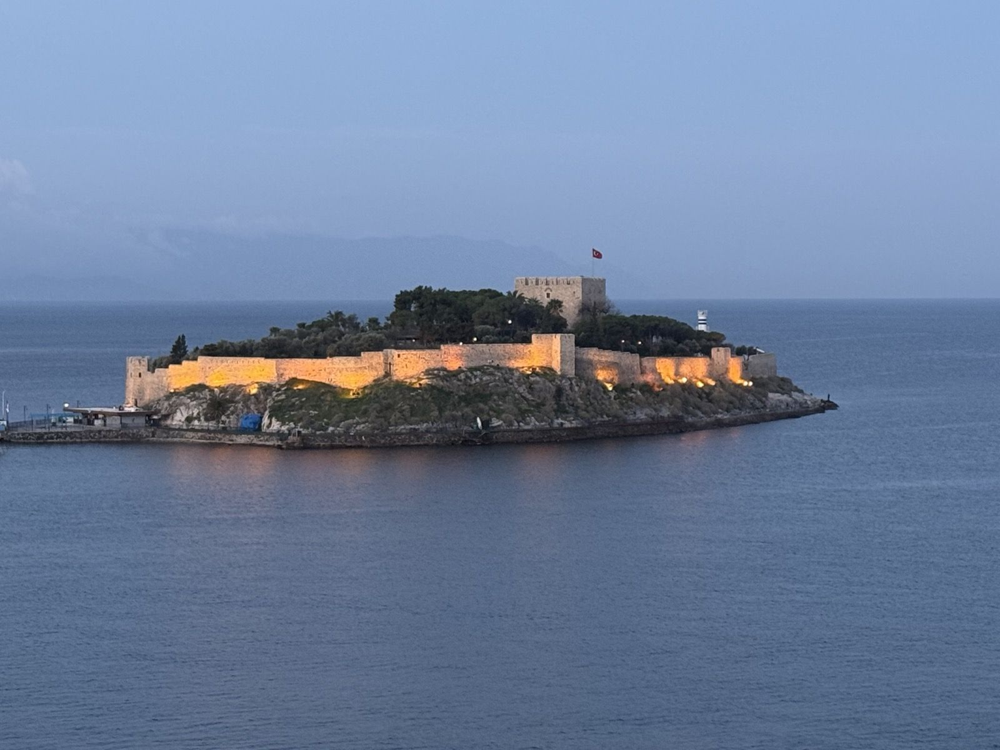
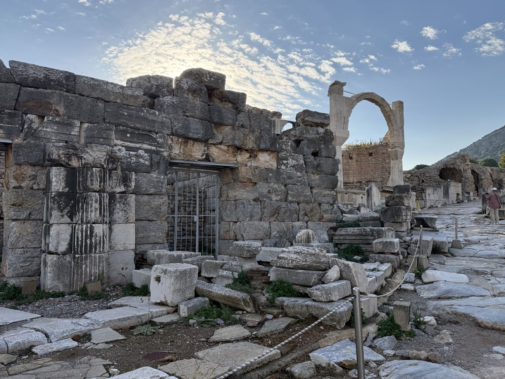
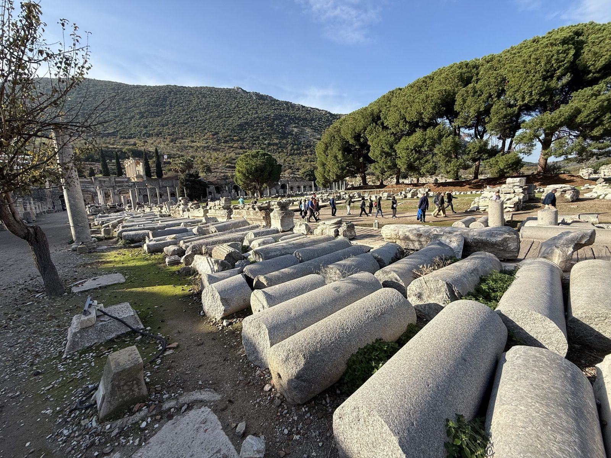
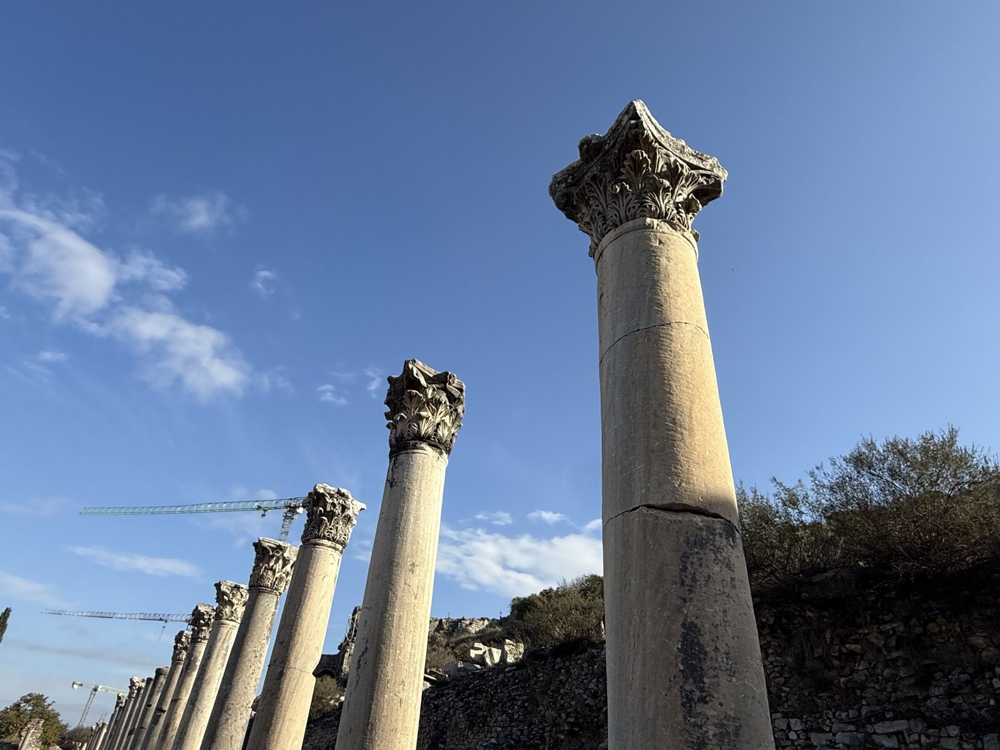
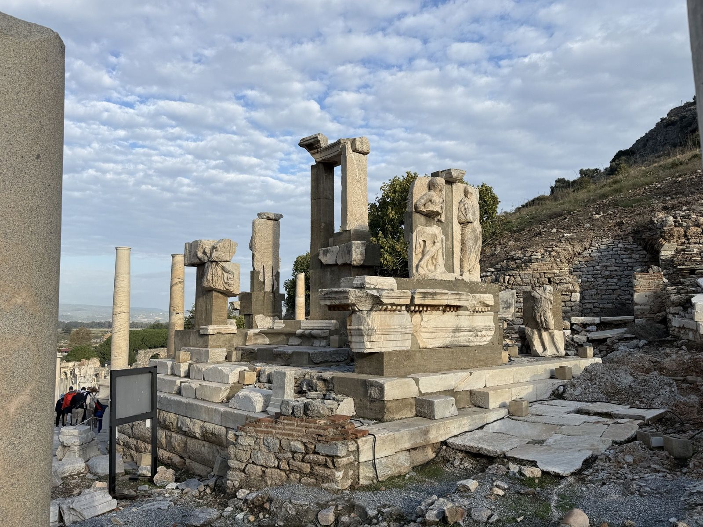
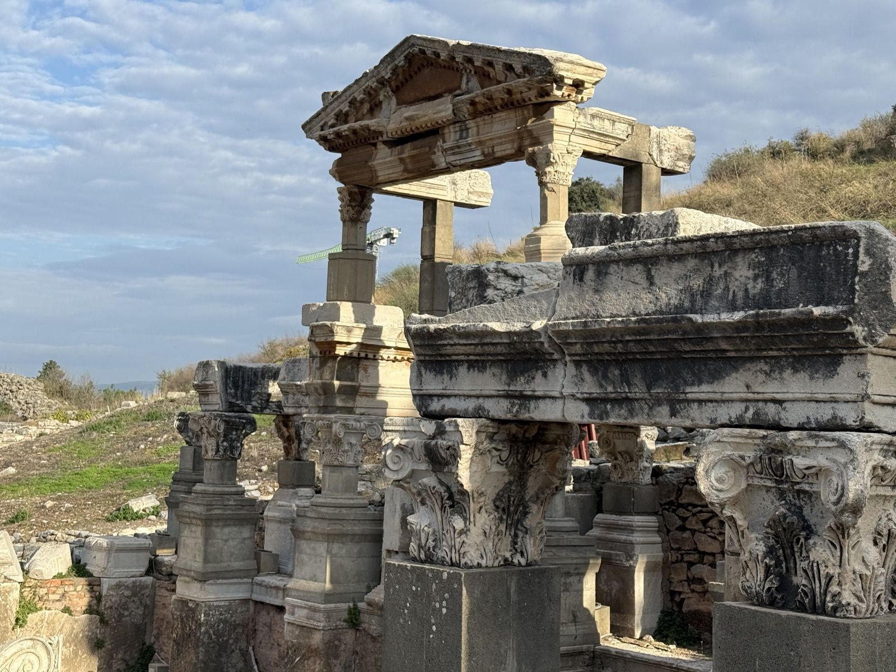
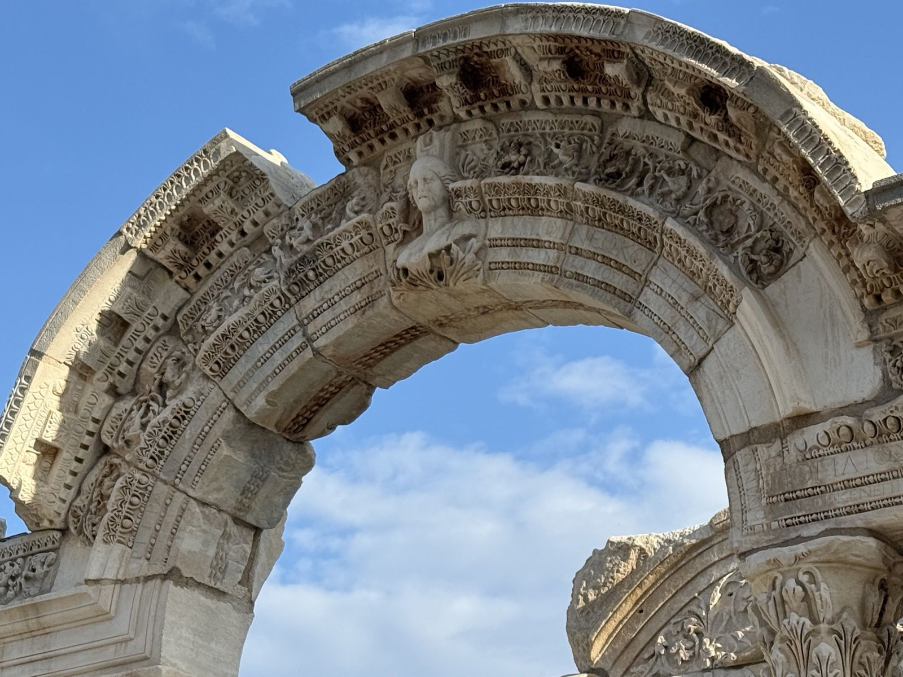
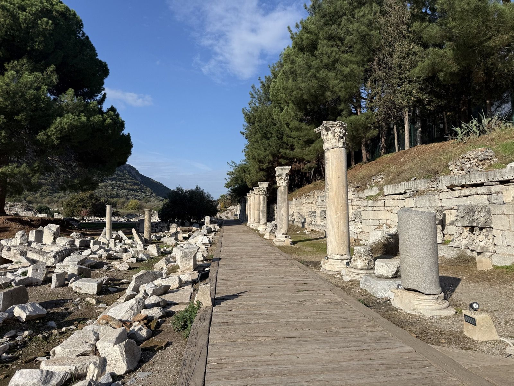

# Day 7: Ephesus, a Greco-Roman City

## Summary

Day 7 (Tuesday, November 17) docks at Kuşadası. The chapter walks the city in visiting order and teaches the classical orders, inscriptions, and frescoes along the way: Curetes and Marble Streets, the terrace houses, the Temple of Hadrian, the Library of Celsus, and the Great Theater where Demetrius' silversmiths rioted against Paul. It covers the Temple of Artemis, the Basilica of St. John, the House of the Virgin Mary, and the Church of Mary where the Council of Ephesus met in 431, and says which sites are traditional rather than historical. It also tells how Greeks of this coast were uprooted by the burning of Smyrna and the 1923 population exchange. Its Learning for All note is the Library of Celsus as a gift of public access to knowledge.

## Concepts Covered

This chapter covers the following 36 concepts from the learning graph:

| Concept | Concept Impact Score |
|---------|-----------------------|
| Classical Orders | 37 |
| Doric Order | 22 |
| Ionic Order | 11 |
| Corinthian Order | 3 |
| Fresco | 4 |
| Inscription | 3 |
| Local Guides | 1 |
| Greek Theater | 20 |
| Seven Wonders of the World | 9 |
| Hadrian | 3 |
| Ephesus Harbor Silting | 1 |
| Temple of Artemis | 7 |
| Artemis of Ephesus | 6 |
| Ephesus Museum | 1 |
| Curetes Street | 9 |
| Marble Street | 6 |
| Great Theater of Ephesus | 5 |
| Library of Celsus | 5 |
| Terrace Houses | 1 |
| Temple of Hadrian at Ephesus | 1 |
| Ephesus Public Latrines | 1 |
| John the Apostle | 3 |
| Riot of the Silversmiths | 4 |
| Demetrius the Silversmith | 1 |
| St. Paul's Prison Tower | 1 |
| Basilica of St. John | 1 |
| House of the Virgin Mary | 1 |
| Church of Mary at Ephesus | 2 |
| Council of Ephesus | 1 |
| Burning of Smyrna | 4 |
| Treaty of Lausanne | 12 |
| Population Exchange of 1923 | 11 |
| Asia Minor Refugees | 3 |
| Kusadasi and Selcuk | 1 |
| Library as Public Access | 4 |
| Philanthropy for Knowledge | 3 |

## Prerequisites

This chapter builds on concepts from:

- [Chapter 1: Before We Go, Part 1: The Long Timeline of the Eastern Mediterranean](../01-long-timeline/index.md)
- [Chapter 2: Before We Go, Part 2: Traveling Well and the Learning for All Thread](../02-traveling-well/index.md)
- [Chapter 3: Day 1: Istanbul, a City on Two Continents](../03-istanbul-two-continents/index.md)
- [Chapter 4: Day 2: Byzantine Constantinople and Hagia Sophia](../04-byzantine-constantinople/index.md)
- [Chapter 6: Day 4: Bazaars, Scripts, and Presses](../06-bazaars-scripts-presses/index.md)
- [Chapter 7: Day 5: The End of Empire and the Birth of Modern Turkey](../07-end-of-empire-modern-turkey/index.md)
- [Chapter 8: Day 6: Troy and Gallipoli](../08-troy-and-gallipoli/index.md)
- [Chapter 9: Paul at Ephesus, Part 1: The Apostle's Life, Letters, and Ephesian Years](../09-paul-life-letters/index.md)

---

## A Tuesday in the Capital of Asia

Day 7, Tuesday, November 17, begins before sunrise at the pier in Kuşadası. The Viking Star docks at 7:00 AM, about an hour before the sun clears the hills, and sails at 6:00 PM, just as it sets. In between lies the best-preserved Roman city on our route. Ephesus is about 20 km inland, beside the small town of Selçuk, and the day divides naturally in two: the morning walking downhill through the ancient city, from its upper gate to its great theater, and the afternoon in Selçuk, with its museum, the marsh where the Temple of Artemis stood, and the hill where tradition places the tomb of the apostle John.

Last night's chapter gave Ephesus its people: Paul, Priscilla and Aquila, Apollos, and the friends who walked with Paul to the ship at Miletus. Today's chapter gives it its stones. We will learn to read a column by its top and a statue base by its first line, stand in the theater where silversmiths shouted for two hours for their goddess, and ask at each holy place whether we are hearing history or tradition, both of which deserve respect. We end with the Greeks who lived on this coast until a century ago, and why they left.

!!! mascot-welcome "A Marble Street Running Downhill"
    { class="mascot-admonition-img" }
    Today we walk downhill through a whole Roman city, past a public toilet where people chatted shoulder to shoulder, a library built as a son's gift to his father's memory, and a theater that once held a riot. By evening, a row of columns will tell us which part of the Greek world they came from, and a line of carved letters will tell us who paid for them. Look closer: Ephesus is the place on our trip where the ancient city is easiest to imagine full of people.

The chapter has eight parts. Part One lands us in Kuşadası and explains why the harbor of Ephesus is now a field. Part Two stands at the upper gate and tells the story of the city's goddess and her temple, one of the Seven Wonders. Part Three teaches the three classical orders and the reading of inscriptions in the upper city. Part Four walks down Curetes Street, past Hadrian's temple, the latrines, and the painted terrace houses. Part Five reaches the Library of Celsus and Marble Street. Part Six stands in the Great Theater and tells the riot of the silversmiths. Part Seven visits the Christian sites of Ephesus and Selçuk and sorts history from tradition. Part Eight tells how the Greeks of this coast were uprooted in 1922 and 1923. The Learning for All note returns to the library.

## Part One: Landfall at Kuşadası

### Kuşadası and Selçuk

**Kuşadası** and **Selçuk** are the two Turkish towns that serve visitors to Ephesus: Kuşadası, the resort and cruise port on the coast where our ship docks, and Selçuk, the inland market town that sits beside the ruins, about 20 km to the northeast. Kuşadası means "bird island," after the small island joined to the town by a causeway, now called Güvercinada, "Pigeon Island," with a fortress on it. Under Ottoman rule the port was known to European merchants by an Italian name, Scala Nova, the "new landing," and it had a large Greek community until 1922, a story Part Eight takes up. Today it is a holiday town of hotels, marinas, and a busy cruise pier.

<figure markdown="span" class="trip-photo">
  { loading=lazy }
  <figcaption>The floodlit fortress on Pigeon Island, Kuşadası, at dawn. Photo by Dan McCreary</figcaption>
</figure>

Selçuk was called Ayasuluk <audio id="audio-ayasuluk" src="../../audio/ayasuluk.mp3" preload="none"></audio><button onclick="document.getElementById('audio-ayasuluk').play()" class="pronounce-btn">🔊 Pronounce</button> *ah-yah-soo-LOOK* for centuries, a Turkish form of the Greek *Hagios Theologos*, "the Holy Theologian," the title of the apostle John, whose basilica stands on its hill. The town took its present name, after the Seljuk Turks, in the early 20th century. Its center has a Byzantine aqueduct where storks nest in summer, a 14th-century mosque, the Ephesus Museum, and a weekly market. In November both towns are in their quiet season, and many shops and restaurants that live on summer visitors have closed or shortened their hours.

### Local Guides

A **local guide** is a person licensed to lead visitors around a site or region, who knows its history, its paths, and its current rules. Turkey licenses its professional tour guides after training and an exam, and a licensed guide wears a photo badge at the sites. On Viking's included tour, a local guide leads each small group through Ephesus, usually entering at the upper gate and walking downhill to the Library of Celsus and the theater, with the coach waiting at the lower gate. This chapter follows that order.

A good guide knows where the shade is, which buildings have just reopened, and stories no book prints. Guides also repeat stories that are more fun than true; Chapter 4 gave us the test for those, and today we use it, politely.

!!! mascot-tip "One Question Per Monument"
    { class="mascot-admonition-img" }
    Here's a way to hear the site twice as clearly without slowing the group: at each stop, ask one question, "How do we know?" A guide who answers "there's an inscription" or "the excavators found it" is giving history; one who answers "people say" is giving tradition. Both are worth hearing once you know which one you got.

### Ephesus Harbor Silting

**Ephesus harbor silting** is the slow filling of the city's harbor with mud carried down by the river, which over many centuries cut Ephesus off from the sea. The river is the Küçük Menderes, the "Little Meander," known to the Greeks as the Cayster. Every winter its floods carried soil from the inland hills and dropped it where the current slowed, at the river's mouth. The coastline crept west, and the city chased it. Ephesus moved with its harbor more than once:

- **The archaic city** grew up near the Temple of Artemis, on the plain below today's Selçuk.
- **Lysimachus**, one of Alexander's successors, refounded it around 290 BCE on its present site, between two hills and nearer the water. This is the city we walk through.
- **Byzantine and Turkish Ayasuluk**, on the hill above Selçuk, took over as the harbor failed.

The Romans dredged the harbor again and again. The geographer Strabo, writing around the time of Jesus, says that engineers working for a king of Pergamon had narrowed the harbor's mouth with a breakwater, hoping to deepen it, and instead trapped the silt inside. The silt won. By the late Byzantine period the harbor was a marsh, and the people of Ephesus had moved up to the hill of Ayasuluk, where Selçuk is now. Today the ancient harbor lies several kilometers from the sea, and the colonnaded Harbor Street that leads west from the theater ends in fields. Miletus and Priene, to the south, suffered the same fate from the larger Meander River, the river whose looping course gave English the word *meander*. When we stand on the theater's top rows and look west toward the sea we cannot see, we are looking at the reason Ephesus died.

## Part Two: The Goddess at the Gate

The upper gate where most tours begin, the Magnesian Gate, is where the road from the Temple of Artemis entered the city. Processions carrying the goddess's images came in here, and so should our story. Before we walk through the city, we need its goddess and her temple, which stood about 2 km away on the plain below, and which the ancients counted among the wonders of the world.

### The Seven Wonders of the World

The **Seven Wonders of the World** are seven famous monuments of the ancient Mediterranean and Near East listed by Greek writers as the sights every educated traveler should see. The Greek word was *theamata*, "things to be seen": the list began as a sightseer's list, not a ranking by experts. Several versions circulated. The best known comes from a poem by Antipater of Sidon in the 2nd century BCE, who says that after seeing all the others, he found that the Temple of Artemis at Ephesus put them in the shade. The list as we know it settled only later.

**Worked example: three wonders near our route.** Let's place the seven on our map. Of the seven, one is on today's route, one we will reach tomorrow, and a third stood about 90 km south of Kuşadası. The Temple of Artemis is at Selçuk. The Colossus of Rhodes, a bronze statue of the sun god about 33 m tall, stood at Rhodes, Day 8, for only about 54 years before an earthquake brought it down around 226 BCE. The Mausoleum at Halicarnassus, the tomb of the ruler Mausolus, stood in today's Bodrum. Earthquakes damaged it, and around 1500 the Knights of St. John, whom we meet in Rhodes, used its stones to build their castle there, spolia on a grand scale. So three of the seven were within a few days' sail of each other on the coast of Anatolia, which says something about how rich and how connected this coast was. Only one wonder survives today: the oldest, the Great Pyramid.

| Wonder | Where | Built | Fate | On our route? |
|---|---|---|---|---|
| Great Pyramid of Giza | Egypt | c. 2560 BCE | Still standing | No |
| Hanging Gardens of Babylon | Mesopotamia | c. 600 BCE, if they existed | No trace found | No |
| Temple of Artemis | Ephesus | c. 550 BCE; rebuilt after 356 BCE | Ruined; one column re-erected | Day 7 |
| Statue of Zeus at Olympia | Greece | c. 435 BCE | Lost, perhaps in a fire in Constantinople | No |
| Mausoleum at Halicarnassus | Bodrum, Turkey | c. 350 BCE | Earthquakes; stones reused by the Knights | No, but close |
| Colossus of Rhodes | Rhodes | c. 280 BCE | Fell in an earthquake, c. 226 BCE | Day 8 |
| Lighthouse of Alexandria | Egypt | c. 280 BCE | Fell after earthquakes, 14th century | No |

### The Temple of Artemis

The **Temple of Artemis** at Ephesus, the *Artemision*, was the sanctuary of the city's goddess and one of the largest temples the Greeks ever built. A shrine stood on the site by the 8th century BCE. Around 550 BCE the Ephesians began a huge marble temple, and Croesus, the rich king of Lydia, paid for many of its columns; a column base carrying part of his dedication is now in the British Museum. Herodotus mentions his gifts. In 356 BCE a man named Herostratus set the temple on fire, by his own admission to make his name immortal. The Ephesians condemned him and, it is said, forbade anyone to speak his name, which is why we remember it. They rebuilt the temple on the same plan, on a higher platform, and it was this second temple, the one Alexander offered to pay for in Chapter 9, that the wonder lists praised.

Pliny the Elder, writing in the 1st century CE, says it had 127 columns, each 60 Roman feet high, about 18 m. Some of the lower column drums were carved with figures in relief, a rare luxury. The temple was also a bank, a place where cities and individuals deposited money under the goddess's protection, and an asylum, where a fugitive who reached the sacred ground could not be seized.

**Worked example: reading the marsh.** Let's do the arithmetic that makes the empty site make sense. A column 18 m tall is about the height of a six-story building. The Parthenon in Athens, which we will see on Day 10, has columns about 10 m tall. Now look at what is there today: a single column, re-erected by archaeologists from drums found on the site, standing in a hollow that is often flooded in winter, with a stork's nest on top in summer. Where did the rest go? The temple was damaged in a raid by the Goths in the 260s CE. When the emperors closed the pagan temples at the end of the 4th century, it became a quarry, and its marble went into the buildings of Christian and later Turkish Ayasuluk, some of it into the Basilica of St. John on the hill above. The English engineer John Turtle Wood searched for the temple for six years before he found it under several meters of silt in 1869, and the best of its sculpture went to London. The site reads like Chapter 4's fourth layer, removal, almost complete.

The table follows the temple from shrine to marsh.

| Date | What happened |
|---|---|
| 8th century BCE | A shrine to the goddess stands on the site |
| c. 550 BCE | The first marble temple is begun, with columns given by Croesus |
| 356 BCE | Herostratus burns the temple |
| 334 BCE | Alexander offers to pay for the rebuilding; the Ephesians decline |
| 260s CE | Damaged in a Gothic raid |
| Late 4th century CE | Temples closed; the building becomes a quarry |
| 1869 | John Turtle Wood finds the site under the silt |

### Artemis of Ephesus

**Artemis of Ephesus** was the goddess worshipped at the Temple of Artemis, a figure who bore the Greek name of Artemis but differed sharply from the Greek huntress of Chapter 8. The Greek Artemis is a slim young woman with a bow, sister of Apollo. The Ephesian Artemis stood stiffly upright, wore a tall crown, and had her body covered from chest to feet with carved ornaments. Her worship seems to have joined the Greek goddess to an older Anatolian mother goddess of this coast, and it drew pilgrims from the whole Greek world. Her priests included a eunuch called the Megabyzos and a body of young priestesses. The bee, which appears on the city's coins, was one of her symbols.

The most famous feature of her statues is a mass of rounded, egg-shaped objects on the chest. They have long been called breasts, and visitors are told so, but they have no nipples, and scholars have proposed many other readings: eggs, gourds, the testicles of sacrificed bulls, or ornaments of amber sewn onto a garment. No ancient text explains them. The honest answer is that we do not know.

**Worked example: reading the goddess top to bottom.** Two marble statues of the Ephesian Artemis, Roman copies of the 1st and 2nd centuries CE, were found in the Prytaneion <audio id="audio-prytaneion" src="../../audio/prytaneion.mp3" preload="none"></audio><button onclick="document.getElementById('audio-prytaneion').play()" class="pronounce-btn">🔊 Pronounce</button> *pry-tuh-NAY-on*, the city hall of Ephesus, and stand today in the Ephesus Museum in Selçuk. Let's read one from the top, as an Ephesian would have. On her head is a tall crown, on some statues shaped like a city wall or a temple front: she protects the city. Around her neck hangs a necklace, and on some copies a garland and signs of the zodiac. On her chest are the much-debated rounded objects. Below them, her tight skirt is divided into panels, each filled with animals, lions, bulls, deer, griffins, and bees, which mark her as mistress of wild creatures. Her arms stretch forward in welcome. Every element can be named; the meaning of the most famous one cannot. That is a useful habit for a museum: describe what is there before deciding what it means.

!!! mascot-thinking "One Name, Two Goddesses"
    { class="mascot-admonition-img" }
    Notice that the Greeks often gave their own gods' names to the gods they met abroad, as the Romans later turned Artemis into Diana. The name traveled, but the local goddess kept her own face. So when a source says "Artemis," ask which one: the huntress of the poems, or the Lady of Ephesus.

## Part Three: Columns and Letters in the Upper City

Inside the Magnesian Gate the path crosses the State Agora, the square where the city's government did its business, and passes the small, steeply raked Odeon, probably a roofed hall for the city council and for concerts, whose seats appear in one of Chapter 9's photos. Beyond lie the Prytaneion, where the sacred flame of the city burned and where the Artemis statues were found, and a square now named for the emperor Domitian, whose temple stood beside it. Here, among half-standing buildings, we meet the two skills this part teaches: reading columns and reading letters.

<figure markdown="span" class="trip-photo">
  { loading=lazy }
  <figcaption>Stone walls and a ruined arch in the upper city of Ephesus. Photo by Dan McCreary</figcaption>
</figure>

### Classical Orders

The **classical orders** are the three related systems of design that Greek architects developed for a column and the beam it carries: the **Doric**, the **Ionic**, and the **Corinthian**. An order is more than a style of column. It is a rulebook: once an architect chose an order, it fixed the shape of the base, the shaft, and the capital (the column's head), and also the parts of the **entablature**, the horizontal band the columns hold up. The entablature has three layers: the **architrave**, a plain beam resting on the capitals; the **frieze**, a band above it, often carved; and the **cornice**, the projecting top edge. On a temple, a triangular **pediment** fills the gable above. The orders also set proportions, so that a column's height is a fixed number of times its own diameter.

We know these rules mainly from Vitruvius <audio id="audio-vitruvius" src="../../audio/vitruvius.mp3" preload="none"></audio><button onclick="document.getElementById('audio-vitruvius').play()" class="pronounce-btn">🔊 Pronounce</button> *vih-TROO-vee-us*, a Roman architect who wrote *On Architecture* around 25 BCE, the only full architectural book to survive from antiquity. Renaissance architects added two Roman variants to make five orders: the plain **Tuscan** and the **Composite**, which stacks Ionic scrolls on a Corinthian capital. The orders spread from Greek temples to Roman streets and, much later, to banks, courthouses, and state capitols around the world. Once we can read them here, we can read the front of a courthouse at home.

**Worked example: reading one column, bottom to top.** Let's read a column of the Basilica Stoa, the long hall on the north side of the State Agora, built under Augustus. Start at the floor. The column stands on a molded **base**, a stack of rings, so it is not Doric, which has no base. Above it rises the **shaft**, which on many buildings is fluted, carved with vertical grooves. At the top the **capital** has a pair of spiral scrolls, called **volutes**, on its front and back: that makes it Ionic. On this building the capitals also carry carved bulls' heads, a local touch. Where an Ionic architrave survives above, it is made of plain bands, each stepped slightly forward. Base, shaft, capital, entablature: four questions, and the capital alone usually answers the main one.

The table summarizes how to tell the three Greek orders apart.

| Feature | Doric | Ionic | Corinthian |
|---|---|---|---|
| Base | None; the shaft stands directly on the floor | Molded rings | Molded rings |
| Flutes (when fluted) | About 20, meeting in sharp edges | About 24, separated by flat strips | About 24, separated by flat strips |
| Capital | A plain cushion under a square slab | Two spiral volutes | A bell of acanthus leaves with small corner scrolls |
| Frieze | Alternating grooved blocks and square panels | A continuous band, plain or carved | A continuous band |
| Proportions | Sturdy: about 4 to 6 diameters tall, later ones slimmer | Slender: about 8 to 9 diameters | Slender: about 9 to 10 diameters |
| Home region | Mainland Greece and the Greek west | Ionia, the coast around Ephesus | Developed in Greece; favored by the Romans |

!!! mascot-thinking "Read the Hat First"
    { class="mascot-admonition-img" }
    Think of the capital as the column's hat: a plain cushion, a pair of scrolls, or a basket of leaves. Nine times out of ten the hat alone names the order, and the base and flutes only confirm it. That frees our eyes for the more interesting question: who paid for this, and why here?

### The Ionic Order

The **Ionic order** is the classical order whose capital carries two spiral volutes, and whose slender, usually fluted shaft stands on a molded base. It was invented in Ionia, the Greek coast of Anatolia and its islands, in the 6th century BCE, and Ephesus is its home ground: the archaic Temple of Artemis was one of the first giant Ionic temples, and its huge scrolled capitals set a pattern for the whole Greek world. The Ionic order is lighter and more decorative than the Doric. Its shaft is usually 8 or 9 times as tall as it is wide, its flutes are separated by narrow flat strips rather than meeting in sharp edges, and its frieze is a continuous band, ideal for a long carved procession. In Athens we will meet it again on the Acropolis, Day 10, in the small Temple of Athena Nike and the Erechtheion <audio id="audio-erechtheion" src="../../audio/erechtheion.mp3" preload="none"></audio><button onclick="document.getElementById('audio-erechtheion').play()" class="pronounce-btn">🔊 Pronounce</button> *eh-REK-thee-on*; Athenians built in Ionic when they wanted grace, and in Doric when they wanted weight.

**Worked example: counting flutes.** Suppose we find a fallen column drum with its flutes still sharp, but no capital anywhere nearby. Can we still name the order? Let's count. Count the grooves around the drum, or count one quarter and multiply by four. About 20 grooves meeting in knife-sharp ridges means Doric. About 24 grooves separated by flat strips, called fillets, means Ionic or Corinthian. In Ephesus, almost every fluted drum we count comes out at 24, as we would expect in the homeland of the Ionic order. To separate Ionic from Corinthian, we need the capital or the proportions. The test takes thirty seconds and works on any fluted fragment on our route.

### The Doric Order

The **Doric order** is the oldest and plainest of the classical orders: a sturdy column with no base, about 20 sharp-edged flutes, and a capital made of a simple cushion-shaped molding under a square slab. Its entablature has a distinctive frieze of alternating **triglyphs**, blocks carved with three vertical bars, and **metopes**, square panels that were often filled with sculpture. The order took shape in the 7th century BCE on the Greek mainland and in the Greek colonies of Italy and Sicily. Many scholars think its details preserve the forms of earlier temples built of wood: the triglyphs, for example, look like the ends of wooden roof beams.

The great Doric building on our route is the Parthenon, which we will see on Day 10, built from 447 to 432 BCE. In Ephesus, Doric is rare. The city's architects worked in their own Ionic tradition, and its Roman builders preferred the Corinthian. Along the west side of Marble Street, though, stood a long Doric colonnade of the 1st century CE, whose remains we pass on the way to the theater.

<figure markdown="span" class="trip-photo">
  { loading=lazy }
  <figcaption>Fallen column drums, Ephesus. Photo by Dan McCreary</figcaption>
</figure>

Columns like these were not carved from one stone. They were built of **drums**, short cylinders of marble stacked on top of each other, joined at the center by wooden or metal pins, and the flutes were often carved only after the column was standing, so that the joints disappeared. When an earthquake shakes a city, the drums come apart and roll, which is why ancient sites are scattered with rows of stone cylinders.

**Worked example: why Athens is Doric and Ephesus is Ionic.** Let's test the idea that architecture follows geography, using proportions. The Parthenon's columns are about 10.4 m tall and about 1.9 m across at the bottom, so each is about 5.5 diameters tall: \( 10.4 \div 1.9 \approx 5.5 \). That is a sturdy, mainland Doric proportion. An Ionic column of the same diameter, at about 9 diameters, would stand about 17 m tall, close to the height Pliny gives for the columns of the Temple of Artemis. So two cities a few days' sail apart built in two different "languages" of architecture, each loyal to its own region, though they could borrow: the Parthenon itself hides four Ionic columns inside its back room.

### The Corinthian Order

The **Corinthian order** is the most ornate of the classical orders: an Ionic-like column whose capital is a tall bell wrapped in two rows of acanthus leaves, with small scrolls curling out at the corners. Acanthus is a Mediterranean plant with deeply cut, spiky leaves, carved on capitals, friezes, and tombs all over our route. Vitruvius tells the order's origin story: the sculptor Callimachus saw a basket left on a young girl's grave in Corinth, covered with a tile, with an acanthus plant growing up around it, and turned the sight into a capital. By Chapter 4's test, that is a lovely myth, written down about four centuries after the sculptor lived. The earliest Corinthian capital we know stood inside a temple at Bassae in the Peloponnese around 420 BCE.

The Greeks used the order sparingly. The Romans made it their favorite, and most of the standing columns in Roman Ephesus are Corinthian. In Athens on Day 13 we will see the Temple of Olympian Zeus, finished by the emperor Hadrian with columns of this order more than 17 m tall.

<figure markdown="span" class="trip-photo">
  { loading=lazy }
  <figcaption>Corinthian columns along a colonnaded street, Ephesus. Photo by Dan McCreary</figcaption>
</figure>

The interactive diagram below lets us practice naming the orders, first by their parts and then on real buildings from our route.

#### Diagram: Doric, Ionic, or Corinthian?

Doric, Ionic, or Corinthian?

Type: infographic
**sim-id:** classical-orders-identifier 
**Library:** html 
**Status:** Specified 
**Bloom Level:** Understand 
**Bloom Verb:** classify 
**Learning Objective:** The learner will classify twelve described column features and buildings from our route as Doric, Ionic, or Corinthian, classifying at least 10 of 12 correctly on the first attempt.

**Prerequisites:** classical orders, base, shaft, flutes, capital, volute, acanthus, entablature, architrave, frieze, triglyph, metope, Doric order, Ionic order, Corinthian order (all defined in Part Three above).

**Evidence of Mastery:** In the quiz, the learner assigns each of 12 cards to one of three orders. An assignment is correct when it matches the Correct order column in Content. Mastery is 10 of 12 correct on the first attempt. Opening the labeled anatomy drawings in the explore stage is exploration, not evidence.

**Misconceptions:** (1) Any column with scrolls on the capital must be Corinthian (cards 2 and 11). (2) Fluting tells the order on its own; in fact Ionic and Corinthian share the same 24-flute pattern (card 6). (3) All Greek temples are Doric (card 9). (4) Smooth, unfluted shafts belong to one particular order; they occur in all three (card 12).

**Instructional Rationale:** Classifying is an Understand task: the learner must map a feature to the concept it signals. An explore stage with three labeled side-by-side columns builds the vocabulary; the quiz then mixes isolated features with whole buildings, so the learner must transfer the rule from parts to real monuments on the route.

**Content:**

Explore stage: three columns drawn side by side, each with these labeled parts that reveal a one-sentence definition when selected.

- Doric: no base; shaft with about 20 sharp-edged flutes; capital of a cushion (echinus) under a square slab (abacus); architrave; frieze of triglyphs and metopes; cornice.
- Ionic: molded base; shaft with about 24 flutes separated by flat strips (fillets); capital with two spiral volutes; architrave in stepped bands; continuous frieze; cornice.
- Corinthian: molded base; shaft with about 24 flutes separated by flat strips; capital shaped as a bell wrapped in two rows of acanthus leaves with small corner scrolls; architrave in stepped bands; continuous frieze; cornice.

Quiz cards, in this fixed order:

| # | Card shown to the learner | Correct order | Why (shown as feedback) |
|---|---|---|---|
| 1 | A column standing directly on the floor, with no base | Doric | Only the Doric order has no base. |
| 2 | A capital with two large spiral scrolls and no leaves | Ionic | Paired volutes without acanthus mark the Ionic capital. |
| 3 | A capital shaped like a basket of acanthus leaves | Corinthian | The acanthus bell is the Corinthian signature. |
| 4 | A frieze of grooved blocks alternating with square panels | Doric | Triglyphs and metopes belong to the Doric entablature. |
| 5 | A fallen drum with about 20 grooves meeting in sharp ridges | Doric | Twenty sharp-edged flutes are Doric. |
| 6 | A fallen drum with about 24 grooves separated by flat strips, no capital nearby | Ionic or Corinthian (either answer accepted) | Ionic and Corinthian share this flute pattern; the capital is needed to separate them. |
| 7 | The Parthenon, Athens, 447–432 BCE | Doric | The Parthenon is the great Doric temple of mainland Greece. |
| 8 | The Temple of Athena Nike, Athens | Ionic | Athens used the Ionic order for this small, graceful temple. |
| 9 | The Temple of Artemis, Ephesus | Ionic | Ephesus is in Ionia, and its temple was one of the first giant Ionic temples. |
| 10 | The Temple of Olympian Zeus, Athens, finished by Hadrian | Corinthian | Its surviving columns carry acanthus capitals; the Romans favored the Corinthian order. |
| 11 | The Basilica Stoa in the State Agora of Ephesus, with bulls' heads on its capitals | Ionic | Its capitals have volutes, with bulls' heads added as a local touch. |
| 12 | A smooth, unfluted column with an acanthus capital on a street in Roman Ephesus | Corinthian | The capital decides; unfluted shafts occur in every order. |

**Provenance:** Features and proportions from the chapter sections "Classical Orders," "The Ionic Order," "The Doric Order," and "The Corinthian Order." Building identifications from the same sections and from Chapter 15 (Parthenon, Athena Nike) and Chapter 20 (Temple of Olympian Zeus).

**Rules:**

- Twelve cards, fixed order, one first attempt each for scoring.
- Card 6 accepts either Ionic or Corinthian as correct; the learner chooses one of the three orders, and both Ionic and Corinthian score as correct.
- Score is 0 to 12. Mastery is score >= 10.
- The explore stage can be revisited at any time, but returning to it during the quiz does not change answers already given.

**Learner Activity:**

1. The learner opens the explore stage and selects parts of each of the three columns to read their definitions.
2. The learner starts the quiz. Each card appears with three choices: Doric, Ionic, Corinthian.
3. The learner chooses an order; feedback appears and the card joins a summary grouped by order.
4. After card 12, the learner sees the score and the summary.
5. The learner should notice that the capital decides most cards, that flute counts separate Doric from the other two, and that the buildings of Ionia are Ionic.

**Feedback:** Correct: "Correct. [Why]" Incorrect: "This one is [correct order]. [Why]" For an incorrect answer of Corinthian on cards 2 or 11, add "Scrolls alone are Ionic; Corinthian needs the acanthus leaves." After card 12: "You classified [n] of 12. Mastery is 10." If n < 10, a "Try again" option restarts the quiz from card 1 in the same order.

**Starting State:** The three labeled columns side by side, and the question "What does the top of a column tell you?"

**Chapter Anchors:** Three Greek orders; Doric about 20 flutes and no base; Ionic and Corinthian about 24 flutes; Parthenon 447–432 BCE; the Basilica Stoa's Ionic capitals with bulls' heads; twelve cards; mastery 10 of 12.

### Inscription

An **inscription** is writing cut, scratched, or painted onto a durable surface, usually stone or metal, meant to last and to be read in public. Ephesus has yielded thousands of them, more than almost any other ancient city, and they are its richest primary sources: they name the people who paid for buildings, record laws and letters from emperors, list the winners of games, and honor benefactors on the bases of statues that have long since vanished. Most are in Greek, the everyday language of the city, written in the capital letters of the alphabet we met in Chapter 2. Some official ones are in Latin, or in both languages side by side.

The square beyond the Prytaneion shows us how much one inscription can do. A ruined monument here, carved with figures in relief, would be just a handsome ruin if its inscription did not name the man it honored, Gaius Memmius, a grandson of the Roman dictator Sulla, who had punished the cities of this province after the massacre of 88 BCE that Chapter 9 described. A monument to the dictator's grandson in the heart of Ephesus says something about who held power here, and the inscription is how we know whose monument it is.

<figure markdown="span" class="trip-photo">
  { loading=lazy }
  <figcaption>The Memmius Monument, 1st century BCE, Ephesus. Photo by Dan McCreary</figcaption>
</figure>

**Worked example: reading a statue base.** Let's decode the commonest inscription in Ephesus, the kind found on dozens of statue bases along the streets. It usually begins with large letters, Η ΒΟΥΛΗ ΚΑΙ Ο ΔΗΜΟΣ, *hē boulē kai ho dēmos*, "the council and the people." Then comes the name of the person honored, often with the verb "honored," and a list of the person's offices and gifts to the city. The first line tells us who gave the honor (the city's two governing bodies), the name tells us who received it, and the list tells us why. With two Greek words, *boulē* and *dēmos*, the second familiar from *democracy*, we can read the opening of most honorary inscriptions on our route. When only the base remains, as is usual, the inscription is all that is left of a citizen the city once wanted everyone to remember.

## Part Four: Down Curetes Street

### Curetes Street

**Curetes Street** is the marble-paved main street that runs downhill from the upper city to the Library of Celsus, lined with fountains, statue bases, shops, and monuments. Its ancient name was the *Embolos*. Its modern name honors the **Curetes**, a college of priests of Artemis named in inscriptions found in this part of the city. In the local myth, the goddess was born near Ephesus, and the Curetes clashed their weapons to drown out the cries of her birth so that the jealous goddess Hera would not hear. The priests named after them took part in her festivals.

The street enters through the **Gate of Hercules**, two pillars carved with reliefs of the hero wearing his lion skin, which narrowed the street so that carts could not pass, and runs down past the **Fountain of Trajan**, built in the early 2nd century CE to honor the emperor, whose statue once stood above a pool. The steep slope made the street a showcase, seen by everyone walking down to the harbor.

<figure markdown="span" class="trip-photo">
  { loading=lazy }
  <figcaption>The Fountain of Trajan on Curetes Street, early 2nd century CE. Photo by Dan McCreary</figcaption>
</figure>

**Worked example: reading Curetes Street with Chapter 4's questions.** Let's run Chapter 4's method on the street as we walk it. *What is it made of, and is any of it reused?* The Gate of Hercules was put together in late antiquity, probably the 4th or 5th century CE, from older carved blocks: its reliefs are spolia. Many statue bases along the street were moved here from elsewhere, and some carry inscriptions of different centuries side by side. *What was added?* The Baths of Scholastikia, beside the latrines, were restored around 400 CE by a Christian woman named Scholastikia, honored by a statue there. *What was removed?* Nearly every statue: the bases line the street, the figures are gone. *Which stories are contested?* An eight-sided tomb, the Octagon, held the bones of a young woman, and some scholars have argued that she was Arsinoe IV, the sister of Cleopatra, killed at Ephesus in 41 BCE on Mark Antony's orders; others find the evidence too thin. *Who restored it?* Austrian archaeologists, digging here since 1895, rebuilt many façades from their fallen blocks. In a few hundred meters, every question has an answer, and the street turns from "old" into a story of six centuries.

!!! mascot-warning "Polished Marble Is Slippery"
    { class="mascot-admonition-img" }
    A common trap at Ephesus is to look up at the façades and step onto marble worn smooth as glass by two thousand years of feet, especially after rain or on the steep upper stretch of Curetes Street. Wear shoes with a soft, grippy sole, and stop walking to look up. If a slab looks shiny, step on the dull stone beside it.

### Hadrian

**Hadrian** was Roman emperor from 117 to 138 CE, the emperor who spent more of his reign traveling his provinces than any ruler before him. Born in 76 CE to a family settled in Spain, he succeeded his relative Trajan. He gave up some of Trajan's eastern conquests, built the wall across northern Britain that bears his name, and rebuilt the Pantheon in Rome. He loved Greek culture so openly that some Romans called him "the little Greek": he wore a beard in the Greek style, the first emperor to do so, and he spent long stays in Athens. He came to Ephesus at least twice, and the city honored him with temples and games. On Day 13 in Athens we will see his arch and the Temple of Olympian Zeus he finished; today we see a small temple an Ephesian built in his name.

### The Temple of Hadrian at Ephesus

The **Temple of Hadrian** at Ephesus is the small, richly carved shrine on the north side of Curetes Street, dedicated to Hadrian before 138 CE by a wealthy citizen, Publius Quintilius Valens Varius, and his family, as its inscription says. It is tiny, a porch and one room, but its front is one of the most photographed sights in Turkey. Corinthian columns and piers support an arch in the middle of the entablature, and in the keystone of that arch is a bust of Tyche, the goddess of the city's fortune. Inside, in the half-circle over the door, a female figure rises from acanthus leaves.

<figure markdown="span" class="trip-photo">
  { loading=lazy }
  <figcaption>The arch of the Temple of Hadrian on Curetes Street, 2nd century CE. Photo by Dan McCreary</figcaption>
</figure>

The carved friezes inside the porch, now replaced on site by copies, are a layer lesson in miniature. Some panels show the founding myth of Ephesus, in which the Athenian prince Androklos kills a boar at the spot an oracle had foretold. One panel, carved some two centuries after the temple was built, shows the family of the Christian emperor Theodosius I. A pagan temple to a deified emperor was repaired in the late 4th century with a frieze honoring a Christian one. The originals are in the Ephesus Museum.

### The Ephesus Public Latrines

The **Ephesus public latrines** are a Roman public toilet beside the Baths of Scholastikia, just off Curetes Street, built around the end of the 1st century CE. Long marble benches with keyhole-shaped openings line three sides of a room around an open courtyard. Water ran continuously in a channel beneath the seats, carrying waste to the city's sewers, and a shallow gutter of clean water ran at the users' feet. Users paid a fee. There were no partitions: Romans sat shoulder to shoulder, and a visit was as social as a visit to the baths, which Chapter 6 described.

Guides often add two stories. One, that Romans cleaned themselves with a sponge on a stick rinsed in the gutter, has a few ancient references behind it, though how widely it was used is debated. The other, that wealthy citizens sent slaves ahead to warm the cold marble seats, has no ancient source we know of: a modern joke hardened into "fact."

### Fresco

A **fresco** is a wall painting made by applying pigments mixed with water onto fresh, still-wet lime plaster. As the plaster dries, a chemical reaction binds the color into the wall itself, so a true fresco does not flake off like paint on a surface; it lasts as long as the plaster does. The word is Italian for "fresh." The steps explain how it was made and why some parts last better than others.

1. **Plaster.** The wall is coated in layers of lime plaster, the last one fine and smooth.
2. **Paint fast.** While the top layer is still wet, the painter applies pigments mixed with water. Only as much wall is plastered as can be painted before it sets, so large frescoes were made in daily patches whose joins can sometimes still be seen.
3. **Let it set.** As the lime dries, it binds the color into the surface.
4. **Finish dry.** Details were often added afterward on the dry surface, a technique called *secco*, "dry." Those are the parts that fade first.

Roman houses were full of frescoes: imitation marble panels, garden scenes, mythological pictures, and portraits of poets and philosophers.

**Worked example: a philosopher on the living-room wall.** Let's read a fresco as evidence, the way Chapter 4 read a building. In one of the terrace houses of Ephesus, excavators found a painted portrait of a bearded, balding man, with his name written beside him in Greek capitals: ΣΩΚΡΑΤΗΣ, Sokrates. What does it tell us? First, the owner of this house, more than four centuries after Socrates died in Athens, wanted the philosopher on the wall where guests would see him, as a family today might hang a portrait of a hero. Second, the label shows that the owner and the guests could read it, or wanted to be seen as people who could. Third, the technique tells us the painting was made for this wall: a fresco cannot be moved without cutting out the plaster. A picture made in a day on wet lime gives us the taste, the education, and the ambitions of one Ephesian family.

### The Terrace Houses

The **terrace houses** of Ephesus are a block of wealthy Roman homes built in terraces up the slope on the south side of Curetes Street, opposite the Temple of Hadrian. The best preserved, known as Terrace House 2, held seven family apartments on three levels, lived in from the 1st century BCE until earthquakes in the 3rd century CE brought them down. Because the ruins were buried, their walls kept their frescoes and marble paneling, their floors kept their mosaics, which Chapter 4 explained, and their plaster kept the scratched graffiti of the people who lived in them. Since 2000 the houses have been covered by a protective roof, with glass walkways that lead visitors above the rooms. They need a separate ticket, and they are worth it: here, more than anywhere else at Ephesus, we see how the rich lived, room by room.

!!! mascot-tip "Buy the Second Ticket"
    { class="mascot-admonition-img" }
    Want the one part of Ephesus most tour groups walk past? Check before the day whether the terrace houses are included in your tour; if not, ask your guide where the group will meet afterward and go in on your own ticket for thirty to forty minutes. It is the only covered space on the walk, a gift on a hot or rainy day.

## Part Five: The Library and Marble Street

### The Library of Celsus

The **Library of Celsus** is the two-story marble library at the foot of Curetes Street, built in the early 2nd century CE as a public library and a tomb, and now the most famous building in Ephesus. Its story begins with a father and a son. Tiberius Julius Celsus Polemaeanus, a Greek from Sardis, rose to become a Roman consul in 92 CE, one of the first men from the Greek East to reach that rank, and later governor of the province of Asia. When he died, his son, Tiberius Julius Aquila, began this building in his memory, around 110 CE, and left money in his will to finish it and to buy books. His heirs completed it. Celsus himself was buried in a marble sarcophagus in a chamber beneath the reading room, a rare honor, since Romans did not normally bury the dead inside a city.

Inside, the reading room was a single hall with niches in its walls for wooden cupboards that held the scrolls, on several levels reached by galleries. The library is usually said to have held about 12,000 scrolls. That figure is a modern estimate from the size and number of the niches, not a number from an ancient source, but it gives a fair sense of scale. The building burned in the 3rd century CE, and an earthquake later brought down the façade. Austrian archaeologists re-erected it between 1970 and 1978 from its fallen pieces, one of the great reconstructions of the 20th century.

**Worked example: reading the façade.** Let's stand in the square below the library and read its front with what we have learned today. *The orders:* two stories of paired columns with richly carved capitals of the Corinthian type, the Roman favorite, stacked one above the other. *The trick:* the restorers found that the columns and spaces near the center are slightly larger than those at the ends, and the lower columns stand on a podium, so the building looks taller and grander than its modest width. *The statues:* four niches between the lower columns hold female figures, each labeled in Greek with a virtue, *Sophia* (Wisdom), *Aretē* (Excellence), *Ennoia* (Thought), and *Epistēmē* (Knowledge). The ones we see are copies; the originals went to Vienna. *The inscriptions:* statue bases on the steps carry texts in both Greek and Latin naming Celsus and his career, the bilingual voice of a Roman official in a Greek city. Beside the library, the **Gate of Mazaeus and Mithridates**, built in 4–3 BCE by two freed slaves of the imperial family to honor Augustus, has its dedication in Latin and Greek, and its Latin letters were once made of bronze; the rows of small holes that held them are a perfect example of Chapter 4's "removed." One square, and every skill of the day is in use.

### Marble Street

**Marble Street** is the paved street that runs north from the library square to the Great Theater, the last stretch of our walk through the city. It was paved with large slabs of marble, and in places the slabs still carry the ruts of cart wheels. On its west side lay the Lower Agora, the *Tetragonos Agora*, the city's great square market, more than 100 m on each side and surrounded by colonnades of shops; on that side, too, ran the raised Doric colonnade we met in Part Three. On its east side the hill of Panayır Dağı rises toward the theater.

<figure markdown="span" class="trip-photo">
  { loading=lazy }
  <figcaption>A walkway past a row of columns and fields of fallen marble, Ephesus. Photo by Dan McCreary</figcaption>
</figure>

**Worked example: the most famous carving on the street.** Every group stops at one slab on Marble Street, carved with a left foot, a woman's head, a heart-like shape, and a rectangle with holes. The guide often explains it as an advertisement for a brothel: walk this way (the foot), and you will find a woman (the head) and love (the heart), if you are old enough (a foot larger than the carving) and have money (the purse). Let's apply the test. Is there an inscription naming a brothel? No. Has any building nearby been securely identified as one? A building near the library is often called a brothel, but the identification is debated, and excavators have read it in other ways. Is the "heart" a heart? The heart shape as a symbol of love is mostly a much later convention. So the carving is real, its age is uncertain, and the brothel reading is a story that may or may not be true. Notice how a story with a punch line beats an honest "we don't know" every time.

## Part Six: The Theater and the Riot

### Greek Theater

A **Greek theater** is an open-air auditorium of the type the ancient Greeks invented for drama, built into a hillside so that rows of stone seats rise in a wide curve around a flat performing floor. It began in Athens in the 6th and 5th centuries BCE, at festivals of the god Dionysus, where tragedies and comedies were performed in competition; we will sit in the Theater of Dionysus there on Day 10. Its parts have Greek names we still use. The **theatron**, "watching place," is the curved bank of seats, divided into wedges by stairways. The **orchestra**, "dancing place," is the flat circle at the bottom, where the chorus sang and danced. The **skene**, "tent" or "hut," is the building behind the orchestra where actors changed masks, which gives us the word *scene*. Every Greek city of any size had a theater, used not only for plays but for festivals, music, and the meetings of the citizen assembly.

The Romans took over the form and changed it. The table compares the two.

| Feature | Greek theater | Roman theater |
|---|---|---|
| Seating | More than a half circle, built into a natural hillside | A half circle, often built up on vaulted walls on flat ground |
| Orchestra | A full circle for the chorus | A half circle, often used for seats of honor |
| Stage building | Low, sometimes temporary | Tall, several stories, with a richly columned façade |
| Uses | Drama, music, assemblies | Drama, mime, assemblies; later also animal shows and gladiators |

**Worked example: a Greek theater in Roman dress.** Let's read the Great Theater of Ephesus against the table. *Seating:* it is cut into the hillside of Panayır Dağı and wraps a little more than a half circle, a Greek theater by birth, first built in the Hellenistic period, probably in the 3rd century BCE. *Stage building:* the ruined stage building is tall and was once three stories high with a façade of columns and statues, Roman work of the 1st and 2nd centuries CE. *Orchestra:* it is now roughly a half circle, cut back by the Roman stage. *Uses:* inscriptions show it hosting the assembly of the people, festivals, and, by the 2nd century, gladiator shows, for which a protective barrier was added around the orchestra. So the answer to "Greek or Roman?" is both, in layers: a Greek plan, rebuilt to Roman taste over about four centuries, exactly the kind of answer Chapter 1 told us to expect in Ephesus.

### The Great Theater of Ephesus

The **Great Theater of Ephesus** is the city's main theater, set into the western slope of Panayır Dağı at the end of Marble Street, facing down the colonnaded Harbor Street toward the vanished sea. The street was rebuilt around 400 CE by the emperor Arcadius and named the Arcadiane after him. In its final Roman form it held about 25,000 people, one of the largest theaters in the Roman world. Its seats rise in three tiers separated by walkways, and from the top rows we can see the whole lower city and the harbor plain. When the people of Ephesus needed to meet as a body, this is where they met.

**Worked example: a procession in stone.** Let's read the theater's most remarkable inscription, which tells us what a normal assembly day here looked like. In 104 CE a rich Roman citizen of Ephesus, Gaius Vibius Salutaris, gave the city a set of about thirty gold and silver statues, of Artemis, of the emperor, and of the city's founders and institutions, along with money to pay for their care and for gifts to citizens. His foundation, recorded in a long inscription of more than 500 lines carved on a wall of the theater, required that the statues be carried in procession from the Temple of Artemis, in through the Magnesian Gate where our walk began, down through the city to the theater, set on bases among the seats during the assembly, and then carried out again and back to the temple. Scholars estimate that this happened about every two weeks. So the route we walked this morning, gate to theater, was a sacred route, and the statues of the goddess sat in the audience. Silver images of Artemis in the theater: keep that picture in mind for the next story, which took place here about fifty years earlier.

### The Riot of the Silversmiths

The **riot of the silversmiths** is the uproar in Ephesus, told in Acts 19:23–41, in which craftsmen whose trade depended on the worship of Artemis filled the Great Theater to protest against Paul's preaching. Chapter 9 followed Paul's two to three years in the city, around 52 to 55 CE. Acts places this story near the end of them, and the theater is the place to tell it. These are the people in the story:

- **Demetrius**, a silversmith and employer of craftsmen, who starts it.
- **The craftsmen** of the silver trade, and then a crowd from the whole city.
- **Gaius and Aristarchus**, Paul's Macedonian traveling companions, dragged into the theater.
- **Paul**, who wants to speak and is held back by his friends.
- **The Asiarchs**, leading men of the province and friends of Paul.
- **Alexander**, put forward by the Jews of the city.
- **The town clerk**, the city's chief official, who ends it.

The story goes like this. Demetrius, who made silver shrines of Artemis, called together his workers and others in the same trade. Paul, he told them, was persuading people throughout Asia that gods made by human hands are no gods at all. That threatened their trade, and worse, it threatened the honor of the goddess and her temple, worshipped across the world. The craftsmen were enraged and began to shout, "Great is Artemis of the Ephesians!" The shouting spread through the city, and the crowd rushed into the theater, dragging Gaius and Aristarchus with them. Paul wanted to go in and speak, but the believers would not let him, and the Asiarchs sent word urging him not to risk it. Inside, Acts says, most of the crowd did not even know why they had come. The Jews of the city pushed Alexander forward to speak, perhaps to show that they had nothing to do with Paul, but when the crowd recognized him as a Jew, they shouted him down, chanting the same phrase for about two hours.

Finally the town clerk quieted the crowd. Everyone knew, he said, that Ephesus was the temple warden of the great Artemis and of the image that fell from heaven, so there was no need for violence. These men had robbed no temple and insulted no goddess. If Demetrius had a complaint, the courts were open and there were proconsuls; anything further belonged to the lawful assembly. As things stood, the city was in danger of being charged with rioting. With that he dismissed the gathering. Acts says Paul left for Macedonia soon after.

!!! mascot-thinking "The Town Clerk's Argument"
    { class="mascot-admonition-img" }
    Notice that the town clerk calms the crowd not by defending Paul but by defending the city's procedures: we have courts, we have an assembly, and Rome is watching. An unlawful gathering in a theater was a danger to the city's privileges. The story turns on order and law as much as on faith.

**Worked example: does the story fit the city?** Acts was written a generation later, and Chapter 9 taught us to read it carefully. Let's check its details against what the stones of Ephesus say. The table lists five details and the local evidence.

| Detail in Acts 19 | What Ephesus itself shows |
|---|---|
| The crowd gathers in the theater | The theater was the city's place of assembly; inscriptions record assemblies held there. |
| Silver images of Artemis | The Salutaris inscription of 104 CE records silver statues of Artemis carried into this theater. Small silver shrines have not survived, but silver was usually melted down. |
| Ephesus as "temple warden" of Artemis | Inscriptions and coins use the same title, *neokoros*, for the city. |
| The town clerk (*grammateus*) as chief official | Inscriptions show the *grammateus* of the people as a leading magistrate who presided over the assembly. |
| Asiarchs, officials friendly to Paul | Asiarchs, leading men of the province, are known from many inscriptions in Ephesus and the province. |

Every local detail fits, which shows that the author knew how Ephesus worked. It does not prove that every word of the scene happened as told; the speeches in Acts are the author's own composition, as Chapter 9 explained. Chapter 11 returns to the riot from another angle, as a case study in why change meets resistance from people whose livelihoods depend on the old way.

### Demetrius the Silversmith

**Demetrius the silversmith** is the craftsman who, according to Acts 19, roused the silversmiths of Ephesus against Paul. He is known only from Acts, which describes him as a maker of silver shrines of Artemis, probably small models of the temple with the goddess inside, sold to pilgrims as souvenirs and offerings, and as an employer of many craftsmen. His speech, as Acts reports it, joins two motives honestly: the craftsmen's income depends on this trade, and the goddess will lose her honor. An inscription from Ephesus names a Demetrius among the temple's officials, and a few scholars have connected the two, but Demetrius was one of the commonest Greek names, and the link is unproven. What Acts gives us is not a villain so much as a type we will recognize: a skilled worker who sees a new idea threatening both his income and his world.

### St. Paul's Prison Tower

**St. Paul's Prison** is the name local tradition gives to a square stone tower on a hilltop at the western edge of the ancient city, which we can see from the lower part of the site. The tower is real and old: it was part of the city wall built by Lysimachus in the early 3rd century BCE, which ran along the ridges around the city. The identification is tradition only. Acts mentions no imprisonment in Ephesus, though, as Chapter 9 explained, Paul's own letters lead many scholars to think he was imprisoned somewhere in the province. Even if he was, nothing ties him to this tower, which was a fortification, not a jail. It is a real Hellenistic tower with a name added much later.

The timeline below sets the monuments of our walk in order of date, rather than in the order we pass them.

#### Diagram: One Walk, Seven Centuries

One Walk, Seven Centuries

Type: timeline
**sim-id:** ephesus-walk-timeline 
**Library:** vis-timeline 
**Status:** Specified 
**Bloom Level:** Understand 
**Bloom Verb:** compare 
**Learning Objective:** The learner will compare the construction dates of nine monuments passed on the downhill walk through Ephesus, predicting for each one whether it was begun before or after the monument passed just before it, with at least 6 of 8 predictions correct.

**Prerequisites:** reading a ruin and spolia (Chapter 4); the Memmius Monument, Curetes Street, the Gate of Hercules, the Fountain of Trajan, the Temple of Hadrian at Ephesus, the terrace houses, the Library of Celsus, the Gate of Mazaeus and Mithridates, the Great Theater of Ephesus, and the Harbor Street (all defined in Parts Three to Six above).

**Evidence of Mastery:** The monuments appear one at a time in walking order. For monuments 2 to 9, the learner predicts "older" (begun earlier) or "younger" (begun later) than the previous monument before its date is revealed. A prediction is correct when it matches the Answer column in Content. Mastery is 6 of 8 correct. Dragging or zooming the finished timeline is exploration, not evidence.

**Misconceptions:** (1) A site is built in one period, so neighboring monuments are about the same age (items 2–3, 6–7). (2) The downhill walk runs steadily from older to newer, or the reverse. (3) A monument's construction date is the date of everything in it; the Gate of Hercules is built of older carved blocks (spolia), and the theater was rebuilt over several centuries.

**Instructional Rationale:** Comparing each date with the one before forces the learner to hold two monuments in mind and commit to a judgment before seeing the answer, which builds a sense of the city as layers rather than a single snapshot. The finished timeline then shows the zigzag visually.

**Content:**

Monuments in walking order:

| # | Monument (walking order) | Date shown | Bar on the timeline (start to end) | Answer (compared with previous) | Why (shown as feedback) |
|---|---|---|---|---|---|
| 1 | Memmius Monument | Late 1st century BCE | 40 BCE to 1 BCE | (first item, no prediction) | A monument to a grandson of Sulla, from the reign of Augustus. |
| 2 | Gate of Hercules | 4th–5th century CE, built with older reliefs | 350 CE to 450 CE | Younger | A late-antique gate built of older carved blocks. |
| 3 | Fountain of Trajan | Early 2nd century CE | 102 CE to 114 CE | Older | Built under Trajan, more than two centuries before the gate we just passed. |
| 4 | Temple of Hadrian | Dedicated before 138 CE | 117 CE to 138 CE | Younger | Dedicated to Hadrian, Trajan's successor. |
| 5 | Terrace House 2 | 1st century BCE to 3rd century CE | 25 BCE to 270 CE | Older | The houses were begun more than a century before the temple and lived in until earthquakes in the 3rd century. |
| 6 | Library of Celsus | Begun c. 110 CE | 110 CE to 125 CE | Younger | Begun around 110 CE, long after the first terrace houses. |
| 7 | Gate of Mazaeus and Mithridates | 4–3 BCE | 4 BCE to 3 BCE | Older | Built under Augustus, more than a century before the library beside it. |
| 8 | Great Theater | First built 3rd century BCE; rebuilt 1st–2nd century CE | Two bars: 290 BCE to 250 BCE, and 41 CE to 117 CE | Older | Its first, Hellenistic building is about three centuries older than the gate; the Roman rebuilding came later. |
| 9 | Harbor Street (Arcadiane) | Rebuilt c. 400 CE | 395 CE to 408 CE | Younger | Rebuilt under the emperor Arcadius, who reigned 395–408 CE. |

After item 9, a second row shows two reference events: Paul in Ephesus, c. 52–55 CE, and the riot of the silversmiths, c. 55 CE.

**Provenance:** Dates from this chapter's sections "Inscription," "Curetes Street," "Hadrian," "The Temple of Hadrian at Ephesus," "The Terrace Houses," "The Library of Celsus," "Greek Theater," and "The Great Theater of Ephesus," and from Chapter 9 for Paul's years. Bar ranges are rounded for display: the sim marks every bar "c." and shows the note "Dates are approximate; most monuments were built over years and repaired for centuries." The Library bar's end, 125 CE, is illustrative, since the completion date is uncertain; the sim labels it so.

**Rules:**

- Items appear in walking order, 1 to 9. Item 1 has no prediction.
- A monument's comparison year is the start of its first bar: 1: −40; 2: 350; 3: 102; 4: 117; 5: −25; 6: 110; 7: −4; 8: −290; 9: 395 (negative numbers are BCE).
- For items 2 to 9, "older" is correct when the item's comparison year is less than the previous item's; "younger" when it is greater. No two consecutive items share a comparison year.
- One prediction per item; it cannot be changed after the reveal. Score 0 to 8; mastery is score >= 6.
- The timeline axis runs from 300 BCE to 500 CE, with no year 0.

**Learner Activity:**

1. The learner sees item 1, the Memmius Monument, placed on the timeline.
2. For each later item, the learner reads its name and walking note ("next, on Curetes Street"), predicts older or younger than the previous item, and sees its bar appear with feedback.
3. After item 9, the full timeline shows, with Paul's years marked.
4. The learner drags and zooms the timeline to compare bars.
5. The learner should notice that the walk zigzags across about seven centuries, from about 290 BCE to about 450 CE, and that the riot took place in a theater that was still being rebuilt.

**Feedback:** After each prediction: correct shows "Correct. [Why]"; incorrect shows "Not quite: this one is [older/younger]. [Why]". A running count "Correct: n of 8." At the end: "You compared [n] of 8 correctly. Mastery is 6." with a "Walk again" option that restarts from item 1.

**Starting State:** An empty timeline from 300 BCE to 500 CE with the first bar, "Memmius Monument, late 1st century BCE," and the question "Walking downhill, is the next monument older or younger?"

**Chapter Anchors:** Memmius Monument 1st century BCE; Gate of Hercules probably 4th or 5th century CE, with spolia reliefs; Fountain of Trajan early 2nd century CE; Temple of Hadrian before 138 CE; Hadrian emperor 117–138; terrace houses 1st century BCE to 3rd century CE; Library begun around 110 CE; Gate of Mazaeus and Mithridates 4–3 BCE; theater first built probably in the 3rd century BCE and rebuilt in the 1st and 2nd centuries CE; Harbor Street rebuilt around 400 CE under Arcadius; Paul in Ephesus about 52–55 CE; nine monuments, eight predictions, mastery 6 of 8.

## Part Seven: Saints, Councils, and the Museum

### The Church of Mary at Ephesus

The **Church of Mary** at Ephesus is a long ruined church near the old harbor, a short walk north of the Harbor Street, and one of the first churches anywhere dedicated to Mary, the mother of Jesus. It was built inside an older Roman building, a very long hall of the 2nd century CE, and converted into a church by the early 5th century. Its ruins have been rebuilt and enlarged several times, but its layout is still easy to read: a long nave, an apse at the east end, and a round baptistery with a pool where new believers were immersed. Some tours finish here, near the lower gate. It matters because of a meeting held inside it in 431.

### The Council of Ephesus

The **Council of Ephesus** was the meeting of bishops of the whole Christian Church, summoned by the emperor Theodosius II, that met in the Church of Mary in 431 CE and is counted as the third of the great councils after Nicaea in 325, which Chapter 1 described, and Constantinople in 381. It settled a bitter argument about how to speak of Jesus and of Mary. Nestorius, archbishop of Constantinople, objected to calling Mary *Theotokos* <audio id="audio-theotokos" src="../../audio/theotokos.mp3" preload="none"></audio><button onclick="document.getElementById('audio-theotokos').play()" class="pronounce-btn">🔊 Pronounce</button> *thee-oh-TOH-kos*, "God-bearer," the title common in popular devotion; he preferred "Christ-bearer," to keep Jesus' human and divine natures distinct. Cyril, archbishop of Alexandria, insisted that because Jesus was one person, both God and man, his mother could rightly be called the bearer of God. The council, led by Cyril, who opened it before the bishops from Antioch, Nestorius' allies, had arrived, condemned and deposed Nestorius and approved the title.

The decision had long consequences. Christians of the Persian Empire who honored Nestorius' teachers did not accept it, and their church, the Church of the East, carried Christianity across Asia as far as China. And *Theotokos* became one of the central titles of Mary in the Orthodox Church: we saw her as Mother of God in the mosaics of Hagia Sophia on Day 2, and in Orthodox churches she is honored under that name every day.

!!! mascot-encourage "Councils Are Hard on Everyone"
    { class="mascot-admonition-img" }
    If the difference between "God-bearer" and "Christ-bearer" feels too fine to fight over, you are in good company: many people at the time found it baffling too, and the politics mattered as much as the theology. Hold on to one idea, that the council was about whether Jesus was one person, and the rest follows. We can come back to the details another day.

### The Ephesus Museum

The **Ephesus Museum** in Selçuk is the archaeological museum that displays finds from Ephesus and its region, a short walk from the town center. It is small enough to see in an hour and rich enough to fill two. Its highlights:

- **The two marble statues of Artemis of Ephesus** found in the Prytaneion.
- **The original friezes from the Temple of Hadrian**, including the Androklos myth.
- **Finds from the terrace houses**: wall paintings and household objects.
- **A small bronze of Eros riding a dolphin.**
- **The gladiators of Ephesus**, whose cemetery was excavated in the 1990s and whose bones show their injuries and their diet.

Much of what Ephesus produced is elsewhere: the British Museum holds the sculptures from the Temple of Artemis, and the Ephesos Museum in Vienna holds the Library's original virtue statues and other pieces that Austrian excavators took home, with the Ottoman government's permission, around 1900. Seeing the museum after the site, rather than before, works well: the objects return to buildings we have just walked past.

### John the Apostle

**John the Apostle** was one of the twelve disciples of Jesus, a fisherman from Galilee, son of Zebedee and brother of James. In the Gospels he is one of the three closest to Jesus, with Peter and James. Christian tradition says that in old age he lived at Ephesus, wrote the Gospel of John there, and died there peacefully, the only one of the Twelve not to be martyred. The tradition is old: around 180 CE, Irenaeus, a bishop who had grown up in this province, wrote that John, the Lord's disciple, published his Gospel while living at Ephesus, and around 190 CE a bishop of Ephesus, Polycrates, wrote that John was buried in the city.

Modern scholars are divided about how much of this is history. The Gospel itself names no author, and early writers also mention a "John the Elder" in the province, who may have been a different man. The Book of Revelation was written by a John on the island of Patmos, off this coast, but scholars mostly doubt that the same person wrote both books. So we have an early, strong local tradition that John lived and died at Ephesus, written down about a hundred years after his death, by people who believed it sincerely. By Chapter 4's test, that is good evidence for what Ephesian Christians believed by 180 CE, and possible but unprovable evidence for John himself.

### The Basilica of St. John

The **Basilica of St. John** is the ruined church on the hill of Ayasuluk in Selçuk, built over the place where Christians honored the tomb of John the Apostle. A small memorial church stood there by the 4th century. In the 6th century the emperor Justinian and the empress Theodora, the builders of Hagia Sophia whom we met on Day 2, replaced it with an enormous cross-shaped basilica roofed with six domes, one of the largest churches of its time, and a pilgrimage center for the whole Christian world. A marked tomb lies beneath the place where its central dome stood. After the Turkish conquest in the 14th century the building was used as a mosque until an earthquake brought it down, and its stones, some of them spolia from the Temple of Artemis below, were carried off again. Partly re-erected columns and arches now give a sense of its size. Beside it stand the İsa Bey Mosque of 1375 and a Byzantine and Ottoman fortress on the hilltop.

The site is a clear case of a historical building over a traditional tomb. The basilica is fully documented: Procopius, whom Chapter 4 introduced, describes Justinian's rebuilding. The tomb is honored by a tradition that, as we just saw, can be traced to about 190 CE, but not to John himself. The table measures the gap between John's life and the sources, as Chapter 9 did for Paul's death.

| Claim about John | Earliest source we have | About | Gap after John's death (late 1st century) |
|---|---|---|---|
| John lived at Ephesus and published his Gospel there | Irenaeus, *Against Heresies* | 180 CE | About 80 to 100 years |
| John was buried at Ephesus | Polycrates, bishop of Ephesus, in a letter quoted by Eusebius | 190 CE | About 90 to 100 years |
| A great church stands over his tomb on Ayasuluk | Procopius, *Buildings* | 550s CE | About 450 years |
| Mary lived her last years in a house near Ephesus | The visions of Anne Catherine Emmerich, published 1852 | 1852 | About 1,750 years after Mary |

### The House of the Virgin Mary

The **House of the Virgin Mary** (Turkish *Meryem Ana Evi*, "House of Mother Mary") is a small stone chapel in the hills of Bülbül Dağı, a short drive above the upper gate of Ephesus, which many Christians and Muslims honor as the house where Mary, the mother of Jesus, lived her last years. The Gospel of John tells how Jesus, from the cross, entrusted his mother to "the disciple whom he loved," traditionally John, and if John came to Ephesus, Mary might have come with him. Another, older tradition places her death and tomb in Jerusalem.

The house's own story begins in the 19th century. A German nun, Anne Catherine Emmerich, who never left Germany, described in visions a house near Ephesus where Mary had lived; her visions were published after her death, in 1852. In 1881 a French priest, and in 1891 a group of Lazarist priests from İzmir, went looking with the book in hand and found a ruined chapel that matched it. The present building is a restoration of that chapel, which archaeologists date mostly to the Byzantine period, with possibly older foundations. The Catholic Church has never ruled on whether Mary lived there, but it treats the house as a place of pilgrimage, and three popes have visited: Paul VI in 1967, John Paul II in 1979, and Benedict XVI in 2006. Muslims, who honor Mary (*Maryam*) as the mother of the prophet Jesus, come to pray here too, and visitors of both faiths tie written wishes to a wall below the house.

This is the place where Chapter 4's tools need the most tact. By the historian's test, the identification rests on a vision recorded eighteen centuries after Mary's death, so it is tradition, not history. By the pilgrim's experience, it is a place of prayer where Christians and Muslims stand side by side, which is itself a real and remarkable thing. We can say both, quietly, and let the people around us pray.

!!! mascot-warning "History Is Not a Verdict on Faith"
    { class="mascot-admonition-img" }
    A common trap here is to treat "tradition, not history" as a polite word for "false." It is not: it means only that the evidence cannot settle the question either way. At a pilgrimage site, keep the historian's question for the walk back to the bus, and inside, follow the pilgrims' lead in voice and dress.

The sorter below practices that distinction on the Christian sites of Ephesus and Selçuk.

#### Diagram: Documented, Debated, or Tradition?

Documented, Debated, or Tradition?

Type: microsim
**sim-id:** ephesus-sites-evidence-judge 
**Library:** p5.js 
**Status:** Specified 
**Bloom Level:** Evaluate 
**Bloom Verb:** judge 
**Learning Objective:** The learner will judge the strength of the evidence for ten claims about the Christian sites of Ephesus and Selçuk, rating each as documented, debated, or tradition only, with at least 8 of 10 correct and the reason chosen for each.

**Prerequisites:** primary source and myth versus history (Chapter 4); the Book of Acts and Paul in Ephesus (Chapter 9); the Church of Mary at Ephesus, the Council of Ephesus, John the Apostle, the Basilica of St. John, the House of the Virgin Mary, St. Paul's Prison Tower, and the riot of the silversmiths (all defined in this chapter above).

**Evidence of Mastery:** For each of ten claim cards, the learner chooses one rating and then one of two reasons. A card is correct when both the rating and the reason match the Content. Mastery is 8 of 10 cards correct on the first attempt.

**Misconceptions:** (1) A real ancient building proves the story attached to it (cards 3, 5, 8). (2) "Tradition" means "false" (card 9). (3) If a holy site is visited by popes, its identification has been proven (card 8). (4) Everything in Acts is either proven or invented, with nothing in between (cards 6, 7).

**Instructional Rationale:** Rating evidence against stated criteria is an Evaluate task: the learner must weigh the kind and age of the evidence, not just recall a fact. Requiring a reason after each rating makes the learner justify the judgment, and separating the building from the story attached to it targets the most common confusion at religious sites.

**Content:**

Ratings, with the definition shown:

- **Documented:** contemporary or near-contemporary written or archaeological evidence supports it.
- **Debated:** some early evidence supports it, but scholars disagree about whether it is reliable.
- **Tradition only:** first recorded long after the events, with no early evidence for or against.

Reasons offered (two per card, one correct):

| # | Claim shown to the learner | Correct rating | Correct reason | Wrong reason offered | Feedback |
|---|---|---|---|---|---|
| 1 | The Council of Ephesus met in the Church of Mary in 431 CE. | Documented | The council's own records name the church. | Guides have always said so. | The acts of the council, written at the time, place it in the church called Mary. |
| 2 | Justinian built a great domed basilica on the hill of Ayasuluk. | Documented | Procopius, writing in Justinian's reign, describes it, and the ruins match. | It is the largest ruin in Selçuk. | A contemporary author and the excavated building agree. |
| 3 | The tower on Bülbül Dağı was a prison where Paul was held. | Tradition only | The tower is a Hellenistic wall tower; no early source links it to Paul. | Acts describes Paul's imprisonment in this tower. | Acts mentions no imprisonment in Ephesus; the name is a later local tradition. |
| 4 | The tower on Bülbül Dağı was part of the city wall of Lysimachus. | Documented | Its masonry and its position on the line of the wall date it to the early 3rd century BCE. | Paul was imprisoned there. | The building itself is securely dated; only its name is tradition. |
| 5 | John the Apostle is buried beneath the Basilica of St. John. | Tradition only | The earliest written claim, about 190 CE, comes about a century after his death. | A tomb is marked beneath the dome. | A marked tomb shows what pilgrims believed, not who lies there. |
| 6 | John the Apostle lived at Ephesus in his old age. | Debated | Irenaeus (about 180 CE) says so, but scholars dispute which John he meant. | No ancient writer mentions it. | The tradition is early and local, and scholars still argue over how reliable it is. |
| 7 | Silversmiths rioted in the theater of Ephesus against Paul. | Debated | Only Acts tells it, written a generation later, though its local details fit the city. | Inscriptions record the riot. | No inscription records the riot; Acts' accurate local detail makes it plausible but not proven. |
| 8 | Mary, the mother of Jesus, lived her last years in the house on Bülbül Dağı. | Tradition only | The identification comes from 19th-century visions; the chapel is mostly Byzantine. | Three popes have visited it. | Papal visits honor the pilgrimage; the Church has not ruled on the identification. |
| 9 | The chapel on Bülbül Dağı is a place where Christians and Muslims pray today. | Documented | Visitors of both faiths can be seen praying there now. | The chapel's identification is unproven, so it is not a real holy place. | Whatever its history, its present role as a shared place of prayer is a plain fact. |
| 10 | Paul spent two to three years based in Ephesus. | Documented | Paul's own letters, written from Ephesus, and Acts both place him there. | The Basilica of St. John honors him. | Paul's letters are primary sources; 1 Corinthians was written from Ephesus. |

Answer counts: Documented 5, Debated 2, Tradition only 3.

**Provenance:** Claims, ratings, and reasons from this chapter's sections "The Church of Mary at Ephesus," "The Council of Ephesus," "John the Apostle," "The Basilica of St. John," "The House of the Virgin Mary," "St. Paul's Prison Tower," and "The Riot of the Silversmiths," and from Chapter 9's "Paul in Ephesus."

**Rules:**

- Ten cards in the fixed order listed; the two reasons for each card appear in random order.
- The learner first chooses a rating, then a reason. A card is correct only if both match.
- One attempt per card. Score 0 to 10; mastery is score >= 8.

**Learner Activity:**

1. The learner reads the three rating definitions.
2. A claim card appears; the learner chooses a rating.
3. Two reasons appear; the learner chooses one.
4. Feedback appears, and the card joins a summary column under its correct rating.
5. After card 10, the learner sees the score and the three columns.
6. The learner should notice that cards 3 and 4 are about the same tower and get different ratings, because the building and the story attached to it are separate claims.

**Feedback:** Correct (rating and reason): "Correct. [Feedback]" Correct rating with wrong reason: "Right rating, but look again at why: [Feedback]" Wrong rating: "This one is [correct rating]. [Feedback]" For a wrong answer on card 9, add "Tradition about the past does not change what happens there today." After card 10: "You judged [n] of 10. Mastery is 8." If n < 8, a "Judge again" option restarts from card 1.

**Starting State:** Three empty columns labeled Documented, Debated, and Tradition only, card 1 showing, and the question "How strong is the evidence?"

**Chapter Anchors:** Council of Ephesus 431 CE in the Church of Mary; Justinian's basilica described by Procopius; Lysimachus' wall early 3rd century BCE; Irenaeus about 180 CE; Polycrates about 190 CE; Anne Catherine Emmerich's visions published 1852; three papal visits; ten cards; mastery 8 of 10.

## Part Eight: The Greeks of This Coast

For almost three thousand years, Greek was spoken along this coast: in Ephesus from about 1000 BCE, through the Roman and Byzantine centuries, and under Ottoman rule, in port towns like Kuşadası and in hill villages above Selçuk. Chapter 7 told how that ended, in the war of 1919 to 1922, the burning of Smyrna, and the exchange of populations decided at Lausanne. Here we look only at what those events meant for the coast we are standing on.

### The Burning of Smyrna

The **burning of Smyrna** is the fire that destroyed the Greek and Armenian quarters of Smyrna, today's İzmir, in September 1922, days after the Turkish army entered the city at the end of the Greco-Turkish War. Smyrna, about 55 km north of Ephesus, was the great port of western Anatolia, a cosmopolitan city of Muslims, Greek Orthodox Christians, Armenians, Jews, and European merchants. As the fire spread, hundreds of thousands of people crowded onto the waterfront, the Kordon, while Allied warships in the harbor at first stood by; many died before ships evacuated the survivors. Estimates of the dead vary widely. Who set the fire is still disputed, as Chapter 7 explained.

For the Greeks of the whole coast, Smyrna was the end. Greek families from the towns and villages around it, including those near Ephesus, had already fled to the coast and the islands as the Greek army retreated, and the fall of the city meant there was nowhere left to go but across the sea.

**Worked example: one week, two calendars.** Let's see how one event lives on in two countries' calendars. In İzmir, September 9 is celebrated as the city's liberation day, the day in 1922 when the Turkish army entered and the war in the west ended; it is a holiday of flags and parades. In Greece, September 14 has been, since a law of 1998, a national day of remembrance for the Greeks of Asia Minor, marking the catastrophe and the uprooting of the Anatolian Greeks, in terms that Turkey rejects. Five days apart on the calendar, the same week of 1922 is remembered as a liberation by one people and as a catastrophe by another. That is Chapter 4's contested history in its plainest form: the dates are agreed; what they mean is not. A traveler who knows both dates can listen to both memories without having to choose.

| Date | Remembered in Turkey as | Remembered in Greece as |
|---|---|---|
| September 9, 1922 | Liberation of İzmir; a city holiday | The fall of Smyrna |
| September 14 | (no commemoration) | National day of remembrance of the Asia Minor Greeks, since 1998 |

### The Treaty of Lausanne

The **Treaty of Lausanne**, signed on July 24, 1923, is the peace treaty between Turkey and the Allied powers, including Greece, that recognized the independent Republic of Turkey and fixed most of its borders, which Chapter 7 described. Two parts of it touch this coast directly. The first is the convention on the exchange of populations, signed at Lausanne six months earlier and made part of the settlement, which the next section follows to a nearby village. The second is the line it drew through the sea.

**Worked example: why Samos is Greek.** Let's read the treaty from the deck of the Viking Star. Look west from Kuşadası, and on a clear day the mountains of Samos fill the horizon, only a couple of kilometers off the Turkish coast at the narrowest point. Why is an island so close to Anatolia part of Greece? Samos had been a self-governing principality under the sultan since the 1830s and united with Greece in 1912, during the Balkan Wars. Lausanne confirmed Greek rule over the large eastern Aegean islands, including Lesbos, Chios, Samos, and Ikaria, while giving Turkey Imbros and Tenedos near the Dardanelles and setting a general rule that islands less than three miles from the Asian coast stayed Turkish. Pigeon Island, joined to Kuşadası by its causeway, is Turkish under that rule; Samos, across the strait, is Greek. And Rhodes, our stop tomorrow, was not covered at all, because in 1923 it belonged to Italy; it joined Greece only in 1947. The map we sail through tonight was drawn, island by island, in a Swiss city a century ago.

### The Population Exchange of 1923

The **population exchange of 1923** is the compulsory transfer, agreed at Lausanne, of the Greek Orthodox Christians of Turkey to Greece and of the Muslims of Greece to Turkey, decided by religion rather than language, as Chapter 7 explained. On this coast, most of the Greek Orthodox had already fled in 1922; the exchange made their departure permanent and sent Muslim families from Greece to take their place.

**Worked example: a village that changed its people and its name.** Let's follow the exchange to one village, Şirince <audio id="audio-sirince" src="../../audio/sirince.mp3" preload="none"></audio><button onclick="document.getElementById('audio-sirince').play()" class="pronounce-btn">🔊 Pronounce</button> *shih-RIN-jeh*, in the hills about 8 km east of Selçuk, which many visitors to Ephesus see in the afternoon. Until 1922 it was a prosperous Greek Orthodox village, known in Greek as Kirkintze, of stone houses, vineyards, and two churches. Its people left in the upheaval of 1922 and the exchange that followed. Many settled in northern Greece, where refugees from Kirkintze founded a village they named Nea Efesos, "New Ephesus." In their place came Muslim families exchanged from Greece, who brought their own customs and dialect. The village's Turkish name, Çirkince, means roughly "ugly," and in 1926 the authorities changed it to Şirince, "pleasant." A popular story says the Greek villagers had chosen the ugly name to keep outsiders away; it has no early source and is best enjoyed as a story. Today Şirince is a busy village of shops, fruit wines, and restored houses, and one of its two churches has been restored. Walking its lanes, we are in a Greek village built by one people and kept alive by another, both of whom lost a home.

!!! mascot-thinking "Two Losses in One Village"
    { class="mascot-admonition-img" }
    Notice that the families living in Şirince today are also descendants of refugees, Muslims sent from Greece in the same exchange that sent the village's Greeks away. The exchange did not create winners and losers so much as two sets of uprooted families. Ask someone who lives here where their grandparents came from.

### Asia Minor Refugees

The **Asia Minor refugees** are the Greek Orthodox Christians who fled or were exchanged from Anatolia to Greece in 1922 and 1923, about 1.2 million people, arriving in a country of about five million. Greece had to house, feed, and find work for them almost overnight. Many lived for years in tents and shacks. Whole new neighborhoods grew up around Athens and Piraeus, named for the places the refugees had lost: Nea Smyrni ("New Smyrna"), Nea Ionia, and Nea Filadelfeia among them. Others settled the farmland of northern Greece left empty by departing Muslims. The refugees changed Greece. They brought the music that grew into rebetiko <audio id="audio-rebetiko" src="../../audio/rebetiko.mp3" preload="none"></audio><button onclick="document.getElementById('audio-rebetiko').play()" class="pronounce-btn">🔊 Pronounce</button> *reh-BEH-tee-koh*, the songs of the Piraeus tavernas, Anatolian dishes such as the spiced meatballs called *soutzoukakia smyrneika*, and skills from trade and crafts. When we walk through Athens on Days 10 to 13, we will pass streets and hear songs that came from this coast, and Chapter 20 returns to them.

## Practical Notes for Day 7

- **Order of the day.** The ship docks at 7:00 AM and sails at 6:00 PM; check the all-aboard time in the daily program. Viking's included tour usually drives to the upper gate, walks downhill through the city for two to three hours, and meets the coach at the lower gate. Afternoon options include the Ephesus Museum, the Temple of Artemis site, and the Basilica of St. John in Selçuk, the House of the Virgin Mary up the mountain, or the village of Şirince.
- **Hours and tickets.** The Ephesus site, the terrace houses, the museum, the basilica, and the House of the Virgin Mary keep shorter winter hours and usually close in late afternoon. The terrace houses need a separate ticket. Hours and prices change, so check on the day.
- **Walking.** The walk is about 2 to 3 km, all downhill on the main route, on worn marble and uneven stone. Wear grippy shoes, carry water, and bring a hat: there is little shade, even in November.
- **Weather and light.** Expect a mild day, often around 18–20 °C (64–68 °F), with a chance of rain. Sunrise is about 8:00 AM and sunset about 6:00 PM, so the sailaway is at dusk, a fine time to be on deck looking west toward Samos.
- **The House of the Virgin Mary.** Dress as for any place of worship, with shoulders and knees covered; speak quietly inside the chapel, and do not photograph people praying.
- **Food.** Try *çöp şiş*, small skewers of lamb, a Selçuk specialty, with flat bread and salad; or the Aegean olive-oil vegetable dishes, *zeytinyağlı*, served cool. In Şirince, the fruit wines are local, and so are the dried figs.
- **Tonight.** Set the watch back one hour for Greece before bed, as Chapter 2 warned. While the Great Theater is still fresh, read Chapter 11, which takes up Paul's ideas and what a leader of change can learn from him.
- **Tomorrow.** Day 8 docks at Rhodes at 7:00 AM; Chapter 12 is the guide to the knights' city.

## Learning for All: A Son's Gift of Books

Chapter 2 promised this story for Day 7: the Library of Celsus, a son's gift to his city. The Library of Celsus was an example of **library as public access**: a collection of books owned in common and opened to readers who could never have afforded the books themselves. In the ancient world a book was a handwritten scroll, copied letter by letter, and a private library of thousands of scrolls was a mark of great wealth. Rome's first public library was founded only in the 30s BCE, and by Celsus' day emperors and rich benefactors had built them in many cities. They usually worked as reading rooms: a reader asked a librarian for a scroll, read it on site, and returned it. Aquila's library put perhaps 12,000 of them within reach of any Ephesian who could walk into the reading room.

It was also an example of **philanthropy for knowledge**: a private fortune given to pay for learning that the giver would never personally use up. The inscription on the building records that Aquila left 25,000 denarii, enough to pay a Roman soldier for many decades, to buy books and maintain the building. Ephesus was a city of such gifts. Salutaris endowed his procession, Scholastikia restored her baths, and other benefactors paid for gymnasia, fountains, and teachers. A benefactor gained honor, a statue, and an inscription with his name in large letters; the city gained a public service. Chapter 5's Ottoman vakıf endowments worked on the same principle, more than a thousand years later.

**Worked example: two libraries, eighteen centuries apart.** Let's compare Aquila's gift with the most famous library philanthropy of modern times. Between 1883 and 1929, the steel magnate Andrew Carnegie paid for more than 2,500 public library buildings around the world, about 1,700 of them in the United States. He set one condition: the town had to provide the land and promise to pay for books, staff, and upkeep every year, about a tenth of his gift. Aquila, by contrast, endowed the books and upkeep along with the building. Each design answered a real problem. Carnegie's spread to thousands of towns because each town shared the cost, and a town that had promised to pay was invested in its library. Aquila's lasted as long as his money did, and then depended on the city. The table sets the two side by side.

| | Aquila's library, Ephesus | Carnegie libraries |
|---|---|---|
| Date | Begun c. 110 CE | 1883–1929 |
| Number | One | More than 2,500 |
| The donor paid for | Building, books, and upkeep (25,000 denarii) | Building only |
| The community paid for | Upkeep after the endowment ran out | Land, books, staff, and upkeep, about a tenth of the gift each year |
| Who could use it | Readers who came to the reading room | Anyone with a library card |

Both, in Chapter 2's four-step pattern, opened learning that had been locked up in private collections. Both met resistance of the quieter kind, the town council that would not vote the upkeep, the scrolls that were not replaced. And neither went all the way: a library is open only to people who can read and who can reach its door, and in Roman Ephesus most people probably could not read at all.

That last point is the lesson for AI and education. A gift of knowledge reaches only as far as the means to use it. For Ephesus, those means were literacy and the walk to the reading room; for an online library or an AI tutor today, they are a device, a connection, and the reading level to use it. The companion textbook *AI-Native Schools* works through exactly this problem in [Learning Graphs, Interoperability Standards, and Access at Scale](https://dmccreary.github.io/ai-native-schools/chapters/09-learning-graphs-interoperability/), where content made once is served to many students, and where offline copies and light pages bring it to students with old devices and slow connections. Aquila's library was "made once, served to many," too: one copy of a scroll could teach every reader who came. The question both ages share is who is still outside the door.

## Key Takeaways

- **Kuşadası and Selçuk** are the port and the inland town for Ephesus; licensed **local guides** usually lead groups downhill from the upper gate to the theater.
- **Ephesus harbor silting** by the Cayster River pushed the coast west, moved the city, and finally left its harbor a field.
- The **Seven Wonders of the World** were a Greek sightseer's list; three stood on or near our route. The **Temple of Artemis**, begun about 550 BCE and rebuilt after 356 BCE, had 127 columns; one stands today.
- **Artemis of Ephesus** was a local mother goddess under a Greek name; the meaning of the objects on her chest is unknown. Her statues are in the **Ephesus Museum**.
- The **classical orders** are rulebooks for columns and entablatures. The **Doric order** has no base and about 20 sharp flutes; the **Ionic order**, born in Ionia, has volutes; the **Corinthian order** has acanthus leaves and was the Romans' favorite.
- An **inscription** names who paid, who was honored, and why; "the council and the people" opens most statue bases.
- **Curetes Street** runs downhill past the Fountain of Trajan, the **Temple of Hadrian at Ephesus** (dedicated to **Hadrian** before 138 CE), and the **Ephesus public latrines**. The **terrace houses** keep their mosaics and **frescoes**, paintings made on wet plaster.
- The **Library of Celsus**, begun around 110 CE, was a son's memorial and a public library of perhaps 12,000 scrolls. **Marble Street** leads from it to the theater.
- A **Greek theater** has a theatron, an orchestra, and a skene. The **Great Theater of Ephesus** held about 25,000 people and the city's assemblies.
- In the **riot of the silversmiths**, **Demetrius the silversmith** led a crowd into the theater shouting "Great is Artemis of the Ephesians!"; Acts' local details fit the city's inscriptions. **St. Paul's Prison Tower** is a Hellenistic wall tower whose name is tradition only.
- The **Church of Mary at Ephesus** hosted the **Council of Ephesus** in 431, which called Mary *Theotokos*. **John the Apostle** is said to have lived and died here; the **Basilica of St. John** is historical, his tomb traditional, and the **House of the Virgin Mary** is a place of shared prayer whose identification rests on 19th-century visions.
- The **burning of Smyrna**, the **Treaty of Lausanne**, and the **population exchange of 1923** ended Greek life on this coast; the **Asia Minor refugees**, about 1.2 million people, reshaped Greece.
- The Library of Celsus shows **library as public access** and **philanthropy for knowledge**: a gift of books reaches only as far as the means to use it.

!!! mascot-celebration "A City You Can Read"
    { class="mascot-admonition-img" }
    You can now name a column's order by its capital, read the first line of a statue base, date a street by its layers, and tell a historical building from the tradition attached to it. You have also stood where the silversmiths shouted and heard both memories of 1922. Next stop: [Paul at Ephesus, Part 2: Ideas, Legacy, and Lessons in Leading Change](../11-paul-ideas-leadership/index.md), tonight's reading as we sail for Rhodes.
