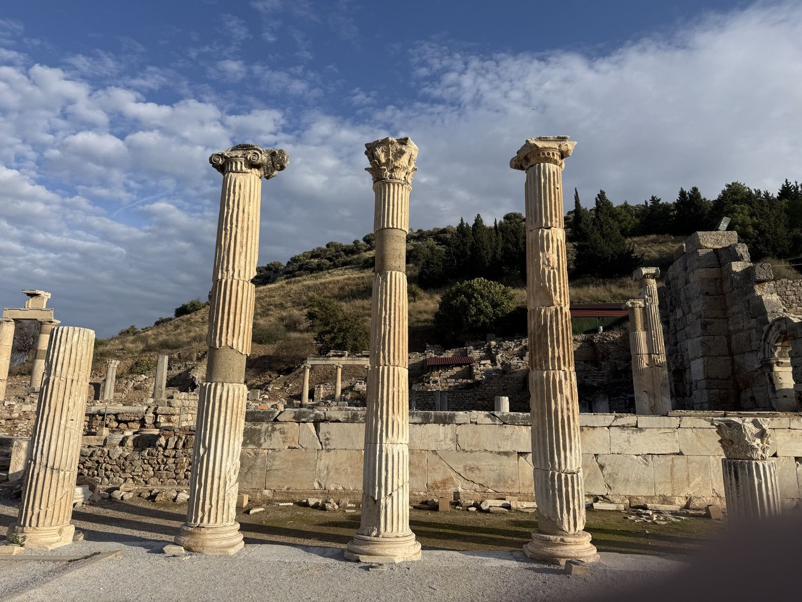
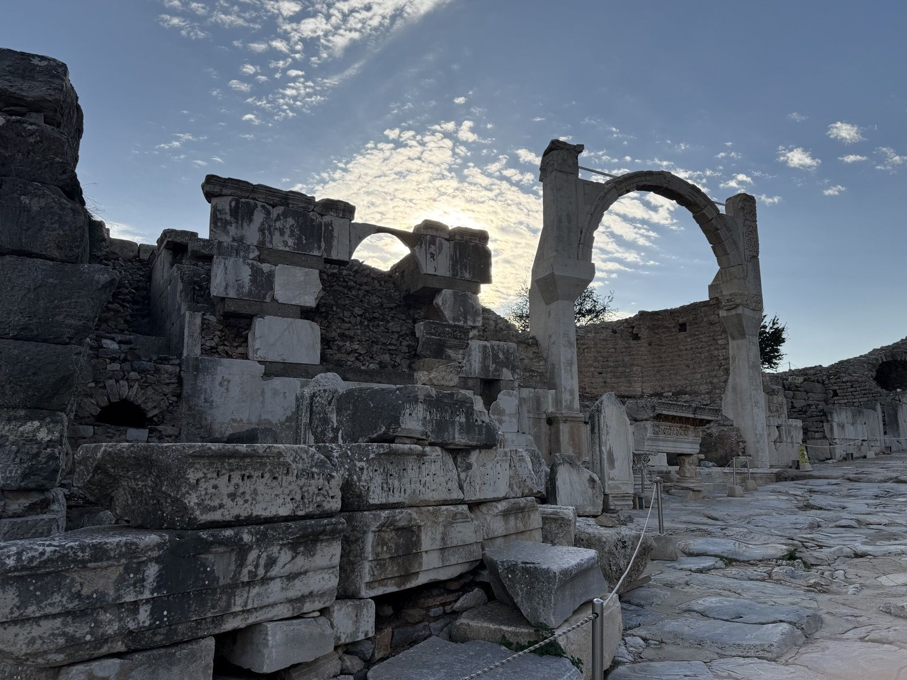
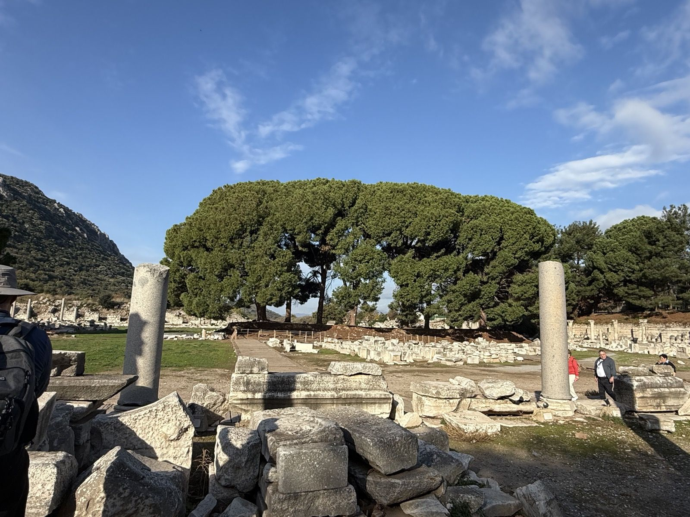

# Paul at Ephesus, Part 2: Ideas, Legacy, and Lessons in Leading Change

## Summary

Read this deep-dive chapter the evening of Day 7, after we have stood in the Great Theater. It explains grace and faith, 'neither Jew nor Greek,' one body with many parts, and love as the greatest virtue, then follows their influence through Augustine and the Reformation to modern ideas of conscience and equality, as well as the Christian anti-Judaism that later drew on his words. The second half treats Paul as a case study in change leadership: deciding what is essential, building a team, hub-and-spoke diffusion, respecting the economics of resistance, systems thinking, the implementation dip, and succession. Each lesson connects to AI-Native Schools, and the chapter ends with where the parallel breaks down and a personal leadership reflection.

## Concepts Covered

This chapter covers the following 43 concepts from the learning graph:

| Concept | Concept Impact Score |
|---------|-----------------------|
| Council of Jerusalem | 4 |
| Grace and Faith | 6 |
| Neither Jew Nor Greek | 3 |
| One Body Many Parts | 8 |
| Love as Greatest Virtue | 1 |
| Tentmaking | 2 |
| Augustine of Hippo | 3 |
| Protestant Reformation | 2 |
| Individual Conscience | 1 |
| Idea of Human Equality | 1 |
| Paul's Contested Legacy | 9 |
| Christian Anti-Judaism | 5 |
| Change Leadership | 64 |
| Legacy Institution | 18 |
| Direct Instruction | 11 |
| AI-Native School | 9 |
| Paul as Change Case Study | 32 |
| Insider Change Leader | 2 |
| Veteran Teacher Champions | 1 |
| Essential Versus Inherited | 3 |
| Grammar of Schooling | 2 |
| Seat Time and Carnegie Unit | 1 |
| Compelling Inclusive Vision | 1 |
| Lecture to Dialogue | 2 |
| Teacher as Coach | 1 |
| Diffusion of Innovation | 6 |
| Hub and Spoke Diffusion | 2 |
| Pilot School as Hub | 1 |
| Letters as Teaching Technology | 1 |
| Building a Team | 2 |
| Guiding Coalition | 1 |
| Economics of Resistance | 2 |
| Systems Thinking | 7 |
| School as a System | 6 |
| Implementation Dip | 2 |
| Change Fatigue | 1 |
| Sustainable Funding | 1 |
| Succession Planning | 6 |
| Anchoring Change in Culture | 5 |
| New Model Becomes Legacy | 4 |
| Who Is Hurt by Change | 4 |
| Limits of the Paul Parallel | 3 |
| Leadership Reflection | 2 |

## Prerequisites

This chapter builds on concepts from:

- [Chapter 2: Before We Go, Part 2: Traveling Well and the Learning for All Thread](../02-traveling-well/index.md)
- [Chapter 9: Paul at Ephesus, Part 1: The Apostle's Life, Letters, and Ephesian Years](../09-paul-life-letters/index.md)
- [Chapter 10: Day 7: Ephesus, a Greco-Roman City](../10-ephesus-greco-roman-city/index.md)

---

## Sailing for Rhodes

Day 7, Tuesday, November 17, ends on deck. The Viking Star leaves Kuşadası at 6:00 PM, as the sun goes down behind Samos, and runs south overnight past the islands of the Dodecanese to Rhodes, where it docks at 7:00 AM. Somewhere in the night the ship's clocks go back an hour, because we are leaving Turkey for Greece. Paul made nearly the same passage. Acts says that after the farewell at Miletus his ship sailed straight to Cos, the next day to Rhodes, and from there to Patara, on its way to Jerusalem. Tonight we follow his wake for the second night running.

This morning we walked down through the columns of the upper city of Ephesus and stood in the Great Theater where the silversmiths shouted for two hours. Chapter 9 told Paul's life and Chapter 10 walked his city; this chapter asks two new questions. First, what did Paul teach, and why have his ideas mattered so much, for good and for ill, for nearly two thousand years? For Christians his letters are scripture, so we describe what Paul argues and how Christians understand him, note where churches differ, and report where modern scholars read him differently. Second, what can someone who wants to change an old institution, such as a school, learn from how he worked? One of us, Dan, spends his working life helping schools use AI well, so for us the second question is personal.

<figure markdown="span" class="trip-photo">
  { loading=lazy }
  <figcaption>Standing columns in the upper city of Ephesus. Photo by Dan McCreary</figcaption>
</figure>

!!! mascot-welcome "From a Theater Riot to a Staff Room"
    { class="mascot-admonition-img" }
    Tonight we carry a tentmaker's workbench, a quarrel over who may sit at dinner, and a letter read aloud in a crowded house into a modern school staff room. By the time we reach Rhodes, a 1st-century argument about what is essential will help us ask which parts of a school are its purpose and which are only old habits. Look closer: the hardest questions about leading change were already being argued on this coast.

The chapter has eight parts. Part One explains Paul's central ideas: the decision at Jerusalem, grace and faith, "neither Jew nor Greek," one body with many parts, and love. Part Two follows those ideas through Augustine and the Reformation to modern ideas of conscience and equality. Part Three looks honestly at his contested legacy, including the Christian hostility to Jews that later drew on his words. Parts Four to Seven read Paul as a case study in leading change, setting each of his moves beside the work of bringing AI into schools: the institution to be changed, deciding what is essential, spreading and paying for the change, and the resistance, systems, and time that every real change meets. Part Eight asks where the comparison breaks down and ends with a reflection we can write before we sleep.

## Part One: Paul's Central Ideas

### The Council of Jerusalem

The **Council of Jerusalem** is the meeting, about 48 or 49 CE, at which the leaders of the early Jesus movement agreed that Gentile believers did not have to be circumcised or take on the whole Jewish law. Chapter 9 promised this story twice: it is where Titus became a test case, and it is the question underneath the quarrel at Antioch. "Council" is a later label. Acts calls it a gathering of "the apostles and the elders," and Paul calls it a private meeting with the leaders he names as the "pillars," James, Cephas (Peter), and John.

Acts 15 tells it as a public debate. Teachers from Judea had come to Antioch saying that Gentile believers could not be saved unless they were circumcised. The church sent Paul and Barnabas to Jerusalem. Peter spoke for welcoming the Gentiles as they were, Paul and Barnabas told of what God had done among the nations, and James, the brother of Jesus, gave the ruling: do not trouble the Gentiles, but write to them to keep away from four things: food offered to idols, sexual immorality, the meat of strangled animals, and blood. A letter carried the decision back to Antioch.

**Worked example: one meeting, two accounts.** Let's lay Paul's own account in Galatians 2 beside Acts 15, using Chapter 9's rule that Paul's own words come first.

| Question | Acts 15 | Galatians 2 |
|---|---|---|
| Why go to Jerusalem? | Sent by the church at Antioch after a dispute | "In response to a revelation" |
| Who was there? | Apostles, elders, and the whole church | Paul, Barnabas, Titus, and the "acknowledged leaders," met privately |
| Test case | None named | Titus, an uncircumcised Greek, was not compelled to be circumcised |
| Outcome | No circumcision for Gentiles; four things to avoid, sent by letter | No circumcision for Gentiles; Paul to go to the Gentiles and Peter to the Jews; "remember the poor" |
| What came next | The letter is read in Antioch with rejoicing | The quarrel at Antioch over shared meals |

The two agree on the core decision: Gentiles could belong without circumcision. They differ on the rest. Paul never mentions the four rules, and when the Corinthians later ask him about food offered to idols, he answers by appealing to conscience and care for others rather than by citing a Jerusalem letter. Most scholars think the two passages describe the same meeting, and some identify Galatians 2 with an earlier visit Acts mentions. Either way, this was the movement's first recorded decision about what was essential and what was not. Part Five returns to it as a lesson for anyone redesigning an old institution.

### Grace and Faith

Paul's teaching on **grace and faith** is his claim that people are put right with God as a gift, received through trust, and not by doing the works of the Jewish law. *Grace* translates the Greek *charis*, a favor freely given, the same word Paul put at the start of his letters. *Faith* translates *pistis*, which means trust and faithfulness as well as belief. The usual theological word for "put right" is *justified*, from the language of a law court. Paul states the idea in Galatians, "not by the works of the law but through faith in Jesus Christ," and develops it at length in Romans.

**Worked example: Paul's argument from Abraham.** Let's follow, step by step, the argument Paul uses in both Galatians and Romans, because it shows how he reasoned from his Bible.

1. Genesis says that Abraham "believed the Lord," and it was counted to him as righteousness.
2. In the order of Genesis, that verse comes before God commands Abraham to be circumcised.
3. So Abraham was counted righteous by trusting God while he was still, in effect, a Gentile.
4. So Abraham is the father of all who trust as he did, Jews and Gentiles alike, and circumcision is a sign of a righteousness that came first.

The argument is a Jewish reading of a Jewish text, made in the manner of the Pharisees' close study of scripture. Its point is the one decided at Jerusalem: Gentiles join Abraham's family by trust, as Abraham did.

Christians across the centuries have agreed that grace comes first, from God, and have disagreed about how it works. Modern scholars have also asked whether the familiar reading fits Paul's own situation. The table summarizes four broad positions; each covers a range of views within it.

| Reading | What "faith, not works of the law" means | Key texts or documents |
|---|---|---|
| Lutheran and many Protestant churches | A person is declared righteous by faith alone (*sola fide*), as a gift; good works follow as fruit | Luther's writings; Romans 3:28 |
| Catholic Church | Grace justifies and also transforms; faith is living when it works through love | Council of Trent (1547); Galatians 5:6 |
| Orthodox Churches | Salvation is healing and union with God, with human freedom cooperating with grace | The Greek Church Fathers |
| The "New Perspective on Paul" (scholars since about 1977) | "Works of the law" are chiefly the markers that set Jews apart from Gentiles; Paul's target is exclusion, not earning salvation | E. P. Sanders (1977); James Dunn (1982) |

The old quarrel has softened. In 1999 the Lutheran World Federation and the Catholic Church signed a *Joint Declaration on the Doctrine of Justification*, stating a shared understanding of the basic truths, and Methodist and other churches later joined it. The New Perspective, for its part, grew from E. P. Sanders' demonstration that the Judaism of Paul's day was not a religion of earning God's favor by good deeds, as Christian readers had long assumed. Scholars also debate whether Paul's phrase *pistis Christou* means "faith in Christ" or "the faithfulness of Christ." None of these debates is settled.

!!! mascot-encourage "Two Thousand Years of Careful Readers"
    { class="mascot-admonition-img" }
    If grace, faith, and works feel tangled, that is normal: Augustine, Luther, and whole church councils argued over these few verses. You already have the tool that helps most, from Chapter 9: read the letter as one side of a conversation. Ask who in Galatia was saying what, and Paul's argument comes into focus.

### Neither Jew Nor Greek

**Neither Jew nor Greek** is the King James Version's wording of Galatians 3:28, the verse that sums up Paul's vision of the new community. In a modern translation it begins "There is no longer Jew or Greek," goes on to say there is no longer slave or free, and no longer male and female, and ends that all are one in Christ Jesus. It names the three great divisions of the ancient world and declares that they no longer decide who belongs:

- **By people:** Jew or Greek, that is, Jew or Gentile.
- **By legal status:** slave or free.
- **By sex:** male and female.

The last pair echoes Genesis, "male and female he created them." The verse just before speaks of baptism, and similar lines appear in 1 Corinthians and in Colossians, so many scholars think Paul is quoting a saying spoken at baptism in the earliest communities. It was a statement about belonging, not a program of social reform. Paul did not call for the end of slavery, and his letters keep distinctions between men and women in worship. But in a city like Ephesus, where people sat in the theater by rank, a group in which a slave and a slaveholder ate at one table and called each other brother and sister was strange and new.

### One Body, Many Parts

**One body, many parts** is Paul's picture of the community as a single body whose members need one another, in 1 Corinthians 12 and again in Romans 12. He wrote it for the quarrelsome community Chapter 9 met: Corinthians who ranked one another by their spiritual gifts, prizing speaking in tongues above the rest, and whose shared suppers left the poor hungry. The foot, Paul writes, cannot say that because it is not a hand it does not belong to the body, and the eye cannot say to the hand, "I have no need of you." The members that seem weaker are indispensable, and the less honored are given greater honor. "If one member suffers, all suffer together with it."

The picture was not new, and that is the point. Every educated listener knew the body as a political image. The best-known version is a fable told by the Roman historian Livy: in 494 BCE, when the common people of Rome walked out of the city in protest, the senator Menenius Agrippa <audio id="audio-menenius-agrippa" src="../../audio/menenius-agrippa.mp3" preload="none"></audio><button onclick="document.getElementById('audio-menenius-agrippa').play()" class="pronounce-btn">🔊 Pronounce</button> *meh-NEE-nee-us uh-GRIP-uh* persuaded them to return with a story about the limbs that refused to feed the belly and so starved themselves.

**Worked example: the same picture, two morals.** Let's compare how Livy's senator and Paul use the body, line by line.

| | Menenius Agrippa's fable (Livy) | Paul's body (1 Corinthians 12) |
|---|---|---|
| Speaker | A senator, for the ruling class | An apostle, to a mixed community |
| Audience | Commoners on strike | Believers divided by status and gifts |
| Problem | The lower orders refuse to serve | The higher-status members look down on others |
| Moral | Every part should accept its place and serve the whole | The weaker parts are indispensable and deserve greater honor |
| Who should change? | The commoners | The strong |

Same image, opposite direction. The Roman fable tells the hands to keep feeding the belly; Paul tells the eye that it needs the hand. Part Seven comes back to this picture, because it is also one of the oldest descriptions of a system.

!!! mascot-thinking "An Old Picture Turned Upside Down"
    { class="mascot-admonition-img" }
    Notice how Paul persuades: he does not invent a new image, he takes the one everyone already knows and reverses its moral. A familiar picture lowers the cost of understanding, and the twist makes people remember it. Think of it as change carried inside something old.

### Love as the Greatest Virtue

**Love as the greatest virtue** is the theme of 1 Corinthians 13, the most quoted passage Paul wrote. Without love, he says, speaking in tongues is a noisy gong or a clanging cymbal, a sharp image in Corinth, a city famous for its bronze. Then comes the description heard at countless weddings, "Love is patient; love is kind," followed by what love is not: envious, boastful, arrogant, rude, or insistent on its own way. The chapter ends with faith, hope, and love, "and the greatest of these is love."

The word is *agapē* <audio id="audio-agape" src="../../audio/agape.mp3" preload="none"></audio><button onclick="document.getElementById('audio-agape').play()" class="pronounce-btn">🔊 Pronounce</button> *ah-GAH-pay*, a love of goodwill shown in action, as distinct from *erōs*, desire, and *philia*, friendship. Older English Bibles translated it "charity," from the Latin *caritas*. Paul did not write the passage for a wedding. He wrote it to the quarreling Corinthians, between his chapter on the body and his advice on keeping worship orderly, and every quality on the list corrects something they were doing. Read in place, it is less a poem about romance than a description of how people with very different gifts can live together.

## Part Two: How the Ideas Traveled

### Augustine of Hippo

**Augustine of Hippo** (354–430 CE) was a North African teacher of rhetoric who became bishop of Hippo, now Annaba in Algeria, and the most influential reader of Paul in the Western church. In his *Confessions*, written around 400, he tells how in a garden in Milan in 386 he heard a child's voice chanting "take up and read," opened a book of Paul's letters at Romans 13, and found his long indecision ended. From then on he read the world through Paul.

His reading hardened in a controversy, from about 411, with the British monk Pelagius <audio id="audio-pelagius" src="../../audio/pelagius.mp3" preload="none"></audio><button onclick="document.getElementById('audio-pelagius').play()" class="pronounce-btn">🔊 Pronounce</button> *puh-LAY-jee-us*. The two positions, in brief:

- **Pelagius:** people can choose the good by their own will, with God's law and Christ's example to help them.
- **Augustine:** the human will is so damaged by sin that grace must come first, before any good choice, as Paul argues in Romans.

Councils of African bishops condemned Pelagius' views in 416 and 418. Augustine also shaped how Christians would treat Jews, in his "witness" teaching, which Part Three describes. A thousand years later, an Augustinian friar in Germany would read Romans through Augustine's eyes.

### The Protestant Reformation

The **Protestant Reformation** is the 16th-century movement that split the Western church, beginning in Germany with Martin Luther (1483–1546), an Augustinian friar and professor of the Bible at Wittenberg. In his lectures on Romans in 1515 and 1516 and the years after, Luther came to read "the one who is righteous will live by faith" as a promise that God gives righteousness as a gift, not a demand to be met. On October 31, 1517, he issued his 95 Theses against the sale of indulgences, the church's grants of release from punishment for sin. The printing presses of Chapter 6 spread his pamphlets across Germany within weeks.

The movement soon had many branches, Lutheran, Reformed, Anabaptist, and Anglican among them. The Catholic Church answered at the Council of Trent (1545–1563). The Reformers' Paul was the Paul of Romans and Galatians, read through Augustine: justification by faith alone. The Orthodox churches of Greece and Turkey were never part of this Western quarrel, which is one reason their language about salvation sounds different. Two centuries later, on May 24, 1738, John Wesley, the founder of Methodism, heard Luther's preface to Romans read aloud in London and wrote that he "felt my heart strangely warmed." Paul's letter to a city he had never visited was still changing lives through a German friar's commentary on it. The table traces that chain of readers.

| Reader | When | What they read | What it set off |
|---|---|---|---|
| Paul | About 57 CE | His own argument, written to Rome | A letter the Roman believers kept and copied |
| Augustine | 386 CE | Romans 13, in a garden in Milan | His conversion, and the Western teaching that grace comes first |
| Luther | 1515–1516 | Romans 1:17, in his lectures at Wittenberg | The Reformation's "faith alone" |
| Wesley | 1738 | Luther's preface to Romans, read aloud in London | The Methodist movement |

### Individual Conscience

**Individual conscience** is the idea that each person has an inner judgment of right and wrong that others must respect and that the person may not betray. Paul gave the idea a word, *syneidēsis*, "conscience," which he uses more than any other New Testament writer. Two passages carry most of the weight:

- **Romans 2:** Gentiles who never received the law show its demands written on their hearts, with their conscience bearing witness.
- **1 Corinthians 8 and 10:** in the dispute over meat offered to idols, Paul tells the strong not to wound a weaker member's conscience, even when the weaker member is wrong.

The idea's most famous later moment came at the Diet of Worms in 1521, when Luther refused to recant before the emperor, saying, in the printed record, that his conscience was "captive to the Word of God." The line from Paul to modern freedom of conscience is long and runs through many other sources, from the Stoics to the Enlightenment, so Paul is one root among several. Scholars add a caution: in 1963 Krister Stendahl argued that Western readers since Augustine had projected their own anxious, introspective conscience onto Paul, who by his own account had a robust conscience and felt himself blameless under the law.

### The Idea of Human Equality

The **idea of human equality** is the conviction that all people share the same basic worth, whatever their birth, status, or sex. Galatians 3:28 became one of its most quoted texts. In the 19th century, opponents of slavery and advocates of women's rights cited it, along with the line in Acts that God made all nations "from one ancestor." Their opponents cited Paul too, especially the household rules of the disputed letters, "Slaves, obey your earthly masters." The contest over Paul shows in a single book. In 1807, a missionary society in London printed a *Slave Bible* for enslaved Africans in the British West Indies that left out most of the Bible, including, by published accounts, Galatians 3:28, while keeping the commands to obey. Those who wanted to keep people enslaved understood exactly what the verse could do.

## Part Three: A Contested Legacy

### Paul's Contested Legacy

**Paul's contested legacy** is the long argument over whether his influence has, on balance, freed people or bound them. Admirers see the apostle of grace, conscience, and equality. Critics have seen the man who turned Jesus' teaching into a church of doctrines: in an 1820 letter, Thomas Jefferson called Paul the first corrupter of the teachings of Jesus, and Friedrich Nietzsche blamed him for much of what he disliked in Christianity. Feminist scholars point to verses used for centuries to silence women; historians of slavery point to verses used to defend it.

**Worked example: checking six famous lines.** Chapter 9's distinction between undisputed and disputed letters matters here, but it does not settle the argument, because hard lines appear in both kinds. Let's take six lines often quoted as "Paul says" and ask of each: which letter, is that letter undisputed, and how has the line been used?

| Line, in brief | Letter | Status | How it has been used |
|---|---|---|---|
| "No longer Jew or Greek, slave or free, male and female" | Galatians 3:28 | Undisputed | For equality, by abolitionists and advocates of women's rights |
| Women should be silent in the churches | 1 Corinthians 14:34–35 | Undisputed letter; some scholars think these two verses were added later, since some manuscripts place them elsewhere | To bar women from preaching |
| "I permit no woman to teach" | 1 Timothy 2:12 | Disputed | To bar women from ordination |
| "Slaves, obey your earthly masters" | Ephesians 6:5; Colossians 3:22 | Disputed | By defenders of slavery |
| Be subject to the governing authorities | Romans 13:1 | Undisputed | To demand obedience to rulers, including by supporters of apartheid in South Africa, criticized by the *Kairos Document* of 1985 |
| A harsh charge against "the Jews" who killed Jesus | 1 Thessalonians 2:14–16 | Undisputed letter; some scholars think the passage is a later addition | Against Jews |

Three of the six lines come from letters nearly every scholar accepts. "Disputed" is a historical judgment about authorship, not a way to clear Paul of everything uncomfortable. What the table does show is that the same letters were quoted on both sides of the great moral arguments of later centuries, which is what a contested legacy means.

!!! mascot-warning "Check the Letter Before You Quote It"
    { class="mascot-admonition-img" }
    A common trap, in sermons and in arguments against Christianity alike, is to quote one line as "Paul says" with no context. Before using a line, check three things: which letter it is in and whether that letter is undisputed, what question the letter was answering, and how the line has been used since. That habit protects both Paul and the people his words have been used against.

### Christian Anti-Judaism

**Christian anti-Judaism** is hostility toward Jews and Judaism grounded in Christian teaching: the charge that the Jews as a people killed Jesus, the claim that God had rejected them and replaced them with the church, and the portrait of Judaism as a dead religion of rules. It is older than modern antisemitism, a word coined in the 1870s for a hatred based on supposed race, but it prepared the ground for it. Chapter 9 warned that "Pharisee" as a word for "hypocrite" belongs to this history.

Paul's own words point in more than one direction. In 1 Thessalonians he writes the harsh passage in the table above. But in Romans 9 to 11, his longest treatment of the question, he writes of "great sorrow and unceasing anguish" for his own people, asks whether God has rejected them, and answers, "By no means!" He pictures Gentile believers as wild branches grafted onto Israel's olive tree, warns them not to boast, because "it is not you that support the root, but the root that supports you," and says that "the gifts and the calling of God are irrevocable." Later Christians, from the preacher John Chrysostom <audio id="audio-chrysostom" src="../../audio/chrysostom.mp3" preload="none"></audio><button onclick="document.getElementById('audio-chrysostom').play()" class="pronounce-btn">🔊 Pronounce</button> *KRIS-us-tum* in 4th-century Antioch to Martin Luther, quoted the harsh lines and forgot the olive tree.

**Worked example: tracing the teaching of contempt.** The French Jewish historian Jules Isaac called this history "the teaching of contempt." Let's follow it through six moments to see how a quarrel inside one family became a weapon.

| When | What happened |
|---|---|
| 386–387 CE | John Chrysostom, a celebrated preacher in Antioch, later archbishop of Constantinople, preaches eight sermons against Christians who attend synagogue festivals, filled with abuse of Jews |
| Early 5th century CE | Augustine teaches that Jews must not be killed but should survive, scattered and humbled, as "witnesses" to the scriptures: a doctrine that both protected Jews and degraded them |
| 1096 | Crusaders on their way east massacre Jewish communities in the Rhineland |
| 1543 | Luther, disappointed that Jews had not converted, publishes *On the Jews and Their Lies*, urging that synagogues be burned |
| 1933–1945 | The Nazis reprint Luther's tract; about six million Jews are murdered in the Holocaust |
| 1965 | The Second Vatican Council's declaration *Nostra Aetate* states that Jews must not be presented as rejected or accursed by God, quoting Romans 11 |

The record has a second half. After the Holocaust, churches began to repudiate the teaching of contempt. *Nostra Aetate* <audio id="audio-nostra-aetate" src="../../audio/nostra-aetate.mp3" preload="none"></audio><button onclick="document.getElementById('audio-nostra-aetate').play()" class="pronounce-btn">🔊 Pronounce</button> *NOS-trah ay-TAH-tay* drew on Paul's own olive tree. In 1994 the Evangelical Lutheran Church in America formally rejected Luther's anti-Jewish writings, and scholars of the New Perspective set out to describe the Judaism of Paul's day as its own people understood it. Tomorrow, on Rhodes, Chapter 12 tells of the island's Jewish community, deported in 1944, at the end of a road this history helped to build.

!!! mascot-encourage "A Hard Section to Read"
    { class="mascot-admonition-img" }
    If this section is painful to read, it should be; many Christian readers find it the hardest part of Paul's story. You already hold the key Chapter 9 gave us: in Paul's time this was a quarrel inside one Jewish family. Keep that picture in mind, read Romans 11 alongside the harsh lines, and the later history becomes something we can face clearly rather than defend.

The timeline below sets twelve later moments in Paul's influence side by side, so we can see how one set of letters fed very different strands.

#### Diagram: How Paul's Words Traveled

<iframe src="../../sims/how-pauls-words-traveled/main.html" height="656px" width="100%" scrolling="no"></iframe>

[Run the How Paul's Words Traveled MicroSim Fullscreen](../../sims/how-pauls-words-traveled/main.html){ .md-button .md-button--primary }

How Paul's Words Traveled

Type: timeline
**sim-id:** how-pauls-words-traveled 
**Library:** vis-timeline 
**Status:** Specified 
**Bloom Level:** Analyze 
**Bloom Verb:** organize 
**Learning Objective:** The learner will organize twelve dated events from 386 CE to 1999 into four strands of Paul's later influence (grace and faith; conscience and equality; contempt and its repudiation; rereading Paul), placing at least 10 of 12 in the correct strand.

**Prerequisites:** grace and faith, individual conscience, the idea of human equality, Christian anti-Judaism, the New Perspective on Paul, Augustine of Hippo, the Protestant Reformation (all defined in the chapter above this block).

**Evidence of Mastery:** The learner drags each of 12 event cards into one of four horizontal strands on the timeline. The card's date is fixed; only its strand is chosen. A placement is correct when it matches the "Correct strand" column in Content. Mastery is 10 of 12 correct on the first Check. Reading event details is exploration, not evidence.

**Misconceptions:** (1) Paul's influence ran in one direction, either all good or all harmful. (2) Each historical figure belongs to one strand; in fact Luther appears in three. (3) Scholarly rereading of Paul is a recent fad with no history; it began in the 1960s and 1970s. (4) The Reformation was about conscience alone; its starting point was grace.

**Instructional Rationale:** Organizing events into strands is an Analyze task: the learner must break each event down to the Pauline idea it carried. Seeing one figure, Luther, land in three strands makes the contested legacy concrete in a way a single narrative cannot.

**Content:**

Strands, with the definition shown on each:

- **Grace and faith:** events in which Paul's teaching that people are put right with God by grace, through faith, was received or argued over.
- **Conscience and equality:** events in which Paul's words were used for, or against, individual conscience or the equal worth of people.
- **Contempt and its repudiation:** events in Christian treatment of Jews that drew on, or later corrected, readings of Paul.
- **Rereading Paul:** scholarly work that changed how Paul is read.

Event cards, in this fixed order:

| # | Date | Event shown to the learner | Correct strand | Why (shown as feedback) |
|---|---|---|---|---|
| 1 | 386 CE | Augustine reads Romans 13 in a garden in Milan and ends his indecision | Grace and faith | His conversion through Paul shaped his later teaching that grace comes first. |
| 2 | c. 386–387 CE | John Chrysostom preaches eight sermons in Antioch against Christians who attend synagogue festivals | Contempt and its repudiation | The sermons are a classic of anti-Jewish preaching. |
| 3 | 1517 | Luther issues the 95 Theses against the sale of indulgences | Grace and faith | His protest grew from his reading of Romans: righteousness is a gift, not something bought or earned. |
| 4 | 1521 | Luther tells the Diet of Worms his conscience is captive to the Word of God | Conscience and equality | A founding moment for the idea that conscience must not be forced. |
| 5 | 1543 | Luther publishes *On the Jews and Their Lies* | Contempt and its repudiation | The tract urged burning synagogues and was later reprinted by the Nazis. |
| 6 | 1738 | John Wesley hears Luther's preface to Romans read and feels his heart "strangely warmed" | Grace and faith | Romans, read through Luther, started the Methodist movement. |
| 7 | 1807 | A *Slave Bible* printed in London for the British West Indies leaves out Galatians 3:28 | Conscience and equality | Removing "no longer slave or free" shows that slaveholders feared the verse's power. |
| 8 | 1963 | Krister Stendahl argues that the West read its own anxious conscience into Paul | Rereading Paul | A scholarly correction of the Augustine-to-Luther reading. |
| 9 | 1965 | *Nostra Aetate* says Jews must not be presented as rejected or accursed by God, quoting Romans 11 | Contempt and its repudiation | The Catholic Church repudiated the teaching of contempt, using Paul's own words. |
| 10 | 1977 | E. P. Sanders shows that the Judaism of Paul's day was not a religion of earning salvation | Rereading Paul | His work launched the "New Perspective on Paul." |
| 11 | 1982 | James Dunn names the "New Perspective on Paul" in a lecture | Rereading Paul | He read "works of the law" as the markers that separated Jews from Gentiles. |
| 12 | 1999 | Lutherans and Catholics sign a *Joint Declaration on the Doctrine of Justification* | Grace and faith | It stated a shared understanding of the question that split the Western church in the 1500s. |

Answer counts: Grace and faith 4, Conscience and equality 2, Contempt and its repudiation 3, Rereading Paul 3.

**Provenance:** Events, dates, and strands come from this chapter's sections "Grace and Faith," "Augustine of Hippo," "The Protestant Reformation," "Individual Conscience," "The Idea of Human Equality," and "Christian Anti-Judaism." Dates before 1500 are shown with "c." where the chapter gives them as approximate.

**Rules:**

- The timeline runs from 300 CE to 2025, with four strands as horizontal lanes.
- Each card has a fixed date and exactly one correct strand, given in Content.
- Check is available when all 12 cards are placed; it scores all 12 at once.
- After Check, correct cards lock; incorrect cards are marked and show the correct strand.

**Learner Activity:**

1. The learner reads the four strand definitions.
2. The learner drags each card, already set at its date, into a strand.
3. The learner presses Check; the score and feedback for each card appear.
4. The learner can then select any card to read its "Why" text.
5. The learner should notice that the three Luther cards (3, 4, 5) fall in three different strands, and that the contempt strand turns toward repudiation only after the Holocaust.

**Feedback:** Twelve cards, placed in any order, one Check. Correct card: "Correct. [Why]" Incorrect card: "This one belongs in [correct strand]. [Why]" After Check: "[n] of 12 placed correctly. Mastery is 10." If n < 10, a "Try again" option returns all cards to the tray in the same order. A note appears after Check: "One man, Martin Luther, appears in three strands."

**Starting State:** Four empty lanes on a timeline from 300 CE to 2025, the 12 cards in a tray in the fixed order, and the question "Which strand of Paul's legacy did each event carry forward?"

**Chapter Anchors:** Augustine read Romans 13 in Milan in 386; Chrysostom's eight sermons, 386–387; 95 Theses, October 31, 1517; Worms, 1521; *On the Jews and Their Lies*, 1543; Wesley, May 24, 1738; *Slave Bible*, 1807; Stendahl, 1963; *Nostra Aetate*, 1965; Sanders, 1977; Dunn, 1982; *Joint Declaration*, 1999; twelve events; four strands.

## Part Four: Paul as a Case Study in Leading Change

The rest of this chapter reads Paul for his methods, not his message. That is a narrow way to read a man whom more than two billion people regard as an apostle, and Part Eight says plainly what it leaves out. But Paul is unusually useful to anyone who leads change, because he left something leaders rarely leave: his own letters, written in the middle of the work, to the people he was trying to change, about the problems that were going wrong.

### Change Leadership

**Change leadership** is the work of moving people and an organization from one way of doing things to another, especially when the leader cannot simply order the change. It differs from management. John Kotter of Harvard Business School put the distinction this way in 1990: management copes with complexity, keeping a large organization running predictably through plans, budgets, and staffing; leadership copes with change, setting a direction, aligning people behind it, and motivating them through the hard middle. A school needs both. A principal who runs a good timetable is managing; a principal who persuades forty teachers to teach differently is leading.

Change leadership matters most when the people who must change have the power to refuse. Teachers have that power. A district can buy software for every classroom, but only teachers can decide to use it well, and research on technology in schools, summed up by the historian Larry Cuban as "oversold and underused," shows how often they decide not to. *AI-Native Schools* surveys the main models leaders use in [Organizational Change Models](https://dmccreary.github.io/ai-native-schools/chapters/16-organizational-change-models/): Kotter's eight steps, Lewin's unfreeze-change-refreeze, ADKAR, Bridges' transitions, Schein's culture levels, Senge's learning organization, Fullan's educational change, and the Concerns-Based Adoption Model.

**Worked example: three changes on our route.** Let's compare three changes by asking how much power the leader had to command, how long the change took, and what it cost. The first is the Turkish alphabet reform of 1928 from Chapter 7. The second is Paul's mission to the Gentiles. The third is a principal introducing an AI-supported morning of self-paced learning in an ordinary school.

| | Alphabet reform, 1928 | Paul's Gentile mission | An AI-supported morning in a school |
|---|---|---|---|
| Leader | Atatürk and a one-party government | A traveling tentmaker with a few co-workers | A principal and a leadership team |
| Power to command | Total: a law, with deadlines | None: every member joined by choice | Partial: can change schedules, cannot make teachers believe |
| How people changed | Free evening classes for adults, new signs, new newspapers | Persuasion, small groups, letters, visits | Pilots, training, coaching, evidence |
| Time | A few years for the switch | About thirty years of Paul's life, and centuries after | Several years, by Fullan's estimate |
| Cost | A generation cut off from its written past | Conflict, prison, quarrels with allies | The implementation dip, lost routines, uneven access |

The table shows a trade-off. The more power the leader has, the faster the visible change and the higher the risk that people comply without committing. Paul had no power at all, which forced him to rely on persuasion, and persuasion built communities that kept going without him. A school leader sits in the middle column's position more often than the first: the formal authority to change a schedule, and no authority at all over what teachers believe.

!!! mascot-thinking "Leading Without the Power to Command"
    { class="mascot-admonition-img" }
    Notice that Paul could not fire, promote, or pay anyone, yet communities he founded outlived him by two thousand years. Change that rests on persuasion is slower to start and much harder to undo. Think of formal authority as a way to clear obstacles, not as a way to change minds.

### Legacy Institution

A **legacy institution** is an organization old and established enough that its structures, habits, and sense of itself were inherited from an earlier age, and that resists redesign because many people depend on it working as it does. The term comes from computing, where "legacy systems" are old software that still runs critical work and is too risky to replace. Legacy is not a criticism. A legacy institution survived because it served real needs.

Ephesus was full of them. The cult of Artemis had run for centuries, with its temple, priests, festivals, processions, and pilgrims, and it supported a whole economy of silversmiths, innkeepers, and sellers of sacrificial animals. The city's civic institutions, its council, its assembly in the theater, and its benefactors' monuments, gave structure to everyone's life.

<figure markdown="span" class="trip-photo">
  { loading=lazy }
  <figcaption>A lone arch above fallen blocks in the upper city of Ephesus. Photo by Dan McCreary</figcaption>
</figure>

**Worked example: two legacy institutions.** Let's set the cult of Artemis of Ephesus beside the modern public school and compare what makes each hard to change.

| | The cult of Artemis at Ephesus | The modern public school |
|---|---|---|
| Age in Paul's day or ours | About six centuries since the first great temple, begun about 550 BCE | About 175 years since the age-graded school, often dated to Boston in 1848 |
| What it provided | Worship, civic pride, pilgrims, a treasury that held deposits | Learning, childcare, safety, meals, a path to work and college |
| Who depended on it | Priests, silversmiths, innkeepers, the whole city's honor | Students, families, teachers, staff, colleges, employers, bus companies |
| How it resisted change | A riot in the theater, defended by the city's pride | Contracts, schedules, laws, and the expectations of parents who went to the same kind of school |

The second column's list of dependents is the reason schools change slowly: in the United States alone, public schools serve about 50 million students and employ more than 3 million teachers. Any change has to keep all of those functions running while it happens. *AI-Native Schools* traces how the industrial-era school took its shape in [School Structures, Equity, and the Industrial-Era Legacy](https://dmccreary.github.io/ai-native-schools/chapters/03-school-structures-equity-industrial-era/).

### Direct Instruction

**Direct instruction** is a teacher-led method in which the teacher explains and models new content, guides students through practice, checks their understanding, and then has them practice on their own, a pattern often summed up as "I do, we do, you do." In capitals, Direct Instruction names a specific scripted program developed by Siegfried Engelmann in the 1960s. In lowercase it names the general approach, the core of the legacy school's day. It works well, especially for beginners who need clear explanation, and it has one built-in limit: the whole room moves at one pace.

**Worked example: one lesson, twenty-eight students.** Let's use the class *AI-Native Schools* analyzes in [The Building Blocks of Schools, Students, and Learning](https://dmccreary.github.io/ai-native-schools/chapters/01-building-blocks-schools-students/). In an illustrative seventh-grade math class of 28 students, readiness ranges from grade 3 to grade 10. The teacher pitches the lesson at grade 7, and a lesson is in reach for a student at that level or one level below it.

- **In reach:** the 13 students at grades 6 and 7.
- **Too hard:** the 7 students at grades 3 to 5.
- **Already known:** the 8 students at grades 8 to 10.

Moving the pitch up or down does not help: no single pitch reaches more than 13 of the 28. The teacher is not doing anything wrong. The method itself, one explanation at one pace, turns ordinary differences in readiness into growing gaps. That is the problem the next idea tries to solve, and the reason direct instruction is both the strength and the bottleneck of the legacy school.

### The AI-Native School

An **AI-native school** is the design *AI-Native Schools* proposes: a school built around a purpose and a way of teaching first, and then equipped with the AI that serves them. Its core is the morning-afternoon model, summed up in a single line, "mornings with AI, afternoons with each other." In the morning, students work through the academic core at their own pace, with adaptive software and teachers who coach; in the afternoon, they learn with other people, in projects, discussion, and activities that build human skills. The book contrasts it with an "AI-first" school, which is defined by its technology rather than its learning goals, in [Designing the AI-Native School Day](https://dmccreary.github.io/ai-native-schools/chapters/20-designing-ai-native-school-day/).

**Worked example: where the time comes from.** Let's follow the book's illustrative arithmetic, from [Mastery Learning and the Case for a Compressed Morning](https://dmccreary.github.io/ai-native-schools/chapters/11-mastery-learning-case-compressed-morning/). Five academic periods of 50 minutes make 250 minutes a day: in each, about 5 minutes of settling, 20 of whole-class explanation, 20 of practice, and 5 of wrap-up. In a compressed morning, settling and wrap-up shrink to 10 minutes in all, explanation becomes 50 minutes of short segments each student takes at their own pace, and practice with immediate feedback takes 90 minutes.

| Part of the academic morning | Traditional (minutes) | Compressed (minutes) |
|---|---|---|
| Settling, attendance, wrap-up | 50 | 10 |
| Explanation | 100 | 50 |
| Practice | 100 | 90 |
| Total | 250 | 150 |

The compressed morning frees 250 − 150 = 100 minutes a day for the afternoon. The book labels these figures a scenario, not data, and the freed time appears only if the self-paced morning actually works. Notice what the design keeps (practice, explanation, feedback) and what it drops (waiting for the whole room), a distinction Part Five develops.

### Paul as a Change Case Study

**Paul as a change case study** means reading his mission as a documented example of leading change, much as a business school reads the history of a company. A case study is a detailed account of one real situation, used to draw lessons for others. Paul makes an unusually good one for three reasons. His letters are primary sources written during the change, by the leader, to the people changing. They cover about ten years and many sites, so we see the same leader working in different conditions. And they record failure as well as success: quarrels, factions, opposition, and communities that slid back after he left.

The method is to ask of each episode, "What problem was Paul solving, and what does that problem look like in a school today?" The answers make the map for Parts Four to Seven.

**Worked example: a map from Paul's world to a school's.** Let's lay out the episodes this chapter uses, the leadership idea each illustrates, and where *AI-Native Schools* treats the modern version.

| Episode | Leadership idea | The school version | Where AI-Native Schools goes deeper |
|---|---|---|---|
| A Pharisee who knew the law from inside | Insider change leader | A respected veteran teacher who changes her mind | Chapter 15 |
| The Council of Jerusalem | Essential versus inherited | Separating the purpose of school from its inherited forms | Chapter 18 |
| "Neither Jew nor Greek" | Compelling inclusive vision | "Mornings with AI, afternoons with each other" | Chapter 17 |
| Ephesus and its spokes | Hub-and-spoke diffusion | A pilot school that others visit | Chapters 15 and 19 |
| Timothy, Titus, Priscilla, Phoebe | Building a team | A guiding coalition | Chapter 17 |
| The silversmiths' riot | Economics of resistance | Teachers' fear for their jobs | Chapter 19 |
| One body, many parts | Systems thinking | The school as a system of connected parts | Chapter 18 |
| Corinth's troubles after he left | Implementation dip | The drop in results before a change pays off | Chapter 16 |
| The farewell at Miletus | Succession planning | A change that survives its champion | Chapter 17 |

Nine episodes, nine ideas. The rest of the chapter takes them one at a time, and Part Eight asks where the map is wrong.

### The Insider Change Leader

An **insider change leader** is someone who leads change from within the institution or tradition being changed, with the knowledge and credibility of a member. Paul was an insider twice over. He was a Pharisee who could argue from the Torah in the style of his teachers, and he had been the movement's fiercest opponent before the road to Damascus. When he argued that Gentiles could belong without the law, no one could say he did not know the law. Insiders know where the real constraints are, speak the language, and are harder to dismiss as naive. They also pay a price: Paul's former colleagues saw him as a traitor, and some within the movement suspected him as a newcomer. In a school, the insider is the teacher who has run a classroom for twenty years, not the consultant who flies in for a day.

### Veteran Teacher Champions

**Veteran teacher champions** are experienced, respected teachers who adopt a change early and help colleagues through it. They are the school's version of the insider. *AI-Native Schools* makes the point in [Technology Adoption and the Diffusion of Innovation](https://dmccreary.github.io/ai-native-schools/chapters/15-technology-adoption-diffusion-innovation/): to persuade cautious colleagues, choose the respected skeptic who changed her mind publicly, not the biggest enthusiast, because colleagues believe someone like themselves. A veteran who has mastered direct instruction knows exactly what a new method must do better, and her endorsement carries that knowledge with it. [Microstrategies for Leading Change](https://dmccreary.github.io/ai-native-schools/chapters/19-microstrategies-leading-change/) adds a warning, because the first adopter can burn out and become a cautionary tale instead of a model. A champion needs:

- **Protected time** to try the change and help colleagues.
- **A lighter load elsewhere**, so the extra work is not unpaid overtime.
- **Recognition**, in public, for taking the risk first.

## Part Five: Deciding What Is Essential

### Essential Versus Inherited

**Essential versus inherited** is the distinction between what an institution exists to do and the particular forms through which it happened to do it. The Council of Jerusalem drew that line. Faith in Jesus as the Messiah, the leaders decided, was essential for Gentile believers; circumcision and the whole law, the inherited form of belonging to Israel's God, were not to be required of them. For Jewish believers, the law remained their way of life; the decision was about what could not be imposed on newcomers. It was the most consequential decision the early movement made, and it was made by deciding what to stop requiring.

Every redesign of a school turns on the same question. Learning to read, getting feedback on practice, and being known by a caring adult are the purposes. The 50-minute period, the grade level set by birth year, and the lecture to the whole class are forms that served those purposes under the constraints of an earlier age. Mistaking one for the other leads to two errors: defending a form as if it were the purpose, or throwing out a purpose along with a form.

!!! mascot-tip "Ask What Problem It Solved"
    { class="mascot-admonition-img" }
    Here's a quick test for any practice in a school, or any institution: ask "What problem did this solve when it began, and does that problem still exist in the same form?" If the problem is gone or can now be solved another way, the practice is probably inherited. If the answer is "it is the point of the whole enterprise," it is essential.

### The Grammar of Schooling

The **grammar of schooling** is the historians David Tyack and William Tobin's phrase, from 1994, for the regular structures that organize nearly every school: dividing time into periods, sorting students into age-graded classes, assigning them to separate classrooms with one teacher each, and splitting knowledge into subjects. Like the grammar of a language, it is mostly invisible to the people who use it, and it shapes everything they say. Tyack and Tobin asked why it had been so hard to change and found that it is embedded in the expectations of teachers, parents, and lawmakers, so reforms that disturb it are absorbed or rejected. Tyack and Larry Cuban later called the century of reform efforts *Tinkering Toward Utopia*. *AI-Native Schools* takes up the idea in [Sustaining Change: Systems Thinking and National Adoption](https://dmccreary.github.io/ai-native-schools/chapters/18-sustaining-change-systems-thinking/), where it explains why a school can install new software and keep lecturing, "reform without real change." The grammar of schooling is the school's equivalent of the inherited law: deep, honored, and not the same thing as the purpose.

### Seat Time and the Carnegie Unit

**Seat time** is the amount of time a student spends in class, used as the measure of how much instruction has been received. The **Carnegie unit** is the standard high school credit built on it, defined in 1906 by the Carnegie Foundation for the Advancement of Teaching as 120 hours of class in one subject over a school year. It was created for a practical reason, to decide which colleges qualified for the Foundation's pensions and to give colleges a common way to read high school transcripts, and most American high schools still award credit on that basis. Its weakness is that it counts hours, not learning: a student who already knows the material and a student who is lost earn the same credit. It is a clear example of an inherited form, and the sorter below asks us to tell such forms from the purposes they serve.

#### Diagram: Essential or Inherited?

<iframe src="../../sims/essential-or-inherited-school-practices/main.html" height="574px" width="100%" scrolling="no"></iframe>

[Run the Essential or Inherited? MicroSim Fullscreen](../../sims/essential-or-inherited-school-practices/main.html){ .md-button .md-button--primary }

Essential or Inherited?

Type: microsim
**sim-id:** essential-or-inherited-school-practices 
**Library:** p5.js 
**Status:** Specified 
**Bloom Level:** Evaluate 
**Bloom Verb:** judge 
**Learning Objective:** The learner will judge whether each of twelve school practices is an essential purpose of schooling or an inherited form that served that purpose under earlier constraints, judging at least 10 of 12 correctly, including both items of the trap pair.

**Prerequisites:** essential versus inherited, the Council of Jerusalem, the grammar of schooling, seat time, the Carnegie unit, direct instruction, the AI-native school (all defined in the chapter above this block).

**Evidence of Mastery:** For each of 12 practice cards, the learner chooses Essential or Inherited before feedback appears. A choice is correct when it matches the "Correct judgment" column in Content. Mastery is 10 of 12 correct on the first attempt, including cards 5 and 11, the trap pair.

**Misconceptions:** (1) Inherited means worthless or harmful; in fact inherited forms solved real problems and may still be useful. (2) Whatever schools have always done must be essential. (3) Checking that a student has learned (card 5) is the same as everyone taking the same test on the same day (card 11). (4) Explanation by a teacher is inherited; what is inherited is the single pace for the whole room (card 10).

**Instructional Rationale:** Judging each practice against a stated criterion is an Evaluate task. The criterion, the chapter's test "What problem did this solve, and does that problem still exist in the same form?", is shown on every card, and the trap pair forces the learner to separate a purpose from the form that once carried it.

**Content:**

The criterion shown at the top: "Essential: part of what a school is for. Inherited: one way of doing it that answered the constraints of an earlier age."

Cards, in this fixed order:

| # | Practice shown to the learner | Correct judgment | Why (shown as feedback) |
|---|---|---|---|
| 1 | Every student learns to read, write, and reason with numbers. | Essential | This is the academic core a school exists to teach. |
| 2 | A high school credit equals about 120 hours of class time. | Inherited | The Carnegie unit was defined in 1906 to standardize transcripts and pensions; it measures hours, not learning. |
| 3 | Students get timely, specific feedback on their practice. | Essential | Feedback is how practice turns into learning, whatever the method. |
| 4 | Students are grouped into grades by birth year. | Inherited | Age grading spread in the 19th century to move many children through a building; it sorts by age, not readiness. |
| 5 | Someone checks that a student has really learned a skill before building on it. (trap) | Essential | Checking mastery is part of teaching; only the way and the timing of the check are matters of form. |
| 6 | A bell moves every student to a new subject about every 50 minutes. | Inherited | The period schedule coordinates a large building; it is one way to divide time, not a purpose. |
| 7 | Each student is known well by at least one caring adult. | Essential | Relationships with adults are part of what a school is for, and AI does not replace them. |
| 8 | Students sit in rows facing the teacher. | Inherited | Rows suit one person explaining to many; other arrangements suit other ways of learning. |
| 9 | Students practice working, talking, and disagreeing well with other people. | Essential | Learning with others is a core purpose; it is what the AI-native afternoon is for. |
| 10 | New material is explained to the whole class at a single pace. | Inherited | Explanation is essential; one pace for everyone is the inherited form, which leaves many students out of reach. |
| 11 | Every student takes the same unit test on the same day. (trap) | Inherited | Checking learning is essential (card 5); the shared date comes from moving a whole class together. |
| 12 | Students are safe in body and mind during the school day. | Essential | Safety is a precondition of learning, and families rely on it. |

Answer counts: Essential 6, Inherited 6. Trap pair: cards 5 and 11.

**Provenance:** Cards 2, 4, 6, and 10 come from this chapter's sections "Seat Time and the Carnegie Unit," "The Grammar of Schooling," and "Direct Instruction," which follow *AI-Native Schools*, Chapters 1, 3, and 18. Cards 1, 3, 7, and 9 follow the chapter's sections "Essential Versus Inherited" and "The AI-Native School." The judgments apply the chapter's stated criterion; the sim labels the set "Judgments follow this chapter's criterion; reasonable people may weigh some forms differently."

**Rules:**

- Each card has exactly one correct judgment, given in Content.
- One scored attempt per card; the first choice is the one scored.
- Score is the number of first-attempt correct choices, 0 to 12.
- Mastery is score >= 10 with cards 5 and 11 both correct.
- Cards appear one at a time in the fixed order.

**Learner Activity:**

1. The learner reads the criterion.
2. For each card, the learner chooses Essential or Inherited.
3. Feedback appears, and the card joins one of two growing columns, Essential or Inherited, marked correct or incorrect.
4. After card 12, the learner sees both columns side by side, with cards 5 and 11 linked by a line labeled "purpose and form."
5. The learner should notice that every inherited form on the list serves an essential purpose on the list, which is why it is hard to change.

**Feedback:** Twelve cards, fixed order, one scored attempt each. Correct: "Correct. [Why]" Incorrect: "This one is [correct judgment]. [Why]" If card 11 is judged Essential: add "The check is essential; the shared test date is a form." If card 10 is judged Essential: add "Keep the explanation, question the single pace." After card 12: "[n] of 12 correct." If mastery is met: "You can separate a purpose from the form that carried it." Otherwise: "Look again at cards 5 and 11: which is the purpose, and which is one way of doing it?" A "Try again" option repeats all twelve cards.

**Starting State:** The criterion, two empty columns labeled Essential and Inherited, and card 1, with the question "Is this part of what a school is for, or one way of doing it?"

**Chapter Anchors:** Carnegie unit defined in 1906 as 120 hours of class time; the test "What problem did this solve when it began, and does that problem still exist in the same form?"; 50-minute periods; twelve practices, six of each.

### A Compelling Inclusive Vision

A **compelling inclusive vision** is a short, vivid picture of the future that people want to belong to and that names who is included. "Neither Jew nor Greek, slave nor free, male and female" is such a vision: a single sentence that any listener could remember and repeat, and that told outsiders they were wanted. Kotter calls a change vision one of the early steps of leading change; Peter Senge adds that a vision announced from above produces compliance, while a vision people help shape produces commitment. *AI-Native Schools* builds its own vision into one line, "mornings with AI, afternoons with each other," and explains the difference between an announced vision and a shared one in [Leading Change: Vision, Culture, and Early-Stage Concerns](https://dmccreary.github.io/ai-native-schools/chapters/17-leading-change-vision-culture/). The inclusive part matters: a vision for AI in schools that names only the students who already have devices and supportive homes is not compelling to anyone else.

### From Lecture to Dialogue

**Lecture to dialogue** names the shift from one person delivering a finished message to a teacher and students reasoning together. Paul's method in Ephesus already leaned that way. Acts says that in the synagogue and then for two years in the hall of Tyrannus, Paul was *dialegomenos*, "reasoning" or "discussing," the Greek verb that gives us "dialogue." His letters show the same habit in writing: he raises his readers' objections ("What then are we to say?") and answers them, in the question-and-answer style of the Greek teachers Chapter 9 met, which goes back to Socrates. A lecture moves information from one head to many; a dialogue makes the listeners do the thinking. An AI tutor can take over much of the explanation that once filled a lecture, which leaves the teacher free for the part that dialogue does best.

### Teacher as Coach

**Teacher as coach** is the role, in an AI-native school, of helping students set goals, practice, and improve, with specific feedback and encouragement, as a sports coach does. *AI-Native Schools* names it as one of four overlapping roles:

- **Coach:** goals, practice, and specific feedback.
- **Mentor:** a longer relationship that guides a student's growth as a person.
- **Facilitator:** setting up group work, asking deepening questions, and stepping back.
- **Learning guide:** a term some AI-first schools use for an adult who supports motivation and progress, who may not be a subject expert.

Together they make up what the book calls the changing teacher role, a shift from presenting content to the whole class toward guiding individuals and groups, often summed up in Alison King's 1993 phrase "from sage on the stage to guide on the side." The book insists that this does not mean teachers matter less. When software takes over routine delivery, a teacher's knowledge of what students find hard, how to explain it a second way, and when a student is in trouble matters more. Paul's co-workers did something similar for his letters: the letter delivered the content, and the carrier stayed to explain, answer questions, and report back.

## Part Six: Spreading the Change

### Diffusion of Innovation

**Diffusion of innovation** is the process by which a new idea or practice spreads through a community over time, described in Everett Rogers' *Diffusion of Innovations*, first published in 1962. Rogers built on a 1943 study of Iowa farmers, who took about a decade to adopt a clearly better hybrid seed corn because they learned from neighbors they trusted, not from bulletins. He divided adopters into five groups by how early they adopt: innovators (2.5 percent), early adopters (13.5 percent), the early majority (34 percent), the late majority (34 percent), and laggards (16 percent). *AI-Native Schools* explains the groups and Geoffrey Moore's "chasm" between the early adopters and the early majority in [Technology Adoption and the Diffusion of Innovation](https://dmccreary.github.io/ai-native-schools/chapters/15-technology-adoption-diffusion-innovation/), the chapter Chapter 6 used for the printing press.

**Worked example: one high school's sixty teachers.** Let's apply Rogers' percentages to a high school with 60 teachers, rounding to whole people.

| Group | Share | Exact | Teachers |
|---|---|---|---|
| Innovators | 2.5% | 1.5 | about 2 |
| Early adopters | 13.5% | 8.1 | about 8 |
| Early majority | 34% | 20.4 | about 20 |
| Late majority | 34% | 20.4 | about 20 |
| Laggards | 16% | 9.6 | about 10 |
| Total | 100% | 60 | 60 |

A principal whose AI pilot thrills 10 teachers has reached the innovators and early adopters, one sixth of the staff, and has not yet started on the 20 who will move only when they see colleagues like themselves succeed. Those 10 enthusiasts are not proof that the change will spread; they are the people who must now persuade the next 20.

Paul's communities spread the way Rogers describes: through trusted relationships, household by household, often beginning with the God-fearers who already stood between the synagogue and the city.

### Hub-and-Spoke Diffusion

**Hub-and-spoke diffusion** is a pattern of spread in which a change is established firmly at one central place, the hub, and then carried out along connections, the spokes, to other places by people who travel between them. Chapter 9's worked example showed Ephesus working this way: Paul stayed in the capital of the province, and co-workers such as Epaphras carried the message to Colossae, Laodicea, and Hierapolis, places Paul himself never visited. The hub worked because Ephesus was where roads, ships, courts, and festivals brought people anyway. A leader who chooses a hub well does not have to go everywhere; people come to the hub and carry the change home.

### The Pilot School as Hub

A **pilot school as hub** applies the pattern to schools: one school, or a few classrooms in it, makes a change work completely and visibly, and then serves as the place where teachers from other schools come to watch, practice, and take the change home. *AI-Native Schools* lists the building blocks of a good pilot classroom in [Microstrategies for Leading Change](https://dmccreary.github.io/ai-native-schools/chapters/19-microstrategies-leading-change/):

- A volunteer teacher and one clear goal.
- A start and end date, often six to eight weeks.
- A baseline measure taken before it starts.
- Support from a coach, and a data-privacy plan.
- An agreed plan for sharing what is learned.
 Its chapter on adoption calls the same idea a beachhead: win one narrow group completely before spreading thin. The hub idea adds the spokes. A pilot that no one visits stays a pilot. A pilot school that hosts visiting teachers each month, and lends its teachers to coach at other schools, becomes an Ephesus.

### Letters as Teaching Technology

**Letters as teaching technology** names Paul's use of the letter as a way to teach communities he could not visit. As a technology, the letter had clear strengths and limits:

- **Strengths:** it could travel when Paul could not, reach many listeners at once when read aloud, be kept and read again, and be copied for other communities.
- **Limits:** it took weeks to arrive, could be misunderstood, and could not answer a follow-up question.

Paul solved the limits by sending each letter with a trusted carrier who could explain it. The combination, a durable text plus a person who interprets it, is the model of a good intelligent textbook today. The text can be copied to every student at almost no cost, and a teacher, or increasingly an AI tutor working under a teacher's guidance, answers the questions the text cannot.

### Building a Team

**Building a team** is the work of recruiting, trusting, and developing the people who will carry a change in places and times the leader cannot reach. Chapter 9 introduced Paul's team, and each member did a different job:

- **Timothy and Titus:** envoys who carried letters and spoke for him.
- **Priscilla and Aquila:** hosts of house churches and teachers.
- **Apollos:** a partner with his own following.
- **Phoebe:** patron and, most scholars think, carrier of Romans.
- **Epaphras:** founder of churches Paul never saw.

The greetings at the end of Romans name more than two dozen people. Paul's team also had failures. He and Barnabas, his first partner, parted company after a disagreement that Acts calls sharp, over whether to take along John Mark, who had left them on the first journey. Teams that carry change are made of strong people, and strong people disagree; Paul's team survived because it was large enough to absorb a split.

### The Guiding Coalition

A **guiding coalition** is the group, in Kotter's model, with enough power, credibility, expertise, and trust to lead a change. *AI-Native Schools* says that in a school it should include the principal, respected teachers, a union representative, a family representative, and technical staff, and that it should include skeptics, because a coalition of enthusiasts will not be believed by everyone else ([Leading Change: Vision, Culture, and Early-Stage Concerns](https://dmccreary.github.io/ai-native-schools/chapters/17-leading-change-vision-culture/)). The meeting at Jerusalem worked like one. Paul did not settle the Gentile question alone; he went to James, Peter, and John, the movement's most trusted leaders and the ones whose doubts mattered most, and came away with their right hand of fellowship. Their agreement made the decision believable in places Paul could never have persuaded by himself.

### Tentmaking

**Tentmaking** is Paul's trade, and the name later given to supporting a mission by working at an ordinary job. Acts says Paul, Priscilla, and Aquila were *skēnopoioi*, "tentmakers," which may mean they worked in leather or in tent cloth; goat-hair cloth was called *cilicium* after Cilicia, the region of Paul's home city of Tarsus. Paul's letters confirm the work without naming the trade: he reminds the Thessalonians that he "worked night and day" so as not to burden them, and he refused pay from the Corinthians while accepting gifts from Philippi. A workshop on a busy street was also a place to talk; some historians think much of Paul's teaching happened at the workbench. Christians today still call ministers who support themselves with another job "tentmakers."

### Sustainable Funding

**Sustainable funding** is money for a change that lasts as long as the change does, rather than a one-time grant that ends when the pilot does. Paul combined three sources:

- **His own trade**, which paid his daily costs and kept him independent of any one patron.
- **Patrons**, such as Phoebe and the community at Philippi, who gave gifts.
- **A regular habit of giving**: for the collection for the poor in Jerusalem, he asked each believer to set something aside "on the first day of every week," rather than make a single appeal.

Educational technology often fails the test: a grant buys the devices, the grant ends, and the program ends with it. Chapter 5's vakıf endowments solved the problem with permanent income. An AI-native school needs its own answer before the pilot begins: what will the licenses, devices, and coaching cost in year four, and whose budget pays?

## Part Seven: Resistance, Systems, and Time

### The Economics of Resistance

The **economics of resistance** is the fact that people resist a change partly because of what it would cost them: income, skill, status, or the value of years of training. Chapter 10 told the riot of the silversmiths where it happened. Read as a leadership case, Demetrius' speech is honest about both motives: if Paul's message spreads, the trade in silver shrines suffers, and the goddess loses her honor. Income and identity together are the strongest source of resistance there is.

**Worked example: two witnesses, sixty years apart.** Let's check whether the economic threat in Acts was real. Around 112 CE, the Roman governor Pliny the Younger wrote to the emperor Trajan from Bithynia, on the Black Sea coast of Anatolia, about the Christians in his province. After he had put down the movement, he reported, the temples that had been almost deserted were being visited again, the festivals revived, and the meat of sacrificial animals, for which buyers had been rare, was selling again. Two independent sources, a Christian history and a pagan governor's report, describe the same pattern: where the new movement grew, the economy of the old cults shrank, and the people who lived on that economy noticed. Demetrius was not irrational. He was right about his market.

The same pattern runs through every Learning for All story in this book, from scribes to copyists, and Chapter 21 gathers them. In schools, the fear is concrete: if AI explains the lesson, will my job exist in five years? *AI-Native Schools* treats that fear in [Microstrategies for Leading Change](https://dmccreary.github.io/ai-native-schools/chapters/19-microstrategies-leading-change/) as a legitimate concern that deserves a straight answer: what the plan assumes about teachers' roles, what can and cannot be promised, and an offer to put it in writing.

!!! mascot-warning "Don't Call It Irrational"
    { class="mascot-admonition-img" }
    A common trap is to treat people who resist a change as uninformed or stubborn. Before answering resistance, list who earns a living, or a sense of competence, from the way things are now, and what the change does to each of them. Answer that list honestly, and much of the resistance turns out to be information.

### Systems Thinking

**Systems thinking** is the practice of seeing a situation as a whole, with connected parts, feedback, and delays, rather than as a series of separate events. It asks, "What structure produces this behavior?" instead of "Who is to blame?" Peter Senge called it the fifth discipline of a learning organization, and the environmental scientist Donella Meadows made it popular in *Thinking in Systems*. Paul's body is an ancient systems picture: no part can be judged alone, a harm to one part affects all of them, and the weakest part may be the one the whole depends on.

Systems thinkers draw **feedback loops**, chains of cause and effect that circle back on themselves. A *reinforcing* loop amplifies: success breeds confidence, which breeds more success, and failure feeds itself the same way. A *balancing* loop resists: it pushes the system back toward a limit, like a thermostat. In a causal loop diagram, each arrow carries a sign: plus when two things move in the same direction, minus when they move in opposite directions. The rule for reading a loop is simple: count the minus signs. An even number, including zero, makes the loop reinforcing; an odd number makes it balancing.

**Worked example: two loops in a rollout.** Let's read the two loops *AI-Native Schools* uses in [Sustaining Change: Systems Thinking and National Adoption](https://dmccreary.github.io/ai-native-schools/chapters/18-sustaining-change-systems-thinking/), counting the minus signs in each.

| Loop | Links, with signs | Minus signs | Type |
|---|---|---|---|
| Success | Student results → teacher confidence (+); confidence → quality of use (+); quality of use → student results (+) | 0 | Reinforcing |
| Pushback | Rollout speed → teacher overload (+); overload → resistance (+); resistance → rollout speed (−) | 1 | Balancing |

In the first loop, better results raise confidence, and confidence improves results. In the second, a faster rollout raises overload and resistance, and resistance slows the rollout. A leader who sees only the first loop pushes harder and is surprised by the second. The way out is to remove what causes overload rather than to push.

### The School as a System

The **school as a system** is the view of a school as a set of connected parts, schedules, staffing, contracts, assessments, transport, families, and the colleges and employers who read its transcripts, so that a change in one part pushes on the others. It is why "just add AI to the morning" is never just that.

**Worked example: pulling one thread.** Let's follow a single change, letting students in one high school earn mathematics credit when they demonstrate mastery rather than after a fixed number of hours, through the parts of the school it touches.

| Part of the system | What the change does to it |
|---|---|
| Transcripts and credits | The Carnegie unit counts hours; a credit for mastery needs a new rule and may need state approval |
| The schedule | Students finish at different times; the bell schedule assumes everyone moves together |
| Teachers' roles and contracts | Teachers coach individuals instead of teaching one section; job descriptions may not fit |
| Assessment | Tests come when a student is ready, not on one date for all |
| College admissions | Colleges read transcripts built on the old credits and need an explanation |
| Families | Parents who never saw a mastery-based transcript need to understand it |

Six parts move because one did. None of them is an enemy of the change; each is a part of the body doing its job. A leader who sees the school as a system plans for all six before starting, which is the difference between a pilot that grows and a pilot that is absorbed.

### The Implementation Dip

The **implementation dip** is the temporary drop in performance and confidence that comes when people start using a new practice that requires new skills. Michael Fullan, the Canadian researcher of school reform, described it from many reform efforts: before people are fluent in the new way, they are worse at it than they were at the old one. *AI-Native Schools* gives an illustrative pilot in [Organizational Change Models](https://dmccreary.github.io/ai-native-schools/chapters/16-organizational-change-models/): the share of questions students answer correctly falls from 70 percent to 63 percent by the third month, recovers past the baseline by the sixth, and reaches 78 percent by the twelfth. A leader who judges the pilot at month three cancels it just before the payoff.

Corinth was Paul's implementation dip. A year or two after he founded the community, it had factions, lawsuits between members, and suppers where the rich ate while the poor went hungry. The new way of living was worse, in places, than the ordinary life of the city. Paul did not abandon Corinth; he wrote 1 Corinthians, sent Timothy, visited, wrote again, and sent Titus. The letters are a record of a leader staying with a change through its worst months.

### Change Fatigue

**Change fatigue** is the weariness and cynicism people feel when one change follows another with no time to absorb any of them. The organizational researcher Eric Abrahamson called it "repetitive change syndrome." In schools it sounds like "This too shall pass," said by a teacher who has seen five initiatives come and go. Change fatigue is the reason an implementation dip is dangerous: people who have been through many changes expect this one to be abandoned too, so they wait it out, and their waiting makes the dip deeper. *AI-Native Schools* treats change fatigue in [Sustaining Change: Systems Thinking and National Adoption](https://dmccreary.github.io/ai-native-schools/chapters/18-sustaining-change-systems-thinking/) as an argument for focus: fewer changes, kept longer, by leaders who finish what they start. Paul's advice to the Galatians fits it: "let us not grow weary in doing what is right." It is easier to follow when there is only one right thing to do at a time. The diagram below lets us practice reading loops like the ones in this part, including two from Paul's world.

#### Diagram: Reinforcing or Balancing? Loops From Ephesus to the Staff Room

<iframe src="../../sims/loops-ephesus-to-staff-room/main.html" height="564px" width="100%" scrolling="no"></iframe>

[Run the Reinforcing or Balancing? Loops From Ephesus to the Staff Room MicroSim Fullscreen](../../sims/loops-ephesus-to-staff-room/main.html){ .md-button .md-button--primary }

Reinforcing or Balancing? Loops From Ephesus to the Staff Room

Type: causal-loop
**sim-id:** loops-ephesus-to-staff-room 
**Library:** vis-network 
**Status:** Specified 
**Template:** https://github.com/dmccreary/systems-thinking/tree/main/docs/sims/cld-creation-workflow 
**Bloom Level:** Analyze 
**Bloom Verb:** differentiate 
**Learning Objective:** The learner will differentiate reinforcing from balancing feedback loops by counting the minus signs around each of six causal loops, two from Paul's world and four from school change, classifying at least 5 of 6 correctly on the first attempt.

**Prerequisites:** systems thinking, feedback loop, reinforcing and balancing loops, the counting rule, one body many parts, the economics of resistance, the implementation dip, change fatigue (all defined in the chapter above this block).

**Evidence of Mastery:** For each of 6 loops, the learner selects Reinforcing or Balancing and submits it. A selection is correct when it matches the "Correct type" column in Content. Mastery is 5 of 6 correct on the first attempt. Hovering over a link to read its meaning is exploration, not evidence.

**Misconceptions:** (1) Reinforcing means good and balancing means bad; loops 3 and 6 are harmful reinforcing loops. (2) Any loop with a minus sign is balancing; loops 3 and 6 each have two minus signs and are reinforcing. (3) The number of variables decides the type.

**Instructional Rationale:** Applying the counting rule to concrete loops makes the learner read each link's sign rather than judge by how the variables sound. Mixing ancient and modern loops shows that the structure, not the setting, decides the behavior.

**Content:**

The rule shown: count the minus signs around the loop; even (including zero) is Reinforcing, odd is Balancing. Convention: the sign after a variable is the sign of the link from that variable to the next; the last variable links back to the first.

Six loops, in this order:

| # | Setting | Loop (variable, sign of the link to the next) | Minus signs | Correct type | Why (shown as feedback) |
|---|---|---|---|---|---|
| 1 | School | Student results (+) → Teacher confidence (+) → Quality of use (+) → Student results | 0 | Reinforcing | Zero minus signs is even: success feeds itself. |
| 2 | School | Rollout speed (+) → Teacher overload (+) → Resistance (−) → Rollout speed | 1 | Balancing | One minus sign is odd: pushing faster raises resistance that slows the rollout. |
| 3 | School | New initiatives launched (+) → Change fatigue (−) → Effort on each initiative (+) → Student results (−) → New initiatives launched | 2 | Reinforcing | Two minus signs is even: weak results prompt more initiatives, which deepen fatigue and weaken results further. |
| 4 | Ephesus | Converts to Paul's message (−) → Sales of silver shrines (−) → Silversmiths' opposition (−) → Converts to Paul's message | 3 | Balancing | Three minus signs is odd: growth of the movement provokes opposition that holds it back. |
| 5 | Corinth | Honor given to weaker members (+) → Sense of belonging (+) → Members' care for one another (+) → Honor given to weaker members | 0 | Reinforcing | Zero minus signs is even: Paul's body picture describes care that grows on itself. |
| 6 | School | Pressure for quick results (+) → Teachers' fear of mistakes (−) → Practice with the new method (+) → Student results (−) → Pressure for quick results | 2 | Reinforcing | Two minus signs is even: during an implementation dip, pressure causes fear, fear cuts practice, and lower results bring more pressure. |

Link meanings shown on hover, one per link: loop 1, "better results raise confidence," "confident teachers use it better," "better use improves results"; loop 2, "a faster rollout means more work," "more overload means more resistance," "more resistance slows the rollout"; loop 3, "more initiatives, more fatigue," "more fatigue, less effort on each," "more effort, better results," "better results, fewer new initiatives"; loop 4, "more converts, fewer shrines sold," "fewer sales, more opposition," "more opposition, fewer converts"; loop 5, "honoring the weak deepens belonging," "belonging grows care," "care gives honor to the weak"; loop 6, "more pressure, more fear," "more fear, less practice," "more practice, better results," "better results, less pressure."

**Provenance:** Loops 1 and 2 are the worked example in *AI-Native Schools*, Chapter 18, "Sustaining Change: Systems Thinking and National Adoption," repeated in this chapter's section "Systems Thinking." Loop 3 is built from this chapter's section "Change Fatigue"; loop 4 from "The Economics of Resistance" (Acts 19 and Pliny's letter); loop 5 from "One Body, Many Parts" (1 Corinthians 12); loop 6 from "The Implementation Dip." All six are illustrative simplifications, and the sim labels them "Illustrative loops."

**Rules:** Type = Reinforcing if the number of minus signs around the loop is even (0, 2, ...) and Balancing if it is odd. Each loop has exactly one correct type, given in Content. A loop is scored on its first submitted answer only. Score counts first-attempt correct answers out of 6. Mastery is score >= 5. Zoom and reset are by buttons; mouse-wheel zoom is disabled.

**Learner Activity:**

1. The learner sees loop 1 drawn as a ring with signed arrows, the counting rule, and the two choices.
2. The learner counts the minus signs, selects a type, and submits. The sim marks the answer and shows the "Why" text.
3. If incorrect, the learner may choose again; the second attempt does not change the score, and after it the correct type is shown.
4. The learner moves through all six loops in order.
5. After loop 6, the sim shows the score and a summary of the six loops with their minus-sign counts and types.
6. The learner should notice that four loops are reinforcing and two balancing, that two harmful loops (3 and 6) are reinforcing, and that the Ephesus loop has the same structure as the school rollout loop (2).

**Feedback:** Six loops, fixed order, two attempts each. Correct: "Correct: [type]. [Why]" Incorrect: "Not quite. Count every minus sign around the whole loop, then check: even or odd?" After the second attempt the correct type and "Why" are shown and the loop counts as missed. A running score "First-try correct: n of 6" is shown. Final message for score >= 5: "You can read a loop, in Ephesus or in a staff room." For score < 5: "Review the counting rule and try the six loops again." A "Try again" option restarts from loop 1.

**Starting State:** Loop 1, the counting rule, the score "First-try correct: 0 of 6," and the question "Is this loop reinforcing or balancing?"

**Chapter Anchors:** The counting rule (even minus signs is reinforcing, odd is balancing); the two rollout loops from *AI-Native Schools* Chapter 18 (results, confidence, quality of use; rollout speed, overload, resistance); Pliny's letter of about 112 CE; six loops.

### Succession Planning

**Succession planning** is preparing for a change to continue when the person who started it leaves. A change that depends on one leader's energy ends when that leader moves on, retires, or burns out. Paul had to plan for succession from the start, because he never stayed anywhere for more than about three years, and in his later letters he faced the prospect of his own death. He left communities in the hands of local leaders, sent envoys who could speak for him, and wrote letters that could be read after he was gone. The farewell at Miletus, which Chapter 9 told, is a succession speech: he hands the Ephesian elders the care of the community, warns them of the troubles to come, and holds up his own example.

**Worked example: the single-point-of-failure test.** Let's ask of Paul's communities and of a school's AI pilot the same question: what keeps going if the leader disappears tomorrow?

| What keeps going | Paul's communities after him | A school's AI pilot after its champion leaves |
|---|---|---|
| People who can lead | Local elders; co-workers such as Timothy and Titus | Is there a second teacher who can run it? |
| Written guidance | Letters, read aloud, copied, and collected by about 100 CE | Is the method written down, or only in one teacher's head? |
| Regular practices | Weekly gatherings, shared meals, baptism, the collection | Is it in the schedule, or done on the champion's lunch hour? |
| A network | Greetings and visits linking Rome, Corinth, Ephesus, Philippi | Do other schools use it, so that it can be relearned? |

The record shows that the communities passed the test. Within a generation of Paul's death, followers were writing letters in his name, the Pastoral letters Chapter 9 described, to set out offices for overseers, elders, and deacons in Ephesus and Crete. Around 110 CE, Bishop Ignatius of Antioch wrote to the church at Ephesus and named its bishop, Onesimus. A school pilot that cannot pass the same four rows is a person, not a program.

### Anchoring Change in Culture

**Anchoring change in culture** is making a new way of working part of "the way we do things here," so that it survives without anyone pushing it. It is the last of Kotter's eight steps, and it corresponds to the "refreeze" of Kurt Lewin's three-stage model. *AI-Native Schools* lists the anchors in a school: hiring, orientation, evaluation, schedules, rituals, and stories ([Leading Change: Vision, Culture, and Early-Stage Concerns](https://dmccreary.github.io/ai-native-schools/chapters/17-leading-change-vision-culture/)). A change is anchored when nobody calls it "the new way" anymore.

**Worked example: Paul's anchors.** Let's list how Paul anchored his communities' new way of life, using his own letters with one detail from Acts, and set beside each anchor the school version.

| Anchor | In Paul's communities | In an AI-native school |
|---|---|---|
| A weekly rhythm | Setting gifts aside "on the first day of every week"; Acts adds a shared meal on that day | A weekly team meeting to review student progress |
| A ritual | The shared supper, which Paul says repeats words of Jesus "handed on" to him | An exhibition night where students show afternoon projects |
| Shared texts | Letters read aloud and kept | A written playbook of the school's methods |
| Shared language | "Brothers and sisters," "in Christ," "the body" | A common vocabulary for mastery, coaching, and feedback |
| Entry and welcome | Baptism, and the teaching of new members | Orientation and mentoring for every new teacher |
| Stories | Accounts of the call on the road to Damascus, retold | Stories of the students the change helped, retold |

Every anchor in the left column was a habit, not a policy. That is the lesson: culture is carried by what people do every week, and a change becomes culture only when it is built into those weekly habits.

### When the New Model Becomes Legacy

**The new model becomes legacy** names the pattern in which a successful change, once anchored, itself becomes the established institution that the next generation of reformers must change. Paul's small house assemblies became, within three centuries, a church allied with the empire. Constantine legalized Christianity in 313, Theodosius made it the official faith in 380, and Justinian built Hagia Sophia, which Chapter 4 explored, in 537. By Luther's day the church had become the legacy institution, and the reformer appealed back to Paul against it.

Schools follow the same arc. The age-graded common school was itself a reform in the 19th century, pressed by people such as Horace Mann, who wanted every child, not only the children of the rich, to have a free education. Its bells and grades were innovations once. The ruins we walked through this morning make the point visible: every building at Ephesus, the theater, the library, the fountains, was somebody's bold new project before it became somebody else's inheritance.

<figure markdown="span" class="trip-photo">
  { loading=lazy }
  <figcaption>A stone pine above the ruins of Ephesus. Photo by Dan McCreary</figcaption>
</figure>

**Worked example: three generations of one reform.** Let's trace the arc in three generations of school design, to see where an AI-native school would sit.

| Generation | The new model | What it solved | What it became |
|---|---|---|---|
| 19th century | The age-graded common school with a bell schedule | Teaching large numbers of children cheaply and in order | The grammar of schooling |
| Early 20th century | The Carnegie unit, standard credits, standardized tests | Comparing students and schools fairly across a big country | Seat time as the measure of learning |
| 21st century | The AI-native school: self-paced mornings, social afternoons | Reaching each student at their own level | If it succeeds, the next legacy |

The last cell is the important one. If the AI-native school works, it too will harden into habits that later reformers will have to question. The best defense is the one Senge's learning organization proposes: build a school that expects to keep changing, and that reviews its own forms against its purposes on a schedule.

!!! mascot-thinking "Today's Reform, Tomorrow's Grammar"
    { class="mascot-admonition-img" }
    Notice the loop: a new model wins, becomes legacy, and is challenged by the next new model, often in the name of the original purpose. Luther appealed to Paul against the church Paul's communities became. Think of every reform you lead as a future inheritance, and leave the next generation a way to question it.

## Part Eight: Where the Parallel Breaks

### Who Is Hurt by Change

**Who is hurt by change** is the question a leader must ask about every change: who loses, and how much? Paul's mission hurt people he never intended to hurt. The silversmiths lost income in his lifetime. Far worse, his words were later turned against his own people, Jews, for centuries, as Part Three told. Neither harm was the purpose of his work, and both were real. A change can be good on balance and still leave people worse off, and a leader who will not name them cannot help them.

William Bridges, whose transition model *AI-Native Schools* uses, argued that every change, even a welcome one, involves loss, and that people cannot begin anything new until they have been allowed an ending ([Leading Change: Vision, Culture, and Early-Stage Concerns](https://dmccreary.github.io/ai-native-schools/chapters/17-leading-change-vision-culture/)).

**Worked example: a "who is hurt" inventory.** Let's list who could be hurt by an AI-supported morning in a typical school, what they could lose, and one response a leader can plan before starting.

| Who | What they could lose | A planned response |
|---|---|---|
| A veteran teacher known for her lectures | Her identity as the expert who explains well | Build her explanations into the new model; make her a coach of other teachers |
| Students without a device or internet at home | Equal access, if work spills into home hours | Keep the AI work inside school hours; lend devices |
| Students who struggle to work alone | The structure of a teacher-paced class | Small-group time with a teacher each morning |
| Paraprofessionals and aides | Roles defined by the old schedule | Redefine roles in the afternoon program, in writing |
| Families who rely on fixed hours | A predictable schedule | Keep the school day's start and end unchanged |
| Students whose data is collected | Privacy | A data-privacy plan agreed with families before the pilot |

The inventory does not stop the change. It changes how the change is made, and it tells everyone that the leader has looked at the costs as well as the benefits.

### The Limits of the Paul Parallel

The **limits of the Paul parallel** are the ways in which Paul's mission is not like leading change in a school, and where reading him as a case study misleads. There are at least five.

- **The message.** Paul believed he carried a message from God, and his communities joined because they believed it too. A school adopting AI is choosing a tool, and no one's salvation depends on it.
- **Choice.** Paul's hearers chose to join, and could leave. Students and teachers in a public school do not choose most changes made to it.
- **Evidence.** Paul had no data and needed none. A school must show that a change helps students, and must be ready to stop if it does not.
- **Survivorship.** We read Paul because his communities survived. Many other movements of his time, led by people just as committed, left no letters at all, so his success is not proof that his methods were the reason.
- **Respect.** For more than two billion people, Paul is an apostle, not a management example. Reducing his faith to a set of techniques misses what mattered most to him.

Chapter 21 returns to a further limit, the shadow side of evangelism: good news imposed on people rather than chosen by them, as happened too often in the history of missions and of school reform alike.

!!! mascot-warning "Don't Turn a Faith Into a Playbook"
    { class="mascot-admonition-img" }
    A common slip, after a chapter like this, is to say "Paul's seven steps to change" as if his letters were a management book. Use the parallels as questions to ask, not as proof that something will work. Ask "Is this like Ephesus, and where is it not?" and the comparison stays honest and respectful.

### A Leadership Reflection

A **leadership reflection** is a short written answer, in our own words, to the question of what a day's history means for the changes we ourselves are trying to make. Chapter 2 set up the travel journal with three daily prompts; tonight, as the ship sails for Rhodes, we add three more. Each takes a sentence or two.

1. **Essential or inherited?** In something I care about, a school, a church, a team, or a family, what practice did I defend today that may be only an inherited form?
2. **Who is my Demetrius?** Whose income, skill, or identity depends on the way things are now, and what would I say to them?
3. **What survives me?** If I stopped tomorrow, which part of my work would keep going without me, and why?

!!! mascot-tip "Write It Before the Clocks Change"
    { class="mascot-admonition-img" }
    Here's a way to make these questions stick: answer them tonight, before we set the watch back an hour, while the theater is still in your ears. Five minutes and three sentences are enough. Then reread them on the flight home, when Chapter 21 asks us to write our own good news.

For Dan, the second question has a sharp answer. Teachers, aides, tutoring companies, and textbook publishers all earn their living from the way schools teach now, and an evangelist for AI in education owes each of them what Demetrius never got from the crowd in the theater: a hearing.

## Key Takeaways

- The **Council of Jerusalem** (about 48–49 CE) decided that Gentile believers need not be circumcised; Acts 15 and Galatians 2 tell it differently but agree on the core.
- **Grace and faith**: Paul argues that people are put right with God as a gift, received by trust; Lutheran, Catholic, and Orthodox Christians understand this differently, and the New Perspective reads "works of the law" as the markers that separated Jews from Gentiles.
- **Neither Jew nor Greek** declared the old divisions irrelevant to belonging; **one body, many parts** reversed a Roman image so that the weakest members are indispensable; **love as the greatest virtue** was written for a quarreling community, not a wedding.
- **Augustine of Hippo** read Paul into Western theology; the **Protestant Reformation** began with Luther's reading of Romans; Paul is one root of the ideas of **individual conscience** and the **idea of human equality**.
- **Paul's contested legacy** includes verses used for and against equality, in both undisputed and disputed letters. **Christian anti-Judaism** drew on his harsh lines and ignored his olive tree, until churches began repudiating it after the Holocaust.
- **Change leadership** moves people who could refuse. A **legacy institution**, like the cult of Artemis or the modern school, resists change because many depend on it. **Direct instruction** paces the whole room together; the **AI-native school** pairs self-paced mornings with social afternoons.
- **Paul as a change case study** is useful because his letters record the work as it happened. An **insider change leader** and **veteran teacher champions** carry credibility that outsiders lack.
- Deciding **essential versus inherited** is the core of redesign. The **grammar of schooling**, **seat time**, and the **Carnegie unit** are inherited forms. A **compelling inclusive vision**, the move from **lecture to dialogue**, and the **teacher as coach** describe the new model.
- **Diffusion of innovation** moves through trusted peers. **Hub-and-spoke diffusion** and the **pilot school as hub** concentrate the change before spreading it. **Letters as teaching technology** pair a durable text with a person who explains it.
- **Building a team** and a **guiding coalition** that includes skeptics make change believable. **Tentmaking** and **sustainable funding** keep it independent and alive.
- The **economics of resistance** is rational, as Demetrius and Pliny show. **Systems thinking** and the **school as a system** explain why one change moves many parts.
- The **implementation dip** and **change fatigue** test a leader's patience. **Succession planning** and **anchoring change in culture** make change survive its champion, and eventually the **new model becomes legacy** itself.
- Asking **who is hurt by change**, admitting the **limits of the Paul parallel**, and writing a **leadership reflection** keep the comparison honest.

!!! mascot-celebration "From the Apostle's Ideas to Monday Morning"
    { class="mascot-admonition-img" }
    You can now explain what Paul meant by grace, by "neither Jew nor Greek," and by one body, trace how those ideas traveled through Augustine and Luther, and face honestly how his words were used against Jews. You can also sort a school's practices into purposes and inherited forms, read a feedback loop, and ask who is hurt before a change begins. Next stop: [Rhodes, From the Colossus to the Knights](../12-rhodes/index.md), where we wake in Greece in the harbor Paul's ship passed.

[See Annotated References](./references.md)
