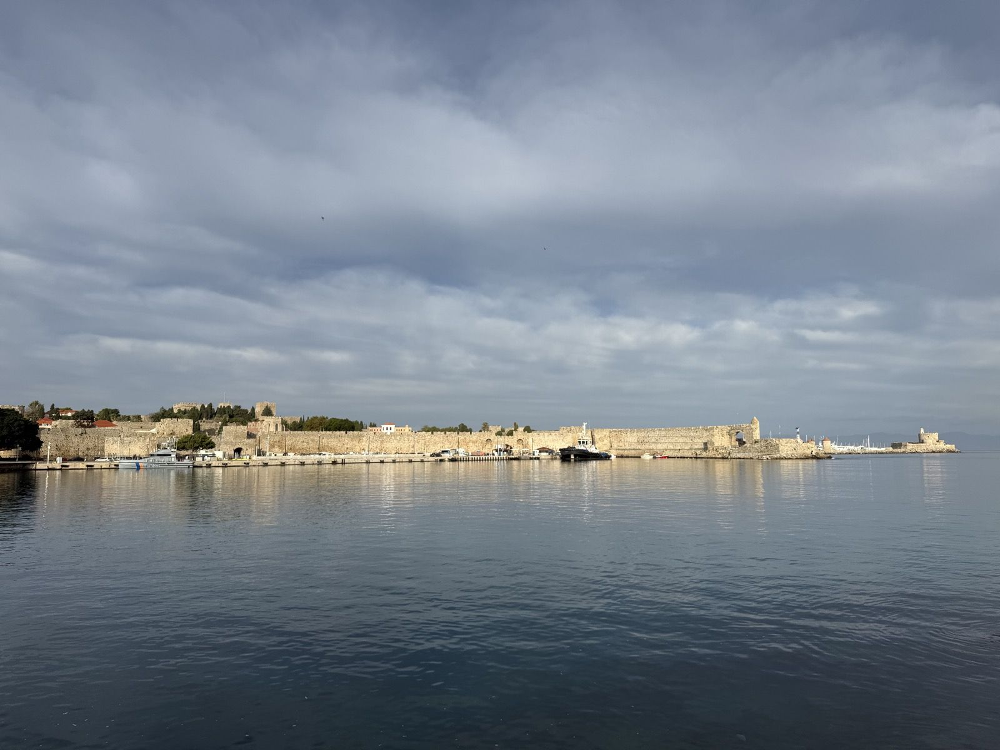
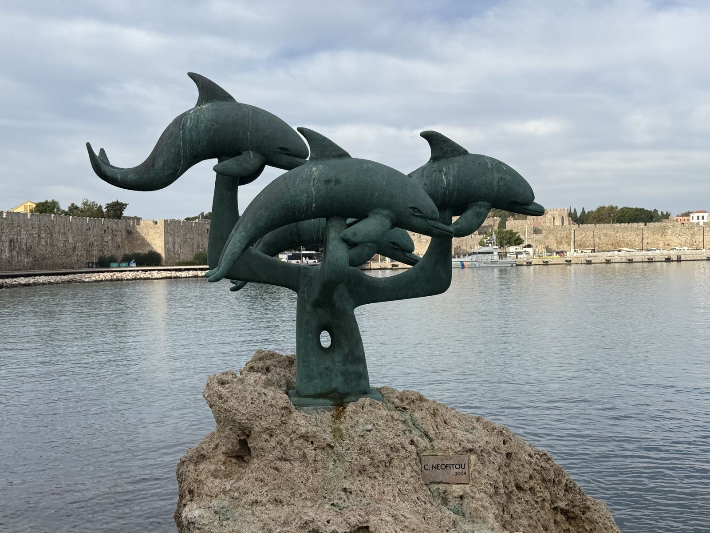
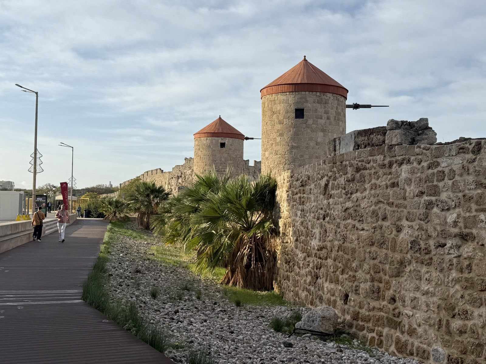
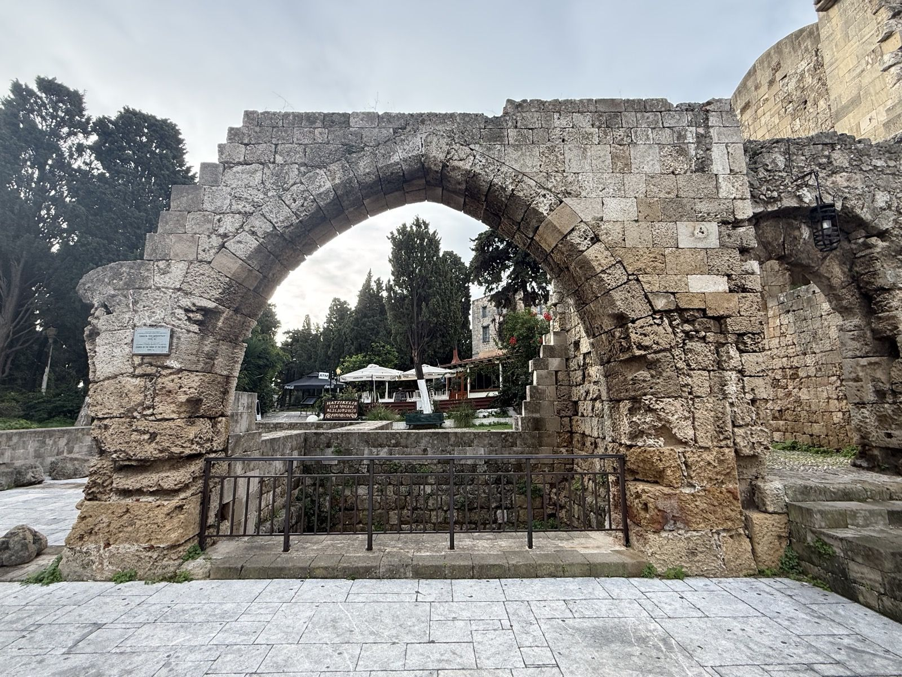
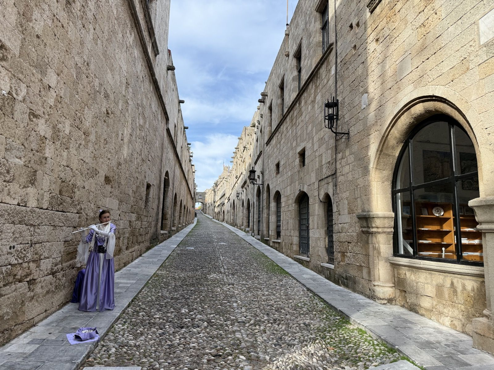
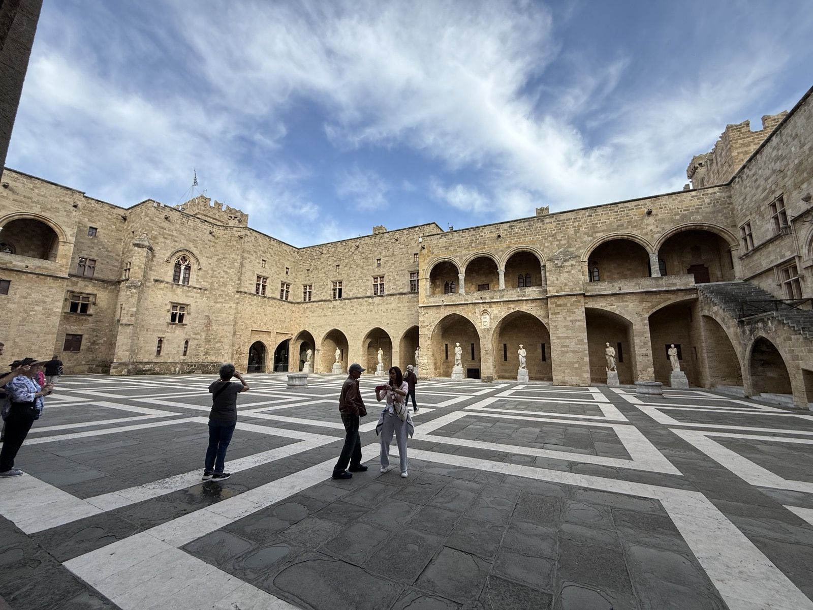
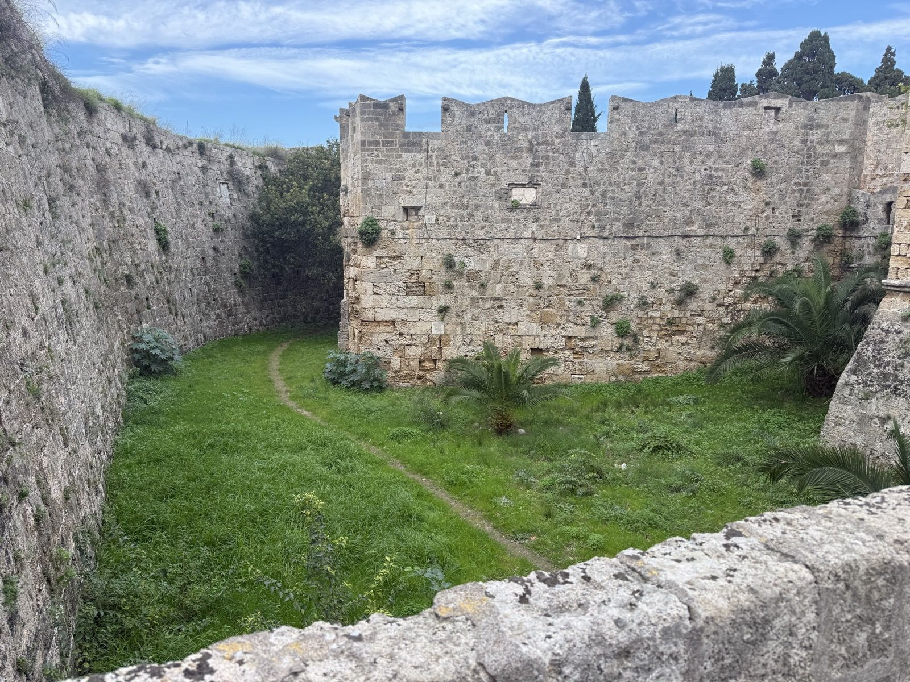
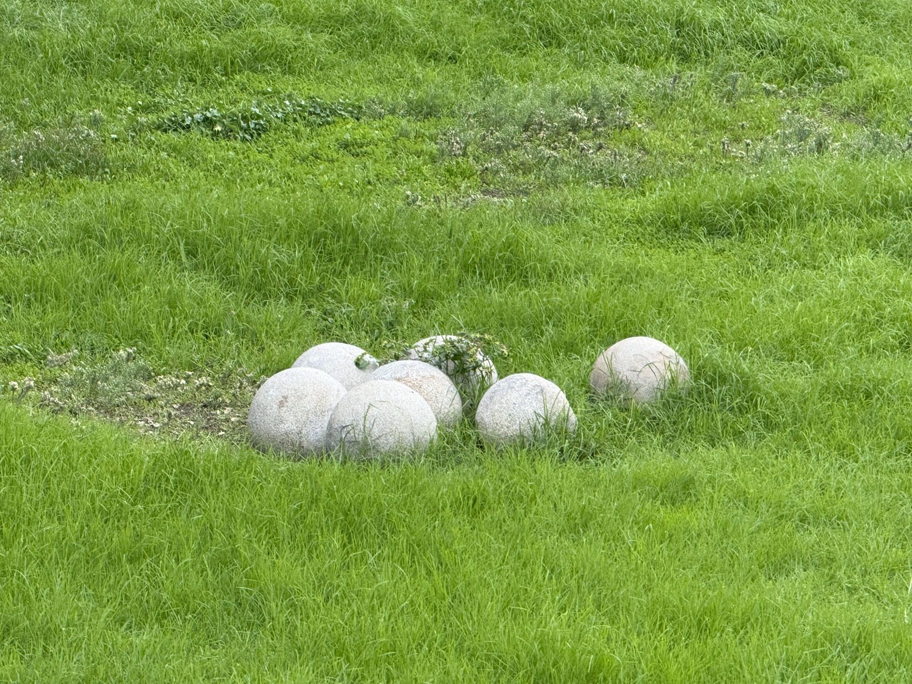

# Day 8: Rhodes, From the Colossus to the Knights

## Summary

Day 8 (Wednesday, November 18) is our first day in Greece. The chapter covers Hellenistic Rhodes, the Colossus and the Seven Wonders, Lindos and its acropolis of Athena, and the school of rhetoric where Romans came to study. It walks the Street of the Knights, the Palace of the Grand Master, and the city walls, and tells the Siege of 1522, the Ottoman and Italian periods, and union with Greece. It introduces Greek phrases, philoxenia, olive oil, and the Mediterranean diet. Its Learning for All notes contrast traveling to the teacher with what the deportation of the Jewish community in 1944 teaches about who gets left out.

## Concepts Covered

This chapter covers the following 31 concepts from the learning graph:

| Concept | Concept Impact Score |
|---------|-----------------------|
| Basic Greek Phrases | 3 |
| Philoxenia | 2 |
| Overtourism | 1 |
| Athena | 11 |
| Rhodes | 26 |
| Helios | 2 |
| Colossus of Rhodes | 1 |
| Lindos Acropolis | 2 |
| Rhodes School of Rhetoric | 4 |
| Roman Students at Rhodes | 3 |
| St. Paul's Bay at Lindos | 1 |
| Knights Hospitaller | 19 |
| Hospitaller Rhodes | 17 |
| Rhodes Medieval Town | 16 |
| Street of the Knights | 1 |
| Palace of the Grand Master | 1 |
| Hospital of the Knights | 1 |
| Rhodes City Walls | 7 |
| Siege of Rhodes 1522 | 6 |
| Ottoman Rhodes | 5 |
| World War II | 5 |
| Italian Rule of Rhodes | 4 |
| Jewish Quarter of Rhodes | 4 |
| Kahal Shalom Synagogue | 1 |
| Rhodes Deportation of 1944 | 2 |
| Dodecanese Union With Greece | 1 |
| Rhodes Today | 1 |
| Greek Cuisine | 16 |
| Olive Oil | 9 |
| Mediterranean Diet | 6 |
| Traveling to the Teacher | 2 |

## Prerequisites

This chapter builds on concepts from:

- [Chapter 1: Before We Go, Part 1: The Long Timeline of the Eastern Mediterranean](../01-long-timeline/index.md)
- [Chapter 2: Before We Go, Part 2: Traveling Well and the Learning for All Thread](../02-traveling-well/index.md)
- [Chapter 3: Day 1: Istanbul, a City on Two Continents](../03-istanbul-two-continents/index.md)
- [Chapter 4: Day 2: Byzantine Constantinople and Hagia Sophia](../04-byzantine-constantinople/index.md)
- [Chapter 5: Day 3: Ottoman Istanbul, Topkapı, and Friday Prayer](../05-ottoman-istanbul/index.md)
- [Chapter 6: Day 4: Bazaars, Scripts, and Presses](../06-bazaars-scripts-presses/index.md)
- [Chapter 7: Day 5: The End of Empire and the Birth of Modern Turkey](../07-end-of-empire-modern-turkey/index.md)
- [Chapter 8: Day 6: Troy and Gallipoli](../08-troy-and-gallipoli/index.md)
- [Chapter 9: Paul at Ephesus, Part 1: The Apostle's Life, Letters, and Ephesian Years](../09-paul-life-letters/index.md)
- [Chapter 10: Day 7: Ephesus, a Greco-Roman City](../10-ephesus-greco-roman-city/index.md)

---

## Our First Morning in Greece

Day 8, Wednesday, November 18, begins an hour earlier than our bodies think. Somewhere in the night between Kuşadası and Rhodes the ship's clocks went back one hour, because Greece is one hour behind Turkey in November, and at 7:00 AM ship's time the Viking Star ties up beside the walls of the Old Town. From the deck we can see the whole island story at once: a medieval harbor wall in honey-colored stone, the round towers and windmills of the mole, the domes and minarets of the Ottoman town, and behind them the modern Greek city waking up. We have until 6:00 PM, and the sun sets at about 5:00 PM, so this is a day for an early start.

It is also our first day in Greece, which changes small things. The money is still the euro, but the letters on the signs are Greek, the greeting is *kaliméra* instead of *merhaba*, and the coffee comes with a glass of water. Rhodes is the right place to make the switch, because it has belonged to almost everyone on our timeline: Greek city-states, Hellenistic kings, Rome, Byzantium, crusader knights, Ottoman sultans, Italy, Nazi Germany, Britain, and finally, only since 1948, Greece. The walls we are looking at were built by knights who came from all over Europe, and the oldest synagogue in Greece stands a few streets inside them.

<figure markdown="span" class="trip-photo">
  { loading=lazy }
  <figcaption>The walls of the Old Town across the harbor in the morning. Photo by Dan McCreary</figcaption>
</figure>

!!! mascot-welcome "An Island That Kept Changing Hands"
    { class="mascot-admonition-img" }
    Today we walk a street of medieval knights' inns, stand where a bronze sun god may once have looked over the harbor, and order lunch in Greek for the first time. Rhodes has been ruled by a dozen powers, and each one left something we can touch, from a stone cannonball in the moat to a palace that is not as old as it looks. By evening we will be able to tell which layer we are standing on, and we will have learned a hard lesson in the Jewish Quarter that every teacher should know. Look closer.

The chapter has five parts. Part One gets us ashore: a handful of Greek phrases, the Greek idea of hospitality, the island itself, and the problem of too many visitors. Part Two is ancient Rhodes: the sun god Helios and his Colossus, Athena at Lindos, and the school of rhetoric where Romans came to study. Part Three is the knights' city, with its street, palace, hospital, and walls. Part Four follows the city after the knights: the siege of 1522, the Ottoman and Italian centuries, the Second World War and the destruction of the Jewish community, and union with Greece. Part Five is lunch: Greek cooking, olive oil, and the Mediterranean diet. The Learning for All notes follow.

## Part One: Ashore in Greece

### Basic Greek Phrases

**Basic Greek phrases** are the dozen or so words that let a visitor greet, thank, order, and apologize in Greek. Chapter 2 taught the letters, the trap that *nai* means yes, and *efcharistó*, "thank you." Today we use them. Almost everyone who works with visitors on Rhodes speaks good English, but a greeting in Greek changes the tone: it shows we know whose country we are in.

The table gives the phrases we will actually use today, with a respelling. Capital letters mark the stressed syllable, which matters more than any single sound.

| Greek | Say it | Meaning | When to use it |
|---|---|---|---|
| Γειά σας | YAH sahs | Hello, goodbye | To anyone we do not know, or to a group |
| Γειά σου | YAH soo | Hi, bye | To one friend or a child |
| Καλημέρα | kah-lee-MEH-rah | Good morning | Until about noon |
| Καλησπέρα | kah-lee-SPEH-rah | Good evening | From late afternoon |
| Παρακαλώ | pah-rah-kah-LOH | Please; you're welcome; here you are | Asking, answering a thank-you, handing something over |
| Ευχαριστώ (πολύ) | ef-khah-ree-STOH (poh-LEE) | Thank you (very much) | Everywhere |
| Συγγνώμη | see-GHNOH-mee | Sorry; excuse me | Squeezing past, or getting attention |
| Πόσο κάνει; | POH-soh KAH-nee | How much is it? | In a shop |
| Τον λογαριασμό, παρακαλώ | ton loh-ghah-ryahz-MOH, pah-rah-kah-LOH | The bill, please | At the end of a meal |
| Στην υγειά μας! | steen ee-YAH mahs | Cheers! (to our health) | Raising a glass; often shortened to *yiá mas* |

**Worked example: lunch in five phrases.** Let's run a whole meal in the Old Town using only the table. We walk in and say *kaliméra* (it is before noon) or *yiá sas* (any time). The waiter brings water and the short November menu, and we point and say *parakaló* for each dish. When he sets the plates down, we say *efcharistó*, and he answers *parakaló*, "you're welcome," the same word doing a second job. A glass of wine gets *yiá mas*. At the end, *ton logariasmó, parakaló*, and on the way out, *efcharistó polí, yiá sas*. Five phrases carried the whole lunch.

!!! mascot-tip "Lead With the Greeting"
    { class="mascot-admonition-img" }
    Here's a shortcut: say *kaliméra* or *yiá sas* before anything else, every time, even if the next sentence is in English. In Greece, launching straight into a question without a greeting can feel abrupt; the greeting first makes everything after it go better.

### Philoxenia

The Greek word **philoxenia** <audio id="audio-philoxenia" src="../../audio/philoxenia.mp3" preload="none"></audio><button onclick="document.getElementById('audio-philoxenia').play()" class="pronounce-btn">🔊 Pronounce</button> *fee-loh-kseh-NEE-ah* means hospitality, but its parts say more: *philos*, "friend" or "loving," and *xenos*, a word that means both "stranger" and "guest." Philoxenia is love of the stranger, and in ancient Greece it was a religious duty. Zeus himself, as *Zeus Xenios*, protected travelers and punished those who mistreated them. Homer's *Odyssey* is built on the custom: again and again a host feeds a wandering stranger, gives him a bath and a bed, and only then asks his name. The suitors who abuse Odysseus's hospitality in his own house are the villains of the poem, and they die for it.

The custom is alive today. On Rhodes, as across Greece, a taverna often ends a meal with something nobody ordered: a plate of fruit, a small sweet, or a glass of the local spirit, *on the house*. In a village, a stranger asking directions may be invited in for coffee. In November, with fewer visitors, we are more likely to meet philoxenia than in August, when there is simply no time for it.

!!! mascot-thinking "One Word for Host and Guest"
    { class="mascot-admonition-img" }
    Notice that Greek *xenos* means both stranger and guest, and Latin *hospes* means both host and guest. Both languages refuse to split the two roles, as if hospitality were one relationship seen from two sides. *Hospes* is also the root of "hospital," and that will matter when we meet the knights who built one here.

### Rhodes

**Rhodes** is the largest island of the Dodecanese and the name of its chief city, at the island's northern tip. The island is about 80 km long and about 38 km across at its widest, and about 125,000 people live on it. It lies only about 18 km from the coast of Turkey, at the southeastern corner of the Aegean, where the sea lane from the Aegean meets the routes to Cyprus, the Levant, and Egypt. That position, which Chapter 1 traced on its trade-route map, made Rhodes rich in almost every century and made it a target in all of them.

In the Archaic and Classical periods the island had three separate cities, Lindos, Ialysos, and Kameiros. In 408 BCE the three joined to found a new, shared capital at the northern tip, with several harbors and a grid of straight streets; ancient writers credited the plan to the architect Hippodamus of Miletus, though the attribution is uncertain. The new city of Rhodes prospered as a neutral trading republic. After Alexander's death it traded with all the successor kingdoms, kept a strong navy to fight pirates, and became the banker and shipping hub of the eastern Mediterranean until Rome undercut it in 166 BCE by making the island of Delos a free port.

<figure markdown="span" class="trip-photo">
  { loading=lazy }
  <figcaption>A dolphin sculpture at the harbor, with the Old Town walls behind. Photo by Dan McCreary</figcaption>
</figure>

Rhodes's longest-lasting export was a rule. From the **Rhodian Sea Law**, the maritime custom of its harbors, one rule passed into Roman law and survives in shipping law today. If a ship in a storm must throw cargo overboard to stay afloat, the loss is shared by everyone whose goods or ship were saved, not borne by the merchant whose goods happened to go over the side. Justinian's lawyers recorded it in the 6th century as the "Rhodian law on jettison," and modern shipping calls the same principle *general average*.

**Worked example: sharing a storm.** Let's work out one jettison the Rhodian way. A ship worth 10,000 silver coins carries three cargoes: wine worth 6,000, olive oil worth 3,000, and pottery worth 1,000, for a total of 20,000 at risk. In a storm the crew throws the pottery overboard to lighten the ship, and everything else is saved. Under the Rhodian rule, the 1,000 lost is shared in proportion to value: the shipowner pays 10,000 ÷ 20,000 = half, or 500; the wine merchant pays 300; the oil merchant pays 150; and the pottery merchant bears his own share, 50, and receives 950 from the others. Every party ends 5 percent poorer, and no one had reason to argue over whose cargo went overboard. (The numbers are invented; the rule is real.)

!!! mascot-thinking "Insurance Before Insurance Companies"
    { class="mascot-admonition-img" }
    Think of the Rhodian rule as insurance built into the voyage itself. By making everyone share the loss, it turned a storm from a fight between merchants into a shared problem. A trading city lives on trust between strangers, and this rule manufactured that trust.

### Overtourism

**Overtourism** is the condition in which the number of visitors to a place is so large that it lowers the quality of life of the people who live there, or spoils the visit for the visitors themselves. The signs are familiar: streets residents avoid, homes turned into holiday rentals, shops that sell only souvenirs, and water systems built for a town serving a city. Rhodes knows them in summer, when several cruise ships can dock on the same day.

Greece has started to respond. In 2025 it introduced a per-passenger fee for cruise visitors, set by port and season: the announced rates were highest at Santorini and Mykonos in summer and lowest at other ports in winter.

| Season (as announced in 2025) | Santorini and Mykonos | Other ports, including Rhodes |
|---|---|---|
| Peak, June to September | €20 | €5 |
| Shoulder, April, May, October | €12 | €3 |
| Low, November to March | €4 | €1 |

**Worked example: what our visit costs the port.** Let's apply the table to our ship. The Viking Star carries up to 930 guests. At the low-season rate for Rhodes, €1 a head, a full ship pays about €930 on November 18; the same ship on a July day would pay about €4,650. The fee is too small to change anyone's decision to come; its real message is that visitors are most welcome when the island has room for them. Rates may change, so treat the table as an illustration, not a price list.

## Part Two: The Sun God's City

### Helios

**Helios** is the Greek god of the sun, who drives the sun's chariot across the sky each day. Most Greek cities honored him only in passing, but Rhodes made him its patron. The poet Pindar, writing in 464 BCE for a Rhodian boxer, told the island's founding myth: when the gods divided up the earth, Helios was away driving his chariot and was left out, but he saw an island rising from the sea and claimed it as his share. He married the nymph Rhodos, and their grandsons gave their names to the three old cities, Lindos, Ialysos, and Kameiros. The coins of Rhodes carried the head of Helios, with rays around his hair, on one side, and a rose, *rhodon* in Greek, on the other, a pun on the island's name.

### The Colossus of Rhodes

Chapter 1 told the outline: in 305–304 BCE Rhodes survived a year-long siege by the Macedonian king Demetrius, nicknamed *Poliorcetes*, "the Besieger," and paid for a bronze statue of Helios by selling the siege machines he left behind. The **Colossus of Rhodes**, about 33 m tall, was made by the sculptor Chares of Lindos over about twelve years and finished around 280 BCE. An earthquake brought it down around 226 BCE. Chapter 10 placed it among the Seven Wonders. Here, on the spot, two questions remain.

First, where did it stand? Not astride the harbor mouth, as the famous engravings show: a bronze statue of that height could not have stood with its legs that far apart, and the harbor entrance was far too wide. Today two bronze deer on columns mark the entrance to Mandraki <audio id="audio-mandraki" src="../../audio/mandraki.mp3" preload="none"></audio><button onclick="document.getElementById('audio-mandraki').play()" class="pronounce-btn">🔊 Pronounce</button> *man-DRAH-kee*, the old harbor, where the popular story places its feet. Scholars think it more likely stood on land, either near the harbor or in a sanctuary of Helios higher in the city; no one knows. Second, what happened to the bronze? The Roman writer Pliny the Elder saw the fallen pieces and wrote that few people could wrap their arms around its thumb. A Byzantine chronicle, written centuries later, says that Arab forces raiding Rhodes in the 650s CE sold the bronze to a merchant who carried it away on hundreds of camels. It may be true, or it may be the kind of story Chapter 4 taught us to enjoy without believing.

<figure markdown="span" class="trip-photo">
  { loading=lazy }
  <figcaption>Windmills on the mole of Mandraki harbor. Photo by Dan McCreary</figcaption>
</figure>

### Athena

**Athena** is the Greek goddess of wisdom, of crafts such as weaving and pottery, and of war fought with strategy rather than rage. In the myth she was born fully grown and armed from the head of her father, Zeus. She never married, which is why one of her titles is *Parthenos*, "the maiden," the name that the Parthenon in Athens carries. Her sacred animal was the little owl, *Athene noctua*, the same small owl as Glaux. Her gift to Athens, in the story of her contest with the sea god Poseidon for the city, was the first olive tree, and the Athenians judged it worth more than Poseidon's spring of salt water. We will meet her in her own city on Day 10, but Rhodes worshipped her too, and her most famous temple on the island stands at Lindos.

Athena is easy to recognize once we know her attributes, the objects that identify a god in art. That skill pays off in every museum from here to Athens.

| Attribute | What it is | What it says about her |
|---|---|---|
| Crested helmet | A tall war helmet, often pushed up on her head | War, but planned and disciplined |
| Spear and shield | Held at rest or raised | Protector of the city |
| Aegis | A goatskin cape or breastplate, fringed with snakes, often with the Gorgon's head | Divine protection; terror for enemies |
| Owl | Perched beside her, or alone on a coin | Wisdom; sight in the dark |
| Olive branch | Held, or growing beside her | Her gift to Athens; peace and plenty |

**Worked example: identifying a goddess on a coin.** Let's say a museum case shows a silver coin with a woman's head in a crested helmet on one side and, on the other, an owl with large eyes, an olive sprig, and the letters ΑΘΕ. The helmet alone could mean the war goddess, but the owl and the olive together settle it: this is Athena. The letters read *A-TH-E*, from Chapter 2's alphabet, short for "of the Athenians." It is an Athenian silver tetradrachm, the coin that traders all over the Mediterranean simply called "owls." Three attributes and three letters, and the coin tells us whose city minted it and which goddess protected that city.

### The Lindos Acropolis

The **Lindos Acropolis** is the fortified rock above the village of Lindos, about 50 km south of the city of Rhodes, crowned by the sanctuary of Athena Lindia. The rock rises about 116 m straight from the sea, and on top stand the island's layers: a Doric temple of Athena, rebuilt in the 4th century BCE after a fire in 392 BCE; a broad Hellenistic colonnade and staircase leading up to it; a Byzantine church; and the walls of a castle built by the knights. At the foot of the stairs, carved into the living rock, is the stern of a warship, a relief of about 180 BCE honoring a distinguished Rhodian citizen. Rhodes was a sea power, and said so in stone.

Danish archaeologists excavated the acropolis from 1902 to 1905, and in 1904 they found one of the most useful stones in Greece for our purposes, the **Lindian Chronicle**, an inscription of 99 BCE listing the famous gifts that had been offered to Athena here. The list begins with gifts said to come from Heracles, from Menelaus, and from Helen of Troy, and continues to real kings such as Alexander the Great. Most of the legendary objects had already been destroyed in the fire of 392 BCE, so the compilers cited, for each one, the earlier written source that described it. Myth and history stand side by side in the stone, and the Lindians knew the difference well enough to footnote it.

!!! mascot-warning "Lindos Is Not a Quick Stop"
    { class="mascot-admonition-img" }
    A common trap is to treat Lindos as a short side trip: it is about an hour each way by road, the village streets are steep, and the climb to the acropolis is on polished stone that is slippery when wet. If we go, we go first thing, wear shoes with grip, and keep an eye on the clock, because the ship will not wait and the sun sets at about 5:00 PM.

### St. Paul's Bay at Lindos

**St. Paul's Bay** is the small, almost enclosed cove just south of the Lindos acropolis, with a white chapel of St. Paul on its shore. Local tradition says that the apostle Paul landed here during a storm, on one of his voyages, and that a spring broke out where he stepped ashore. The Book of Acts says only that Paul's ship stopped at Rhodes on its way to Jerusalem, as Chapter 9 noted, without naming a harbor, so the Lindos landing is tradition, not record. The chapel is a favorite place for weddings, and from the acropolis the bay looks like a lake cut off from the sea.

### The Rhodes School of Rhetoric

**Rhetoric** is the art of persuasive speaking, and in the Greek and Roman world it was the core of higher education: a young man who wanted a career in law, politics, or government had to learn to speak well in public. The **Rhodes School of Rhetoric** is the name for the teachers of rhetoric who made Rhodes, from the 2nd century BCE, one of the two or three best places in the Mediterranean to study it. Tradition traces the school to the Athenian orator Aeschines, who is said to have opened a school here after he lost a famous courtroom duel to Demosthenes in 330 BCE and left Athens. Whether or not he founded it, by the time Rome ruled the Greek world, Rhodian teachers were famous.

The Rhodians taught a middle way between two styles. The **Attic** style, named for Athens, was plain, exact, and spare. The **Asian** style, popular in the Greek cities of Asia Minor such as Ephesus, was ornate, rhythmic, and emotional, sometimes to the point of showing off. Rhodes stood between them on the map and in taste: rich enough to move an audience, controlled enough to be trusted. The most famous Rhodian teacher was **Apollonius Molon**, who taught in the 1st century BCE and also visited Rome as an ambassador.

**Worked example: Cicero's year of correction.** Let's follow one student to see what the school actually did. In 79 BCE Marcus Tullius Cicero, aged about 27, was already a successful lawyer in Rome, but he was exhausting himself: he spoke at the top of his voice, without variation, straining his thin body, and friends and doctors warned him to stop. Instead he left Rome for two years of study in Athens, Asia Minor, and finally Rhodes, where he worked again with Molon. In his own later account, in the dialogue *Brutus*, Cicero says that Molon set out to rein in his excess, like a river overflowing its banks, and that he came home two years later a changed speaker, calmer in voice and style. The biographer Plutarch adds a story about his Rhodian teacher: after hearing Cicero declaim in Greek, the teacher sat silent for a long time and then said he pitied Greece, because the last glories she had left, learning and eloquence, were now going to Rome with this young man. The story may be polished, but the lesson is clear: Cicero did not travel for information, which he could read at home. He traveled for a master's correction of his own performance.

### Roman Students at Rhodes

**Roman students at Rhodes** were the young Roman aristocrats, and some older ones, who sailed to Rhodes in the 1st centuries BCE and CE to study rhetoric and philosophy with its Greek teachers. As Chapter 1 put it, Rome conquered the Greek world, but Greek culture conquered Rome, and an educated Roman finished his education in Greek, in a Greek city. Rhodes was also home to the Stoic philosopher **Posidonius**, one of the most learned men of his age, whose lectures drew the most powerful Romans of the day.

| Visitor | When | What he came for |
|---|---|---|
| Cicero | 78–77 BCE | Rhetoric with Molon; philosophy with Posidonius |
| Julius Caesar | About 75 BCE | Rhetoric with Molon; on the way he was captured by pirates and ransomed, according to Suetonius and Plutarch |
| Pompey | 66 and 62 BCE | Visits to hear Posidonius, at the height of his power |
| Tiberius | 6 BCE to 2 CE | A self-imposed retirement on the island, attending lectures, before he became emperor |

Caesar's story is the most famous, but it is also the hardest to pin down: the ancient writers agree he set out for Rhodes to study with Molon, and Plutarch says he did study there, so we say that Caesar traditionally studied on Rhodes. What the table shows for certain is a pattern: for about two centuries, the most ambitious people in the most powerful state in the world got on a ship and sailed to a small Greek island to learn from a teacher. The Learning for All note comes back to that pattern.

## Part Three: The Knights' City

### The Knights Hospitaller

The **Knights Hospitaller** <audio id="audio-hospitaller" src="../../audio/hospitaller.mp3" preload="none"></audio><button onclick="document.getElementById('audio-hospitaller').play()" class="pronounce-btn">🔊 Pronounce</button> *HOS-pih-tuh-ler*, officially the Order of the Hospital of St. John of Jerusalem, are a Catholic religious order that began as a hospital for pilgrims in Jerusalem and became a military order of knights who were also monks. Merchants from the Italian city of Amalfi founded a hospice for poor and sick pilgrims in Jerusalem in the 11th century, before the First Crusade. After the crusaders took Jerusalem in 1099, its brothers formed a religious order, which Pope Paschal II recognized in 1113. Within a few decades the order added armed brothers to escort pilgrims and defend the crusader states, and the hospital brothers became the Knights Hospitaller, also called the Knights of St. John.

A Hospitaller knight took the three monastic vows of poverty, chastity, and obedience, wore a black habit, and in battle a red surcoat, both marked with the white eight-pointed cross that is still called the Maltese cross. The knights were nobles from all over Catholic Europe, organized into national groups called **langues** or **tongues**: by 1462 there were eight, Provence, Auvergne, France, Italy, Aragon, Castile, England, and Germany. Each tongue defended its own section of the walls of Rhodes and had its own inn, its *auberge*, as its headquarters.

**Worked example: following the knights around the Mediterranean.** Let's trace the order's homes, because they explain why a crusading order ended up on a Greek island. The table lists each move and the reason for it.

| Years | Headquarters | Why they moved |
|---|---|---|
| 1099–1187 | Jerusalem | Founded as a hospital; lost when Saladin took the city in 1187 |
| 1187–1291 | Margat and then Acre, on the coasts of today's Syria and Israel | Crusader strongholds; Acre, the last crusader capital, fell to the Mamluks of Egypt in 1291 |
| 1291–1310 | Cyprus | A refuge, but under a king who did not want a rival power |
| 1310–1522 | Rhodes | Conquered from the Byzantines; their own island state for 212 years |
| 1530–1798 | Malta | Given by Emperor Charles V for a token rent of one falcon a year; lost to Napoleon in 1798 |
| Since 1834 | Rome | Today the Sovereign Military Order of Malta, a Catholic charity running hospitals and relief work |

The order lost every fortress it ever held, yet it still exists more than nine centuries after it began, as a medical and relief organization. It ended where it started: caring for the sick and the stranger.

### Hospitaller Rhodes

**Hospitaller Rhodes** is the island state that the knights ruled from 1310 to 1522. After losing the Holy Land, the order needed a base of its own, and the Byzantine Empire, broken by the Fourth Crusade of 1204 that Chapter 4 described, could no longer defend its islands. Between 1306 and 1310 the knights conquered Rhodes from the Byzantines, and the city of Rhodes became the capital of a small sovereign state ruled by the order's **Grand Master**, who was elected for life by the knights.

It was a state built for war with the Islamic powers to the east. The knights kept a fleet of galleys that attacked Muslim shipping and coastal towns, and Rhodes became a center for privateers, called corsairs, sailing under the order's flag. That warfare had a human cost we should name plainly: the knights, like their Ottoman and Mamluk enemies, captured people at sea and enslaved them, and their galleys were rowed partly by enslaved Muslims. The city survived two great sieges, by the Mamluk sultan of Egypt in 1444 and by the army of Mehmed II, the conqueror of Constantinople, in 1480; both failed. After 1480 Grand Master Pierre d'Aubusson rebuilt the walls for the age of gunpowder.

Most of the island's people were not knights at all. Perhaps a few hundred knights lived on Rhodes at any one time, ruling a population of Greek Orthodox islanders, Latin merchants from Italy and France, and a Jewish community. The Catholic knights and the Orthodox Greeks had different churches and bishops, and relations swung between suspicion and cooperation; when the final siege came, Greeks fought on the walls beside the knights.

**Worked example: who lived where in 1500.** Let's read the town plan as a social map. The Hospitaller town was divided by an inner wall into two parts. The northern part, the **Collachium**, held the Palace of the Grand Master, the cathedral of St. John, the hospital, and the inns of the tongues; it was reserved for the knights and their servants. The larger southern part, the **Burgum**, or *Chora* in Greek, held everyone else: Greek and Latin homes and churches, shops, merchants' houses, and, in the east, the Jewish quarter. So a walk from the Street of the Knights down to the market is a walk from the ruling order's compound into the town of the people they ruled. The inner wall is mostly gone, but the change in the streets, from straight and official to winding and lived-in, is still easy to feel.

### The Rhodes Medieval Town

The **Rhodes Medieval Town**, usually called the Old Town, is the walled city of the knights, inside the modern city of Rhodes. It was added to UNESCO's World Heritage List in 1988 as the Medieval City of Rhodes, one of the best-preserved medieval towns in Europe and one of the few still lived in: people have homes, shops, and schools inside its walls. Its streets keep almost everything since the knights: their Gothic buildings, the domes and minarets the Ottomans added, the fountains and wooden balconies of the Ottoman centuries, the Italian restorations of the 1920s and 1930s, and the cafés and souvenir shops of today.

The Old Town is small enough to cross on foot in fifteen minutes, but its lanes twist, and getting lost is part of the visit. Three landmarks keep us oriented: the Palace of the Grand Master at the high northwest corner, the Street of the Knights running down from it toward the harbor, and **Sokratous Street**, the main shopping street of the Burgum, running from the harbor up to the Mosque of Suleiman. Between them, wherever we wander, we will pass a pointed Gothic arch, a carved coat of arms over a door, or a small Byzantine church.

<figure markdown="span" class="trip-photo">
  { loading=lazy }
  <figcaption>A ruined Gothic arch in the Old Town of Rhodes. Photo by Dan McCreary</figcaption>
</figure>

**Worked example: reading a coat of arms.** Let's date a wall by the shields carved on it. The knights put the arms of the ruling Grand Master on the public works they built or repaired, often beside the plain cross of the order, so a shield works like a date stamp. The arms of Pierre d'Aubusson, Grand Master from 1476 to 1503, mark his rebuilding after the siege of 1480; those of Philippe Villiers de L'Isle-Adam, the last Grand Master on Rhodes, mark the final years before 1522. A guidebook or a plaque will name the shield; the habit that matters is to look up, because the knights signed their work.

### The Street of the Knights

The **Street of the Knights** (in Greek, *Odos Ippoton*) is the straight, cobbled street, about 200 m long, that climbs from the area of the old hospital up to the Palace of the Grand Master. It is the best-preserved medieval street on Rhodes, lined on both sides by the inns of the tongues: the Inn of the Tongue of Italy, the Inn of France with its rich carving and coats of arms, the Inn of Provence, and the Inn of Spain among them. Each inn was a mix of club, barracks, and dining hall, where the knights of one tongue ate together and received guests. The street has no shops and few signs, and early in the morning, before the groups arrive, it is quiet enough to hear our own footsteps. The Italians restored it heavily in the early 20th century, so what we see is medieval in plan and largely medieval in stone, with careful modern repairs.

<figure markdown="span" class="trip-photo">
  { loading=lazy }
  <figcaption>The Street of the Knights, Rhodes Old Town. Photo by Dan McCreary</figcaption>
</figure>

### The Palace of the Grand Master

The **Palace of the Grand Master** is the fortress-palace at the top of the Old Town, built by the knights in the 14th century on the site of a Byzantine citadel. It was the residence of the Grand Master and the last stronghold of the town if the walls fell. The building we visit, though, is mostly not medieval. In 1856, under Ottoman rule, lightning struck the nearby Church of St. John, igniting gunpowder that had been stored in its vaults, possibly since the siege of 1522; the explosion destroyed the church, killed many people, and wrecked much of the palace. The Italian governor had the palace rebuilt from 1937 to 1940, intended as a residence for the king of Italy and for Mussolini, and filled it with Hellenistic and early Christian floor mosaics brought from the island of Kos. It is a grand building and a good museum, but it is an Italian reconstruction of the 1930s on medieval foundations.

<figure markdown="span" class="trip-photo">
  { loading=lazy }
  <figcaption>Courtyard of the Palace of the Grand Master. Photo by Dan McCreary</figcaption>
</figure>

### The Hospital of the Knights

The **Hospital of the Knights** is the large two-story building at the foot of the Street of the Knights, built between 1440 and 1489, where the order cared for the sick, pilgrims, and the poor. Its center is a courtyard surrounded by arcades; upstairs, the great ward is a long hall divided by a row of columns, where the beds stood, with small alcoves along the walls and a chapel at one end. The knights took their founding duty seriously: the order's rules required that the sick be treated as "our lords," and knights took turns serving in the wards. Since the Italian period the building has housed the **Archaeological Museum of Rhodes**, with finds from the ancient cities of the island, including fine Hellenistic sculpture. Standing in the ward, we are in the building that gives the whole order its name, and the word "hospital," its meaning.

### The Rhodes City Walls

The **Rhodes city walls** are the fortifications, about 4 km long, that still surround the Old Town on every side, on land and toward the sea. They follow the line of the Byzantine walls, but the knights rebuilt them several times, above all after the siege of 1480, when they faced a new problem: cannon. Tall, thin medieval walls shatter under cannon fire. So the knights made the walls lower and much thicker, in places many meters thick, built massive bastions, called bulwarks, that projected outward so that defenders could fire along the face of the walls, and widened and deepened the moat. Each tongue held its own stretch, so the defense of Rhodes was organized like the inns: by nation.

The moat on the land side is dry, and it was never meant to hold water. It was a killing ground: attackers who reached it were trapped between the outer wall and the main wall, under fire from both. Today it is a long, grassy walkway between the two walls, where we can walk for a stretch below the ramparts, and in places the grass is scattered with round stone balls of the kind hurled by siege weapons.

<figure markdown="span" class="trip-photo">
  { loading=lazy }
  <figcaption>The dry moat and walls of the Old Town. Photo by Dan McCreary</figcaption>
</figure>

**Worked example: reading a wall for gunpowder.** Let's look at the walls with an engineer's eye and find the cannon-age changes. First, height: compare a tall square medieval tower, built for archers and stones dropped from above, with the low, broad bulwark beside it, built to absorb cannonballs and to carry the defenders' own guns. Second, shape: the faces of the newer works are angled and rounded so that shot glances off instead of striking square. Third, the moat: its width keeps siege guns far back, and its outer wall, called the counterscarp, makes attackers climb down into it under fire. Fourth, the gates: the d'Amboise Gate, built in 1512 near the palace, is reached by a bridge over the moat and turns its path through more than one gateway, so that no attacker can charge straight in. Four details, and the walls show the moment when castles turned into artillery fortresses. They were the reason the knights held Rhodes for six months in 1522.

<figure markdown="span" class="trip-photo">
  { loading=lazy }
  <figcaption>Stone siege balls in the grass of the dry moat. Photo by Dan McCreary</figcaption>
</figure>

## Part Four: After the Knights

### The Siege of Rhodes, 1522

Chapter 5 told the **Siege of Rhodes of 1522** from Suleiman's side; here is the knights' side. In late June 1522 an Ottoman fleet of perhaps 300 to 400 ships landed an army on the island; the size of the army is unknown, and estimates in the sources run from about 100,000 to 200,000 men, most of them laborers and support troops. The young Sultan Suleiman, two years into his reign, arrived to command in person at the end of July. Against him, Grand Master Philippe Villiers de L'Isle-Adam had about 600 to 700 knights and perhaps 6,000 or so other defenders: hired soldiers, Rhodian Greek militia, and townspeople, including women who carried stones and supplies to the walls.

The Ottomans did not try to climb the walls at first. They bombarded them with heavy cannon and, above all, dug: teams of miners tunneled under the walls to blow them up with gunpowder. The defenders listened for the digging, some say with drums whose skins trembled at the vibrations, and dug countermines to meet the tunnels underground. Ottoman assaults through breaches in September, including a great general assault on September 24, were thrown back with heavy losses. But no help came from Christian Europe, food and gunpowder ran low, and by December the walls were broken in many places. On December 20 the Grand Master accepted Suleiman's terms.

**Worked example: why surrender was a victory of sorts.** Let's weigh the terms the knights got. A city taken by storm in this age could expect to be sacked, its people killed or enslaved. Rhodes instead surrendered on terms: the knights could leave with their arms, their relics, and their honor; inhabitants who wished could leave with them, and those who stayed kept their faith and their churches. The knights sailed out on January 1, 1523, with several thousand Rhodians, and after seven years of wandering received Malta, where in 1565 they withstood another great Ottoman siege. For Suleiman the terms were a bargain: they ended a siege that had cost him dearly, as his own losses had been enormous, and gave him the island intact. Both sides could tell the story as a victory, and both did.

!!! mascot-thinking "Walls Buy Time, Not Victory"
    { class="mascot-admonition-img" }
    Notice what the best walls in the Mediterranean actually did: they held for six months, long enough for help to arrive, and help never came. A fortress is a promise that someone outside will come; when no one does, even the strongest walls only delay the end. Ask of any defense, of a city or a school system: who is coming, and when?

### Ottoman Rhodes

**Ottoman Rhodes** is the period from 1523 to 1912, when the island was part of the Ottoman Empire, about 390 years. The new rulers turned the cathedral and several churches into mosques, built new mosques, baths, and fountains, and changed who lived where. Muslims and Jews lived inside the walls; the Greek Orthodox were required to live outside them, in suburbs and villages, and, by most accounts, to be out of the walled town by sunset. The Jewish community, which had suffered under the knights, grew, and Sephardic families, descendants of the refugees from Spain whom Chapter 6 followed to Istanbul, settled in the eastern quarter, which became known as La Juderia <audio id="audio-juderia" src="../../audio/juderia.mp3" preload="none"></audio><button onclick="document.getElementById('audio-juderia').play()" class="pronounce-btn">🔊 Pronounce</button> *hoo-deh-REE-ah*.

The Ottoman layer is easy to find. At the top of Sokratous Street stands the pink-plastered **Mosque of Suleiman**, founded after the conquest and rebuilt in 1808, which Chapter 5 promised we would see. Opposite it is the Ottoman library founded by Hafiz Ahmed Agha in the late 18th century, which holds manuscripts in Arabic, Persian, and Ottoman Turkish. Nearby is a Turkish bath of the 16th century, and fountains and wooden balconies of the Ottoman centuries survive in the side streets. Sokratous Street itself was the Ottoman bazaar.

**Worked example: why the Muslims of Rhodes stayed in 1923.** Chapter 7 described the exchange of 1923, in which Greece and Turkey swapped their Orthodox and Muslim populations. Let's ask why Rhodes still has a small Muslim community, with Turkish as its home language, when Crete's Muslims all left. The exchange applied only to Turkey and Greece, and in 1923 Rhodes belonged to neither: Italy had held it since 1912. So the island's Muslims were not exchanged. They are Greek citizens today, a small community, and some of their mosques still serve them. One date in Chapter 7's treaty, and a whole community's history follows from it.

### Italian Rule of Rhodes

**Italian rule of Rhodes** lasted from 1912 to 1943. In May 1912, during the Italo-Turkish War, Italy seized Rhodes and the other Dodecanese islands from the Ottoman Empire, saying the occupation was temporary. It was not: the Treaty of Lausanne in 1923 confirmed the islands as Italian, and Italy, under Mussolini's Fascist government from 1922, treated them as a showcase colony. Most islanders were Greek and hoped for union with Greece, which Italy refused.

The Italians left the most visible modern layer in the city. They cleared Ottoman houses away from the knights' monuments, restored the walls, the Street of the Knights, and the hospital, and rebuilt the Palace of the Grand Master. Along the Mandraki harbor they built a whole new civic quarter in styles that borrowed from Venetian Gothic and from the knights: a governor's palace, a town hall, a covered market, a theater, and the Church of the Annunciation, a 1925 copy of the knights' lost cathedral. They opened the **Liberty Gate** through the walls in 1924 to connect the Old Town with the new quarter. Under Governor Cesare Maria De Vecchi, from 1936, the regime pressed harder: Italian was imposed in the schools, Greek identity was suppressed, and in 1938 Italy's racial laws began to strip the island's Jews of their rights.

!!! mascot-warning "Not Everything Gothic Is Medieval"
    { class="mascot-admonition-img" }
    A common trap on Rhodes is to assume that every pointed arch and battlement belongs to the knights. The Liberty Gate (1924), the Church of the Annunciation (1925), the harbor-front civic buildings, and most of the Palace of the Grand Master are Italian work of the 20th century. When a building looks almost too perfect, check its date on a plaque or in the guidebook before admiring its age.

### World War II

**World War II** was the global war of 1939 to 1945, fought between the Allies, chiefly Britain, the Soviet Union, the United States, and China, and the Axis powers, Germany, Italy, and Japan. Greece entered it on October 28, 1940, when Mussolini demanded the right to occupy Greek territory and the Greek government refused. Greeks remember the answer as one word, *óchi*, "no," the same word Chapter 2 taught, and October 28, **Ochi Day**, is still a national holiday. The Greek army threw the Italian invasion back into Albania, but in April 1941 Germany invaded, and Athens fell on April 27. Greece was occupied by Germany, Italy, and Bulgaria until 1944, years of famine, resistance, and reprisals that Athens will remember for us on later days.

Rhodes was on the other side of that line. As Italian territory, the island was an Axis base, with airfields from which Italian planes attacked Allied shipping. When Italy surrendered to the Allies in September 1943, the much smaller German garrison on Rhodes seized the island from the Italian troops within days, and the British attempt to take the Dodecanese that autumn failed. Rhodes stayed under German control until the war's end. The German commander of the Dodecanese signed the surrender on May 8, 1945, the day the war in Europe ended.

| Date | Athens | Rhodes |
|---|---|---|
| October 28, 1940 | Greece refuses Italy's ultimatum and is invaded | Italian territory; an Axis base |
| April 27, 1941 | German troops enter Athens; occupation begins | Still Italian |
| September 1943 | Occupation continues | Italy surrenders; German forces take the island |
| July 1944 | Occupation continues | The Jews of Rhodes are deported |
| October 12, 1944 | German troops leave; Athens is liberated | Still German |
| May 8, 1945 | War in Europe ends | Germans surrender the Dodecanese; British administration begins |

The war also brought the Holocaust to Greece. Greece had one of the oldest Jewish populations in Europe, roughly 70,000 to 77,000 people in 1940. By the end of the war the Germans and their collaborators had murdered most of them, an estimated 60,000 to 67,000, more than four in five; about 45,000 were deported from Thessaloniki alone in 1943. Rhodes was one of the last communities to be destroyed.

### The Jewish Quarter of Rhodes

The **Jewish Quarter of Rhodes**, called **La Juderia** in Ladino, is the eastern part of the Old Town, near the sea walls, where the island's Jews lived for centuries. Jews had lived on Rhodes since the Hellenistic period, as Chapter 1 noted, and the old Greek-speaking community was joined after 1522 by Sephardic families who spoke Ladino. Under the Ottomans the quarter had several synagogues, schools, and a lively commercial life; at the end of the 19th century a school of the Alliance Israélite Universelle, a French Jewish educational network, taught French, Hebrew, and modern subjects, and Rhodes became known across the Sephardic world for its rabbis and teachers.

The community was already shrinking before the war. Economic hard times under Italian rule sent many young people abroad from the 1920s, to the United States, especially Seattle and Los Angeles, to Argentina, and to southern Africa, where Rhodesli families settled in what were then Rhodesia and the Belgian Congo. Then came the 1938 racial laws, which drove out Jews classified as foreigners and barred Jews from public schools and many jobs. Estimates of the community's size vary by source and date: about 4,000 people around 1930, and an Italian census of March 1939 counted 1,952 Jews in the city.

**Worked example: a walk through La Juderia.** Let's plan the afternoon walk from Chapter 2's "port day that is ours." From the harbor we enter by the Marine Gate or St. Catherine's Gate and walk a few minutes to the **Square of the Jewish Martyrs** (in Greek, *Plateia Evreon Martyron*), with its fountain of bronze seahorses and, on one side, a memorial to the deported Jews of Rhodes and Kos. From the square, a short walk through the lanes leads to the Kahal Shalom Synagogue and the Jewish Museum of Rhodes. Along the way, guides point out doorposts with a small slanted groove on the right-hand side, where a *mezuzah*, a small case holding a verse of scripture, once hung. The walk takes ten minutes without stops, and it is worth an hour with them.

### The Kahal Shalom Synagogue

The **Kahal Shalom Synagogue**, "Holy Congregation of Peace," is the synagogue of La Juderia, completed in 1577 and generally described as the oldest synagogue in Greece. It is the only one of the quarter's synagogues still standing. Inside, the floor is a pebble mosaic in black and white, and the Torah arks stand on the southeast wall, facing Jerusalem, with the reader's platform in the middle of the room in the Sephardic arrangement. Plaques in Ladino, Hebrew, and French remember the people who kept it and the people who were taken from it. The **Jewish Museum of Rhodes**, founded in 1997, occupies the former women's prayer rooms next door and tells the community's history through photographs, documents, and objects lent by Rhodesli families around the world. Services are held mainly in summer, when descendants return; in November the opening hours are short and may change, so check before going.

### The Rhodes Deportation of 1944

The **Rhodes deportation of 1944** was the German roundup and transport of the Jews of Rhodes and Kos to Auschwitz-Birkenau in July and August 1944. In mid-July, on the orders of the German commander and the security police, all Jewish men were told to report with their identity papers to the former Italian air force headquarters; women and children were ordered there in the following days, and everyone who came was held. Their homes and valuables were seized. On July 23, 1944, more than 1,700 people were marched through the town to the harbor and packed into three small cargo boats. The boats stopped at Kos, where the Germans added the Jews of that island, and reached Piraeus, the port of Athens, after more than a week at sea; some of the oldest and weakest died at sea. From the Haidari camp near Athens, the survivors were put on sealed freight cars on August 3 and arrived at Auschwitz on August 16, 1944, after one of the longest deportation journeys of the war.

Most were murdered in the gas chambers the day they arrived. The number of survivors is usually given as about 150: the United States Holocaust Memorial Museum counts 151 Jews of Rhodes who survived, and an Italian research center counts 179 who left the camp alive, a figure that includes Kos. The figures for those deported also vary between sources, from about 1,600 to more than 1,700 from Rhodes, with between about 65 and 100 more from Kos, because records were destroyed and lists disagree. What does not vary is the scale: a community that had lived on the island for centuries was almost entirely destroyed less than a year before the war ended.

One man saved some. **Selahattin Ülkümen** <audio id="audio-selahattin-ulkumen" src="../../audio/selahattin-ulkumen.mp3" preload="none"></audio><button onclick="document.getElementById('audio-selahattin-ulkumen').play()" class="pronounce-btn">🔊 Pronounce</button> *seh-lah-hah-TEEN ewl-kew-MEN*, the Turkish consul on Rhodes, went to the German commander and insisted that Jews with Turkish citizenship, and their families, were under Turkey's protection, as Turkey was neutral. He secured the release of 42 people, and he is credited with protecting about 50 in all. In 1989 Yad Vashem, Israel's Holocaust memorial, recognized him as one of the Righteous Among the Nations.

!!! mascot-encourage "It Is Right That This Is Hard"
    { class="mascot-admonition-img" }
    If this section is hard to read on a sunny morning in a beautiful town, that is the right response, not a reason to skip it. Many visitors find it helps to do one small, concrete thing: stand for a minute at the memorial in the Square of the Jewish Martyrs, or find one family's name on the plaques in Kahal Shalom. The Learning for All note below asks what this history teaches.

### Dodecanese Union With Greece

**Dodecanese union with Greece** is the transfer of Rhodes and the other Dodecanese islands from Italy to Greece after World War II. After the German surrender in May 1945, the islands were governed by a British military administration. In the peace treaty with Italy, signed in Paris on February 10, 1947, Italy ceded the Dodecanese to Greece. Greek administration took over in the spring of 1947, and the islands were formally united with Greece on March 7, 1948, a date the islands still celebrate as a holiday. Earlier chapters gave the date as 1947, the year of the treaty and the handover; 1948 is the year of formal union. Either way, Rhodes has been Greek for less than eighty years, after almost four centuries as Ottoman and three decades as Italian.

The timeline below lets us practice reading these overlapping rulers, because the right answer to "who governed Rhodes?" depends entirely on the year.

#### Diagram: Rhodes Changes Hands, 1912–1948

Rhodes Changes Hands, 1912–1948

Type: timeline
**sim-id:** rhodes-changes-hands-1912-1948 
**Library:** vis-timeline 
**Status:** Specified 
**Bloom Level:** Understand 
**Bloom Verb:** interpret 
**Learning Objective:** The learner will interpret a timeline of the powers that governed Rhodes from 1912 to 1948 to answer which power governed the island at a given date and what followed from it, answering at least 4 of 5 questions correctly on the first attempt.

**Prerequisites:** Ottoman Rhodes, Italian rule of Rhodes, World War II, the Rhodes deportation of 1944, Dodecanese union with Greece (all defined in Part Four above), and the 1923 population exchange (Chapter 7).

**Evidence of Mastery:** The learner answers five questions, each locked in before the answer is shown. An answer is correct when it matches the Correct answer column in Content. Mastery is 4 of 5 correct on the first attempt. Scrolling, zooming with buttons, and opening event descriptions are exploration, not evidence.

**Misconceptions:** (1) Rhodes became Greek when Greece became independent, or after World War I (question 1). (2) Rhodes was occupied by the Axis like Athens, rather than being Axis territory itself (question 2). (3) The deportation happened under Italian rule (question 3). (4) Rhodes passed straight from Germany to Greece (question 4). (5) Rhodes was Greek long before World War II (question 5).

**Instructional Rationale:** Interpreting a timeline means reading two kinds of information at once, spans of rule and single events, and relating them. Committing an answer before the reveal makes the learner read the timeline rather than guess from what "feels Greek."

**Content:**

Rule spans, shown as bands on a single "Who governed Rhodes" row:

| Span | Power |
|---|---|
| 1522 to May 1912 (the band starts off-screen at the left) | Ottoman Empire |
| May 1912 to September 1943 | Italy |
| September 1943 to May 8, 1945 | Germany (military occupation) |
| May 8, 1945 to March 31, 1947 | Britain (military administration) |
| March 31, 1947 onward | Greece (Greek administration; formal union March 7, 1948) |

Events, shown as points on a second row, each with the one-sentence description shown when opened:

| # | Date | Event | Description |
|---|---|---|---|
| 1 | May 1912 | Italy seizes Rhodes | During the Italo-Turkish War, Italy takes Rhodes and the Dodecanese from the Ottoman Empire, calling it temporary. |
| 2 | January 30, 1923 | Greek-Turkish population exchange agreed | Orthodox Christians of Turkey and Muslims of Greece are to be exchanged; Rhodes, Italian, is not included. |
| 3 | July 24, 1923 | Treaty of Lausanne | Turkey gives up its claim to the Dodecanese in favor of Italy. |
| 4 | 1936 | De Vecchi becomes governor | Italianization of schools and public life intensifies. |
| 5 | September 5, 1938 | First anti-Jewish decree on Rhodes | Italy's racial laws reach the island. |
| 6 | October 28, 1940 | Greece says "óchi" | Italy invades Greece; Rhodes is an Italian base. |
| 7 | April 27, 1941 | German troops enter Athens | The occupation of mainland Greece begins. |
| 8 | September 1943 | Italy surrenders; Germans take Rhodes | The German garrison seizes the island from Italian troops. |
| 9 | July 23, 1944 | Deportation of the Jews of Rhodes | More than 1,700 people are shipped from the harbor; they reach Auschwitz on August 16, 1944. |
| 10 | October 12, 1944 | Athens liberated | German troops leave Athens; Rhodes remains German. |
| 11 | May 8, 1945 | Germans surrender the Dodecanese | British military administration begins. |
| 12 | February 10, 1947 | Paris peace treaty | Italy cedes the Dodecanese to Greece. |
| 13 | March 7, 1948 | Formal union with Greece | Rhodes becomes fully part of the Greek state. |

Questions, in this fixed order:

| # | Question | Choices | Correct answer | Reason shown after answering |
|---|---|---|---|---|
| 1 | Which power governed Rhodes when the Greek-Turkish population exchange was agreed in January 1923? | Ottoman Empire; Greece; Italy; Britain | Italy | Italy had held Rhodes since May 1912, so the exchange between Greece and Turkey did not apply there. |
| 2 | On October 28, 1940, when Greece said "óchi," which side was Rhodes on? | It was occupied Greek territory; It was Italian territory, an Axis base; It was neutral; It was British | It was Italian territory, an Axis base | Rhodes was part of Italy's empire, so it was on the side attacking Greece. |
| 3 | Which power controlled Rhodes when its Jews were deported in July 1944? | Italy; Germany; Britain; Greece | Germany | German forces had held Rhodes since September 1943; the deportation was a German operation, helped by records from the Italian civil administration. |
| 4 | Who governed Rhodes between the German surrender and Greek administration? | Italy again; Britain; Turkey; the United Nations | Britain | A British military administration ran the islands from May 1945 until March 1947. |
| 5 | In the 100 years before the Paris peace treaty (February 1847 to February 1947), how many years did Rhodes spend under Greek rule? | None; About 10; About 50; About 100 | None | Greek administration began only on March 31, 1947; before that the island was Ottoman, Italian, German, and British. |

**Provenance:** Dates from the chapter sections "Italian Rule of Rhodes," "World War II," "The Rhodes Deportation of 1944," and "Dodecanese Union With Greece," and from Chapter 7 (exchange convention, January 30, 1923; Treaty of Lausanne, July 24, 1923). The anti-Jewish decree date (September 5, 1938) and the start of German control (September 1943) are from the timeline of the Fondazione CDEC exhibition "Jews of Rhodes: Eclipse of a Community" (https://ebreidirodi1944.cdec.it/en/timeline-the-historical-context/). The generator must check the date of Greek administration (March 31, 1947) and the German surrender of the Dodecanese (May 8, 1945) against the Wikipedia article "Dodecanese" and flag any difference to the author rather than change the chapter.

**Rules:** The timeline runs from January 1910 to December 1949. Rule spans do not overlap; each event falls inside exactly one span, and opening an event names the span it falls in. Question 5: the period ends before Greek administration began on March 31, 1947, so the answer is None. Zoom and pan use buttons, not the mouse wheel.

**Learner Activity:**

1. The learner sees the two rows, rule spans and events, with all events visible.
2. The learner opens any events to read their descriptions (exploration).
3. The learner answers question 1 by choosing one option; the answer is locked in, the correct answer is shown with its reason, and the relevant event or span is highlighted on the timeline.
4. The learner repeats for questions 2 to 5.
5. The learner should notice that Athens and Rhodes were on opposite sides of the war until 1945, and that Rhodes became Greek only after the war ended.

**Feedback:** Five questions, fixed order, one attempt each. Correct: "Correct: <reason>." Incorrect: "Not quite. The answer is <correct answer>: <reason>." A running score "Correct: n of 5" is shown. At the end: if score >= 4, "You can read who governed Rhodes in any year, and why it mattered."; otherwise, "Look again at where 1923, 1940, and 1944 fall among the colored spans." A Try Again option resets the five questions.

**Starting State:** Both rows visible from 1910 to 1949, no question answered, and the prompt "Rhodes changed rulers four times in 35 years. Who was in charge when it mattered?"

**Chapter Anchors:** Italy seized Rhodes in May 1912; Treaty of Lausanne 1923; De Vecchi from 1936; racial laws 1938; Ochi Day October 28, 1940; Athens fell April 27, 1941; Germans took Rhodes September 1943; deportation July 23, 1944, more than 1,700 people, arrival at Auschwitz August 16, 1944; Athens liberated October 12, 1944; German surrender May 8, 1945; Paris treaty February 10, 1947; formal union March 7, 1948; thirteen events; five questions; mastery 4 of 5.

### Rhodes Today

**Rhodes today** is a Greek island of about 125,000 people whose economy runs mainly on tourism, with farming, fishing, and wine on the side. The city of Rhodes is the capital of the Dodecanese and the seat of a university campus. Its Orthodox churches belong, as Chapter 4 explained, to the Metropolis of Rhodes, which reports directly to the Ecumenical Patriarchate in Istanbul rather than to the Church of Greece; a small Muslim community and a very small Jewish community remain. In summer the island receives many times its own population in visitors, and it has had to face the risks of that dependence: in July 2023 wildfires forced the evacuation of thousands of residents and tourists from the south of the island. In November, with the beach hotels shut, the Old Town belongs again to the people who live in it, and we see the island's working life as well as its monuments.

The MicroSim below gathers the whole day's layers into one exercise: for each building, decide which power built what we actually see.

#### Diagram: Who Built What We See in the Old Town?

Who Built What We See in the Old Town?

Type: microsim
**sim-id:** rhodes-old-town-layers-sorter 
**Library:** p5.js 
**Status:** Specified 
**Bloom Level:** Analyze 
**Bloom Verb:** attribute 
**Learning Objective:** The learner will attribute twelve buildings and features of the city of Rhodes to the period whose builders made what we see today (ancient, Knights, Ottoman, or Italian), attributing at least 10 of 12 correctly on the first attempt, including the Palace of the Grand Master and the Liberty Gate.

**Prerequisites:** the Rhodes Medieval Town, the Street of the Knights, the Palace of the Grand Master, the Hospital of the Knights, the Rhodes city walls, Ottoman Rhodes, Italian rule of Rhodes, the Kahal Shalom Synagogue (all defined in Parts Two to Four above).

**Evidence of Mastery:** For each card, the learner chooses one of four periods before feedback. A choice is correct when it matches the Correct period column in Content. Mastery is 10 of 12 correct on the first attempt, with cards 6 and 10 both correct.

**Misconceptions:** (1) Everything inside the walls is medieval (cards 6, 10, 11). (2) A building's style tells us its date (cards 6, 10, 11 look Gothic but are Italian). (3) Only Muslims built under Ottoman rule (card 9, a synagogue, was built by the Jewish community under Ottoman rule). (4) Nothing ancient survives in the city because the Colossus vanished (cards 1 and 2).

**Instructional Rationale:** Attributing each feature to a builder forces the learner to separate what a building looks like from who built it and when, the core skill for reading a layered city. The three Italian "medieval-looking" cards target the most common error on Rhodes.

**Content:**

The four periods, each with its definition:

- Ancient: built by the Greek or Roman city, before about 400 CE.
- Knights: built by the Knights Hospitaller, 1310 to 1522.
- Ottoman: built under Ottoman rule, 1523 to 1912.
- Italian: built or rebuilt under Italian rule, 1912 to 1943.

| # | Card | Correct period | Reason shown after answering |
|---|---|---|---|
| 1 | Remains of the Temple of Aphrodite, near the Liberty Gate | Ancient | Foundations and column drums of a temple of the 3rd century BCE, uncovered in the Italian period. |
| 2 | The ancient acropolis on Monte Smith, with the Temple of Apollo and the stadium | Ancient | The Hellenistic city's sanctuary and stadium; some columns were re-erected in the 20th century, but the stones are ancient. |
| 3 | The Hospital of the Knights, now the Archaeological Museum | Knights | Built between 1440 and 1489 to care for the sick, pilgrims, and the poor. |
| 4 | The inns of the tongues on the Street of the Knights | Knights | Medieval headquarters of the national tongues; restored, but medieval in plan and largely in stone. |
| 5 | The low, thick walls, bulwarks, and dry moat | Knights | Rebuilt after the siege of 1480 to resist cannon. |
| 6 | The Palace of the Grand Master as we see it (trap) | Italian | Wrecked by an explosion in 1856 and rebuilt from 1937 to 1940 on medieval foundations. |
| 7 | The Mosque of Suleiman | Ottoman | Founded after the conquest of 1522 and rebuilt in 1808. |
| 8 | The library of Hafiz Ahmed Agha, opposite the mosque | Ottoman | An Ottoman foundation of the late 18th century holding manuscripts in Arabic, Persian, and Ottoman Turkish. |
| 9 | The Kahal Shalom Synagogue (trap) | Ottoman | Completed in 1577 by the Jewish community under Ottoman rule. |
| 10 | The Liberty Gate (trap) | Italian | Opened through the walls in 1924 to link the Old Town with the new Italian quarter. |
| 11 | The Church of the Annunciation at Mandraki (trap) | Italian | Built in 1925 as a copy of the knights' lost cathedral of St. John. |
| 12 | Sokratous Street's bazaar, fountains, and wooden balconies | Ottoman | The Ottoman market street of the town and its domestic details. |

**Provenance:** Building dates and periods from the chapter sections "The Hospital of the Knights," "The Rhodes City Walls," "The Palace of the Grand Master," "Ottoman Rhodes," "Italian Rule of Rhodes," and "The Kahal Shalom Synagogue." The Temple of Aphrodite (3rd century BCE) and the Monte Smith acropolis are from the Wikipedia article "Rhodes (city)"; the generator must check both against that article and flag any difference to the author.

**Rules:** Each card is answered once for scoring. A first-attempt answer is correct if and only if it equals the Correct period. Score is 0 to 12. Mastery is score >= 10 with cards 6 and 10 both correct. Cards are shown in a shuffled order that is the same for every learner (seeded), so the trap cards are not grouped together.

**Learner Activity:**

1. The learner reads the four periods.
2. For each card, the learner chooses a period.
3. Feedback appears, and the card joins a growing summary grouped by period.
4. After card 12, the learner sees the summary: Ancient 2, Knights 3, Ottoman 4, Italian 3.
5. The learner should notice that three of the twelve features that look most "medieval" were built in the 20th century.

**Feedback:** Twelve cards, one attempt each for scoring. Correct: "Correct: <reason>." Incorrect: "This one is <correct period>: <reason>." After card 12: if mastery is met, "You can read Rhodes by its builders, not just its style."; otherwise, "Look again at the palace, the Liberty Gate, and the church at Mandraki: when were they built?" A Try Again option repeats all twelve cards.

**Starting State:** The four period labels, an empty summary, and the first card, with the question "Who built what we see here?"

**Chapter Anchors:** Knights 1310 to 1522; hospital 1440–1489; walls rebuilt after 1480; palace rebuilt 1937–1940 after the 1856 explosion; Mosque of Suleiman rebuilt 1808; Kahal Shalom completed 1577; Liberty Gate 1924; Church of the Annunciation 1925; twelve cards; summary Ancient 2, Knights 3, Ottoman 4, Italian 3; mastery 10 of 12.

## Part Five: The Greek Table

### Greek Cuisine

**Greek cuisine** is the cooking of Greece: built on olive oil, vegetables, legumes, bread, cheese, fish, and smaller amounts of meat, flavored with lemon, garlic, oregano, and other wild herbs, and eaten slowly and shared. Much of it is the same food we ate in Turkey under different names, a shared Eastern Mediterranean and Ottoman inheritance that Chapter 15 explores, and much of it is regional: the islands cook with more fish and wild greens, the mountains with more meat and cheese. A Greek meal is organized around the table, not the plate. Dishes come in the middle, everyone takes a little of everything, and the meal is a social event that can last for hours.

The usual place to eat it is a **taverna**, a family restaurant with a short menu of home cooking and grilled food. The menu follows a standard order, which helps us read it even when it is in Greek.

| Section on the menu | What it means | Typical dishes |
|---|---|---|
| *Orektiká* or *mezédes* | Starters for sharing | Tzatziki, fava (yellow split-pea purée), melitzanosalata (eggplant dip), fried cheese (saganaki) |
| *Saláta* | Salads | Horiátiki (the "village" or Greek salad), seasonal greens (*hórta*) with lemon and oil |
| *Mageireftá* | Cooked dishes of the day, often oven-baked | Moussaka, *briám* (baked vegetables), stuffed tomatoes and peppers, beans in tomato sauce |
| *Psári* | Fish, often priced by the kilo | Grilled fish of the day, fried small fish, octopus |
| *Tis óras* | "Of the hour," grilled to order | Souvlaki, lamb chops, *keftédes* (meatballs) |
| *Glyká* | Sweets, often brought free | Fruit, yogurt with honey, a spoon sweet |

**Worked example: a November lunch in the Old Town.** Let's order lunch at a family taverna, following Chapter 2's advice to ask what is good today. The waiter says the fish this morning was small red mullet, and the cooked dish is beans baked in tomato. We order fava with capers and onion, a horiátiki salad, a plate of *pitaroúdia*, the chickpea fritters of Rhodes, the beans, and a few fried red mullet to share, with bread and a half-liter of local white wine. That is five dishes for two people, which is normal: Greeks order for the table, not for each person. It costs less than a single dinner on the ship's specialty menu would suggest, and almost all of it is vegetables, legumes, olive oil, and fish. Somewhere in the middle comes a small plate of *melitzanosalata*, smoky eggplant mashed with garlic, oil, and lemon, the Greek cousin of the *patlıcan salatası* we ate in Istanbul. Eggplant is a favorite of ours, and Chapter 15 gives it, and moussaka, *papoutsákia* ("little shoes"), and briám, the full treatment.

### Olive Oil

**Olive oil** is the oil pressed from the fruit of the olive tree, and it is the fat of the Greek kitchen. Greece is one of the world's largest producers, usually among the top four, and Greeks eat more of it per person than almost anyone else. Olives are harvested from October to January, so in November we are in the middle of the harvest Chapter 2's waiter was thinking about: nets are spread under the trees, branches are combed or beaten, and the fruit goes to the mill within a day or two. At the mill, the olives are crushed into a paste, the paste is stirred slowly, a step called malaxation, and the oil is separated from water and solids by spinning. No heat or chemicals are needed for the best grades.

The European Union sets the grades, by laboratory tests and by a trained tasting panel. The most useful test for a shopper is **free acidity**, a measure of how much the oil has broken down, which rises when olives are bruised, overripe, or left too long before milling.

| Grade | Free acidity | What it is | Best use |
|---|---|---|---|
| Extra virgin | 0.8% or less, and no taste defects | The best oil, extracted mechanically, with fresh fruity flavor | Raw on salads and bread; everyday cooking |
| Virgin | 2.0% or less | Mechanically extracted, with minor defects | Cooking |
| Olive oil (refined and virgin blend) | 1.0% or less | Refined oil with a little virgin oil added for flavor | Frying, neutral cooking |
| Lampante | Above 2.0% | Defective oil, not fit to eat until refined | Industry, refining |

!!! mascot-tip "Read the Harvest Date"
    { class="mascot-admonition-img" }
    Want the freshest bottle? Look for a harvest date, such as "2026/27," not just a best-before date, which can be two years after bottling. Choose dark glass or a tin, since light and heat make oil stale, and in November ask for the new season's oil.

**Worked example: judging two bottles.** Let's compare two bottles in a shop in the Old Town. Bottle A says "Extra virgin olive oil, harvest 2026/27, acidity ≤ 0.3%, cold extraction," in a dark tin. Bottle B says "Light olive oil" in a clear bottle, with "composed of refined olive oils and virgin olive oils" in small print on the back. Bottle A is consistent: an acidity well under the 0.8% limit, this season's harvest, and "cold extraction," which EU rules allow only when the oil was kept below 27 °C. Bottle B is honest in its small print but misleading on the front: "light" is not an official grade, and it means light in flavor and color, not in calories. Every olive oil, like every vegetable oil, has about 120 calories per tablespoon. For the table, we buy A; for frying, B is fine, but at a fair price for what it is. Ancient Athenians would have recognized the judgment: Athena's olive was valued for the quality of its oil, and Athens awarded jars of oil from her sacred trees as prizes at its great festival.

The MicroSim below gives practice with nine labels like these.

#### Diagram: Read the Olive Oil Label

Read the Olive Oil Label

Type: microsim
**sim-id:** read-the-olive-oil-label 
**Library:** p5.js 
**Status:** Specified 
**Bloom Level:** Evaluate 
**Bloom Verb:** judge 
**Learning Objective:** The learner will judge whether each of nine olive oil labels supports the claim on its front, using the EU grade limits, the cold-extraction rule, harvest dates, and origin wording, judging at least 7 of 9 correctly on the first attempt.

**Prerequisites:** olive oil, the four grades and their free-acidity limits, malaxation, cold extraction below 27 °C, harvest date versus best-before date, calories per tablespoon (all defined in the section "Olive Oil" above).

**Evidence of Mastery:** For each label, the learner chooses "Supports the claim" or "Does not support the claim" before feedback. A judgment is correct when it matches the Correct judgment column in Content. Mastery is 7 of 9 correct on the first attempt.

**Misconceptions:** (1) "Light" olive oil has fewer calories (label 2). (2) Any oil called extra virgin is extra virgin, whatever its acidity (label 3). (3) "Cold" is a vague marketing word with no rule (labels 4 and 5). (4) A blend containing virgin oil can be called extra virgin (label 6). (5) A best-before date in the future means the oil is fresh (label 7). (6) An oil bottled or sold in Greece is Greek oil (label 8).

**Instructional Rationale:** Judging a claim against evidence on the same label is an Evaluate task: the learner applies a standard to decide whether a claim is justified. Pairing a supported and an unsupported "cold extraction" label, and including three labels that do support their claims, keeps the learner from simply rejecting every marketing phrase.

**Content:**

Each label shows the front claim and the back-label details.

| # | Front claim | Back-label details | Correct judgment | Reason shown after answering |
|---|---|---|---|---|
| 1 | "Fresh extra virgin olive oil" | Extra virgin; harvest 2026/27; acidity ≤ 0.3%; dark glass | Supports the claim | Acidity is well under the 0.8% limit, and the harvest is this season's. |
| 2 | "Light olive oil: fewer calories!" | Olive oil composed of refined olive oils and virgin olive oils; 120 kcal per tablespoon | Does not support the claim | "Light" means mild flavor and pale color; every oil has about 120 calories per tablespoon. |
| 3 | "Extra virgin olive oil" | Acidity 1.5% | Does not support the claim | Extra virgin requires free acidity of 0.8% or less; 1.5% is at best virgin. |
| 4 | "Cold extraction" | Extra virgin; malaxation and extraction at 25 °C | Supports the claim | EU rules allow "cold extraction" when the oil is kept below 27 °C, and 25 °C is below it. |
| 5 | "Cold extraction" | Extra virgin; extraction at 32 °C | Does not support the claim | 32 °C is above the 27 °C limit for the words "cold extraction." |
| 6 | "Extra virgin olive oil" | Ingredients: refined olive oils and virgin olive oils | Does not support the claim | A blend of refined and virgin oils is the grade "olive oil," not extra virgin. |
| 7 | "This season's oil" (bought in November 2026) | Extra virgin; harvest 2024/25; best before December 2026 | Does not support the claim | The oil is two harvests old; the best-before date does not make it this season's. |
| 8 | "Greek olive oil" | Extra virgin; blend of olive oils of European Union origin; bottled in Greece | Does not support the claim | "Blend of EU oils" can mean oil from several countries; bottling in Greece does not make it Greek oil. |
| 9 | "Early-harvest green oil" (*agourélaio*) | Extra virgin; harvest October 2026; product of Greece | Supports the claim | An October harvest is early in the season, and the origin is stated as Greece. |

**Provenance:** Grade names and free-acidity limits (extra virgin 0.8% or less; virgin 2.0% or less; refined-and-virgin blend 1.0% or less; lampante above 2.0%), the 27 °C condition for "cold extraction," and the origin wording "blend of olive oils of European Union origin" are from the EU marketing standards for olive oil, Commission Delegated Regulation (EU) 2022/2104; the generator must check each value against that regulation and flag any difference to the author. The calorie value (about 120 kcal per tablespoon) is from the USDA FoodData Central entry for olive oil. The nine labels are illustrative and must be labeled "Illustrative labels" in the sim.

**Rules:** Each label is answered once for scoring. A first-attempt judgment is correct if and only if it equals the Correct judgment. Score is 0 to 9. Mastery is score >= 7. Labels are shown in the fixed order 1 to 9. Thresholds: extra virgin requires acidity <= 0.8%; "cold extraction" requires temperature < 27 °C.

**Learner Activity:**

1. The learner reads the claim on the front of label 1, then turns the label to read the back.
2. The learner chooses "Supports the claim" or "Does not support the claim."
3. Feedback appears, with the back-label detail that decides the case marked.
4. The learner repeats for labels 2 to 9.
5. After label 9, the learner sees a summary: 3 labels support their claims, 6 do not, with their own score.
6. The learner should notice that the deciding facts were always on the back label, in the acidity, the temperature, the ingredients, the harvest date, or the origin line.

**Feedback:** Nine labels, fixed order, one attempt each. Correct: "Correct: <reason>." Incorrect: "Look again: <reason>." A running score "Labels judged correctly: n of 9" is shown. At the end: if score >= 7, "You can read an olive oil label like a Greek grandmother."; otherwise, "Check the back label first: acidity, temperature, ingredients, harvest, origin." A Try Again option repeats all nine labels.

**Starting State:** Label 1 showing its front claim, a button to turn it over, the two judgment choices, and the question "Does the bottle live up to its claim?"

**Chapter Anchors:** Extra virgin 0.8% or less; virgin 2.0% or less; refined-and-virgin blend 1.0% or less; lampante above 2.0%; cold extraction below 27 °C; about 120 calories per tablespoon; harvest from October to January; nine labels; three support their claims; mastery 7 of 9.

### The Mediterranean Diet

The **Mediterranean diet** is a pattern of eating based on the traditional food of the lands around the Mediterranean, especially Crete and southern Italy in the mid-20th century: plenty of vegetables, fruit, legumes, whole grains, nuts, and olive oil; fish and seafood often; cheese and yogurt in moderation; little red meat and few sweets; and wine, if any, in moderation with meals. It is not a diet in the sense of a weight-loss plan but a description of how people ate, and of how they ate it: slowly, seasonally, and together.

Its fame comes from medical research. In the 1950s the American physiologist Ancel Keys began the **Seven Countries Study**, which followed middle-aged men in the United States, Finland, the Netherlands, Italy, Yugoslavia, Greece, and Japan. The men of Crete had some of the lowest rates of heart disease in the study, despite eating a lot of fat, because most of that fat was olive oil. Later trials tested the idea directly: the PREDIMED trial in Spain, published in 2013 and republished with a corrected analysis in 2018, found about 30 percent fewer heart attacks, strokes, and cardiovascular deaths among people at high risk who ate a Mediterranean diet supplemented with extra virgin olive oil or nuts, compared with a control group advised to eat a low-fat diet. In 2010 UNESCO recognized the Mediterranean diet as part of the Intangible Cultural Heritage of Humanity, naming Greece, Italy, Spain, and Morocco, and later Cyprus, Croatia, and Portugal: a recognition of a way of life, not just a menu.

There is an irony to notice. The diet that made Crete famous was partly a diet of poverty, eaten by farm families who could not afford much meat, and as Greece grew richer, many Greeks moved away from it toward more meat, sugar, and processed food. The traditional pattern survives best in villages and in older households, which is one more reason the November taverna, cooking what the season gives, is worth seeking out.

**Worked example: scoring our lunch.** Let's check the November lunch from the Greek Cuisine section against the pattern. Vegetables and legumes: fava, salad, chickpea fritters, beans, and eggplant, five of the dishes. Olive oil: in or on nearly all of them. Fish: the red mullet. Bread: yes, ideally whole grain, though a taverna loaf usually is not. Red meat: none. Wine: a modest glass or two each, with food. Sweets: a plate of fruit, on the house. By any scoring system the lunch is a near-perfect Mediterranean meal, and the one improvement would be to walk the walls afterward, because the traditional pattern included hours of daily physical work. Chapter 14 looks at the Cretan version of this diet in its home.

## Practical Notes for Day 8

- **Order of the day.** The ship docks at about 7:00 AM beside the Old Town. Walk in early: the Street of the Knights is quiet before 9:00 AM, and the Palace of the Grand Master opens in the morning. If we take a Lindos excursion, it fills the morning and returns by early afternoon; otherwise, spend the morning on the knights' town and the walls.
- **Afternoon.** Lunch in the Old Town, then La Juderia: the Square of the Jewish Martyrs, Kahal Shalom, and the Jewish Museum of Rhodes. Finish with a walk along the moat or the Mandraki harbor front.
- **Hours.** Greek state sites keep shorter winter hours from November 1, and many close in mid-afternoon; some museums close one day a week. Kahal Shalom and the Jewish Museum keep limited hours outside summer. Check every site's hours on the day.
- **Clocks.** Greece is one hour behind Turkey. Use ship's time from the daily program, and check that phones and watches have changed.
- **Weather and light.** Expect a mild day, around 20 °C, possibly with a shower. The sun sets at about 5:00 PM, before the 6:00 PM sailing, and the all-aboard time is earlier; we should be walking back to the ship by late afternoon.
- **Food.** Ask what is good today, order for the table, and try *pitaroúdia* and the local white wine. Buy olive oil in a tin, with a harvest date, if it fits the luggage.
- **Money and words.** Euros, cards accepted almost everywhere; small cash for cafés. Lead with *kaliméra* and finish with *efcharistó*.
- **Tomorrow.** Day 9 docks at Heraklion, on Crete, at 7:00 AM. Read Chapter 13 tonight.

## Learning for All: Traveling to the Teacher, and a List of Names

Chapter 2's route table gives Rhodes two stories: a famous school of rhetoric, and the deported Jewish children of 1944. They belong together because both are about who gets to learn, and they point in opposite directions. One shows how far people have been willing to go to reach a teacher. The other shows how quickly a community's schools, teachers, and children can be taken away.

### Traveling to the Teacher

**Traveling to the teacher** is the old pattern of education in which the learner goes to where the master is, often at great cost, rather than the teaching coming to the learner. Cicero sailed for two years, Caesar risked pirates, and Roman families paid for years of a son's absence, because the best teachers of rhetoric were in a few Greek cities and could not be copied or carried home. Books could travel; the master's ear could not. What Cicero got on Rhodes was something no scroll could give: an expert who listened to him speak, told him exactly what was wrong, and made him do it again.

Run Chapter 2's four-step pattern on it. *Locked up:* advanced rhetoric lived with a few teachers in a few cities. *Opened:* rich Romans could reach them by sea, and the teachers, in turn, built schools that trained many students at once. *Resisted:* many Romans distrusted Greek teachers as foreign and corrupting; the Senate expelled Greek philosophers and teachers of rhetoric from Rome in 161 BCE, and censors condemned the new Latin schools of rhetoric in 92 BCE. *Never all the way:* only families who could pay for a son's voyage, years abroad, and a Greek tutor ever made the trip, and daughters almost never did.

The AI parallel is direct, and it cuts both ways. An AI tutor can bring something close to Molon's correction to any learner with a phone: it can listen to a practice speech, a draft essay, or a math solution, and give specific feedback immediately, without a voyage. Chapter 20 takes up that side of the story, when the teacher comes to the learner. But notice what else Cicero found on Rhodes: other ambitious students to argue with, a live audience, and a culture of speaking. Rhetoric is a social skill, practiced in front of real people. The companion textbook *AI-Native Schools* argues that this is exactly what schools must protect even when AI can teach the content well, in [Social Learning and Human Skills](https://dmccreary.github.io/ai-native-schools/chapters/13-social-learning-human-skills/): communication, collaboration, and empathy still need other humans in the room.

### A List of Names

The second story is darker. Before the war, La Juderia had its own schools, and Rhodes was known across the Sephardic world for its teachers; in 1928 the Italian authorities and Jewish organizations even opened a rabbinical college on the island, which closed for lack of funds in the 1930s. Then the circle closed in steps. In 1938 the racial laws barred Jewish children from public schools and expelled Jews classified as foreign. In 1944 the children of the community were deported with their parents and grandparents, and almost none came back. Run the four-step pattern, and the last step does not just leave someone out: it removes them.

One detail of the deportation speaks directly to anyone who builds educational technology. A recent study of the Italian administration's archives found that in the spring of 1944, before the German deportation team arrived, the island's police asked the city's registry office for a list of Jewish residents organized by household and address, for what was described as a routine check of identity documents. The office prepared the list, and a copy went to the German police. Records first made for ordinary purposes, a census, a school roll, a registry, became the tool that found every family in July.

That is why data about learners is not a neutral by-product of teaching. An AI tutor works by collecting detailed information about each student: what they know, how fast they learn, sometimes where they are and who they are. *AI-Native Schools* treats the safeguards in [Student Privacy and Data Governance](https://dmccreary.github.io/ai-native-schools/chapters/10-student-privacy-data-governance/): collect only what teaching needs, control who can see it, and plan for what happens to it if the people in charge change. The Jews of Rhodes were not harmed by a list alone; they were murdered by people who chose to murder them. But the list made it fast and complete. Learning for All has to mean protecting the learners as well as teaching them.

## Key Takeaways

- **Basic Greek phrases** carry a whole meal; lead with the greeting. **Philoxenia**, love of the stranger, is an ancient duty and a living custom.
- **Rhodes**, a united city from 408 BCE, grew rich on trade and gave the world the jettison rule. **Overtourism** strains it in summer.
- **Helios** was the island's god; the **Colossus of Rhodes** stood about 54 years and did not straddle the harbor.
- **Athena** is known by her helmet, aegis, owl, and olive. The **Lindos Acropolis** holds her temple; **St. Paul's Bay at Lindos** is tradition, not record.
- The **Rhodes School of Rhetoric** taught a middle style; **Roman students at Rhodes** included Cicero and, traditionally, Caesar.
- The **Knights Hospitaller** began as a Jerusalem hospital. **Hospitaller Rhodes** (1310–1522) was their island state, organized by tongues.
- The **Rhodes Medieval Town** (UNESCO 1988) keeps the **Street of the Knights**, the **Palace of the Grand Master** (rebuilt by Italy, 1937–1940), and the **Hospital of the Knights** (1440–1489).
- The **Rhodes city walls**, about 4 km long, were rebuilt for cannon after 1480. The **Siege of Rhodes 1522** ended on terms; the knights left on January 1, 1523.
- **Ottoman Rhodes** (1523–1912) kept Christians outside the walls. **Italian rule of Rhodes** (1912–1943) restored, rebuilt, and Italianized the city.
- In **World War II**, Rhodes was Italian, then German. The **Jewish Quarter of Rhodes** and the **Kahal Shalom Synagogue** (1577) remember a Ladino-speaking community; in the **Rhodes deportation of 1944**, more than 1,700 people were sent to Auschwitz and about 150 survived.
- **Dodecanese union with Greece** came by treaty in 1947 and formally in 1948. **Rhodes today** lives mainly on tourism.
- **Greek cuisine** is shared and seasonal; extra virgin **olive oil** has acidity of 0.8% or less; the **Mediterranean diet** is linked to lower heart disease.
- **Traveling to the teacher** brought Romans to Rhodes for correction and practice; the deportation of 1944 shows why learners' data must be protected.

!!! mascot-celebration "Every Layer Has a Name"
    { class="mascot-admonition-img" }
    You can now walk the Old Town and say who built each layer, from the knights' bulwarks to an Italian gate pretending to be medieval, and tell the siege of 1522 from both sides. You can order lunch in Greek, judge an olive oil label, and explain what a list of names had to do with the deportation of 1944. Next stop: [Knossos, the Minoans, and Linear B](../13-knossos-minoans-linear-b/index.md), on Crete, where writing itself was once a palace secret.
