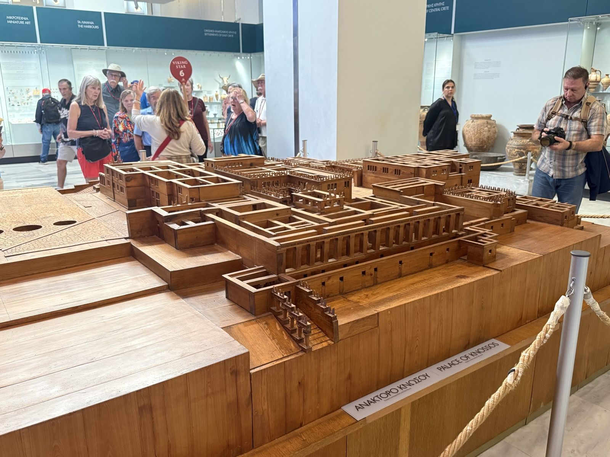
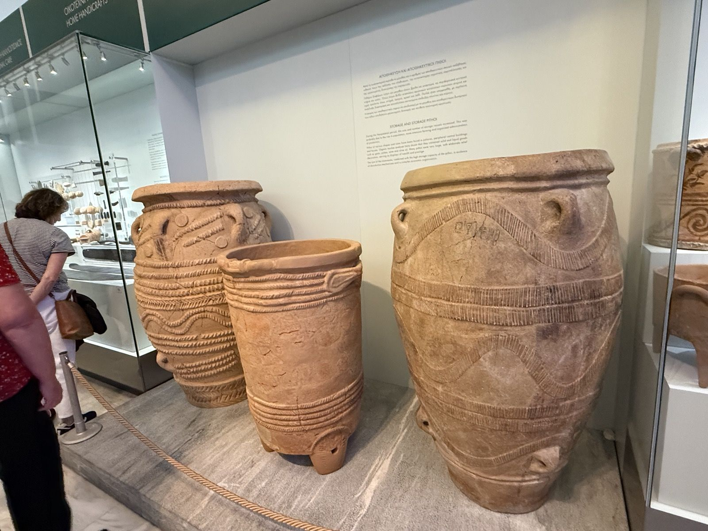
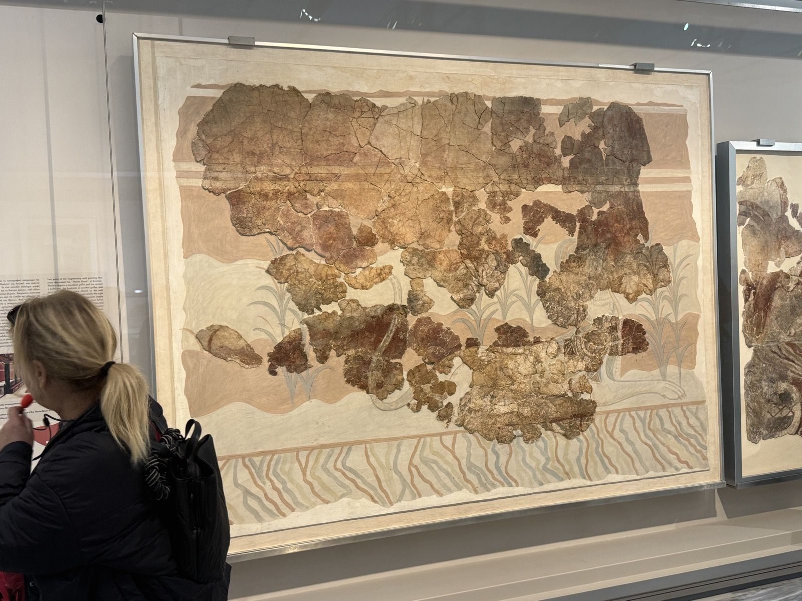
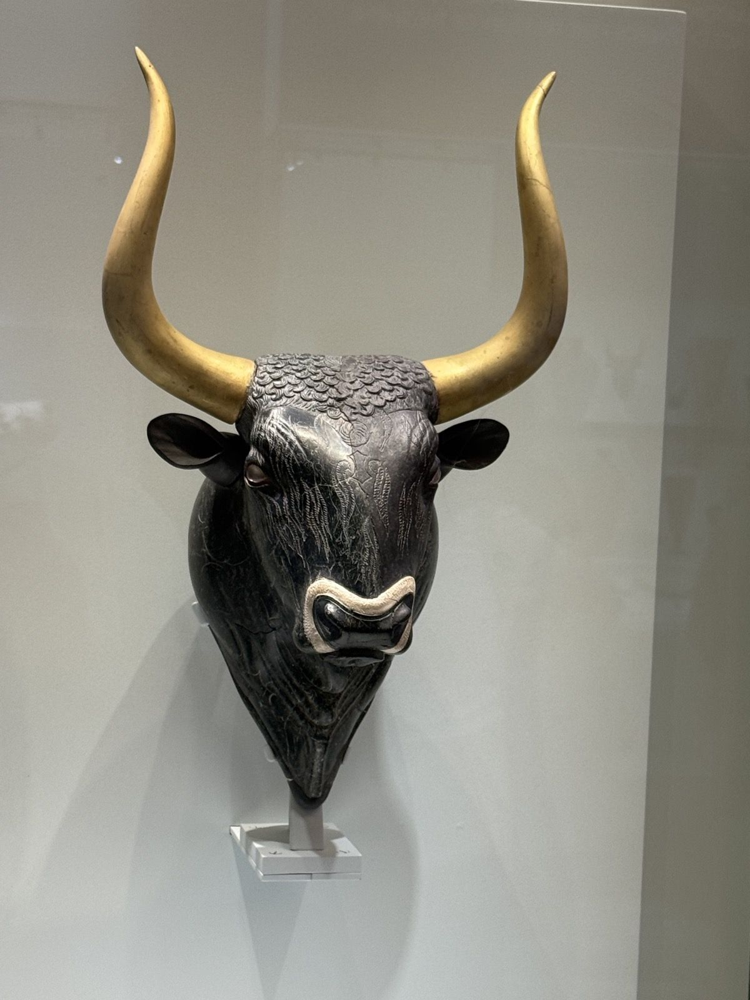
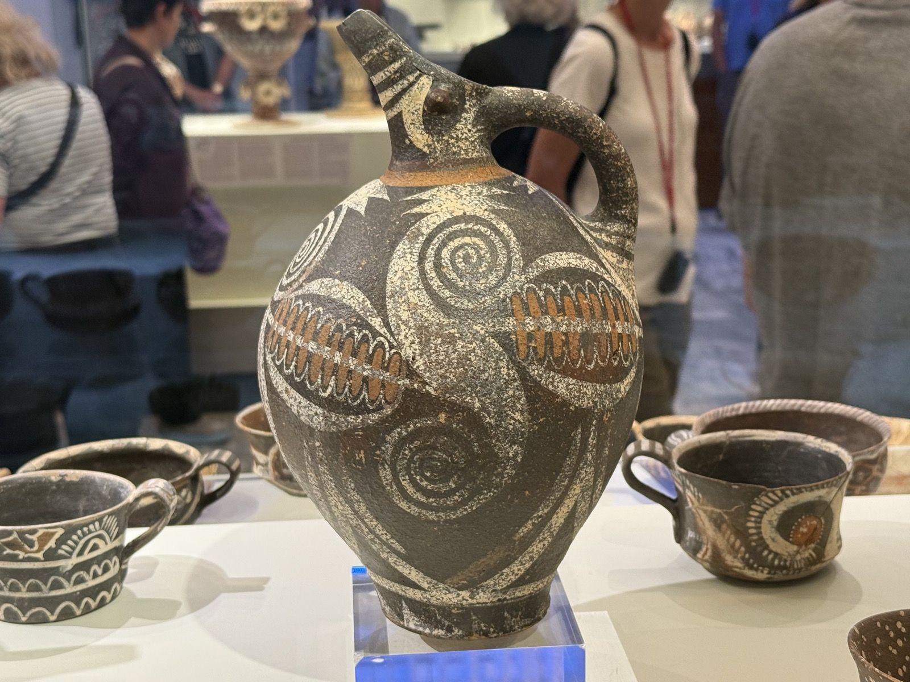
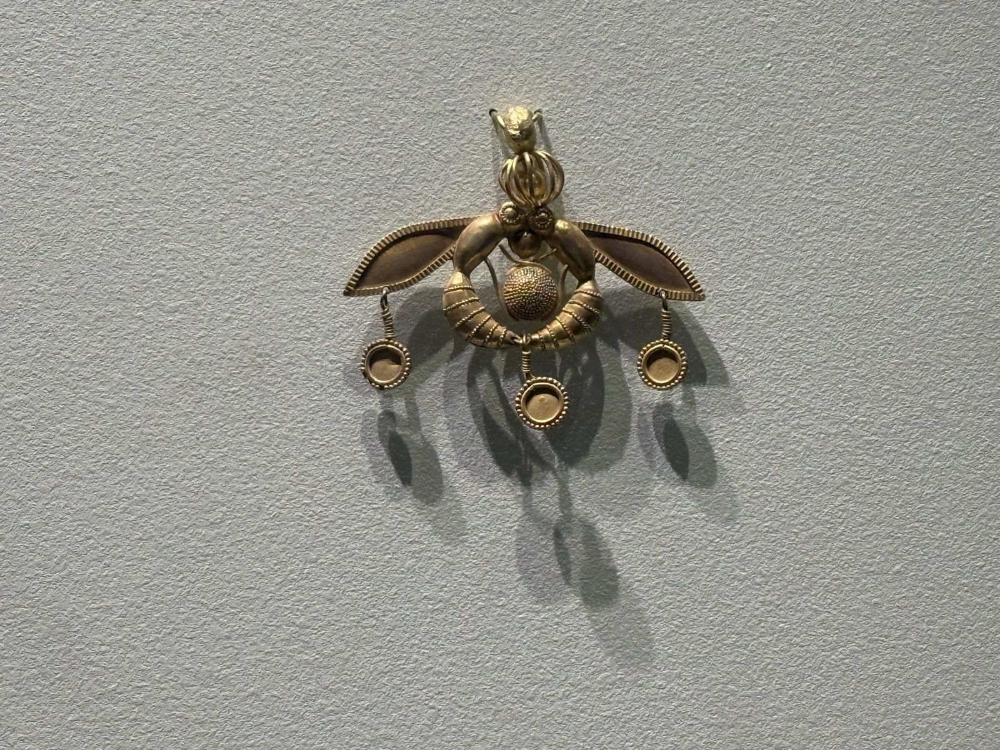
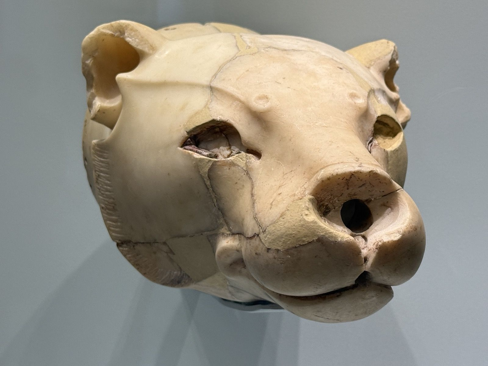
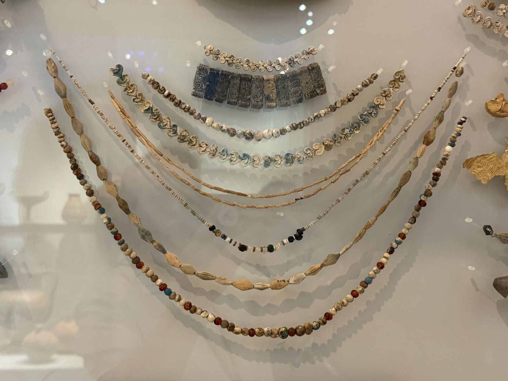
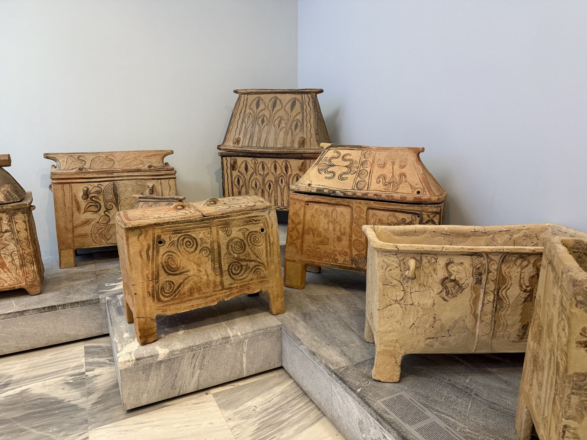

# Day 9, Part 1: Knossos, the Minoans, and Linear B

## Summary

Day 9 (Thursday, November 19) docks at Heraklion, and this chapter covers the morning at Knossos. It explains the palace, the throne room, the storage jars and the palace economy, the frescoes and the bull-leaper, the myth of the Minotaur, and how much of what we see is Arthur Evans' concrete reconstruction. In the museum it looks at the Snake Goddess figurines, the Phaistos Disc, and Linear A and B. Its Learning for All notes tell how Alice Kober and Michael Ventris deciphered Linear B, and why writing kept by a few palace scribes vanished when the palaces fell.

## Concepts Covered

This chapter covers the following 24 concepts from the learning graph:

| Concept | Concept Impact Score |
|---------|-----------------------|
| Knossos Palace | 11 |
| Arthur Evans | 2 |
| Evans Reconstructions | 1 |
| Myth of the Minotaur | 2 |
| Labyrinth | 1 |
| Minoan Frescoes | 2 |
| Bull-Leaping Fresco | 1 |
| Throne Room at Knossos | 1 |
| Palace Economy | 5 |
| Storage Pithoi | 1 |
| Snake Goddess Figurines | 1 |
| Thera Eruption | 1 |
| Linear A | 15 |
| Linear B | 13 |
| Palace Scribes | 3 |
| Alice Kober | 5 |
| Michael Ventris | 4 |
| Decipherment of Linear B | 3 |
| Heraklion Archaeological Museum | 2 |
| Phaistos Disc | 1 |
| Elite Knowledge Is Fragile | 2 |
| Concentrated AI Risk | 1 |
| Outsider Breakthroughs | 1 |
| Credit for Groundwork | 1 |

## Prerequisites

This chapter builds on concepts from:

- [Chapter 1: Before We Go, Part 1: The Long Timeline of the Eastern Mediterranean](../01-long-timeline/index.md)
- [Chapter 2: Before We Go, Part 2: Traveling Well and the Learning for All Thread](../02-traveling-well/index.md)
- [Chapter 4: Day 2: Byzantine Constantinople and Hagia Sophia](../04-byzantine-constantinople/index.md)
- [Chapter 8: Day 6: Troy and Gallipoli](../08-troy-and-gallipoli/index.md)
- [Chapter 10: Day 7: Ephesus, a Greco-Roman City](../10-ephesus-greco-roman-city/index.md)

---

## A Morning in the Bronze Age

Day 9, Thursday, November 19, the Viking Star docks at Heraklion, the capital of Crete, at 7:00 AM and sails at 6:00 PM. Crete is the largest Greek island, a long mountainous rampart across the southern Aegean, and Heraklion sits in the middle of its north coast. About 5 km inland, on a low hill called Kephala above a stream valley, lies Knossos, the largest of the Minoan palaces. Chapter 1 hung the whole Bronze Age on this one place, and Chapter 8 showed how the palace world of the Aegean fell. Today we see where that world was richest, and we meet the clay tablets that let us hear its last voices. This chapter covers Knossos and the Heraklion Archaeological Museum; Chapter 14 covers the Venetian city and Crete today.

A word about what we actually did. This chapter is written as a guide to a morning at Knossos, and it teaches the palace in full, because no account of the Minoans can skip it. On the day, though, we made a different choice. Viking offered a Knossos excursion, and it also offered "The Villages of Crete," an afternoon with a wine tasting at the Avli winery and a visit to Thrapsano <audio id="audio-thrapsano" src="../../audio/thrapsano.mp3" preload="none"></audio><button onclick="document.getElementById('audio-thrapsano').play()" class="pronounce-btn">🔊 Pronounce</button> *thrap-sah-NOH*, a pottery village known for its huge storage jars. We chose the villages. That left our morning free, and we spent it, from a little after nine, in the Heraklion Archaeological Museum, where nearly everything movable from Knossos now lives, before walking through the old town. So the palace itself is waiting for a future visit, or for a free morning on another trip. The museum sections of this chapter describe what we saw, and every photo in it was taken in those galleries.

!!! mascot-welcome "A Palace, a Puzzle, and a Pile of Index Cards"
    { class="mascot-admonition-img" }
    Today we meet a people whose name was invented for them, whose language we still cannot read, and whose palace was half rebuilt in concrete by an Englishman with strong opinions. By the end of this chapter, a red column will tell us who made it, a clay tablet will tell us who counted the sheep, and a cigarette carton full of index cards will tell us who deserves the credit. Look closer.

The chapter has four parts and a long Learning for All note. Part One walks through the palace of Knossos and asks how much of it Arthur Evans built. Part Two explains how the palace worked, from its storage jars to its accounts, and what the eruption of Thera did to it. Part Three looks at Minoan wall paintings, the bull-leapers, and the myth of the Minotaur and the Labyrinth. Part Four is the museum we visited: the Snake Goddess figurines, the Phaistos Disc, and the scripts Linear A and Linear B. The Learning for All note then tells how Alice Kober and Michael Ventris read Linear B, and why a script kept by a few palace scribes vanished when the palaces fell.

## Part One: The Palace and the Man Who Rebuilt It

### Knossos Palace

The **Knossos Palace**, or Palace of Knossos, is the largest of the Minoan palace complexes of Bronze Age Crete, built around a great open court on the Kephala hill about 5 km southeast of the center of Heraklion. People lived on this hill long before any palace. The first farming village here goes back to about 7000 BCE, which makes Knossos one of the oldest settlements in Europe, and centuries of houses built on houses raised the hill itself. The first palace rose about 1900 BCE. It was badly damaged about 1700 BCE, probably by an earthquake, and rebuilt on a grander scale; most of what we see belongs to that second palace. After about 1450 BCE, Greek-speaking Mycenaeans from the mainland controlled it, and about 1375 BCE it burned, though some scholars argue for a later date. A town lived on, and in Classical and Roman times Knossos was a city again, but the palace was never rebuilt.

As Chapter 1 explained, a Minoan "palace" was more than a royal home. It was a storehouse, a set of workshops, a shrine, an office, and probably a residence, all in one building of several stories with hundreds of rooms. It had no fortification wall. It was built of rubble and timber framing, faced with cut limestone and with the local gypsum, a soft, shining stone that dissolves slowly in rain. Light wells brought daylight down into the lower floors, and clay pipes and stone channels carried water and drains, one of the best water systems of the ancient world.

**Worked example: reading the plan from the central court.** Let's walk the palace the way the scale model in the museum lays it out, and notice what each wing was for. We arrive from the west, across the paved West Court, where raised stone walkways cross the pavement and three large round pits, whose purpose is still debated, are sunk into it. A ramp and the Corridor of the Procession, named for its wall painting of people carrying gifts, lead us toward the **central court**, an open rectangle roughly 50 m long and 25 m wide, running north to south. Everything faces it. On the west side are the Throne Room and, behind it, a long row of storerooms full of giant jars: ceremony in front, wealth behind. On the north side, a ramp leads down to the North Entrance, where a painted plaster relief of a charging bull once greeted visitors. On the east side, the hill drops away, and the builders cut the **Grand Staircase** into the slope, flight below flight, down to a set of rooms Evans called the royal apartments, including the so-called Queen's Megaron with its dolphin painting. Workshops for stone vases and other crafts stood on this side too. Four wings, one court: storage, ritual, administration, craft, and living all faced the same open space. The names, though, are mostly Evans's guesses. Nobody knows whether a king, a queen, or a group of priests lived here, and "Queen's Megaron" is a label, not a fact.

<figure markdown="span" class="trip-photo">
  { loading=lazy }
  <figcaption>Scale model of the palace of Knossos. Photo by Dan McCreary</figcaption>
</figure>

The table sets the palace's long life in order.

| Phase | Dates | What happened at Knossos |
|---|---|---|
| Neolithic village | c. 7000–3100 BCE | Farming settlement; houses rebuilt on houses raise the hill |
| First palace | c. 1900–1700 BCE | The first palace is built around the central court |
| Second palace | c. 1700–1450 BCE | Rebuilt after an earthquake; the Minoan high point |
| Mycenaean Knossos | c. 1450–1375 BCE | Greek speakers rule; records kept in Linear B |
| After the palace | c. 1375 BCE onward | Palace burns; the town survives and later becomes a Greek and Roman city |

### Arthur Evans

**Arthur Evans** (1851–1941) was the British archaeologist who excavated Knossos from 1900 and made it famous. He was the keeper of the Ashmolean Museum in Oxford, and he first came to Crete in 1894 looking for something specific: writing. Engraved sealstones that Cretan women wore as charms carried little signs, and Evans suspected they belonged to an unknown script older than the Greek alphabet. He was not the first to dig at Knossos. In 1878 a Heraklion merchant and antiquarian, Minos Kalokairinos, opened trenches on the hill and found storerooms full of giant jars, but the Ottoman authorities, who still governed Crete, stopped him. Once Crete became autonomous, Evans bought the land and began digging in March 1900, with the Scottish archaeologist Duncan Mackenzie keeping the daily records and a large crew of Cretan workers. Within weeks they found the Throne Room and the first clay tablets.

Evans spent the rest of his life on Knossos. He named the Minoans after King Minos, divided their history into periods by pottery style, and published the palace in four huge volumes, *The Palace of Minos*, between 1921 and 1935. He was knighted in 1911. He also had a vision of the Minoans as peaceful, nature-loving, and ruled by a priest-king and a great goddess, and that vision shaped what he rebuilt and what he named.

### Evans Reconstructions

Chapter 4 separated **restoration**, which conserves what survives, from **reconstruction**, which rebuilds what is lost, and warned that a reconstruction can quietly turn a guess into a fact. Knossos is the most famous case of reconstruction in Europe. The **Evans reconstructions** are the rooms, stairways, columns, and upper stories that Evans rebuilt at Knossos between about 1905 and 1930, at first with wood and stone and from the 1920s mainly in reinforced concrete, with copies of wall paintings set into them.

He had a real problem. The palace's wooden columns and beams had burned or rotted away, leaving upper floors with nothing to hold them, and the gypsum was dissolving in the rain. His answer came in stages.

- **Wood and stone, from about 1905.** His first wooden supports and props decayed within a few years.
- **Reinforced concrete, mainly in the 1920s.** Concrete could imitate stone and timber, hold up a floor, and last. The architects working for him, Christian Doll and later Piet de Jong, rebuilt the Grand Staircase, the North Entrance, and an upper floor over the Throne Room, and painted concrete columns red, with the Minoan shape that is wider at the top than at the bottom.
- **Painted copies.** A father-and-son team of Swiss artists, both named Émile Gilliéron, painted copies of the frescoes for the rebuilt walls, filling in what the fragments did not show.

The result is the only Bronze Age palace where we can stand in a room and feel its height. It is also a palace partly designed in the 1920s. Some of Evans's guesses were careful, based on fallen beams, column bases, and paintings that showed Minoan buildings; others were imagination. Later conservation rules turned against this approach: the Venice Charter of 1964, the international charter for conserving monuments, says that on archaeological sites reconstruction should be ruled out, and only fallen original pieces may be put back. Today the concrete is nearly a century old, its iron reinforcement is rusting, and conservators must decide how to care for Evans's work, which is now itself part of the site's history.

!!! mascot-tip "Check the Material, Then the Color"
    { class="mascot-admonition-img" }
    Here's a quick test at any wall in Knossos: look at the material before the paint. Rough rubble, worn limestone, and pitted gypsum are almost always Minoan; smooth gray concrete, crisp edges, and anything bright red or black above head height is almost always Evans. A painting on a wall outdoors is a copy, because every original went to the museum.

The MicroSim below practices that test on ten things a visitor sees at Knossos.

#### Diagram: Knossos: Minoan, Evans, or Copy?

<iframe src="../../sims/knossos-minoan-or-evans/main.html" height="584px" width="100%" scrolling="no"></iframe>

[Run the Knossos: Minoan, Evans, or Copy? MicroSim Fullscreen](../../sims/knossos-minoan-or-evans/main.html){ .md-button .md-button--primary }

Knossos: Minoan, Evans, or Copy?

Type: microsim
**sim-id:** knossos-minoan-or-evans 
**Library:** p5.js 
**Status:** Specified 
**Bloom Level:** Analyze 
**Bloom Verb:** distinguish 
**Learning Objective:** The learner will distinguish surviving Minoan remains at Knossos from Arthur Evans's reconstructions and from modern copies of originals now in the Heraklion Archaeological Museum, sorting at least 8 of 10 features correctly on the first attempt.

**Prerequisites:** restoration and reconstruction (Chapter 4), Knossos Palace, Arthur Evans, Evans reconstructions, the Throne Room (all defined in Part One above), storage pithoi (Part Two).

**Evidence of Mastery:** For each of ten feature cards, the learner chooses one of three bins before feedback. A choice is correct when it matches the Correct bin column in Content. Mastery is 8 of 10 correct on the first attempt. Opening the "What to look for" hint after answering is exploration, not evidence.

**Misconceptions:** (1) Everything at Knossos that looks old is Minoan. (2) The bright red columns are original Minoan columns. (3) The wall paintings outdoors are the original frescoes. (4) Nothing at the site is original, so it is "all fake."

**Instructional Rationale:** Distinguishing layers is an Analyze task: the learner must break the visible site into parts by origin, using evidence (material, location, what the chapter says was moved to the museum). Sorting cards with an explained reason after each choice builds the habit of asking "who made this?" before admiring it.

**Content:**

The three bins, each with its definition:

- Minoan original: built or made by the Minoans and still at the site.
- Evans reconstruction: built for Arthur Evans between about 1905 and 1930.
- Modern copy: a painted copy at the site of an original now in the Heraklion Archaeological Museum.

| # | Feature card | Correct bin | Why (shown as feedback) |
|---|---|---|---|
| 1 | The lower walls and floor plan around the central court | Minoan original | The plan and the lower courses of stone survived the fire and were excavated in place. |
| 2 | Red columns, wider at the top than the bottom, at the North Entrance | Evans reconstruction | The original columns were wooden and burned; these are painted concrete, shaped after Minoan evidence. |
| 3 | The painted relief of a charging bull at the North Entrance | Modern copy | The original plaster relief is in the Heraklion museum; the one on the wall is a copy. |
| 4 | The gypsum throne in the Throne Room | Minoan original | The throne was found in place in 1900 and has never left the room. |
| 5 | The concrete upper floor built over the Throne Room | Evans reconstruction | Evans rebuilt a whole upper story in reinforced concrete to show how the wing may have looked. |
| 6 | Giant storage jars in the West Magazines | Minoan original | Many pithoi were left where they were found, in the storerooms behind the Throne Room. |
| 7 | The dolphin painting in the so-called Queen's Megaron | Modern copy | The original fragments are in the museum; the room shows a painted copy. |
| 8 | Large stone horns of consecration on the south side | Evans reconstruction | They were re-made at large size from fragments, an Evans-era guess at the original. |
| 9 | Clay drainage pipes and stone water channels | Minoan original | The palace's water system survived underground and was excavated in place. |
| 10 | The Cup-Bearer painting on the south side | Modern copy | The original figure from the procession paintings is in the museum. |

**Provenance:** All ten features and their classification come from Part One of this chapter ("Knossos Palace," "Arthur Evans," "Evans Reconstructions," "The Throne Room at Knossos") and Part Two ("Storage Pithoi"). The general rule that outdoor wall paintings at the site are copies is stated in the mascot tip "Check the Material, Then the Color."

**Rules:** Ten cards, shown in the order listed. Each card is scored once, on the first answer. Score is 0 to 10. Mastery is score >= 8. After scoring, the learner may re-sort any card for practice; re-sorts are not scored.

**Learner Activity:**

1. The learner reads the three bin definitions.
2. For each card, the learner chooses a bin.
3. Feedback appears with the reason, and the card joins a summary grouped by bin.
4. After card 10, the summary shows Minoan original 4, Evans reconstruction 3, Modern copy 3.
5. The learner should notice that the site is neither all original nor all fake: the plan, the throne, the jars, and the drains are Minoan, while the color and height are mostly the 20th century's.

**Feedback:** One scored attempt per card, fixed order. Correct: "Correct." plus the reason. Incorrect: "This one is [correct bin]." plus the reason, which names the misconception (for example, for card 2: "The original columns were wooden and burned..."). After card 10, if mastery is met: "You can read Knossos in layers: Minoan bones, Evans's body, and copies for skin." Otherwise: "Look again at the cards you missed: what is each one made of, and where is the original?" A running count "Correct: n of 10" is shown, and a Try Again option repeats all ten cards unscored.

**Starting State:** The three empty bins with their definitions, card 1 face up, and the question "Who made this: the Minoans, Evans, or a modern copyist?"

**Chapter Anchors:** Evans excavated from 1900; reconstructions about 1905 to 1930, mainly in reinforced concrete from the 1920s; ten feature cards; summary counts 4, 3, 3; mastery 8 of 10.

### The Throne Room at Knossos

The **Throne Room at Knossos** is a small room on the west side of the central court, found by Evans's team in April 1900, where a high-backed gypsum seat still stands against the wall, flanked by stone benches. It is often called the oldest throne in Europe. Painted griffins, lion-bodied and eagle-headed, lie among plants on the walls on either side; what we see are modern paintings based on fragments. Opposite the throne, steps lead down into a small sunken area that Evans called a "lustral basin," a place for ritual washing, though no drain shows that water was used there.

Evans called it the throne of Minos. In its present form, though, the room dates from the last phase of the palace, after about 1450 BCE, when Mycenaeans ruled Knossos. Who sat here is unknown. Some scholars think the seat belonged to a priestess who appeared as a goddess between her guardian griffins, which fits the many Minoan images of powerful women and the absence of any clear image of a king. Visitors today look in from the antechamber rather than walking in, and the stone throne is worth the wait: it is one of the few things in the palace that is exactly where the Bronze Age left it.

## Part Two: How the Palace Worked

### Palace Economy

The **palace economy** is the system in which a Bronze Age palace collected farm produce, raw materials, and labor from the surrounding countryside, stored them, recorded them, and paid them out again as rations, wages, gifts, and offerings. Economists call this kind of system **redistribution**: goods flow into a center and back out, directed by its officials, rather than being bought and sold in a market. Knossos, Phaistos, Malia, and Zakros on Crete, and later Pylos and Mycenae on the mainland, all worked this way. The palace also controlled specialist crafts, such as perfumed oil, fine textiles, bronze, and stone vases, and the long-distance trade in tin and copper that Chapter 1 followed on the Uluburun shipwreck.

**Worked example: following a jar of olive oil.** Let's follow one product through the system at Mycenaean Knossos, using what the Linear B tablets record. A farming village in the countryside owes the palace a share of its olive harvest. The oil arrives in jars and is checked in by an official, and a scribe writes a short record on a clay tablet: the place, the product, and the amount, using a word-sign for oil and the numbers. The jars go into the storerooms on the west side of the palace. Over the following months, oil goes out again: as rations to workers, as raw material to the perfume makers, who boil it with herbs and spices to make scented oil, and as offerings to the gods. Each issue gets its own tablet. Scented oil in painted jars may then travel overseas as a luxury export, and the tablets record wool, sheep, and cloth in the same way: one Knossos series records flocks of sheep that together run to tens of thousands of animals. At every step, the palace knows where the oil is, because someone wrote it down. That is why the palace needed scribes, and why its writing was bookkeeping.

!!! mascot-thinking "A Warehouse That Could Read"
    { class="mascot-admonition-img" }
    Think of the palace as a giant warehouse with an accounting office in the middle. The jars hold the wealth, and the tablets hold the knowledge of where the wealth is. Notice that both depend on the palace standing: burn the building, and the stores and the bookkeepers are gone together.

Historians now think the palace did not control everything. Families kept their own stores, villages traded among themselves, and the tablets record only what concerned the palace. But for the goods it did manage, Knossos was the center of a web that reached the whole of central Crete.

### Storage Pithoi

**Storage pithoi** <audio id="audio-pithoi" src="../../audio/pithoi.mp3" preload="none"></audio><button onclick="document.getElementById('audio-pithoi').play()" class="pronounce-btn">🔊 Pronounce</button> *PITH-oy* are the very large clay jars in which the Minoans stored olive oil, wine, grain, and pulses; the singular is *pithos*. The biggest at Knossos stand taller than a person. They were built up by hand in coils or sections, sometimes finished on a wheel, and fired at high heat, which took real skill at that size. Many carry raised bands of clay in a rope pattern, which may imitate the ropes used to move them, and rows of handles for lifting and tying on covers. In the West Magazines, the long, narrow storerooms behind the Throne Room, rows of pithoi still stand where they were found, beside stone-lined pits in the floors that held more stores. These jars were the first thing anyone dug up at Knossos: they were what Kalokairinos found in 1878.

<figure markdown="span" class="trip-photo">
  { loading=lazy }
  <figcaption>Minoan storage jars (pithoi). Photo by Dan McCreary</figcaption>
</figure>

The craft did not end with the palaces. In the afternoon of Day 9 we visited Thrapsano, a village in the hills southeast of Heraklion whose potters have made large storage jars for centuries, and whose workshops still build them by hand. Chapter 14 tells that visit. Standing beside a new pithos there, after a morning beside the Minoan ones in the museum, is the quickest way to feel how long some skills last on this island.

### Thera Eruption

The **Thera eruption** was the enormous volcanic eruption of the island of Thera, modern Santorini, about 110 km north of Crete, around 1600 BCE. It was one of the largest eruptions of the last ten thousand years. It buried the prosperous Minoan-style town at Akrotiri on Thera under meters of ash and pumice, preserving its houses and wall paintings much as Vesuvius later preserved Pompeii, though the people seem to have had time to flee. Ash fell on eastern Crete, and layers of sea debris on Crete's north coast suggest a tsunami reached it.

In 1939 the Greek archaeologist Spyridon Marinatos, who later excavated Akrotiri, proposed that the eruption destroyed Minoan civilization. Better dating has changed that picture, and the eruption has also been linked to the legend of Atlantis, so it is worth sorting the claims with Chapter 4's habit of asking for the evidence and for when a story first appears.

| Claim | Evidence | Verdict |
|---|---|---|
| The eruption destroyed Minoan civilization | The palaces carried on for more than a century afterward; most were destroyed about 1450 BCE | Not supported |
| The eruption weakened Minoan Crete | Ash on eastern Crete, tsunami debris on the north coast, a lost Minoan-style town on Thera | Likely |
| Thera was Atlantis | Atlantis first appears in Plato's dialogues of the 4th century BCE, more than a thousand years later, as a story with a moral | A later story, most likely Plato's invention |

## Part Three: Bulls, Paintings, and the Minotaur

### Minoan Frescoes

**Minoan frescoes** are the wall paintings of Bronze Age Crete, painted mostly on fresh lime plaster in the true-fresco technique that Chapter 10 explained at Ephesus, more than a thousand years before the Romans. Minoan painters used a few mineral colors, red and yellow ochre, a blue made of colored glass called Egyptian blue, black, and the white of the plaster itself, and some panels were modeled in low relief before painting. Their favorite subjects were nature and ceremony: lilies and crocuses, monkeys and birds, dolphins and fish, processions of people carrying gifts, crowds at festivals, and athletes with bulls. They followed a convention also found in Egypt, painting men's skin red-brown and women's white.

Almost none of these paintings survived on the walls. They fell when the palaces burned and collapsed, and they come out of the ground as heaps of fragments, often a few centimeters across. Every fresco in the museum is therefore a reconstruction: real fragments set into new plaster, with the missing areas painted in by a restorer. Chapter 6 told how one of them, restored as "the Saffron Gatherer," a boy picking crocuses, turned out to be a blue monkey. The best-preserved Bronze Age Aegean paintings come not from Crete but from Akrotiri, where the ash of Thera protected them.

<figure markdown="span" class="trip-photo">
  { loading=lazy }
  <figcaption>Fragments of a Minoan wall painting set into a modern plaster panel. Photo by Dan McCreary</figcaption>
</figure>

!!! mascot-warning "The Plaster Is Not the Painting"
    { class="mascot-admonition-img" }
    A common trap in the fresco gallery is to admire a whole figure that is mostly modern plaster. Before reading a scene, find the edges of the real fragments, which are usually darker, rougher, and slightly raised. Then judge the restorer's choices by how much of the figure the fragments actually show.

### Bull-Leaping Fresco

The **Bull-Leaping Fresco** is a painted panel less than a meter high from the east wing of the palace of Knossos, made about 1450–1400 BCE and now in the Heraklion Archaeological Museum. It shows a charging bull and three young athletes. One, in front, grips the bull's horns. A second is in mid-air over the bull's back, upside down, in a handspring. A third stands behind the bull with arms outstretched, either to catch the leaper or having just landed. By the color convention, the front and back figures, painted white, would be women, and the leaper, painted red-brown, a man, though some scholars think young men were sometimes painted white too.

Bulls are everywhere in Minoan art: in paintings, on sealstones, in a famous ivory figure of a leaper in mid-flight, and in the stone stands called "horns of consecration," shaped like a pair of horns, that crowned Minoan buildings. The most striking bull in the museum is a ritual pouring vessel, a **rhyton** <audio id="audio-rhyton" src="../../audio/rhyton.mp3" preload="none"></audio><button onclick="document.getElementById('audio-rhyton').play()" class="pronounce-btn">🔊 Pronounce</button> *RYE-ton*, carved as a bull's head in black stone with eyes of rock crystal; it was filled through a hole in the neck, and liquid poured out of the muzzle. The original gilded horns did not survive; the ones we see are restorations.

<figure markdown="span" class="trip-photo">
  { loading=lazy }
  <figcaption>Bull's-head rhyton from Knossos, about 1500 BCE. Photo by Dan McCreary</figcaption>
</figure>

Could anyone really vault over a charging bull? Experienced rodeo performers asked about the fresco have said that grabbing the horns and somersaulting over the back is close to impossible, because a bull tosses its head sideways, not straight up. The painting may compress several moves into one picture, or show an ideal more than a technique. That the sport existed, in some form, is clear from how often the Minoans showed it. Whether it was a sport, a rite of passage, or a religious ceremony, we cannot tell without their words.

### Myth of the Minotaur

The **myth of the Minotaur** is the Greek story of a monster, half man and half bull, kept by King Minos of Crete beneath his palace at Knossos. Chapter 1 told its ending; the beginning is stranger. The sea god Poseidon sent Minos a magnificent white bull to sacrifice, and Minos kept it. In revenge, Poseidon made Minos's wife, Pasiphaë, fall in love with the bull, and their child was the Minotaur, "the bull of Minos," which the craftsman Daedalus shut in the Labyrinth. Athens had to send seven young men and seven young women as its food, until the Athenian prince Theseus killed it and found his way out with a thread given to him by Minos's daughter Ariadne. Daedalus later escaped from Crete on wings of feathers and wax with his son Icarus, who flew too close to the sun.

**Worked example: running the myth test on the Minotaur.** Let's apply Chapter 4's method and ask when each piece of the story first appears.

| Piece of the story | Earliest source we have | Date |
|---|---|---|
| Knossos, Minos, Daedalus, and Ariadne | Homer's *Iliad*, which mentions a dancing floor Daedalus made for Ariadne at Knossos | Written down about the 8th–7th century BCE |
| Theseus killing the Minotaur | Scenes on Greek pottery and metalwork | From the 7th century BCE |
| The tribute of fourteen young Athenians, and Ariadne's thread | Writers of the Roman era, such as Plutarch and Apollodorus | 1st–2nd century CE |

So the earliest pieces of the myth were written down some 600 or 700 years after the palace fell, and the full story more than a thousand years later than that. What could the Greeks have remembered? A great palace at Knossos with a confusing plan of many rooms; a powerful Cretan ruler; bulls at the center of ritual and sport; and perhaps a time when the mainland owed something to Crete. The monster itself is the poets' work. The story is a memory of a place, not a record of events.

### Labyrinth

The **Labyrinth** is, in Greek myth, the maze that Daedalus built at Knossos to imprison the Minotaur, so confusing that no one who entered could find the way out. Since Evans, many writers have linked the word to the **labrys** <audio id="audio-labrys" src="../../audio/labrys.mp3" preload="none"></audio><button onclick="document.getElementById('audio-labrys').play()" class="pronounce-btn">🔊 Pronounce</button> *LAB-ris*, the Minoan double-headed axe, a sacred symbol carved on the palace's stone blocks and found in shrines, so that the Labyrinth would be "the house of the double axe." Linguists are divided on that explanation. Two other clues are firmer. A Linear B tablet from Knossos, of the kind Part Four explains, records an offering of honey to "the Mistress of the Labyrinth," so a place or shrine with that name existed at Mycenaean Knossos. And a thousand years later, the coins of the Greek city of Knossos carried a maze pattern, proudly claiming the myth as the city's own. Anyone who has tried to find the way out of the ruined palace, with its corridors, stairs, and dozens of small rooms, will understand how the idea of a maze could grow from it.

## Part Four: The Museum We Saw

### Heraklion Archaeological Museum

The **Heraklion Archaeological Museum** is the museum in the center of Heraklion that holds the world's greatest collection of Minoan art, gathered from Knossos, Phaistos, Malia, Zakros, Hagia Triada, and hundreds of smaller sites across Crete. Its collection began in 1883, and its present building, a light-filled modernist design by the architect Patroklos Karantinos, was built between 1937 and 1940 and reopened in 2014 after a long renovation. The galleries run roughly in time order, from the Neolithic to the Roman period, with the frescoes upstairs. Chapter 8 introduced the site museum, kept beside its ruins; this is the opposite case, a central museum to which the originals of a whole island were brought for safety, which is why the walls at Knossos show copies.

**Worked example: our hour in the museum.** We had about an hour on the morning of Day 9, from a little after nine, and it was enough to see the high points if we kept moving. Let's follow the route our photos record. The early galleries hold the pottery of the first palaces, about 2000–1700 BCE, including Kamares <audio id="audio-kamares" src="../../audio/kamares.mp3" preload="none"></audio><button onclick="document.getElementById('audio-kamares').play()" class="pronounce-btn">🔊 Pronounce</button> *kah-MAH-res* ware, named for a cave on Mount Ida where it was first found: thin-walled cups and jugs, some as thin as eggshell, painted in white, red, and orange on a dark ground, which only a skilled potter with a fast wheel could make.

<figure markdown="span" class="trip-photo">
  { loading=lazy }
  <figcaption>Kamares-ware jug with spiral decoration. Photo by Dan McCreary</figcaption>
</figure>

A few cases later is one of the smallest and finest objects in the museum: a gold pendant from a cemetery at Malia, about 1700 BCE, in which two bees, or perhaps wasps, hold a drop of honey between them. The gold is decorated with granulation, tiny beads of gold fused to the surface, a technique that is hard to do well even today. Nearby are the palace model, the storage jars, and the cases of stone vases and ritual vessels, including the lioness-head rhyton from Knossos, carved from a pale stone and polished smooth.

<figure markdown="span" class="trip-photo">
  { loading=lazy }
  <figcaption>The Malia bee pendant, gold, about 1700 BCE. Photo by Dan McCreary</figcaption>
</figure>

The bull's-head rhyton from Part Three is in this part of the museum too, and the two animal heads, bull and lioness, make a good pair to compare: one dark and fierce, the other pale and calm, both made to pour offerings to the gods. The craft of the stone-carvers is as fine as the goldsmith's.

<figure markdown="span" class="trip-photo">
  { loading=lazy }
  <figcaption>Lioness-head rhyton from Knossos. Photo by Dan McCreary</figcaption>
</figure>

Further on, jewelry cases hold strings of beads in gold, carnelian, amethyst, and glass paste, worn by the people who ran and served the palaces.

<figure markdown="span" class="trip-photo">
  { loading=lazy }
  <figcaption>Minoan bead necklaces. Photo by Dan McCreary</figcaption>
</figure>

The later galleries show how Crete changed after the Mycenaeans arrived. The dead were now often buried in larnakes <audio id="audio-larnakes" src="../../audio/larnakes.mp3" preload="none"></audio><button onclick="document.getElementById('audio-larnakes').play()" class="pronounce-btn">🔊 Pronounce</button> *LAR-nah-kes*, clay coffins shaped like chests or bathtubs, painted with octopuses, birds, fish, and plants, from about 1400 to 1200 BCE. They are worth a slow look, because they show the Minoan love of the sea surviving into the Mycenaean age, now in the service of the dead.

<figure markdown="span" class="trip-photo">
  { loading=lazy }
  <figcaption>Painted Minoan clay coffins (larnakes). Photo by Dan McCreary</figcaption>
</figure>

Upstairs, the fresco gallery holds the Bull-Leaping Fresco, the original bull relief from the North Entrance, the Cup-Bearer, the dolphins, and the panels of fragments set into plaster that Part Three described. That is where we finished, just after ten, before walking out into the old town that Chapter 14 describes.

!!! mascot-tip "Spend Your Hour Like a Curator"
    { class="mascot-admonition-img" }
    Short of time? Choose five objects before you go in, say the Snake Goddesses, the Phaistos Disc, the bull's-head rhyton, the bee pendant, and the Bull-Leaping Fresco, and find those first. Anything else you see on the way is a bonus, and you will not reach the frescoes upstairs with five minutes left.

### Snake Goddess Figurines

The **Snake Goddess figurines** are two small figures of women made of faience, a glazed ceramic of crushed quartz, found by Evans in 1903 in stone-lined pits called the Temple Repositories at Knossos and dated to about 1600 BCE. Both wear the Minoan court dress of a long flounced skirt and a tight bodice open at the front, leaving the breasts bare. The larger figure has snakes winding over her arms and around her body and high headdress. The smaller one holds a snake up in each raised hand. Evans called them a goddess and her priestess, and they became the most famous images of Minoan religion.

They are also a lesson in restoration. The smaller figure was found in pieces without its head; its head and the small cat perched on it are the restorers' work, and some scholars question whether she held snakes at all. We do not know whether either figure shows a goddess, a priestess, or a worshipper. Their fame also attracted forgers: several "Minoan goddesses" of ivory and gold that entered museums in Europe and North America in the early 20th century are now thought to be modern fakes. The faience pair in Heraklion is genuine, but what we see is partly an interpretation.

### Linear A

**Linear A** is the script the Minoans used to write their own language, from about 1800 to about 1450 BCE, on clay tablets, sealings, stone offering vessels, and jewelry. It is still undeciphered. Before it, Crete used a script now called Cretan hieroglyphic, and Linear A takes its name, like Linear B, from Evans, because its signs are drawn with lines rather than pictures. About 1,400 Linear A inscriptions are known, most of them very short, and most of the tablets come from the villa of Hagia Triada, near Phaistos, rather than from Knossos. It has about 90 sound-signs, which, by Chapter 2's sign-count rule, makes it a syllabary, plus word-signs for goods and a system of numbers and fractions.

The odd thing about Linear A is that we can read it aloud without understanding it. Many of its signs look like Linear B signs, whose sounds we know. If we assume similar signs had similar sounds, we can pronounce Linear A words roughly. What we cannot do is understand them, because the Minoan language is unrelated to any known language: it is not Greek, and no one has convincingly matched it to anything else.

The table compares the scripts of Bronze Age Crete.

| Script | Dates | Signs | Language | Status |
|---|---|---|---|---|
| Cretan hieroglyphic | c. 2100–1700 BCE | Several dozen sound-signs plus word-signs | Unknown (Minoan) | Undeciphered |
| Phaistos Disc | c. 1700 BCE | 45 different signs on one object | Unknown | Undeciphered, unique |
| Linear A | c. 1800–1450 BCE | About 90 sound-signs plus word-signs | Minoan, unknown | Sounds partly guessable; meaning unknown |
| Linear B | c. 1450–1200 BCE | About 90 sound-signs plus word-signs | Mycenaean Greek | Deciphered in 1952 |

**Worked example: a word we can read without knowing it.** Let's try it on an account tablet from Hagia Triada. The tablet lists several entries, each a word followed by a number. At the bottom comes a word that, sounded out with Linear B values, reads *ku-ro*, followed by a number that equals the sum of the numbers above it. So *ku-ro* almost certainly means "total," and that is one of the few Minoan words whose meaning is agreed. Notice what this shows. We got the meaning from the arithmetic, not from the language. A scribe's habit of adding up a column has told us more than any amount of staring at the signs. To read Linear A properly, scholars need what Ventris had for Linear B, which the Learning for All note describes: either a bilingual text or a strong guess about the language. Linear A has neither.

### Phaistos Disc

The **Phaistos Disc** is a round tablet of fired clay about 16 cm across, found in 1908 by the Italian archaeologist Luigi Pernier in the palace of Phaistos in southern Crete and usually dated to about 1700 BCE. Both sides carry signs arranged in a spiral, divided by lines into 61 groups that look like words: 241 signs in all, of 45 different kinds, including a running man, a plumed head, a fish, a ship, and a bird. By Chapter 2's sign-count rule, 45 different signs suggests a syllabary.

What makes the disc unique is how it was made. Each sign was not drawn but pressed into the wet clay with a carved stamp, one stamp for each kind of sign. That makes it the oldest known text printed with reusable "type," more than 3,000 years before the movable type of Gutenberg that Chapter 6 described. But it is the only object ever found with these signs, and 241 signs are far too few to decipher; many confident "translations" have been published, and none can be tested. A minority of scholars even suspect it is a modern forgery, though most accept it. The disc stands in its own case in the museum, usually with a crowd around it, and it is worth waiting for a clear look at both sides.

### Linear B

**Linear B** is the script the Mycenaean Greeks adapted from Linear A to write their own language, an early form of Greek, used from about 1450 to about 1200 BCE at Knossos and at mainland palaces such as Pylos, Mycenae, and Thebes. Chapter 1 introduced it, and Chapter 2 sorted it as a syllabary. It has about 90 sound-signs, each a vowel or a consonant plus a vowel, together with word-signs for things like men, women, sheep, wine, oil, and chariots, and signs for numbers counted in tens. Evans found thousands of Linear B tablets and fragments at Knossos, more than at any other site. In 1952 Michael Ventris showed that the language was Greek, which made the Mycenaeans the earliest Europeans whose words we can read. A syllabary built for another language fits Greek badly, and the scribes simplified. Greek words are full of consonant clusters and final consonants, which a sign system of consonant-plus-vowel cannot show, so the scribes used a set of spelling rules.

- Most final consonants are left out: *s*, *n*, and *r* at the end of a word are not written.
- A cluster of consonants is split by repeating the next vowel, or the first consonant is dropped.
- *L* and *r* share one set of signs.
- Some signs cover several related consonants, so *ka* can stand for *ka*, *ga*, or *kha*.

**Worked example: spelling Knossos the Mycenaean way.** Let's apply the rules to the place names a Knossos scribe wrote most. *Knossos* begins with the cluster *kn*: split it with the next vowel, *ko-no*, then add *so* and drop the final *s*: **ko-no-so**. *Amnisos*, Knossos's harbor town, has *mn* in the middle; split it, and drop the final *s*: **a-mi-ni-so**. *Tylissos*, a town west of Knossos, uses an *r* sign for its *l* and drops the final *s*: **tu-ri-so**. *Phaistos* has an *st* cluster near the end, and the scribes dropped both the *s* before the *t* and the final *s*: **pa-i-to**. Now go the other way: the tablet word *ti-ri-po* restores to *tripos*, "tripod," a three-legged cauldron. The rules are simple once known, but they make Linear B ambiguous: *pa-te* can be *patēr*, "father," or *pantes*, "all." Context, and often a word-sign next to the word, settles which.

### Palace Scribes

**Palace scribes** were the small group of trained officials who wrote the Linear B records of a Mycenaean palace. Scholars have learned to tell their individual handwriting apart on the Knossos tablets, and, as Chapter 2 said, they were a few dozen people. They wrote on tablets of unbaked clay with a pointed stylus, in two shapes, long thin "leaf" tablets for single entries and larger "page" tablets for lists, and filed them in baskets and wooden boxes by subject. The tablets were working records for the current year, meant to be smoothed over and reused, not archives. They contain no letters, laws, histories, poems, or prayers: only lists of people, livestock, land, goods, and offerings, including offerings to gods with familiar names such as Zeus, Hera, and Poseidon.

We have them only because of disaster. The fire that destroyed the palace of Knossos, about 1375 BCE in the most common dating, baked its tablets hard, and the fires that ended the mainland palaces did the same for Pylos around 1200 BCE. Chapter 8 described that wider collapse. The scribes did not survive it, and neither did their script.

The timeline below sets the whole story of Knossos, from village to decipherment, in order.

#### Diagram: Knossos From Village to Decipherment

<iframe src="../../sims/knossos-village-to-decipherment-timeline/main.html" height="680px" width="100%" scrolling="no"></iframe>

[Run the Knossos From Village to Decipherment MicroSim Fullscreen](../../sims/knossos-village-to-decipherment-timeline/main.html){ .md-button .md-button--primary }

Knossos From Village to Decipherment

Type: timeline
**sim-id:** knossos-village-to-decipherment-timeline 
**Library:** vis-timeline 
**Status:** Specified 
**Bloom Level:** Understand 
**Bloom Verb:** interpret 
**Learning Objective:** The learner will interpret a timeline of Knossos from its first village to the decipherment of Linear B, answering at least 3 of 4 prediction questions about the order and spacing of events correctly before each answer is revealed.

**Prerequisites:** Knossos Palace, Arthur Evans, Evans reconstructions (Part One); palace economy and the Thera eruption (Part Two); the Snake Goddess figurines, the Phaistos Disc, Linear A, Linear B, and palace scribes (Part Four); the Bronze Age collapse (Chapter 8).

**Evidence of Mastery:** The learner answers four prediction questions, each locked in before the relevant events appear on the timeline. An answer is correct when it matches the Correct answer column in Content. Mastery is 3 of 4 correct. Zooming, panning, and opening event descriptions after the reveal are exploration, not evidence.

**Misconceptions:** (1) The Thera eruption destroyed Minoan Crete at once. (2) Knossos and its tablets fell in the same disaster as the mainland palaces. (3) Linear B was read soon after the tablets were found. (4) The palace we see is all from one moment.

**Instructional Rationale:** Prediction before reveal makes the learner commit to a mental timeline and then confront the actual spacing, which is what makes the long gaps (a century between Thera and the destruction of the palaces, 52 years between the first tablets and their decipherment) memorable. A to-scale timeline shows those gaps directly.

**Content:**

Two bands share one timeline: "Bronze Age Crete" and "Rediscovery." Events, all of which appear on the timeline:

| # | Date | Band | Event label | Description shown on click |
|---|---|---|---|---|
| 1 | c. 7000 BCE | Bronze Age Crete | First village at Knossos | A farming village on the Kephala hill, one of the oldest settlements in Europe. |
| 2 | c. 1900 BCE | Bronze Age Crete | First palace | The first palace is built around the central court. |
| 3 | c. 1700 BCE | Bronze Age Crete | Second palace | After earthquake damage, the palace is rebuilt on a grander scale. |
| 4 | c. 1700 BCE | Bronze Age Crete | Phaistos Disc | The stamped clay disc is made at Phaistos. |
| 5 | c. 1600 BCE | Bronze Age Crete | Thera erupts | Akrotiri is buried; Minoan Crete is weakened but carries on. |
| 6 | c. 1600 BCE | Bronze Age Crete | Snake Goddess figurines | The faience figures later found in the Temple Repositories are made. |
| 7 | c. 1450 BCE | Bronze Age Crete | Mycenaeans at Knossos | Most Minoan palaces are destroyed; Greek speakers rule Knossos and write Linear B. |
| 8 | c. 1375 BCE | Bronze Age Crete | Knossos burns | The palace is destroyed by fire; the fire bakes the Linear B tablets. |
| 9 | c. 1200 BCE | Bronze Age Crete | Mainland palaces fall | Pylos and other palaces burn in the Bronze Age collapse; Linear B ends. |
| 10 | 1878 | Rediscovery | Kalokairinos digs | Minos Kalokairinos finds the storerooms and their giant jars. |
| 11 | 1900 | Rediscovery | Evans begins | Arthur Evans begins excavating; the Throne Room and the first tablets are found. |
| 12 | 1903 | Rediscovery | Snake Goddesses found | Evans finds the faience figurines in the Temple Repositories. |
| 13 | 1908 | Rediscovery | Phaistos Disc found | Luigi Pernier finds the disc at Phaistos. |
| 14 | c. 1905–1930 | Rediscovery | Evans reconstructions | Parts of the palace are rebuilt, mainly in reinforced concrete from the 1920s. |
| 15 | 1952 | Rediscovery | Linear B is read | Michael Ventris shows that Linear B writes Greek. |
| 16 | 2025 | Rediscovery | UNESCO listing | The Minoan palatial centres of Crete, including Knossos, become a World Heritage Site. |

Prediction questions, in this order:

| # | Question (shown before the reveal) | Choices | Correct answer | Events revealed after answering |
|---|---|---|---|---|
| 1 | Did the Thera eruption come before or after most Minoan palaces were destroyed? | Before; At the same time; After | Before | 5 and 7 |
| 2 | About how many years separate the Thera eruption and the destruction of most Minoan palaces? | About 10; About 150; About 500 | About 150 | 2, 3, 4, 6 (the rest of the Bronze Age Crete band up to event 7) |
| 3 | Did Knossos burn before, at the same time as, or after the mainland palaces such as Pylos? | Before; At the same time; After | Before | 8 and 9 |
| 4 | How many years passed between Evans finding the first tablets and Ventris reading them? | About 5; About 50; About 150 | About 50 | 10 to 16 |

**Provenance:** All dates come from this chapter: Part One ("Knossos Palace," "Arthur Evans," "Evans Reconstructions"), Part Two ("Thera Eruption"), and Part Four ("Snake Goddess Figurines," "Phaistos Disc," "Linear B," "Palace Scribes"), and from Chapter 4's World Heritage table (2025). Bronze Age dates are approximate; the timeline labels them "c." and the sim shows the note "Bronze Age dates are approximate and debated; the destruction of Knossos is sometimes dated later than 1375 BCE."

**Rules:** The timeline is to scale from 7000 BCE to 2030 CE, with a zoom control (buttons, not the mouse wheel) to expand the Bronze Age band. Question 2's answer is computed as 1600 − 1450 = 150 years. Question 4's answer is computed as 1952 − 1900 = 52 years, which rounds to "About 50." Event 1 is shown from the start so the learner sees the full scale. Events 10 to 16 and 2 to 9 stay hidden until their question is answered, as listed. After all four questions, every event is visible.

**Learner Activity:**

1. The learner sees the empty two-band timeline with event 1 only, and question 1.
2. The learner answers question 1; events 5 and 7 appear, and the gap between them is labeled.
3. The learner answers questions 2 to 4 in turn; after each, the listed events appear.
4. After question 4, the learner can click any event to read its description and zoom into the Bronze Age band.
5. The learner should notice the long gap between the Bronze Age band and the Rediscovery band, and that the record keepers of Knossos were silent for more than 3,000 years before anyone read their tablets.

**Feedback:** Four questions, fixed order, one attempt each. Correct: "Right." plus the reason. Incorrect: "Not quite: [correct answer]." plus the reason. Reasons: (1) "Thera erupted about 1600 BCE; most palaces fell about 1450 BCE, so the eruption weakened Crete but did not end it." (2) "1600 − 1450 = about 150 years, several generations." (3) "Knossos burned about 1375 BCE in the usual dating, more than a century before the mainland palaces fell around 1200 BCE." (4) "Evans found tablets in 1900; Ventris read them in 1952: 52 years, about 50." A score "Predictions correct: n of 4" is shown.

**Starting State:** The to-scale axis from 7000 BCE to 2030 CE, event 1 visible, the two band labels, and question 1 with the prompt "Before we fill this in: what came first, the volcano or the fall?"

**Chapter Anchors:** First village about 7000 BCE; first palace about 1900 BCE; rebuilt about 1700 BCE; Phaistos Disc about 1700 BCE; Thera about 1600 BCE; Snake Goddesses about 1600 BCE; Mycenaeans at Knossos after about 1450 BCE; Knossos burns about 1375 BCE; Pylos around 1200 BCE; Kalokairinos 1878; Evans 1900; Snake Goddesses found 1903; disc found 1908; reconstructions about 1905 to 1930; Linear B read 1952; UNESCO 2025.

## Practical Notes for Day 9 (Morning)

- **Order of the day.** The ship docks at about 7:00 AM and sails at 6:00 PM. If Knossos is the plan, go first, as early as it opens, then come back to the museum in the late morning; the originals mean more after seeing the site. If an afternoon excursion is booked, as ours was, the museum alone fits easily into the morning.
- **Getting to Knossos.** It is about 5 km from the center: a short taxi ride, a city bus from the center, or a ship's excursion with a guide. Allow at least two hours at the site.
- **Hours.** Greek state sites and museums keep shorter winter hours from November 1, and may close early in the afternoon. Check Knossos and the museum on the day; a combined ticket has been offered in past years.
- **At the site.** There is little shade or shelter, and the paths are uneven stone. Wear good shoes. Some areas, including the Throne Room, are seen from viewing points rather than entered.
- **Weather and light.** Expect a mild day, around 20 °C, with a chance of rain. The sun sets at about 5:15 PM, before the 6:00 PM sailing.
- **Food.** Leave lunch for the Cretan table, which Chapter 14 describes.
- **Next.** The afternoon belongs to Venetian Heraklion and the villages of Crete. Read Chapter 14 next.

## Learning for All: Index Cards, a Grid, and a Script That Died With Its Palaces

Chapter 2's route table gives Crete a Bronze Age story in two halves. The first half is a loss: writing kept by a few palace scribes vanished from Greece for about 400 years when the palaces fell. The second half is a recovery: in the 20th century, a classics teacher in Brooklyn and an architect in London worked out how to read it again. The recovery is the more famous story, and it usually has one hero. It should have at least two.

### Alice Kober

**Alice Kober** (1906–1950) was an American classicist who taught at Brooklyn College in New York and spent most of the 1930s and 1940s working on Linear B in her spare time. She studied at Hunter College and Columbia University and carried a heavy teaching load. Her method was patience. Few tablets had been published, because Evans, who controlled the Knossos texts, published only a small part of them in his lifetime. Kober collected every sign and word she could find, and she taught herself several ancient languages to know what to compare them with. Without a computer, she built her own database: about 180,000 index cards, many cut by hand from scrap card because paper was scarce in the war, filed in cigarette cartons.

She refused to guess what language the tablets were written in. Everyone else had started with a guess, Etruscan, Hittite, Basque, and failed. Kober insisted on finding the structure of the language first, using nothing but the patterns of the signs.

**Worked example: a Kober triplet.** Let's see the pattern that made her famous, using words we can now read, though Kober could not. On the tablets, some words appeared in three forms with the same beginning and different endings, as in this group of the kind she found:

| Form | Signs (in transliteration) | Meaning (known only after 1952) |
|---|---|---|
| 1 | a-mi-ni-**so** | Amnisos (the place) |
| 2 | a-mi-ni-**si**-jo | a man of Amnisos |
| 3 | a-mi-ni-**si**-ja | a woman of Amnisos |

Kober saw two things without knowing a single sound. First, the words changed their endings, so the language was **inflected**, like Latin or Greek, where endings show grammar. Second, the sign just before the ending, *so* in form 1 and *si* in forms 2 and 3, changed too. That made sense only if each sign was a syllable straddling the stem and the ending: the consonant belonged to the stem and stayed the same, while the vowel belonged to the ending and changed. So *so* and *si* must share a consonant. From pairs like this she began a small grid of signs that shared consonants or vowels, without assigning any sounds at all. She also showed that some words had masculine and feminine forms, matching the word-signs for men and women beside them. She published her results in 1945 to 1948.

Kober died after an illness in May 1950, at 43, two years before the decipherment she had made possible.

### Michael Ventris

**Michael Ventris** (1922–1956) was an English architect who deciphered Linear B in 1952, at the age of 30. The story goes that as a schoolboy of 14 he heard Arthur Evans speak at an exhibition in London in 1936, learned that the Knossos tablets could not be read, and resolved to read them. He trained as an architect, served as a navigator in the Royal Air Force in the Second World War, and kept working on the script in his spare time. He had no degree in classics, a gift for languages, and an architect's eye for visual pattern.

**Worked example: from grid to Greek.** Let's follow his method in four steps.

1. **Count and place.** Ventris counted how often each sign appeared and where. Signs common at the beginning of words were probably plain vowels, because in a syllabary a word that starts with a vowel needs a vowel sign.
2. **Build the grid.** He extended Kober's idea into a full grid, with rows for signs that seemed to share a consonant and columns for signs that seemed to share a vowel, still with no sounds attached. He shared each version with a small group of scholars in a series of 20 typed "Work Notes" in 1951 and 1952.
3. **Guess the place names.** He noticed that some words appeared only on the Knossos tablets, never on those from Pylos, and guessed they were Cretan place names. If one word was *ko-no-so*, Knossos, and another *a-mi-ni-so*, Amnisos, then a handful of signs got sound values, and because each sign sat in a row and a column, every other sign in those rows and columns got a partial value too.
4. **Sound out the rest.** He tried the new values on other words. He had expected the language to be Etruscan. Instead, words came out as Greek, such as *ko-wo*, "boy," and *ko-wa*, "girl," beside the word-signs for children, *po-me*, "shepherd," and *ka-ko*, "bronze."

The guess about place names was the key, but the grid was the lock that made one guess open everything.

On July 1, 1952, Ventris announced on BBC radio that Linear B was Greek. Four years later, in September 1956, at 34, he was killed in a car crash outside London.

### The Decipherment of Linear B

The **decipherment of Linear B** is the work, completed between 1950 and 1953, that showed Linear B wrote an early form of Greek and assigned sound values to most of its signs. Ventris did not finish it alone. After the radio talk, John Chadwick, a Cambridge scholar of early Greek who had worked as a codebreaker in the Second World War, wrote to offer help, and he supplied what Ventris lacked: deep knowledge of how Greek had changed over time. Together they published the case in 1953 and the first full handbook, *Documents in Mycenaean Greek*, in 1956. They also built on the American scholar Emmett Bennett, whose careful catalog of the signs and edition of the Pylos tablets, published in 1951, gave everyone a reliable set of texts to test.

Many scholars doubted the decipherment at first. The test came from the ground. In 1952 the American archaeologist Carl Blegen dug up a new tablet at Pylos, and when he read it with Ventris's values in 1953 it described tripods and cups, with a little picture of each object beside its word. The word *ti-ri-po-de*, "tripods," stood next to a drawing of a three-legged cauldron. A cup described as *qe-to-ro-we*, "four-handled," was drawn with four handles; one described as *ti-ri-o-we*, "three-handled," had three; and one described as *a-no-we*, "without handles," had none. No one could have arranged that match in advance. Doubt quickly faded.

!!! mascot-encourage "Code-Breaking Feels Hard Because It Is"
    { class="mascot-admonition-img" }
    If the grid sounds like a puzzle that only a genius could solve, remember that it took two people fifteen years of evenings, plus a whole circle of colleagues. We already have the key pieces: we know a syllabary has about 90 signs, and we spelled *ko-no-so* ourselves in Part Four. Try the MicroSim below one step at a time, and the logic will click.

#### Diagram: Crack Linear B Like Ventris

<iframe src="../../sims/crack-linear-b-like-ventris/main.html" height="450px" width="100%" scrolling="no"></iframe>

[Run the Crack Linear B Like Ventris MicroSim Fullscreen](../../sims/crack-linear-b-like-ventris/main.html){ .md-button .md-button--primary }

Crack Linear B Like Ventris

Type: microsim
**sim-id:** crack-linear-b-like-ventris 
**Library:** p5.js 
**Status:** Specified 
**Bloom Level:** Apply 
**Bloom Verb:** solve 
**Learning Objective:** The learner will solve a simplified version of the 1952 decipherment by matching three Linear B sign groups to Cretan place names with grid clues and then using the resulting sound values to predict four objects on the Pylos tripod tablet, getting all three place names and at least 3 of 4 objects right on the first attempt.

**Prerequisites:** syllabary and the sign-count rule (Chapter 2); Linear B, its spelling rules, and the worked example "spelling Knossos the Mycenaean way" (Part Four); the Kober triplet, the grid, and the place-name guess (sections "Alice Kober," "Michael Ventris," and "The Decipherment of Linear B" above).

**Evidence of Mastery:** Two committed answer sets count as evidence: the three place-name matches in step 3 (correct when each matches the Content table; mastery requires 3 of 3) and the four object predictions in step 5 (correct when each matches the Content table; mastery requires at least 3 of 4). Steps 1, 2, and 4 are guided and count as practice, not evidence.

**Misconceptions:** (1) Decipherment starts by guessing the language (Kober's point was the opposite). (2) Each Linear B sign is a letter, as in an alphabet. (3) A single lucky guess deciphered the script, when the grid is what let one guess unlock many signs. (4) Linear B words look like Classical Greek words, when the spelling rules hide final consonants and split clusters.

**Instructional Rationale:** Solving a small, real instance of the decipherment is an Apply task: the learner uses the sign-count rule, the syllable logic of Kober's triplet, and the grid to reach an answer, then tests it against independent evidence (the pictures on the tablet), which is exactly how the decipherment was confirmed. Seeing the pictograms only after committing a prediction makes the confirmation feel earned.

**Content:**

Signs are shown as Linear B characters (Unicode Linear B Syllabary block) with sign numbers, and only gain transliterations when the learner unlocks them. Signs used:

| Sign | Unicode | Value (hidden until unlocked) |
|---|---|---|
| B070 | U+10012 | ko |
| B052 | U+1001C | no |
| B012 | U+10030 | so |
| B008 | U+10000 | a |
| B073 | U+10016 | mi |
| B030 | U+1001B | ni |
| B069 | U+10036 | tu |
| B053 | U+1002A | ri |
| B041 | U+1002F | si |
| B036 | U+1000D | jo |
| B057 | U+1000A | ja |
| B037 | U+10034 | ti |
| B011 | U+10021 | po |
| B045 | U+10006 | de |
| B078 | U+10024 | qe |
| B005 | U+10035 | to |
| B002 | U+1002B | ro |
| B075 | U+10038 | we |
| B061 | U+10003 | o |

Step 1 (sign count). Statement: "Linear B uses about 90 different sound-signs." Question: "What kind of script is this?" Choices: alphabet; syllabary; logographic script. Correct: syllabary. Reason: "About 40 to 100 signs suggests a syllabary (Chapter 2's sign-count rule)."

Step 2 (Kober's triplet). The three words a-mi-ni-so, a-mi-ni-si-jo, a-mi-ni-si-ja are shown as signs only. Question: "The last sign of word 1 is replaced by a different sign in words 2 and 3. If each sign is a syllable, what do the two signs probably share?" Choices: the same consonant; the same vowel; nothing. Correct: the same consonant. Reason: "The consonant belongs to the stem, which stays the same; the vowel belongs to the ending, which changes." The sim then places B012 and B041 in the same grid row, labeled "row 1 (unknown consonant)."

Step 3 (place names). Three sign groups that appear only on Knossos tablets, with two grid clues:

| Group | Signs | Correct match | Reason |
|---|---|---|---|
| A | B070 B052 B012 | Knossos (ko-no-so) | Three signs ending in the shared final sign, and its second sign is in the same row as group B's third sign (both have n). |
| B | B008 B073 B030 B012 | Amnisos (a-mi-ni-so) | The only four-sign group, starting with a plain-vowel sign. |
| C | B069 B053 B012 | Tylissos (tu-ri-so) | Three signs ending in the shared final sign, with no sign in the n row. |

Candidate names offered (one is a distractor): Knossos, Amnisos, Tylissos, Phaistos. Clues shown: (1) "All three groups end with the same sign." (2) "The second sign of group A and the third sign of group B are in the same consonant row." (3) "Group B's first sign is common at the start of words." Phaistos (pa-i-to) is the distractor: "Phaistos would end in a different sign, because its final st is written with a t sign."

Step 4 (unlock). After step 3, the eight signs ko, no, so, a, mi, ni, tu, ri appear in their grid cells with values. The sim then states: "Ventris's grid gave partial values to every sign sharing a row or column with these. Here are the values the decipherment reached for the signs on the next tablet," and unlocks ti, po, de, qe, to, ro, we, o.

Step 5 (the Pylos tripod tablet). A short Greek word bank is shown: *tri-* "three"; *tetra-*, earlier *kwetro-*, "four" (Linear B writes *kwe* with the sign qe); *a-* or *an-* "not, without"; *pous*, plural *podes*, "foot, feet"; *ous*, "ear, handle." Four words are shown, in this order, with the pictograms hidden:

| # | Word | Correct object | Reason |
|---|---|---|---|
| 1 | ti-ri-po-de | Tripods (three-legged cauldrons) | *Tri-* "three" plus *podes* "feet": tripodes. |
| 2 | qe-to-ro-we | A cup with four handles | *Kwetro-* "four" plus *-owes* "handled." |
| 3 | ti-ri-o-we | A cup with three handles | *Tri-* "three" plus *-owes* "handled." |
| 4 | a-no-we | A cup with no handles | *An-* "without" plus *-owes* "handled." |

Choices for each word: tripods; a cup with four handles; a cup with three handles; a cup with no handles; a chariot wheel; a jar of oil. Each choice may be used once.

**Provenance:** Sign numbers and Unicode code points from the Unicode Standard, Linear B Syllabary block (U+10000 to U+1007F). Sign values, the place names ko-no-so, a-mi-ni-so, tu-ri-so, and pa-i-to, the triplet a-mi-ni-so / a-mi-ni-si-jo / a-mi-ni-si-ja, and the tripod tablet words from this chapter (Part Four "Linear B"; Learning for All "Alice Kober," "Michael Ventris," "The Decipherment of Linear B"), which follow Ventris and Chadwick's published values. The tripod tablet is Pylos Ta 641; the pictograms the sim draws are simplified drawings labeled "simplified from the tablet." The grid clues are a teaching simplification of Ventris's grid; the sim labels step 3 "a simplified version of Ventris's test."

**Rules:** Steps run in order and cannot be skipped. Step 1 and step 2 allow repeated attempts until correct (practice). Step 3: the learner assigns each of the four names to at most one group, leaving one name unused, then presses Check; scoring counts the first Check only; a group is correct if its assigned name matches the table. Step 5: one choice per word, each choice used at most once, scored on the first Check only. Mastery is step 3 score = 3 and step 5 score >= 3. After a scored Check, wrong answers may be changed for practice, unscored.

**Learner Activity:**

1. The learner answers the step 1 question and sees the sign-count rule confirmed.
2. The learner studies the triplet and answers the step 2 question; two signs move into the same grid row.
3. The learner reads the three clues and assigns place names to groups A, B, and C, then checks.
4. The grid fills with eight values; the learner should notice that every value came from one guess tested against the grid.
5. The learner reads the four tablet words with the unlocked values and the word bank, predicts each object, and checks; the pictograms from the tablet appear beside the words.
6. The learner should notice that the pictures were drawn by a scribe 3,200 years ago and could not have been arranged to fit Ventris's values: that is why the match convinced the doubters.

**Feedback:** Step 1 and step 2: correct shows the reason; incorrect shows "Not yet:" plus a hint ("Count the signs: about 90." / "Which part of the word stays the same?") and allows another try. Step 3, on Check: each group is marked correct or incorrect with the reason from the table; if Phaistos was used, "Phaistos would end in a different sign, because its final st is written with a t sign." Step 5, on Check: each word is marked correct or incorrect with its reason, and the pictogram is revealed. Final message if mastery is met: "You have just repeated the test that convinced the world in 1953." Otherwise: "Look again at the word bank: tri- and kwetro- are numbers, and a- means without." A score "Place names: n of 3; Tablet objects: n of 4" is shown.

**Starting State:** An empty grid with five vowel columns and blank rows, a row of unread Linear B signs, and the question "Linear B uses about 90 sound-signs. What kind of script is this?"

**Chapter Anchors:** Linear B has about 90 sound-signs; Kober's triplet a-mi-ni-so / a-mi-ni-si-jo / a-mi-ni-si-ja; place names ko-no-so, a-mi-ni-so, tu-ri-so, pa-i-to; Ventris announced on July 1, 1952; tripod tablet found by Blegen at Pylos in 1952 and read in 1953; ti-ri-po-de, qe-to-ro-we, ti-ri-o-we, a-no-we; three place names and four tablet words.

### Elite Knowledge Is Fragile

Run Chapter 2's four-step pattern on the Bronze Age, and the story ends in a way that is almost unique on our route. *Locked up:* writing belonged to a few dozen palace scribes, who used it only for the palace's accounts. *Opened:* never; no Mycenaean farmer, potter, or soldier learned to write, and there was no literature to read if they had. *Resisted:* there is no sign that anyone tried to widen it. *Never all the way:* when the palaces fell around 1200 BCE, writing did not shrink, it disappeared. For about 400 years nobody in Greece wrote anything, until the alphabet arrived around 800 BCE, and when Homer's poems were finally written down, no one could read a single tablet from the age they described. On Cyprus, a related syllabary did survive for centuries, a small exception that proves the rule: writing lasted where more people kept using it.

The lesson can be put in four words: **elite knowledge is fragile**. Knowledge held by a small group, for a narrow purpose, inside one institution, lives and dies with that institution. Knowledge spread among many people, for many purposes, survives the fall of any one of them. The Greek alphabet, scratched on jugs and walls by ordinary people, came through every later collapse; Linear B did not come through one.

!!! mascot-thinking "Two Kinds of Gatekeeper"
    { class="mascot-admonition-img" }
    Notice that Linear B was locked up twice. The palace kept it for a few scribes in the Bronze Age, and in the 20th century Evans kept most of the Knossos tablets unpublished for decades, so only a handful of scholars could study them. Chapter 6 called such people knowledge gatekeepers, and the decipherment moved quickly only after the texts were opened to everyone.

### What It Means for AI

The story has three lessons for AI and education, one for each of the remaining ideas in this chapter. The first is **concentrated AI risk**: the danger that knowledge and skills held inside a few AI systems, owned by a few companies, can be lost, priced out of reach, or controlled, much as Linear B was lost with the palaces. If a school lets essential teaching run on one company's AI, with students' work stored in its formats, a price rise, a policy change, or the company's failure can take that teaching away overnight. The defenses are the ones the scribes lacked: spread the knowledge widely, keep it in open formats, keep teachers skilled in what the machines do, and know how to leave. The companion textbook *AI-Native Schools* sets out those defenses for schools buying AI in [Implementing the AI-Native Model Responsibly](https://dmccreary.github.io/ai-native-schools/chapters/21-implementing-ai-native-model-responsibly/), under the heading of vendor lock-in.

The second is **outsider breakthroughs**: the pattern in which a problem that has defeated the experts in a field is solved by someone from outside it, who brings a different skill or simply does not know what is supposed to be impossible. Ventris was an architect, not a classicist. The pattern has repeated in our own time. In 2023 and 2024, the Vesuvius Challenge offered prizes for reading scrolls carbonized by the eruption that buried Herculaneum in 79 CE, too fragile to unroll; three young students, Luke Farritor, Youssef Nader, and Julian Schilliger, used machine learning to find ink on scans of a rolled scroll and read whole columns of Greek. AI makes the pattern more common, because it lets an outsider skilled at finding patterns in data work on problems that once took decades of specialist training. In 2019, researchers at MIT showed that a machine-learning system could match many Linear B words to their Greek forms automatically, once told the language was Greek; knowing which language to try was the hard part, and that took Ventris.

The third is **credit for groundwork**: the principle that the people who build the foundations of a discovery, by collecting, cleaning, and organizing evidence, deserve recognition alongside the people who make the final leap. Ventris used Kober's method and acknowledged it, but for half a century the decipherment was told as his story alone. Her work was brought back into view by Margalit Fox's book *The Riddle of the Labyrinth* in 2013, which drew on Kober's papers, now kept at the University of Texas at Austin. The scroll readers, too, built on twenty years of scanning and "virtual unwrapping" software developed by the computer scientist Brent Seales and his team. Today's version of Kober's index cards is the labeled data on which every AI system is trained: millions of examples that people sorted, checked, and tagged, mostly unnamed.

The table sets the three lessons side by side.

| Idea | In the Bronze Age story | In the age of AI |
|---|---|---|
| Concentrated AI risk | Writing kept by a few palace scribes died with the palaces | Teaching that runs on one company's AI can be lost, priced up, or controlled; keep knowledge open and portable |
| Outsider breakthroughs | An architect read Linear B after the specialists had failed | Machine learning lets students and outsiders read scrolls and find patterns in data |
| Credit for groundwork | Kober's roughly 180,000 index cards made the grid possible | The people who label and organize data deserve recognition |

That last point matters for schools, because a breakthrough, in a lab or a classroom, is rarely one person's lightning flash; it is a team's work, with a long, patient part that is easy to overlook. *AI-Native Schools* argues in [Social Learning and Human Skills](https://dmccreary.github.io/ai-native-schools/chapters/13-social-learning-human-skills/) that collaboration, in which the thinking itself is shared, is one of the human skills schools must protect when AI can deliver content. Ventris's Work Notes, sent out for criticism, Kober's cards, Bennett's sign list, and Chadwick's Greek are a model of it. If AI tutors make outsider breakthroughs more common, learners will also need to learn the older habit Kober practiced and Ventris honored: name the people whose groundwork you stand on.

## Key Takeaways

- The **Knossos Palace** (first built about 1900 BCE, rebuilt about 1700 BCE) was storehouse, workshop, shrine, and office around a central court; Mycenaeans ruled it after about 1450 BCE, and it burned about 1375 BCE.
- **Arthur Evans** excavated it from 1900. The **Evans reconstructions**, mainly concrete from the 1920s, mean the site must be read as Minoan remains, Evans's rebuilding, and modern copies.
- The **Throne Room at Knossos** keeps its original gypsum throne; who sat there is unknown.
- The **palace economy** collected, recorded, and redistributed goods, stored in **storage pithoi**; Thrapsano's potters still build big jars by hand.
- The **Thera eruption**, about 1600 BCE, weakened Minoan Crete but did not end it.
- **Minoan frescoes** survive as fragments set in modern plaster; the **Bull-Leaping Fresco** shows three athletes and a bull.
- The **myth of the Minotaur** was written down centuries after the palace fell; a Linear B tablet names a "Mistress of the **Labyrinth**."
- The **Heraklion Archaeological Museum** holds the originals, including the partly restored **Snake Goddess figurines** and the stamped **Phaistos Disc**.
- **Linear A**, the Minoan script, is undeciphered (*ku-ro* means "total"). **Linear B** wrote Greek in about 90 sound-signs: *ko-no-so* is Knossos.
- **Palace scribes**, a few dozen at Knossos, kept only accounts, on tablets baked by the fires that destroyed them.
- **Alice Kober** found the script's structure on about 180,000 index cards; **Michael Ventris** built the grid and read it as Greek in 1952; the Pylos tripod tablet confirmed the **decipherment of Linear B** in 1953.
- **Elite knowledge is fragile**, and **concentrated AI risk** is its modern form; **outsider breakthroughs** need **credit for groundwork** to be told truly.

!!! mascot-celebration "You Can Read Ko-No-So"
    { class="mascot-admonition-img" }
    You can now walk through Knossos, or its scale model, and tell Minoan stone from Evans's concrete, follow a jar of oil through the palace accounts, and spell a Cretan place name the way a Mycenaean scribe did. You can also tell the whole story of Linear B, with Alice Kober in it where she belongs. Next stop: [Venetian Heraklion and Crete Today](../14-venetian-heraklion/index.md), where the afternoon takes us from Venetian walls to the potters of Thrapsano.
