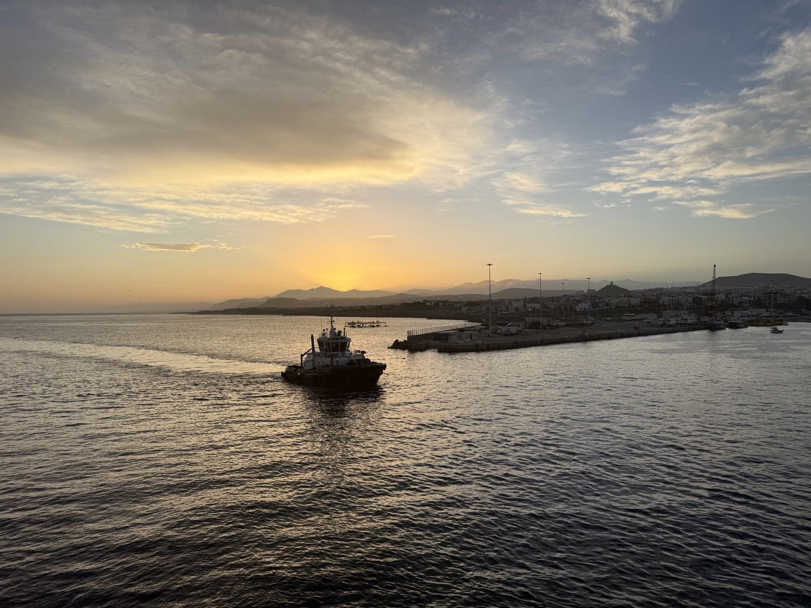
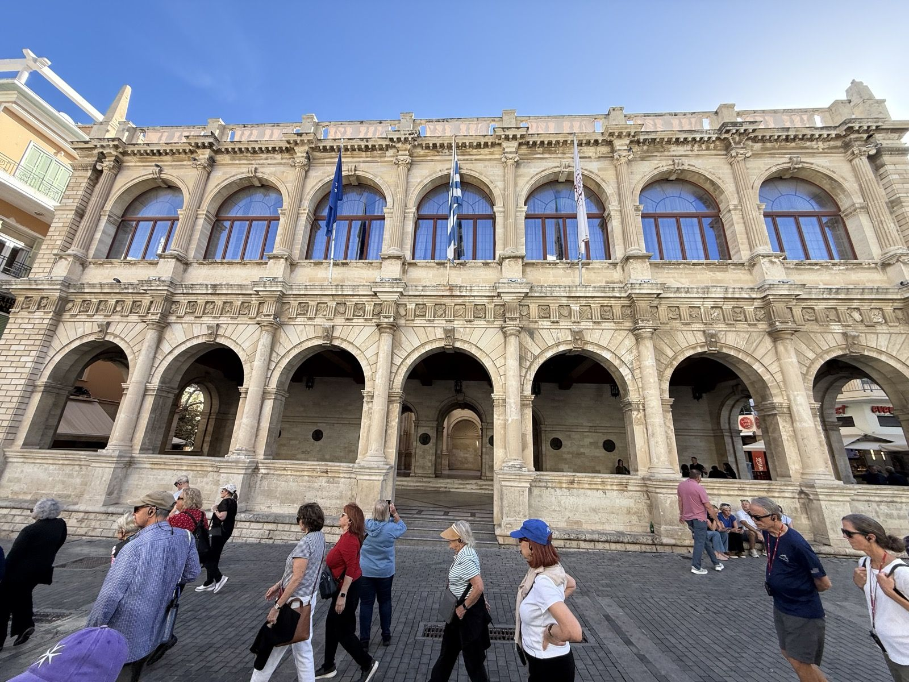
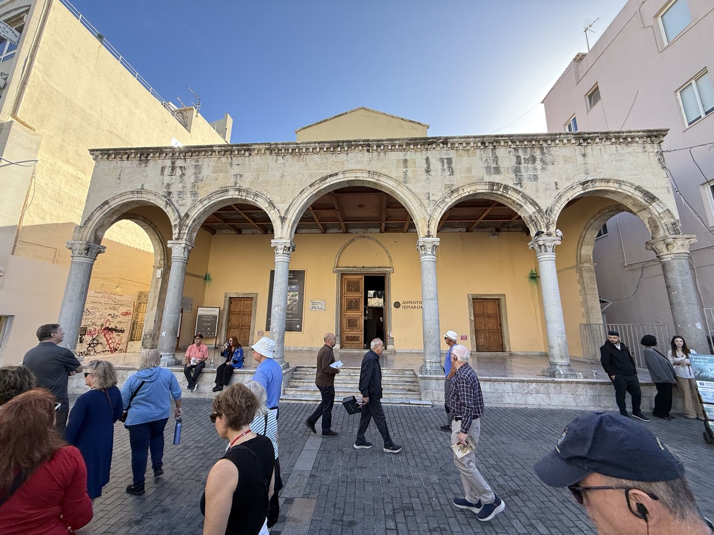
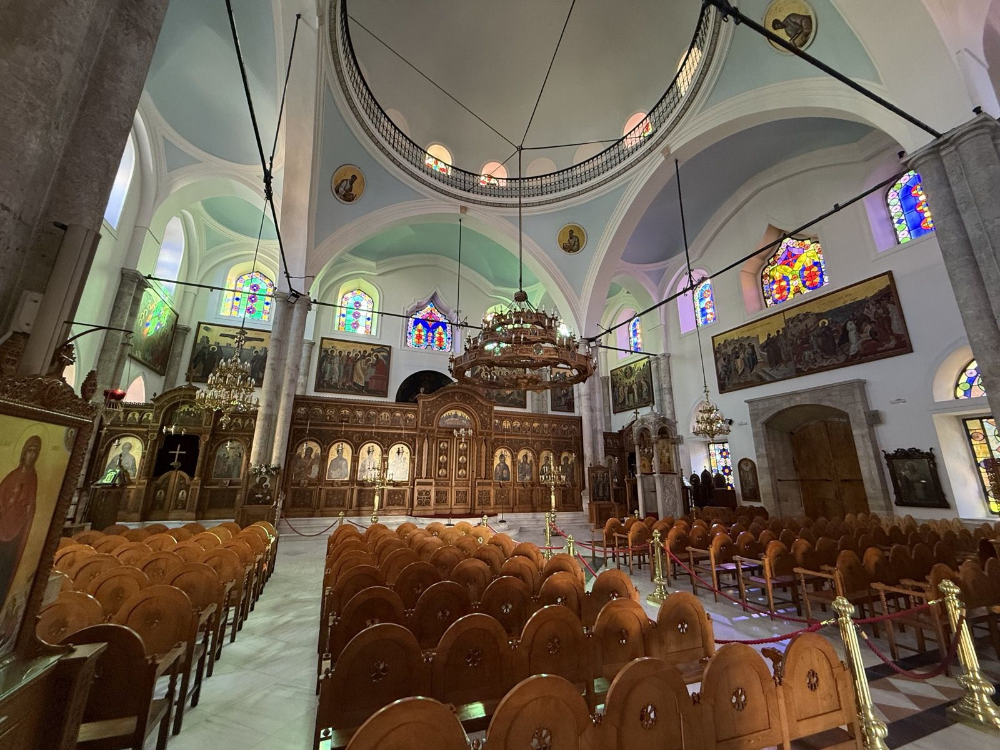
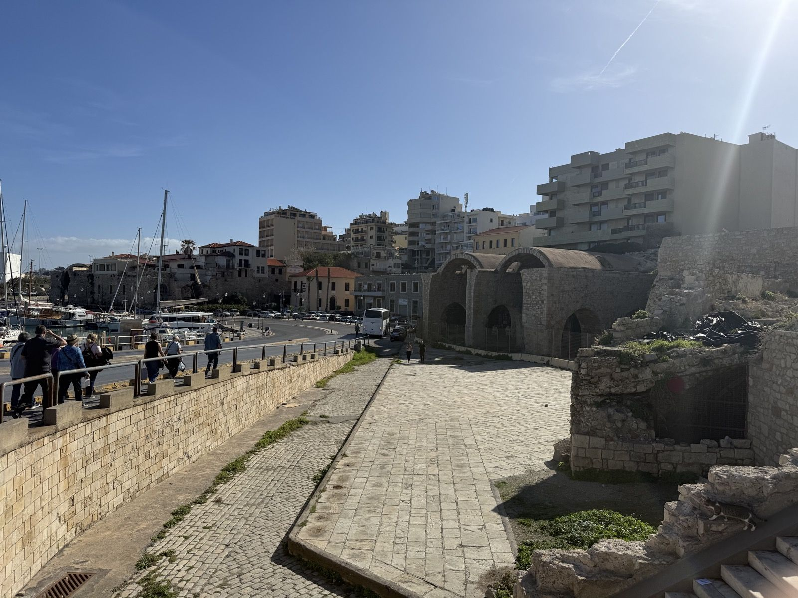
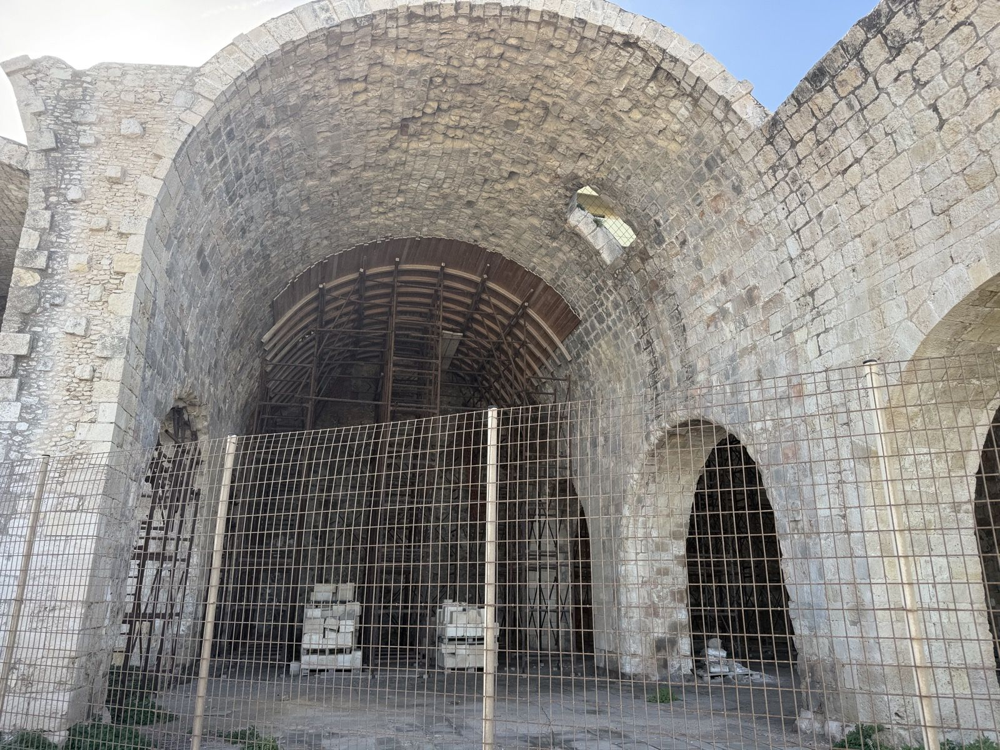
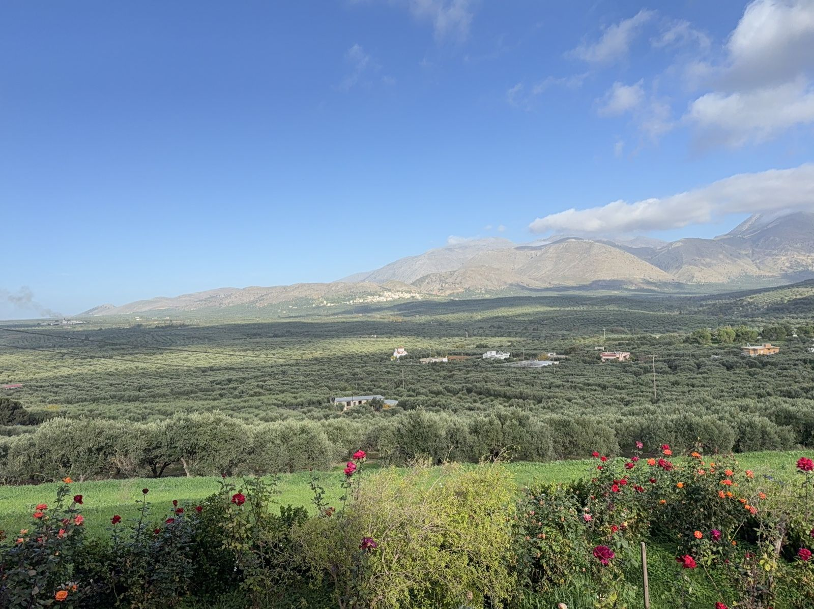
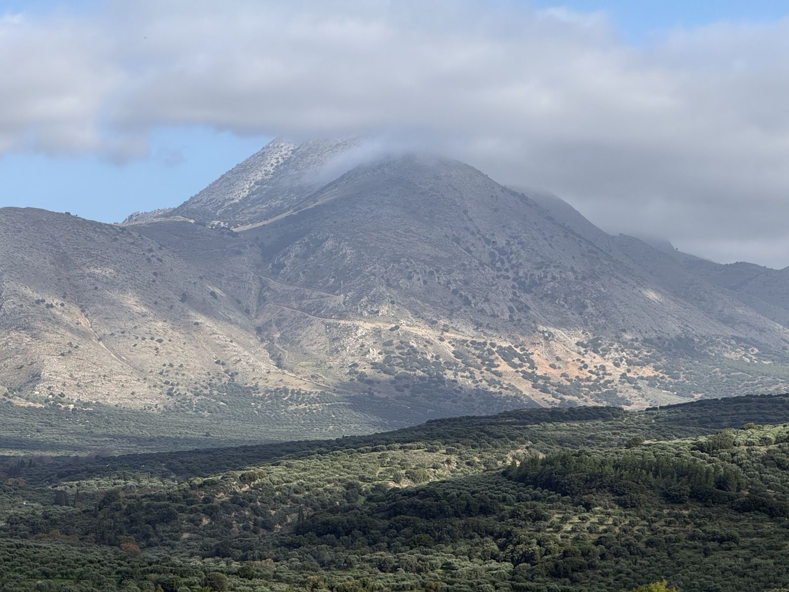
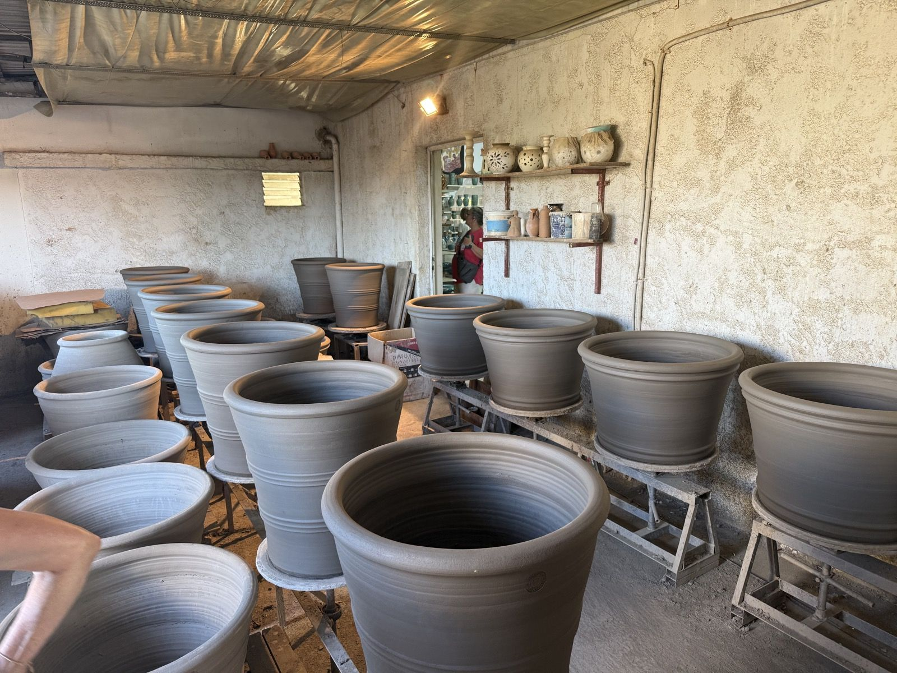

# Day 9, Part 2: Venetian Heraklion and Crete Today

## Summary

This chapter covers the afternoon of Day 9 in Heraklion's old town. It tells the story of Venetian Crete and Candia: the Koules fortress, the walls, the Morosini Fountain, and the twenty-year Siege of Candia that ended in Ottoman rule. It follows the Cretan Renaissance to El Greco and to Marcus Musurus, who edited Greek texts for Aldus Manutius. Its Learning for All note follows those small, cheap Aldine editions to affordable course materials and open educational resources. The chapter closes with Titus in Crete, the Battle of Crete, Kazantzakis, the Cretan diet, and village and city life today.

## Concepts Covered

This chapter covers the following 24 concepts from the learning graph:

| Concept | Concept Impact Score |
|---------|-----------------------|
| Titus in Crete | 1 |
| Venetian Crete | 16 |
| Candia | 8 |
| Koules Fortress | 1 |
| Venetian Walls of Heraklion | 4 |
| Morosini Fountain | 1 |
| Siege of Candia | 2 |
| Cretan Renaissance | 7 |
| El Greco | 1 |
| Marcus Musurus | 5 |
| Aldus Manutius | 5 |
| Aldine Editions | 4 |
| Ottoman Crete | 1 |
| Battle of Crete | 1 |
| Nikos Kazantzakis | 1 |
| Heraklion Today | 1 |
| Cretan Diet | 5 |
| Cretan Village Life | 1 |
| Dakos | 1 |
| Horta | 1 |
| Tsikoudia | 1 |
| Affordable Course Materials | 3 |
| Open Educational Resources | 2 |
| Intelligent Textbook | 1 |

## Prerequisites

This chapter builds on concepts from:

- [Chapter 1: Before We Go, Part 1: The Long Timeline of the Eastern Mediterranean](../01-long-timeline/index.md)
- [Chapter 2: Before We Go, Part 2: Traveling Well and the Learning for All Thread](../02-traveling-well/index.md)
- [Chapter 3: Day 1: Istanbul, a City on Two Continents](../03-istanbul-two-continents/index.md)
- [Chapter 4: Day 2: Byzantine Constantinople and Hagia Sophia](../04-byzantine-constantinople/index.md)
- [Chapter 6: Day 4: Bazaars, Scripts, and Presses](../06-bazaars-scripts-presses/index.md)
- [Chapter 7: Day 5: The End of Empire and the Birth of Modern Turkey](../07-end-of-empire-modern-turkey/index.md)
- [Chapter 8: Day 6: Troy and Gallipoli](../08-troy-and-gallipoli/index.md)
- [Chapter 9: Paul at Ephesus, Part 1: The Apostle's Life, Letters, and Ephesian Years](../09-paul-life-letters/index.md)
- [Chapter 10: Day 7: Ephesus, a Greco-Roman City](../10-ephesus-greco-roman-city/index.md)
- [Chapter 12: Day 8: Rhodes, From the Colossus to the Knights](../12-rhodes/index.md)

---

## From the Museum to the Harbor, and Into the Hills

Day 9, Thursday, November 19, is our one day on Crete, and it has two halves. Chapter 13 covered the Bronze Age: Knossos, and the Heraklion Archaeological Museum, where we spent the first hour of the morning. This chapter covers nearly everything that happened on Crete in the last eight hundred years. When we walked out of the museum a little after ten, we were in a different city: not Minoan Knossos but Venetian Candia, the walled capital that Venice ruled from the early 1200s until 1669, with a lion fountain, a loggia, a harbor fortress, and a ring of bastions built to stop the cannon of the Ottoman Empire. They stopped it for twenty-one years. The day had started three hours earlier, when the Viking Star tied up in Heraklion's port, east of the old Venetian harbor, just as the sun came up.

<figure markdown="span" class="trip-photo">
  { loading=lazy }
  <figcaption>Sunrise over the port of Heraklion. Photo by Dan McCreary</figcaption>
</figure>

Chapter 2 planned the old town for the afternoon, with lunch near the Morosini Fountain. On the day we turned that around. We walked the old town in the late morning, from Lions Square down 25th August Street to the harbor, and gave the afternoon to Viking's excursion "The Villages of Crete": a wine tasting at the Avli winery, then the pottery village of Thrapsano, where potters still make the great storage jars that we had seen, 3,500 years older, in the museum that morning. So this chapter moves the way our day did, from the Venetian city to the countryside, and from the past to Crete as people live it now.

!!! mascot-welcome "Lions in the Square, Jars in the Hills"
    { class="mascot-admonition-img" }
    Today we go from a fountain where four stone lions have stood since 1628 to a village where potters still build jars big enough to climb into. In between we meet a Cretan scholar who helped put Plato into print, and a painter from this harbor whom the world calls simply "the Greek." By the end of the chapter, a bastion will tell us what it was built to stop, and a plate of dakos <audio id="audio-dakos" src="../../audio/dakos.mp3" preload="none"></audio><button onclick="document.getElementById('audio-dakos').play()" class="pronounce-btn">🔊 Pronounce</button> *DAH-kos* will tell us how Cretans ate for centuries. Look closer.

The chapter has four parts. Part One walks Venice's Kingdom of Candia: the city and its names, the Morosini Fountain, the Church of Agios Titos and the companion of Paul it honors, the harbor fortress, the walls, the siege of 1648 to 1669, and the Ottoman centuries that followed. Part Two follows Cretan painters and scholars into the Renaissance: El Greco, Marcus Musurus <audio id="audio-musurus" src="../../audio/musurus.mp3" preload="none"></audio><button onclick="document.getElementById('audio-musurus').play()" class="pronounce-btn">🔊 Pronounce</button> *moo-SOO-rus*, and the Venetian printer Aldus Manutius, whose small editions changed how people read. Part Three brings the story into the 20th century and the city of today, with the Battle of Crete and Nikos Kazantzakis <audio id="audio-kazantzakis" src="../../audio/kazantzakis.mp3" preload="none"></audio><button onclick="document.getElementById('audio-kazantzakis').play()" class="pronounce-btn">🔊 Pronounce</button> *kah-zahn-DZAH-kees*. Part Four is our afternoon in the villages: the Cretan diet, its dishes and its spirit, and a potter's workshop at Thrapsano. The Learning for All note then follows Aldus's pocket books to today's open textbooks.

## Part One: Venice's Kingdom of Candia

### Venetian Crete

**Venetian Crete** is the period, from 1211 to 1669, when the Republic of Venice ruled Crete as an overseas colony, which the Venetians called the *Regno di Candia*, the Kingdom of Candia. Chapter 4 told how Venice got it. After the Fourth Crusade broke up the Byzantine Empire in 1204, Crete was allotted to one of the crusade's leaders, Boniface of Montferrat, who sold his claim to Venice that same year. Venice then had to drive out a Genoese rival who had seized much of the island, and it controlled Crete by about 1211. What Venice wanted, as Chapter 1 explained, was a harbor on its sea lanes. Crete lies halfway between Venice and the ports of Constantinople, Syria, and Egypt, and its harbors sheltered and supplied the Venetian galleys that carried the trade of the East.

Venice governed the island from Candia through a governor with the title of duke, sent out from Venice for a fixed term, and it settled Venetian noble families on estates as military colonists, who owed horses and soldiers in return for their land. The Orthodox Greek majority kept its faith but lost its bishops: the Catholic Church took over the island's cathedrals, and Orthodox priests had to travel off the island to be ordained. The first century and a half brought repeated revolts, some led by Greek landowning families, and in 1363 even the Venetian colonists rose against Venice over taxes, in the Revolt of Saint Titus, named for the island's patron saint. Over time, though, the two peoples grew together. Venetian families married into Greek ones, many spoke Greek at home, and some became Orthodox. Crete grew wealthy on exports, above all its sweet wine, known in Italy as *malvasia* and in England as malmsey, along with olive oil, cheese, and grain. When Constantinople fell in 1453, Crete became the largest Greek land still under Christian rule, and Greek scholars, scribes, and painters gathered in its towns. Part Two follows them.

**Worked example: following a cask of Cretan wine.** Let's trace one cask of sweet wine around 1500, to see what colonial rule meant on the ground. A typical journey might run like this:

1. The grapes grow on a Greek farmer's plot in the hills south of Candia, on land that belongs to a Venetian fief, so part of the harvest goes to the landlord as rent.
2. The wine is made in the village and carried by mule to the city, where it is taxed.
3. In the harbor a merchant loads it onto a Venetian ship, paying customs in Candia and again in Venice.
4. From Venice it may travel on to Flanders or England and sell as malmsey at a high price.

At every step someone holding Venetian papers takes a share: landlord, tax collector, customs office, merchant. The farmer who grew the grapes keeps the least. That is the pattern of colonial trade, and it explains why so many Cretan revolts, Greek and Venetian alike, began as quarrels over taxes.

### Candia

**Candia** is the medieval and early modern name of the city we now call Heraklion, used by the Venetians, who also used it for the whole island. The name is older than Venice. Chapter 1 traced it to the Arabs, who took Crete in the 820s and built a fortified town on this shore, protected by a great ditch, and called it *Rabdh al-Khandaq*, "the castle of the moat." When the Byzantine general Nikephoros Phokas retook Crete in 961, the Greeks called the town Chandax. The Venetians turned that into Candia, the Ottomans into Kandiye, and in the 19th century Greeks revived the ancient name Herakleion, after a harbor of Knossos mentioned by ancient geographers. The old name survives in the Venetian state archives, where the colony's records, from tax rolls to notaries' contracts, are preserved in great numbers.

**Worked example: one city, five names.** Let's line the names up and read each one as a layer, the way Chapter 4 read buildings. Each ruler kept the place and renamed it in its own language, and each name points to something we can still find.

| Name | Used by | Origin | What it points to today |
|---|---|---|---|
| Rabdh al-Khandaq | Arab emirate, 820s–961 | "Castle of the moat" | A walled, ditched town on this shore |
| Chandax | Byzantines, 961–1204 | The Arabic name in Greek form | The Byzantine reconquest and the first church of Agios Titos |
| Candia | Venetians, 1211–1669 | Chandax in Italian form | The fountain, loggia, harbor fortress, and walls |
| Kandiye | Ottomans, 1669–1898 | Candia in Turkish form | Mosques later turned into churches; Ottoman fountains |
| Heraklion | Greeks, from the 19th century | Ancient Herakleion, a harbor of Knossos | The modern city and its port |

Reading down the table, we see a habit that runs through this whole trip: rulers rename, but the place keeps its shape, and the moat the Arabs dug set the line that later walls followed. Reading across, we see why Venetian documents call the island itself "Candia": to a clerk in Venice, the colony and its capital were the same thing.

Our own walk through Candia began at Lions Square, the heart of the Venetian city. From there **25th August Street** runs downhill to the harbor, lined with the buildings of the old government quarter. The first is the **Loggia**, an arcaded two-story hall built in the 1620s as a meeting place for the Venetian nobility of Candia, where they did business, heard news, and passed the time. It was badly damaged in the Second World War and carefully restored, and today it is part of Heraklion's city hall.

<figure markdown="span" class="trip-photo">
  { loading=lazy }
  <figcaption>The Venetian Loggia, Heraklion, 17th century. Photo by Dan McCreary</figcaption>
</figure>

### The Morosini Fountain

The **Morosini Fountain** is the fountain of four stone lions in Lions Square, built in 1628 by the Venetian governor Francesco Morosini at the end of an aqueduct he built to bring fresh water to the city from springs on Mount Juktas, the mountain south of Heraklion. Water pours from the lions' mouths into a basin of eight curved lobes carved with sea creatures and figures from myth. The lions are thought to be older than the fountain. The square is officially Venizelou Square, after the Cretan statesman Eleftherios Venizelos, who led Crete into union with Greece, but everyone calls it *ta Liontaria*, "the Lions."

The governor is easy to confuse with his namesake, the Francesco Morosini (1619–1694) who commanded Candia in the last years of the siege, surrendered it in 1669, and in 1687 led the Venetian army whose shell blew up the Parthenon, as Chapter 7 told. Across the square from the fountain stands the **Basilica of San Marco**, Venice's church of its patron saint, first built in the 13th century. Under the Ottomans it became a mosque; today, restored, it is used as an exhibition hall, and its columned porch is a shady place to read this chapter.

<figure markdown="span" class="trip-photo">
  { loading=lazy }
  <figcaption>The Basilica of San Marco (Agios Markos), Heraklion. Photo by Dan McCreary</figcaption>
</figure>

!!! mascot-tip "Start at the Lions and Walk Downhill"
    { class="mascot-admonition-img" }
    Here's a route that puts the Venetian city in order: start at the Lions, then walk north down 25th August Street past San Marco, the Loggia, and Agios Titos to the harbor and the Koules <audio id="audio-koules" src="../../audio/koules.mp3" preload="none"></audio><button onclick="document.getElementById('audio-koules').play()" class="pronounce-btn">🔊 Pronounce</button> *koo-LESS*. It is less than a kilometer and all downhill, so save the walls, which ring the city's upper edge, for a taxi or a second visit.

### Titus in Crete

**Titus in Crete** is the tradition that Paul's companion Titus organized the first Christian communities of Crete and became the island's first bishop. Chapter 9 introduced Titus as Paul's Greek co-worker and troubleshooter in Corinth, and Chapter 11 met him as the test case at the meeting in Jerusalem. Our only early source for his work on Crete is the Letter to Titus, in which Paul says he left Titus on Crete to put things in order and to appoint elders in every town. Chapter 9 explained that most scholars think this letter was written after Paul's death by a follower writing in his name, so it tells us what Christians of the late 1st or early 2nd century believed about Titus and Crete, not necessarily what Paul did. Acts mentions Crete only once in Paul's story: the ship carrying him to Rome as a prisoner sheltered at Fair Havens, on the south coast.

The same letter holds the most famous sentence ever written about Cretans. Quoting "one of their own prophets," it says that "Cretans are always liars." The prophet is traditionally identified as Epimenides, a Cretan sage of about 600 BCE, and logicians later turned the line into a puzzle: if a Cretan says that Cretans always lie, is he telling the truth? Cretans have long since forgiven the remark.

Tradition says Titus died on Crete at a great age and was buried at Gortyn, the Roman capital of the island, where the ruins of a 6th-century basilica of Agios Titos still stand. His relic, the skull, traveled with the island's history: it was kept in Candia, carried to Venice when the Venetians surrendered the city in 1669, and returned to Heraklion in 1966.

The **Church of Agios Titos**, a few steps east of the Loggia, is a record of every ruler in this chapter. It was first built after the Byzantine reconquest of 961, became a Catholic church under Venice and a mosque under the Ottomans, and was rebuilt as a mosque after an earthquake destroyed it in 1856. It served Heraklion's Muslims until they left in the population exchange of 1923, and in 1925 it was consecrated as an Orthodox church again, as Chapter 7 told. Inside, the domed hall keeps the broad, open shape of a mosque, now filled with icons, and the skull of Titus rests in a reliquary in a side chapel.

<figure markdown="span" class="trip-photo">
  { loading=lazy }
  <figcaption>Interior of the Church of Agios Titos, Heraklion. Photo by Dan McCreary</figcaption>
</figure>

### Koules Fortress

**Koules Fortress** is the Venetian sea fortress at the end of the breakwater that guards Heraklion's old harbor, built between 1523 and 1540 on the site of an earlier tower. The Venetians called it the *Rocca a Mare*, the "sea fortress"; its present name comes from the Turkish *kule*, "tower," given by the Ottomans. Its thick walls rise in two stories, with vaulted rooms below for soldiers, stores, and guns, an upper level for cannon, and, set into the outer walls, carved reliefs of the winged lion of St. Mark, the emblem of Venice. Today it is open as a museum, and its roof gives a view back over the harbor to the old town and the mountains beyond.

We reached the harbor at about half past eleven, at the foot of 25th August Street, where the long stone vaults of the **Venetian arsenal** stand beside the water. An arsenal (from the Arabic *dar as-sina'a*, "house of manufacture") was a state shipyard, and these vaults were sheds where galleys were built, repaired, and kept out of the weather in winter, ready to defend the island's sea lanes.

<figure markdown="span" class="trip-photo">
  { loading=lazy }
  <figcaption>The Venetian arsenal beside Heraklion's old harbor. Photo by Dan McCreary</figcaption>
</figure>

When we passed, some of the vaults stood open and partly roofless, fenced off for conservation, so we could look straight into the great arches. Each was long and tall enough to take a galley, and standing at the fence it is easy to picture a hull on wooden rollers being hauled up out of the water. From here the Koules is a short walk out along the breakwater.

<figure markdown="span" class="trip-photo">
  { loading=lazy }
  <figcaption>Vaulted ship shed of the Venetian arsenal, Heraklion. Photo by Dan McCreary</figcaption>
</figure>

### The Venetian Walls of Heraklion

The **Venetian walls of Heraklion** are the fortifications that enclose the old city on its landward side, built mainly in the 16th and 17th centuries on a plan drawn up by the Venetian military architect Michele Sanmicheli, and still almost complete. They replaced smaller medieval walls closer to the harbor. Seven bastions project from them; running round from the sea on the east to the sea on the west, they are Sabbionara, Vitturi, Jesus, Martinengo, Bethlehem, Pantocrator, and St. Andrew. The main gates are the Jesus Gate on the southeast and the Pantocrator Gate, also called the Chania Gate, on the west. On the Martinengo Bastion, the southernmost, is the grave of Nikos Kazantzakis, which Part Three visits.

The walls were built for a new kind of war. Tall, thin medieval walls shattered when cannon came into use in the 15th century, so engineers in Italy worked out a new design, which spread across Europe as the *trace italienne*, the "Italian outline." Its walls were low and enormously thick, packed with earth behind a stone face so they absorbed cannonballs instead of cracking, and a wide ditch kept the enemy's guns and miners at a distance. Its signature was the **bastion**, a projecting, arrowhead-shaped platform for guns at each angle of the wall.

**Worked example: why an arrowhead?** Let's attack two walls on paper. First, a medieval wall with round towers. The defenders on a round tower can shoot outward, but they cannot see the foot of their own tower, because the curve of the wall hides it, and they can barely see the foot of the wall between two towers. That hidden ground is called **dead ground**, and it is where attackers place ladders or dig mines. Now an arrowhead bastion. Its two front faces meet in a point, and its two short side walls, the flanks, carry guns that fire not outward but sideways, along the faces of the neighboring bastions and along the stretch of wall between them. Each bastion covers the next, so every meter of the ditch is under fire from somewhere. The shape is pure geometry: draw the line of fire from each flank, and the arrowhead is what is left when no dead ground remains. That is why Candia's walls make a jagged star on the map, and why its attackers spent twenty-one years digging tunnels under them rather than walking up to them.

!!! mascot-thinking "A Wall Drawn With a Ruler"
    { class="mascot-admonition-img" }
    Notice that the bastion's shape was decided by lines of fire, not by beauty or tradition. Think of the walls as a drawing of everywhere a gun could reach, with the empty corners erased. Once we see that, the star-shaped outline of every old fortress city, from Candia to Valletta, makes sense.

### The Siege of Candia

The **Siege of Candia** was the Ottoman siege of the Venetian capital of Crete, from 1648 to 1669, one of the longest sieges in history. The war began in 1645, when an Ottoman army landed in western Crete. Chania fell that year and Rethymno in 1646, and in 1648 the Ottomans dug in before Candia. For more than twenty years the city held out, supplied from the sea, while Venetian fleets fought the Ottomans as far away as the Dardanelles. The fighting at the walls was a war of tunnels: Ottoman miners dug under the bastions to blow them up, and Venetian countermines dug out to meet them underground.

In 1667 the grand vizier Köprülü Fazıl Ahmed Pasha took personal command and pressed the siege harder than ever. Volunteers came from across Christian Europe to help, including a French expedition in 1669 whose commander was killed in a failed sortie. By late summer the city was in ruins, and its commander, Francesco Morosini, negotiated a surrender in September 1669. The terms were generous: the garrison and any inhabitants who wished could leave with their property, and Venice kept three small island fortresses off the Cretan coast, at Souda, Gramvousa, and Spinalonga, the last of them until 1715. Tens of thousands died on each side.

### Ottoman Crete

**Ottoman Crete** is the period from 1669 to 1898 when Crete was a province of the Ottoman Empire. In the generations after the conquest many Cretans converted to Islam, so that by the 19th century a large minority of the island was Muslim. Cretan Muslims and Christians spoke the same Cretan Greek, sang the same songs, ate the same food, and often came from the same families. Candia, now Kandiye, gained mosques, baths, and public fountains, and lost much of its Venetian grandeur.

The 19th century was an age of revolts, and the table follows the island from revolt to union.

| Year | Event |
|---|---|
| 1821 | Crete rises with the Greek mainland in the War of Independence; the revolt is put down |
| 1866–1869 | The Great Cretan Revolt; the defenders of the Arkadi Monastery, besieged by Ottoman troops, blow up their own powder store rather than surrender |
| 1897 | A new revolt, and war between Greece and the Ottoman Empire |
| 1898 | A riot in Candia on August 25 kills many Christian residents, British soldiers, and the British vice-consul; the Great Powers force the Ottoman army out, and Crete becomes an autonomous state under Ottoman sovereignty, with Prince George of Greece as High Commissioner |
| 1913 | Crete joins Greece, as Chapter 7 told |
| 1923 | The island's Muslims leave for Turkey in the population exchange |

The street we walked down to the harbor, 25th August Street, takes its name from the day of the 1898 riot.

The map below lets us place the landmarks of the old town before walking it.

#### Diagram: Walking Venetian Candia

<iframe src="../../sims/walking-venetian-candia-map/main.html" height="660px" width="100%" scrolling="no"></iframe>

[Run the Walking Venetian Candia MicroSim Fullscreen](../../sims/walking-venetian-candia-map/main.html){ .md-button .md-button--primary }

Walking Venetian Candia

Type: map
**sim-id:** walking-venetian-candia-map 
**Library:** Leaflet 
**Status:** Specified 
**Bloom Level:** Remember 
**Bloom Verb:** locate 
**Learning Objective:** The learner will locate eight landmarks of Venetian and Ottoman Heraklion on a street map of the old town, placing at least six of the eight within 150 m of the true position on the first attempt.

**Prerequisites:** Candia, the Morosini Fountain, the Loggia, the Church of Agios Titos, the Venetian arsenal, Koules Fortress, the Venetian walls and bastions, the Martinengo Bastion, and the Pantocrator (Chania) Gate (all defined in Part One above), and the Heraklion Archaeological Museum (Chapter 13).

**Evidence of Mastery:** For each of eight landmark cards, the learner clicks the map where they think the landmark stands. A placement is correct when the click is within 150 m of the landmark's reference point. Mastery is 6 of 8 correct on the first attempt. Panning, zooming, and opening infoboxes after an answer are exploration, not evidence.

**Misconceptions:** (1) The Koules stands on the shore of the town rather than out at the end of the harbor breakwater (card 5). (2) The Venetian walls run along the harbor, when they enclose the town on its landward side (cards 7 and 8). (3) The landmarks are spread across the city, when the Venetian civic center (fountain, Loggia, Agios Titos) lies within about 200 m.

**Instructional Rationale:** Locating a landmark from a description is the Remember-level skill a walker needs before arriving; committing a click before the answer appears turns a glance at a map into retrieval practice. Revealing each landmark's era and date in its infobox ties the location to the layer it belongs to.

**Content:**

A street map of Heraklion's old town, centered on 35.3385, 25.1330, at a zoom that shows the whole area inside the walls and the harbor breakwater. Landmark names are not labeled on the map until answered. Cards, in this order:

| # | Card shown to the learner | Reference point (lat, lon) | Infobox shown after answering |
|---|---|---|---|
| 1 | Lions Square: the Morosini Fountain and the Basilica of San Marco | 35.3392, 25.1334 | Venetian. Fountain built 1628 by the governor Francesco Morosini; San Marco first built in the 13th century, later a mosque, now an exhibition hall. |
| 2 | The Loggia, meeting hall of the Venetian nobility | 35.3399, 25.1340 | Venetian, built in the 1620s; damaged in the Second World War and restored; now part of city hall. |
| 3 | The Church of Agios Titos | 35.3401, 25.1349 | Byzantine foundation after 961; Catholic under Venice; a mosque under the Ottomans, rebuilt after the 1856 earthquake; an Orthodox church again from 1925. Holds the relic of Titus, returned from Venice in 1966. |
| 4 | The Venetian arsenal, the galley sheds | 35.3422, 25.1353 | Venetian state shipyard: vaulted sheds where galleys were built and stored. |
| 5 | Koules Fortress, the Venetian sea fortress | 35.3444, 25.1369 | Venetian *Rocca a Mare*, built 1523–1540 at the end of the harbor breakwater; named Koules ("tower") by the Ottomans. |
| 6 | The Heraklion Archaeological Museum | 35.3389, 25.1375 | Modern museum (1937–1940) of Minoan Crete; where our Day 9 began (Chapter 13). |
| 7 | The Martinengo Bastion and the grave of Nikos Kazantzakis | 35.3317, 25.1311 | Venetian bastion, the southernmost of seven; Kazantzakis (1883–1957) is buried on top. |
| 8 | The Pantocrator Gate, also called the Chania Gate | 35.3378, 25.1255 | Venetian gate in the western walls, on the road to Chania. |

After card 8 the map shows all eight markers and a line along our own walk on Day 9: Archaeological Museum, Lions Square, Loggia, Agios Titos, arsenal, Koules.

**Provenance:** Landmark descriptions and dates from Part One of this chapter and from Chapter 13. Reference points for cards 1 to 4 are rounded from the locations of our own photos taken at those places on Day 9; card 5 is rounded from the Wikipedia article "Koules Fortress"; card 6 is the value in `data/chapter-places.json`; cards 7 and 8 are approximate. Before publishing, the generator must check every reference point against OpenStreetMap and correct any that is more than 50 m from the landmark, and note the correction in the sim's index page.

**Rules:** Distance is great-circle (haversine) distance in meters from the click to the reference point. A placement is correct if distance <= 150 m. Each card allows two attempts; only the first counts toward the score. After a second miss, the marker appears at the reference point. Score is 0 to 8; mastery is score >= 6 on first attempts. Zoom uses the map's buttons, not the mouse wheel.

**Learner Activity:**

1. The learner reads card 1 and clicks the map where the landmark stands.
2. The sim draws the click, the true marker, and the distance in meters, and opens the infobox.
3. The learner moves to the next card; answered markers stay visible.
4. After card 8 the walking line appears, and the learner should notice that cards 1 to 5 lie on one short downhill route to the sea, while the walls (cards 7 and 8) ring the town's upper edge.

**Feedback:** Eight cards, fixed order. Correct: "Correct: [distance] m away. [Infobox text]". First miss: "Not quite: [distance] m away. Try again." The miss message for card 5 adds "Look out along the harbor breakwater."; for cards 7 and 8 it adds "The walls ring the town on its landward side." Second miss: "Here it is." and the marker and infobox appear. At the end: "First-attempt score: n of 8." If n >= 6: "You could walk Venetian Candia without a map." Otherwise: "Try again, starting from the Lions." A Try Again option resets all cards.

**Starting State:** The unlabeled street map of the old town and card 1, with the question "Where would you find the Lions?"

**Chapter Anchors:** Morosini Fountain 1628; Koules built 1523–1540; seven bastions; Martinengo the southernmost; Agios Titos an Orthodox church again from 1925, relic returned 1966; from the Lions to the Koules is less than a kilometer, all downhill; eight landmarks; mastery 6 of 8.

## Part Two: Cretan Painters, Scholars, and a Venetian Press

### The Cretan Renaissance

The **Cretan Renaissance** is the flowering of painting, literature, and scholarship in Venetian Crete, especially from the mid-15th century until the fall of Candia in 1669, in which Byzantine traditions met the art and learning of Renaissance Italy. Its center was Candia. Three things fed it: the wealth of the wine trade, the Greek painters and scholars who settled on Crete before and after the fall of Constantinople, and daily contact with Venice, where many Cretans studied, worked, and printed books.

Its painters made Candia the busiest center of icon painting in the Greek world. They kept the Byzantine way of painting icons, with gold backgrounds, solemn frontal figures, and fixed models for each saint and scene, and many of them could also paint in the Italian manner, with depth, landscape, and soft modeling of light. **Theophanes the Cretan** decorated monasteries at Meteora and on Mount Athos in the 16th century, and his style shaped Orthodox church painting for generations. Its writers produced a literature in the Cretan dialect of Greek, including plays such as Georgios Chortatsis's tragedy *Erophile*, and the verse romance **Erotokritos** <audio id="audio-erotokritos" src="../../audio/erotokritos.mp3" preload="none"></audio><button onclick="document.getElementById('audio-erotokritos').play()" class="pronounce-btn">🔊 Pronounce</button> *eh-roh-TOH-kree-tos* by Vitsentzos Kornaros, written around 1600, about 10,000 rhyming lines on the love of the young Erotokritos for a princess. When Candia fell, many artists and writers fled to the Venetian-held Ionian Islands and to Venice, and the Cretan Renaissance ended with the city that had made it.

**Worked example: an icon order of 1499.** Let's read one document from Candia's archives to see how this art was made and sold. In 1499 two dealers signed a contract with three painters of Candia for 700 icons of the Virgin, to be delivered within 45 days: 500 of them in the Latin manner and 200 in the Greek manner. Do the arithmetic. Seven hundred icons in 45 days is about 15.6 icons a day, or about five a day for each painter. No one paints five icons a day alone from nothing, so these were workshop products: assistants prepared the wooden panels, the gesso, and the gold, and the masters worked from standard patterns, painting the faces and finishing the work. Notice the split, too. The same workshops sold the Western style to Catholic buyers in Italy and beyond, and the Byzantine style to Orthodox ones. The Cretan painter was bilingual in paint, and that is the soil El Greco grew in.

The table sets the two manners side by side.

| | Greek manner (*maniera greca*) | Latin manner (*maniera latina*) |
|---|---|---|
| Background | Flat gold, a heavenly space | Landscape, architecture, or sky |
| Figures | Frontal, solemn, following fixed models | Turned in space, with natural movement |
| Light | Lines of highlight laid over dark underpaint | Soft modeling of light and shadow |
| Main buyers | Orthodox churches and households | Catholic buyers in Venice and beyond |

### El Greco

**El Greco**, "the Greek," was the painter **Domenikos Theotokopoulos** <audio id="audio-theotokopoulos" src="../../audio/theotokopoulos.mp3" preload="none"></audio><button onclick="document.getElementById('audio-theotokopoulos').play()" class="pronounce-btn">🔊 Pronounce</button> *theh-oh-toh-KOH-poo-los* (1541–1614), born in Candia, who trained as an icon painter in the Cretan tradition and was already a master painter in his home city by 1563. About 1567 he moved to Venice, where he learned from Titian and Tintoretto's use of color and light, and in 1570 to Rome. In 1577 he settled in Toledo, in Spain, and stayed there until his death. His Spanish paintings, with their long, flame-like figures, cold, glowing colors, and visionary light, puzzled critics for centuries and were rediscovered by modern painters in the early 20th century. He signed his paintings in Greek letters, and on some he added *Kres*, "Cretan." Heraklion owns two small works of his, the *View of Mount Sinai* and *The Baptism of Christ*, both in the Historical Museum of Crete, a few minutes' walk west of the harbor along the waterfront.

!!! mascot-warning "El Greco's Famous Paintings Are in Spain"
    { class="mascot-admonition-img" }
    A common trap is to look for El Greco's great canvases in his hometown. *The Burial of the Count of Orgaz* is in Toledo and most of the famous works are in Spain, so in Heraklion head for the Historical Museum of Crete and its two small paintings. Check its opening hours before walking over, since museum hours are shorter in winter.

### Marcus Musurus

**Marcus Musurus** (in Greek, Markos Mousouros; about 1470–1517) was a Cretan scholar, born in Rethymno or, by some accounts, in Candia itself, who became the leading editor of Greek texts for the Venetian printer Aldus Manutius. He studied Greek with the scholar **Janus Lascaris**, and by the late 1490s he was working in Venice. For Aldus he prepared the first printed editions of many Greek authors, among them Aristophanes (1498), Plato (1513), and the dictionary of Hesychius (1514). He taught Greek at the University of Padua and then in Venice, where students came from across Europe to hear him. The 1513 Plato was dedicated to **Pope Leo X**, and in 1516 Leo called Musurus to Rome and made him an archbishop. He died there the following year.

Musurus was not the only Cretan in Venice's Greek book trade. In 1499 two other Cretans, the printer **Zacharias Kallierges** and the merchant **Nikolaos Vlastos**, who paid for the work with the backing of the Byzantine noblewoman Anna Notaras, printed the *Etymologicum Magnum*, a huge Byzantine dictionary of Greek words, at their own press in Venice. Cretan scribes copied Greek manuscripts for collectors across Italy, and Cretan teachers taught Greek in Italian cities. For a few decades around 1500, a large share of the people who made Greek books in Venice had been born on this island.

**Worked example: what an editor did for Plato.** Chapter 4 followed Plato from Athenian papyrus to Byzantine minuscule, ending with the 1513 Aldine edition. Let's look at the last link, Musurus's job, in four steps.

1. **Gather.** He collected manuscripts, every one copied by hand, every one with its own copyists' slips.
2. **Compare and correct.** He compared them line by line and chose the best reading wherever they disagreed, correcting obvious errors from his knowledge of Greek grammar and of Plato's style. Scholars call the comparing **collation** and the correcting **emendation**.
3. **Prepare and proof.** He prepared clean copy that the typesetters could follow, and read the printed proofs.
4. **Present.** He wrote a long Greek poem in praise of Plato to open the book, addressed to the pope.

Notice what changed when the job ended in print rather than in another manuscript. A scribe's choices reached one reader at a time; Musurus's choices were printed in hundreds of identical copies and became, for generations, the Plato that Europe read. His good guesses and his mistakes were multiplied alike, which made the editor one of the most powerful gatekeepers of the new age of print.

### Aldus Manutius

**Aldus Manutius** (in Italian, Aldo Manuzio; about 1450–1515) was the Venetian printer and publisher who made Venice the center of Greek printing and invented the small, plain, portable book. Born in Bassiano, south of Rome, he worked first as a humanist teacher, tutoring the young princes of Carpi, before he moved to Venice and opened his press around 1494, with money from a partner, the printer **Andrea Torresani**, whose daughter he later married. Around his shop he gathered scholars into a circle called the New Academy, whose members were supposed to speak only Greek together. His printer's mark, a dolphin wrapped around an anchor, illustrated his motto *Festina lente*, "make haste slowly," and publishers still borrow it. Famous visitors worked in his house: in 1508 the Dutch scholar **Erasmus** lived there for months while the press printed his collection of proverbs, the *Adagia*, and the Venetian **Pietro Bembo** edited Petrarch and Dante for his small Italian editions.

**Worked example: a teacher's publishing plan.** Let's read Aldus's early list in order and ask what kind of mind chose it. His first dated Greek book, in 1495, was a Greek grammar, by Constantine Lascaris. Alongside the first printed Aristotle, in five large volumes from 1495 to 1498, he brought out a Greek dictionary and more grammars. That is how a teacher plans: the tools a beginner needs to read Greek come with the texts to read. The table follows the list a little further.

| Year | Book | Why it mattered |
|---|---|---|
| 1495 | Constantine Lascaris, Greek grammar | A textbook first: the tool for learning to read the rest |
| 1495–1498 | Aristotle, in five volumes | The first printed Aristotle in Greek, in large folio |
| 1498 | Aristophanes, nine comedies | Edited by the Cretan Marcus Musurus |
| 1501 | Virgil | The first book printed entirely in italic, in small octavo |
| 1502 | Sophocles | Greek drama in the new small format |
| 1513 | Plato | The first printed Plato in Greek, edited by Musurus |

By the time Aldus died in 1515, his press had brought about thirty Greek authors into print for the first time. Without the Byzantine copyists of Chapter 4, there would have been nothing to print; without the Cretan editors, there would have been no one to prepare it.

### Aldine Editions

**Aldine editions** are the books printed by Aldus Manutius and his successors at the Aldine Press in Venice, from about 1494 until 1597, and especially the small classics he began in 1501. Three choices made them new. The first was their size: the **octavo**, a small book that fits in a hand or a coat pocket, until then used mainly for prayer books, not for the classics. The second was their type: the compact **italic**, modeled on the elegant handwriting of Italian humanist scholars and cut for Aldus by the punchcutter **Francesco Griffo** of Bologna, which fitted more words on each line. The third was their content: the plain text of Virgil, Horace, or Sophocles, without the thick commentaries that surrounded the classics in the big editions used for teaching. Aldus himself called them, in Latin, portable little books.

To see why that mattered, we need three words from the printing shop. Early books were printed on large **sheets** of handmade paper, several pages to a side, and then folded and cut. A sheet folded once makes a **folio**: 2 leaves, which is 4 pages. Folded twice it makes a **quarto**: 4 leaves, 8 pages. Folded three times it makes an **octavo**: 8 leaves, 16 pages. Handmade paper was one of the largest costs of an early printed book, so the number of sheets a book needs is close to a measure of its price.

**Worked example: the paper in a Virgil.** Let's compare two editions of Virgil with illustrative round numbers. Virgil's three works, the *Eclogues*, the *Georgics*, and the *Aeneid*, run to about 12,900 lines of verse. Suppose a big folio edition for teachers prints the verses in the middle of each page, surrounded by commentary, so that each page shows 15 lines of Virgil. That takes 12,900 ÷ 15 = 860 pages, and at 4 pages to a sheet, 860 ÷ 4 = 215 sheets for every copy. Now suppose an Aldine-style octavo in compact italic, with no commentary, fits 30 lines on each small page. That takes 12,900 ÷ 30 = 430 pages, and at 16 pages to a sheet, 430 ÷ 16 = 26.9, so 27 sheets. The full text of Virgil, every line of it, for about one-eighth of the paper. Notice that two choices are at work: the small fold, and the dense, plain page. The MicroSim below separates them.

#### Diagram: Folding the Sheet: Folio, Quarto, Octavo

<iframe src="../../sims/folio-quarto-octavo-paper-calculator/main.html" height="624px" width="100%" scrolling="no"></iframe>

[Run the Folding the Sheet: Folio, Quarto, Octavo MicroSim Fullscreen](../../sims/folio-quarto-octavo-paper-calculator/main.html){ .md-button .md-button--primary }

Folding the Sheet: Folio, Quarto, Octavo

Type: microsim
**sim-id:** folio-quarto-octavo-paper-calculator 
**Library:** p5.js 
**Status:** Specified 
**Bloom Level:** Apply 
**Bloom Verb:** calculate 
**Learning Objective:** The learner will calculate the number of pages and sheets of paper needed for one copy of Virgil's works in folio, quarto, or octavo format at a given number of lines per page, getting all three challenge calculations exactly right within two attempts each.

**Prerequisites:** sheet, folio, quarto, octavo, italic type, commentary, Aldine editions (all defined in the section "Aldine Editions" above).

**Evidence of Mastery:** For three challenge editions, the learner types the number of pages and the number of sheets per copy before the sim shows the folded sheet. An answer is correct when both numbers equal the model values exactly. Mastery is all three challenges correct within two attempts each. Free exploration with the controls afterward is not evidence.

**Misconceptions:** (1) A sheet is a page (a sheet makes 4, 8, or 16 pages). (2) The small format alone explains the Aldine savings, and the compact type and missing commentary did not matter (challenges 2 and 3 show that denser pages halve the paper again). (3) A cheaper book must hold a shorter text (all three challenges print the same 12,900 lines). (4) Pages divide evenly into sheets (a partly used sheet must still be bought, so sheets round up).

**Instructional Rationale:** Calculating with a check makes the learner use the fold rule and the rounding rule rather than watch them, which is the Apply-level evidence. Holding the text fixed and changing one variable per challenge lets the learner attribute the savings to the fold and to the page density separately.

**Content:**

Formats, each with a picture of a sheet folded the stated number of times and its pages numbered:

| Format | Folds | Leaves per sheet | Pages per sheet |
|---|---|---|---|
| Folio | 1 | 2 | 4 |
| Quarto | 2 | 4 | 8 |
| Octavo | 3 | 8 | 16 |

Text: Virgil's *Eclogues*, *Georgics*, and *Aeneid*, 12,900 lines in all (shown as "about 12,900 lines").

Adjustable quantities:

| Quantity | Min | Max | Step | Default | Unit |
|---|---|---|---|---|---|
| Lines of verse per page | 10 | 40 | 5 | 15 | lines |
| Copies printed | 100 | 2,000 | 100 | 1,000 | copies |

Challenge editions, in this order:

| # | Format | Lines per page | Pages | Sheets per copy | Feedback when wrong |
|---|---|---|---|---|---|
| 1 | Folio, verses surrounded by commentary | 15 | 860 | 215 | 12,900 ÷ 15 = 860 pages; a folio sheet makes 4 pages, so 860 ÷ 4 = 215 sheets. |
| 2 | Octavo, same 15 lines per page | 15 | 860 | 54 | The same 860 pages, but an octavo sheet makes 16 pages: 860 ÷ 16 = 53.75, and a part-sheet still costs a sheet, so 54. |
| 3 | Octavo in compact italic, no commentary | 30 | 430 | 27 | 12,900 ÷ 30 = 430 pages; 430 ÷ 16 = 26.875, rounded up to 27 sheets. |

After challenge 3 the sim shows the comparison: folio 215 sheets, octavo 54, Aldine-style octavo 27, so one copy of the Aldine-style octavo uses about one-eighth of the folio's paper; for 1,000 copies, 215,000 sheets against 27,000.

**Provenance:** Fold, leaf, and page counts are the standard definitions of the formats (section "Aldine Editions"). The line count is the combined length of Virgil's three works in standard editions, rounded to the nearest hundred. Lines per page are illustrative, not measurements of real editions; the sim labels them "Illustrative page densities."

**Rules:** pages = ceiling(12,900 ÷ lines per page). sheets per copy = ceiling(pages ÷ pages per sheet). sheets per edition = sheets per copy × copies. Both ceilings round any fraction up to the next whole number. At 40 lines per page: 323 pages; folio 81, quarto 41, octavo 21 sheets. At 10 lines per page: 1,290 pages; folio 323, quarto 162, octavo 81 sheets.

**Learner Activity:**

1. The learner reads challenge 1 (format and lines per page) and types the pages and the sheets per copy.
2. The learner presses Check. The sim folds a sheet into the format, shows the page numbers on its leaves, and shows the model values beside the learner's.
3. The learner repeats for challenges 2 and 3.
4. After challenge 3, free exploration unlocks: the learner chooses any format, lines per page, and copies, and pages, sheets per copy, and sheets per edition update at once.
5. The learner should notice that the fold divides the paper by 4 from folio to octavo, and the denser page halves it again.

**Feedback:** Three challenges, fixed order, two attempts each. Correct: "Correct: [pages] pages on [sheets] sheets." Incorrect: the "Feedback when wrong" text for that challenge; if only the sheets are wrong by one, add "Remember to round a part-sheet up." After a second wrong attempt the model values and the worked calculation appear, and the challenge counts as missed. A running count "Challenges correct: n of 3" is shown. After challenge 3: "Same Virgil, about one-eighth of the paper: small fold, dense page."

**Starting State:** Challenge 1 with empty answer boxes, an unfolded sheet, and the question "How many sheets of paper does one copy of this Virgil need?"

**Chapter Anchors:** About 12,900 lines of Virgil; folio 15 lines per page gives 860 pages and 215 sheets; octavo 30 lines per page gives 430 pages and 27 sheets (430 ÷ 16 = 26.9 rounded up); about one-eighth of the paper; folio 4, quarto 8, octavo 16 pages per sheet.

!!! mascot-thinking "Small Was the Invention"
    { class="mascot-admonition-img" }
    Notice that Aldus invented neither printing, nor Greek type, nor Virgil. What he changed was the size of the book and the person it was made for: the reader with a pocket, not the library with a lectern. Think of it as the same move as putting a textbook on a phone, and ask who it lets in.

The small editions sold well, and success brought copies. Printers in Lyon, in France, reprinted Aldus's octavos in imitation italic, errors and all, and in 1503 Aldus printed a warning to readers listing the faults that gave the fakes away. He had also obtained privileges from the Venetian government, a kind of early patent, forbidding others to use his italic type. The man who made the classics cheap also wanted the right to decide who could copy them, a tension the Learning for All note returns to.

A Greek book in Venice was the work of many hands, not one genius. The interactive diagram below asks us to say who did what.

#### Diagram: Who Made a Greek Book in Venice?

<iframe src="../../sims/greek-book-makers-venice-network/main.html" height="630px" width="100%" scrolling="no"></iframe>

[Run the Who Made a Greek Book in Venice? MicroSim Fullscreen](../../sims/greek-book-makers-venice-network/main.html){ .md-button .md-button--primary }

Who Made a Greek Book in Venice?

Type: graph-model
**sim-id:** greek-book-makers-venice-network 
**Library:** vis-network 
**Status:** Specified 
**Bloom Level:** Analyze 
**Bloom Verb:** attribute 
**Learning Objective:** The learner will attribute ten contributions to Greek and humanist printing in Venice around 1500 to the people who made them, attributing at least 8 of 10 correctly on the first attempt.

**Prerequisites:** Aldus Manutius, Marcus Musurus, Janus Lascaris, Andrea Torresani, Francesco Griffo, Zacharias Kallierges, Nikolaos Vlastos, Erasmus, Pietro Bembo, Pope Leo X, Aldine editions, collation and emendation (all defined in Part Two above).

**Evidence of Mastery:** For each of ten contribution cards, the learner chooses one of the ten people before feedback. A choice is correct when it matches the Correct person column in Content. Mastery is 8 of 10 correct on the first attempt. After the ten cards, the learner answers one question: "How many of the ten were born on Crete?" (correct: 3). Clicking nodes to read infoboxes after answering is exploration.

**Misconceptions:** (1) Aldus did all the work himself, so every card belongs to him. (2) The editor and the printer were the same person. (3) Venice's Greek printing was Italian work, with no Greek or Cretan makers (cards 1, 6, 7). (4) A rival press was an enemy of learning rather than another route to it (cards 6 and 7).

**Instructional Rationale:** Attributing each contribution to its maker forces the learner to break "the Aldine Press" into its roles (editor, publisher, type cutter, financier, teacher, author, patron), which is Analyze-level work. Building the network one confirmed link at a time makes the team, and the Cretan share in it, visible.

**Content:**

The ten people, shown as unconnected nodes with name and dates only: Aldus Manutius (about 1450–1515); Marcus Musurus (about 1470–1517); Janus Lascaris (about 1445–1535); Andrea Torresani (1451–1529); Francesco Griffo (about 1450–1518); Zacharias Kallierges (active about 1499–1523); Nikolaos Vlastos (active about 1499); Erasmus (about 1466–1536); Pietro Bembo (1470–1547); Pope Leo X (1475–1521).

| # | Contribution card | Correct person | Reason shown after answering | Link drawn when correct |
|---|---|---|---|---|
| 1 | Compared manuscripts and corrected the Greek text for the first printed Plato, 1513, and wrote a Greek poem to open it | Marcus Musurus | The Cretan editor did the scholarly work; the printer did not. | Musurus – Aldus: "edited for" |
| 2 | Ran the press, chose the books, and began the small octavo classics in 1501 | Aldus Manutius | Choosing the list and the format was the publisher's work. | none (Aldus is the hub) |
| 3 | Cut the punches for the italic type and for Greek types | Francesco Griffo | The punchcutter made the letters; Aldus commissioned them. | Griffo – Aldus: "cut type for" |
| 4 | Put money into the press as Aldus's partner, and became his father-in-law | Andrea Torresani | A press needed capital before it sold a single book. | Torresani – Aldus: "financed" |
| 5 | Taught Greek to the young Musurus | Janus Lascaris | Editors were trained by an earlier generation of Greek teachers. | Lascaris – Musurus: "taught" |
| 6 | Printed the *Etymologicum Magnum*, a huge Greek dictionary, at his own press in Venice in 1499 | Zacharias Kallierges | A Cretan printer ran a Greek press of his own, separate from Aldus's. | Kallierges – Vlastos: "printed for" |
| 7 | Paid for that 1499 dictionary | Nikolaos Vlastos | A Cretan merchant financed the Cretan press, as Torresani financed Aldus's. | (drawn with card 6) |
| 8 | Lived in Aldus's house in 1508 while the press printed his collection of proverbs, the *Adagia* | Erasmus | The author came to the press, which shows how central it was. | Erasmus – Aldus: "printed by" |
| 9 | Edited Petrarch and Dante for Aldus's small Italian editions | Pietro Bembo | The octavo format served Italian classics as well as Greek and Latin ones. | Bembo – Aldus: "edited for" |
| 10 | Received the dedication of the 1513 Plato, and in 1516 called its editor to Rome as an archbishop | Pope Leo X | Patrons rewarded the scholars who honored them. | Leo X – Musurus: "patron of" |

Infobox for each node after its card is answered: the person's dates and the reason text from the table, plus "Born on Crete" for Musurus, Kallierges, and Vlastos.

**Provenance:** All contributions and dates from Part Two of this chapter (sections "Marcus Musurus," "Aldus Manutius," and "Aldine Editions"), checked against the Wikipedia articles for each person and for "Aldine Press." Life dates for Griffo, Kallierges, and Vlastos are approximate or uncertain; the sim shows them with "about" or "active."

**Rules:** Cards appear in the order listed. Each card has one scored attempt; after a wrong first choice the learner may keep choosing until correct, but only the first choice is scored. A link is drawn only when its card is answered correctly (on any attempt), so the finished network has 8 links. Score is 0 to 10; mastery is score >= 8. The Crete question is scored separately: correct if the answer is 3.

**Learner Activity:**

1. The learner reads card 1 and chooses a person.
2. Feedback appears; when the choice is right, the link is drawn and the person's node shows its role.
3. The learner continues through card 10, watching the network grow around Aldus, with a separate pair, Kallierges and Vlastos, beside it.
4. The learner answers the Crete question.
5. The learner should notice that Aldus's name stands on the books, but at least seven other people made them possible, and that Cretans appear both inside his circle and in a rival press.

**Feedback:** Correct: "Correct: [reason]." Incorrect: "Not [chosen person]. Think about which job this is: editing, publishing, type cutting, financing, teaching, writing, or patronage." After card 10: if score >= 8, "You can take a famous name apart into the team behind it."; otherwise, "Look again at cards 1, 3, and 6: Aldus did not do them." Crete question, correct: "Yes: Musurus, Kallierges, and Vlastos were Cretans."; incorrect: "Three: Musurus, Kallierges, and Vlastos." A Try Again option resets the cards.

**Starting State:** Ten unconnected nodes, card 1, and the question "Who did this job?"

**Chapter Anchors:** Plato 1513, edited by Musurus and dedicated to Leo X; Musurus to Rome 1516; Aldus's octavos from 1501; Griffo cut the italic; Torresani partner and father-in-law; Lascaris taught Musurus; Kallierges and Vlastos printed the *Etymologicum Magnum* in 1499; Erasmus in Aldus's house in 1508; Bembo edited Petrarch and Dante; ten people; three born on Crete; mastery 8 of 10.

## Part Three: Crete in the Twentieth Century

### The Battle of Crete

The **Battle of Crete** was the German airborne invasion of Crete in May 1941, the first large invasion in history carried out mainly from the air. Chapter 12 told how Germany conquered mainland Greece that April; British, Australian, New Zealand, and Greek troops withdrew to Crete. On May 20, 1941, German paratroopers and glider troops landed around the airfields and towns of the north coast, at Maleme, Chania, Rethymno, and Heraklion. They took terrible losses, but once they held the airfield at Maleme in the west, reinforcements flew in, and within about ten days the Allies were evacuating by sea to Egypt; Heraklion's garrison was taken off by the Royal Navy at the end of May. German losses among their elite paratroopers were so heavy that Hitler never again ordered a large airborne operation.

Cretan civilians, men and women, fought the invaders with whatever weapons they had, and the Germans answered with reprisals against villages that went on through four years of occupation. The resistance never stopped: in 1944 Cretan partisans and British officers, among them Patrick Leigh Fermor, kidnapped the German general Heinrich Kreipe on the road near Knossos and smuggled him across the mountains and off the island to Egypt. Heraklion was heavily bombed, which is why so much of the city is modern, and why the Loggia we passed is a restoration. Crete still commemorates the battle every May.

### Nikos Kazantzakis

**Nikos Kazantzakis** (1883–1957) was the novelist, poet, and thinker from Heraklion who became one of the most translated Greek writers of the 20th century. He was born in Ottoman Candia and grew up during the revolts of the 1890s. He is best known for three works:

- *Zorba the Greek* (1946), the story of a bookish narrator and a joyful, reckless workman who teaches him how to live, filmed in 1964 with Anthony Quinn.
- *The Last Temptation of Christ* (1955), whose portrait of a very human Jesus the Orthodox Church condemned.
- *The Odyssey: A Modern Sequel* (1938), a vast poem continuing Homer's story in 33,333 lines.

His books return again and again to Crete, to freedom, and to the struggle between body and spirit.

He died in Germany in 1957 and was brought home to be buried on the Martinengo Bastion of the Venetian walls, under a plain wooden cross. His epitaph, in translation, reads: "I hope for nothing. I fear nothing. I am free." The airport where many visitors to Crete land is named for him.

### Heraklion Today

**Heraklion today** is the capital of the Region of Crete and, with about 180,000 people in its municipality, the fourth-largest city in Greece, after Athens, Thessaloniki, and Patras. It is a working city more than a resort: its port and its airport, one of the busiest in Greece, carry the island's trade and its millions of summer visitors, and the University of Crete and the Foundation for Research and Technology–Hellas make it a center of research. Most of the city is modern, built quickly after the war in concrete apartment blocks around the Venetian core. Its economy rests on tourism, trade, and the farms of central Crete: olive oil, wine, grapes and raisins, and vegetables grown in greenhouses on the plains of the south. On a Thursday in November, as Chapter 2 predicted, it felt like a city busy with its own life, with few other visitors in the streets.

## Part Four: The Villages of Crete

In the early afternoon our coach left the port and climbed south into the hills. Soon the city gave way to olive groves and vineyards, terraced slopes, and villages of white and ochre houses around their churches. By half past two we were more than 300 m above the sea, in country that looks much as the Venetian wine cask of Part One would have known it.

<figure markdown="span" class="trip-photo">
  { loading=lazy }
  <figcaption>Olive groves and mountains of central Crete. Photo by Dan McCreary</figcaption>
</figure>

Inland Crete is mountain country. Three great ranges run along the island: the White Mountains in the west, Mount Ida, or Psiloritis, in the center, at 2,456 m the island's highest peak, and the Dikti range in the east. In November the high peaks catch the clouds and the first rains, which turn the hillsides green again after the dry summer and bring up the wild greens that Cretans gather.

<figure markdown="span" class="trip-photo">
  { loading=lazy }
  <figcaption>A cloud-capped mountain in inland Crete. Photo by Dan McCreary</figcaption>
</figure>

### The Cretan Diet

The **Cretan diet** is the traditional way of eating in rural Crete, as researchers recorded it in the mid-20th century: bread and twice-baked rusks of barley and wheat, pulses such as lentils, chickpeas, and fava, vegetables and wild greens, fruit, a great deal of olive oil, cheese and yogurt from sheep and goats, little meat, little fish away from the coast, honey, herbs, and wine with meals. Chapter 12 introduced the Mediterranean diet and the Seven Countries Study, in which the middle-aged men of Crete had some of the lowest rates of heart disease of any group studied. Crete was the model. About 40 percent of those men's calories came from fat, most of it olive oil, which is why the diet surprised doctors who expected fat to cause heart disease.

Two forces shaped it. The first was poverty and the land: farm families ate what their own fields, trees, flocks, and hillsides gave them, and meat was for feast days. The second was the Orthodox calendar of fasting, which asks the faithful to give up meat, dairy, and eggs on most Wednesdays and Fridays and through long seasons before Easter and Christmas. Our visit fell in one of them: the Nativity fast begins on November 15, so in late November many menus mark dishes as *nistisima*, "fasting food," cooked without meat or dairy. A cuisine that must feed people well for weeks without animal products becomes very good at vegetables, pulses, and olive oil.

**Worked example: reading a Cretan menu by where it comes from.** Let's take a typical village taverna menu and sort it by the place each dish comes from. From the **garden**: *briam*, the oven-baked tray of eggplant, zucchini, potato, and tomato in olive oil, and the smoky eggplant dip *melitzanosalata*; eggplant, our favorite vegetable, came all the way from Chapter 5's *hünkâr beğendi* and Chapter 6's *imam bayıldı* to this table, and Chapter 15 gives it its full due. From the **hillside**: *horta*, wild greens, and snails, gathered after the rain and cooked with rosemary. From the **flock**: hard *graviera* cheese, soft *mizithra*, and the little cheese pies called *kalitsounia*. From the **oven**: barley rusks, the base of *dakos*. From the **vineyard and the still**: wine and *tsikoudia* <audio id="audio-tsikoudia" src="../../audio/tsikoudia.mp3" preload="none"></audio><button onclick="document.getElementById('audio-tsikoudia').play()" class="pronounce-btn">🔊 Pronounce</button> *tsee-koo-DYAH*. From the **beehive**: thyme honey with yogurt. Almost nothing on the menu traveled farther than the nearest port, and nearly every dish, with the cheese left off, fits the Nativity fast. That is the Cretan diet in one page: local, seasonal, plant-based, and soaked in olive oil.

| Source | Dishes | Fits the fast? |
|---|---|---|
| Garden | Briam, melitzanosalata, salads | Yes |
| Hillside | Horta, snails, herb teas | Yes |
| Flock | Graviera, mizithra, kalitsounia, yogurt | No (dairy) |
| Oven | Barley rusks, bread | Yes |
| Vineyard and still | Wine, tsikoudia | Yes, though wine is limited on strict days |
| Beehive | Thyme honey | Yes |

### Horta

**Horta** (Greek for "greens") are leafy greens, wild or cultivated, boiled and dressed with olive oil and lemon, and eaten as a side dish or, with bread and cheese, as a light meal. Cretans gather dozens of wild species from hillsides, olive groves, and field edges, especially after the autumn rains, and knowing which plants are good, and where and when to pick them, is knowledge passed from grandparents to grandchildren. Some greens are island specialties, such as *stamnagathi*, a spiny wild chicory that is eaten raw in salads or cooked with lamb, and is now also grown for market. Horta is the plainest dish on the table, and in nutrition research it is one of the reasons the Cretan diet did so well.

### Dakos

**Dakos** is a Cretan dish of a large, round barley rusk, briefly moistened with water and olive oil and topped with grated ripe tomato, crumbled soft cheese, usually mizithra or feta, oregano, and more olive oil, sometimes with olives or capers. The rusk, *paximadi*, is bread baked a second time until it is completely dry, which kept for months in a farmhouse without spoiling and could be carried by shepherds into the mountains. Dakos turns that hard ration into a fresh dish with nothing but tomato and oil. In some parts of Crete it is also called *koukouvagia*, "owl."

!!! mascot-tip "Let the Dakos Rest"
    { class="mascot-admonition-img" }
    Here's a shortcut to eating dakos gracefully: when it arrives, wait two or three minutes before cutting it. The tomato juice and oil soften the rusk, so it cuts with a fork instead of shattering across the table. And yes, some villages call it "owl," which I choose to take as a compliment.

### Tsikoudia

**Tsikoudia** is the clear spirit of Crete, distilled from the grape skins, seeds, and stems left over after winemaking, and called *raki* by most Cretans. Unlike the Turkish *rakı* of Chapter 6, it has no anise, so it stays clear when water is added. Its season is the late autumn just after the grape harvest, when village stills are fired up and neighbors gather for the *kazanemata*, still-side parties with food, music, and the first raki of the year, so our November visit fell right in it. In a Cretan taverna a small carafe of tsikoudia, often with fruit or a sweet, usually arrives free with the bill as a gesture of hospitality, the *philoxenia* of Chapter 12.

!!! mascot-warning "The Free Carafe Is Not a Challenge"
    { class="mascot-admonition-img" }
    Watch out for the idea that politeness means finishing the free carafe. Tsikoudia is often 40 percent alcohol or more, and a coach and a gangway are waiting. Raise one small glass, say *yamas*, "to our health," sip, and leave the rest; that is all the courtesy requires.

### Cretan Village Life

**Cretan village life** is the way of life of Crete's inland villages, built around family land, olive groves and vineyards, the parish church and its saint's-day festival, and the *kafeneio* <audio id="audio-kafeneio" src="../../audio/kafeneio.mp3" preload="none"></audio><button onclick="document.getElementById('audio-kafeneio').play()" class="pronounce-btn">🔊 Pronounce</button> *kah-feh-NEE-oh*, the village coffeehouse, where older men meet to talk, play backgammon, and argue about politics. Villages have lost people to Heraklion, Athens, and abroad for decades, but families return for Easter, weddings, the August holidays, and the olive harvest, which begins in November. Music and poetry are still part of everyday life: the three-stringed Cretan **lyra**, and the *mantinades*, rhyming couplets of fifteen-syllable lines, improvised at weddings and festivals in the same meter as the *Erotokritos*, which villagers sang from memory for centuries after it was written.

Our afternoon gave us two short looks at that life. The first was a tasting at the Avli winery. Crete grows wine grapes found almost nowhere else, white Vidiano and Vilana and red Kotsifali and Mandilari among them, and the hills south of Heraklion, around Peza and Archanes, are the island's main wine country. The tradition is very old. The Minoans made wine, and a Minoan country house at Vathypetro, near Archanes, still has a stone wine press. Sitting with a glass of Cretan wine a few hours after standing beside the palace storage jars made the morning's word "redistribution" feel less abstract: the wine was the wealth, and the jar was the bank.

The second was Thrapsano. The village's potters have made the great storage jars of Crete for centuries. In the past, teams of Thrapsano potters traveled the island through the summer, setting up temporary workshops near good clay and firewood and making jars for the villages around them. Today its workshops make large jars and garden pots. In the workshop we visited, rows of freshly made pots stood drying in the shade, still gray, waiting for the kiln that would turn them the orange of terracotta.

<figure markdown="span" class="trip-photo">
  { loading=lazy }
  <figcaption>Pots drying in a pottery workshop at Thrapsano. Photo by Dan McCreary</figcaption>
</figure>

**Worked example: one job description, 3,500 years apart.** Chapter 13 showed us Minoan pithoi in the museum that morning. Let's compare them with the jars of Thrapsano, line by line, to see what has changed and what has not. Both are built up in stages: a large jar cannot be thrown in one piece, so the potter adds a band of clay, lets it stiffen, and adds the next. Both are fired at high heat, which at that size takes real skill. What changed is the job. The Minoan jar stood in a palace storeroom as part of an economy run by scribes; within living memory, Cretan farmhouses still kept their own oil, wine, and grain in big clay jars; today most big jars hold flowers in a garden. The craft outlived every use it was invented for, and every ruler of Part One.

| | Minoan pithos (c. 1700–1450 BCE) | Thrapsano jar (today) |
|---|---|---|
| Made by | Palace or village potters | Village workshops |
| Method | Built up in stages, fired at high heat | Built up in stages, fired at high heat |
| What it held | Olive oil, wine, grain, pulses | Oil and wine within living memory; today mostly plants |
| Who kept track | Palace scribes, on clay tablets | The family who owned it |
| Where it stood | Palace storerooms | Farmhouses, courtyards, gardens |

## Practical Notes for Day 9 (Afternoon)

- **Order of the day.** The ship docks at about 7:00 AM and sails at 6:00 PM. With an afternoon excursion, as ours was, fit the museum and the old town into the morning: the museum from opening, then the walk from Lions Square down to the harbor. Without one, add the Koules, the Historical Museum of Crete, and the walls in the afternoon.
- **The walk.** From the Lions to the Koules is less than a kilometer, all downhill. The Martinengo Bastion and Kazantzakis's grave are at the opposite, upper edge of the old town, 15 to 20 minutes' walk south of the Lions, or a short taxi ride.
- **Hours.** Greek sites and museums keep shorter winter hours from November 1. Check the Koules and the Historical Museum of Crete on the day. Agios Titos and San Marco open according to their own schedules; Agios Titos is a working church, so dress modestly and keep voices low.
- **Weather and light.** Expect a mild day, around 20 °C, with a chance of showers in the hills. The sun sets at about 5:15 PM, before the 6:00 PM sailing; the all-aboard time is earlier, so excursions return in the late afternoon.
- **Food.** Try *dakos*, *horta*, *kalitsounia*, and *briam*, and look for dishes marked *nistisima* during the Nativity fast. Accept the free tsikoudia graciously, in moderation.
- **To carry home.** Cretan olive oil (in a tin, with a harvest date), thyme honey, and barley rusks all travel well. A small piece of Thrapsano pottery fits a suitcase; a pithos does not.
- **Tomorrow.** Day 10 docks at Piraeus, the port of Athens, for the Acropolis. Read Chapter 15 tonight.

## Learning for All: Cretan Scholars and Pocket Classics

Chapter 2's route table gives Crete a story in two halves. Chapter 13 told the first: writing kept by a few palace scribes vanished when the palaces fell. This chapter tells the second, which runs the opposite way. Around 1500, Greek learning was copied out of a few libraries into many hands, and Cretans did much of the copying, editing, and printing.

Run Chapter 2's four-step pattern on it. *Locked up:* in 1490, to read Plato in Greek in Western Europe, a person needed access to one of a handful of manuscript collections, money to pay a scribe for a copy, and a teacher of Greek, who was likely a refugee from Constantinople or a Cretan. *Opened:* Cretan editors like Musurus, Cretan printers like Kallierges and Vlastos, and Aldus's press put the Greek authors into print, along with the grammars and dictionaries a learner needed, and from 1501 Aldus's small octavos made the classics something a student could own and carry. *Resisted:* some collectors looked down on print as cheap and common, and the Florentine manuscript dealer Vespasiano da Bisticci praised a duke's library for holding only handwritten books. Aldus himself built a gate, too, with privileges that forbade others to use his type, and he fought the Lyon printers who copied his books. *Never all the way:* the new books spoke Latin and Greek to men who had been to school. Few women were taught Greek, and most Cretans in the villages could not read at all. The *Erotokritos*, printed in Venice only in 1713, lived for centuries in their memories and songs instead.

The modern descendants of the Aldine octavo are three ideas. **Affordable course materials** are textbooks and other learning materials priced so that cost does not keep a student from having them, the goal behind every cheap student edition from Aldus's Virgil to today's paperbacks. **Open educational resources** go a step further: they are teaching and learning materials that are free to use and carry an open license, such as a Creative Commons license, which lets anyone copy, adapt, translate, and share them without asking. The difference is the one Aldus faced. His books were cheap, but they were not open: his privilege made the Lyon printers pirates. Under an open license, the same Lyon printers would have been partners, spreading the text further and fixing its errors. An **intelligent textbook** goes another step: it is a textbook that responds to the reader, with interactive simulations, self-check quizzes, and a map of how its concepts depend on one another. The book you are reading is one, built on the same plan.

The AI parallel is about cost, and about checking. Aldus cut the cost of each copy by changing the format; AI is now cutting the cost of writing the book itself, and open licenses and the web have already cut the cost of copying it to nearly zero. The companion textbook *AI-Native Schools* works through those economics in [Content Economics and Open Educational Resources](https://dmccreary.github.io/ai-native-schools/chapters/07-content-economics-open-educational/), including its "penny-per-day" target of a high-quality interactive textbook for about one cent per student per day, and it sorts textbooks from static pages to AI tutors in [The Five-Level Model of Intelligent Textbooks](https://dmccreary.github.io/ai-native-schools/chapters/06-five-level-model-intelligent-textbooks/). One job does not get cheaper. When copies cost nothing, an editor's mistakes are multiplied as freely as the truth, as Musurus's were in 1513, so the careful reader who checks the text against its sources matters more, not less. The Cretan editor, comparing manuscripts line by line, is the model for anyone reviewing an AI-written textbook today.

## Key Takeaways

- **Venetian Crete** (1211–1669) was Venice's Kingdom of **Candia**, a colony on its eastern sea lanes, rich in wine and Greek talent.
- The city's names, from Rabdh al-Khandaq to Chandax, **Candia**, Kandiye, and Heraklion, record its rulers. The **Morosini Fountain** (1628) and the Loggia mark the Venetian center.
- **Titus in Crete** is known from the disputed Letter to Titus and from tradition; the Church of Agios Titos was a church, a mosque, and an Orthodox church again from 1925.
- **Koules Fortress** (1523–1540) guards the harbor, and the **Venetian walls of Heraklion**, with seven arrowhead bastions, were designed to leave no dead ground.
- The **Siege of Candia** (1648–1669) ended in an honorable surrender and began **Ottoman Crete** (1669–1898); Crete joined Greece in 1913.
- The **Cretan Renaissance** produced icons in two manners and the *Erotokritos*. **El Greco**, born in Candia in 1541, carried its training to Venice, Rome, and Toledo.
- **Marcus Musurus**, a Cretan, edited the first printed Plato (1513) for **Aldus Manutius**, whose **Aldine editions** put plain classics in compact italic into small octavos from 1501: about one-eighth of the paper for the same Virgil.
- The **Battle of Crete** (May 1941) was the first great airborne invasion. **Nikos Kazantzakis** lies on the Martinengo Bastion.
- **Heraklion today** is Greece's fourth-largest city, a working port, university, and research center.
- The **Cretan diet** is local, seasonal, plant-based, and rich in olive oil, shaped by poverty and fasting: **horta**, **dakos**, and **tsikoudia** are its signatures.
- **Cretan village life** keeps its music, its coffeehouses, and its crafts; Thrapsano's potters still build jars in stages, as the Minoans did.
- **Affordable course materials** lower the price of learning; **open educational resources** also open the permissions; an **intelligent textbook** responds to its reader. When copying is free, careful editing matters more.

!!! mascot-celebration "From Bastion to Pocket Book"
    { class="mascot-admonition-img" }
    You can now walk from the Lions to the Koules and name each Venetian layer, explain why Candia's bastions are shaped like arrowheads, and count the sheets in an Aldine Virgil. You can also order a Cretan lunch by where each dish comes from, and tell a Minoan pithos from a Thrapsano jar by its job rather than its shape. Next stop: [Athens, the Acropolis, and the Persian Wars](../15-athens-acropolis/index.md), where we climb to the Parthenon that the other Francesco Morosini's guns wrecked in 1687.

[See Annotated References](./references.md)
