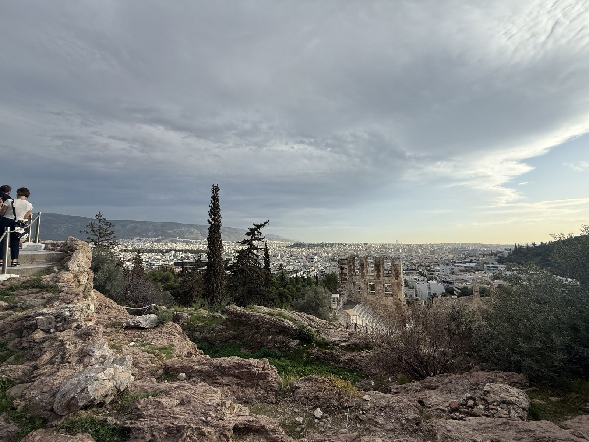
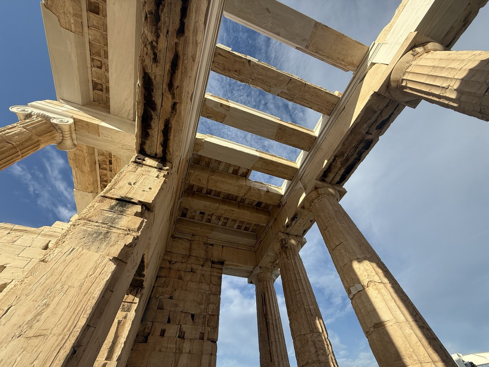
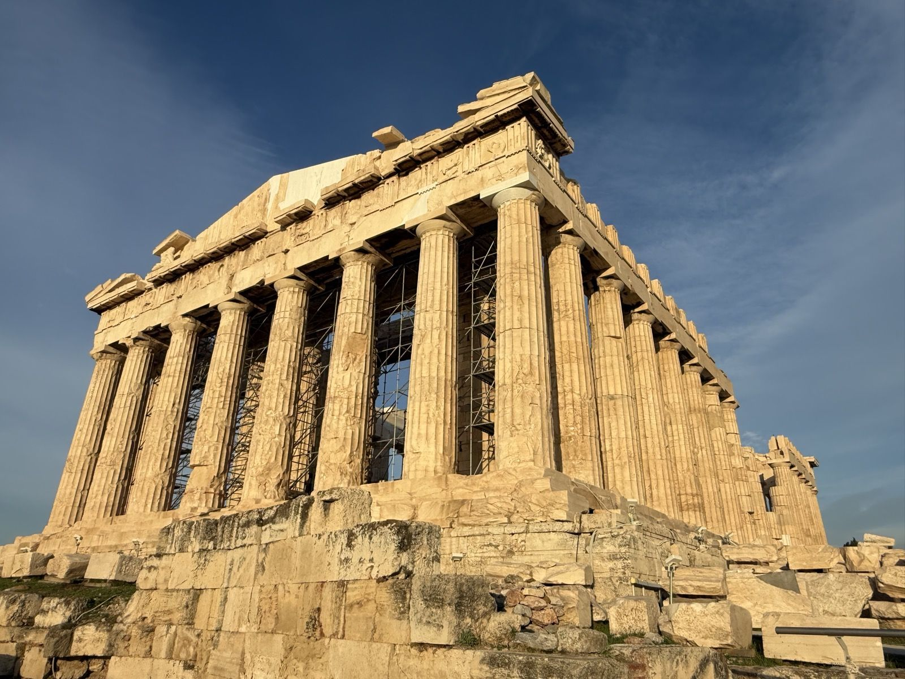
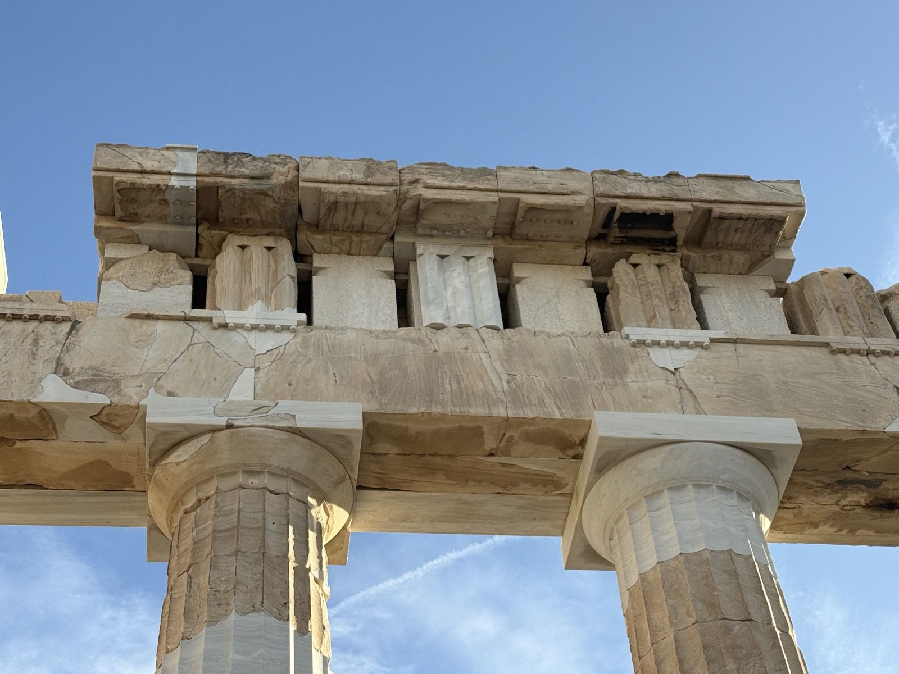
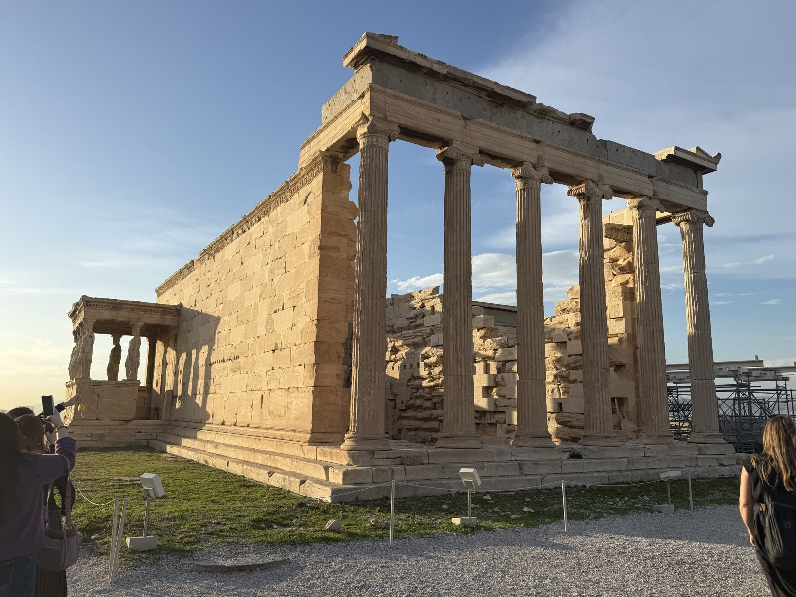
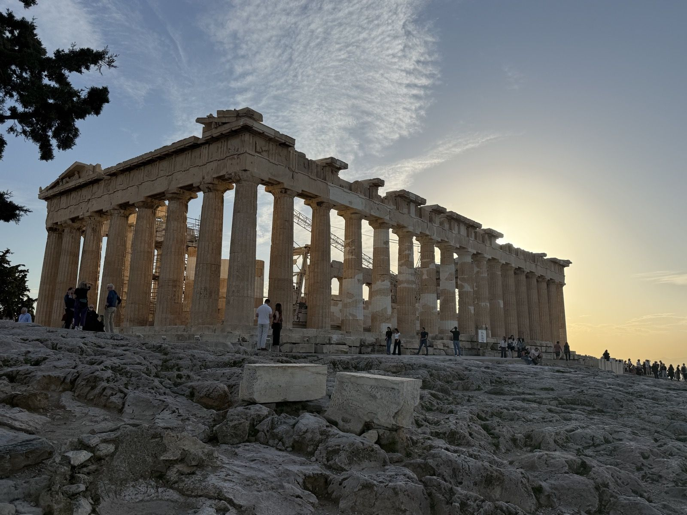
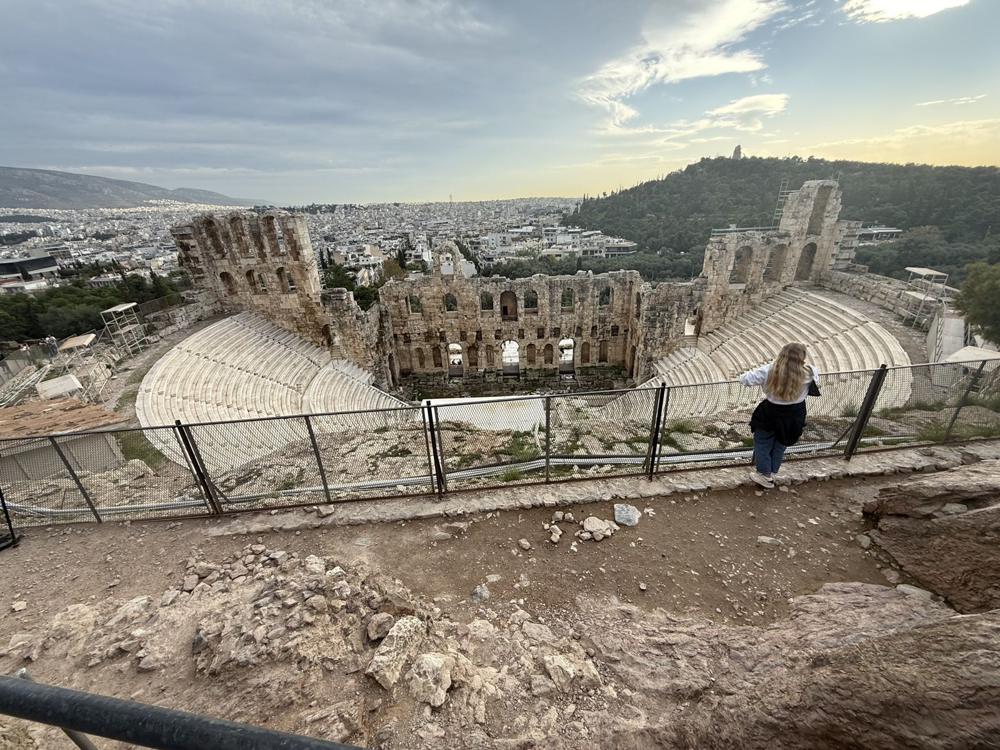

# Day 10: Athens, the Acropolis, and the Persian Wars

## Summary

Day 10 (Friday, November 20) arrives at Piraeus. The chapter climbs the Acropolis through the Propylaea to the Parthenon, the Erechtheion, and the Temple of Athena Nike, then visits the Acropolis Museum and explains the Parthenon Marbles dispute and the building's later lives as church and mosque. It tells the Persian Wars from Marathon to Themistocles and Salamis, using Herodotus as our source. It covers the Theater of Dionysus, Greek tragedy, and hubris, along with feta, Greek salad, souvlaki, and the dishes Greeks and Turks share.

## Concepts Covered

This chapter covers the following 27 concepts from the learning graph:

| Concept | Concept Impact Score |
|---------|-----------------------|
| Piraeus Port | 1 |
| Acropolis | 21 |
| Pericles | 7 |
| Phidias | 6 |
| Parthenon | 5 |
| Parthenon Sculptures | 3 |
| Parthenon Marbles Dispute | 1 |
| Parthenon as Church and Mosque | 1 |
| Propylaea | 1 |
| Erechtheion | 3 |
| Caryatids | 2 |
| Temple of Athena Nike | 1 |
| Acropolis Museum | 1 |
| Persian Wars | 14 |
| Battle of Marathon | 2 |
| Themistocles | 4 |
| Battle of Salamis | 1 |
| Herodotus | 5 |
| Theater of Dionysus | 1 |
| Greek Tragedy | 12 |
| Hubris | 7 |
| Athens as Modern Capital | 6 |
| Feta Cheese | 2 |
| Greek Salad | 1 |
| Souvlaki and Gyros | 1 |
| Eggplant | 2 |
| Shared Greek-Turkish Dishes | 1 |

## Prerequisites

This chapter builds on concepts from:

- [Chapter 1: Before We Go, Part 1: The Long Timeline of the Eastern Mediterranean](../01-long-timeline/index.md)
- [Chapter 3: Day 1: Istanbul, a City on Two Continents](../03-istanbul-two-continents/index.md)
- [Chapter 4: Day 2: Byzantine Constantinople and Hagia Sophia](../04-byzantine-constantinople/index.md)
- [Chapter 6: Day 4: Bazaars, Scripts, and Presses](../06-bazaars-scripts-presses/index.md)
- [Chapter 7: Day 5: The End of Empire and the Birth of Modern Turkey](../07-end-of-empire-modern-turkey/index.md)
- [Chapter 8: Day 6: Troy and Gallipoli](../08-troy-and-gallipoli/index.md)
- [Chapter 9: Paul at Ephesus, Part 1: The Apostle's Life, Letters, and Ephesian Years](../09-paul-life-letters/index.md)
- [Chapter 10: Day 7: Ephesus, a Greco-Roman City](../10-ephesus-greco-roman-city/index.md)
- [Chapter 12: Day 8: Rhodes, From the Colossus to the Knights](../12-rhodes/index.md)

---

## Arriving at the Port of Athens

Day 10, Friday, November 20, is the day the whole voyage has been sailing toward. The Viking Star docks at Piraeus, the port of Athens, at about 7:00 AM, and tonight is our final night aboard. Today belongs to the Acropolis, the rock in the middle of the city where the Athenians built the Parthenon, and to the war that made Athens rich and confident enough to build it. As Chapter 1 told, in 480 BCE a Persian army burned the temples on the Acropolis, and that same year the Greek fleet destroyed the Persian navy at Salamis, a few kilometers from where we dock. Thirty-three years later, Pericles began the Parthenon.

Here is how our own day went. We walked the Ancient Agora below the rock around 1:00 PM, but its story belongs to Chapter 16. We climbed the Acropolis from about 3:15 to 4:15 PM, up the west slope above the Odeon of Herodes Atticus, through the gateway, and around the Parthenon and the Erechtheion as the light turned gold. The sun sets in Athens at about 5:10 PM in late November, so our last photos on the summit were taken about an hour before sunset, with the sun already low behind the temple.

!!! mascot-welcome "The Owl Comes Home"
    { class="mascot-admonition-img" }
    Today we climb to the house of Athena, whose little owl gave me my name, and whose city stamped my ancestors on its silver coins. By tonight the Parthenon will not be a postcard but a building with five lives, a war memorial, a public works budget, and a quarrel between two museums. We will also finally eat the eggplant we have been promising since Istanbul. Look closer.

The chapter has six parts. Part One lands at Piraeus and reads the modern capital. Part Two tells the Persian Wars, from Marathon to Salamis, through our main source, Herodotus. Part Three climbs the Acropolis with Pericles and Phidias <audio id="audio-phidias" src="../../audio/phidias.mp3" preload="none"></audio><button onclick="document.getElementById('audio-phidias').play()" class="pronounce-btn">🔊 Pronounce</button> *FID-ee-us*, through the Propylaea <audio id="audio-propylaea" src="../../audio/propylaea.mp3" preload="none"></audio><button onclick="document.getElementById('audio-propylaea').play()" class="pronounce-btn">🔊 Pronounce</button> *prop-uh-LEE-uh* to the Parthenon and the Erechtheion. Part Four follows the Parthenon's later lives as church, mosque, ruin, and museum piece, and the dispute over its sculptures. Part Five goes down to the Theater of Dionysus for tragedy and hubris. Part Six is the Greek table: feta, salad, souvlaki, and the eggplant dishes Greeks and Turks share.

## Part One: The Port and the Capital

### Piraeus

**Piraeus** is the port city of Athens, about 10 km southwest of the Acropolis, and the harbor from which ferries leave for most of the Aegean islands. Its life as Athens's port began with Themistocles <audio id="audio-themistocles" src="../../audio/themistocles.mp3" preload="none"></audio><button onclick="document.getElementById('audio-themistocles').play()" class="pronounce-btn">🔊 Pronounce</button> *thuh-MIS-tuh-kleez*, whom we meet in Part Two, who from 493 BCE had its three natural harbors fortified. In the 400s BCE Hippodamus of Miletus laid the town out in a grid, and the Long Walls, two parallel walls about 6 km long, joined port and city so that Athens could be fed by sea even under siege. When Athens lost the Peloponnesian War in 404 BCE, the victors made the Athenians pull the walls down.

In the Middle Ages sailors called the half-empty harbor Porto Leone, after a great marble lion that sat beside it. In 1687 the Venetian commander Francesco Morosini, whose shell wrecked the Parthenon that year, carried the lion off to Venice, where it still guards the gate of the Arsenal, with runes on its flanks carved centuries earlier by Scandinavian soldiers, probably men of the Byzantine emperor's Varangian Guard. Today Piraeus is Greece's main port; since 2016 the Chinese shipping company COSCO has held a majority stake in the company that runs it. For us it is a cruise terminal and a metro station: Line 1, which began in 1869 as the Athens–Piraeus railway, runs to Monastiraki and Thissio, at the foot of the Acropolis, in about 25 minutes.

### Athens as Modern Capital

**Athens as modern capital** means the city's second life, as the capital of the modern Greek state since 1834. Chapter 7 told how King Otto's government chose it for its ancient name when it was a battered town of a few thousand people, and laid out straight avenues around a royal palace that is now the Parliament. The city then grew in three great waves:

1. **Refugees, 1922–1923.** The Asia Minor refugees whom Chapter 10 met built new districts named for the places they had lost, such as Nea Smyrni.
2. **The villages move to the city, 1950s–1970s.** Hundreds of thousands of rural Greeks came for work and were housed in the concrete apartment blocks, the *polykatoikies*, that now cover the plain.
3. **The Olympic rebuilding, around 2004.** A new airport, a new metro, and a tram to the sea.

Today about 3.7 million people live in greater Athens, more than a third of everyone in Greece. Every construction project risks hitting antiquity: the metro's builders found so much that Syntagma and Acropoli stations display their finds behind glass.

**Worked example: reading the modern city from the top.** Let's stand at the east end of the Acropolis this afternoon and turn from north to southwest. To the northeast rises Lycabettus hill, 277 m high, with a small white chapel on its summit. To the east are Syntagma Square and the Parliament, Otto's palace of the 1830s and 1840s. To the southeast stand the columns of the Temple of Olympian Zeus, finished by the Roman emperor Hadrian, and beyond them the white marble Panathenaic Stadium, rebuilt for the first modern Olympics in 1896. Below us to the north are the roofs of Plaka and Monastiraki (Chapter 20), and to the west the Agora (Chapter 16). To the southwest, past Philopappos Hill, are the cranes of Piraeus and the long shape of Salamis. Around it all, apartment blocks run to the mountains, including Penteli to the northeast, where the Parthenon's marble was quarried. One turn of the head spans about 2,500 years.

<figure markdown="span" class="trip-photo">
  { loading=lazy }
  <figcaption>Athens seen from the slope of the Acropolis. Photo by Dan McCreary</figcaption>
</figure>

## Part Two: The Persian Wars

### The Persian Wars

The **Persian Wars** are the wars between the Persian Empire and an alliance of Greek city-states that ran from 499 to 479 BCE. The Persian Empire, founded by Cyrus the Great, was the largest the world had yet seen, stretching from the Aegean to the borders of India, and by about 540 BCE it ruled the Greek cities of Ionia. In 499 BCE those cities revolted, led by Miletus, and Athens sent 20 ships to help; together the rebels burned Sardis, the Persian capital of the west. Herodotus says that King Darius then ordered a servant to say to him three times at every dinner, "Master, remember the Athenians." The revolt was crushed by 494 BCE, and Persia turned west.

There were two invasions. In 490 BCE Darius sent a fleet across the Aegean, which burned Eretria on Euboea and landed at Marathon, where the Athenians beat it. In 480 BCE his son Xerxes came in person, with an army that crossed the Hellespont on bridges of boats and a fleet sailing beside it. The Greeks who resisted, led by Sparta on land and with Athens providing the largest navy, were a minority: many Greek cities sided with Persia or stayed out. Xerxes forced the pass at Thermopylae, where the Spartan king Leonidas and his allies held out for three days until a local man showed the Persians a mountain path around them. He took Athens and burned the Acropolis, but his fleet was beaten at Salamis that September. In 479 BCE the army he left behind was defeated at Plataea, and a Greek fleet destroyed the Persian forces at Mycale, on the Anatolian coast.

The table puts the wars in order and shows how much of them our route has already crossed.

| Date | Event | Where on our route |
|---|---|---|
| 499–494 BCE | Ionian Revolt; Sardis burned 498 | Miletus and Sardis, near Ephesus (Day 7) |
| 490 BCE | Darius's expedition; Battle of Marathon | 40 km northeast of Athens |
| 480 BCE | Xerxes crosses the Hellespont | Beside Çanakkale (Day 6) |
| 480 BCE | Thermopylae; Athens and the Acropolis burned; Salamis | The Acropolis and the strait west of Piraeus (Day 10) |
| 479 BCE | Plataea and Mycale | Mycale faces Samos, near Kuşadası (Day 7) |
| 479 BCE | Serpent Column dedicated at Delphi | Now in Istanbul's Hippodrome (Day 2) |

!!! mascot-encourage "Hang the War on Three Places"
    { class="mascot-admonition-img" }
    If the Persian Wars feel like a blur of kings, battles, and dates, that is normal; most readers need two passes. We already tamed the whole timeline in Chapter 1 by hanging each era on a place, so do the same here: Marathon, the burned Acropolis, and the strait of Salamis. The map at the end of this part walks the steps between them in order.

### Herodotus

**Herodotus** is the Greek writer whose *Histories*, finished around 430 BCE, are our main source for the Persian Wars and the first large work of history in Western literature. He was born about 484 BCE at Halicarnassus, modern Bodrum, on the Turkish coast, so he grew up a subject of the Persian king. He traveled to Egypt, Phoenicia, and the Black Sea, spent time in Athens, and died about 425 BCE. His book opens by announcing that it presents his *historia*, Greek for "inquiry," so that the great deeds of Greeks and non-Greeks would not be forgotten, and so that we would know why they fought. That word became our word *history*.

His method is what makes him the founder of a discipline. He tells us where his information comes from and how much he trusts it, and he often gives the Persian, Phoenician, and Greek versions of a story side by side. He is bound, he says, to report what people say, but not to believe all of it. He also gives the enemy a fair hearing, which is why the later writer Plutarch attacked him as a "barbarian-lover." Cicero called him the father of history; critics have called him the father of lies.

The table shows the four kinds of statement Herodotus keeps apart, in our paraphrase.

| What he is telling us | How he signals it | Example from the *Histories* |
|---|---|---|
| What he saw | He went to look, or to ask | He sailed to Tyre to ask how old its temple of Heracles was |
| What others told him | He names the teller | The rival Persian and Phoenician stories of how the quarrel began |
| What he reports but doubts | He says he does not believe it | Sailors who rounded Africa said the sun was on their right, just what sailors south of the equator would see |
| His own judgment | He warns it will be unpopular | That Athens, more than any other city, saved Greece |

**Worked example: testing Herodotus' numbers.** Let's put Chapter 4's tools to work on his most famous figure. He says Xerxes' land army had 1,700,000 infantry, and that with the navy and camp followers more than five million people marched into Greece. Now some arithmetic: at about 1 kg of grain per soldier per day, 1.7 million soldiers eat about 1,700 tonnes a day, roughly 50,000 tonnes a month, all carried or gathered along one coast road. Modern historians, working from what roads, water, and food could support, usually estimate a much smaller force, often in the range of about 100,000 to 300,000 fighting men, though estimates vary widely. So we keep Herodotus' account of what happened and where, and treat his numbers the way he treated his own sources: reported, not believed.

He is right far more often than his critics once allowed. Archaeologists have traced the canal Xerxes had dug across the Athos peninsula, and Scythian royal tombs north of the Black Sea match his account of their burials.

!!! mascot-thinking "A Persian Subject Writes the War"
    { class="mascot-admonition-img" }
    Notice who wrote the first history of the Persian Wars: a man born a subject of the Persian king, in a city that sent ships to fight for Xerxes at Salamis. Herodotus could see the war from both shores, and that is part of why his inquiry still reads as fair. Ask of every source: which shore was the writer standing on?

### The Battle of Marathon

The **Battle of Marathon** was the Athenian victory over a Persian landing force on the plain of Marathon, about 40 km northeast of Athens, in 490 BCE. Guided by Hippias, the tyrant the Athenians had expelled twenty years before, the Persians chose the bay because, Herodotus says, it was the best ground in Attica for cavalry and close to Eretria. About 10,000 Athenian hoplites, heavily armed citizen infantry, marched out, joined by about 1,000 men from the small allied town of Plataea; the Spartans could not march until the full moon and arrived too late. The Athenians, led by generals including Miltiades, attacked at a run, let their center give way, and closed on the Persians from both wings. Herodotus counts 6,400 Persian dead and 192 Athenians, who were buried under a mound, the Soros, that still stands on the plain.

Marathon gave Athens a founding legend. The playwright Aeschylus, who fought there and whose brother died there, is said to have asked that his epitaph mention Marathon and not his plays, and Chapter 18 visits the Treasury of the Athenians at Delphi, which Pausanias says was paid for from its spoils.

**Worked example: the myth test on the marathon runner.** Let's run Chapter 4's myth-versus-history test on the battle's most famous story: a runner carried the news of victory from Marathon to Athens, gasped "We have won!", and died, and the modern marathon race, first run at the Athens Olympics of 1896, honors him. When does each part first appear?

| Claim | Earliest source | Written about | Verdict |
|---|---|---|---|
| A runner named Pheidippides ran from Athens to Sparta before the battle to ask for help, arriving the next day | Herodotus | 60 years after the battle | History, from our earliest source; about 240 km in two days |
| The god Pan spoke to him on the road | Herodotus | Same | What the Athenians believed; they founded a shrine to Pan afterward |
| A runner ran from Marathon to Athens with the news of victory and died | Plutarch and Lucian | 550 to 650 years after the battle | Legend; Herodotus never mentions it |
| The marathon race is 42.195 km | Olympic rules | Set for London in 1908, standard from 1921 | A modern convention |

So the real feat is the one fewer people know, a runner covering about 240 km to Sparta in two days; the death-run first appears centuries later, under three different names.

### Themistocles

**Themistocles** (about 524 to about 459 BCE) was the Athenian politician and general who built the navy that won at Salamis. He was not from one of the old noble families, and he made his career by persuading the Assembly. In 483 BCE the state silver mines at Laurion, in southern Attica, struck a rich new vein. Herodotus says the Athenians were about to share out the windfall at ten drachmas a citizen when Themistocles persuaded them to build 200 warships instead, officially for a war with the island of Aegina, though many readers think he had Persia in mind.

**Worked example: what the silver bought.** Let's follow the money to Salamis. The ships were **triremes**, the standard warship of the age, and a few numbers explain how they fought:

- **Size:** about 37 m long and 5 m wide; the modern replica *Olympias*, built in the 1980s, is 36.9 m long.
- **Crew:** about 170 rowers on three levels, plus about 30 officers, deckhands, and marines.
- **Weapon:** a bronze ram at the bow, at the waterline. A trireme won by ramming, not by boarding.

Herodotus lists the Greek fleet at Salamis as 378 ships, and says Athens alone provided 180 of them, almost half (\( 180 \div 378 \approx 0.48 \)). Without the Laurion silver there would have been no Greek fleet able to face Persia. And with about 170 rowers a ship, Athens's 180 ships needed about 30,000 oarsmen, many of them from the poorest citizens, a fact whose consequences for democracy Chapter 16 follows.

Themistocles' end was strange. In the 470s the Athenians ostracized him, a vote Chapter 16 explains, and accused of treason he fled to Persia, where the king made him governor of Magnesia on the Maeander, about 25 km from Ephesus. He died there. Thucydides judged him the best of all men at forecasting the future from little information, a talent the Oracle and Algorithm chapters will make us think hard about, and Chapter 17 tells how he won an argument over an answer from Delphi before the battle.

### The Battle of Salamis

The **Battle of Salamis** was the sea battle of September 480 BCE in which the Greek fleet defeated Xerxes' larger navy in the narrow strait between the island of Salamis and the mainland of Attica. The Athenians had evacuated their families to Salamis, Aegina, and Troezen, and when news came that the Acropolis was burning, Herodotus says, some commanders at Salamis panicked. The Spartan-led allies wanted to fall back to the Isthmus of Corinth. Themistocles argued that in open water the Persians' numbers would tell, but in the narrows they could not. Herodotus tells the rest as a sequence of moves.

1. Themistocles secretly sent Sicinnus, an enslaved man who tutored his children, to tell Xerxes that the Greeks were about to flee.
2. Xerxes believed it, and his ships spent the night closing both ends of the strait, so the Greeks could no longer retreat to the Isthmus, as Themistocles wanted.
3. At dawn the Persian fleet rowed into the narrows, and the Greeks attacked once the leading ships were crowded together.
4. In the crush the Persian ships could not turn or use their numbers. Xerxes watched from a seat at the foot of Mount Aigaleo on the mainland.
5. By evening the Persian fleet had withdrawn with heavy losses. Without a navy to supply his army, Xerxes went home with much of it.

One of Xerxes' commanders that day was Artemisia, queen of Herodotus' own city of Halicarnassus, who had advised the king not to fight in the narrows at all. From the ship's deck at Piraeus, the long island across the water to the west is Salamis; the strait lies just beyond, between the island and the shore at Perama.

The next year the Greeks won at Plataea and Mycale and dedicated the Serpent Column at Delphi, the column Chapter 4 found in Istanbul. Later writers said the allies swore not to rebuild the burned temples but to leave them as memorials; the oath survives only in 4th-century versions and its authenticity is debated. Either way, the Acropolis stood in ruins for about thirty years, and when the Athenians rebuilt its north wall, they set into it column drums and carved blocks from the burned temples, still visible from the streets below: a war memorial made of the war's own rubble.

The map below follows the war from Sardis to Mycale and asks us to predict, at five of its stops, why the fighting or the crossing happened there.

#### Diagram: Xerxes' Road to Salamis

Xerxes' Road to Salamis

Type: map
**sim-id:** persian-wars-campaign-map 
**Library:** Leaflet 
**Status:** Specified 
**Bloom Level:** Understand 
**Bloom Verb:** infer 
**Learning Objective:** The learner will infer, at five places in the Persian Wars, why the fighting or the crossing happened there, choosing the geographic reason before it is revealed and getting at least 4 of 5 correct.

**Prerequisites:** Persian Wars, Ionian Revolt, Herodotus, Battle of Marathon, Themistocles, trireme, Battle of Salamis, Hellespont (all defined in Part Two above; the Hellespont in Chapter 7).

**Evidence of Mastery:** At five of the eight places, the learner chooses one of three reasons before the explanation appears. An answer is correct when it matches the Correct reason in Content. Mastery is 4 of 5 correct on the first attempt. Stepping through the map, reading the place notes, and panning are exploration, not evidence.

**Misconceptions:** (1) The Greeks won because they had more soldiers or ships. (2) The Persian army and fleet traveled separately and did not depend on each other. (3) The Athenians defended their city walls in 480 BCE. (4) The Persian Wars were one battle at Marathon.

**Instructional Rationale:** Inferring a reason from geography before the answer appears makes the learner use the map as evidence, which is an Understand task; stepping through the places in date order builds the sequence without asking the learner to memorize it.

**Content:**

Eight places, shown in this order as numbered steps. Coordinates are approximate (latitude, longitude):

| Step | Place | Coordinates | Date | Note shown at this step |
|---|---|---|---|---|
| 1 | Sardis | 38.488, 28.040 | 498 BCE; again winter 481/480 BCE | Ionian rebels and 20 Athenian ships burn the Persian western capital in 498 BCE. In the winter of 481/480 BCE Xerxes gathers his army here. |
| 2 | Marathon | 38.118, 23.978 | 490 BCE | Darius's expedition lands. About 10,000 Athenians and 1,000 Plataeans win; Herodotus counts 192 Athenian dead. |
| 3 | Abydos, on the Hellespont | 40.196, 26.405 | Spring 480 BCE | Xerxes' army crosses on two bridges of boats, a few kilometers from Çanakkale. |
| 4 | Thermopylae | 38.797, 22.537 | August 480 BCE | Leonidas and his Spartans and allies hold the pass for three days until a mountain path is betrayed. |
| 5 | The Acropolis of Athens | 37.971, 23.726 | September 480 BCE | The Persians take the abandoned city and burn the temples on the rock. |
| 6 | The strait of Salamis | 37.950, 23.570 | September 480 BCE | The Greek fleet of 378 ships, 180 of them Athenian, defeats the Persian fleet in the narrows. |
| 7 | Plataea | 38.216, 23.272 | August 479 BCE | The Greek army defeats the Persian army Xerxes left behind. |
| 8 | Mycale | 37.660, 27.150 | 479 BCE | A Greek fleet destroys the Persian forces on the Anatolian shore facing Samos, near Kuşadası. |

Prediction questions, asked when the learner reaches these steps:

| # | Step | Question | Options | Correct reason | Explanation shown |
|---|---|---|---|---|---|
| 1 | 2 Marathon | Why did the Persians land at Marathon? | (a) It was Athens's own harbor. (b) Its wide plain suited cavalry and it lay close to Eretria. (c) No Athenians lived nearby. | (b) | Herodotus says the exiled tyrant Hippias led them there because the plain was the best ground for cavalry in Attica and near Eretria. |
| 2 | 3 Abydos | Why did Xerxes cross the Hellespont at Abydos? | (a) The strait is among its narrowest there. (b) The water is shallow enough to wade. (c) Abydos was a Greek ally. | (a) | The Hellespont is only about 1.2 to 6 km wide, and narrowest near Çanakkale, so a bridge of boats could span it. |
| 3 | 4 Thermopylae | Why did the Greeks try to stop the army at Thermopylae? | (a) It was a walled city. (b) A narrow pass between mountains and sea let a small force block a large one. (c) A river there could not be crossed. | (b) | In the pass, only a few men could fight at once, so numbers counted for less. |
| 4 | 5 Acropolis | Why did the Persians find Athens almost empty? | (a) The Athenians had surrendered and left. (b) The Athenians had moved their families to Salamis, Aegina, and Troezen and put their trust in the fleet. (c) A plague had emptied the city. | (b) | Herodotus says the Athenians evacuated the city and manned the ships; only a few defenders held out on the rock. |
| 5 | 6 Salamis | Why did Themistocles want to fight in the strait? | (a) Open water gave his ships room to maneuver. (b) In the narrows the larger Persian fleet could not spread out or use its numbers. (c) The Persians could not see the Greek ships there. | (b) | In the crowded strait the Persian ships fouled each other, and the Greek rams found targets. |

**Provenance:** Dates, numbers, and reasons from this chapter's Part Two, which follows Herodotus' *Histories* (books 5 to 9). Coordinates are approximate and must be checked against each place's Wikipedia article before publishing; Salamis and Mycale mark areas, not exact battlefields, and the sim labels them "approximate location."

**Rules:** Steps advance in the order listed, forward and back. A prediction question appears when the learner first arrives at its step; the step's note is hidden until the question is answered. Each question allows one scored attempt. Score is 0 to 5; mastery is score >= 4. Moving backward shows the answered question with the learner's choice and the explanation; it cannot be re-answered for score. The route line from step to step is drawn only up to the current step.

**Learner Activity:**

1. The learner sees the map of the Aegean with step 1, Sardis, highlighted, and reads its note.
2. The learner advances to each next step. At steps 2, 3, 4, 5, and 6, the learner first answers the prediction question, then reads the explanation and the note.
3. After step 8, the learner sees the whole route from Sardis to Mycale and the score.
4. The learner should notice that the Greeks repeatedly chose narrow places, a pass and a strait, where a smaller force could face a larger one.

**Feedback:** Correct answer: "Correct." followed by the Explanation shown. Incorrect answer: "Not quite." followed by the Explanation shown, with the correct option marked. After step 8: if score >= 4, "You can read the Persian Wars as a war of narrow places."; otherwise, "Look again at Thermopylae and Salamis: what did the ground and the water do to the Persians' numbers?" A Start Again option resets all answers.

**Starting State:** The map with step 1 marked and the question "A Persian king wants revenge on Athens. How will he get there?"

**Chapter Anchors:** 20 Athenian ships in the Ionian Revolt; Sardis burned 498 BCE; Marathon 490 BCE, about 10,000 Athenians and 1,000 Plataeans, 192 Athenian dead; Xerxes crosses 480 BCE; Hellespont about 1.2 to 6 km wide (Chapter 7); Salamis September 480 BCE, 378 Greek ships, 180 Athenian; Plataea and Mycale 479 BCE; eight places; five questions; mastery 4 of 5.

## Part Three: The Rock of Athena

### The Acropolis

An **acropolis**, Greek for "high city," is the fortified hilltop of a Greek town, and **the Acropolis** of Athens is the most famous of them: a flat-topped limestone rock about 150 m above sea level, with steep cliffs on three sides and an easier slope only at the west end, covering about 3 hectares on top. People lived on it in the Bronze Age. In the 13th century BCE it held a palace of the Mycenaeans whom Chapter 8 met, and a few huge blocks of its wall still stand near the entrance. In later centuries the kings' rock became the gods' rock, the sanctuary of Athena, the city's patron, whose story Chapter 12 told: her contest with Poseidon, her olive tree, and her owl.

The Acropolis we visit is almost entirely the work of one generation. The Persians burned its temples in 480 BCE; after thirty years of ruins, the Athenians rebuilt it between 447 and about 406 BCE. At the city's great festival, the Panathenaia, a procession climbed from the city gate through the Agora and up the west slope to bring Athena a new woven robe, the *peplos*, while cattle for the sacrifice were led along behind. The Acropolis has been a UNESCO World Heritage Site since 1987.

The table lists the four great buildings in the order we meet them on the way up. The terms are explained in the sections that follow.

| Building | Built | Order | What it was for |
|---|---|---|---|
| Propylaea | 437–432 BCE, never finished | Doric outside, Ionic inside | The monumental gateway |
| Temple of Athena Nike | c. 427–424 BCE | Ionic | A small temple to Athena as Victory |
| Parthenon | 447–432 BCE | Doric, with Ionic touches | The great temple of Athena Parthenos and the city's treasury |
| Erechtheion | c. 421–406 BCE | Ionic | The old cults of the rock, including Athena's ancient olive-wood statue |

**Worked example: our route up the rock.** Let's trace our own climb this afternoon and see how each step is a step in time. We came up the west slope above the Odeon of Herodes Atticus, a Roman theater of 161 CE, and passed the Beulé Gate, a late Roman gate built of reused stones. We climbed the steps of the Propylaea, Pericles' gateway, with the little temple of Athena Nike on its bastion to our right. Through the gateway the Parthenon appeared ahead and to the right, seen first from its corner, so that its length and its front show together. We walked along its north side to the Erechtheion and on toward the Greek flag at the east end of the rock, where, on the night of May 30, 1941, two young Athenians, Manolis Glezos and Apostolos Santas, tore down the Nazi flag in one of the first acts of resistance in occupied Europe. In one hour: Pericles' Athens, Rome, and the Second World War.

!!! mascot-tip "Pick the Hour Before You Pick the Day"
    { class="mascot-admonition-img" }
    Here's a shortcut: the Acropolis sells timed entry slots, and the cruise-ship crowds arrive mid-morning. Book the first slot of the day or one in the mid-afternoon, as we did, and the summit is calmer and the light is warmer. Book online the day before, because popular slots sell out even in November.

### Pericles

**Pericles** (about 495 to 429 BCE) was the Athenian statesman who led the democracy at its height and launched the building program that produced the Parthenon. Born into the old aristocracy, he made his power as a democratic leader: he held no permanent office, but was elected one of the city's ten generals year after year, almost without a break from 443 BCE until his death, and governed by persuading the Assembly. His partner, Aspasia, came from Miletus. In 431 BCE, at the start of the Peloponnesian War against Sparta, he gave the Funeral Oration that Thucydides reports, praising Athens as an education to all Greece. Two years later he died in the plague that struck the crowded city.

Chapter 1 followed the money for his building program, the Delian League treasury moved to Athens in 454 BCE. Here we look at how the program was sold to the citizens who voted for it.

**Worked example: Pericles' public works.** Let's read the building program as politics, using two kinds of evidence. The first is Plutarch's *Life of Pericles*, written about five centuries later, which says Pericles defended the spending by how many people it employed, in three groups:

- **Materials:** stone, bronze, ivory, gold, ebony, and cypress wood.
- **Crafts that worked them:** carpenters, molders, coppersmiths, stonecutters, dyers, workers in gold and ivory, painters, and embroiderers.
- **Trades that brought them:** merchants, sailors, and pilots by sea; cartwrights, teamsters, rope makers, and road builders by land.

When his opponents complained of the cost, Plutarch says, Pericles offered to pay for the buildings himself if the inscriptions would name him instead of the people, and the Assembly told him to spend what he needed from public funds. That story may be polished, but the second kind of evidence is not: fragments of the yearly building accounts, carved in stone on the Acropolis, survive, listing what the commissioners received and spent on the Parthenon and its statue. The most famous building in Greece was also a public works program, voted on by citizens and accounted for in public.

### Phidias

**Phidias** (about 480 to about 430 BCE) was the sculptor who made the great statues of Athena on the Acropolis and, according to Plutarch, oversaw the whole building program. His bronze **Athena Promachos**, "who fights in front," stood in the open behind the Propylaea, and Pausanias says sailors rounding Cape Sounion could see the tip of her spear. Inside the Parthenon stood his **Athena Parthenos**, dedicated in 438 BCE: a figure about 12 m tall, built over a wooden core, with skin of ivory and armor and robes of gold, holding a life-size Victory in her hand. He later made the seated Zeus at Olympia, one of the Seven Wonders, and in his excavated workshop there archaeologists found a small cup scratched with the words "I belong to Phidias."

| Work | Where it stood | Material | What survives |
|---|---|---|---|
| Athena Promachos | In the open on the Acropolis | Bronze | Descriptions, and traces of its base |
| Athena Parthenos (438 BCE) | Inside the Parthenon | Gold and ivory over wood | Descriptions and small Roman copies |
| Parthenon sculptures (447–432 BCE) | On the Parthenon | Marble, painted | Much of it, in Athens, London, and elsewhere |
| Zeus at Olympia | Temple of Zeus, Olympia | Gold and ivory over wood | Descriptions, coins, and his workshop |

Neither great statue of Athena survives. The best small Roman copy of the Athena Parthenos, about a meter tall, is in the National Archaeological Museum (Chapter 20), and Americans can see a full-size modern re-creation in the replica Parthenon in Nashville, Tennessee.

**Worked example: weighing Athena's gold.** Thucydides reports that Pericles told the Athenians the statue carried 40 talents of refined gold, all of it removable. An Attic talent weighed about 26 kg, so the gold weighed about \( 40 \times 26 = 1{,}040 \) kg, roughly a tonne, which Pericles counted among the city's emergency reserves, to be borrowed and replaced. The design mattered to Phidias, too. Plutarch says that when enemies accused him of stealing gold, the plates were taken off and weighed, and the charge failed; they then accused him of impiety for putting portraits of himself and Pericles on Athena's shield. Our sources disagree about his end: Plutarch says he died in prison, another tradition that he went to work at Olympia.

### The Propylaea

The **Propylaea** is the monumental gateway at the west end of the Acropolis, built from 437 to 432 BCE by the architect Mnesicles. Its name means "the gates in front." A central hall with five doorways leads through, its outer porches in the sturdy Doric order and its inner passage lined with slender Ionic columns that carried a marble ceiling. Its northwest wing held paintings that Pausanias saw in the 2nd century CE. Work stopped when the Peloponnesian War began, and some blocks still carry the rough lifting knobs that masons would have cut away at the end.

<figure markdown="span" class="trip-photo">
  { loading=lazy }
  <figcaption>Ionic columns and marble ceiling beams in the Propylaea. Photo by Dan McCreary</figcaption>
</figure>

The gateway's later lives are a short course in Chapter 4's layers. The Frankish and Florentine lords who ruled Athens after 1204 made it their palace, and a medieval tower stood on its south wing until 1874, when it was demolished with money from Heinrich Schliemann, the excavator of Troy (Chapter 8). In 1656 lightning ignited gunpowder stored in the building. Restorers have since reset many of its marble ceiling beams, which is what we look up into as we pass through.

!!! mascot-warning "Marble Polished by Millions of Feet"
    { class="mascot-admonition-img" }
    A common slip, quite literally, is on the steps and paths through the Propylaea, where the marble has been worn glassy and turns slick in even a light November shower. Wear shoes with real grip, use the handrails, and step on the rougher stone at the edges of the path. Coming down at the end of the day is when most falls happen, so slow down then.

### The Temple of Athena Nike

The **Temple of Athena Nike** is the small Ionic temple on the bastion to the right of the Propylaea, built about 427 to 424 BCE and dedicated to Athena as goddess of victory. It has four columns at each end, and it is so small that it reads almost as a jewel box beside the gateway. A sculpted parapet once ran around the edge of the bastion, carved with winged Victories leading cattle to sacrifice and setting up trophies; the best-known slab, a Victory bending to adjust her sandal, is in the Acropolis Museum. Pausanias says the Athenians' statue of Athena Nike had no wings, so that Victory could never fly away from Athens.

The building itself has been taken apart and reassembled several times: dismantled by the Ottoman garrison in 1686 to make room for a gun battery, rebuilt from the recovered blocks in the 1830s, and taken down and rebuilt again in the 1930s and in the early 2000s, to replace rusting iron fittings and correct earlier errors.

### The Parthenon

The **Parthenon** is the temple of Athena Parthenos, "the maiden," built on the highest part of the Acropolis between 447 and 432 BCE: the main structure by 438, when Phidias' statue was dedicated, and the sculpture by 432. Its architects were Ictinus and Callicrates, with Phidias in overall charge of its sculpture. It is a Doric temple, the type Chapter 10 taught us to recognize by its plain cushion capitals and columns without bases, with 8 columns across each end and 17 down each side, all of white marble from Mount Pentelikon, about 16 km away. Its platform measures about 30.9 by 69.5 m, and its columns are about 10.4 m tall. Behind the outer columns, an Ionic frieze ran around the top of the walls of the inner building, and inside, four Ionic columns probably held up the roof of the back room, so the most Doric building in Greece quietly mixes in the Ionic order of the eastern Greeks. The temple housed the gold-and-ivory Athena and served as a treasury for the city's reserves; the great annual sacrifices took place at an altar outside.

<figure markdown="span" class="trip-photo">
  { loading=lazy }
  <figcaption>The Parthenon in late-afternoon light. Photo by Dan McCreary</figcaption>
</figure>

What makes the building extraordinary is that almost nothing in it is straight. The platform rises gently toward the middle of each side, by about 6 cm on the ends and about 11 cm on the long sides, so that it does not look as if it sags. The columns lean slightly inward, swell a little in the middle (a curve called *entasis*), and the corner columns are a bit thicker than the others, perhaps because a column seen against the bright sky looks thinner. Because every block was cut for its own place in this curved geometry, no two are quite alike, which is one reason restoration takes decades.

<figure markdown="span" class="trip-photo">
  { loading=lazy }
  <figcaption>Doric columns and entablature of the Parthenon, with new marble set among the old. Photo by Dan McCreary</figcaption>
</figure>

**Worked example: testing the golden-ratio story.** Many books say the Parthenon was designed on the "golden ratio," about 1.618 to 1. First, the myth test: no ancient source says so; the idea was popularized in the 19th and 20th centuries. Second, the arithmetic, using the platform: \( 30.9 \div 69.5 \approx 0.444 \), almost exactly 4 to 9, not the golden ratio's 0.618. A golden-rectangle platform 30.9 m wide would be about 50 m long, not 69.5 m. Claims for the front view depend on where one starts measuring, and with a free choice of starting points almost any building can be made to fit. Several scholars have noticed the 4-to-9 proportion recurring in the building, though how deliberately is debated. The Parthenon is not proof of the golden ratio; it is proof of how readily we find patterns in famous things.

### The Parthenon Sculptures

The **Parthenon sculptures** are the carved marble decoration of the temple, made under Phidias' direction between about 447 and 432 BCE, in three kinds: the square **metopes** above the outer columns, the continuous **frieze** around the inner building, and the statue groups of the two **pediments**, the triangles at each end. The frieze is usually read as the Panathenaic procession, though scholars still debate exactly what it shows. All of it was painted, in colors of which only faint traces remain, and every theme is a story of order defeating chaos, which after the Persian Wars every Athenian could read as a story about themselves.

| Element | Where on the building | How much | Subjects |
|---|---|---|---|
| Metopes | Square panels above the outer columns | 92 | Gods and giants (east), Greeks and Amazons (west), the fall of Troy (north), Lapiths and centaurs (south) |
| Frieze | A band around the top of the inner building's walls | About 160 m | A great procession, usually read as the Panathenaia, approaching seated gods |
| Pediments | The triangles at each end | Two groups of larger-than-life statues | The birth of Athena (east); Athena and Poseidon's contest for Athens (west) |

### The Erechtheion

The **Erechtheion** is the Ionic temple on the north side of the Acropolis, built about 421 to 406 BCE, during the Peloponnesian War. It is the oddest building on the rock, with porches on three sides at different levels, because it sits on uneven ground and gathers under one roof the oldest and holiest places on the hill. It housed the ancient olive-wood statue of Athena Polias, Athena "of the city," for which the Panathenaic robe was woven. Inside or around it were shown the marks of Poseidon's trident in the rock and his spring of salt water, the tomb of the legendary king Cecrops, and the shrine of Erechtheus, another legendary king, from whom the building takes its modern name. Beside it grew Athena's sacred olive tree. Herodotus tells that the Persians burned the tree in 480 BCE, and that the very next day the Athenians found a new shoot already about half a meter long. An olive tree grows on the spot today, a modern planting.

<figure markdown="span" class="trip-photo">
  { loading=lazy }
  <figcaption>The Erechtheion and its Porch of the Caryatids. Photo by Dan McCreary</figcaption>
</figure>

### The Caryatids

The **Caryatids** <audio id="audio-caryatids" src="../../audio/caryatids.mp3" preload="none"></audio><button onclick="document.getElementById('audio-caryatids').play()" class="pronounce-btn">🔊 Pronounce</button> *kar-ee-AT-idz* are the six marble statues of young women who stand in place of columns on the Erechtheion's south porch, the Porch of the Maidens, holding its roof on their heads. Each is a little different, in her stance, her drapery, and her braids, and the thick braids down their backs also strengthen the slender necks that carry the load. The ones on the building today are copies, put in place in 1979 to save the originals from air pollution. Five originals stand in the Acropolis Museum, cleaned with lasers, and the sixth is in the British Museum in London, taken by Lord Elgin's agents.

Their name is a good case for the myth test. The Roman architect Vitruvius, writing in the 1st century BCE, says it comes from the town of Caryae, which sided with the Persians; the Greeks punished it, enslaved its women, and architects carved them bearing loads forever as a lesson. That story fits this chapter's war almost too neatly, and historians doubt it: the Erechtheion's own building accounts, carved at the time, simply call the statues *korai*, "maidens," and Caryae was also known for dances of young women in honor of Artemis, which may be the real source of the name.

## Part Four: The Parthenon's Later Lives

### The Parthenon as Church and Mosque

**The Parthenon as church and mosque** is the story of the building's two thousand years after its gods lost their worshippers. After the Christian Roman emperors banned the old sacrifices at the end of the 4th century CE, its worship ended, and probably by the late 6th century it had become a church of the Virgin Mary, the Theotokos, whom the Athenians called Our Lady of Athens. The builders moved the entrance to the west, built an apse at the east end, and cut windows; Christian inscriptions are still scratched into its columns. In 1018 the emperor Basil II gave thanks there for his victories. After the Fourth Crusade of 1204 it became the Catholic cathedral of Athens. In 1458 the Ottomans took the Acropolis, and soon afterward the cathedral became the city's main mosque, with a minaret at its southwest corner. A French ambassador's artist drew its sculptures in 1674, drawings that are now our best record of what came next.

Chapter 7 told the explosion. On September 26, 1687, during the siege by Francesco Morosini's Venetian army, a shell ignited the gunpowder the Ottoman garrison had stored inside, blowing out the middle of the building and killing about three hundred people. (Chapter 14 met Morosini's namesake and his fountain in Heraklion.) Morosini then tried to lower the horses of Athena's chariot from the west pediment as trophies; the ropes failed and the sculptures shattered. The Venetians left the next year, a small mosque was built inside the ruin, and for more than a century fallen marble was burned for lime or carried off by collectors.

<figure markdown="span" class="trip-photo">
  { loading=lazy }
  <figcaption>The Parthenon against the late-afternoon sun. Photo by Dan McCreary</figcaption>
</figure>

**Worked example: reading the Parthenon with Chapter 4's questions.** Let's run the seven questions from "Reading a Ruin" on the building in front of us.

1. **Made of, and reused?** Pentelic marble, nearly all original to the temple, with bright new marble set in by restorers.
2. **Added?** Almost nothing now; the apse, the minaret, and the little mosque have all been removed.
3. **Taken away?** The roof, the middle of both long sides (by the 1687 explosion), the statue, and much of the sculpture, to London and elsewhere.
4. **Described at the time?** The building accounts, and Thucydides on the gold; later, Plutarch and Pausanias.
5. **Myths?** The golden ratio, tested in Part Three.
6. **Restored, and what did they choose to show?** Here the answer is surprising. The Ottoman garrison left in 1833, and from 1835 the new Greek state cleared the Acropolis of almost everything built after the 5th century BCE: the houses, the mosque in the Parthenon, the medieval tower, the Christian and Ottoman walls.
7. **Used now, and what does it mean?** A national symbol and a world monument, and the center of an argument about sculptures in two countries.

!!! mascot-thinking "The Clean Acropolis Is Also a Layer"
    { class="mascot-admonition-img" }
    Notice that the bare classical rock we admire is itself a choice made in the 19th century, when the young Greek state removed two thousand years of churches, mosques, and houses to show the Athens of Pericles. That choice told a story about who the new nation was. Think of the empty spaces on the Acropolis as one more layer, written by the people who decided what to erase.

Restoration continues. Early in the 20th century the engineer Nikolaos Balanos rebuilt parts of the temples with iron clamps that rusted, swelled, and cracked the marble. Since 1975 the Acropolis restoration service has been undoing those repairs and returning each original block to its true place, joining pieces with titanium and filling gaps with new Pentelic marble, left plain so it can be told from the old. The white patches in the photo of the Parthenon's columns in Part Three are that new marble: restoration, in Chapter 4's sense, not reconstruction.

The timeline below sets the Parthenon's lives in order and asks us to place twelve events in them.

#### Diagram: The Parthenon's Five Lives

The Parthenon's Five Lives

Type: timeline
**sim-id:** parthenon-five-lives-timeline 
**Library:** vis-timeline 
**Status:** Specified 
**Bloom Level:** Understand 
**Bloom Verb:** classify 
**Learning Objective:** The learner will classify twelve events in the Parthenon's history by which of the building's five lives it was living when each event happened, classifying at least 10 of 12 correctly on the first attempt.

**Prerequisites:** Parthenon, Parthenon sculptures, the Parthenon as church and mosque, Lord Elgin, Acropolis Museum, restoration (defined in Parts Three and Four above; restoration in Chapter 4).

**Evidence of Mastery:** For each event card, shown with its date but without the background bands, the learner chooses one of five lives before feedback. A choice is correct when it matches the Correct life in Content. Mastery is 10 of 12 correct on the first attempt, including cards 7 and 9, the two cards where the event happens at the end of one life.

**Misconceptions:** (1) The Parthenon was ruined in antiquity, not in 1687. (2) The Parthenon went straight from temple to ruin. (3) Elgin's removals happened in a working building rather than a ruin. (4) The building has been unchanged since the Greek state took it over in the 1830s.

**Instructional Rationale:** Placing each event in a life before the band is revealed makes the learner reason from what the building was being used for, which turns a list of dates into a sequence of uses; the bands then confirm the pattern on a shared timeline.

**Content:**

The five lives, shown as labeled bands after all cards are answered:

| Life | From | To |
|---|---|---|
| Temple of Athena | 447 BCE | 4th–6th century CE (closure and conversion; exact date debated) |
| Church (Orthodox, then Latin Catholic from 1204) | Probably late 6th century CE | 1458 |
| Mosque | 1458 | 1687 |
| Ruin, with a small mosque inside | 1687 | 1833 |
| Protected monument, with its sculptures in museums | 1833 | Today |

Event cards, in this order:

| # | Date | Event shown | Correct life | Reason shown after answering |
|---|---|---|---|---|
| 1 | 447 BCE | Work begins on the new temple, 33 years after the Persians burned the Acropolis. | Temple of Athena | The Parthenon was built as Athena's temple. |
| 2 | 438 BCE | Phidias' gold-and-ivory Athena Parthenos is dedicated inside. | Temple of Athena | The statue was the temple's centerpiece. |
| 3 | 1018 CE | The emperor Basil II gives thanks for his victories in the building. | Church | It was then the church of the Virgin, Our Lady of Athens. |
| 4 | 1204 CE | After the Fourth Crusade, the building becomes the Catholic cathedral of Athens. | Church | Still a church, now Latin instead of Orthodox. |
| 5 | Soon after 1458 | A minaret is added at the southwest corner. | Mosque | The Ottomans made the cathedral their mosque. |
| 6 | 1674 | An artist with the French ambassador draws the sculptures. | Mosque | It was a nearly complete building, in use as a mosque. |
| 7 | 1687 (trap) | A Venetian shell ignites gunpowder stored inside. | Mosque | The explosion ended the mosque's life, but it happened to a working mosque. |
| 8 | 1687 | Morosini's men try to lower the west pediment horses; they fall and shatter. | Ruin | This happened just after the explosion, to the ruined building. |
| 9 | 1801–1812 (trap) | Lord Elgin's agents remove sculptures and ship them to Britain. | Ruin | The building was a roofless ruin with a small mosque inside. |
| 10 | 1835 onward | The Greek state clears post-classical buildings from the Acropolis. | Protected monument | This is how the monument's life began. |
| 11 | 1975 | A new restoration program begins replacing rusted iron clamps. | Protected monument | Restoration is part of its life as a monument. |
| 12 | 2009 | The Acropolis Museum opens with a gallery for the frieze. | Protected monument | Its sculptures now live in museums in Athens and London. |

**Provenance:** All dates and events from this chapter's Parts Three and Four ("The Parthenon," "The Parthenon as Church and Mosque," "The Acropolis Museum," "The Parthenon Marbles Dispute") and Chapter 7's worked example "the Parthenon's Ottoman life." The conversion to a church is dated "probably late 6th century" because scholars disagree; the sim shows that band's start as uncertain.

**Rules:** Cards appear in the listed order. Each card has one scored attempt. A first-attempt answer is correct if and only if it equals the Correct life. Score is 0 to 12. Mastery is score >= 10 with cards 7 and 9 both correct. After each answer, the card is placed on the timeline at its date. After card 12, the five bands appear behind the cards.

**Learner Activity:**

1. The learner reads the names of the five lives.
2. For each card, the learner reads the date and event and chooses a life.
3. Feedback appears and the card drops onto the timeline at its date.
4. After card 12, the bands appear, and the learner sees the twelve cards sitting inside them.
5. The learner should notice that the temple and church lives each lasted about a thousand years, while the building's ruin, after two thousand years of use, began only in 1687.

**Feedback:** After each first attempt: correct shows "Correct." and the reason; incorrect shows "This happened during its life as [correct life]: [reason]". After card 12: if mastery is met, "You can tell the Parthenon's story as five lives, not one."; otherwise, "Look again at 1687 and at Elgin: was the building whole or ruined at each moment?" A Try Again option repeats all twelve cards.

**Starting State:** An empty timeline from 500 BCE to 2030 CE, the five life names, and card 1, with the question "What was the Parthenon when this happened?"

**Chapter Anchors:** Built 447–432 BCE; Athena Parthenos 438 BCE; church probably by the late 6th century; Basil II 1018; Latin cathedral 1204; Ottomans 1458; drawings 1674; explosion September 26, 1687, about three hundred killed; Elgin 1801–1812; Ottoman garrison left 1833; restoration program from 1975; Acropolis Museum 2009; twelve events; five lives; mastery 10 of 12.

### The Acropolis Museum

The **Acropolis Museum** is the museum at the foot of the Acropolis, about 300 m southeast of the Parthenon, that holds the finds from the rock. It opened in June 2009, in a building designed by the architect Bernard Tschumi with Michael Photiadis. Like the site museums we saw at Troy and Ephesus, it shows objects close to where they were found; unlike them, it stands on its own excavation. Through glass floors at the entrance and in the lower level we look down into the streets and houses of an Athenian neighborhood, lived in from antiquity into Byzantine times and uncovered when the museum was built.

The floors climb like the Acropolis itself. The first holds the Archaic sculpture from before the Persian sack, including painted maiden statues that the Athenians buried after it, which is why their colors survive, and the five original Caryatids. The top floor is the Parthenon Gallery, a glass room turned to line up with the temple, visible through its windows. Around a core the size of the Parthenon's inner building, the frieze, metopes, and pediment figures are set out in their original order: originals in Athens in the honey color of weathered marble, pieces held in London as white plaster casts.

!!! mascot-tip "Start at the Top, Then Count the White"
    { class="mascot-admonition-img" }
    Want the museum's argument in ten minutes? Go straight up to the Parthenon Gallery on the top floor, find the frieze, and count the bright white plaster pieces as you walk around: each one stands for a piece of marble in London. Then look out the window at the temple they came from, and go back down for the Caryatids.

### The Parthenon Marbles Dispute

The **Parthenon Marbles dispute** is the long disagreement between Greece and the British Museum over the Parthenon sculptures held in London. It is contested history in exactly Chapter 4's sense: the basic facts are largely agreed, and the dispute is over what they mean and where the sculptures should be. Here are the agreed facts. Thomas Bruce, seventh Earl of Elgin, was the British ambassador to the Ottoman government in Constantinople. Between 1801 and 1812 his agents removed about half of the sculpture that then survived on the Parthenon, including 15 metopes, 17 pediment figures, and about 75 m of the frieze, along with one Caryatid and other pieces, and shipped them to Britain; Athens was then part of the Ottoman Empire. Elgin said he had permission from the Ottoman authorities. The original permission document has never been found; an Italian translation survives. In 1816, after a parliamentary committee examined how he had acquired them, the British government bought the collection for £35,000 and gave it to the British Museum. A British law of 1963, the British Museum Act, restricts the Museum's trustees from permanently giving away objects in the collection.

The two positions, stated as each side states them, are summarized below.

| | The British Museum's position | The Greek government's position |
|---|---|---|
| How they were acquired | Legally, with the permission of the Ottoman authorities who governed Athens | Removed under foreign occupation; the permission did not cover sawing sculpture off the building |
| Where they belong | In a world museum, seen free of charge beside the cultures of the whole world | Reunited with the rest of the sculptures, within sight of the building, as parts of one monument |
| What a loan would mean | The Museum has said it would consider lending them, as owner | Greece does not accept British ownership, so it will not borrow what it considers its own |

The positions have moved over time. Greece's campaign for return was launched by the actress and culture minister Melina Mercouri in the early 1980s, and its government formally asked for the sculptures in 1983. The Acropolis Museum answered an old argument that Athens had no fit place to show them. Other museums have returned fragments: a museum in Palermo in 2022, and the Vatican Museums in 2023. Since about 2022, Greek officials and the British Museum's leadership have been reported to be discussing possible arrangements; as of this writing no agreement has been announced, so check the news before you go.

!!! mascot-thinking "Same Facts, Two Homes"
    { class="mascot-admonition-img" }
    Notice that almost every fact in this dispute is accepted by both sides; what divides them is whether a sculpture belongs to the building it was carved for or to the museum that has kept it for two centuries. That is why more evidence will not settle it. Ask someone who lives here, and then someone in London, and listen to both.

The MicroSim below practices the skill this dispute demands: telling an agreed fact from a position.

#### Diagram: Agreed Fact or Position?

Agreed Fact or Position?

Type: microsim
**sim-id:** parthenon-marbles-fact-or-position 
**Library:** p5.js 
**Status:** Specified 
**Bloom Level:** Analyze 
**Bloom Verb:** differentiate 
**Learning Objective:** The learner will differentiate agreed facts from the British Museum's position and the Greek government's position in twelve statements about the Parthenon Marbles dispute, sorting at least 10 of 12 correctly on the first attempt.

**Prerequisites:** contested history (Chapter 4), Parthenon sculptures, Lord Elgin, Acropolis Museum, Parthenon Marbles dispute (defined in Parts Three and Four above).

**Evidence of Mastery:** The learner sorts each of twelve statement cards into one of three bins before feedback. A choice is correct when it matches the Correct bin in Content. Mastery is 10 of 12 correct on the first attempt, including cards 6 and 10, facts that one side relies on but both sides accept.

**Misconceptions:** (1) In a dispute, the facts themselves must be in doubt. (2) A fact that helps one side is that side's position (cards 6 and 10). (3) The Greek government is asking for a loan. (4) The British Museum's case rests only on legality.

**Instructional Rationale:** Sorting statements into fact and position makes the learner break a heated argument into its parts, an Analyze task; the two trap cards show that a fact remains a fact even when one side quotes it most often.

**Content:**

The three bins, each with its definition:

- Agreed fact: something both sides accept as true.
- British Museum's position: what the British Museum argues should be concluded or done.
- Greek government's position: what the Greek government argues should be concluded or done.

| # | Statement card | Correct bin | Reason shown after answering |
|---|---|---|---|
| 1 | Between 1801 and 1812, Lord Elgin's agents removed sculptures from the Parthenon and shipped them to Britain. | Agreed fact | Neither side disputes what was removed or when. |
| 2 | Athens was part of the Ottoman Empire when the sculptures were removed. | Agreed fact | This is the shared starting point of both arguments. |
| 3 | In 1816 the British government bought the collection and gave it to the British Museum. | Agreed fact | The purchase is documented and undisputed. |
| 4 | Elgin acted with the permission of the Ottoman authorities who governed Athens, so the acquisition was legal. | British Museum's position | This is the Museum's reading of the facts. |
| 5 | The permission Elgin had did not cover sawing sculpture off the building, and it was given by a foreign occupier. | Greek government's position | This is Greece's reading of the same facts. |
| 6 | The original Ottoman permission document has never been found; an Italian translation survives. (trap) | Agreed fact | Both sides accept it; they disagree about what the translation proves. |
| 7 | The sculptures are parts of one monument and should be reunited in Athens within sight of the building. | Greek government's position | It is an argument about where they belong. |
| 8 | In London the sculptures are seen free of charge beside the art of cultures from around the world. | British Museum's position | It is the Museum's argument for keeping them where they are. |
| 9 | The Acropolis Museum opened in 2009 with a gallery for the frieze that shows the London pieces as plaster casts. | Agreed fact | The museum and its gallery exist; what they should hold is the dispute. |
| 10 | A British law of 1963 restricts the Museum's trustees from permanently giving away objects in its collection. (trap) | Agreed fact | The law exists; the Museum cites it most, but Greece does not deny it. |
| 11 | The Museum would consider lending the sculptures to Athens, as their owner. | British Museum's position | A loan assumes the Museum owns them. |
| 12 | Greece does not accept that the British Museum owns the sculptures, so it will not borrow them. | Greek government's position | It rejects the ownership a loan would imply. |

**Provenance:** Facts and positions from this chapter's section "The Parthenon Marbles Dispute," which summarizes the British Museum's published statements on the Parthenon Sculptures and the Greek government's published case for return. Positions are paraphrased, not quoted.

**Rules:** Cards appear in a shuffled order, the same for every learner within a session. Each card has one scored attempt. A first-attempt answer is correct if and only if it equals the Correct bin. Score is 0 to 12. Mastery is score >= 10 with cards 6 and 10 both correct. The final tally is Agreed fact 6, British Museum's position 3, Greek government's position 3.

**Learner Activity:**

1. The learner reads the three bin definitions.
2. For each card, the learner chooses a bin.
3. Feedback appears, and the card joins its correct bin.
4. After card 12, the learner sees the three bins side by side.
5. The learner should notice that half the statements are agreed facts, and that each side's position is built from the same facts.

**Feedback:** After each first attempt: correct shows "Correct." and the reason; incorrect shows "This one is [correct bin]: [reason]". After card 12: if mastery is met, "You can separate the facts of a contested story from the arguments built on them."; otherwise, "Look again at the document and the 1963 law: are they arguments, or facts that both sides accept?" A Try Again option reshuffles and repeats all twelve cards.

**Starting State:** The three empty bins and the first card, with the question "Is this something both sides agree on?"

**Chapter Anchors:** Elgin 1801–1812; Athens under Ottoman rule; British government purchase 1816 for £35,000; British Museum Act 1963; Acropolis Museum opened 2009; original document lost, Italian translation survives; twelve cards; tally 6, 3, 3; mastery 10 of 12.

## Part Five: The Theater on the South Slope

### The Theater of Dionysus

The **Theater of Dionysus** is the open-air theater on the south slope of the Acropolis, the birthplace of Greek drama and the model of the Greek theater Chapter 10 defined at Ephesus. It stands in the sanctuary of Dionysus, god of wine and theater, whose festival, the City Dionysia, was held each spring. When the great tragedies were first performed here in the 5th century BCE, the audience probably sat on wooden benches on the hillside. The stone theater whose ruins we see was built in the 4th century BCE and could hold perhaps 15,000 to 17,000 people. Its front row is a line of marble thrones for priests and officials, the central one for the priest of Dionysus.

A short walk west is the **Odeon of Herodes Atticus**, a steep Roman theater built in 161 CE by a wealthy Athenian in memory of his wife, restored in the 1950s for the summer festival; we look down into it from the path up to the Acropolis. The Theater of Dionysus is included in the Acropolis ticket, through the south slope gate near the Acropolis Museum.

<figure markdown="span" class="trip-photo">
  { loading=lazy }
  <figcaption>The Odeon of Herodes Atticus below the Acropolis. Photo by Dan McCreary</figcaption>
</figure>

### Greek Tragedy

**Greek tragedy** is the form of serious drama that the Athenians created in the 6th and 5th centuries BCE for the festivals of Dionysus. A tragedy tells a story, usually from myth, of a person brought from good fortune to suffering, played by masked male actors, no more than three speaking at once, with a chorus who sang and danced between the scenes. Tradition says the first actor to step out of the chorus was Thespis, around 534 BCE, which is why actors are still called thespians. At the City Dionysia three playwrights competed each year, each presenting three tragedies and a comic "satyr play" in one day, and a wealthy citizen, the *choregos*, paid for each chorus as a public duty.

Three tragedians dominate what survives, **Aeschylus**, **Sophocles**, and **Euripides**: of around three hundred plays they wrote, 32 complete tragedies survive. Most retell myths, but the audience heard them as plays about their own city. Aristotle, in the next century, said tragedy works through pity and fear and brings a *catharsis*, a cleansing or release of those emotions.

| Playwright | Lived | Complete tragedies surviving | Plays to know |
|---|---|---|---|
| Aeschylus | c. 525–456 BCE | 7 | *The Persians* (472 BCE); the *Oresteia* trilogy, beginning with *Agamemnon* (458 BCE) |
| Sophocles | c. 496–406 BCE | 7 | *Antigone*; *Oedipus the King* |
| Euripides | c. 480–406 BCE | 18 | *Medea* (431 BCE); *The Trojan Women* (415 BCE) |

**Worked example: a war play in the war's own city.** Let's go to the theater in the spring of 472 BCE, eight years after Salamis, for the oldest Greek play that survives, Aeschylus' *The Persians*. The *choregos* who paid for its chorus was a young man named Pericles. The play is set not in Athens but at the Persian court, where the queen mother waits for news of her son Xerxes. A messenger describes Salamis, ship by ship, to an audience in which many men had rowed in it. The ghost of King Darius rises and explains the disaster: his son, in his pride, tried to chain the sacred Hellespont and master a god. At the end Xerxes enters in torn robes, and the chorus mourns with him. The Athenians chose to watch their greatest victory as the enemy's tragedy, and gave it first prize. It was not the first play about current events: in the 490s Phrynichus staged *The Capture of Miletus*, and Herodotus says the audience wept, fined him a thousand drachmas for reminding them of their own misfortunes, and banned the play. It seems the Athenians could weep for Persians more easily than for themselves.

### Hubris

**Hubris** (Greek *hybris*) is arrogant overreaching: pride that leads a person to exceed human limits, insult others, or treat the gods' order with contempt. In Athenian law, *hybris* was also a crime, assault meant to humiliate. In tragedy and in Herodotus, hubris invites ruin, sometimes as punishment by the gods and sometimes as the natural result of blindness to limits. The Greeks' answer to hubris was a motto carved at Delphi, "Nothing in excess," which Chapter 17 explores.

**Worked example: Xerxes as a tragic pattern.** Let's trace hubris in Herodotus' Xerxes and compare him with two tragic kings. Herodotus' Xerxes is not a monster. His uncle Artabanus warns him that the god likes to strike down whatever stands tallest. When a storm breaks his first bridges over the Hellespont, Xerxes has the water given three hundred lashes and a pair of fetters thrown into it. At Abydos, reviewing his army, he weeps, because in a hundred years not one of these men will be alive. Then comes Salamis. The table sets him beside Agamemnon in Aeschylus' *Agamemnon* (458 BCE) and Creon in Sophocles' *Antigone* (about 441 BCE).

| Stage | Xerxes (Herodotus; Aeschylus' *Persians*) | Agamemnon (Aeschylus, *Agamemnon*) | Creon (Sophocles, *Antigone*) |
|---|---|---|---|
| Great power | King of the largest empire on Earth | Victorious king, home from Troy | New king of Thebes after a civil war |
| Overreaching act | Lashes and chains the Hellespont | Walks into his palace on sacred purple tapestries, as only a god should | Forbids the burial of his rebel nephew, defying the gods' law |
| Warning ignored | Artabanus' advice | His wife's flattery hides a plan; he hesitates, then gives in | The prophet Tiresias warns him; he gives in too late |
| Downfall | Defeat at Salamis; returns in rags | Murdered in his bath | His son and his wife kill themselves |

!!! mascot-warning "Hubris Is Not the Tragic Flaw"
    { class="mascot-admonition-img" }
    A common trap is to treat hubris as the "tragic flaw" every hero has. Aristotle's word for what brings a hero down is *hamartia*, which means an error or a mistake, often made in ignorance, as when Oedipus does not know who his parents are. Use hubris for arrogant overreaching and hamartia for the mistake, and the plays make more sense.

## Part Six: The Greek Table

### Feta

**Feta** is Greece's best-known cheese: a white, crumbly, salty cheese made from sheep's milk, or sheep's milk with up to 30 percent goat's milk, cured in brine for at least two months. Its name comes from the Italian *fetta*, "slice." Since 2002 it has had Protected Designation of Origin status in the European Union, so only cheese made the traditional way in defined regions of Greece may be sold there as feta. Greeks eat it crumbled on salads, baked with tomatoes, wrapped in phyllo, or as a slab beside bread and olives. Its Turkish cousin is *beyaz peynir*, the "white cheese" of Chapter 3's Turkish breakfast.

### Greek Salad

**Greek salad**, in Greek *horiatiki*, "village salad," is tomatoes, cucumber, onion, green pepper, and olives, dressed with olive oil and oregano and topped with a whole slab of feta, with no lettuce. It is a summer dish; in November the tomatoes are often from greenhouses. Its Turkish cousin is the *çoban salatası*, "shepherd's salad," usually without the cheese. The ancient Greeks could have made neither: tomatoes and peppers came from the Americas after 1500.

### Souvlaki and Gyros

**Souvlaki** ("little skewer") is small pieces of meat, usually pork in Athens, grilled on a skewer and eaten off the stick or wrapped in a pita. **Gyros** <audio id="audio-gyros" src="../../audio/gyros.mp3" preload="none"></audio><button onclick="document.getElementById('audio-gyros').play()" class="pronounce-btn">🔊 Pronounce</button> *YEE-ros* is meat roasted on a vertical spit and sliced as it turns; its name means "turn," exactly as Turkish *döner* does, which Chapter 6 met. Gyros reached Greece in the 20th century, probably first with refugees from Anatolia, and became a standard Athenian street food in the second half of the century. The usual wrap is pita with pork or chicken, tomato, onion, tzatziki, and, to many visitors' surprise, a few French fries. The grill shops on Monastiraki Square are the traditional place for a quick souvlaki lunch.

### Eggplant

**Eggplant** (*melitzana* in Greek, *patlıcan* in Turkish) is the vegetable at the heart of more shared Greek and Turkish dishes than any other, and one of our favorites. It was first domesticated in South or Southeast Asia and reached the Mediterranean in the early Middle Ages through Persian and Arab cooking, so neither Pericles nor Herodotus ever tasted one. The four Greek eggplant dishes to look for in Athens are these:

- **Melitzanosalata**, eggplant roasted until the skin blackens, then mashed with garlic, olive oil, lemon or vinegar, and sometimes walnuts; the cousin of Turkish *patlıcan salatası* (Chapter 6).
- **Moussaka**, layers of fried or baked eggplant and minced lamb or beef cooked with tomato and a little cinnamon, topped with a thick béchamel sauce and baked.
- **Papoutsakia** <audio id="audio-papoutsakia" src="../../audio/papoutsakia.mp3" preload="none"></audio><button onclick="document.getElementById('audio-papoutsakia').play()" class="pronounce-btn">🔊 Pronounce</button> *pah-poo-TSAH-kyah*, "little shoes," halved eggplants stuffed with spiced minced meat and topped with béchamel; the cousin of Turkish *karnıyarık*, "split belly," which has no béchamel.
- **Briam**, a tray of eggplant, zucchini, potatoes, and tomatoes baked slowly in olive oil, which Chapter 14 ordered in Crete.

**Worked example: an eggplant lunch that crosses the Aegean.** Let's order the eggplant lunch we have promised since Istanbul, at a taverna in Plaka, and notice where each dish has been before. We start with *melitzanosalata*: smoky, like the *patlıcan salatası* on Day 4's meze tray and the eggplant purée under the lamb in Chapter 5's *hünkâr beğendi*. Next come *papoutsakia*, Turkish *karnıyarık* wearing a béchamel coat. Many Athenian menus also list a dish under its Turkish name, *imam baildi*, the stuffed eggplant in olive oil we called *imam bayıldı* in Chapter 6. If there is room, we split a moussaka, and over coffee we remember Chapter 6's *patlıcan kebabı*, eggplant and meatballs on one skewer. Four dishes on the table, two in memory, one vegetable, and two languages.

### Shared Greek-Turkish Dishes

**Shared Greek-Turkish dishes** are the many foods that Greek and Turkish kitchens hold in common, often under nearly the same names, because the two peoples lived in one empire for centuries and exchanged populations in 1923. The refugees carried Anatolian cooking to Greece: *soutzoukakia smyrneika*, meatballs in tomato sauce with cumin, are named for Smyrna. The table pairs dishes we have now eaten on both sides of the Aegean.

| Greek name | Turkish name | What it is | Where we met it |
|---|---|---|---|
| Tzatziki | Cacık | Yogurt with cucumber and garlic; the Turkish version is often thinner | Chapter 12 |
| Dolmades | Yaprak sarma, dolma | Stuffed vine leaves; *dolma* is Turkish for "stuffed" | Chapter 6 |
| Keftedes | Köfte | Meatballs | Chapter 12 |
| Melitzanosalata | Patlıcan salatası | Smoky eggplant salad | Chapters 6 and 12 |
| Imam baildi | İmam bayıldı | Stuffed eggplant in olive oil | Chapter 6 |
| Moussakas | Musakka | Eggplant and minced meat; the Greek version has béchamel | This chapter |
| Gyros | Döner | Meat roasted on a vertical spit | Chapter 6 |
| Baklavas | Baklava | Layered pastry with nuts and syrup | Chapter 5 |
| Loukoumi | Lokum | Turkish delight | Chapter 6 |
| Elliniko kafe | Türk kahvesi | Coffee boiled in a small pot, served with its grounds | Chapter 3 |

Who invented them is asked in both countries, often with feeling, a gentle case of Chapter 4's contested history: the dishes are agreed, and the argument is over whom they belong to. **Moussaka** has an Arabic-derived name (*musaqqa'a*, usually explained as "chilled"), versions across the Ottoman world, and a modern Greek form whose béchamel topping is usually credited to the European-trained chef Nikolaos Tselementes in the early 20th century. **Baklava**, as Chapter 5 told, is claimed by Turks, Greeks, and Arabs. **Coffee** came to Istanbul from Yemen in the 16th century; Greeks long called it "Turkish coffee" and mostly switched to "Greek coffee" after 1974, as Chapter 20 tells. The honest answer is that each dish belongs to everyone who cooked it, and Athens and Istanbul both cook it well.

## Practical Notes for Day 10

- **Order of the day.** The ship docks at Piraeus at about 7:00 AM, and we sleep aboard tonight, so there is no sailing deadline. Take the ship's shuttle, a taxi, or metro Line 1 to Monastiraki or Thissio. Do the Acropolis at opening time or in the mid-afternoon, the Acropolis Museum in the other half of the day, and the Theater of Dionysus on the south slope between them.
- **Tickets and hours.** The Acropolis needs a timed-entry ticket, best bought online; it also covers the slopes and the Theater of Dionysus. The Acropolis Museum has its own ticket. Winter hours end in the late afternoon; check both sites on the day, since hours change and strikes occasionally close sites.
- **Footing.** Wear shoes with grip for the polished marble. There is an elevator on the north side for visitors who cannot climb.
- **Weather and light.** Expect around 19–21 °C (66–70 °F), a chance of showers, and wind on the summit. Sunset is about 5:10 PM; the best light on the Parthenon is in the hour before.
- **Food.** Souvlaki at Monastiraki for lunch; an eggplant dinner in Plaka, with a Greek salad and a slab of feta.
- **Tomorrow.** Day 11 is disembarkation and our first day on our own, in the Ancient Agora and on the Areopagus. Read Chapter 16 tonight.

## Learning for All: History Anyone Can Check

Chapter 2's route table gives Athens a story about Socrates and the democracy that left most people out, and that story belongs to tomorrow, in the Agora. Today's note is about the man who taught us the Persian Wars, and about what his one-word title, *historia*, "inquiry," did for learning.

Run Chapter 2's four-step pattern on the past itself. *Locked up:* before Herodotus, the past was told mainly by poets, who sang it as the Muses gave it, as Homer did (Chapter 8), and by kings, who carved it as they wished it remembered, as Darius did on the cliff at Behistun in Persia, in three languages. Neither invited questions. *Opened:* Herodotus wrote in everyday prose and showed his work: who told him what, what he saw himself, where the Persians, Phoenicians, and Greeks disagreed, and which version he believed and why. His book was meant to be heard in public; a later story, probably legend, says he read it aloud at the Olympic Games. Anyone listening could weigh the evidence with him. *Resisted:* Thucydides pointedly called his own history a lasting possession rather than a piece for a moment's applause, which many take as a dig at Herodotus, and Plutarch wrote a whole essay on Herodotus' "malice." *Never all the way:* the inquiry was a free Greek man's conversation with other free men; women and enslaved people speak in it far less often, and most of its listeners could not have read it.

The lesson for AI and education is about showing the inquiry. An AI system usually answers in one smooth, confident paragraph, without saying which parts come from a source it can name, which are reports it is passing on, and which are its own conclusions. Herodotus did better nearly 2,500 years ago. A student who learns to ask any answer, from a guide, a textbook, or a chatbot, "Who says so? How do they know? What do other sources say?" is practicing *historia*. The companion textbook *AI-Native Schools* builds that habit in [Evidence, Motivation, and the Stakeholders of Schooling](https://dmccreary.github.io/ai-native-schools/chapters/02-evidence-motivation-stakeholders/), which teaches how to weigh a claim about what works in education and why curiosity drives real learning. Herodotus' first sentence is still a fine mission statement for any tutor, human or artificial: present the inquiry, so that others can carry it on.

## Key Takeaways

- **Piraeus** has been Athens's port since Themistocles fortified it. **Athens as modern capital** dates from 1834 and now holds about 3.7 million people.
- The **Persian Wars** (499–479 BCE) ran from the Ionian Revolt to Plataea and Mycale. **Herodotus**, born a Persian subject, wrote their history as an *inquiry* that names its sources and doubts its numbers.
- At the **Battle of Marathon** (490 BCE) the Athenians and Plataeans beat a Persian landing; the death-run to Athens is a late legend.
- **Themistocles** turned the Laurion silver into warships, and at the **Battle of Salamis** (480 BCE) Athens supplied 180 of the 378 Greek ships that won in the narrows.
- The **Acropolis**, burned in 480 BCE, was rebuilt from 447 BCE under **Pericles**, with **Phidias** making the gold-and-ivory Athena, about a tonne of removable gold.
- The **Propylaea** is the gateway, the **Temple of Athena Nike** the small Ionic temple to Victory, and the **Erechtheion** the home of Athena's oldest cults, with its **Caryatids** on the south porch.
- The **Parthenon** (447–432 BCE) is a Doric temple with almost no straight lines, built on 4 to 9 rather than the golden ratio. The **Parthenon sculptures** are its metopes, frieze, and pediments.
- **The Parthenon as church and mosque** lasted over a thousand years, until the explosion of 1687; the clean classical rock is a 19th-century choice.
- The **Acropolis Museum** (2009) shows the sculptures in order, with white casts for the London pieces. The **Parthenon Marbles dispute** rests on agreed facts and two sincere positions, and is still under discussion.
- The **Theater of Dionysus** saw the birth of **Greek tragedy**. **Hubris** is arrogant overreaching, not the same as a hero's mistake, *hamartia*.
- **Feta**, **Greek salad**, **souvlaki** and **gyros**, and the **eggplant** dishes are the Greek side of the **shared Greek-Turkish dishes** we have eaten from Istanbul to Athens.

!!! mascot-celebration "From the Burned Rock to the Shared Table"
    { class="mascot-admonition-img" }
    You can now tell the Persian Wars from Marathon to Salamis and test Herodotus' numbers, walk the Acropolis from the Propylaea to the Caryatids, and tell the Parthenon's five lives and both sides of the marbles dispute. You can also order an eggplant lunch in two languages. Next stop: [Athens, the Agora, Democracy, and Paul on the Areopagus](../16-athens-agora-democracy/index.md), where we walk down from the rock into the marketplace where Socrates taught for free.
