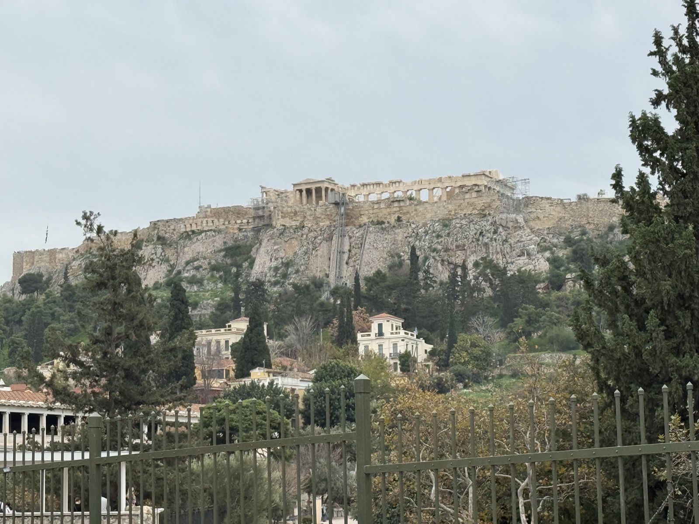
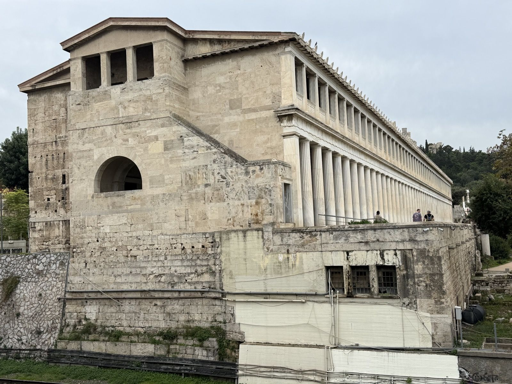
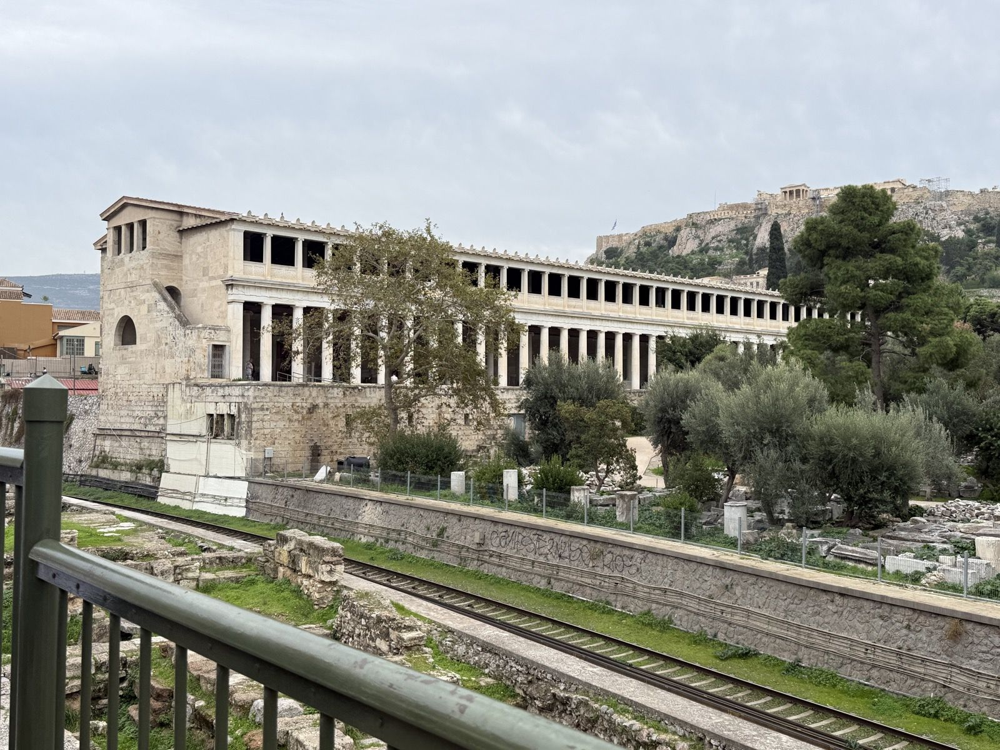
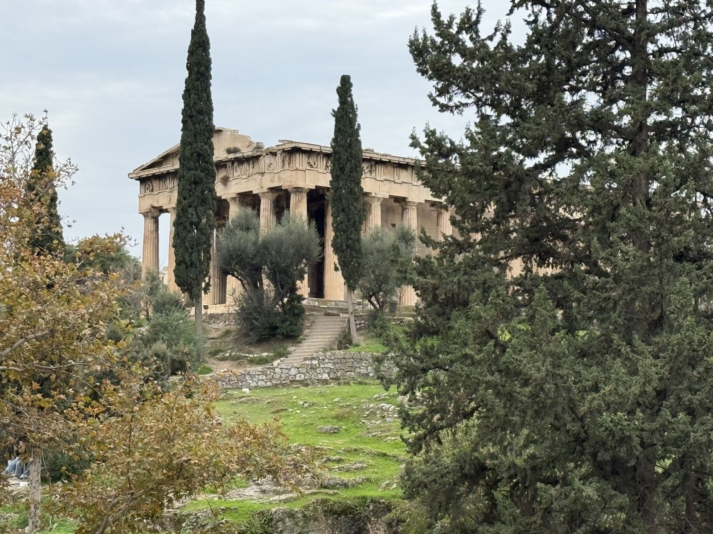
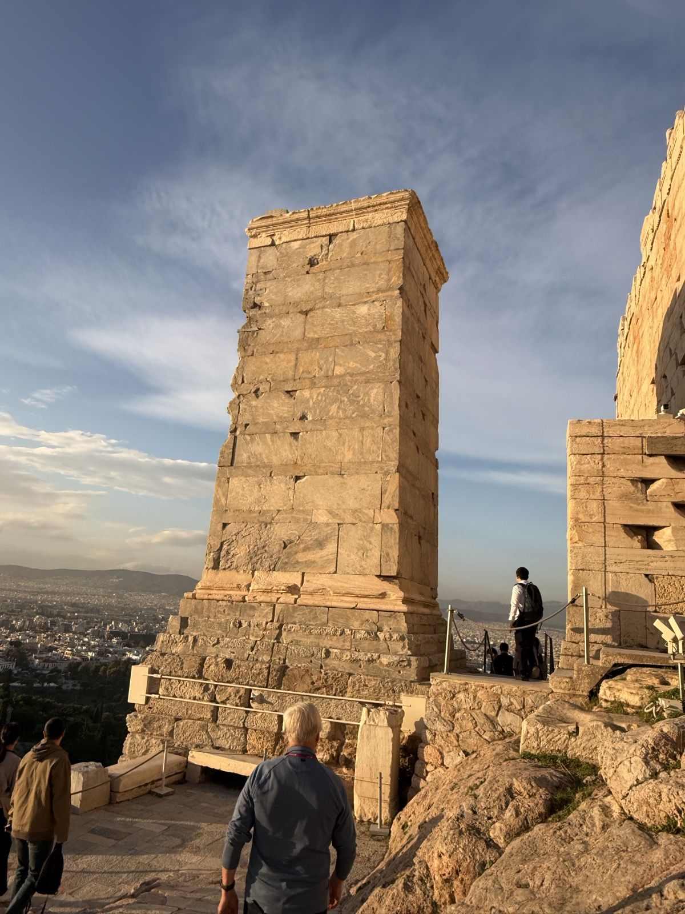

# Day 11: Athens, the Agora, Democracy, and Paul on the Areopagus

## Summary

Day 11 (Saturday, November 21) is our first day on our own in Athens. The chapter walks the Ancient Agora, the Stoa, and the Temple of Hephaestus, then explains Athenian democracy: the Pnyx, ostracism, citizenship, the Sophists, and the trial of Socrates. On the Areopagus it reads Paul's speech to the Athenians, his debt to the Stoics, and the altar 'to an unknown god,' and draws the leadership lesson of meeting people where they are. Evening food covers mezedes, ouzo, Greek wine, taverna culture, and the symposium. Its Learning for All notes ask who pays for learning and who Athenian democracy left out.

## Concepts Covered

This chapter covers the following 26 concepts from the learning graph:

| Concept | Concept Impact Score |
|---------|-----------------------|
| Ancient Agora of Athens | 13 |
| Stoa | 11 |
| Temple of Hephaestus | 1 |
| Athenian Democracy | 16 |
| Pnyx | 1 |
| Ostracism | 1 |
| Athenian Citizenship | 3 |
| Sophists | 2 |
| Trial of Socrates | 1 |
| Stoicism | 10 |
| Areopagus | 9 |
| Paul and the Stoics | 9 |
| Paul in Athens | 9 |
| Areopagus Speech | 8 |
| Altar to an Unknown God | 6 |
| Areopagus Bronze Plaque | 1 |
| Mezedes | 2 |
| Ouzo | 1 |
| Greek Wine | 2 |
| Taverna Culture | 1 |
| Symposium | 1 |
| Meeting People Where They Are | 5 |
| Stages of Concern | 1 |
| Who Pays for Learning | 1 |
| Who Democracy Left Out | 2 |
| Measuring Who Is Left Out | 1 |

## Prerequisites

This chapter builds on concepts from:

- [Chapter 1: Before We Go, Part 1: The Long Timeline of the Eastern Mediterranean](../01-long-timeline/index.md)
- [Chapter 2: Before We Go, Part 2: Traveling Well and the Learning for All Thread](../02-traveling-well/index.md)
- [Chapter 9: Paul at Ephesus, Part 1: The Apostle's Life, Letters, and Ephesian Years](../09-paul-life-letters/index.md)
- [Chapter 10: Day 7: Ephesus, a Greco-Roman City](../10-ephesus-greco-roman-city/index.md)
- [Chapter 11: Paul at Ephesus, Part 2: Ideas, Legacy, and Lessons in Leading Change](../11-paul-ideas-leadership/index.md)
- [Chapter 12: Day 8: Rhodes, From the Colossus to the Knights](../12-rhodes/index.md)
- [Chapter 15: Day 10: Athens, the Acropolis, and the Persian Wars](../15-athens-acropolis/index.md)

---

## A Saturday in the Marketplace of Ideas

Day 11, Saturday, November 21, is our first day on our own in Athens. We leave the Viking Star at Piraeus in the morning, drop our bags at the hotel, and walk down from the modern city into the square where the ancient one argued, voted, shopped, and went to court. Yesterday's chapter looked up at the Acropolis, the city's house of the gods. Today's walks the flat ground below it, the Agora, where the citizens of Athens invented a government run by ordinary men chosen by lot, where Socrates questioned anyone who would stop and talk, and where, about 450 years later, a traveling tentmaker named Paul argued every day with whoever happened to be there. Then we climb a low, slippery rock beside the Acropolis, the Areopagus, where Acts sets Paul's most famous speech to the Athenians.

This is the guide for the day as we planned it. In the end we walked the Ancient Agora on the afternoon of Day 10, around 1:00 PM, before we climbed the Acropolis, and the Areopagus rock sits right beside the path between the two. Either way, the order of the walk is the same, and so is the question that runs under it. Athens called itself a democracy, a city ruled by its people. Who counted as the people, who paid for their learning, and who was left outside?

!!! mascot-welcome "The Square Where Everyone Talked"
    { class="mascot-admonition-img" }
    Today we stand in the square where a potter could vote on war, a barefoot philosopher taught for free, and a visitor from Tarsus quoted the Athenians' own poets back to them. By tonight a heap of broken pottery will tell us how to exile a politician, and a rock beside the Acropolis will teach us how to talk to people who do not yet agree with us. Then we will end the day as Athenians always have, with small plates, a little ouzo, and a long argument. Look closer.

The chapter has six parts. Part One walks the Ancient Agora, its stoas, and the Temple of Hephaestus. Part Two explains Athenian democracy: the Pnyx, ostracism, citizenship, the Sophists, and the trial of Socrates. Part Three meets the Stoics, who took their name from a porch in the Agora. Part Four follows Paul to the Areopagus and reads his speech line by line. Part Five draws its leadership lesson, meeting people where they are. Part Six is the evening table, from mezedes to the ancient symposium.

## Part One: The Agora

### The Ancient Agora of Athens

The **Ancient Agora of Athens** is the open square northwest of the Acropolis that was the center of the city's public life for about a thousand years. Chapter 1 defined an *agora* as a city's marketplace, meeting ground, and civic center, and the Athenian Agora was all three at once. Around a large open space, crossed diagonally by the Panathenaic Way, the road the great procession took up to the Acropolis, stood the offices of the Council, the law courts, the city archives, temples, fountains, and long covered halls full of shops. Officials, jurors, shoppers, and philosophers all used the same square. In the 6th century BCE it was still a place of houses and graves; by the 5th it was the working heart of the democracy.

After the city's decline the square filled up with houses. In 1931 the American School of Classical Studies at Athens began excavating it, and hundreds of houses of a 19th-century neighborhood were demolished to uncover the site. The excavation is still going on. What we walk through is a park of foundations, two standing buildings, a small Byzantine church, the Holy Apostles, from about 1000 CE, and a great many olive and cypress trees.

<figure markdown="span" class="trip-photo">
  { loading=lazy }
  <figcaption>The Acropolis seen from the Agora. Photo by Dan McCreary</figcaption>
</figure>

**Worked example: reading the west side.** Let's walk the west side of the square from north to south, where the democracy kept its offices, and notice that most of what we see is a line of foundations. At the north end, beside the metro tracks, is the small **Royal Stoa**, the office of the official called the King Archon, who handled religious law; here charges of impiety were filed. Next comes the **Stoa of Zeus Eleutherios**, Zeus the Freedom-Giver, which ancient writers name as a favorite spot for Socrates' conversations. Then the **Metroon**, the city's archive, where copies of laws and decrees were stored, and behind it the **Bouleuterion**, the hall where the Council of 500 met. In front of them, on the open square, stood the **Monument of the Eponymous Heroes**, a long base carrying bronze statues of the ten heroes who gave their names to the ten tribes; notices of proposed laws, lawsuits, and call-ups for military service were posted on it, so this is where an Athenian read the news. At the south end is the round **Tholos** <audio id="audio-tholos" src="../../audio/tholos.mp3" preload="none"></audio><button onclick="document.getElementById('audio-tholos').play()" class="pronounce-btn">🔊 Pronounce</button> *THOH-los*, where the councillors on duty ate their meals at public expense. A few steps away, still in place, stands a marble boundary stone from about 500 BCE inscribed, in effect, "I am the boundary of the Agora." Six buildings and a monument along one side of the square did the work that a city hall, a records office, and a newspaper do today.

### The Stoa

A **stoa** is a long, roofed colonnade, open along its front and closed by a wall at the back, the all-purpose public building of the Greek city. Out of the summer sun and the winter rain, people shopped, met friends, did business, heard lawsuits, and argued about everything. The Agora had at least half a dozen. The **Painted Stoa**, the **Stoa Poikile** <audio id="audio-stoa-poikile" src="../../audio/stoa-poikile.mp3" preload="none"></audio><button onclick="document.getElementById('audio-stoa-poikile').play()" class="pronounce-btn">🔊 Pronounce</button> *STOH-uh POY-kih-lee*, on the north side, built in the 460s BCE, was hung with famous paintings of the Battle of Marathon, the fall of Troy, and the Athenians fighting the Amazons; its remains were found in 1981, north of the metro line, and can be seen from Adrianou Street. The **Stoa of Attalos**, on the east side, is the one we can walk into, because it has been rebuilt.

**Worked example: a king's gift, rebuilt by Americans.** Let's read the Stoa of Attalos as a document with three dates. *About 150 BCE:* King **Attalos II** of Pergamon, the Hellenistic kingdom on the coast of Anatolia north of Ephesus, paid for a two-story stoa about 115 m long, with Doric columns below and Ionic above, and 21 shops on each floor, 42 in all. He is said to have studied in Athens as a young man, so the building was a former student's thank-you to his school town, as well as a king's advertisement. *267 CE:* Germanic raiders called the Heruli sacked Athens; the stoa was burned and its ruins built into a defensive wall. *1953–1956:* the American School rebuilt it on its original foundations, using ancient pieces where they survived, as the museum and storerooms of the excavation. Chapter 1's era sorter used it as a trap: rebuilt in the 1950s, it is still a Hellenistic building in design. Inside, three objects explain the democracy better than any book, and Part Two meets them: an allotment machine for choosing jurors, bronze ballots, and a heap of potsherds with politicians' names scratched on them.

<figure markdown="span" class="trip-photo">
  { loading=lazy }
  <figcaption>The reconstructed Stoa of Attalos. Photo by Dan McCreary</figcaption>
</figure>

The rebuilt stoa also answers a question ruins cannot: what did these buildings feel like? Walk the length of the colonnade in the late afternoon, when the light comes in low between the columns, and the shade, the breeze, and the long view down the square explain at once why Athenians spent whole days here.

<figure markdown="span" class="trip-photo">
  { loading=lazy }
  <figcaption>The Stoa of Attalos with the Acropolis behind and the tracks of metro Line 1 in the foreground. Photo by Dan McCreary</figcaption>
</figure>

!!! mascot-tip "Start Indoors, Then Walk the Square"
    { class="mascot-admonition-img" }
    Here's a shortcut: go to the museum in the Stoa of Attalos first, and find the allotment machine, the ostraka, and the water clock. Then walk out onto the square, and the bare foundations will turn back into a working government, because we will know what happened in each one.

### The Temple of Hephaestus

The **Temple of Hephaestus** is the Doric temple on the low hill, the Kolonos Agoraios, above the west side of the Agora, and the best-preserved temple of the classical Greek world. It was begun around 449 BCE, about the time the Parthenon was planned, and finished decades later. It honored **Hephaestus**, god of fire and the forge, and Athena as patron of crafts, and it fittingly overlooked a district of bronze foundries and potters' workshops. It has the classic Doric plan of Chapter 10, 6 columns across the ends and 13 along the sides, and its sculpted metopes show the labors of Heracles and of the Athenian hero Theseus, which is why it was long misnamed the "Theseion." It survived almost whole because it became a Christian church, dedicated to St. George, and was used as one until 1834. Standing beside it, we see what a Doric temple looks like with its columns, entablature, and pediments still whole, as the Parthenon looked before 1687.

<figure markdown="span" class="trip-photo">
  { loading=lazy }
  <figcaption>The Temple of Hephaestus above the Ancient Agora. Photo by Dan McCreary</figcaption>
</figure>

## Part Two: Rule by the People

### Athenian Democracy

**Athenian democracy** was the system of government in which the adult male citizens of Athens made the city's decisions themselves, in person, from the reforms of Cleisthenes in 508 BCE until the Macedonians ended it in 322 BCE, with two brief oligarchic interruptions, in 411 and 404–403 BCE. It was direct, not representative: there was no parliament of elected members. Its main institutions were these.

- **The Assembly** (*ekklesia*): every adult male citizen could attend, speak, and vote, by show of hands, on laws, war, peace, and money. In the 4th century BCE it met about 40 times a year, on the Pnyx.
- **The Council of 500** (*boule*): 50 men from each of the ten tribes, aged 30 or over, chosen by lot for one year, no one more than twice in his life. It prepared the Assembly's agenda and ran the city day to day.
- **The courts**: each year 6,000 citizens over 30 were enrolled as jurors, and juries of hundreds, chosen by lot on the morning of the trial, decided cases by secret ballot.
- **Officials**: most were chosen by lot for a year. The main exception was the ten generals, elected because war needed skill, which is why Pericles could be elected year after year.

Two ideas held the system together. The first was the **lot**: if most offices are filled by drawing names, no one can buy an election, and any citizen might find himself governing. The second was **pay**. From about the 450s BCE jurors were paid a small daily wage, and from about 400 BCE so were citizens who came to the Assembly, so that a poor man could afford to leave his workshop for a day of governing.

**Worked example: why the rowers had a vote that counted.** Let's follow a promise from Chapter 15, which counted about 30,000 oarsmen in Athens's 180 ships at Salamis, many of them the poorest citizens. A hoplite, the armored infantryman, had to buy his own bronze armor and shield, so the old Greek idea was that power belonged to the men who could equip themselves to fight. Athens's power after 480 BCE came from its fleet, and the fleet was rowed by men who owned nothing but their arms and backs. An anonymous Athenian writer of the 5th century, hostile to democracy and nicknamed the "Old Oligarch," admitted the logic: it is just, he wrote in effect, that the poor and the common people have more power than the noble and rich, because it is the common people who row the ships and give the city its strength. The reforms that followed, Ephialtes' cut to the powers of the old Areopagus council in 462 BCE and pay for jurors in the 450s, moved power toward those rowers. A navy built from Themistocles' silver had made a democracy of oarsmen.

In the Stoa of Attalos museum we can see the machinery that made the lot work. A **kleroterion** <audio id="audio-kleroterion" src="../../audio/kleroterion.mp3" preload="none"></audio><button onclick="document.getElementById('audio-kleroterion').play()" class="pronounce-btn">🔊 Pronounce</button> *kleh-roh-TEER-ee-on* is a stone slab cut with rows of narrow slots. Each would-be juror pushed his bronze identity ticket into a slot; a magistrate then dropped black and white balls down a tube at the side, and each ball decided whether a whole row of men served that day or went home. Beside it are bronze ballots, a hollow-axled one for "guilty" and a solid one for "not guilty," and a water clock, two clay pots that timed a speaker by the water running from one to the other, about six minutes per filling.

| Institution | Who | How chosen | Where in Athens |
|---|---|---|---|
| Assembly | All adult male citizens | Anyone could attend | The Pnyx |
| Council of 500 | 50 from each tribe, aged 30+ | Lot, one year, at most twice in a life | The Bouleuterion, with the 50 on duty dining in the Tholos |
| Courts | Jurors aged 30+ from a pool of 6,000 | Lot, on the morning of each trial | Courts in and around the Agora |
| Officials | About 700 posts, mostly one-year | Lot, except elected generals and some financial officers | Offices around the Agora |

!!! mascot-thinking "A Government Chosen Like a Raffle"
    { class="mascot-admonition-img" }
    Notice what the Athenians did not trust: elections. To them, voting for officials favored the rich, the famous, and the good speakers, while the lot gave every citizen the same chance. Think of the kleroterion as their anti-corruption technology, and ask which of our own offices we would be willing to fill by drawing names.

### The Pnyx

The **Pnyx** is the rocky hill about half a kilometer southwest of the Agora where the Assembly of Athens met from about 500 BCE through the 4th century. Citizens sat on the sloping hillside facing a speaker's platform, the *bema*, cut from the living rock, which is still there. Behind the speaker, across the valley, rose the Acropolis. The meeting place was enlarged twice; in its first form it probably held about 6,000 people, the number required for certain votes, including ostracism, and in its largest form perhaps 10,000 or more. The herald opened debate with the question "Who wishes to speak?", and in principle any citizen could answer. Comedy shows the other side: in Aristophanes' *Acharnians*, public slaves sweep loiterers from the Agora toward the Pnyx with a rope dipped in red dye, so that latecomers would be marked. Today the Pnyx is a quiet, free, pine-shaded hill, much less visited than the Areopagus, with one of the best views of the Acropolis. Chapter 1 promised that we would return here to ask how many of the people living below it could actually vote; the estimator in "Athenian Citizenship" below does exactly that.

### Ostracism

**Ostracism** was the Athenian procedure for sending a leading politician into exile for ten years, without a trial and without any crime being charged. Once a year the Assembly voted on whether to hold one. If it said yes, citizens gathered in the Agora some weeks later and each scratched a name on an *ostrakon*, a broken piece of pottery, the scrap paper of the ancient world. If at least 6,000 votes were cast (ancient sources differ on whether that was the total or the count against one man), the man with the most votes had ten days to leave. He kept his property and his citizenship, and could come back after ten years. The first known ostracism was in 487 BCE and the last about 417 BCE. Its victims include Aristides, nicknamed "the Just," in 482 BCE, and Themistocles, the victor of Salamis, in the 470s, as Chapter 15 told.

**Worked example: the ostraka of Themistocles.** Let's read one find as evidence. Plutarch, writing about 600 years later, tells a story about Aristides: an illiterate countryman, not recognizing him, handed him his potsherd and asked him to write "Aristides" on it, because he was tired of hearing him called "the Just." Aristides wrote his own name. A story that late is a story. But archaeology found something like it. In a well on the north slope of the Acropolis, excavators found about 190 ostraka with Themistocles' name, written by only a few different hands, ready-made ballots apparently prepared to hand out to voters, and never used. Two things follow. Someone was organizing a campaign against Themistocles, and some voters needed a ballot already written, because they could not write the name themselves. A democracy that voted in writing quietly assumed a literacy that not every citizen had.

### Athenian Citizenship

**Athenian citizenship** was membership in the community of Athens, with the right to attend the Assembly, serve on the Council and juries, hold office, and own land in Attica. Political rights belonged only to adult men born into citizen families. From 451 BCE, by a law proposed by Pericles, a man was a citizen only if both his parents were Athenian. Women of citizen families were citizens in the sense that their sons could be, and they had important roles in religion, but they could not vote, speak in the Assembly, or serve on a jury. Two large groups of free and unfree people lived in Attica with no political rights at all.

- **Metics** (*metoikoi*, "those who live among") were free foreigners who settled in Athens. They paid a yearly residence tax, needed a citizen sponsor, served in the army and navy, and could not own land. Many were rich merchants and craftsmen. Aspasia of Miletus, whom Chapter 15 met as Pericles' partner, was a metic; so, later, was Aristotle.
- **Enslaved people** were owned as property, captured in war or bought in the slave markets of the Aegean. They worked in houses, workshops, farms, and, in the harshest conditions, the silver mines at Laurion whose ore paid for Themistocles' fleet.

How many people does that leave out? Nobody counted Athens's people as a modern census would, so every number is an estimate built from scattered evidence: military lists, grain imports, the size of the Pnyx. The table gives rounded ranges that cover most modern estimates for Attica around 431 BCE, at the start of the Peloponnesian War, and they agree with Chapter 1's estimate of a quarter of a million people or more.

| Group | Estimated number in Attica, c. 431 BCE | Could vote? |
|---|---|---|
| Adult male citizens | 30,000–50,000 | Yes |
| Citizens' wives, daughters, and young sons | 70,000–130,000 | No |
| Metics, of all ages | 20,000–40,000 | No |
| Enslaved people | 60,000–100,000 | No |

Taking the middle of every range, 40,000 voters out of 250,000 people is 16 percent, about one person in six. Taking the ranges seriously, the true share lies somewhere between about one in ten and one in four. The sim below lets us test those claims ourselves.

#### Diagram: Who Could Vote in Athens?

<iframe src="../../sims/athens-who-could-vote/main.html" height="584px" width="100%" scrolling="no"></iframe>

[Run the Who Could Vote in Athens? MicroSim Fullscreen](../../sims/athens-who-could-vote/main.html){ .md-button .md-button--primary }

Who Could Vote in Athens?

Type: chart
**sim-id:** athens-who-could-vote 
**Library:** Chart.js 
**Status:** Specified 
**Bloom Level:** Apply 
**Bloom Verb:** calculate 
**Learning Objective:** The learner will calculate the share of Attica's population that could vote around 431 BCE from estimated ranges for four groups, to within one percentage point, and identify the combination of estimates that gives the largest possible share.

**Prerequisites:** Athenian democracy, the Assembly, the Pnyx, Athenian citizenship, metics, enslaved people (all defined in Part Two above), and the idea of an estimate given as a range (section "Athenian Citizenship").

**Evidence of Mastery:** The learner answers three challenges by typing a percentage or by setting the four estimates and pressing Check. Challenge 1 is correct when the typed answer is within ±1.0 of 16.0. Challenge 2 is correct when the four settings produce a share of 25.0 percent (citizens 50,000; each other group at its minimum). Challenge 3 is correct when the typed answer is within ±0.2 of 2.4. Mastery is 3 of 3, each within two attempts. Moving the estimates freely is exploration, not evidence.

**Misconceptions:** (1) Most Athenians could vote, because Athens was a democracy. (2) "The people" meant all adults. (3) A range of estimates means the historians made a mistake, rather than that the evidence is thin. (4) A packed Assembly of 6,000 was a large share of the population.

**Instructional Rationale:** Calculating the voting share from the group estimates makes the learner see the excluded majority as numbers rather than a slogan. Pushing the estimates to their limits in challenge 2 shows that even the most generous reading leaves three in four people without a vote, which is the chapter's point about measuring who is left out.

**Content:**

Four adjustable estimates, each shown as a bar segment in one stacked bar for "Everyone in Attica, c. 431 BCE," with the voting group visually separated from the three non-voting groups and a label giving the voting share:

| Group | Min | Max | Step | Default | Unit | Could vote? |
|---|---|---|---|---|---|---|
| Adult male citizens | 30,000 | 50,000 | 5,000 | 40,000 | people | Yes |
| Citizens' wives, daughters, and young sons | 70,000 | 130,000 | 10,000 | 100,000 | people | No |
| Metics, of all ages | 20,000 | 40,000 | 5,000 | 30,000 | people | No |
| Enslaved people | 60,000 | 100,000 | 10,000 | 80,000 | people | No |

A second, smaller bar shows "A full Assembly on the Pnyx: 6,000" against the current total.

Permanent label on the chart: "Estimates. No ancient census survives; these rounded ranges cover most modern estimates."

Challenges, in this order:

| # | Challenge shown | Correct answer | Feedback when wrong |
|---|---|---|---|
| 1 | At the default estimates, what percent of everyone in Attica could vote? | 16.0 (accept 15.0 to 17.0) | Divide the voters by everyone: 40,000 ÷ (40,000 + 100,000 + 30,000 + 80,000) = 40,000 ÷ 250,000 = 0.16, or 16 percent. |
| 2 | Set the four estimates to give the largest share of voters the evidence allows. | Citizens 50,000; wives and children 70,000; metics 20,000; enslaved 60,000; share 25.0 percent | The share is largest when the voters are as many as possible and everyone else as few as possible: 50,000 ÷ 200,000 = 25 percent. |
| 3 | Back at the defaults, what percent of everyone in Attica sat in a full Assembly of 6,000? | 2.4 (accept 2.2 to 2.6) | 6,000 ÷ 250,000 = 0.024, or 2.4 percent: about one person in forty. |

**Provenance:** Group ranges and the 6,000 figure are from the section "Athenian Citizenship" and "The Pnyx" of this chapter; the ranges are the chapter's rounded summary of modern scholarly estimates and agree with Chapter 1, section "City-States," which gives 30,000 to 50,000 adult male citizens and a total of a quarter of a million or more. The sim labels all four values as estimates.

**Rules:**

- Total = citizens + wives and children + metics + enslaved, in people.
- Voting share (percent) = citizens ÷ total × 100, shown to one decimal place.
- Assembly share (percent) = 6,000 ÷ total × 100, shown to one decimal place.
- With these ranges the total runs from 180,000 to 320,000 people. The largest voting share is 50,000 ÷ (50,000 + 70,000 + 20,000 + 60,000) = 50,000 ÷ 200,000 = 25.0 percent, reached only with citizens at their maximum and the three other groups at their minimums. The smallest is 30,000 ÷ (30,000 + 130,000 + 40,000 + 100,000) = 30,000 ÷ 300,000 = 10.0 percent.
- Challenge 2 is checked from the settings, not from a typed number.

**Learner Activity:**

1. The learner sees the stacked bar at the default estimates, with the voting share hidden, and answers challenge 1.
2. After Check, the share label appears (16.0 percent) and the worked division is shown.
3. For challenge 2 the learner moves the four estimates and presses Check; the bar and both shares update as each estimate moves.
4. For challenge 3 the estimates return to their defaults, and the learner types the Assembly share.
5. After the three challenges, free exploration unlocks. The learner should notice that no combination of estimates gives voters more than a quarter of the population, and none gives them less than a tenth.

**Feedback:** Three challenges in fixed order, two attempts each. Correct: "Correct: [answer]." Incorrect: the "Feedback when wrong" text for that challenge. After a second wrong attempt the correct answer is shown, the estimates are set to it, and the challenge counts as missed. A running count "Challenges correct: n of 3" is shown. After challenge 3: "Even at its most generous, Athenian democracy gave a vote to one person in four."

**Starting State:** The stacked bar at the default estimates, the Assembly bar, the estimates label, and challenge 1 with an empty answer box, under the question "Athens was a democracy. How many of its people could vote?"

**Chapter Anchors:** Ranges 30,000–50,000; 70,000–130,000; 20,000–40,000; 60,000–100,000; defaults total 250,000; 16 percent, about one in six; between about one in ten and one in four; a full Assembly of about 6,000 (section "The Pnyx"). The 2.4 percent of challenge 3 is computed in the sim, not stated in the prose.

### The Sophists

The **Sophists** were traveling professional teachers of the 5th and 4th centuries BCE who taught young men, for a fee, the skills of public life, above all rhetoric, the art of speaking persuasively in the Assembly and the courts. The name comes from *sophos*, "wise," and at first simply meant an expert. Most were not Athenians: Protagoras came from Abdera in Thrace, Gorgias from Leontini in Sicily, Prodicus from the island of Ceos. They came to Athens because a democracy that decided everything by speeches was the best market in Greece for a teacher of speaking. Protagoras is remembered for the saying "Man is the measure of all things," and for teaching that every question has two sides that can be argued. Their critics, above all Plato, made "sophist" an insult: a man who sells cleverness and teaches how to make the weaker argument win. The fees were real, and the Learning for All note at the end of this chapter works out what they meant to a craftsman's family.

### The Trial of Socrates

The **trial of Socrates** was the prosecution in 399 BCE of the philosopher Chapter 9 introduced, on a charge of impiety, before a jury of about 500 citizens. The written charge said that he did not recognize the gods the city recognized, introduced new divine beings, and corrupted the young. Its main accusers were Meletus, a young poet; Anytus, a leading democratic politician; and Lycon, an orator. The charge was filed at the Royal Stoa, at the northwest corner of the Agora, where Plato sets his dialogue *Euthyphro*, with Socrates on his way to answer the indictment.

The timing explains much. Athens had lost the Peloponnesian War in 404 BCE, and a Spartan-backed junta, the Thirty Tyrants, had ruled by terror until democracy was restored in 403. Its leader, Critias, had been Socrates' companion, as had the brilliant traitor Alcibiades. An amnesty forbade prosecutions for what people had done under the Thirty, so a charge of impiety could carry an unspoken political one. In Plato's *Apology*, Socrates says that if only 30 votes had gone the other way he would have been acquitted, which suggests about 280 to 220. Invited to propose his own penalty, he first proposed free meals at public expense, the honor given to Olympic victors, and then a fine his friends would guarantee; a later writer, Diogenes Laertius, says even more jurors then voted for death. He drank hemlock in the state prison about a month later, after the sacred ship sent to Delos returned, since no execution could take place while it was away. Visitors on Philopappos Hill are shown a "Prison of Socrates" cut into the rock; that is a modern tradition with no ancient evidence. The prison may have been a building at the southwest corner of the Agora, where excavators found small clay bottles of a size that would suit a dose of poison, but that identification too is a suggestion, not a certainty.

!!! mascot-warning "The Democracy Did Not Kill Philosophy"
    { class="mascot-admonition-img" }
    A common trap is to read the trial as "democracy versus philosophy." Socrates had questioned Athenians in public for decades before 399 BCE, his students went on teaching in Athens, and the city became the philosophy capital of the Mediterranean for nine centuries afterward. Read the verdict as a frightened city, just out of war and tyranny, looking for someone to blame, and it makes more sense.

The sim below gathers the democracy's buildings in one place, so we can match each job of government to the building on the square where it was done.

#### Diagram: Democracy's Workplaces in the Agora

<iframe src="../../sims/agora-democracy-workplaces/main.html" height="450px" width="100%" scrolling="no"></iframe>

[Run the Democracy's Workplaces in the Agora MicroSim Fullscreen](../../sims/agora-democracy-workplaces/main.html){ .md-button .md-button--primary }

Democracy's Workplaces in the Agora

Type: infographic
**sim-id:** agora-democracy-workplaces 
**Library:** html 
**Status:** Specified 
**Bloom Level:** Understand 
**Bloom Verb:** classify 
**Learning Objective:** The learner will classify nine jobs of Athenian public life by the Agora building or monument where each was done, choosing correctly for at least 7 of 9 on the first attempt.

**Prerequisites:** Ancient Agora of Athens, stoa, Royal Stoa, Metroon, Bouleuterion, Tholos, Monument of the Eponymous Heroes, Stoa Poikile, Stoa of Attalos, Temple of Hephaestus, Council of 500, trial of Socrates (all defined in Parts One and Two above).

**Evidence of Mastery:** For each job card the learner selects one place on the plan before feedback. A choice is correct when it matches the Correct place column in Content. Mastery is 7 of 9 correct on the first attempt, including card 5 (the impiety charge), where the likely wrong answer is a law court. Clicking a place to read its description is exploration, not evidence.

**Misconceptions:** (1) The Agora was only a market (cards 1, 2, 3, 4). (2) Trials started in a courtroom, when charges of impiety were filed with the King Archon at the Royal Stoa (card 5). (3) Philosophy was taught in schools with buildings, when the Stoics met in a public stoa (card 7). (4) The Stoa of Attalos dates from Socrates' time, when it was built about 250 years later (card 8).

**Instructional Rationale:** Classifying jobs by building makes the learner reconstruct the Agora as a working system of government rather than a field of foundations. Showing the places on a schematic plan, by side of the square, ties each job to where it stands on our walk.

**Content:**

A schematic plan of the Agora, not to scale, showing the open square with the Panathenaic Way crossing it diagonally from the northwest corner to the southeast, and ten places, each with a short description revealed on click:

| Place | Position on the plan | Description revealed on click |
|---|---|---|
| Royal Stoa | West side, north end, beside the metro tracks | Office of the King Archon, who handled religious law. |
| Stoa of Zeus Eleutherios | West side, south of the Royal Stoa | A stoa to Zeus the Freedom-Giver; ancient writers name it as a favorite spot for Socrates' conversations. |
| Metroon | West side, middle | The city archive, where laws and decrees were stored. |
| Bouleuterion | Behind the Metroon, on the west side | The meeting hall of the Council of 500. |
| Monument of the Eponymous Heroes | On the open square, in front of the Metroon | Bronze statues of the ten tribal heroes; public notices were posted on its base. |
| Tholos | West side, south end | Round building where the 50 councillors on duty dined at public expense. |
| Boundary stone | Southwest corner | Marble stone of about 500 BCE: "I am the boundary of the Agora." |
| Stoa Poikile | North side, beyond the metro tracks | The Painted Stoa of the 460s BCE, with paintings of Marathon; Zeno taught here. |
| Stoa of Attalos | East side | Two-story stoa of 42 shops, a gift of Attalos II about 150 BCE; rebuilt 1953–1956 as the museum. |
| Temple of Hephaestus | On the low hill above the west side | Doric temple of Hephaestus and Athena, patrons of crafts, begun about 449 BCE. |

Job cards, in this order:

| # | Job card | Correct place | Reason shown after answering |
|---|---|---|---|
| 1 | Read a proposed new law, or check whether you have been called up for the army. | Monument of the Eponymous Heroes | Notices were posted on its base, where every citizen passed. |
| 2 | Prepare the agenda for the next Assembly. | Bouleuterion | The Council of 500 met here to prepare the Assembly's business. |
| 3 | Eat dinner at public expense as one of the 50 councillors on duty. | Tholos | The councillors on duty dined here, and some stayed overnight so the city always had a government awake. |
| 4 | Look up the exact wording of a decree passed years ago. | Metroon | It was the city's archive of laws and decrees. |
| 5 | File a charge of impiety, as Meletus did against Socrates. | Royal Stoa | Impiety was religious law, so the charge went to the King Archon's office before any trial. |
| 6 | Sit in the shade and talk with Socrates, as ancient writers describe. | Stoa of Zeus Eleutherios | Ancient writers name this stoa as a favorite spot for Socrates' conversations. |
| 7 | Hear Zeno teach beside the painting of Marathon. | Stoa Poikile | Zeno taught in the Painted Stoa, and his followers were named Stoics after it. |
| 8 | Buy goods in a shop given by a king of Pergamon who had studied in Athens. | Stoa of Attalos | Attalos II paid for its 42 shops about 150 BCE, two and a half centuries after Socrates. |
| 9 | Pray to the god of the forge above the bronze workshops. | Temple of Hephaestus | Hephaestus, with Athena, was the patron of the craftsmen around the Agora. |

The boundary stone has no job card; it is a place the learner can click but is never the answer.

**Provenance:** Places, positions, dates, and descriptions from Part One ("The Ancient Agora of Athens," "The Stoa," "The Temple of Hephaestus") and Part Two ("Athenian Democracy," "The Trial of Socrates") of this chapter. Positions are schematic (side of the square), not measured; the plan is labeled "Schematic plan, not to scale."

**Rules:** Each card is answered once for scoring. A first-attempt answer is correct if and only if it equals the Correct place. Score is 0 to 9. Mastery is score >= 7 with card 5 correct. Every place, including the boundary stone, can be selected for every card.

**Learner Activity:**

1. The learner sees the plan with all ten places labeled and may click any place to read its description.
2. Card 1 appears. The learner selects the place where that job was done.
3. Feedback appears, and the card is pinned beside its correct place on the plan.
4. The learner continues through card 9.
5. At the end, the plan shows all nine jobs pinned. The learner should notice that six of the nine jobs cluster along the west side, the democracy's "street of offices."

**Feedback:** After each first attempt: correct shows "Correct" and the reason; incorrect shows "This job belonged to the [correct place]: [reason]." After card 9: if mastery is met, "You can read the Agora as a working government."; otherwise, "Walk the west side again: archive, council, dining hall, notice board, and the King Archon's office." A Try Again option repeats all nine cards.

**Starting State:** The labeled plan, no cards pinned, and card 1 with the question "Where in the Agora would you go to do this?"

**Chapter Anchors:** Ten places; nine job cards; Council of 500; 50 councillors on duty; boundary stone of about 500 BCE; Stoa Poikile of the 460s BCE; Stoa of Attalos about 150 BCE with 42 shops, rebuilt 1953–1956; Temple of Hephaestus begun about 449 BCE; mastery 7 of 9.

## Part Three: The Painted Porch

### Stoicism

**Stoicism** is the school of philosophy founded in Athens around 300 BCE by Zeno of Citium, a merchant from Cyprus who, the story goes, lost his cargo in a shipwreck, wandered into a bookshop in Athens, and found philosophy. Zeno taught in the Painted Stoa, and his followers were named after the building: the Stoics, "the porch people." His successors Cleanthes and Chrysippus built the school's system. Three of its ideas matter for us today.

1. **The world is ordered by reason.** The Stoics called the rational, divine force running through everything the *logos*, and sometimes Zeus or simply god. To live well is to live "in agreement with nature," that is, with reason.
2. **Virtue is the only good.** Wisdom, justice, courage, and self-control are good; health, wealth, and reputation are "indifferent," pleasant to have but not what makes a life good. Our distress comes less from events than from our judgments about them.
3. **All humans are one community.** Every person shares in reason, so every person, Greek or barbarian, free or enslaved, is a citizen of one world, a *kosmopolitēs*, the word that gives us "cosmopolitan."

Their great rivals were the **Epicureans**, who met in Epicurus' Garden (Chapter 9). Epicureans taught that the gods exist but take no interest in us, that the world is made of atoms moving by chance, and that the good life is a calm one, free of pain and fear, especially the fear of death and of divine punishment. A Stoic saw the divine everywhere, guiding the world; an Epicurean saw gods far away, minding their own business. Both schools were in the Agora when Paul arrived, and the table sets them side by side.

| Question | Stoics | Epicureans |
|---|---|---|
| Where they met | The Painted Stoa, in the Agora | Epicurus' Garden |
| The gods | One divine reason runs through everything and guides it | The gods exist, far away, and take no interest in us |
| How the world works | Ordered by reason and providence | Atoms moving by chance |
| The good life | Virtue, living in agreement with reason | A calm life, free of pain and fear |
| Death and the end | The soul may outlast the body for a time; the cosmos ends in fire and begins again | Death is nothing to us; the soul's atoms simply scatter |

In Paul's century Stoicism was the most popular philosophy among educated Romans, and its three most-read writers lived in the Roman era. Seneca (about 4 BCE to 65 CE) was the emperor Nero's tutor and adviser. **Epictetus** <audio id="audio-epictetus" src="../../audio/epictetus.mp3" preload="none"></audio><button onclick="document.getElementById('audio-epictetus').play()" class="pronounce-btn">🔊 Pronounce</button> *ep-ik-TEE-tus* (about 50 to 135 CE) was born enslaved at Hierapolis in Anatolia and taught in Greece after he was freed. Marcus Aurelius (121–180 CE) was emperor and wrote his private *Meditations* in Greek.

**Worked example: a Stoic on a strike day.** Let's test Epictetus' most famous rule on a day like ours. His handbook opens by dividing everything into what is up to us, our own judgments, choices, and efforts, and what is not, our body, property, reputation, and everything else that others or chance control. Suppose we reach the Agora gate this morning and find it closed for a strike, which happens in Greece a few times a year. The closure is not up to us. Our judgment that the day is ruined, and what we do next, are. A Stoic does not pretend to like the closure; he moves his energy to what he controls: the Areopagus and the Pnyx are free and open, the Stoa Poikile can be seen from the street, and the Agora can wait until Day 13. Epictetus also said that people are disturbed not by things but by their opinions about things, an idea modern cognitive behavioral therapy openly credits as one of its sources. Two thousand years later, the porch in the Agora is still teaching.

## Part Four: Paul on the Areopagus

### Paul in Athens

**Paul in Athens** is the short visit, around 50 CE, that Acts 17:15–34 describes on Paul's second journey, after he had been driven out of Thessalonica and Berea in Macedonia. As Chapter 9 explained, Acts is Luke's account, written a generation later, and Paul's own letters mention Athens only once, saying that he stayed there alone while he sent Timothy back north. The Athens he walked into was the university town of Chapter 9: no longer powerful, governed under Rome, and proud of its philosophers.

The city had learned to flatter its Roman patrons. Anyone climbing to the Acropolis in Paul's day passed a tall pedestal on its west approach, about 8.9 m high, built in the 2nd century BCE, probably for a bronze chariot honoring a king of Pergamon; after about 27 BCE the Athenians topped it with a new chariot honoring Marcus Agrippa, Augustus' right-hand man, as "their own benefactor." Agrippa had also given the city a covered concert hall, the Odeon, set in the middle of the Agora itself.

<figure markdown="span" class="trip-photo">
  { loading=lazy }
  <figcaption>The pedestal of the Monument of Agrippa below the Propylaea, in late-afternoon light. Photo by Dan McCreary</figcaption>
</figure>

**Worked example: reading Acts 17 with Agora eyes.** Let's read Luke's opening scene with what Part One and Part Two have taught us, and see how much of it is set in the square we just walked. Acts says Paul was deeply disturbed to see the city full of idols, the statues of gods and heroes that crowded every street. He argued in the synagogue with Jews and God-fearing Gentiles, and in the agora every day with whoever happened to be there: the Socratic habit, in Socrates' own square. Some Epicurean and Stoic philosophers debated with him. Some called him a *spermologos*, a "seed-picker," Athenian slang for a bird pecking up scraps, and so for a man who picks up scraps of learning and repeats them. Others said he seemed to be "a proclaimer of foreign divinities," because he spoke about Jesus and the resurrection; some scholars think the listeners heard *Anastasis*, "Resurrection," as the name of a goddess paired with Jesus. Then they took him to the Areopagus and asked to hear his new teaching, and Luke adds a dry aside that the Athenians and visitors there spent their time on nothing but telling or hearing something new.

!!! mascot-thinking "Paul Cast as a Second Socrates"
    { class="mascot-admonition-img" }
    Notice the echo. Socrates was charged with introducing new divine beings, and here the Athenians say Paul seems to proclaim foreign divinities, in the same square, before the same kind of audience. Luke's educated readers would have heard it at once: Paul as a new Socrates, questioning Athens in its own marketplace.

### The Areopagus

The **Areopagus**, the "Hill of Ares," is a bare outcrop of rock just northwest of the Acropolis, between the Acropolis entrance and the Agora, and also the name of the ancient council that met there. The council was the oldest in Athens, made up of former chief magistrates who served for life. It tried cases of homicide on the hill, and in myth it was founded by Athena herself for the trial of Orestes, the story Aeschylus put on stage in the *Eumenides* in 458 BCE. In 462 BCE Ephialtes stripped it of most of its political powers, leaving it its homicide court and some religious duties. Under Rome it regained prestige and became one of the most important governing bodies in the city.

That double meaning makes Acts ambiguous. When Luke says the Athenians brought Paul "to the Areopagus" and that Paul stood "in the middle of the Areopagus," he may mean the hill, or he may mean the council, which in Paul's day probably met down in the Agora, perhaps at the Royal Stoa. Scholars still debate whether the scene was an informal speech on the rock or a hearing before the council, which may have had some say over new teachers lecturing in the city. Luke gives one clue: among those who joined Paul was "Dionysius the Areopagite," a member of the council.

**Worked example: on the hill or before the council?** Let's weigh the evidence as Chapter 4 taught, claim by claim.

| Claim | Evidence for | Evidence against | Verdict |
|---|---|---|---|
| Paul spoke on the hill itself | Luke names the Areopagus; the rock looks at the temples Paul mentions | By Paul's day the council probably no longer met on the hill | Possible, and the tradition the plaque follows |
| Paul spoke before the council | "In the middle of the Areopagus" reads naturally as a body of people; a councillor joins him | Luke describes no charge, vote, or verdict | Possible; many scholars prefer it |
| It was a trial like Socrates' | The echo of "foreign divinities" | No accusers, no penalty; Paul leaves freely | Unlikely; a hearing or an inquiry at most |

The modern visitor's Areopagus is the hill, and it is worth the climb either way. From its flat top the Agora lies spread out below, the Temple of Hephaestus faces us across it, and the Propylaea rises just behind. When Paul said that God does not live in shrines made by human hands, his listeners had some of the most famous shrines in the world in view.

!!! mascot-warning "The Polished Rock Is Slippery"
    { class="mascot-admonition-img" }
    The old steps cut into the Areopagus, and the rock on top, have been polished smooth by centuries of feet, and they are treacherous when wet or dusty. Use the modern metal staircase beside the old steps, wear shoes with grip, and keep well back from the edges, which have no railings.

### Paul and the Stoics

**Paul and the Stoics** names the overlap, and the disagreement, between Paul's thought and the most popular philosophy of his day. Paul grew up in Tarsus, which the geographer Strabo praised for its schools, and which produced several Stoic teachers, among them Athenodorus, a tutor of the emperor Augustus. Whether or not Paul ever studied philosophy, he wrote in a Greek full of the Stoic vocabulary that educated people used. His letters use *syneidēsis*, "conscience"; speak of Gentiles who do by nature what the law requires; call the community a body with many parts, a picture the Stoics also loved; and say that he has learned to be *autarkēs*, "content" or self-sufficient, in any circumstance, a key Stoic word.

There is a family link too. In Corinth, just after Athens, Acts brings Paul before the proconsul Gallio, whose year in office the inscription at Delphi dates, as Chapter 9 told. Gallio was the elder brother of Seneca, the Stoic. Seneca wrote to a friend that God is near you, with you, within you, a sentence that sounds very like Paul in Athens. Later Christians liked the resemblance so much that by the 4th century a set of letters between Paul and Seneca was circulating; scholars agree it is a forgery.

The table sets the overlaps beside the breaks.

| Idea | Stoics | Paul |
|---|---|---|
| God and the world | The divine reason pervades the world and is in a sense the world | God made the world and is distinct from it |
| Humanity | One human community, all sharing in reason | One human family from one ancestor, and in Christ "neither Jew nor Greek" (Chapter 11) |
| Images and temples | Zeno taught that temples were unnecessary | God does not live in shrines made by hands |
| What is good | Virtue alone, achieved by reason | Love above all, and a right standing with God received by grace through faith (Chapter 11) |
| The future | The cosmos ends in fire and begins again, endlessly | One day of judgment, and the resurrection of the dead |

**Worked example: contentment, two ways.** Let's compare one idea in both voices. Epictetus would say that a wise person is content because he wants only what is up to him, his own judgments, so nothing outside can take his peace. Paul writes to the Philippians, from prison, that he has learned to be content with little or with plenty, using the Stoic word, but then gives a different reason: he can do all things through the one who strengthens him. The word is the same, the circumstances similar, and the source of strength opposite: inside the self for the Stoic, outside it for Paul. That pattern, borrowed vocabulary carrying a new meaning, is exactly what we will hear on the Areopagus.

### The Areopagus Speech

The **Areopagus speech** is the address to the Athenians that Acts 17:22–31 gives Paul, the longest example in Acts of his preaching to an audience with no Jewish background. It takes about two minutes to read aloud. Ancient historians, as Thucydides openly said of his own work, often composed speeches to give the sense of what was said rather than a transcript, and most scholars think Luke wrote this one in his own style. Its themes still match what Paul's letters say he told Gentiles: to turn from idols to the living God and to wait for the one God raised from the dead.

**Worked example: the speech in five moves.** Let's follow its structure, which is a lesson in persuasion.

1. **A compliment and a hook.** "I see that in every way you are very religious," he begins; the Greek word can also mean superstitious, a clever ambiguity. Then the hook: he has seen an altar to an unknown god, and what they worship as unknown, he will make known.
2. **Common ground.** The God who made the world does not live in shrines made by hands, needs nothing from human hands, and made all nations from one ancestor so that they would seek him, though he is not far from any of us.
3. **Their own poets.** "In him we live and move and have our being," and, "as even some of your own poets have said," "for we too are his offspring."
4. **The turn.** If we are God's offspring, the divine cannot be like an image of gold, silver, or stone. The times of ignorance God overlooked; now he calls everyone everywhere to repent.
5. **The new claim.** God has fixed a day to judge the world by a man he has appointed, and has given proof by raising him from the dead.

Notice what is missing. In the synagogue speeches of Acts, Paul argues from the Hebrew scriptures by name. Here he quotes not one verse, only Greek poets, though nearly every idea in moves 2 and 4 also comes from those scriptures. And notice where it ends. Acts says that at the mention of the resurrection some scoffed, others said they would hear him again on the subject, and a few joined him, including Dionysius the Areopagite and a woman named Damaris. Then Paul left for Corinth.

The second quotation is from **Aratus** <audio id="audio-aratus" src="../../audio/aratus.mp3" preload="none"></audio><button onclick="document.getElementById('audio-aratus').play()" class="pronounce-btn">🔊 Pronounce</button> *uh-RAY-tus* of Soli, a poet from Cilicia, Paul's own home region, whose astronomical poem *Phaenomena*, written in the 3rd century BCE under Stoic influence, opens with a hymn to Zeus containing those very words. The first is attributed by later Christian writers to the Cretan poet Epimenides, but that attribution is uncertain.

The sim below lets us test where each line of the speech stands with a Stoic listener, before Luke tells us how they reacted.

#### Diagram: Paul's Speech Through Stoic Ears

<iframe src="../../sims/areopagus-speech-stoic-ears/main.html" height="450px" width="100%" scrolling="no"></iframe>

[Run the Paul's Speech Through Stoic Ears MicroSim Fullscreen](../../sims/areopagus-speech-stoic-ears/main.html){ .md-button .md-button--primary }

Paul's Speech Through Stoic Ears

Type: microsim
**sim-id:** areopagus-speech-stoic-ears 
**Library:** p5.js 
**Status:** Specified 
**Bloom Level:** Analyze 
**Bloom Verb:** differentiate 
**Learning Objective:** The learner will differentiate the lines of Paul's Areopagus speech that build on what Stoic listeners already believed from the lines that ask them to accept something new, judging at least 8 of 10 lines correctly on the first attempt.

**Prerequisites:** Stoicism, Epicureans, Paul in Athens, the Areopagus, Paul and the Stoics, the Areopagus speech and its five moves, Aratus (all defined in Parts Three and Four above).

**Evidence of Mastery:** For each line, in speech order, the learner predicts "Common ground" or "Something new" before the answer is revealed. A prediction is correct when it matches the Answer column in Content. Mastery is 8 of 10 correct on the first attempt, including lines 9 and 10. Reading the Stoic background notes after a reveal is exploration, not evidence.

**Misconceptions:** (1) Paul dropped his own message to please philosophers (lines 8 to 10 show he did not). (2) Every idea in the speech was new to Greeks (lines 2 to 7 show otherwise). (3) "We are his offspring" comes from the Hebrew Bible (line 6: it is Aratus). (4) The Athenians rejected the speech as a whole, when Acts says they reacted at the resurrection (final reveal).

**Instructional Rationale:** Differentiating common ground from new claims line by line makes the learner analyze the speech's structure rather than its message, and predicting before each reveal makes the learner commit to a reading of Stoic belief. The final reveal of the audience's reaction lets the learner check the analysis against Luke's account.

**Content:**

Ten lines, paraphrased from Acts 17:22–31, shown one at a time in this order:

| # | Line shown (paraphrase) | Reference | Answer | Stoic background shown after the reveal |
|---|---|---|---|---|
| 1 | "I see that in every way you are very religious." | 17:22 | Common ground | Stoics respected piety and treated the city's gods as names for the one divine reason. |
| 2 | God does not live in shrines made by human hands. | 17:24 | Common ground | Zeno taught that temples were unnecessary, since no work of builders is worthy of the gods. |
| 3 | God is not served by human hands, as though he needed anything. | 17:25 | Common ground | Stoics, and Epicureans too, held that the divine needs nothing from people. |
| 4 | From one ancestor God made every nation of humankind. | 17:26 | Common ground | The Stoics taught that all people form one community, citizens of one world. |
| 5 | God is not far from each one of us. | 17:27 | Common ground | For a Stoic the divine reason runs through everything; Seneca wrote that God is near you, with you, within you. |
| 6 | "For we too are his offspring." | 17:28 | Common ground | A line from Aratus' *Phaenomena*, a poem written under Stoic influence; Cleanthes' hymn to Zeus says much the same. |
| 7 | The divine is not like an image of gold, silver, or stone shaped by human skill. | 17:29 | Common ground | Stoic teachers criticized the worship of images as unworthy of the divine. |
| 8 | God now commands all people everywhere to repent, turning from the times of ignorance. | 17:30 | Something new | Stoics saw wisdom as each person's long work of reason, not a response to a command from a personal God. |
| 9 | God has fixed a day on which he will judge the world by a man he has appointed. | 17:31 | Something new | Stoics expected the world to end in fire and begin again in endless cycles, with no single day of judgment. |
| 10 | God has given proof of this by raising that man from the dead. | 17:31 | Something new | Greek philosophers might accept a surviving soul, but not a dead body raised to life. |

Tally: Common ground 7, Something new 3.

Final reveal after line 10 (Acts 17:32–34, paraphrased): "When they heard about the resurrection, some scoffed. Others said, 'We will hear you again about this.' A few joined Paul, among them Dionysius, a member of the Areopagus council, and a woman named Damaris."

**Provenance:** Lines paraphrased from Acts 17:22–31 (any modern translation; no translation is quoted beyond the short phrases given in the chapter). Stoic background from the chapter sections "Stoicism" and "Paul and the Stoics"; Zeno on temples (reported by Plutarch), Seneca's Letter 41, Aratus' *Phaenomena* line 5, and Cleanthes' *Hymn to Zeus*. The answers are this chapter's reading of the speech, and the sim says so: "Answers follow the usual scholarly reading; Stoics were not all alike."

**Rules:** Lines appear in the order listed. Each line is answered once for scoring. A first-attempt prediction is correct if and only if it equals the Answer. Score is 0 to 10. Mastery is score >= 8 with lines 9 and 10 both correct. The running tally of Common ground and Something new answers is shown only after each reveal.

**Learner Activity:**

1. The learner reads line 1 and predicts "Common ground" or "Something new."
2. The answer and the Stoic background appear, and the line is placed on a strip running from the start of the speech to its end, marked by its answer.
3. The learner continues through line 10.
4. After line 10, the final reveal shows the audience's reaction beside the strip.
5. The learner should notice that the first seven lines build on Stoic ground and the speech breaks with it only in its last three lines, and that Acts records the scoffing exactly at the break.

**Feedback:** After each first attempt: correct shows "Correct" and the Stoic background; incorrect shows "A Stoic would have heard this as [answer]: [Stoic background]." After line 10: if mastery is met, "You can see the bridge Paul built, and where he asked his listeners to cross it."; otherwise, "Look again at lines 8 to 10: which of them could a Stoic have said?" A Try Again option repeats all ten lines.

**Starting State:** The empty strip labeled "Beginning of the speech" and "End of the speech," and line 1, with the question "Would a Stoic listener already agree with this, or is it something new?"

**Chapter Anchors:** Acts 17:22–31; five moves; quotations from Aratus' *Phaenomena* and, by later attribution, Epimenides; Dionysius the Areopagite and Damaris; ten lines, tally 7 and 3; mastery 8 of 10.

### The Altar to an Unknown God

The **altar to an unknown god** is the inscription Paul says he found while walking through Athens, "To an unknown god," which he uses as the hook for his whole speech. No altar with exactly that wording has been found in Athens, but there is good evidence for something close. The Greeks feared offending a god they had failed to name, and they sometimes dedicated altars to gods in general or to gods whose names were not known.

**Worked example: testing Luke's altar.** Let's apply Chapter 4's test: earliest source, gap, and what the evidence actually says.

| Source | Date | What it says |
|---|---|---|
| Acts 17:23 | About 80–90 CE | Paul sees an altar inscribed "To an unknown god," in the singular |
| Pausanias, *Description of Greece* | About 150–175 CE | At Phaleron, Athens's old harbor, there are "altars of gods called Unknown," in the plural |
| Philostratus, *Life of Apollonius* | Early 3rd century CE | Athenians set up altars even to unknown gods, plural |
| Diogenes Laertius, on the Cretan seer Epimenides | 3rd century CE | During a plague, Epimenides had sheep released from the Areopagus and sacrificed "to the appropriate god" where each lay down; nameless altars could still be found around Attica |
| Jerome, commenting on Paul's letter to Titus | About 387 CE | The inscription really named unknown and foreign gods in the plural; Paul quoted it in the singular to suit his argument |

So altars to unknown gods in Athens are well attested by independent writers. The singular form is attested only by Acts. Either Paul or Luke saw a singular dedication we have lost, or, as Jerome thought, the plural was turned into a singular, which is just what a speaker pointing to one God would do. Either way, the move is the same: start with something the listeners built themselves.

### The Areopagus Bronze Plaque

The **Areopagus bronze plaque** is the large bronze tablet set into the rock at the foot of the Areopagus steps, engraved with the text of Paul's speech in the original Greek of Acts 17:22–31, in capital letters. It is easy to miss on the way up and worth stopping for. Greek visitors, including school groups and pilgrims, can read it in a form of their own language nineteen centuries old; with the letters from Chapter 2 we can at least sound out the opening words, ΑΝΔΡΕΣ ΑΘΗΝΑΙΟΙ, *andres Athenaioi*, "Men of Athens." Paul's visit is also remembered on the calendar: around the feast of Saints Peter and Paul, June 29, the Church of Greece holds an annual service at the foot of the hill.

## Part Five: Meeting People Where They Are

### Meeting People Where They Are

**Meeting people where they are** is the practice of starting from what an audience already knows, values, and worries about, and building from there toward something new, rather than starting from what the speaker knows. On the Areopagus, Paul started from an altar the Athenians had built, ideas their philosophers taught, and lines their poets wrote. He described the same practice in his own words in 1 Corinthians, saying that to the Jews he became as a Jew and to those outside the law as one outside the law, that he had become all things to all people, so that he might win some.

Two cautions keep the lesson honest.

- **It does not mean leaving people where they are.** Paul's speech ends with the claim his audience found hardest to accept, and some laughed.
- **It does not guarantee success.** Acts records only a few converts in Athens, and no community there appears in Paul's letters.

Soon afterward Paul wrote to the Corinthians that he had come to them not with lofty words or wisdom but only with Christ crucified; some readers think Athens taught him to change his approach, while many scholars think Luke's speech and Paul's letter simply describe different occasions. The record does not settle it.

**Worked example: one change, three conversations.** Let's apply the Areopagus pattern to a school introducing an AI tutor for math practice. A principal could give the same speech to everyone, about test scores and the future. Paul's method suggests starting from three different altars.

- **To a veteran teacher worried about her job:** start from what she already values, her knowledge of each student, and show how the tutor gives her more time for exactly that, before saying anything about scores.
- **To a parent worried about screens:** start from the parent's own wish that their child get help at home in the evening, and show the limits on screen time first.
- **To a student who finds math boring:** start from the game or puzzle the student already likes, and let the tutor's first task look like it.

The new claim, that the school is changing how math is taught, is the same in all three. Only the starting point moves. And as on the Areopagus, some will still say no.

### Stages of Concern

The **stages of concern** are the seven kinds of concern people typically move through when they meet an innovation, part of the Concerns-Based Adoption Model developed by Gene Hall, Shirley Hord, and colleagues at the University of Texas from the 1970s to study how teachers take up new practices. The model turns "meet people where they are" into something a leader can diagnose. People's concerns tend to move from themselves, to the task, to the impact on others, and a leader helps most by answering the concern a person actually holds, not the one the leader wishes they had.

| Stage | Name | Typical question |
|---|---|---|
| 0 | Awareness | "I'm not thinking about this." |
| 1 | Informational | "What is it, exactly?" |
| 2 | Personal | "What will it mean for me?" |
| 3 | Management | "How do I fit it into my day?" |
| 4 | Consequence | "Is it helping students?" |
| 5 | Collaboration | "How can we do this better together?" |
| 6 | Refocusing | "Is there something even better?" |

Read Acts 17 this way, and Paul's Athenian audience sat mostly at stages 0 and 1: curious about "this new teaching," with no personal stake yet. His speech answered an informational concern with information about God, in their own terms. The companion textbook *AI-Native Schools* makes the matching explicit in [Microstrategies for Leading Change](https://dmccreary.github.io/ai-native-schools/chapters/19-microstrategies-leading-change/), whose section on matching the strategy to the person pairs each stage of concern with a concrete move: a classroom visit for "What does it look like?", a smaller first step for "Will I be able to do this?", coaching for "How do I fit it in?" It is the Areopagus method made into a checklist, and it adds what Paul's speech could not: listening first, so that we know which altar to start from.

!!! mascot-tip "Ask Before You Explain"
    { class="mascot-admonition-img" }
    Here's a diagnostic question to use the next time you introduce anything new, from a travel plan to a classroom tool: "What's your biggest question about this?" The answer tells you which stage of concern you are talking to, and which altar to start from.

## Part Six: The Evening Table

### Mezedes

**Mezedes** (singular *meze*) are the Greek small plates, the same tradition as the Turkish meze of Chapter 6, and the natural food of a long evening. A Greek table orders several to share, usually with ouzo or wine, and keeps ordering as the talk goes on. Many of the names will be familiar from Istanbul and from Chapter 15's eggplant lunch, but a few are distinctly Greek: *tirokafteri*, a spicy whipped feta dip; *saganaki*, a slab of cheese fried until crusted; *taramosalata*, a pink dip of fish roe; *gigantes*, giant white beans baked in tomato; grilled octopus; and *fava*. Here is a case of one word, two dishes: Turkish *fava* is a purée of broad beans, while Greek *fava* is a purée of yellow split peas, the most famous from Santorini. A restaurant that specializes in small plates is a *mezedopoleio*.

### Ouzo

**Ouzo** is Greece's anise-flavored spirit, the cousin of Turkish rakı (Chapter 6); Cretan tsikoudia (Chapter 14) is the same kind of grape spirit without the anise. It is made from a distilled spirit flavored with aniseed and often other spices such as fennel or mastic, and bottled at about 40 percent alcohol. Like rakı, it turns milky white when water or ice is added, because the oils of the anise come out of solution. It has protected status in the European Union, so only spirit made in Greece or Cyprus may be sold as ouzo, and the island of Lesbos, around the town of Plomari, is the most famous source. Ouzo is not a cocktail or a shot: it is sipped slowly, with water and mezedes, in an *ouzeri*, a place built for exactly that. The toast is *Yamas!*, "to our health."

### Greek Wine

**Greek wine** is one of the oldest wine traditions in the world, and in the last thirty years one of the most improved. The ancient Greeks traded wine across the Mediterranean in clay amphoras, and they drank it, as the symposium below shows, mixed with water. Today Greece grows hundreds of native grape varieties, and four names will carry us through any Athenian wine list. For a white, Assyrtiko, first made famous on Santorini; for a soft red, Agiorgitiko <audio id="audio-agiorgitiko" src="../../audio/agiorgitiko.mp3" preload="none"></audio><button onclick="document.getElementById('audio-agiorgitiko').play()" class="pronounce-btn">🔊 Pronounce</button> *ah-yor-YEE-tee-koh* from Nemea, or the firmer Xinomavro from Naoussa in the north; and, as an experiment, retsina. The table summarizes them.

| Wine | Color | Region | What to expect |
|---|---|---|---|
| Assyrtiko | White | Santorini, now grown widely | Dry, mineral, high acidity; a fine match for fish |
| Agiorgitiko | Red | Nemea, in the Peloponnese | Soft, fruity, easy with grilled meat |
| Xinomavro | Red | Naoussa, in Macedonia | Firm and tannic, often compared to Italian Nebbiolo |
| Retsina | White | Attica, from Savatiano grapes | Flavored with pine resin; an acquired taste, cheap and cold |

Retsina is the one with a story. The usual explanation is that ancient potters sealed amphoras with pine resin, which flavored the wine, and Greeks kept the flavor long after the jars were gone. A modest carafe of house wine, *hima*, sold by the quarter, half, or full liter, is the usual taverna choice and usually perfectly good.

### Taverna Culture

**Taverna culture** is the Greek way of eating out: a simple, family-run restaurant, plain tables, a paper tablecloth, food brought to the middle of the table to share, and no hurry at all. It is *philoxenia* (Chapter 12) in daily form. A few customs help. Athenians eat dinner late, often from 9:00 PM, so an early dinner means an empty room. Bread usually arrives with a small charge. It is normal to go into the kitchen or look at the display to choose what is cooking today. Nobody brings the bill until we ask for it, *to logariasmo, parakalo*, because rushing a guest would be rude, and a free dessert or a small glass of something often arrives with it. Tipping is modest: rounding up, or 5 to 10 percent for good service.

!!! mascot-warning "Water With the Ouzo, Food With Both"
    { class="mascot-admonition-img" }
    A common slip is to drink ouzo neat, like a shot, on an empty stomach; at about 40 percent alcohol, its sweetness hides its strength. Do as Athenians do: add water, sip it slowly, and never drink it without mezedes on the table.

### The Symposium

The **symposium** (Greek *symposion*, "drinking together") was the drinking party that followed dinner in an ancient Greek house, the setting for much of Greek poetry and philosophy. Guests, all men, reclined on couches around the walls of a dining room. Wine was mixed with water in a large bowl, the *krater*, at a ratio set by the host or a chosen "king of the symposium," often two or three parts water to one of wine; drinking wine unmixed was thought barbaric. Then came songs, poetry, riddles, a game called *kottabos*, in which guests flicked the last drops from their cups at a target, and talk. A comic poet has the god Dionysus advise three bowls for sensible guests, one for health, one for love and pleasure, one for sleep, and warn that by the tenth comes madness.

Plato's dialogue *Symposium* is set at such a party in 416 BCE, celebrating a playwright's victory, where each guest gives a speech in praise of love and Socrates outtalks them all, then walks off at dawn to spend the day as usual. The symposium shows the whole chapter in miniature: brilliant conversation among free citizen men, while the women present were hired musicians and companions, and the cups were filled by enslaved servants. Tonight's taverna table, where anyone may sit and the conversation is open to all, is a democratic improvement on it.

## Practical Notes for Day 11

- **Order of the day.** Disembark at Piraeus in the morning and get to the hotel by taxi or metro Line 1 (Chapter 15). Spend the late morning and early afternoon in the Ancient Agora, starting at the Stoa of Attalos museum, then walking the west side and climbing to the Temple of Hephaestus. Walk up to the Areopagus in the late afternoon, and cross to the Pnyx if there is time.
- **Hours and tickets.** The Agora is a ticketed site; its ticket covers the museum and the Temple of Hephaestus. Winter hours usually end in the late afternoon, and strikes occasionally close sites, so check on the day. The Areopagus and the Pnyx are open hillsides and free.
- **Light and weather.** Sunset is about 5:10 PM, so the late-afternoon light on the Areopagus comes from about 4:00 PM. Expect mild weather, similar to Day 10, with a chance of showers; the rock is slippery when wet.
- **The bronze plaque.** Look for it at the foot of the Areopagus steps, on the way up.
- **Food.** A light lunch near Monastiraki; dinner late, at a taverna or *mezedopoleio* in Psyrri or Thissio, with mezedes, ouzo or a carafe of house wine, and an Agiorgitiko or Assyrtiko if we want something better.
- **Tomorrow.** Day 12 is the drive to Delphi, about 2½ hours each way, with an early start. Read Chapter 17 tonight, on the oracle.

## Learning for All: The Free Teacher and the Narrow Circle

Chapter 2's route table gives Athens this story: Socrates teaching for free in the Agora, and a democracy that left most people out. The two halves belong together. The same square held a teacher who charged nothing, teachers who charged a fortune, and a political community that most of the people living around it could not join.

### Who Pays for Learning

**Who pays for learning** is the question of where the cost of an education falls: on the learner's family, on a patron, on the state, or on the teacher who gives the time for free. Athens tried every answer. The Sophists charged fees, and Plato, who disliked them, made sure we remember it. Socrates charged nothing; in Plato's *Apology* he offers his poverty as proof. Even the democracy took a position: it paid citizens to serve on juries and attend the Assembly, so that the poor could govern, but it paid no one to learn.

**Worked example: what a Sophist cost.** Let's turn the fees into working days. In the building accounts of the Erechtheion, from about 409 BCE, a skilled craftsman earned about 1 drachma a day. A mina was 100 drachmas. In the *Apology*, Socrates mentions Evenus of Paros, who taught virtue for 5 minae: 500 drachmas, or about 500 days of a craftsman's wages, well over a year of work. A much later writer, Diogenes Laertius, reports that Protagoras charged 100 minae, 10,000 drachmas, which would be more than 25 years of daily wages; that figure comes some 650 years after Protagoras and may be exaggerated, but even the sober figure from Plato puts a Sophist's course out of reach of any working family. The table sets the prices side by side.

| Teacher | Fee | In a craftsman's working days | Source |
|---|---|---|---|
| Socrates | Nothing | 0 | Plato, *Apology*; Xenophon |
| Evenus of Paros | 5 minae (500 drachmas) | About 500 | Plato, *Apology* |
| Protagoras | 100 minae (10,000 drachmas) | About 10,000, more than 25 years | Diogenes Laertius, about 650 years later |

Socrates' "free" teaching had a cost too, though not in coins: his followers were mostly young men with leisure, which in Athens meant men whose farms, workshops, and households were worked by others.

### Who Democracy Left Out

**Who democracy left out** is the list of people living under Athenian democracy who had no share in it: all women, including the wives and daughters of citizens; metics, however long their families had lived in Attica; enslaved people; and, in practice, many poor citizens in the countryside, a day's walk from the Pnyx. Their exclusion was not an oversight. It was the democracy's design, and Pericles' citizenship law of 451 BCE narrowed the circle further. Yet the excluded made the city work: enslaved miners dug the silver that built the fleet, metics ran much of its trade, and women ran the households that let citizen men spend their days on the Pnyx and in the courts.

### Measuring Who Is Left Out

**Measuring who is left out** means counting the people a system does not reach, by group, rather than judging the system by those it does. The estimator in Part Two does this for Athens: about one person in six could vote, and no honest set of estimates gives more than one in four. Chapter 12 showed the dark side of counting people, when a list of Jewish households on Rhodes became the tool that found every family in 1944. Counting can be used to exclude or to include. The difference lies in who keeps the count, what it is for, and how it is protected.

Run Chapter 2's four-step pattern, and Athens fits it closely.

- *Locked up:* in Athens, as everywhere, advanced learning belonged to families who could pay for it or spare a son's time.
- *Opened:* Socrates taught anyone who would talk in the public square, for nothing, and the democracy paid poor citizens to take part in government.
- *Resisted:* the city that let him teach for decades put him to death, and the Sophists' paying customers had no wish to share their advantage.
- *Never all the way:* the circle of citizens, and of Socrates' students, was free, male, and Athenian.

The lesson for AI and education has the same two halves. An AI tutor can look like Socrates in the Agora: patient, questioning, available to anyone, and nearly free to use. But the most talked-about AI-first private schools charge tuition two to four times what a public school spends per student, a modern Sophist's fee. And a tool that helps everyone on average can still widen the gap if the students who start ahead gain the most. *AI-Native Schools* takes up both problems in [Implementing the AI-Native Model Responsibly](https://dmccreary.github.io/ai-native-schools/chapters/21-implementing-ai-native-model-responsibly/), whose section on equity in implementation sets the cost barrier beside the public alternative and shows how a school can measure, group by group, whether a change is closing gaps or widening them. Athens counted its voters and was proud of the number. A school using AI should count the students it is not reaching, and be honest about that number too.

## Key Takeaways

- The **Ancient Agora of Athens** was the city's market, meeting ground, and civic center, with the democracy's offices along its west side. A **stoa** is a roofed colonnade; the Painted Stoa gave the Stoics their name, and the rebuilt Stoa of Attalos is now the Agora's museum.
- The **Temple of Hephaestus**, begun about 449 BCE, is the best-preserved classical Greek temple, saved by its use as a church until 1834.
- **Athenian democracy** (508–322 BCE) was direct: an Assembly of citizens, a Council of 500 chosen by lot, jurors chosen by lot, and pay for public service. Its power rested on the poor citizens who rowed the fleet.
- The Assembly met on the **Pnyx**. **Ostracism** exiled a leading politician for ten years by a vote on potsherds; ready-made ballots against Themistocles hint at who could not write.
- **Athenian citizenship** belonged to adult men with two Athenian parents; women, metics, and enslaved people had no vote.
- The **Sophists** taught rhetoric for fees. The **trial of Socrates** in 399 BCE ended in a death sentence by a jury of about 500, in a city just out of war and tyranny.
- **Stoicism**, founded by Zeno about 300 BCE, taught reason in nature, virtue as the only good, and one human community.
- **Paul in Athens**, around 50 CE, argued in the Agora and was taken to the **Areopagus**, both a hill and a council. **Paul and the Stoics** shared vocabulary and several ideas but parted over creation, judgment, and resurrection.
- The **Areopagus speech** (Acts 17:22–31), as Luke gives it, moves from the **altar to an unknown god** through common ground and Greek poets to the resurrection. The **Areopagus bronze plaque** carries it in Greek.
- **Meeting people where they are** means starting from the audience's own altars without leaving them there. The **stages of concern** turn it into a diagnosis.
- **Mezedes**, **ouzo**, **Greek wine**, and **taverna culture** make the evening; the ancient **symposium** was the same table for free men only.
- **Who pays for learning**, **who democracy left out**, and **measuring who is left out** are the day's Learning for All questions: a Sophist's course cost over a year's wages, and about one Athenian in six could vote.

!!! mascot-celebration "From the Marketplace to the Rock"
    { class="mascot-admonition-img" }
    You can now walk the Agora's west side and name the job each building did, explain how a raffle and a potsherd ran a democracy, and estimate how few of Athens's people it included. You can also read Paul's speech line by line and see where he built on Stoic ground and where he asked his listeners to cross. Next stop: [The Oracle and the Algorithm, Part 1: The Oracle](../17-oracle/index.md), where we read tonight about the sanctuary we drive to in the morning, and about the oracle that called Socrates the wisest of men.
