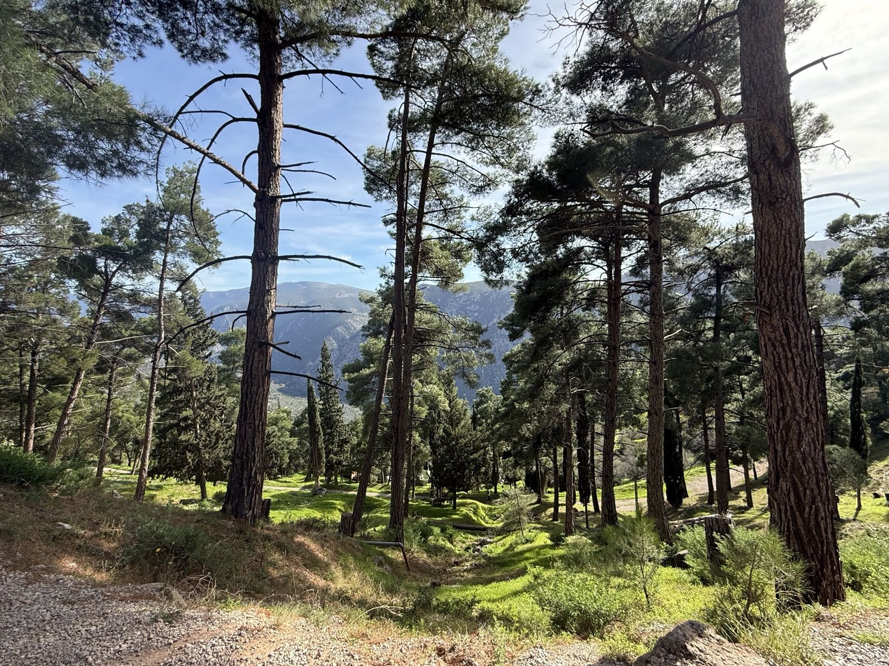
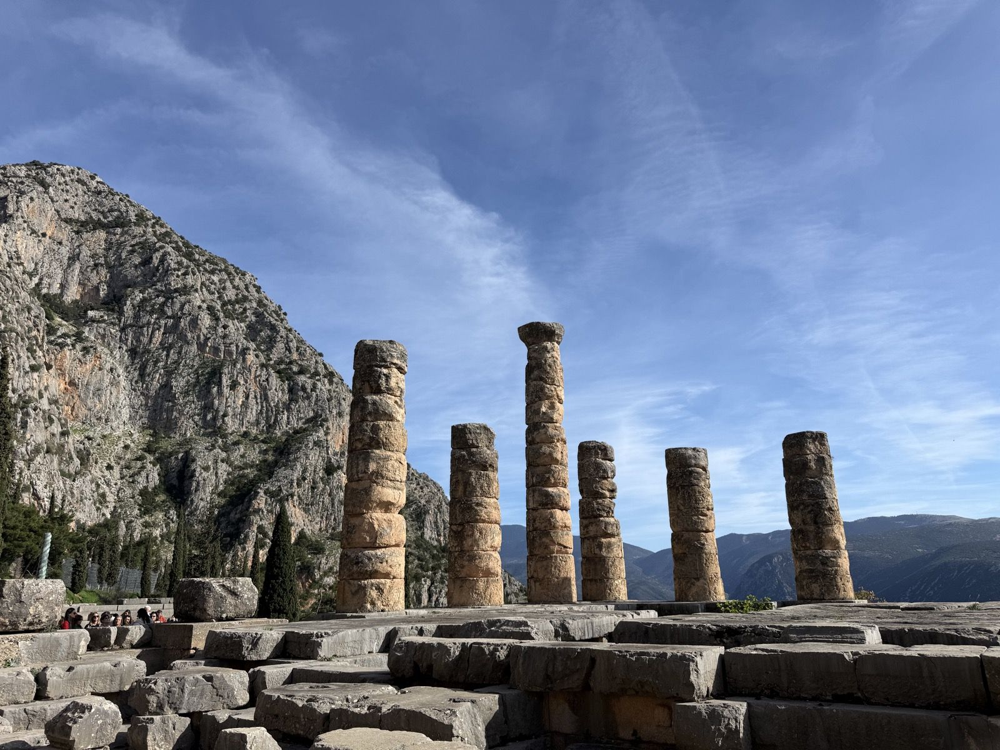
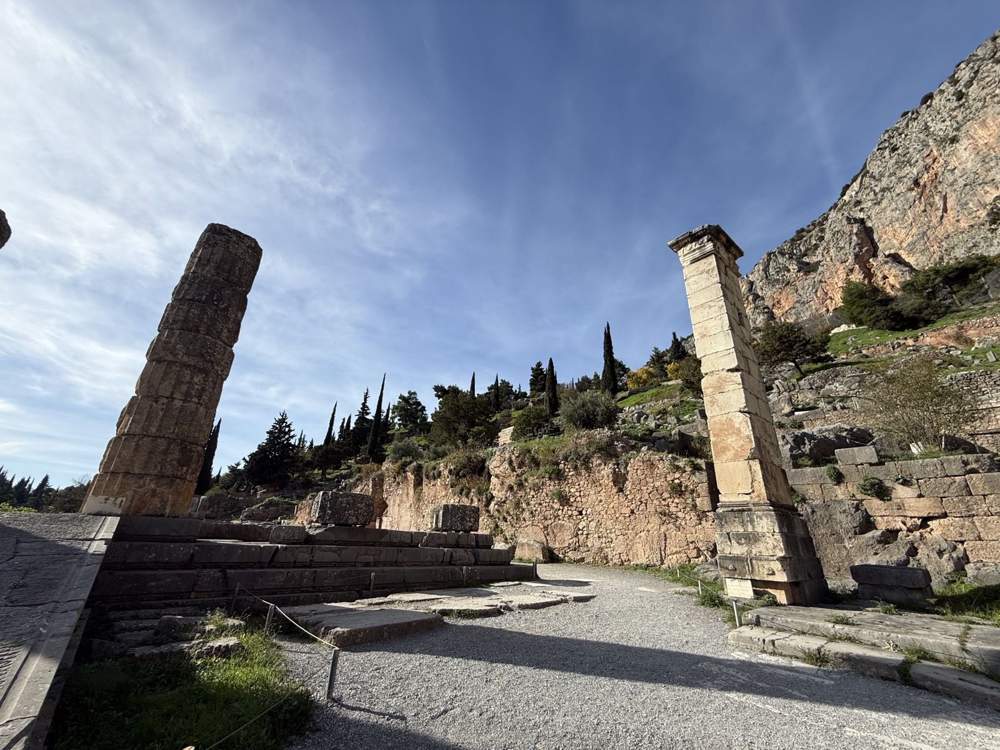

# The Oracle and the Algorithm, Part 1: The Oracle

## Summary

Read this deep-dive chapter the night of Day 11, before the drive to Delphi. It explains Mount Parnassus, the Sanctuary and Temple of Apollo, the Pythia and the priests who framed her words, and how a consultation worked from fee to answer. It retells the famous answers given to Croesus, the Athenians before Salamis, and Chaerephon, and the oracle's flaws: bribery, hedging, and the debated gas-vent theory. It follows the Amphictyonic League, Plutarch's insider view, Apollo's winter absence, and the oracle's long decline and closing, all framed by the human need to see what our choices will bring.

## Concepts Covered

This chapter covers the following 33 concepts from the learning graph:

| Concept | Concept Impact Score |
|---------|-----------------------|
| Mount Parnassus | 88 |
| Delphi | 86 |
| Apollo | 81 |
| Sanctuary of Apollo | 76 |
| Oracle of Delphi | 47 |
| Oracle as Living Faith | 4 |
| Pythia | 26 |
| Oracle Consultation | 22 |
| Priests Who Framed Answers | 2 |
| Fees and Sacrifice | 1 |
| Oracle in Verse and Prose | 1 |
| Temple of Apollo at Delphi | 15 |
| Amphictyonic League | 6 |
| Delphic Neutrality | 5 |
| Greek Colonization | 1 |
| Croesus of Lydia | 3 |
| Croesus Prophecy | 2 |
| Wooden Walls Prophecy | 2 |
| Chaerephon's Question | 4 |
| Bribery of the Oracle | 2 |
| Hedging Answers | 1 |
| Geological Fault Theory | 1 |
| Know Thyself | 4 |
| Nothing in Excess | 6 |
| Dionysus at Delphi | 5 |
| Apollo's Winter Absence | 4 |
| Oedipus Prophecy | 4 |
| Plutarch | 5 |
| Decline of the Oracle | 4 |
| Closing of the Oracle | 3 |
| Oracle's Long Lifespan | 2 |
| Human Need for Foresight | 52 |
| Prediction | 51 |

## Prerequisites

This chapter builds on concepts from:

- [Chapter 1: Before We Go, Part 1: The Long Timeline of the Eastern Mediterranean](../01-long-timeline/index.md)
- [Chapter 3: Day 1: Istanbul, a City on Two Continents](../03-istanbul-two-continents/index.md)
- [Chapter 8: Day 6: Troy and Gallipoli](../08-troy-and-gallipoli/index.md)
- [Chapter 9: Paul at Ephesus, Part 1: The Apostle's Life, Letters, and Ephesian Years](../09-paul-life-letters/index.md)
- [Chapter 10: Day 7: Ephesus, a Greco-Roman City](../10-ephesus-greco-roman-city/index.md)
- [Chapter 15: Day 10: Athens, the Acropolis, and the Persian Wars](../15-athens-acropolis/index.md)

---

## The Night Before Delphi

Day 11, Saturday, November 21, ends back at our hotel in Athens, with the Agora still in our legs and an early alarm set. Tomorrow we drive about 180 km northwest, roughly two and a half hours each way, past Thebes and Livadeia and up the slopes of Mount Parnassus to Delphi. Tonight, like most travelers the night before a long day, we are making small predictions. Will it rain on the mountain? How cold will it be at the site? Will the museum close early in winter? Should we leave at 7:30 or at 8:00? We check a forecast app, a website, and our own guesses, and then we decide.

For more than a thousand years, people climbed the same road with bigger versions of the same questions. Should I marry? Will my child be healthy? Should our city found a colony across the sea? Should we fight the Persians? At Delphi they put those questions to Apollo, and a woman seated on a bronze tripod gave his answer. Tomorrow's chapter, Chapter 18, walks the site in order, from the Castalian Spring <audio id="audio-castalian" src="../../audio/castalian.mp3" preload="none"></audio><button onclick="document.getElementById('audio-castalian').play()" class="pronounce-btn">🔊 Pronounce</button> *kas-TAY-lee-un* to the stadium and the museum. This chapter, read tonight, explains the oracle as an institution: the mountain and the god, who answered and how, what it cost, the famous answers and how far we can trust the stories about them, the oracle's flaws and its politics, and its long decline and closing. On the drive back, Chapter 19 will set these stories beside the prediction machines of our own time. Tonight we only plant the questions.

!!! mascot-welcome "A Thousand Years of Questions"
    { class="mascot-admonition-img" }
    Tonight we meet a rich king who tested the gods before he trusted them, a frightened city that argued over two words, and a barefoot philosopher who spent his life checking one answer. By breakfast we will read an oracle story the way a good detective reads an alibi: who said it, who wrote it down, and how long afterward. Tomorrow the ruins will be full of voices. Look closer.

The chapter has eight parts. Part One asks why people want to see the future at all, and what a prediction is. Part Two climbs Mount Parnassus to Delphi and its sanctuary and meets Apollo and his temple. Part Three explains how the oracle worked: the Pythia, the priests, the fee, and the steps of a consultation. Part Four tells the famous answers, to colonists, to Croesus, to the Athenians before Salamis, to Socrates' friend Chaerephon <audio id="audio-chaerephon" src="../../audio/chaerephon.mp3" preload="none"></audio><button onclick="document.getElementById('audio-chaerephon').play()" class="pronounce-btn">🔊 Pronounce</button> *KAIR-uh-fon*, and to Oedipus, and tests each story. Part Five looks at the oracle's flaws: hedged answers, bribery, and the debate over a gas rising from the rock. Part Six follows the league that ran the sanctuary, its claim to neutrality, the god's winter absence, and the priest Plutarch, who served there. Part Seven reads two sayings carved on the temple. Part Eight follows the oracle's decline and closing. A short last section lists the questions we will carry up the mountain.

## Part One: Wanting to Know What Comes Next

### The Human Need for Foresight

**Foresight** is the effort to see, before we act, what is likely to happen, and especially what our own choices will bring. The **human need for foresight** is the lasting wish for that knowledge whenever three things come together: the outcome is uncertain, the stakes are high, and we must act before we can know. A farmer deciding when to sow, a family deciding whether to move, and a city deciding whether to go to war all stand in the same place. They cannot wait to see how things turn out, because waiting is itself a choice.

Every culture on our route found ways to meet that need. The *Iliad*, whose world Chapter 8 explored at Troy, has **Calchas**, the seer who reads the will of the gods for the Greek army. Real Greek armies carried seers too: Herodotus says that before the Battle of Plataea in 479 BCE, both the Greek and the Persian commanders held back from attacking for days because their seers' sacrifices kept giving unfavorable signs. People slept in the sanctuaries of Asclepius, the healing god, hoping for a dream that would tell them the cure. In southern Anatolia, Roman-era towns set up stone tablets listing the meaning of every throw of five knucklebones, a do-it-yourself oracle in the marketplace. And people traveled, sometimes for weeks, to an **oracle**: a place where a god was believed to answer questions put to him.

The table below sorts these methods by where the answer came from.

| Method | Where the answer came from | An example on our route |
|---|---|---|
| Reading signs | A trained seer interprets the liver of a sacrificed animal or the flight of birds | Calchas at Troy, in the *Iliad*; the seers at Plataea, 479 BCE |
| Dreams | The god sends a dream to someone sleeping in his sanctuary | Sanctuaries of Asclepius, the healing god |
| Lots | Dice, knucklebones, or marked tokens are drawn, and a list says what each result means | Knucklebone oracles carved in stone in southern Anatolia |
| An inspired voice | The god speaks through a chosen person | Apollo's oracles at Delphi, Didyma, and Claros |
| Reasoning from patterns | A person forecasts from experience or from regularities in nature | Thales and the eclipse of 585 BCE; Themistocles (Chapter 15) |

**Worked example: tonight's decisions.** Let's list the choices we have to make before we sleep and notice what each one rests on. *When to leave:* the site and museum keep shorter winter hours, so we predict the drive and the opening time and work back from them. *What to wear:* Delphi is several hundred meters above Athens, so we predict the temperature on the mountain, not in the city. *What to see first:* if rain is forecast for the afternoon, we might start outdoors and save the museum for later. *Whether to stop in Arachova on the way home:* that depends on whether we predict we will still have the energy. Every one of these is a decision that rests on a prediction, and every prediction rests on a source we have chosen to trust: an app, a website, a guidebook, a hotel clerk, or our own past trips. A farmer of 400 BCE asking Apollo whether to buy a field was doing the same thing with a different source. The need has not changed in 2,400 years. What has changed is where we go to meet it, and how we decide whether to believe the answer.

### Prediction

A **prediction** is a statement about something not yet known, usually a future event, made before the outcome and in a form that could later be checked against what actually happens. Three parts matter. A prediction makes a claim; it is made before the outcome, not after; and some possible outcome could show it to be wrong. A **forecast** is a prediction that states how likely it is ("a 60 percent chance of rain"). A **prophecy** is a prediction said to come from a god. And many statements that sound like predictions are really something else: a piece of advice or a command ("found a city in Libya") tells us what to do, not what will happen.

**Worked example: sorting six statements.** Let's apply the three parts to statements we will meet tonight and tomorrow.

| Statement | What kind | Could an outcome prove it wrong? |
|---|---|---|
| "It will rain at Delphi between noon and 3 PM tomorrow." | Prediction | Yes, tomorrow afternoon |
| "There is a 60 percent chance of rain at Delphi tomorrow." | Forecast | Not from one day; only over many such forecasts |
| Thales foretold the year of the eclipse that stopped a battle between the Lydians and the Medes (Herodotus) | Prediction from a pattern | Yes; the eclipse came, in 585 BCE, though whether Thales could really have predicted it is debated |
| "Found a city in Libya." (Delphi to the islanders of Thera) | Command | No; it is not about the future at all |
| "Themistocles is the best man in Athens at guessing what will happen." (Thucydides, in substance) | A judgment about a forecaster | Only by his track record |
| "If Croesus makes war on the Persians, he will destroy a great empire." | Sounds like a prediction | No; Part Five shows why |

The fifth row keeps a promise from Chapter 15. Thucydides, the Athenian historian of the next generation, judged Themistocles the best of all men at forecasting what would happen from very little information. In 480 BCE, the Athenians had two kinds of foresight on hand: the god's answer from Delphi and the judgment of their most gifted politician. Part Four shows that they needed both, and that the decision was still theirs to make.

!!! mascot-thinking "A Prediction Has to Be Able to Lose"
    { class="mascot-admonition-img" }
    Notice that a statement only becomes a real prediction when some outcome could prove it wrong. "Rain tomorrow afternoon" can lose; "a great empire will fall" cannot. Keep that test close all evening, because the oracle's most famous answers are the ones that slip past it.

Chapter 2 asked a chatbot when Hagia Sophia would close for Friday prayer and found that it could only predict a typical answer, then promised that the Delphi chapters would come back to the old human habit of asking a source about the future. This is the first half of that return. Tonight the source is a god speaking through a woman on a mountain; on the drive back, Chapter 19 turns to the machines. The questions to ask of both are the same: what can this source know, how does it answer, and how would we ever find out it was wrong?

## Part Two: The Mountain, the God, and the Sanctuary

### Mount Parnassus

**Mount Parnassus** is the limestone mountain massif in central Greece, rising to 2,457 m at its highest summit, Liakoura, on whose southwestern slopes Delphi stands. It towers over the region the ancients called **Phocis**, between the plain of Boeotia to the east and the Gulf of Corinth to the south. Its upper slopes are bare rock and high meadows, snow-covered for much of the winter; its middle slopes carry forests of fir and pine; and below Delphi the land drops steeply into the gorge of the Pleistos River and a broad plain of olive trees that runs down to the sea at Itea.

<figure markdown="span" class="trip-photo">
  { loading=lazy }
  <figcaption>Pines on the slopes of Mount Parnassus. Photo by Dan McCreary</figcaption>
</figure>

To the Greeks, Parnassus was a holy mountain. In the flood story that the Roman poet Ovid tells, Deucalion and Pyrrha, the only survivors, ground their boat on its peaks and repopulate the earth by throwing stones over their shoulders. Poets made it a home of the **Muses**, the goddesses of poetry and the arts, which is why "Parnassus" came to mean the world of poetry in English and French. On the high plateau above Delphi lies the **Corycian Cave**, sacred to Pan and the nymphs, where archaeologists have found tens of thousands of small offerings, many of them knucklebones. Every other winter, women devoted to Dionysus climbed toward the heights for night-time rites, a practice Part Six describes. Directly above the sanctuary rise the two great cliffs called the **Phaedriades** <audio id="audio-phaedriades" src="../../audio/phaedriades.mp3" preload="none"></audio><button onclick="document.getElementById('audio-phaedriades').play()" class="pronounce-btn">🔊 Pronounce</button> *fee-DRY-uh-deez*, "the Shining Ones," named for the way their rock faces gleam in the sun. From the cleft between them flows the Castalian Spring, the first stop of Chapter 18.

Today the mountain is a national park, created in 1938, and in winter its upper slopes hold Greece's largest ski center, above the village of Arachova. The table below gives the heights we will pass through tomorrow.

| Place | Height above sea level | What it is |
|---|---|---|
| Itea | Sea level | Port on the Gulf of Corinth, about 15 km by road below Delphi |
| Athens city center | About 100 m | Where we start |
| The Sanctuary of Apollo | About 550 to 650 m | Built on terraces up the slope, from the entrance to the stadium |
| Arachova | About 950 m | Mountain village we drive through, Chapter 18 |
| Liakoura | 2,457 m | The summit of Parnassus |

**Worked example: predicting the weather on the mountain.** Let's make a real prediction for tomorrow from a rule. In still air, temperature falls by roughly 6.5 °C for every 1,000 m we climb; meteorologists call this the lapse rate, and on a given day the real figure can be lower or higher. Suppose the forecast for central Athens tomorrow afternoon is 18 °C. The sanctuary is about 500 m higher than the city center, so we expect it to be about 500 ÷ 1,000 × 6.5 ≈ 3 °C cooler, near 15 °C. Arachova, about 850 m above Athens, should be about 5.5 °C cooler, near 12 or 13 °C. The rule ignores wind, cloud, and the fog that Chapter 2 warned can sit on Parnassus, all of which can make the mountain feel colder still. So our prediction is "noticeably cooler, perhaps 3 to 6 °C, with a chance of fog," and it is a real prediction: tomorrow afternoon it will be right or wrong. Notice what kind of foresight this is. It rests on a rule anyone can check, applied to numbers anyone can look up. The pilgrims who climbed this road had a different source in mind.

!!! mascot-tip "Check the Forecast for Delphi, Not Athens"
    { class="mascot-admonition-img" }
    Here's a two-minute habit for tonight: set the weather app to Delphi itself, not Athens, and look at the hourly forecast for fog and rain. Then pack one more layer than the Athens forecast suggests. The sanctuary climbs about 100 m from its entrance to the stadium, and the top is the coldest part of the visit.

### Delphi

**Delphi** (in Greek, *Delphoi*) is the ancient sanctuary town on the southwestern slopes of Mount Parnassus, in Phocis, about 180 km by road northwest of Athens, that was home to the most famous oracle of the Greek world. Today the name covers three things: the archaeological site, a UNESCO World Heritage Site since 1987, as Chapter 4 noted; its museum; and the modern village just west of the ruins, whose story Chapter 18 tells. People lived here long before Apollo's temple: figurines and pottery from the Mycenaean age, the late Bronze Age world of Chapter 8, have been found on the site. The sanctuary began to grow in the 8th century BCE, at the end of the Dark Age, and by the 6th century it was the place where Greeks from every city came to ask their questions.

Why here? The site has a spring of cold water, a dramatic setting under cliffs that seemed made for a god, and a position on the route from the Gulf of Corinth into central Greece, so pilgrims could arrive by sea at the ancient port of Kirrha and climb up. Just as important, it belonged to no great city. A small community in the mountains could become a meeting place for rivals in a way that Athens or Sparta never could.

**Worked example: three names, three stories.** Delphi carried three names, and each comes with a story. Let's run each through Chapter 4's test: what is the earliest source, and what does it really tell us?

- **Pytho.** The *Homeric Hymn to Apollo*, a poem probably composed in the 7th or 6th century BCE, says that Apollo killed a monstrous she-serpent here and left it to rot (Greek *pythein*) in the sun, so the place was called Pytho. That is where the words *Pythia* and *Pythian* come from.
- **Delphi.** The same hymn says that Apollo, in the shape of a dolphin (*delphis*), leaped onto a ship of Cretan sailors from Knossos, steered it to the coast below, and made the Cretans his first priests. So Apollo was worshipped here as *Delphinios*, "of the dolphin," and a Greek poem traced his first priests to Knossos, the palace of Chapter 13.
- **The navel of the earth.** Later writers said that Zeus released two eagles from opposite ends of the world and they met above Delphi, marking it as the world's center, the *omphalos* <audio id="audio-omphalos" src="../../audio/omphalos.mp3" preload="none"></audio><button onclick="document.getElementById('audio-omphalos').play()" class="pronounce-btn">🔊 Pronounce</button> *OM-fuh-los*. Chapter 18 visits the stone that marked it.

The verdict is the same for all three. These stories are primary sources for what Greeks *believed* about Delphi by about the 6th century BCE, not for what happened there. They tell us that Greeks thought of Delphi as old, as Apollo's by conquest, as linked to Crete, and as the center of their world. That belief is itself a historical fact, and it is what drew pilgrims up the mountain.

### Apollo

Chapter 8 met **Apollo** among the twelve Olympians: the god of light, music, prophecy, healing, and archery, carrying a lyre, a bow, and a sprig of laurel. He was the son of Zeus and Leto, born on the island of Delos (Chapter 1), and the twin brother of Artemis, whose great temple at Ephesus Chapter 10 described. The Greeks called him **Phoebus**, "the bright one," and at Delphi also **Loxias**, a name ancient writers often explained as "the oblique one," the god who speaks at a slant.

Apollo was the god of order, measure, and purification. Having killed the serpent at Delphi, the myth says, he himself had to be purified of the bloodshed, and Delphi became the place where killers came to be cleansed. In Aeschylus' tragedy the *Eumenides* (458 BCE), Orestes, who has killed his mother, takes refuge at Apollo's altar here. The same play opens with the Pythia's prayer naming the powers who held the oracle before Apollo: Earth first, then Themis, the goddess of right order, then Phoebe, who gave it to Phoebus as a birthday gift. Whether that sequence remembers an older cult or is a poet's genealogy, no one can say. The philosopher Heraclitus, around 500 BCE, summed up the god's way of speaking in one line that survives: the lord whose oracle is at Delphi "neither speaks nor conceals, but gives a sign."

**Worked example: Apollo's oracles on our route.** Delphi was not Apollo's only oracle, and several of the others lie close to the coast we sailed. Let's compare them, because the differences show that the god's voice could come in very different ways.

| Oracle | Where | Who spoke for the god | What we know |
|---|---|---|---|
| Delphi | Phocis, central Greece | The Pythia, a woman of Delphi, seated on a tripod | The most consulted; this chapter |
| Didyma | South of Miletus, on the Turkish coast south of Ephesus | A prophetess, at a spring inside a vast temple | Consulted by Croesus, Herodotus says; its huge Hellenistic temple was never finished |
| Claros | Near Colophon, on the coast north of Ephesus | A male priest who drank from a sacred spring in a chamber under the temple | Famous in Roman times; Tacitus says the priest answered in verse though he knew nothing of poetry |
| Patara | The Lycian coast, where Paul's ship called (Chapter 11) | A prophetess | Herodotus says the oracle there did not always operate |

The table makes a point the Greeks understood well. Prophecy was not one place's monopoly. A king could send envoys to several oracles and compare them, as Croesus did, and Delphi had to keep earning its place at the top. Its reputation, more than its god, was what it had to protect.

### The Sanctuary of Apollo

A **sanctuary** (Greek *temenos*, "a piece cut off") is land set apart as a god's property, usually enclosed by a wall. The **Sanctuary of Apollo** at Delphi is the walled precinct, roughly 200 m long, built on terraces up the slope below the Phaedriades, that held Apollo's temple, his altar, the treasuries and monuments of the Greek cities, and, above them, the theater; the stadium lay higher still, outside the wall. A paved **Sacred Way** zigzags up through it from the main gate to the temple. Below, along the road toward Arachova, lies a second sanctuary, of Athena Pronaia <audio id="audio-pronaia" src="../../audio/pronaia.mp3" preload="none"></audio><button onclick="document.getElementById('audio-pronaia').play()" class="pronounce-btn">🔊 Pronounce</button> *proh-NAY-uh*, "Athena before the temple," with its round Tholos.

A sanctuary was much more than a temple. People came to sacrifice, to give thanks, and to keep promises made to the god in danger. Every four years they came for the **Pythian Games**, which began as a contest in singing hymns to Apollo with the lyre and grew to include athletics and chariot races, with a crown of laurel as the prize. Cities inscribed treaties, decrees, and honors on the sanctuary's walls, so that the whole Greek world could see them. And they came to the oracle. All of this was paid for by gifts, and the gifts were also messages. The Roman writer Pliny the Elder reports a visitor's estimate that, even after Roman generals had carried off so much, Delphi still held about as many statues as Rhodes, which he put at 3,000.

**Worked example: reading the sanctuary as a scoreboard.** Let's read five famous gifts as messages from their givers to everyone else. Chapter 18 walks past the places where several of them stood.

| Gift | Date | Giver | The message |
|---|---|---|---|
| A gold lion and giant gold and silver mixing bowls | c. 550s BCE | Croesus, king of Lydia | A foreign king can be the god's most generous friend, and expects the god's favor in return |
| The Siphnian Treasury | c. 525 BCE | The small island of Siphnos, rich from its gold and silver mines | Even a small island can build in marble if its mines are good |
| The Athenian Treasury | c. 500–490 BCE | Athens; Pausanias says from the spoils of Marathon | Athens beat the Persians first |
| The Serpent Column | 479 BCE | The Greek allies who won at Plataea | We won together; the names of 31 cities were inscribed on its coils |
| The Monument of the Admirals | after 405 BCE | Sparta, after its naval victory over Athens at Aegospotami | Sparta won the long war; Pausanias says it stood near the Athenians' Marathon monument |

The Serpent Column, which Chapter 4 found in Istanbul's Hippodrome, carries a story that belongs here. Thucydides says that the Spartan regent Pausanias, who had commanded at Plataea, first had a verse inscribed on it naming himself as the leader who had destroyed the Persian army. The Spartans had his boast erased and the names of the cities inscribed instead. On neutral ground, before every city's eyes, a general's pride was publicly corrected. Part Seven will find a two-word motto on the temple that said the same thing.

### The Temple of Apollo at Delphi

The **Temple of Apollo at Delphi** is the Doric temple at the center of the sanctuary that housed the oracle. What we see tomorrow are the foundations, the ramp, and six re-erected columns of the temple completed around 330 BCE, the last of a series of temples on the same spot. Pausanias heard a legend of four earlier ones: a hut of laurel branches, a temple of beeswax and feathers built by bees, one of bronze, and finally one of stone built by two legendary architects. The real history begins with a fire. The stone temple burned in 548 BCE, and the rebuilding became a project of the whole Greek world. Herodotus says the Delphians had to raise a quarter of the cost, and collected gifts from as far as Egypt, where the pharaoh Amasis gave a thousand talents of alum. The contract went to the **Alcmaeonids** <audio id="audio-alcmaeonids" src="../../audio/alcmaeonids.mp3" preload="none"></audio><button onclick="document.getElementById('audio-alcmaeonids').play()" class="pronounce-btn">🔊 Pronounce</button> *alk-MEE-uh-nidz*, a powerful Athenian family then in exile, who, Herodotus says, built the front in fine marble when the contract required only limestone, winning great credit at Delphi. That generosity returns in Part Five. The great retaining wall below the temple, built after the fire to hold up its terrace, is the polygonal wall Chapter 18 stops at.

The Alcmaeonid temple stood until an earthquake destroyed it in 373 BCE. The temple whose ruins we will see was built over the next decades, with contributions from across Greece, and finished around 330 BCE. It was a Doric temple, in the order Chapter 10 taught us to recognize, with 6 columns across its ends and 15 down its sides, about 60 m long. Pausanias, who saw it in the 2nd century CE, describes the sculptures of its two pediments: on the east front, facing the morning, Apollo with his mother, his sister, and the Muses; on the west, facing the sunset, Dionysus with his women followers. Two gods, one at each end, a pairing Part Six explains.

<figure markdown="span" class="trip-photo">
  { loading=lazy }
  <figcaption>The Temple of Apollo, home of the oracle. Photo by Dan McCreary</figcaption>
</figure>

**Worked example: walking into the temple in about 300 BCE.** Let's reconstruct what a consultant would have passed through, using Pausanias, Plutarch, and the excavated foundations. We climb the ramp at the east end, past the great altar of sacrifice in front of it. In the porch, the *pronaos*, we pass sayings carved on the walls, among them "Know thyself" and "Nothing in excess," which Part Seven reads, and a mysterious letter E, which Plutarch wrote a whole essay trying to explain. In the main hall stood a hearth where an eternal fire burned. At the far western end was the **adyton** <audio id="audio-adyton" src="../../audio/adyton.mp3" preload="none"></audio><button onclick="document.getElementById('audio-adyton').play()" class="pronounce-btn">🔊 Pronounce</button> *AD-ih-ton*, "the place not to be entered," a room set lower than the floor, where, tradition said, the Pythia sat on her tripod beside a laurel and the *omphalos* stone, and where the tomb of Dionysus lay too. Here is the honest limit of our knowledge: the floor of the adyton has not survived well enough to show exactly how it was arranged, which is why Part Five's debate about what lay beneath it is still open.

## Part Three: How the Oracle Worked

### The Oracle of Delphi

The word *oracle* has three meanings, and the Greeks used all three. It is the place where a god answers questions, the person through whom the god answers, and the answer itself. The **Oracle of Delphi** is the institution through which Apollo was believed to answer questions at Delphi, from at least the 8th century BCE until it fell silent at the end of the 4th century CE: the most consulted, most respected, and most famous oracle of the ancient Greek world.

Two kinds of people came. **Private consultants** asked about the questions of ordinary life: marriage, children, journeys, health, money, a quarrel, a debt. **State envoys** asked for their cities: where to found a colony, how to end a plague, which god to honor, whether a new law pleased the god, whether to go to war. Most consultations were private, but the state questions are the ones the historians wrote down. We have no archive of Delphi's private questions, because they were mostly spoken aloud. The best evidence for what ordinary people asked comes from the oracle of Zeus at **Dodona**, in northwestern Greece, where consultants scratched their questions on thin strips of lead. More than 4,000 of these tablets survive. Should I marry? Is the child mine? Will I do better if I take up sheep farming? Should I sail to Sicily? The form is often "is it better and more good for me to...," a question the god could answer with a yes or a no.

**Worked example: sorting the answers.** If the oracle was consulted for a thousand years, why do we know so few of its answers, and why are the famous ones so riddling? In 1978 the American scholar Joseph Fontenrose collected every Delphic response he could find in ancient writing and inscriptions, about 535 of them, and sorted them by how close the record was to the event. Let's look at his four categories.

| Category | What it means | Roughly how many | What the answers are like |
|---|---|---|---|
| Historical | Recorded at or near the time, often in an inscription | About 75 | Mostly plain: commands and approvals, especially about worship and sacred law |
| Quasi-historical | Said to answer a real person, but recorded long afterward | About 270 | Many riddles, ambiguities, and verse |
| Legendary | Attached to heroes and founders of the distant past | About 175 | Dramatic prophecies and riddles |
| Fictional | Invented in plays, stories, or jokes | About 15 | Whatever the story needs |

The pattern is the point. The answers recorded closest to the time are mostly short and practical: "it is better to sacrifice to this god," "yes, the law is approved." The famous double-edged riddles cluster in the stories recorded later. Scholars still argue about Fontenrose's individual judgments, but the shape of his result has held: the riddling oracle of legend and the practical oracle of the inscriptions are not the same thing. When Part Four tests the famous answers, this table is the background.

### The Oracle as a Living Faith

It is easy, 2,400 years later, to treat the oracle as a curiosity or a con. For the people who climbed to Delphi, it was neither. The **oracle as a living faith** means the oracle understood as its users understood it: a religious act in which a person approached a god with purity, sacrifice, and respect, and received the god's word. Consulting Delphi was a form of piety, the same way that lighting a candle in a church or praying before a journey is for many believers today. That does not mean everyone believed everything. Educated Greeks and Romans debated how divination could work; in 44 BCE Cicero wrote a whole book, *On Divination*, in which his brother defends it and he himself takes it apart. But Plutarch, a philosopher of great learning, served as Apollo's priest here for decades and wrote about the oracle as something real that needed to be understood, not exposed. This chapter describes the oracle with the respect we owe any faith, and tests the stories about it with the tools we use on all stories.

**Worked example: Xenophon asks the wrong question.** The clearest picture of a believer framing a question comes from Xenophon, the Athenian soldier and writer who studied with Socrates. Around 401 BCE, a friend invited him to join the Persian prince Cyrus on a campaign. Xenophon asked Socrates' advice, and Socrates told him to put the question to the god at Delphi. Xenophon went, but, as he himself tells it, he did not ask *whether* he should go. He asked to which gods he should sacrifice and pray so that the journey would go well and he would come home safely. Apollo named the gods. Back in Athens, Socrates scolded him: he had already made up his mind and asked only how to succeed. Since he had asked that, Socrates said, he must do what the god had told him. Xenophon went, and the campaign ended in disaster, though Xenophon himself survived to lead the Greek army home and write about it. The god answered the question he was asked, and the question already contained the decision.

!!! mascot-thinking "The Question Shapes the Answer"
    { class="mascot-admonition-img" }
    Think about what Xenophon did. By asking "how do I succeed?" instead of "should I go?", he made sure the answer could only help him do what he already wanted. Any source of advice, a god, a friend, or a machine, can only answer the question we actually ask.

### The Pythia

The **Pythia** was the woman through whom Apollo spoke at Delphi, the priestess who sat on the tripod in the adyton and gave the god's answers. She was chosen from the families of Delphi and lived apart in purity while she served. Plutarch, who worked beside the Pythias of his day, says the one serving in his time came from a poor farming family and had no education or special skill. In early times, the historian Diodorus says, the Pythia was a young unmarried woman; after a visitor from Thessaly abducted one, the Delphians decided she should be a woman over fifty, still dressed as a girl. At the oracle's height, Plutarch says, there were three Pythias, two who took turns and a third in reserve, because so many people came.

On a consultation day she bathed in the Castalian Spring, is said to have purified herself with smoke from burning laurel leaves and barley meal, and went down into the adyton. There she sat on a tall tripod, a bronze cauldron on three legs, holding a sprig of laurel. The best-known picture of a consultation from the oracle's great age is a painted drinking cup made in Athens around 440 BCE, now in Berlin, which shows the mythical king Aegeus consulting a seated woman labeled Themis. She sits calmly on the tripod, looking into a shallow bowl in one hand and holding a laurel branch in the other. Greeks believed that when she spoke, she was *entheos*, "with the god inside," and that the voice was Apollo's.

!!! mascot-warning "Picture a Calm Woman, Not a Raving One"
    { class="mascot-admonition-img" }
    A common trap is to imagine the Pythia foaming and writhing in clouds of smoke. That picture comes mostly from the Roman poet Lucan's dramatic verse of the 1st century CE and from later painters. Plutarch, who worked beside her for years, and the Berlin cup, painted in her own day, show a calm woman speaking, so start from them.

Plutarch does record one terrifying exception. In his own time, he says, the omens at the goat sacrifice were poor, but the priests pressed on. The Pythia went down unwillingly, answered in a harsh, strange voice, rushed out screaming, and fell; she died a few days later. Plutarch tells the story precisely because it was unusual, and because it showed that the god's presence could not be forced.

### Priests Who Framed the Answers

The Pythia did not work alone. **The priests who framed the answers** were the officials who managed the consultation and stood between the god's voice and the consultant. Two **priests** of Apollo, chosen for life from leading Delphic families, oversaw the sacrifices; Plutarch was one of them. A **prophet** (*prophetes*, "one who speaks for") received the Pythia's answer and announced it to the consultant. Five **holy ones** (*hosioi*), from families that claimed descent from the city's founders, assisted in the rites.

How much the officials shaped the answers is one of the oracle's open questions. The geographer Strabo, writing around the turn of the eras, says that poets in the god's service put the Pythia's words into verse. On that reading, the priests were editors, even authors, and could steer a city's fate. Other scholars point out that the ancient sources mostly show the Pythia speaking directly to the consultant, and argue that she gave coherent answers herself. The truth may have changed over the centuries. What is clear is that the oracle was a team, and that a team, unlike a god, had interests of its own.

### The Oracle Consultation

An **oracle consultation** was the sequence of ritual steps by which a person or a city put a question to Apollo and received his answer. Ancient writers never set out the whole procedure in one place, so the steps below are pieced together from Plutarch, Herodotus, Euripides, inscriptions, and the layout of the temple. In early times, Plutarch says, the god answered only once a year, on his birthday, the seventh day of the month Bysios, in early spring; later, consultations are usually said to have taken place on the seventh day of each month, for the nine months of the year when Apollo was present.

1. **Arrive on a consultation day.** Consultants gathered at Delphi, often days ahead, and found lodging in the town.
2. **Purify with water** from the Castalian Spring.
3. **Pay the fee**, the *pelanos*. A foreigner had to present himself through a **proxenos**, a citizen of Delphi who acted as his sponsor.
4. **Test the god's presence.** The priests sprinkled a goat with cold water. If it trembled through its whole body, Apollo was present and consultations could go ahead; if it did not, there would be no consultation.
5. **Sacrifice the goat** on the great altar before the temple's east front; the day's consultations can begin.
6. **Wait for a turn.** Cities and people granted *promanteia*, the right to consult first, went ahead; the rest went in an order decided by lot.
7. **Enter the temple and ask.** The consultant made another offering at the inner hearth and put the question; the Pythia answered from the tripod in the adyton.
8. **Receive the answer** from the prophet, write it down, and carry it home. State envoys reported it to their assembly, which then argued over what it meant.

<figure markdown="span" class="trip-photo">
  { loading=lazy }
  <figcaption>An ancient column and a tall stone pillar near the east end of the Temple of Apollo. Photo by Dan McCreary</figcaption>
</figure>

**Worked example: Croesus jumps the line.** Let's follow one privileged consultant through the steps. Herodotus says that after Croesus sent his lavish gifts, the Delphians granted him and every Lydian forever the right to consult first, freedom from fees, front seats at the festivals, and the right to become citizens of Delphi. So a Lydian envoy arriving on the seventh of the month would still purify himself and wait for the goat to tremble, but at step 6 he would walk past everyone else, and at step 3 he would pay nothing. A farmer from Attica who had walked a week to get there would wait his turn by lot, and if the line was long, he might not be heard that month at all. The oracle was open to anyone, but not to everyone equally, and the difference was bought with gold. Chapter 19 comes back to that.

### Fees and Sacrifice

**Fees and sacrifice** were the costs a consultant paid to approach the god. The fee was called the *pelanos*, a word that first meant a sacred cake offered at the altar and later meant the money paid in its place. Fees varied by consultant: an inscription recording an agreement with the city of Phaselis, on the south coast of Anatolia, sets a much higher fee for an envoy asking on behalf of the city than for a private person. On top of the fee came the animal for the preliminary sacrifice, further offerings inside the temple, and the cost of the journey itself, which for most people was by far the largest expense. Many consultants also left a gift of thanks afterward, which is how the sanctuary filled with statues. The fees, the sacrifices, and the gifts supported the priests, the temple, and the whole town of Delphi, which lived from the oracle the way a modern town lives from its university or its cathedral.

### The Oracle in Verse and Prose

**The oracle in verse and prose** refers to the two forms in which Delphi's answers were given. The famous answers that Herodotus quotes are in **dactylic hexameter**, the six-beat meter of Homer's epics, which made them sound ancient and grand and easy to memorize. Strabo says the oracle answered "both in verse and in prose." By Plutarch's day, around 100 CE, the answers came in plain prose, and some visitors complained that the god had lost his poetry, or his power. Plutarch wrote a dialogue to answer them, known in English as *The Oracles at Delphi No Longer Given in Verse*. His answer is that the god adapts to his questioners: in an age of plain speech and plain questions, plain answers are clearer and serve people better, and verse had always invited misreading. It is an insider's defense, and also an honest admission that the oracle had changed.

The MicroSim below walks through a consultation step by step and asks us to predict what happens at three turning points.

#### Diagram: A Day at the Oracle

A Day at the Oracle

Type: microsim
**sim-id:** delphi-consultation-steps 
**Library:** p5.js 
**Status:** Specified 
**Bloom Level:** Understand 
**Bloom Verb:** explain 
**Learning Objective:** The learner will explain the sequence of a Delphic consultation, from arrival to the written answer, by placing eight steps in a valid order and choosing the correct outcome at three checkpoints, with a valid order within two attempts and at least 2 of 3 checkpoints correct.

**Prerequisites:** Pythia, adyton, pelanos, proxenos, promanteia, prophet, the Castalian Spring, the goat test, verse and prose answers (all defined in Parts Two and Three above, in "The Temple of Apollo at Delphi", "The Pythia", "Priests Who Framed the Answers", "The Oracle Consultation", "Fees and Sacrifice" and "The Oracle in Verse and Prose").

**Evidence of Mastery:** (1) The learner arranges the eight step cards and presses Check; an order is valid when it satisfies every constraint in Rules. (2) At each of three checkpoints the learner commits to one of four answers before the outcome is shown; an answer is correct when it matches the Correct column in Content. Mastery is a valid order within two Checks and at least 2 of 3 checkpoints correct on the first attempt. Reading the step descriptions after mastery is exploration, not evidence.

**Misconceptions:** (1) Anyone could walk in and ask at any time (step 1 and the consultation calendar). (2) The fee was the only cost, when sacrifice, travel and gifts cost more. (3) The oracle answered everyone in the same order (promanteia, checkpoint B). (4) The god could always be made to answer (the goat test, checkpoint A). (5) The Pythia always answered in verse (checkpoint C).

**Instructional Rationale:** Ordering the steps makes the learner rebuild the consultation as a process with gates, and the three checkpoints ask the learner to predict before the answer is revealed, which is the Understand-level move of explaining why each gate existed. Feedback quotes the chapter's sources so the learner connects each step to its evidence.

**Content:**

The eight step cards, shown shuffled. The number is the order the chapter gives and is hidden until the order is checked.

| # | Card text |
|---|---|
| 1 | Arrive at Delphi on a consultation day, usually said to be the seventh of the month, in one of the nine months when Apollo was present. |
| 2 | Purify yourself with water from the Castalian Spring. |
| 3 | Pay the fee (*pelanos*); a foreigner presents himself through a Delphian sponsor (*proxenos*). |
| 4 | The priests sprinkle a goat with cold water to test whether the god is present. |
| 5 | The goat is sacrificed on the great altar before the temple's east front; the day's consultations can begin. |
| 6 | Wait for your turn: those with *promanteia* first, the rest by lot. |
| 7 | Enter the temple, make an offering at the inner hearth, and put your question; the Pythia answers from the tripod in the adyton. |
| 8 | Receive the answer from the prophet, write it down, and carry it home. |

The three checkpoints, shown at the points named:

| Checkpoint | Shown after step | Question | Choices | Correct | Feedback shown after answering |
|---|---|---|---|---|---|
| A | 4 | The goat is sprinkled with cold water and does not tremble. What happens? | The consultation goes ahead with a smaller fee; There is no consultation; The Pythia decides for herself; A second goat is bought and the line goes on | There is no consultation | A goat that did not tremble meant the god was absent. Plutarch tells of priests who pressed on after poor omens; the Pythia answered in a strange voice, rushed out screaming, and died days later. |
| B | 6 | On the same morning, a Lydian envoy of King Croesus and a farmer from Attica are both waiting. Who goes in first? | The farmer, because he arrived first; The Lydian, because Lydians held *promanteia*; Whoever pays the larger fee; They draw lots | The Lydian, because Lydians held *promanteia* | Herodotus says the Delphians gave Croesus and all Lydians the right to consult first and freedom from fees. The farmer waits for the lot. |
| C | 8 | It is about 100 CE, in Plutarch's time. In what form will the answer most likely come? | Hexameter verse; Plain prose; A written riddle in a sealed tablet; A nod with no words | Plain prose | By Plutarch's day the answers were given in prose, and he wrote a dialogue defending the change. |

**Provenance:** Steps, sources and checkpoint facts from this chapter: "The Oracle Consultation" (steps 1–8, the consultation calendar, the goat test, promanteia, the Croesus worked example), "The Pythia" (Plutarch's story of the forced consultation), "Fees and Sacrifice" (pelanos), and "The Oracle in Verse and Prose" (Plutarch and prose). The order is the chapter's reconstruction, assembled from Plutarch, Herodotus, Euripides, inscriptions and the temple plan; the sim states "No ancient writer lists every step; this order is a reconstruction."

**Rules:**

- An order is valid when all of these hold: step 1 is first; step 8 is last; steps 2 and 3 come before step 4; step 4 comes before step 5; step 5 comes before step 6; step 6 comes before step 7.
- Steps 2 and 3 may be in either order. Every other pair is fixed by the constraints above, so the valid orders are 1-2-3-4-5-6-7-8 and 1-3-2-4-5-6-7-8.
- Checkpoints appear only after the order is valid, in the fixed order A, B, C, at the steps named in Content.
- Each checkpoint is answered once for scoring. Score is 0 to 3.
- Mastery: valid order within two Checks and checkpoint score >= 2.

**Learner Activity:**

1. The learner reads the question on screen and the eight shuffled cards.
2. The learner arranges the cards and presses Check. The sim marks each card in a correct relative position and names each broken constraint.
3. When the order is valid, the sim steps through the consultation one card at a time; the learner advances with Next.
4. At steps 4, 6 and 8, a checkpoint stops the walk. The learner chooses one answer, then sees the outcome and the feedback.
5. After step 8, the sim shows a summary: Order valid on Check number n; Checkpoints correct: n of 3.
6. The learner should notice that the consultation had gates (the calendar, the goat, the line) and that each gate could keep a consultant from ever reaching the god.

**Feedback:** Order: on a valid order, "Valid: this is the order the chapter reconstructs. Steps 2 and 3 could come in either order." On an invalid order, one message per broken constraint: "Arriving comes first: nothing happens until a consultation day.", "Carrying the answer home comes last.", "Purification and the fee come before the goat test.", "The goat is tested before it is sacrificed.", "The line forms only after the sacrifice shows the god is present.", "Everyone waits for a turn before entering the temple." After the second invalid Check, the sim shows the order 1-2-3-4-5-6-7-8 and the walk begins. Checkpoints: correct shows "Correct." and the feedback text from Content; incorrect shows "Not quite." and the same feedback text. A running count "Checkpoints correct: n of 3" is shown.

**Starting State:** The eight cards in a shuffled row, an empty sequence of eight slots, and the question "You have walked a week to ask Apollo one question. What must happen before you hear his answer?"

**Chapter Anchors:** Eight steps in the order of "The Oracle Consultation"; seventh day of the month; nine months a year; the goat must tremble; Lydians held promanteia and freedom from fees (Herodotus); prose answers in Plutarch's day, around 100 CE; three checkpoints.

## Part Four: Famous Answers, Tested

The oracle's fame rests on a handful of stories, and almost all of them come to us from writers who lived long after the answers were given. Chapter 4 gave us the test: find the earliest source, ask how long after the event it was written and by whom, and remember that a myth tells us what people later believed even when it does not tell us what happened. A second question belongs with it for any prophecy: was it written down before it came true, or after? The table below applies both to the stories in this part.

| Story | When the answer was given | Earliest source | About how long after | Written before or after the outcome? |
|---|---|---|---|---|
| Found a city in Libya (Cyrene) | c. 630 BCE | Herodotus | About 200 years | After |
| Croesus will destroy a great empire | c. 550 BCE | Herodotus | About 120 years | After |
| The wooden wall (Athens) | 481 or 480 BCE | Herodotus | About 50 years | After |
| No one is wiser than Socrates | Before 399 BCE, date unknown | Plato's *Apology* and Xenophon's *Apology* | A few years after the trial | After the trial, but it was never a prediction |
| Your son will kill you (Laius) | Myth, no date | Sophocles, *Oedipus the King*, 420s BCE | Not history | Written into the story |

Every famous prophecy in the table was first written down after the event it seemed to predict. That does not prove any of them false. It means that none of them can prove the oracle foresaw anything, because the writer already knew the ending.

### Greek Colonization

**Greek colonization** was the founding, from about 750 to about 550 BCE, of hundreds of new Greek cities around the Mediterranean and the Black Sea by settlers from older cities in Greece and Ionia. It happened during the Archaic Period of Chapter 1, and it put Greek cities from Spain to the Crimea. Byzantium, founded by settlers from Megara, was one of them, as Chapter 3 told. A new colony needed a leader, the **oikist**, a site, and the gods' approval, and Delphi became the usual place to ask for that approval. Many cities later told stories of the oracle choosing their site.

The fullest story is Cyrene's, on the coast of today's Libya. Herodotus says that the king of the small island of Thera (Santorini) came to Delphi about other matters and was told to found a city in Libya. Nobody on Thera knew where Libya was, so nothing was done, until seven years of drought sent the Therans back to Delphi, and finally a man named Battus led a small group across the sea, about 630 BCE. Cyrene grew into a rich city. A 4th-century BCE inscription found there, which claims to copy the settlers' original oath, says the same thing. Even so, many historians think that colonies often consulted Delphi *after* choosing a site, and that some foundation oracles were composed later to give a successful city a divine birth certificate. Chapter 3's story of the Megarians told to settle "opposite the city of the blind" is one of them.

!!! mascot-tip "Two Questions for Every Oracle Story"
    { class="mascot-admonition-img" }
    Here's the quickest check there is. Ask who first wrote the answer down and how many years after it was given, then ask whether that writer already knew how things turned out. If the answer was recorded after it "came true", treat it as a story about the oracle, not evidence of foresight.

### Croesus of Lydia

**Croesus of Lydia** was the last king of Lydia, ruling from about 560 to about 546 BCE from his capital at Sardis, about 100 km inland from Ephesus. Chapter 1 met him as the most famous king of the land that invented coins, with a fortune so famous that "rich as Croesus" is still an English phrase, and Chapter 10 told how he paid for many of the columns of the Temple of Artemis. He ruled the Greek cities of the Ionian coast, admired Greek culture, and gave splendidly to Greek gods.

Herodotus, writing about a century later, tells how Croesus, worried by the rise of Persia, decided to test the oracles before trusting any of them. He sent envoys to seven, including Delphi, Dodona, and Apollo's oracle at Didyma, with orders to ask, on the hundredth day after leaving Sardis, "What is King Croesus doing today?" Only Delphi got it right: the Pythia answered in verse that she smelled a tortoise being boiled with lamb in a bronze pot with a bronze lid, which is exactly what Croesus, choosing something no one could guess, had done. The story is a perfect parable of testing a source before trusting it, and it is told by a writer who could not have checked a word of it. Satisfied, Croesus sent Delphi the gifts we met in Part Two. Herodotus lists them:

- **3,000 animals** of every kind fit for sacrifice, and a great bonfire of gold- and silver-covered couches, gold cups, and purple robes.
- **117 half-bricks** of gold and white gold, stacked as a base.
- **A gold lion**, set on top of the stack; Herodotus says it fell when the temple burned in 548 BCE.
- **Two enormous mixing bowls**, one of gold and one of silver, and many smaller gifts.

### The Croesus Prophecy

**The Croesus prophecy** is the answer Croesus received when he asked whether he should make war on the Persians: if he did, he would destroy a great empire. Herodotus says the oracle also told him to find the most powerful Greeks as allies. Croesus took it as a promise of victory, crossed the Halys River into Persian territory, fought an indecisive battle, and went home. The Persian king Cyrus followed him, took Sardis, and captured him. The great empire Croesus destroyed was his own. In Herodotus' account, Croesus later sent his chains to Delphi and asked whether the god was not ashamed. The Pythia replied that he should have asked *which* empire, and had only himself to blame for not asking.

**Worked example: three Croesus stories in a century.** Let's apply Chapter 4's test to the ending of the story, because here we are lucky enough to have three versions. *About 500–490 BCE*, some fifty years after the fall of Sardis, an Athenian vase painter showed Croesus enthroned on a pyre, calmly pouring an offering, as if going willingly to his death; the vase, painted by Myson, is in the Louvre. *In 468 BCE*, the poet Bacchylides sang that Croesus climbed the pyre with his family, that Zeus sent rain, and that Apollo carried him off to the land of the Hyperboreans as a reward for his gifts to Delphi. *About 430 BCE*, Herodotus has Cyrus place Croesus on the pyre; Croesus calls out the name of Solon, a wise man who had warned him, Cyrus relents, and Apollo sends rain to put out the flames. Croesus then lives on as Cyrus' adviser. Three versions in a little over a century, each one more about Delphi's loyalty to its great benefactor. What survives is not a record but a story growing in the telling, and the oracle's prophecy grows with it.

| Version | Date | About how long after 546 BCE | How Croesus is saved |
|---|---|---|---|
| Myson's vase | c. 500–490 BCE | About 50 years | Not shown; he sits calmly on the pyre, pouring an offering |
| Bacchylides' victory ode | 468 BCE | About 80 years | Zeus sends rain; Apollo carries him to the Hyperboreans |
| Herodotus' *Histories* | c. 430 BCE | About 115 years | He calls on Solon; Cyrus relents; Apollo sends rain |

### The Wooden Walls Prophecy

**The wooden walls prophecy** is the answer Athens received from Delphi in 481 or 480 BCE, as Xerxes' army approached, telling the Athenians that a "wooden wall" alone would not fall. Herodotus tells it in two acts. The first answer the Athenian envoys received was terrifying: it told them to flee to the ends of the earth, for fire and war would destroy their city. A respected Delphian, Timon, advised them to go back as suppliants, carrying olive branches, and ask again. The second answer was hardly cheerful, but it left a door open. Zeus would grant Athena a wooden wall that alone would not be taken, and it ended: "Divine Salamis, you will destroy the children of women," at the time of sowing or of harvest.

Back in Athens, the Assembly argued. Some older men said the wooden wall meant the thorn hedge that had once surrounded the Acropolis. Others said it meant the fleet. The professional interpreters of oracles said "divine Salamis" meant the Athenians would be defeated in a sea battle there. Themistocles argued the opposite: if the god had meant Athenian deaths, he would have said "cruel Salamis," not "divine"; the dead would be the enemy's, and the wooden wall was the ships. The Assembly voted with Themistocles, and Chapter 15 told the rest: the evacuation, the battle in the narrows in September 480 BCE, and the victory. The men who barricaded the Acropolis with timber died when the Persians took it. Herodotus wrote all this about fifty years later, and some historians suspect that the second answer was polished afterward, or even that Themistocles had friends at Delphi. What no one doubts is where the decision was made: in the Assembly, by citizens who argued over two words, and on the advice of their best forecaster.

### Chaerephon's Question

**Chaerephon's question** is the question that Socrates' friend Chaerephon put to the oracle: was anyone wiser than Socrates? The Pythia answered that no one was. We know it from Socrates' own defense speech at his trial in 399 BCE, the trial Chapter 16 told in the Agora, as his student Plato recorded it in the *Apology*. Plato's Socrates calls Chaerephon impulsive in everything he did, says he has since died, and offers his brother as a witness.

The answer puzzled Socrates, he says, because he knew he was not wise. So he set out to prove the god wrong, questioning three kinds of people with a reputation for knowing things:

1. **A politician** famous for his wisdom, who turned out to think he knew things he did not.
2. **The poets**, who wrote fine things but could not explain what they meant.
3. **The craftsmen**, who truly knew their crafts but thought this made them wise about everything else.

He concluded that the god meant something modest: Socrates was wiser only in that he did not think he knew what he did not know. And he took the answer as a mission. He would spend his life questioning people, as the god's servant, even at the cost of making enemies, which, he tells the jury, is how he came to be on trial.

**Worked example: three versions of one answer.** Let's test the story. The three versions are set out below.

| Source | Writer | What the god said |
|---|---|---|
| Plato, *Apology* | A student who was at the trial, writing in the years after 399 BCE | No one is wiser than Socrates |
| Xenophon, *Apology* | A student who was away from Athens at the time | No one is more free, more just, or more sensible than Socrates |
| A verse quoted by Diogenes Laertius | About 600 years later; widely thought to be a late invention | Sophocles is wise, Euripides wiser, but Socrates wisest of all men |

All three come from admirers writing after his death, and they disagree on what the god said. Some scholars have even wondered whether the whole episode is Plato's literary device. Most accept that Chaerephon asked something and received a flattering answer. Notice what kind of answer it was. It was not a prediction. It was a claim that could be tested, and Socrates spent the rest of his life testing it. Of all the famous answers, this is the only one whose questioner treated it not as the end of an inquiry but as the beginning.

### The Oedipus Prophecy

**The Oedipus prophecy** is the oracle at the heart of the myth of Oedipus, best known from Sophocles' tragedy *Oedipus the King*, probably first performed in Athens in the 420s BCE, which Chapter 15 placed among the surviving plays. In the myth, Apollo warns King Laius of Thebes that his son will kill him. Laius has the newborn's ankles pierced and orders him left to die on a mountain, but a shepherd saves the child, who is raised as the son of the king and queen of Corinth. As a young man, Oedipus hears a rumor that he is not their son and goes to Delphi to ask. The god does not answer his question. Instead, he tells Oedipus that he will kill his father and marry his mother. Horrified, Oedipus resolves never to go home to Corinth, and sets off the other way.

On the road, at a place where three roads meet, he quarrels with an old man in a carriage and kills him and his attendants. The old man was Laius. Oedipus goes on to Thebes, frees it from the Sphinx by solving her riddle, marries the widowed queen Jocasta, and becomes king. Years later, when a plague strikes Thebes, Oedipus sends to Delphi again, and his own investigation reveals the truth. Sophocles places that crossroads in Phocis, where the road from Delphi meets the road from Daulis, and tradition later pointed to a spot called the *Schiste*, "the split road," on the old route from Thebes toward Delphi. Our own road tomorrow passes through the same country.

**Worked example: following the chain of choices.** Let's trace the play as a chain, because the chain is what makes it frightening.

1. Apollo warns Laius; Laius abandons his son to prevent it.
2. The child survives and grows up in Corinth, not knowing his parents.
3. Oedipus asks Delphi who his parents are; Apollo tells him his fate instead.
4. Oedipus flees Corinth to prevent it and takes the road toward Thebes.
5. At the crossroads he kills a stranger, who is Laius.

Each attempt to escape the prophecy is a link in the chain that fulfills it: had Laius kept his son, there would have been no stranger at the crossroads; had Oedipus not asked at Delphi, he would have stayed in Corinth, far from Laius. Jocasta, in the play, mocks oracles because Laius' prophecy seemed to have failed; her contempt is the play's sharpest irony. The myth is not history, and the "prophecy" was written by a playwright who knew the ending. But the question it asks is real: would the prophecy have come true if no one had heard it? Chapter 19 picks that question up.

## Part Five: Flaws, Doubts, and Debates

### Hedging Answers

**Hedging** is giving an answer that will look right whatever happens. A **hedged answer** does this by being ambiguous, by covering more than one outcome, or by depending on a condition that can be blamed later. The Croesus prophecy is the classic case: "you will destroy a great empire" comes true if Croesus wins and if he loses. "Divine Salamis, you will destroy the children of women" names no side, so it comes true whichever fleet sinks. And "at the time of sowing or of harvest" covers half the year.

The most perfectly hedged answer attributed to Delphi is a Latin line said to have been given to Pyrrhus, the king of Epirus who invaded Italy in 280 BCE. In Latin it can mean either "I say that you, son of Aeacus, can defeat the Romans" or "I say that the Romans can defeat you," because the grammar allows both. Cicero, who quotes it, mocked the story himself: Apollo, he says, never spoke Latin, and in any case the Pythia had long since stopped giving answers in verse. The line comes from the Roman poet Ennius, not from Delphi. The best-known hedge in the Latin world was, by Cicero's own test, a poet's invention.

**Worked example: testing an answer against both outcomes.** Let's build a quick test. For any answer, list the possible outcomes and ask: which of them would make the answer come true? If every outcome does, the answer cannot lose, and it predicts nothing. Croesus: Lydia wins, true; Persia wins, true. Salamis: Greeks win, true; Persians win, true. "No one is wiser than Socrates": someone wiser is found, false; no one is, true; so this answer could lose, and Socrates tried for decades to make it lose. "Found a city in Libya": no outcome is predicted at all; it is a command. Hedged answers are what Part One's mascot warned about: statements that sound like predictions but cannot be checked. Fontenrose's table in Part Three suggests that the oracle's everyday answers were mostly commands and approvals, and that the famous hedges belong mostly to the stories told later. Either way, a hedged answer protects the reputation of whoever gives it, and that is worth remembering about any source.

!!! mascot-warning "Hindsight Makes Every Riddle Look Brilliant"
    { class="mascot-admonition-img" }
    A common trap is to read an oracle story, see how the riddle "came true," and be impressed. It happens because we already know the ending, so we read the answer the only way that fits it. The fix is simple: before reading how a story ends, write down what you would have taken the answer to mean, and only then read on.

The MicroSim below gives us eight answers to test, ancient and modern.

#### Diagram: Can This Answer Lose?

Can This Answer Lose?

Type: microsim
**sim-id:** oracle-answer-hedging-test 
**Library:** p5.js 
**Status:** Specified 
**Bloom Level:** Analyze 
**Bloom Verb:** distinguish 
**Learning Objective:** The learner will distinguish answers that could be proven wrong from hedged answers that come true whatever happens and from answers that are not predictions at all, classifying at least 6 of 8 answers correctly on the first attempt, including the Croesus answer and the Chaerephon answer.

**Prerequisites:** prediction, forecast, command, hedging, the Croesus prophecy, the wooden walls prophecy, Chaerephon's question, the Oedipus prophecy, Xenophon's question (defined in Parts One, Three, Four and Five above).

**Evidence of Mastery:** For each of eight answer cards, the learner first commits to one of three categories, then tests the answer against its two outcomes. A first-attempt classification is correct when it matches the Correct category in Content. Mastery is at least 6 of 8 correct on the first attempt, with cards 1 and 4 both correct. Testing outcomes after committing is exploration, not evidence.

**Misconceptions:** (1) An answer that came true must have been a good prediction (cards 1, 2, 3). (2) Every oracle answer was a prediction, when many were commands (cards 5, 6). (3) A claim about the present cannot be tested (card 4). (4) A prediction that came true in a story proves the oracle's foresight (card 7).

**Instructional Rationale:** Analyze-level work asks the learner to look inside an answer's structure rather than at whether it "came true." Committing to a category before testing both outcomes forces a prediction, and the two-outcome test then reveals the structure directly, which is the skill the chapter's hindsight warning asks for.

**Content:**

The three categories, each with its definition:

- Could be proven wrong: at least one possible outcome would show the answer to be false.
- Comes true either way: every possible outcome can be read as fulfilling it.
- Not a prediction: it tells someone what to do and says nothing about what will happen.

| # | Answer card (source) | Outcome A | True under A? | Outcome B | True under B? | Correct category | Why (shown as feedback) |
|---|---|---|---|---|---|---|---|
| 1 | To Croesus, about 550 BCE: "If you make war on the Persians, you will destroy a great empire." (Herodotus) | Lydia wins | Yes | Persia wins | Yes | Comes true either way | It never says whose empire, so either victory fulfills it. |
| 2 | To the Athenians, 480 BCE: "Divine Salamis, you will destroy the children of women." (Herodotus) | The Greeks win at Salamis | Yes | The Persians win at Salamis | Yes | Comes true either way | It names no side, so either fleet's dead fulfill it; Themistocles had to argue over the word "divine." |
| 3 | Said to be given to Pyrrhus: "I say that you, son of Aeacus, the Romans can defeat." (a Latin line quoted by Cicero) | Pyrrhus defeats Rome | Yes | Rome defeats Pyrrhus | Yes | Comes true either way | The Latin grammar allows both meanings; Cicero noted that Apollo never spoke Latin and the line comes from the poet Ennius. |
| 4 | To Chaerephon: "No one is wiser than Socrates." (Plato, *Apology*) | Someone wiser than Socrates is found | No | No one wiser is found | Yes | Could be proven wrong | One outcome would make it false, and Socrates spent his life looking for it. |
| 5 | To the king of Thera, about 630 BCE: "Found a city in Libya." (Herodotus) | The Therans found Cyrene | Not applicable | The Therans stay home | Not applicable | Not a prediction | It is a command; it says what to do, not what will happen. |
| 6 | To Xenophon, about 401 BCE: the names of the gods to whom he should sacrifice for a safe journey (Xenophon, *Anabasis*) | The journey goes well | Not applicable | The journey goes badly | Not applicable | Not a prediction | It answers "to whom should I pray?", the question Xenophon asked, not "should I go?" |
| 7 | To Laius, in Sophocles' *Oedipus the King*: "Your son will kill you." | Laius dies at his son's hand | Yes | Laius dies some other way | No | Could be proven wrong | It names one outcome and could fail; in the play it comes true because every attempt to escape it leads to it. |
| 8 | A weather forecast tonight: "It will rain at Delphi between noon and 3 PM tomorrow." | It rains between noon and 3 PM | Yes | It stays dry between noon and 3 PM | No | Could be proven wrong | A dry afternoon would prove it wrong, which is what makes it a real prediction. |

Totals: Comes true either way 3 (cards 1, 2, 3); Could be proven wrong 3 (cards 4, 7, 8); Not a prediction 2 (cards 5, 6).

**Provenance:** Cards 1, 2, 4, 5 and 7 from Part Four of this chapter ("The Croesus Prophecy", "The Wooden Walls Prophecy", "Chaerephon's Question", "Greek Colonization", "The Oedipus Prophecy"); card 3 from "Hedging Answers" (Cicero, *On Divination*, Book 2); card 6 from "The Oracle as a Living Faith" (Xenophon, *Anabasis*, Book 3); card 8 from "Prediction" in Part One. Quotations are the chapter's paraphrased translations.

**Rules:**

- Cards appear in the order listed (fixed, not shuffled), one at a time.
- Each card is classified once for scoring. A first attempt is correct if and only if it equals the Correct category. Score is 0 to 8.
- After the first attempt on a card, the learner may run the outcome test: the sim shows Outcome A and Outcome B with "True" or "False" (or "Not applicable" for commands). The classification cannot be changed after the test.
- Mastery: score >= 6 with cards 1 and 4 both correct.
- A Try Again option repeats all eight cards in the same order and resets the score.

**Learner Activity:**

1. The learner reads the three category definitions.
2. For card 1, the learner chooses a category.
3. The learner presses Test Both Outcomes. The two outcomes appear with whether the answer comes true under each, followed by the feedback.
4. The learner continues through all eight cards.
5. At the end, the learner sees the totals by category and their own score, and should notice that the three answers that "came true" most famously (cards 1, 2 and 3) are the three that could not lose.

**Feedback:** After each first attempt: correct shows "Correct:" followed by the Why text; incorrect shows "This one is [correct category]:" followed by the Why text. After card 8: if mastery is met, "You can see through a hedge: an answer that cannot lose predicts nothing."; otherwise, "Look again at Croesus and Chaerephon: which one could have been proven wrong?" Score shown as "Correct on first attempt: n of 8."

**Starting State:** The three category definitions, card 1 face up, and the question "Could anything that happens prove this answer wrong?"

**Chapter Anchors:** Eight answers; three categories; Croesus about 550 BCE; Salamis 480 BCE; Pyrrhus and Cicero's remark that Apollo never spoke Latin; Cyrene about 630 BCE; Xenophon about 401 BCE; the noon-to-3 PM rain forecast; mastery 6 of 8 with cards 1 and 4.

### Bribery of the Oracle

**Bribery of the oracle** means paying or pressuring the Pythia or her officials to give a particular answer. Herodotus reports two cases, and it is telling that he does. The first involves the Alcmaeonids, the exiled Athenian family who had rebuilt the temple's front in marble. Herodotus says that they bribed the Pythia so that whenever Spartans came to consult, on any business, she told them to free Athens from its tyrant, Hippias. The Spartans eventually did, in 510 BCE, and the Alcmaeonids came home. Within a few years one of them, Cleisthenes, gave Athens the reforms that began its democracy.

The second case is about Sparta. Around 491 BCE, Herodotus says, the Spartan king Cleomenes wanted to remove his fellow king, Demaratus, by proving he was not the true son of the previous king. He persuaded a powerful Delphian named Cobon to persuade the Pythia, Perialla, to say so, and she did. When the plot came out, Cobon fled Delphi and Perialla was removed from office. The story shows both the flaw and a defense against it: the oracle could be corrupted, and when it was found out, it punished its own. A century and a half later, as Philip of Macedon came to dominate Delphi, the Athenian orator Demosthenes complained that the Pythia had begun to "philippize," to take Philip's side. The charge was political, but it shows that Greeks always knew the god's voice passed through human hands.

### The Geological Fault Theory

Ancient writers say that something came out of the ground at Delphi. Strabo describes a cave with a narrow mouth under the temple, from which rose a breath that filled the Pythia with the god; Plutarch, who worked there, mentions a sweet smell like perfume that sometimes filled the room where consultants waited, and suggests that the oracle's decline might come from the vapor growing weaker. Yet when French archaeologists cleared the temple in the 1890s, they found no chasm beneath the adyton, and for most of the 20th century scholars treated the vapor as a myth.

The **geological fault theory** is the modern hypothesis that the Pythia's inspiration came from gases rising through faults in the rock beneath the temple. In the 1990s, the geologist Jelle Zeilinga de Boer and the archaeologist John Hale studied the site and argued, in a paper published around 2001 with the chemist Jeffrey Chanton and later work with the toxicologist Henry Spiller, that two faults cross beneath the temple; that the local limestone contains petroleum-like material; that springs once flowed through the rock, leaving mineral deposits; and that water from a nearby spring contained traces of light gases, including **ethylene**, a sweet-smelling gas once used as an anesthetic, which in small doses can bring on a pleasant, detached trance. Earthquakes, they suggested, could open and close the gas's path, which would explain why the oracle seemed to grow weaker or stronger over the centuries. The table below separates the parts of the case by how firm they are.

| Claim | Evidence | Status |
|---|---|---|
| Ancient writers reported a vapor or breath at the oracle | Strabo; Plutarch | Certain: they reported it |
| Faults cross beneath the temple | Geological mapping by de Boer and Hale | Widely accepted |
| Gas escaped there in antiquity | Mineral deposits left by springs; traces of light gases in spring water today | Plausible |
| The gas was ethylene, strong enough to cause a trance | Small traces measured in spring water; comparison with ethylene anesthesia | Disputed |

The theory was widely reported, and it has been seriously criticized. Later measurements around Delphi found little or no ethylene in the gases escaping from the ground. A toxicologist and a historian argued that the amounts needed to cause a trance in a closed room would have been far larger than any plausible leak, and that the effects did not match the ancient descriptions closely enough. Others point out that the oracle's practical answers, recorded in inscriptions, do not need a drug to explain them. The faults themselves are real; whether anything useful came out of them is debated.

!!! mascot-encourage "It Is All Right to Leave This One Open"
    { class="mascot-admonition-img" }
    If you finish this section wanting a verdict, that is normal; most readers do, and the scientists still disagree. Sort it the way Part Four sorted the stories: ancient writers did report a vapor, the faults are measured, and the gas is disputed. Two out of three is a good night's work.

## Part Six: Politics, Seasons, and an Insider

### The Amphictyonic League

The oracle needed managers who were not a single city. The **Amphictyonic League** <audio id="audio-amphictyonic" src="../../audio/amphictyonic.mp3" preload="none"></audio><button onclick="document.getElementById('audio-amphictyonic').play()" class="pronounce-btn">🔊 Pronounce</button> *am-fik-tee-ON-ik* (from Greek *amphiktyones*, "those who dwell around") was the association of peoples of central and northern Greece that ran the Sanctuary of Apollo at Delphi. It had twelve member peoples, among them the Thessalians, the Boeotians, the Phocians, the Dorians, and the Ionians, each with two votes on its council, 24 in all. Its delegates met twice a year, in spring and autumn, at Delphi and at Anthela, near Thermopylae. The League managed the sanctuary's money and property, organized the Pythian Games, oversaw the rebuilding of the temple, and was supposed to protect the sanctuary and the pilgrims' road. It was not a union of equals: Athens took part only through the Ionian vote and Sparta through the Dorian one, while small peoples of the north had votes of their own. The point was not fairness but shared ownership. No one city could claim the god.

**Worked example: the Sacred Wars.** Let's follow what happened when someone did try. The League fought four wars that ancient writers called Sacred Wars, wars to protect, or to seize, the god's sanctuary.

| War | Dates | What happened | What it shows |
|---|---|---|---|
| First Sacred War | c. 595–585 BCE | The League destroyed Kirrha, the port town below Delphi, said to have taxed pilgrims; its plain was dedicated to Apollo and left unfarmed | The League's founding story of protecting pilgrims; some historians think it was elaborated later |
| Second Sacred War | c. 449–448 BCE | Sparta and Athens took turns handing control of the sanctuary to the Delphians and the Phocians | The great powers fought over who held the god's house |
| Third Sacred War | 356–346 BCE | The Phocians seized Delphi and melted the sanctuary's treasures to pay mercenaries, worth more than 10,000 talents by the reckoning of the historian Diodorus; Philip II of Macedon defeated them and took their two votes | The treasures were only safe while the rivals agreed to leave them alone |
| Fourth Sacred War | 339–338 BCE | The League called on Philip against the city of Amphissa; his army came south, and at Chaeronea in 338 BCE he defeated Athens and Thebes | A war in the god's name opened Greece to Macedon |

### Delphic Neutrality

**Delphic neutrality** is the oracle's claim, and its practical need, to stand above the quarrels of the Greek cities, as a sanctuary common to all. The claim was real. Enemies dedicated their victory monuments side by side, as Part Two's scoreboard showed. Treaties often guaranteed free access to Delphi: the Peace of Nicias between Athens and Sparta in 421 BCE begins, Thucydides says, with the right of everyone to visit the common sanctuaries and consult the oracles. A god whom every city consulted could not be seen to belong to one.

The practice was more complicated. Before Xerxes' invasion, Delphi's answers to the Greeks were gloomy and discouraging: it told the Athenians first to flee and, Herodotus says, advised Argos and the Cretans to stay out of the war. Many historians think the oracle expected Persia to win and hedged accordingly, as any sensible institution in the Persians' path might. Herodotus himself tells a different story of 480 BCE: a Persian detachment marching on Delphi was driven off by thunder, by boulders crashing down from Parnassus, and by two giant warriors, local heroes come to life. The god, the Delphians said, had defended his own. After the war, the Serpent Column stood in the sanctuary, and the oracle's wartime caution was quietly forgotten. In the Peloponnesian War, Thucydides says, the god told Sparta it would win if it fought with all its strength, and that he would help, invited or uninvited. Neutrality was the oracle's ideal; leaning toward the likely winner was often its practice.

### Dionysus at Delphi

Delphi was Apollo's, but not only Apollo's. **Dionysus at Delphi** refers to the god of wine, theater, and ecstasy, whom Chapter 8 met among the Olympians, and to his strong place in the life of Apollo's sanctuary. Plutarch, writing as a Delphic priest, says that Dionysus had no less share in Delphi than Apollo. Tradition placed Dionysus' tomb in the adyton beside the golden statue of Apollo. The west pediment of the 4th-century temple showed Dionysus with his women followers, facing the setting sun, while Apollo faced the sunrise.

His most vivid worshippers were the **Thyiads** <audio id="audio-thyiads" src="../../audio/thyiads.mp3" preload="none"></audio><button onclick="document.getElementById('audio-thyiads').play()" class="pronounce-btn">🔊 Pronounce</button> *THY-yadz*, women of Athens and Delphi who, every other winter, climbed Parnassus by night to celebrate Dionysus with dancing and torches. Their leader in Plutarch's day was his friend Clea, to whom he dedicated two of his essays. Plutarch tells of a winter when the Thyiads were caught in a snowstorm on the heights and had to be rescued, the rescuers' cloaks frozen stiff as boards. He also tells how, during the Third Sacred War, a band of Thyiads wandered exhausted into the town of Amphissa at night and fell asleep in the marketplace, and the women of Amphissa stood around them in silence until morning to protect them, then fed them and escorted them home. Two gods shared one sanctuary: Apollo of order and measure and clear speech, and Dionysus of wine, night, and release. The Greeks did not think a holy place needed only one.

| | Apollo at Delphi | Dionysus at Delphi |
|---|---|---|
| Season | Spring, summer, and autumn | The three winter months |
| Song | The *paean* | The *dithyramb* |
| Temple pediment | East, toward the sunrise | West, toward the sunset |
| Worshippers | Consultants, pilgrims, and athletes | The Thyiads, on the mountain at night |
| What he stands for | Order, measure, clear speech | Wine, night, release |

### Apollo's Winter Absence

**Apollo's winter absence** is the belief that Apollo left Delphi for the three winter months, during which the oracle gave no answers and Dionysus held the sanctuary. Plutarch says that in winter the hymns to Apollo, the *paeans*, gave way to the *dithyramb*, Dionysus' song. Ancient writers usually said Apollo spent the winter with the **Hyperboreans**, a happy people who lived "beyond the north wind," the same faraway land to which Bacchylides' Apollo carried Croesus. His return in spring was celebrated, and in early times his birthday, in the month Bysios, was the oracle's one consultation day of the year.

**Worked example: would the oracle have been open for us?** Let's check our own date against the ancient calendar. Greek months were lunar and began at different times in different cities, so we cannot convert November 22, 2026, exactly into the Delphic calendar. But the three winter months of the oracle's silence are generally put in roughly the period from November or December to February. So if we had arrived tomorrow in the oracle's great days, we would very probably have found the god away and the Pythia silent, with the Thyiads perhaps preparing for their night on the mountain. We would have had to wait until spring to ask our question. There is a lesson about foresight hidden in the myth: even the god of prophecy had a season when he did not answer. Chapter 19 asks what that means for every forecaster.

### Plutarch

**Plutarch** (about 46 to after 119 CE) was the Greek philosopher and biographer from Chaeronea in Boeotia, a small town not far from our road tomorrow, who served for about the last thirty years of his life as one of the two priests of Apollo at Delphi. This book has quoted him often: on Pericles and the Parthenon in Chapter 1, on Alexander's birth in Chapter 9, on Cicero's teacher in Chapter 12. He wrote the *Parallel Lives*, paired biographies of famous Greeks and Romans, and dozens of shorter works on ethics, religion, and nature, collected as the *Moralia*. He studied in Athens, visited Rome and Egypt, and chose to live in his small hometown, so that it would not become smaller by one. An inscription at Delphi records that the Delphians and the people of Chaeronea set up a portrait of him together.

**Worked example: what only an insider could tell us.** Let's list what Plutarch adds that no outsider could. Three of his essays are set at Delphi and are called the *Pythian dialogues*.

- ***The E at Delphi*** discusses the letter carved in the temple porch and records the yearly rhythm of Apollo and Dionysus.
- ***The Oracles at Delphi No Longer Given in Verse*** describes the Pythia of his day as an uneducated farm woman, defends prose answers, and notices the monuments around the sanctuary as an informed guide would.
- ***The Obsolescence of Oracles*** asks why so many oracles had fallen silent, and in answering records the three Pythias of former times, the goat test, the story of the Pythia who died, and the theory that the vapor had grown weaker.

Without Plutarch, we would know the oracle almost entirely from historians who saw it from outside, and the inside view he gives is one of devotion mixed with intelligent doubt. He believed in the god and was honest about the oracle's decline, a combination worth admiring in any insider.

## Part Seven: Two Sayings Over the Door

### Know Thyself

**Know thyself** (Greek *gnōthi seauton*) is the most famous of the sayings carved in the porch of the Temple of Apollo at Delphi. Pausanias says the sayings there were attributed to the **Seven Sages**, a traditional list of wise men of the 6th century BCE whose names vary from writer to writer but usually include Thales and Solon. Visitors read them before they entered the god's house, so the sayings were advice given to everyone, free, before anyone paid for an answer.

**Worked example: one saying, three meanings across six centuries.** Let's follow how "Know thyself" was read, because its meaning changed with its readers. *In the Archaic age*, scholars think it meant: know that you are a mortal, not a god; know your place and your limits before you approach Apollo. *In Plato's dialogues*, around 380 BCE, Socrates turns it inward: to know oneself is to examine one's own beliefs, desires, and ignorance, the work he took up after Chaerephon's answer; in one dialogue he says he cannot yet know himself, so it would be absurd to investigate other things. *In Plutarch's The E at Delphi*, around 100 CE, one speaker suggests the letter E stands for *ei*, "you are," the worshipper's greeting to the eternal god, and that "Know thyself" is the god's reply to the mortal: you are not. Across six centuries the saying moved from humility before a god to self-examination to a meditation on what it means to be a changing creature before an unchanging one.

| When | Reader | "Know thyself" means |
|---|---|---|
| 6th century BCE | Visitors to the Archaic temple | Know that you are mortal, not a god |
| c. 380 BCE | Socrates, in Plato's dialogues | Examine your own beliefs and ignorance |
| c. 100 CE | A speaker in Plutarch's *The E at Delphi* | Answer the god's "you are" by knowing that you are not eternal |

The sayings traveled farther than any pilgrim. In the early 3rd century BCE, a Greek named Clearchus copied a list of Delphic maxims and had them carved on a monument at Ai Khanoum, a Greek city founded after Alexander's conquests in what is now northern Afghanistan, more than 4,000 km from Delphi as the crow flies. The inscription survives. Its last lines give advice for each stage of life: as a child, be well-behaved; as a youth, self-controlled; in middle age, just; in old age, a good counselor; at the end, without grief.

!!! mascot-thinking "The Free Advice and the Paid Answer"
    { class="mascot-admonition-img" }
    Notice the order of a visit. Before anyone reached the Pythia and paid for a particular answer, they walked past a wall of general advice that cost nothing. The oracle told you what might happen; the porch told you who you were and how to act whatever happened.

### Nothing in Excess

**Nothing in excess** (Greek *mēden agan*) is the second great Delphic saying: the advice to keep a measure in everything, to avoid the extremes of pride, greed, grief, and ambition. Chapter 15 met its opposite, **hubris**, arrogant overreaching that invites ruin, and saw Xerxes as its great example. The Greek virtue that goes with the saying is *sōphrosynē*, usually translated as self-control or moderation: the sense of one's limits.

**Worked example: Croesus and Solon.** Herodotus frames the whole Croesus story with this saying, and the frame is worth testing. He says that Solon, the Athenian lawmaker and one of the Seven Sages, visited Croesus at Sardis. Croesus showed him his treasures and asked who was the happiest man in the world, expecting to hear his own name. Solon named an Athenian who had died bravely for his city after a good life, then two young brothers who had died in their sleep after an act of devotion to their mother. Count no one happy until you see how his life ends, Solon said: the god often gives people a glimpse of happiness and then destroys them root and branch. Croesus dismissed him as a fool. Then came his son's death, the misread prophecy, the fall of Sardis, and the pyre, where he called out Solon's name. It is a perfect story of excess and its price. It is also, very probably, not history. Solon's travels are usually dated before Croesus became king, and Plutarch, writing his *Life of Solon*, noted that some people rejected the meeting on chronological grounds, but said he would not give up so famous a story, so true to Solon's character, for the sake of some tables of dates. Plutarch, the Delphic priest, chose the saying's truth over the story's accuracy, and told us he was doing it. That is an honest way to keep a myth.

## Part Eight: Eleven Centuries and an Ending

### Decline of the Oracle

The **decline of the oracle** was the long, slow loss of the oracle's political importance, wealth, and number of consultants, from the 4th century BCE to the 4th century CE. It did not happen at once, and it was never a straight line. Several forces worked together.

- **Power moved away.** After Philip of Macedon and Alexander, the great decisions of the Greek world were made by kings and, later, by Rome, who did not need a god's permission to found a city or make war, though they still sent gifts.
- **The treasures were taken.** The Phocians melted the sanctuary's treasures in 356–346 BCE. The Roman general Sulla took what remained of value in 87–86 BCE to pay for his war against Mithridates. The emperor Nero, touring Greece in 67 CE, carried off about 500 bronze statues, Pausanias says.
- **Faith in oracles weakened among the educated.** In 44 BCE Cicero asked why Delphi's answers had not been given for so long, in his own day or earlier, and why nothing was now more despised.
- **Greece grew emptier.** Plutarch explains that in his day one Pythia was enough where three had once been needed, because Greece had far fewer people and far fewer questions.
- **But not yet death.** In 279 BCE, a Gaulish army that attacked Delphi was driven off, the defenders said by snow, earthquake, and the god; Plutarch saw new building and a revival of the sanctuary in his own day; and in the 2nd century CE the Roman emperor Hadrian showed Delphi favor. The oracle had become something like a famous old university: still respected, still visited, still answering, but no longer where the world's decisions were made.

### Closing of the Oracle

The **closing of the oracle** was the end of consultations at Delphi in the late 4th century CE, as Christian emperors outlawed the old religion. Constantine had already carried off the Serpent Column to his new capital by 330 CE, where Chapter 4 found it. The Theodosian Decrees of 391 and 392, which Chapter 3 told, banned sacrifice and closed the temples. With no goat to sacrifice, there could be no consultation, and the Pythia fell silent. Christian churches were later built at Delphi, and in time a village grew over the ruins, until the French excavation that Chapter 18 describes.

A famous "last oracle" is said to have been given to the emperor Julian, who reigned from 361 to 363 and tried to restore the old gods. His physician, the story says, was sent to Delphi and brought back the answer that the god's hall had fallen: "No longer has Phoebus a hut, nor a prophetic laurel," nor a speaking spring. It is a moving answer, and a suspicious one. It survives only in Christian writers, most fully in a Byzantine chronicle written some seven hundred years later, and it announces exactly what Christian readers wanted to hear. By Chapter 4's test, as Chapter 3 said, it is a legend. The silence was real.

### The Oracle's Long Lifespan

**The oracle's long lifespan** is the length of time the Oracle of Delphi gave answers, from at least the 8th century BCE until its closing at the end of the 4th century CE, more than eleven centuries. Using Chapter 1's rule for spans across the line between BCE and CE (add the two years and subtract one, because there was no year zero), a span from 750 BCE to 391 CE is 750 + 391 − 1 = 1,140 years. That is a conservative figure, since legend and some archaeology push the start earlier.

**Worked example: putting 1,140 years in perspective.** Let's compare the oracle's life with the long-lived institutions on our route. The Byzantine Empire, ruled from Constantinople from 330 to 1453, lasted 1,123 years. The Ottoman Empire, from about 1299 to 1922, lasted about 623 years. The oracle outlived both.

| Institution | From | To | Years |
|---|---|---|---|
| The Oracle of Delphi | c. 750 BCE | 391 CE | About 1,140 |
| The Byzantine Empire | 330 CE | 1453 CE | 1,123 |
| The Ottoman Empire | c. 1299 CE | 1922 CE | About 623 |

Through all that time, kings and cities kept sending envoys up the mountain, even after the riddles failed, the treasures were looted, and the critics laughed. Whatever we think of its answers, an institution does not last eleven centuries without giving people something they valued: a place to bring their hardest questions, and a voice they trusted more than their own fear. Chapter 19 asks what earns, and what loses, that kind of trust.

The timeline below sorts fourteen moments of those centuries into signs of the oracle's strength and signs of its weakness.

#### Diagram: Eleven Centuries of the Oracle

Eleven Centuries of the Oracle

Type: timeline
**sim-id:** delphi-oracle-strength-timeline 
**Library:** vis-timeline 
**Status:** Specified 
**Bloom Level:** Analyze 
**Bloom Verb:** distinguish 
**Learning Objective:** The learner will distinguish events that show the Oracle of Delphi's strength from events that show a weakness or decline, classifying at least 12 of 14 dated events correctly on the first attempt.

**Prerequisites:** Oracle of Delphi, Greek colonization, Croesus of Lydia, Temple of Apollo at Delphi, bribery of the oracle, Delphic neutrality, Amphictyonic League and the Sacred Wars, Plutarch, decline of the oracle, closing of the oracle, the oracle's long lifespan (all defined in this chapter above).

**Evidence of Mastery:** For each of 14 event cards, the learner commits to "Shows strength" or "Shows a weakness or decline" before the event is placed on the timeline. A first-attempt choice is correct when it matches the Correct column in Content. Mastery is at least 12 of 14 correct on the first attempt, with the three trap cards (3, 5 and 7) answered correctly in at least two of three. After all cards are placed, the learner answers one final reflection question, not counted toward mastery: "After about what date do the signs of weakness cluster?" with choices About 550 BCE; About 360 BCE; About 100 CE; About 391 CE. Correct: About 360 BCE. Scrolling the timeline is exploration, not evidence.

**Misconceptions:** (1) The oracle declined suddenly when Christianity arrived, when signs of decline begin about 700 years earlier. (2) Damage always means decline, when the temple fire of 548 BCE led to a rebuilding paid for by the whole Greek world (card 3). (3) Corruption only appears late, when the Alcmaeonid bribery happened at the oracle's height (card 5). (4) A late event must be a sign of decline, when the defeat of the Gauls in 279 BCE added to the oracle's prestige (card 7).

**Instructional Rationale:** Analyze-level work asks the learner to judge what each event means for the institution, not just when it happened. Committing to a judgment before the timeline appears, then seeing all fourteen judgments in time order, lets the learner discover the shape of a long decline and the exceptions inside it.

**Content:**

| # | Date shown | Event card | Correct | Why (shown as feedback) |
|---|---|---|---|---|
| 1 | c. 750 BCE | The Sanctuary of Apollo grows; the earliest dedications accumulate. | Shows strength | The sanctuary was growing into a meeting place for Greeks from many cities. |
| 2 | c. 630 BCE | Settlers from Thera found Cyrene in Libya after repeated answers from Delphi. | Shows strength | Cities sought the oracle's approval for new foundations across the sea. |
| 3 | 548 BCE | The temple burns; the Greek world and the king of Egypt pay to rebuild it. (trap) | Shows strength | The fire was damage, but the rebuilding shows how much the whole world valued the oracle. |
| 4 | c. 550 BCE | King Croesus of Lydia sends a gold lion and great mixing bowls. | Shows strength | Even a foreign king tested the oracles and chose Delphi as the one to honor. |
| 5 | c. 510 BCE | The Alcmaeonids bribe the Pythia to tell the Spartans to free Athens, Herodotus says. (trap) | Shows a weakness or decline | It happened at the height of the oracle's power, but it shows that its voice could be bought. |
| 6 | 479 BCE | The Greek allies dedicate the Serpent Column after Plataea. | Shows strength | The victors chose Delphi to display their shared victory. |
| 7 | 279 BCE | A Gaulish army attacks Delphi and is driven off; the defenders credit snow, earthquake and the god. (trap) | Shows strength | It is late, but the story added to the god's prestige as protector of his sanctuary. |
| 8 | 356–346 BCE | In the Third Sacred War, the Phocians seize Delphi and melt its treasures. | Shows a weakness or decline | The sanctuary's wealth was safe only while the rivals agreed to leave it alone. |
| 9 | c. 87–86 BCE | The Roman general Sulla takes the sanctuary's remaining valuables to pay for his war. | Shows a weakness or decline | A Roman general treated the god's treasure as a war chest. |
| 10 | 44 BCE | Cicero writes that Delphi's answers have long fallen silent and nothing is more despised. | Shows a weakness or decline | Educated Romans no longer took the oracle seriously. |
| 11 | 67 CE | Nero carries off about 500 bronze statues, Pausanias says. | Shows a weakness or decline | An emperor stripped the sanctuary as plunder. |
| 12 | c. 100 CE | Plutarch writes that one Pythia is now enough where three were once needed. | Shows a weakness or decline | Far fewer people came with questions. |
| 13 | by 330 CE | Constantine removes the Serpent Column to Constantinople. | Shows a weakness or decline | The sanctuary's monuments became decoration for a Christian capital. |
| 14 | 391–392 CE | The Theodosian Decrees ban sacrifice and close the temples; the Pythia falls silent. | Shows a weakness or decline | Without sacrifice there could be no consultation; this is the end. |

Totals: Shows strength 6 (cards 1, 2, 3, 4, 6, 7); Shows a weakness or decline 8 (cards 5, 8, 9, 10, 11, 12, 13, 14).

**Provenance:** All events and dates from this chapter: "Delphi" (8th-century growth), "Greek Colonization" (Cyrene), "The Temple of Apollo at Delphi" (548 BCE fire and rebuilding), "The Sanctuary of Apollo" and "Croesus of Lydia" (Croesus' gifts), "Bribery of the Oracle" (Alcmaeonids, 510 BCE), "The Sanctuary of Apollo" (Serpent Column, 479 BCE), "The Amphictyonic League" (Third Sacred War), "Decline of the Oracle" (Gauls 279 BCE, Sulla 87–86 BCE, Cicero 44 BCE, Nero 67 CE, Plutarch), "Closing of the Oracle" (Constantine by 330 CE, Theodosian Decrees 391–392 CE). Dates marked "c." are approximate and shown with "c." on the timeline.

**Rules:**

- Cards appear in the order listed (fixed, not shuffled; the order is deliberately not chronological).
- Each card is answered once for scoring; score is 0 to 14. Mastery is score >= 12 with at least two of cards 3, 5 and 7 correct.
- Placement: after each answer, the event is placed on the timeline at its date, marked by its correct category (not by the learner's answer), with a second, non-color cue for the category.
- Dates with a range are placed as a span from the first to the last year; "c." dates are placed at the year shown; "by 330 CE" is placed at 330 CE.
- The timeline runs from 800 BCE to 450 CE. A marker shows the span from 750 BCE to 391 CE, labeled "1,140 years (750 + 391 − 1)".
- The final question appears only after all 14 cards are placed and is answered once.

**Learner Activity:**

1. The learner reads card 1 and chooses a category.
2. Feedback appears, and the event is placed on the timeline.
3. The learner works through all 14 cards; the timeline fills in.
4. The learner answers the final question about when the signs of weakness cluster.
5. The learner should notice that every weakness card except the Alcmaeonid bribery falls after about 360 BCE, and that the decline took roughly 700 years.

**Feedback:** After each first attempt: correct shows "Correct:" followed by the Why text; incorrect shows "This one [correct category]:" followed by the Why text. Final question: correct, "Yes. From the Third Sacred War on, the signs run one way, but the end took more than 700 years."; incorrect, "Look at the timeline again: where do the weakness markers begin to crowd together?" A running count "Correct on first attempt: n of 14" is shown.

**Starting State:** An empty timeline from 800 BCE to 450 CE with the 1,140-year span marked, card 1 face up, and the question "Does this event show the oracle's strength, or a weakness?"

**Chapter Anchors:** Fourteen events; 750 BCE to 391 CE is 1,140 years (750 + 391 − 1); temple fire 548 BCE; Croesus c. 550 BCE; Cyrene c. 630 BCE; Alcmaeonid bribery c. 510 BCE; Serpent Column 479 BCE; Third Sacred War 356–346 BCE; Gauls 279 BCE; Sulla 87–86 BCE; Cicero 44 BCE; Nero 67 CE, about 500 statues; Plutarch's one Pythia instead of three; Constantine by 330 CE; Theodosian Decrees 391–392 CE.

## Questions to Carry Up the Mountain

Tomorrow we will stand in front of the temple where all of this happened. The stories in this chapter raise questions that the drive back, and Chapter 19, will take up with today's prediction machines. We leave them as questions tonight.

1. Delphi heard questions from cities all over the Greek world for centuries. Did hearing so many questions make it better informed, and did its priests use what they heard?
2. At Salamis the god gave a riddle and the Assembly decided what it meant. Who was really responsible for the choice, the source that answered or the people who acted?
3. Croesus heard the answer he wanted to hear. How often do we read an answer in the way that confirms what we already planned?
4. Oedipus fulfilled his prophecy by trying to escape it. Can a prediction, once spoken, help cause what it predicts?
5. Croesus' gold and the Alcmaeonids' marble paid for the god's house. Does it matter who pays for a source of answers?
6. Delphi is remembered for its hits; who remembers its misses? How would we measure whether a source of predictions deserves our trust?
7. Apollo did not answer in winter. How far ahead, and in which seasons, can any forecaster really see?

The companion book *AI-Native Schools* asks a version of the Socrates question about AI tutors, whether a good tutor should hand over answers or, as the oracle did for Socrates, start an inquiry, in [AI Guardrails: Teaching Thinking Without Over-Reliance](https://dmccreary.github.io/ai-native-schools/chapters/12-ai-guardrails-teaching-thinking-without/). Tonight it is enough to notice that the oldest answer in this chapter that is still worth having is the one Socrates refused to take on trust.

## Key Takeaways

- The **human need for foresight** arises whenever an outcome is uncertain, the stakes are high, and we must act before we know. Greeks met it with seers, dreams, lots, oracles, and reasoning.
- A **prediction** is a claim, made before the outcome, that some outcome could prove wrong. Commands and hedged answers are not predictions.
- **Mount Parnassus** rises to 2,457 m above **Delphi**, about 180 km from Athens; the sanctuary sits about 550 to 650 m up, so expect it to be several degrees colder than Athens.
- **Apollo**, god of prophecy, music, healing, and purification, spoke at Delphi, Didyma, Claros, and Patara. The **Sanctuary of Apollo** was a walled precinct whose gifts were messages between cities.
- The **Temple of Apollo at Delphi** burned in 548 BCE and fell in an earthquake in 373 BCE; the Doric temple we see was finished around 330 BCE.
- The **Oracle of Delphi** answered private and state questions for more than a thousand years. Fontenrose found that its best-recorded answers were mostly plain commands, and the riddles mostly legend. For its users it was an **oracle as a living faith**, an act of piety, and Xenophon shows that the question shapes the answer.
- The **Pythia**, a woman of Delphi on a tripod, spoke for the god, and the **priests who framed the answers** announced and perhaps shaped them. An **oracle consultation** had eight steps, with **fees and sacrifice**, a goat test, and a line led by those with promanteia. Answers came in **verse and prose**, and in prose by Plutarch's day.
- **Greek colonization** sought Delphi's approval. **Croesus of Lydia** tested the oracles and misread the **Croesus prophecy**. The **wooden walls prophecy** was decided by the Athenian Assembly on Themistocles' reading. **Chaerephon's question** made Socrates begin a lifelong inquiry. The **Oedipus prophecy** comes true through every attempt to escape it.
- Every famous answer was written down after the outcome. **Hedging answers** cannot lose. **Bribery of the oracle** happened and was punished. The **geological fault theory** of an ethylene vapor is real science and is still debated.
- The **Amphictyonic League** ran the sanctuary and fought the Sacred Wars. **Delphic neutrality** was an ideal often bent toward the likely winner. **Dionysus at Delphi** shared the sanctuary, and **Apollo's winter absence** silenced the oracle for three months a year.
- **Plutarch**, a priest at Delphi, gives the only insider's view. **Know thyself** and **nothing in excess**, carved on the temple, were free advice for everyone.
- The **decline of the oracle** took centuries, and the **closing of the oracle** came with the Theodosian Decrees of 391–392 CE. The **oracle's long lifespan**, about 1,140 years from 750 BCE, outlasted the Byzantine Empire.

!!! mascot-celebration "Ready for the Mountain"
    { class="mascot-admonition-img" }
    You can now walk up to the Temple of Apollo and explain how a consultation worked, from the cold-water goat to the prophet's answer, and tell the Croesus and Salamis stories while testing them like a historian. You can also tell a real prediction from a hedge, and you know why the god would probably have been away for our visit. Next stop: [Day 12: Delphi](../18-delphi/index.md), where we walk the Sacred Way under the cliffs.
