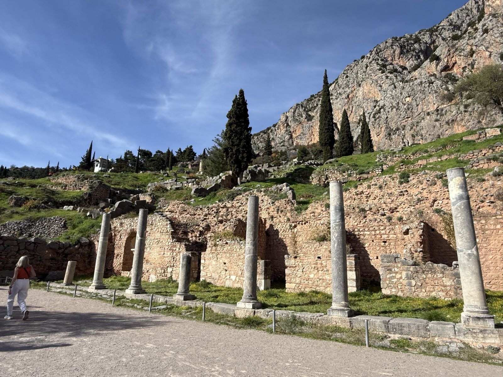
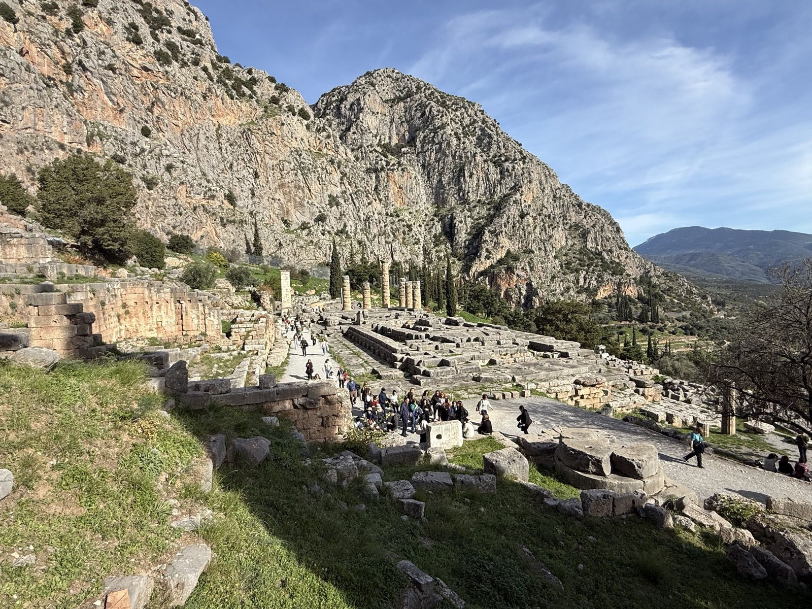
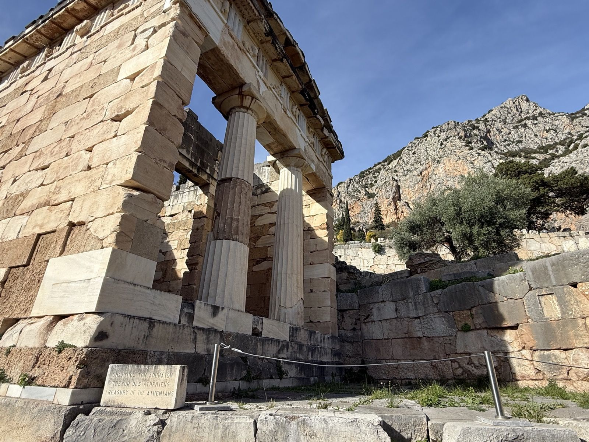
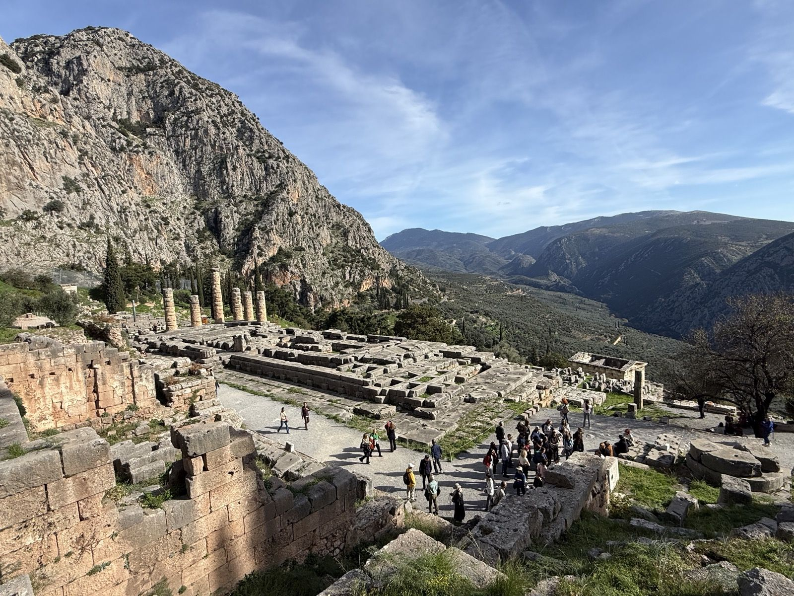
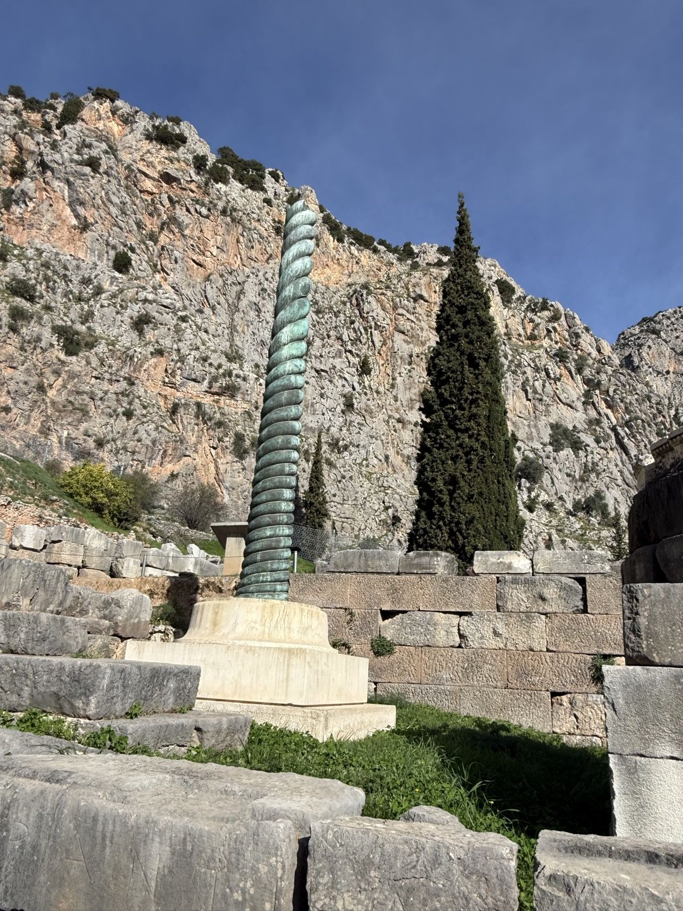
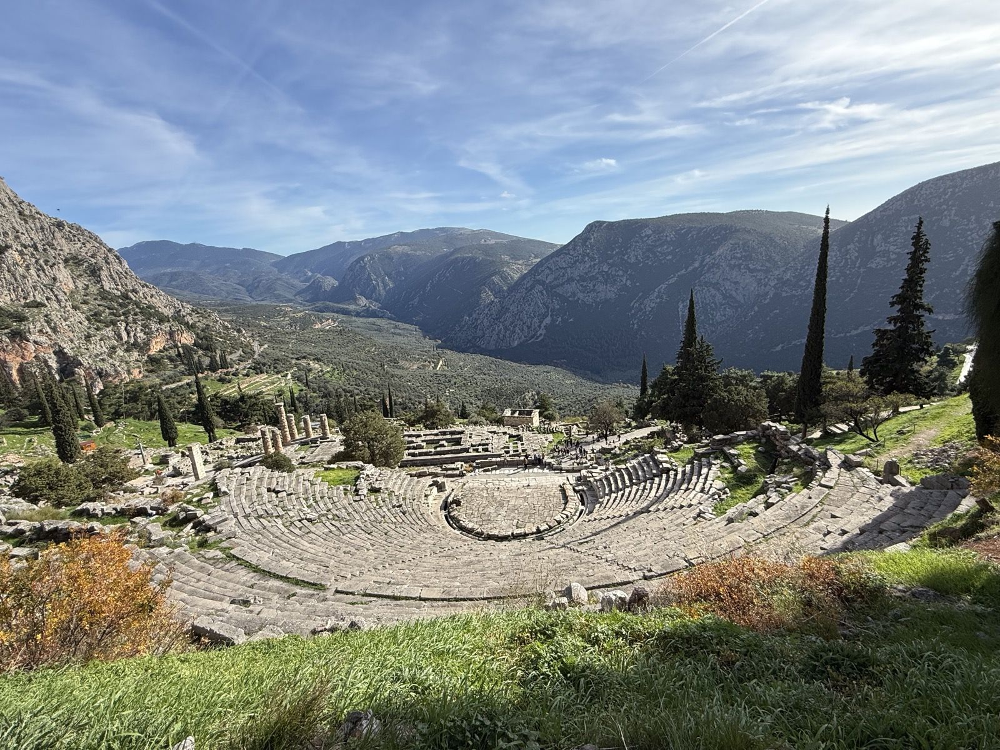
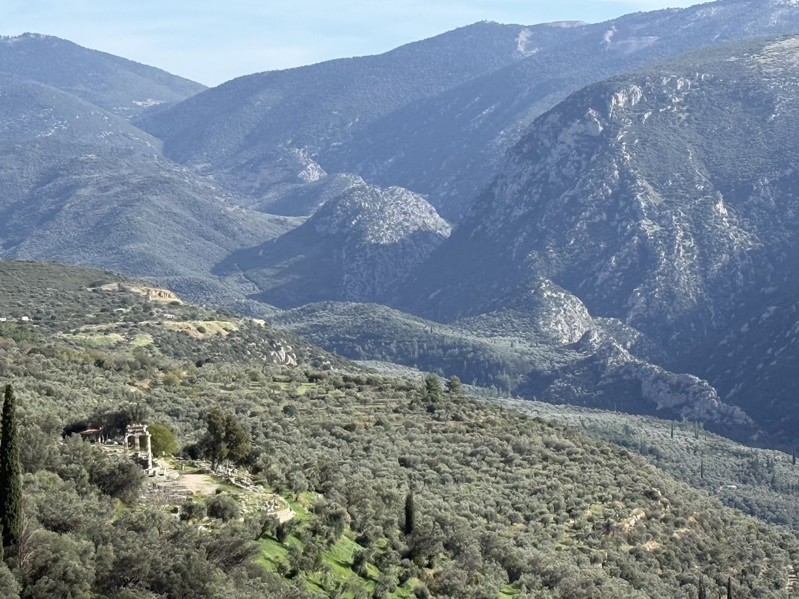
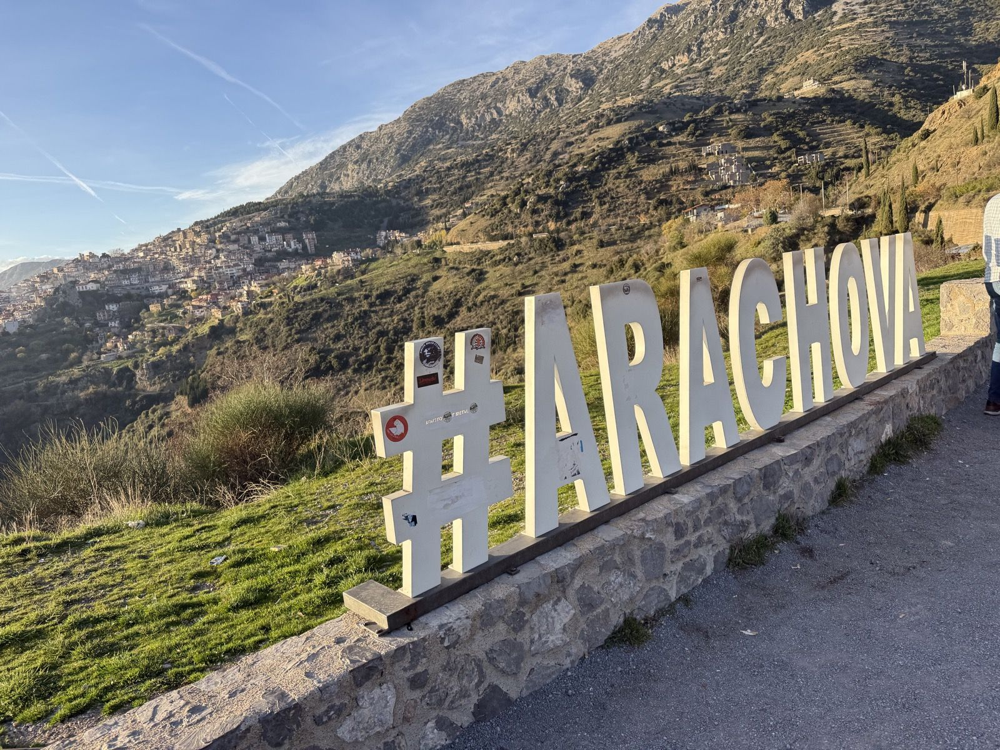
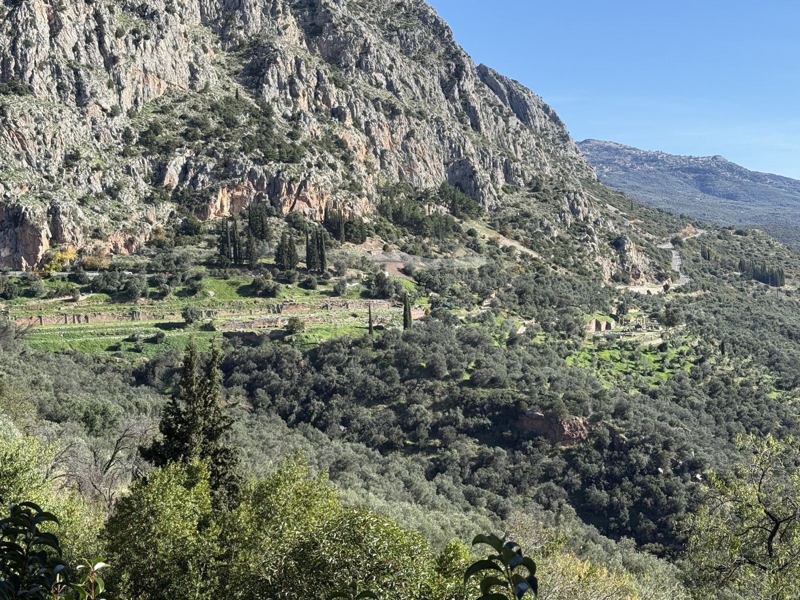

# Day 12: Delphi

## Summary

Day 12 (Sunday, November 22) is the day trip by road to Delphi, about two and a half hours each way. The chapter walks the site in order: the Castalian Spring, the Sacred Way and the Athenian Treasury, the polygonal wall and its records of freed slaves, the omphalos, the theater, the stadium of the Pythian Games, and the round Tholos at Athena Pronaia. In the museum it explains the Charioteer, and it traces the Serpent Column we saw in Istanbul back to its original home here. It closes with the French excavation that moved the village, and with modern Delphi, Arachova, the Amfissa olive groves, and mountain honey.

## Concepts Covered

This chapter covers the following 22 concepts from the learning graph:

| Concept | Concept Impact Score |
|---------|-----------------------|
| Day Trip to Delphi | 1 |
| Serpent Column | 1 |
| Arachova | 1 |
| Amfissa Olive Groves | 1 |
| Thyme Honey | 2 |
| Loukoumades | 1 |
| Sacred Way of Delphi | 3 |
| Treasuries of Delphi | 2 |
| Athenian Treasury | 1 |
| Omphalos | 1 |
| Castalian Spring | 1 |
| Polygonal Wall | 2 |
| Manumission Records | 1 |
| Pythian Games | 3 |
| Theater of Delphi | 1 |
| Stadium of Delphi | 1 |
| Athena Pronaia Sanctuary | 2 |
| Tholos of Delphi | 1 |
| Delphi Archaeological Museum | 2 |
| Charioteer of Delphi | 1 |
| French Excavation of Delphi | 2 |
| Modern Delphi Village | 1 |

## Prerequisites

This chapter builds on concepts from:

- [Chapter 1: Before We Go, Part 1: The Long Timeline of the Eastern Mediterranean](../01-long-timeline/index.md)
- [Chapter 2: Before We Go, Part 2: Traveling Well and the Learning for All Thread](../02-traveling-well/index.md)
- [Chapter 4: Day 2: Byzantine Constantinople and Hagia Sophia](../04-byzantine-constantinople/index.md)
- [Chapter 8: Day 6: Troy and Gallipoli](../08-troy-and-gallipoli/index.md)
- [Chapter 9: Paul at Ephesus, Part 1: The Apostle's Life, Letters, and Ephesian Years](../09-paul-life-letters/index.md)
- [Chapter 10: Day 7: Ephesus, a Greco-Roman City](../10-ephesus-greco-roman-city/index.md)
- [Chapter 12: Day 8: Rhodes, From the Colossus to the Knights](../12-rhodes/index.md)
- [Chapter 15: Day 10: Athens, the Acropolis, and the Persian Wars](../15-athens-acropolis/index.md)
- [Chapter 17: The Oracle and the Algorithm, Part 1: The Oracle](../17-oracle/index.md)

---

## A Sunday on Apollo's Mountain

Day 12, Sunday, November 22, is our day trip from Athens to Delphi, about 180 km and two and a half hours each way by coach. Last night's chapter, Chapter 17, explained the oracle as an institution: the Pythia on her tripod, the steps of a consultation, the famous answers and their flaws, and the league that ran the sanctuary. Today we stand in the place itself. The ruins are not one building but a whole hillside of them, climbing in terraces under the cliffs of Mount Parnassus, and each terrace was built by someone who wanted to be seen there.

So today's chapter is a walk, in the order a pilgrim climbed, from the spring at the bottom to the stadium at the top, then down to Athena's sanctuary and into the museum. It ends where the ancient story meets the modern one: a village that archaeologists moved, a mountain town that lives from snow, and a plain of olives that was once the god's own land.

!!! mascot-welcome "A Hillside That Talks"
    { class="mascot-admonition-img" }
    Today we follow a bronze snake from Istanbul back to its home, watch a bronze driver hold the reins he has held for about 2,500 years, and read the names of people who bought their own freedom from a god. Every stone on this slope was put there to send a message. By evening we will be able to read a good number of them. Look closer.

The chapter has six parts. Part One covers the drive and the Castalian Spring. Part Two climbs the Sacred Way past the treasuries, the polygonal wall and its records, the Serpent Column's old home, and the omphalos. Part Three explains the Pythian Games and visits the theater and the stadium where they were held. Part Four goes down to the sanctuary of Athena Pronaia and its Tholos. Part Five tours the museum and the Charioteer. Part Six follows Delphi after the oracle: the French excavation, the modern village, Arachova, the olive groves, thyme honey, and honey-soaked loukoumades <audio id="audio-loukoumades" src="../../audio/loukoumades.mp3" preload="none"></audio><button onclick="document.getElementById('audio-loukoumades').play()" class="pronounce-btn">🔊 Pronounce</button> *loo-koo-MAH-thes*.

## Part One: The Road and the Spring

### The Day Trip to Delphi

The **day trip to Delphi** is Day 12 of our itinerary: a round trip by road from Athens to the sanctuary and its museum, about 180 km and two and a half hours each way, with a stop in the mountain town of Arachova. The road leaves Athens to the north, crosses the plain of Boeotia past Thebes, turns west at Livadeia, and then climbs the flank of Parnassus. Somewhere on this road, ancient writers placed the crossroads where Oedipus met and killed his father, a story Chapter 17 tested. Pilgrims who came from Athens walked or rode much of the same way for several days. We do it before lunch.

A long day by coach has a shape, and our own photos record it. Their timestamps, in Athens time, show where the hours went.

| Time (Athens) | What our photos show | Where this chapter covers it |
|---|---|---|
| About 11:00 AM | The olive plain below Delphi | The Amfissa Olive Groves |
| 12:41 PM | Columns at the entrance to the sanctuary | The Sacred Way of Delphi |
| 12:49 PM | The Athenian Treasury | The Athenian Treasury |
| 12:57 PM | The bronze copy of the Serpent Column | The Serpent Column |
| 1:14 PM | The theater above the temple | The Theater of Delphi |
| 1:44 PM | The Pleistos valley | The Athena Pronaia Sanctuary |
| About 4:15 PM | Arachova, on the road home | Arachova |

**Worked example: budgeting a short winter day.** Let's see how much time the table leaves for each part of the visit. Our photos on the site span about an hour, from 12:41 to 1:44 PM. An hour is enough to walk the Sacred Way to the temple and theater at a steady pace, but not to linger at every stone. Add the museum, which deserves at least an hour, and lunch, and the day in Delphi itself runs from late morning to mid-afternoon. With two and a half hours of driving at each end and sunset at about 5:15 PM, much of the drive home is in the dark. The lesson for anyone planning the same day is simple: decide before arriving which three or four things matter most, because there will not be time for everything.

### The Castalian Spring

The **Castalian Spring** is the sacred spring that flows from the gorge between the two Phaedriades cliffs, just east of the Sanctuary of Apollo, where pilgrims, priests, and the Pythia purified themselves with water before entering the sanctuary. Two fountain houses survive. The older one, from about 600 BCE, lies lower down by the modern road: a paved court where water poured from spouts into a basin. The later one, cut into the rock face itself, has a long basin, steps, and niches carved for offerings. Because rocks fall from the cliffs above, the upper fountain is often fenced off, and we may have to look at it from the path.

Later stories gave the spring a nymph, Castalia, who leaped into it to escape Apollo, and Roman poets made its water the drink of poetic inspiration, as Parnassus was the home of the Muses. For a pilgrim, though, the point was simpler. Nobody approached Apollo unwashed. A splash of cold mountain water on the hands and hair was the first step of every visit, which is why our walk begins here too.

## Part Two: Up the Sacred Way

### The Sacred Way of Delphi

The **Sacred Way of Delphi** is the paved processional road that zigzags up through the Sanctuary of Apollo from its main gate at the southeast corner to the great altar in front of the temple. It runs west along the lowest terrace, turns sharply at the Athenian Treasury, climbs back east along the polygonal wall, and turns once more up to the temple. In antiquity it was lined so thickly with statues, bases, and small buildings that walking it was like walking through a crowded museum of Greek rivalry. Our best guide to what stood here is Pausanias, the Greek travel writer of the 2nd century CE, who walked it and described it monument by monument in the tenth book of his *Description of Greece*. Before the gate lies a paved square with a row of columns, the Roman agora, the market square of Roman times, where pilgrims probably bought statuettes and other offerings before going in.

<figure markdown="span" class="trip-photo">
  { loading=lazy }
  <figcaption>Columns of the Roman agora at the entrance to the Sanctuary of Apollo. Photo by Dan McCreary</figcaption>
</figure>

The first stretch inside the gate shows how the monuments argued with one another. Pausanias saw a bronze bull given by the island of Corcyra, statues given by the Arcadians, and the Spartans' monument for their naval victory over Athens in 405 BCE, which Chapter 17 met in its scoreboard of gifts. Across the way stood Athenian and Argive monuments. Rival cities set their victories facing each other on the god's road, so that every pilgrim walked between the claims.

### The Treasuries of Delphi

The **treasuries of Delphi** are the small, temple-shaped buildings that Greek city-states built along the Sacred Way to hold their offerings to Apollo and to display their wealth and piety. Archaeologists have found the foundations of more than twenty. A treasury was not a bank. It held gifts of gold, silver, and bronze, ritual equipment, and spoils of war, and its real job was to stand in the god's precinct with the city's name on it.

The treasury of the Corinthians, said to be the oldest, held the gold and silver gifts of Croesus, Herodotus says, and Chapter 17 explained how Croesus earned his answer. The small island of Siphnos built its treasury in marble around 525 BCE with young women, not columns, holding up its porch; its carved frieze is one of the museum's treasures. Most treasuries are now only foundations, so the terraces they stood on are the best guide to how crowded this slope once was.

<figure markdown="span" class="trip-photo">
  { loading=lazy }
  <figcaption>Sanctuary terraces under the cliffs. Photo by Dan McCreary</figcaption>
</figure>

### The Athenian Treasury

The **Athenian Treasury** is the small Doric treasury of Parian marble, built by Athens around 500 to 490 BCE, that stands at the first bend of the Sacred Way. It is the only treasury at Delphi that we can see standing, because French archaeologists rebuilt it from its original blocks between 1903 and 1906, with money from the city of Athens. Its metopes, the carved panels above the columns, showed the deeds of Heracles and of Theseus, the hero of Athens; the originals are in the museum and copies are on the building.

**Worked example: built from the spoils of Marathon?** Let's run Chapter 4's test on the building's famous story. Pausanias says the Athenians built the treasury from the spoils of the Battle of Marathon in 490 BCE, which Chapter 15 told. Beside the treasury, on a triangular terrace, a base still carries an inscription saying the Athenians dedicated the spoils of Marathon to Apollo. That sounds conclusive. But many archaeologists date the building's style to a few years *before* Marathon, around 500 BCE, and the inscription belongs to the terrace, which may have held a separate monument. So the honest verdict is "possibly." Athens certainly used this spot to remind every visitor of Marathon. Whether the treasury itself was paid for by that victory, or was simply a good place to advertise it afterward, the evidence does not settle.

<figure markdown="span" class="trip-photo">
  { loading=lazy }
  <figcaption>The Treasury of the Athenians. Photo by Dan McCreary</figcaption>
</figure>

Its walls also became a public notice board. In the 2nd century BCE, two hymns to Apollo were carved on its south wall with signs written above the words to show the melody. These Delphic Hymns are among the oldest pieces of written music that can still be performed, and the stones are now in the museum.

### The Polygonal Wall

The **polygonal wall** is the long retaining wall that holds up the terrace of the Temple of Apollo, built after the temple burned in 548 BCE. Its limestone blocks are not rectangles. Each is cut to an irregular many-sided shape with curving edges, and fitted against its neighbors so closely, without mortar, that the blocks lock one another in place. Masonry like this resists earthquakes well: the temple above it fell in the earthquake of 373 BCE, but the wall has stood for about 2,500 years. Against its lower face the Athenians built a long, narrow porch, the Stoa of the Athenians, to display spoils from their naval victories.

<figure markdown="span" class="trip-photo">
  { loading=lazy }
  <figcaption>The Sanctuary of Apollo on the slopes of Parnassus. Photo by Dan McCreary</figcaption>
</figure>

A smooth, prominent wall in the busiest part of the sanctuary was too good to leave blank. Over the centuries its face was covered with hundreds of inscriptions, so many that the wall became the sanctuary's public archive. Most of them record one kind of transaction, the subject of the next section.

!!! mascot-tip "Let the Light Skim the Stone"
    { class="mascot-admonition-img" }
    Here's an epigrapher's trick: worn letters show best when light skims across the stone at a low angle, not when it falls straight on. Look at the wall from the side, or shade it with your hand and hold a phone light low and sideways. Rows of letters will appear where we saw only rough stone.

### Manumission Records

**Manumission** is the legal act of freeing an enslaved person. The **manumission records** of Delphi are the inscriptions, more than a thousand of them, most carved between about 200 BCE and 100 CE, that record enslaved men and women gaining their freedom through a sale to Apollo. Many of them are on the polygonal wall. Slavery was normal in the ancient Greek world, and most enslaved people had been captured in war or by pirates, or born to enslaved mothers. A few could save money from their work, and at Delphi they could use it to buy their freedom in a form that the whole community would respect.

The form was a sale to the god. The owner "sold" the person to Pythian Apollo for a price, but the money was the enslaved person's own, saved and handed over through the god. Since no one could claim a god's property, the person became free. The record was dated by the **archon**, the magistrate who gave his name to the Delphic year, and named a **guarantor**, a citizen bound to defend the sale if anyone later claimed the freed person as a slave, and **witnesses**, often including Apollo's priests. Many records add a harder condition, called *paramone*, "remaining": the freed person had to stay with the former owner and serve, often until the owner's death, before the freedom became complete. Many of the people freed were women.

**Worked example: reading a record's parts.** Let's take the standard form of a Delphic manumission record, simplified and with the names left out, and ask what each part did. The table follows the record clause by clause.

| Part of the record | What it says, in substance | What it did |
|---|---|---|
| Date | In the year of a named archon, in a named month | Made the record findable and checkable |
| Sale | A named owner sold to Pythian Apollo | Made the god the legal buyer |
| The person freed | A named person, with his or her homeland | Identified who was freed |
| Price | A sum in silver, received in full | Recorded that the sale was complete |
| Freedom clause | The person trusted the purchase to the god, to be free, claimed by no one, living as they wish | Protected the freed person |
| Guarantor | A named citizen, by the law of the city | Protected the freed person against later claims |
| Paramone (in many records) | The freed person stays with the former owner while the owner lives | Kept the former owner's control for years |
| Witnesses | The priests and named citizens | Protected the freed person: people who could testify |

The record did two things at once. It gave a person freedom that no one could later deny, written where everyone could read it, and in many cases it also kept them bound to the old household for years. The infographic below lets us take a record apart clause by clause.

#### Diagram: Read a Freedom Record on the Polygonal Wall

<iframe src="../../sims/delphi-freedom-record-reader/main.html" height="734px" width="100%" scrolling="no"></iframe>

[Run the Read a Freedom Record on the Polygonal Wall MicroSim Fullscreen](../../sims/delphi-freedom-record-reader/main.html){ .md-button .md-button--primary }

Read a Freedom Record on the Polygonal Wall

Type: infographic
**sim-id:** delphi-freedom-record-reader 
**Library:** html 
**Status:** Specified 
**Bloom Level:** Analyze 
**Bloom Verb:** deconstruct 
**Learning Objective:** The learner will deconstruct a simplified Delphic manumission record into its eight clauses, naming each clause and judging whether it protects the freed person, limits the freed person's freedom, or records the facts of the sale, with at least 7 of the 8 judgments correct.

**Prerequisites:** manumission, manumission records, archon, guarantor, witnesses, paramone, and the sale to the god (all defined in "Manumission Records" above); inscription (Chapter 10); the polygonal wall (defined above).

**Evidence of Mastery:** For each of the eight clauses, the learner commits two answers: the clause name (from eight names) and its effect (one of three). A clause is correct when both answers match the Content table. Mastery is at least 7 of 8 clauses correct on the first attempt. Hovering over a clause and reading the glossary terms is exploration, not evidence.

**Misconceptions:** (1) Freedom at Delphi was a gift from the owner, when the price was usually the enslaved person's own savings. (2) A freed person was immediately and completely free, when many records include a paramone clause. (3) The god's role was decorative, when the sale to the god was the legal mechanism that made re-enslavement impossible. (4) The witnesses and guarantor were formalities, when they were the people who could defend the freedom later.

**Instructional Rationale:** Deconstructing a real document form into its working parts is an Analyze task: the learner must decide what each clause does, not just what it says. Asking for the effect of each clause, with protection and limitation as separate answers, makes the learner confront the record's double character.

**Content:**

A heading above the record reads: "A simplified record in the standard Delphic form. Bracketed words stand for the names that a real record gives. This is a composite, not a translation of one inscription."

The record, shown as eight clauses in this order:

| # | Clause text shown | Correct name | Correct effect | Why (shown as feedback) |
|---|---|---|---|---|
| 1 | "In the year when [name] was archon, in the month [month]," | Date | Records the facts | Dating by the archon's year made the record findable and checkable by anyone. |
| 2 | "[owner's name], son of [father's name], sold to Pythian Apollo" | Sale to the god | Protects the freed person | Once the god owned the person, no human could claim them as property. |
| 3 | "a woman named [name], [her homeland] by birth," | Person freed | Records the facts | The record names the person and her origin so that she can be identified later. |
| 4 | "for a price of [sum] of silver, and he has received the whole price," | Price | Records the facts | The price was usually the freed person's own savings, and full payment closed the sale. |
| 5 | "as [name] entrusted the purchase to the god, on condition that she be free and claimed by no one, doing what she wishes and going where she wishes." | Freedom clause | Protects the freed person | This clause states the freedom itself and forbids anyone to claim her. |
| 6 | "Guarantor, according to the law of the city: [name]." | Guarantor | Protects the freed person | The guarantor was legally bound to defend the sale if anyone claimed her as a slave. |
| 7 | "[name] shall remain with [owner's name] for as long as he lives, doing what she is told." | Paramone | Limits the freed person's freedom | This condition kept her serving the former owner, often until his death. |
| 8 | "Witnesses: the priests of Apollo, [name], [name]." | Witnesses | Protects the freed person | Witnesses could testify to the sale if her freedom was ever challenged. |

The eight clause names offered for every clause: Date; Sale to the god; Person freed; Price; Freedom clause; Guarantor; Paramone; Witnesses.

The three effects offered for every clause: Protects the freed person; Limits the freed person's freedom; Records the facts.

Glossary available on hover: archon, guarantor, witnesses, paramone, manumission, each with the definition given in the chapter section "Manumission Records".

**Provenance:** The clause structure, the sale to Pythian Apollo, the entrusting formula, the guarantor, the witnesses, and the paramone condition come from the chapter section "Manumission Records". The wording is a simplified composite of the standard form; the sim must show the heading in Content saying so.

**Rules:**

- The clauses are always shown in the fixed order 1 to 8.
- Each clause has exactly one correct name and one correct effect, as in the Content table.
- A clause counts as correct only when both its name and its effect are correct.
- Each clause name may be used for more than one clause while answering, but the Check reports every duplicate as wrong for all clauses except the one it fits.
- Score = number of correct clauses, from 0 to 8. Mastery is score >= 7 on the first Check.

**Learner Activity:**

1. The learner reads the whole record, then selects clause 1.
2. For the selected clause, the learner chooses a name and an effect. The clause is marked as answered.
3. The learner repeats step 2 for all eight clauses, in any order.
4. The learner presses Check. Each clause is marked correct or incorrect, and the "Why" text appears for every clause.
5. The learner may change answers on incorrect clauses and press Check again; only the first Check counts toward mastery.
6. After the final Check, a summary line appears under the record: "Four clauses protect her freedom, three record the facts, and one keeps her bound."
7. The learner should notice that the same document both guarantees and limits freedom.

**Feedback:** Eight clauses, fixed order, unlimited re-checks. Correct clause: "Correct: [why text]." Incorrect name: "This clause is the [correct name]. [why text]" Incorrect effect only: "Right name, but look again at its effect. [why text]" The score "Clauses correct: n of 8" is shown after each Check. After the second Check, a Show Answers option reveals any remaining correct answers.

**Starting State:** The eight clauses of the record, unanswered, with the heading from Content and the question "Which words set her free, and which words keep her bound?"

**Chapter Anchors:** More than a thousand manumission records, most from about 200 BCE to 100 CE; the sale to Pythian Apollo; the paramone condition, "often until the owner's death"; eight parts in the chapter's table, the same eight in this record.

### The Serpent Column

At the top of the Sacred Way, the road turns onto the temple terrace and reaches the great altar in front of the temple's east end. Here, Herodotus says, stood the golden tripod that the Greeks dedicated after their victory over the Persians at Plataea in 479 BCE, set on a three-headed serpent of bronze. Chapter 4 met what is left of that monument in Istanbul. Today we close the loop.

The **Serpent Column** is the bronze column of three intertwined snakes, cast for the Greek allies after Plataea from a tenth of the spoils, as Herodotus says, which once supported a golden tripod beside Apollo's altar and has stood in the Hippodrome of Istanbul since Constantine moved it to his new capital by 330 CE. Its coils carry the names of the 31 Greek communities that fought, under the heading "These fought the war." Chapter 17 told how the Spartan commander Pausanias first had his own name inscribed on it, and how the Spartans erased his boast.

**Worked example: two ends of one object.** Let's put the two ends of the Serpent Column side by side, and ask what each place can show us that the other cannot. On Day 2, in Istanbul, we looked down into a pit in the Hippodrome at a twisted trunk of bronze with no heads, standing on ground that has risen several meters since Byzantine times. On it we could have read, if we had climbed down, the names of the cities. In the Istanbul Archaeology Museums, which Chapter 5 passed at the edge of Gülhane Park, lies the upper jaw of one of the serpent heads. Istanbul has the object.

Delphi has the place. Here the monument's base still lies near the altar, and a bronze copy of the column now stands near it, so that we can see how tall the column rose against the cliffs and how close it stood to the god's altar and temple. Neither city tells the story alone. Istanbul cannot show why the column mattered, and Delphi cannot show the column. The written sources fill in what neither place can show: Herodotus gives the spoils and the place, Thucydides gives the erased boast, and the travel writer Pausanias, in the 2nd century CE, says that the gold of the tripod had been carried off by the Phocian leaders during the Third Sacred War of 356–346 BCE, while the bronze serpent still stood. The table sorts the evidence.

| Evidence | Where we meet it | What it adds |
|---|---|---|
| The monument's base by the altar | Delphi, the temple terrace | Where the monument stood, before every pilgrim's eyes |
| The bronze copy of the column | Delphi, near the altar | How the column looked in its setting |
| The bronze coils with the cities' names | Istanbul, the Hippodrome (Day 2) | Who fought, in their own inscription |
| The upper jaw of one head | Istanbul Archaeology Museums | What the lost heads looked like |
| Herodotus, about 430 BCE | A written source | Made from the spoils of Plataea; the tripod stood on the serpent by the altar |
| Thucydides, about 400 BCE | A written source | Pausanias' boast inscribed, then erased |
| Pausanias, 2nd century CE | A written source | The tripod's gold taken in 356–346 BCE; the bronze still in place |

The column's life runs across this whole book. It was cast in 479 BCE, the year after Salamis in Chapter 15. It lost its gold in the Third Sacred War of Chapter 17. It stood at Delphi for about eight hundred years and then, by 330 CE, became one of the ornaments Constantine gathered for his capital in Chapter 3. It survived the Byzantine and Ottoman centuries; Ottoman pictures of the 16th century still show its three heads, which broke off at the end of the 17th century or soon after, as different accounts say. One piece of a head came to light again in the 19th century.

<figure markdown="span" class="trip-photo">
  { loading=lazy }
  <figcaption>A bronze copy of the Serpent Column in the Sanctuary of Apollo. Photo by Dan McCreary</figcaption>
</figure>

!!! mascot-thinking "An Object Is Half a Story"
    { class="mascot-admonition-img" }
    Notice that the Serpent Column meant one thing beside Apollo's altar, where every Greek city saw its own name among the victors, and another in an emperor's racetrack, where it said "everything old and holy now belongs to the new capital." The bronze did not change; its place did. Whenever we meet an object far from home, ask what it said where it first stood.

The sorting activity below asks which evidence can be checked at which end of the column's journey.

#### Diagram: Two Ends of the Serpent Column

<iframe src="../../sims/serpent-column-two-ends/main.html" height="450px" width="100%" scrolling="no"></iframe>

[Run the Two Ends of the Serpent Column MicroSim Fullscreen](../../sims/serpent-column-two-ends/main.html){ .md-button .md-button--primary }

Two Ends of the Serpent Column

Type: microsim
**sim-id:** serpent-column-two-ends 
**Library:** p5.js 
**Status:** Specified 
**Bloom Level:** Analyze 
**Bloom Verb:** attribute 
**Learning Objective:** The learner will attribute each of 10 claims about the Serpent Column to the place where its evidence can be checked, at Delphi, in Istanbul, or only in an ancient written source, with at least 8 of 10 correct on the first attempt.

**Prerequisites:** Serpent Column, Plataea and the Persian Wars (Chapter 15), the Hippodrome (Chapter 4), the Third Sacred War (Chapter 17), Herodotus, Thucydides and Pausanias as sources, the great altar and the temple terrace, and the polygonal wall (all defined in this chapter's Part Two or in the chapters named).

**Evidence of Mastery:** The learner places each of the 10 claim cards into one of three bins. A placement is correct when it matches the Correct bin column in Content. Mastery is at least 8 of 10 correct on the first Check. Reading a card's hint before placing it is exploration, not evidence.

**Misconceptions:** (1) Everything about the column can be seen in Istanbul, because the bronze is there. (2) Delphi has nothing left of the monument. (3) Facts in a museum label must come from the object itself, when many come from ancient writers. (4) The column was always headless.

**Instructional Rationale:** Attributing each claim to its evidence is an Analyze task: the learner must separate what an object shows, what a place shows, and what only a text reports. The three bins mirror the chapter's table, so the learner rebuilds the distinction instead of reading it.

**Content:**

Bins, shown with these labels: "Check it at Delphi"; "Check it in Istanbul"; "Only in a written source".

Claim cards, shown in a shuffled order:

| # | Claim card | Correct bin | Why (shown as feedback) |
|---|---|---|---|
| 1 | Bronze coils carry the names of the Greek cities that fought. | Check it in Istanbul | The inscribed coils stand in the Hippodrome, where Constantine moved them. |
| 2 | A stone base by the great altar marks where the monument stood. | Check it at Delphi | The base never left the sanctuary. |
| 3 | A bronze copy shows how the column looked in its setting. | Check it at Delphi | The copy stands near the altar, close to where the original stood. |
| 4 | The upper jaw of one serpent head survives. | Check it in Istanbul | It is in the Istanbul Archaeology Museums, beside Gülhane Park. |
| 5 | The column stands in a pit because the ground has risen since Byzantine times. | Check it in Istanbul | The pit is in the Hippodrome, at about the level of the Byzantine track. |
| 6 | The temple terrace where the monument stood is held up by the polygonal wall. | Check it at Delphi | We can walk along the wall below the terrace. |
| 7 | The Spartan commander Pausanias had his own name inscribed first, and it was erased. | Only in a written source | Thucydides tells this story; the erased verse does not survive on the bronze. |
| 8 | A golden tripod once sat on top of the three heads. | Only in a written source | Herodotus and Pausanias describe the tripod; its gold was taken long ago. |
| 9 | The monument was made from a tenth of the spoils of Plataea. | Only in a written source | Herodotus gives the source of the metal; the bronze itself cannot tell us. |
| 10 | The Phocian leaders took the tripod's gold during the Third Sacred War. | Only in a written source | The travel writer Pausanias reports it, about five hundred years later. |

**Provenance:** All claims come from this chapter's sections "The Serpent Column" and "The Polygonal Wall" and from Chapter 4 (the Hippodrome pit, the Byzantine ground level). Bin assignments follow the chapter's evidence table.

**Rules:**

- 10 cards and 3 bins. Each card has exactly one correct bin.
- Cards are shuffled once when the sim starts; the order is the same after Reset.
- A card can be moved between bins until Check is pressed.
- Check is available only when all 10 cards are placed.
- Score = number of cards in their correct bin, from 0 to 10. Mastery is score >= 8 on the first Check.
- The correct totals are 3 for Delphi, 3 for Istanbul, and 4 for written sources.

**Learner Activity:**

1. The learner reads the three bin labels and the first card.
2. The learner places each card in a bin. A placed card can be moved again.
3. When all 10 cards are placed, the learner presses Check. Every card is marked correct or incorrect, and its Why text appears.
4. The learner moves the incorrect cards and presses Check again until all 10 are correct; only the first Check counts toward mastery.
5. When all cards are correct, the sim shows the three bins side by side with the summary: "Delphi has the place, Istanbul has the object, and the writers have the story."
6. The learner should notice that four of the ten claims depend on ancient writers, not on anything we can see at either end.

**Feedback:** Ten cards, shuffled, unlimited re-checks. Correct card: "Correct: [why text]." Incorrect card: "Not here. [why text]" The score "Cards correct: n of 10" is shown after every Check. A Reset option clears all placements and restores the starting order.

**Starting State:** Three empty bins, ten unplaced cards, and the question "The bronze is in Istanbul. What can only Delphi tell us?"

**Chapter Anchors:** Plataea, 479 BCE; 31 communities named; moved by 330 CE; the Third Sacred War, 356–346 BCE; Pausanias the travel writer, 2nd century CE; the upper jaw of one head in the Istanbul Archaeology Museums; ten claims, three bins.

### The Omphalos

The **omphalos** (Greek for "navel") is the sacred stone that marked Delphi as the center of the world. Chapter 17 told the best-known story behind it: Zeus released two eagles from the ends of the earth, and they met above Delphi. The poet Hesiod, around 700 BCE, told another. When Rhea saved the infant Zeus from his father Cronus, who swallowed his children, she gave Cronus a stone wrapped in swaddling clothes instead, and Zeus later set that stone up at Pytho, under Parnassus, as a sign for mortals. Pausanias saw a small stone near the temple that the Delphians anointed with oil every day and wrapped in raw wool at festivals, and said it was believed to be the stone of Cronus.

Several stones have carried the name. The one most visitors photograph is in the museum: a marble cone carved with a net of woolen bands, made in Hellenistic or Roman times, which may copy the stone that stood in the temple. Beside the Sacred Way, a plainer stone of the same beehive shape also waits for photographs; it too is a copy. The original, if a single original ever existed, is lost. What survives is the idea: a place that called itself the center of the world, and convinced the Greeks.

## Part Three: Games for Apollo

### The Pythian Games

The **Pythian Games** were the athletic and musical festival held at Delphi every four years in honor of Apollo, one of the four great Panhellenic games that were open to Greeks from every city. They began as a contest in singing a hymn to Apollo with the *kithara*, the concert lyre. After the First Sacred War, which Chapter 17 described, the Amphictyonic League reorganized them in 582 BCE as a festival held every four years, adding athletics and horse races. The music came first in the program, then the athletic events in the stadium, then the chariot and horse races on the plain below Delphi, where the racecourse has never been found. The prize was a crown of laurel, Apollo's tree; tradition says the branches were brought from the Vale of Tempe in Thessaly, where Apollo had been purified after killing the serpent.

The four Panhellenic games formed a circuit, spaced so that there were great games somewhere in Greece every year. Having described the Pythian program, we can compare the four.

| Games | Place | God | Crown | Held from | How often |
|---|---|---|---|---|---|
| Olympic | Olympia | Zeus | Wild olive | 776 BCE (traditional date) | Every 4 years |
| Pythian | Delphi | Apollo | Laurel | 582 BCE | Every 4 years |
| Isthmian | Isthmus of Corinth | Poseidon | Pine, at times wild celery | c. 582 BCE | Every 2 years |
| Nemean | Nemea | Zeus | Wild celery | c. 573 BCE | Every 2 years |

Winners were celebrated in poetry. The poet Pindar wrote twelve odes for Pythian victors, among them men from the Greek cities of Sicily, whose rulers spent fortunes on chariot teams. One of those rulers' brothers paid for the bronze in the museum that Part Five visits.

### The Theater of Delphi

The **Theater of Delphi** is the stone theater above the Temple of Apollo, at the top of the walled sanctuary, where the musical contests of the Pythian Games were held. Its first form dates from the 4th century BCE; it was rebuilt in stone in the 2nd century BCE, with help from King Eumenes II of Pergamon, and remodeled again under the Romans. Its 35 rows of seats held about 5,000 people, a fifth of the Great Theater of Ephesus in Chapter 10, but no theater on our route has a finer view. From the top rows we look down over the temple's columns into the Pleistos gorge.

<figure markdown="span" class="trip-photo">
  { loading=lazy }
  <figcaption>The theater of Delphi above the Temple of Apollo. Photo by Dan McCreary</figcaption>
</figure>

The theater had a modern second life. In 1927 and again in 1930, the Greek poet Angelos Sikelianos and his American wife, Eva Palmer-Sikelianos, staged Delphic Festivals here, with Aeschylus' *Prometheus Bound* performed in the ancient way, with masks, a chorus, and costumes woven by hand. They dreamed of making Delphi a center for peace between nations. The festivals were too expensive to continue, but they helped inspire the modern revival of ancient drama in ancient theaters, which still fills the theater at Epidaurus every summer.

### The Stadium of Delphi

The **Stadium of Delphi** is the running track and its stone seating at the highest point of the ancient site, above the theater and outside the sanctuary wall, where the athletic contests of the Pythian Games were held. It is one of the best-preserved stadiums in Greece. The track is about 178 m long. The stone starting and finishing lines survive, with grooves cut for the runners' toes, and a Roman entrance of four pillars stands at its east end. Pausanias credits the rich Athenian Herodes Atticus with giving it stone seats in the 2nd century CE; they held about 6,500 spectators.

The climb from the theater is steep, and in winter the path is not always open. The view from the top, of the whole sanctuary falling away below, is the reward for those who make it.

!!! mascot-warning "Polished Stones and Closed Paths"
    { class="mascot-admonition-img" }
    Watch out: the paving of the Sacred Way has been polished by millions of feet and turns slippery in rain or frost, and the upper paths, including the one to the stadium, are sometimes closed for rockfalls or ice. Wear shoes with grip, come down the steps slowly, and ask at the ticket gate which paths are open before planning the climb.

## Part Four: Athena Before the Temple

### The Athena Pronaia Sanctuary

The **Athena Pronaia sanctuary** is the lower sanctuary at Delphi, a short walk east of Apollo's, below the modern road, dedicated to Athena *Pronaia*, "before the temple," because it was the first shrine a pilgrim reached on the road from the east. Villagers later took its marble for building, and so it is still called the *Marmaria*, "the marbles." On a long, narrow terrace above the Pleistos gorge it holds the foundations of two temples of Athena, two small treasuries, one of them built by Massalia, the Greek colony that became Marseille, altars, and in the middle the round Tholos. Between it and the Castalian Spring lie the gymnasium and palaestra, where athletes trained for the games.

<figure markdown="span" class="trip-photo">
  { loading=lazy }
  <figcaption>The Pleistos valley below Delphi. Photo by Dan McCreary</figcaption>
</figure>

**Worked example: the rocks that saved Delphi.** Let's test a story Herodotus tells about this shrine. In 480 BCE, he says, a Persian detachment marched on Delphi to plunder it. As it reached the shrine of Athena Pronaia, thunderbolts fell from the sky and two great crags broke off Parnassus and crashed down on the Persians, who fled. Herodotus adds that the rocks still lay in Athena's precinct in his own day. What do we make of it? The rockfalls are believable: the cliffs above the Marmaria really do drop boulders, and rockfall damaged the old temple of Athena in the early 20th century. A Persian force may well have turned back here. That the god sent the rocks at exactly the right moment is the part no source could check. As with the Serpent Column, the place supplies what is possible, and the writer supplies the meaning.

### The Tholos of Delphi

The **Tholos of Delphi** is the circular marble building of the early 4th century BCE in the sanctuary of Athena Pronaia, the most photographed ruin at Delphi. A *tholos* is any round building. This one had an outer ring of 20 Doric columns and, inside the round wall, 10 Corinthian columns; three of the outer columns were set up again by archaeologists in the 20th century, which is why it photographs so well. The Roman architect Vitruvius says that its architect, Theodorus of Phocaea, wrote a book about it.

And there the certainty ends. No ancient writer says what the Tholos was for. Scholars have proposed a shrine to an earth goddess, a hero's memorial, a hall for some rite we no longer know, or a treasury. The building is one of the most admired in Greece, and nobody knows why it was built. That is worth remembering when a guide speaks with confidence: the best-preserved building can still be the least explained.

## Part Five: The Museum

### The Delphi Archaeological Museum

The **Delphi Archaeological Museum** is the site museum, beside the road between the sanctuary and the modern village, that holds the finds of the excavations at Delphi. Chapter 8 explained the advantage of a site museum, and Delphi shows it at its best: nearly everything here was found a few hundred meters away. The first museum opened in 1903, during the great excavation, and the building has been enlarged and rebuilt several times since. Its rooms follow the centuries, from the earliest offerings to the Roman emperors, and a walk through them in order of date passes these highlights.

- **Kleobis and Biton**, two marble youths of about 580 BCE from Argos. Herodotus says Solon named these brothers, who pulled their mother's cart to Hera's festival and then died in their sleep, the second-happiest of men, in the conversation with Croesus that Chapter 17 retold. Some scholars think the statues show the twin gods Castor and Pollux instead.
- **The Sphinx of the Naxians**, of about 560 BCE, a winged lion with a woman's head that once sat on a tall Ionic column near the polygonal wall.
- **The Siphnian Treasury frieze**, of about 525 BCE, with the gods fighting the giants and the gods debating the Trojan War.
- **The silver bull and the gold and ivory heads**, 6th-century BCE offerings found in 1939 in pits under the Sacred Way, where damaged treasures had been buried.
- **The Athenian Treasury metopes**, with Heracles and Theseus.
- **The Delphic Hymns**, the inscribed music from the treasury's wall.
- **The Dancers' Column** and the omphalos, a column of acanthus leaves with three dancing women at the top, and the carved marble navel stone.
- **The Charioteer**, in a room of its own.
- **Antinous**, a marble statue of the young favorite of the emperor Hadrian, from the 2nd century CE.

### The Charioteer of Delphi

The **Charioteer of Delphi** is the life-size bronze statue of a young chariot driver, about 1.8 m tall, made around 478 to 470 BCE, that survives from a group set up to celebrate a victory in the chariot race of the Pythian Games. The inscription on its base names Polyzalos, ruler of the Greek city of Gela in Sicily and brother of Hieron of Syracuse; the inscription was altered in antiquity, and scholars still debate whose name was carved first. The group once included the chariot, four horses, and probably a groom, and fragments of horses' legs and tail and a child's arm survive with it. French excavators found the driver in 1896, buried near the temple, probably by the earthquake of 373 BCE.

**Worked example: looking closer at the Charioteer.** Let's stand in front of it and read the details in order, from the head down. *The eyes* are inlaid with white and colored materials, so they seem to look back at us; few Greek bronzes keep their eyes. *The eyelashes* are fine strips of metal. *The lips* were once inlaid with copper, a slightly redder metal, to give them color. *The headband*, the victor's ribbon, was inlaid with a silver pattern. *The robe*, the long garment charioteers wore, falls in straight folds like the fluting of a column, and *the right hand* still holds part of the reins. *The face* is calm. This is not the race but the moment after it, the victory lap, and the sculptor has shown control instead of effort. Greek art was moving from the stiff, smiling statues of the Archaic period toward the Classical style of the Parthenon, and the Charioteer stands at that turning point.

!!! mascot-thinking "Saved by Being Lost"
    { class="mascot-admonition-img" }
    Think about why the Charioteer is here at all. Thousands of bronzes once stood in this sanctuary; Nero alone took about 500, and most of the rest were melted down for their metal. This one survived because it was buried and forgotten, so what we can see today is not a fair sample of what Delphi once held, only what happened to escape.

## Part Six: Delphi After the Oracle

### The French Excavation of Delphi

After the oracle closed at the end of the 4th century CE, Delphi did not simply empty. A Christian town grew on the site, then shrank, and by the time western travelers came looking, the ruins lay under a mountain village called **Kastri** <audio id="audio-kastri" src="../../audio/kastri.mp3" preload="none"></audio><button onclick="document.getElementById('audio-kastri').play()" class="pronounce-btn">🔊 Pronounce</button> *kah-STREE*, "the little castle." Its houses stood on the sanctuary's terraces, and its people reused the ancient stones in their walls. Travelers who knew their Greek authors came looking for Delphi: the Italian merchant Cyriac of Ancona copied inscriptions here in 1436, and in 1676 the French doctor Jacob Spon and the English traveler George Wheler identified the village as the site of the oracle.

The **French excavation of Delphi** is the archaeological excavation of the Sanctuary of Apollo by the French School at Athens, led by Théophile Homolle, which began in 1892, after the village of Kastri was moved off the site, and uncovered most of what we see today. After years of negotiation, in which American archaeologists also bid for the site, the Greek government gave the excavation rights to France. Kastri's houses were bought and demolished, and its people were moved to a new village built a short distance to the west, which took the name Delphi. The excavators then cleared tons of earth and rubble from the slope. Within a few years they had found the treasuries, the polygonal wall with its inscriptions, the Delphic Hymns, and, in 1896, the Charioteer.

For the people of Kastri, the excavation meant losing their homes, their fields, and the graves of their families, so that the world could see what lay beneath them. Archaeology often makes such trades, and they are worth naming. The sanctuary we walk today exists because a village was taken away.

Delphi's story after the oracle falls into four stages, and naming them makes the dates easier to hold. First the site was **silenced**: the oracle closed and the sanctuary was built over. Then it was **found**: travelers identified it from their reading. Then it was **dug up**: the excavation revealed and recovered it. Finally it was **shown**: museums, rebuilding, festivals, and world recognition presented it to visitors. The timeline below places the key dates in those stages.

#### Diagram: Delphi After the Oracle

<iframe src="../../sims/delphi-after-the-oracle-timeline/main.html" height="450px" width="100%" scrolling="no"></iframe>

[Run the Delphi After the Oracle MicroSim Fullscreen](../../sims/delphi-after-the-oracle-timeline/main.html){ .md-button .md-button--primary }

Delphi After the Oracle

Type: timeline
**sim-id:** delphi-after-the-oracle-timeline 
**Library:** vis-timeline 
**Status:** Specified 
**Bloom Level:** Understand 
**Bloom Verb:** classify 
**Learning Objective:** The learner will classify nine events in Delphi's history after the oracle into the four stages silenced, found, dug up, and shown, with at least 8 of 9 correct, predicting each event's stage before its description is revealed.

**Prerequisites:** the closing of the oracle and the Theodosian Decrees (Chapters 3 and 17), the village of Kastri, the French excavation of Delphi, the Athenian Treasury, the Charioteer of Delphi, the Delphi Archaeological Museum, the Delphic Festivals in the Theater of Delphi, and the four stages silenced, found, dug up, and shown (all defined in this chapter above the block).

**Evidence of Mastery:** For each of the nine events, the learner commits a stage before the event's description and stage are revealed. A prediction is correct when it matches the Correct stage column in Content. Mastery is at least 8 of 9 correct. Scrolling and zooming the timeline are exploration, not evidence.

**Misconceptions:** (1) The ruins of Delphi were always visible and visited, when they lay under a village for centuries. (2) Archaeologists found Delphi by digging, when travelers identified it first from ancient texts. (3) The excavation was the end of the story, when rebuilding, museums, and festivals shaped what visitors see today. (4) What we see at Delphi is exactly as the excavators found it, when the Athenian Treasury was rebuilt.

**Instructional Rationale:** Classifying each event into a named stage is an Understand task: the learner must explain to themselves what the event did to the site. Predicting before the reveal makes the learner commit, and the four stages give the dates a structure that is easier to remember than a list.

**Content:**

Stages, with the definitions shown in a legend: Silenced (the oracle closes and the sanctuary is abandoned or built over); Found (travelers identify the site from ancient texts and inscriptions); Dug up (excavation reveals and recovers the sanctuary and its finds); Shown (the site and its finds are rebuilt, displayed, performed in, or recognized for visitors).

Events, in date order:

| # | Date | Event label | Description revealed after prediction | Correct stage | Why (shown as feedback) |
|---|---|---|---|---|---|
| 1 | 391–392 CE | Theodosian Decrees | Imperial decrees ban sacrifice and close the temples; with no sacrifice, the oracle falls silent. | Silenced | The decrees ended consultations and began the sanctuary's long burial. |
| 2 | 1436 | Cyriac of Ancona | The Italian merchant and antiquarian visits and copies inscriptions. | Found | He came looking for Delphi because of what he had read. |
| 3 | 1676 | Spon and Wheler | The French doctor Jacob Spon and the English traveler George Wheler identify the village of Kastri as Delphi. | Found | They matched the place to the ancient descriptions. |
| 4 | 1892 | The great excavation begins | The French School at Athens, led by Théophile Homolle, begins excavating after Kastri is moved west. | Dug up | Moving the village opened the sanctuary to excavation. |
| 5 | 1896 | The Charioteer found | Excavators find the bronze Charioteer buried near the temple. | Dug up | It was recovered from the earth that had protected it. |
| 6 | 1903 | The first museum opens | A museum near the site opens to display the finds. | Shown | It presented the finds to visitors. |
| 7 | 1903–1906 | The Athenian Treasury rebuilt | French archaeologists rebuild the Athenian Treasury from its original blocks, paid for by the city of Athens. | Shown | Rebuilding turned scattered blocks into a building visitors can see. |
| 8 | 1927 | The first Delphic Festival | Angelos and Eva Palmer-Sikelianos stage Aeschylus' *Prometheus Bound* in the ancient theater. | Shown | The theater was used again for drama. |
| 9 | 1987 | World Heritage Site | Delphi is listed as a UNESCO World Heritage Site. | Shown | The listing recognized the site for the whole world. |

**Provenance:** Events 1 to 9 and their dates come from this chapter's sections "The French Excavation of Delphi", "The Theater of Delphi", "The Athenian Treasury", "The Charioteer of Delphi", and "The Delphi Archaeological Museum", and from Chapter 17 (the closing of the oracle, the UNESCO listing in 1987).

**Rules:**

- The timeline spans 300 CE to 2000 CE. No events fall between 400 CE and 1400 CE; that stretch may be compressed, provided the sim states that it is compressed and still shows the length of the gap in years.
- Events are revealed one at a time in date order. Each starts as a dated card showing only its label.
- For each card, the learner chooses one of the four stages; the description and the correct stage are then revealed and the card is marked correct or incorrect.
- A revealed prediction cannot be changed.
- Score = number of correct predictions, from 0 to 9. Mastery is score >= 8.
- The correct totals are 1 Silenced, 2 Found, 2 Dug up, and 4 Shown.

**Learner Activity:**

1. The learner reads the four stage definitions in the legend.
2. The first event card appears on the timeline with its date and label only.
3. The learner predicts its stage. The description, the correct stage, and the Why text appear, and the card takes the mark of its correct stage.
4. The learner repeats step 3 for all nine events.
5. After the ninth event, the timeline shows all events grouped by stage, with the long gap between event 1 and event 2.
6. The learner should notice that more than a thousand years separate the silence from the rediscovery, and that four of the nine events concern how Delphi is shown, not how it was found.

**Feedback:** Nine predictions, fixed date order, one attempt each. Correct: "Correct: [stage]. [why text]" Incorrect: "This one is [correct stage]. [why text]" The score "Predictions correct: n of 9" is shown throughout. A Restart option clears all predictions.

**Starting State:** An empty timeline from 300 CE to 2000 CE, the legend of four stages, and the question "The oracle fell silent in 391 CE. How did Delphi come back?"

**Chapter Anchors:** Theodosian Decrees 391–392 CE; Cyriac of Ancona 1436; Spon and Wheler 1676; excavation begins 1892; Charioteer found 1896; first museum 1903; Athenian Treasury rebuilt 1903–1906; Delphic Festivals 1927 and 1930 (the timeline shows 1927); UNESCO 1987; four stages; nine events.

### Modern Delphi Village

**Modern Delphi village** is the small town just west of the archaeological site, built from 1892 for the people moved from Kastri, which lives today mainly from the visitors to the ruins. Its hotels, shops, and tavernas line two long streets that run along the slope, and from their back terraces the view falls away over the olive plain to the town of Itea and the blue line of the Gulf of Corinth. In summer the village is full of tour groups; on a Sunday in late November, many places keep shorter hours, and some close for the winter, the off-season pattern Chapter 8 described at Troy. The house of Angelos and Eva Palmer-Sikelianos is now a small museum of the Delphic Festivals. Most visitors see Delphi village only through a coach window. A walk along its main street, with a coffee on a terrace above the olives, shows what became of the people who were moved so that the sanctuary could be uncovered.

### Arachova

**Arachova** is the mountain town on the road between Livadeia and Delphi, at about 950 m on the slopes of Parnassus, known for its stone houses and steep lanes, its handwoven textiles and *formaela*, a hard local cheese that is fried or grilled, and its winter visitors. In 1826, during the Greek War of Independence, Greek forces under Georgios Karaiskakis defeated an Ottoman army here, and a monument in the town remembers the battle.

<figure markdown="span" class="trip-photo">
  { loading=lazy }
  <figcaption>A roadside sign spelling out Arachova, the mountain village above Delphi. Photo by Dan McCreary</figcaption>
</figure>

Arachova's year runs the opposite way from the coast's. Chapter 8 described the off-season livelihoods of places like Çanakkale, busy in summer and quiet in November. Arachova's busiest time is winter, when the ski slopes higher up the mountain open and Athenians drive up for the weekend; its quiet season is the summer. On November 22 we pass through between the two, as shopkeepers get ready for the ski season, which depends each year on the snow.

### The Amfissa Olive Groves

The **Amfissa olive groves** <audio id="audio-amfissa" src="../../audio/amfissa.mp3" preload="none"></audio><button onclick="document.getElementById('audio-amfissa').play()" class="pronounce-btn">🔊 Pronounce</button> *AHM-fee-sah* are the great plain of olive trees, often called the "sea of olives," that runs from below Delphi past the town of Amfissa down to Itea and the Gulf of Corinth, often described as one of the largest continuous olive groves in Greece. Seen from the terraces of Delphi, it fills the valley floor with gray-green. Its best-known product is a table olive, *Konservolia Amfissis*, with protected designation of origin in the European Union. In late November the harvest is under way, so the nets spread under the trees that Chapter 12 described may be out on the plain below us.

<figure markdown="span" class="trip-photo">
  { loading=lazy }
  <figcaption>The sea of olive trees below Delphi. Photo by Dan McCreary</figcaption>
</figure>

This plain was once the god's. After the First Sacred War, Chapter 17 explained, the land below Delphi was dedicated to Apollo and left unfarmed. When the people of Amphissa farmed it in the 4th century BCE, the league declared the Fourth Sacred War against them and called in Philip of Macedon. Today the land is planted from edge to edge, and nobody thinks it sacrilege. A plain that was once forbidden ground now feeds a region.

### Thyme Honey

**Thyme honey** is honey made by bees from the flowers of wild thyme, which covers the dry, rocky hillsides of Greece; it is pale amber, strongly scented, and one of the most prized Greek honeys. Greek beekeepers move their hives up and down the mountains with the seasons, and on Parnassus they also make honey from the fir forests. Chapter 14 found thyme honey with yogurt on a Cretan menu; here we can buy it from the people who keep the bees.

Bees belong to Delphi's oldest stories. Chapter 17 recalled the legendary second temple, built by bees of wax and feathers. The poet Pindar called the Pythia "the Delphic bee," and the *Homeric Hymn to Hermes* tells of three winged sisters living under a ridge of Parnassus who prophesy truthfully when they have eaten honey. Whatever the stories mean, they show that honey and prophecy were neighbors on this mountain long before honey was sold in jars along the road.

!!! mascot-warning "Honey Counts as a Liquid"
    { class="mascot-admonition-img" }
    A common trap: at airport security, honey counts as a liquid, so a jar larger than 100 ml in a carry-on bag will be taken away. Pack honey in checked luggage, sealed in a plastic bag and wrapped in clothes, or buy it in small jars.

### Loukoumades

**Loukoumades** are small puffs of yeasted dough, fried until golden and then soaked in honey or syrup and sprinkled with cinnamon, walnuts, or sesame. They are eaten hot, from a plate shared at the table, and sold all over Greece. The Turkish version, *lokma*, is the same sweet, and the Greek name comes from the Turkish one; in Turkey, especially around İzmir, families give *lokma* away to neighbors and passersby in memory of someone who has died, a small cousin of the charity Chapter 5 found in the imaret. Despite the similar sound, loukoumades are not related to *loukoumi*, the Turkish delight Chapter 6 bought, whose name comes from a different Arabic phrase.

Food writers often claim that loukoumades were the first recorded dessert, given as "honey tokens" to winners at the ancient Olympic Games. The claim is repeated widely, usually without naming the ancient passage it depends on. Until someone shows us that passage, Chapter 4's test puts it on the shelf with the legends: a good story, best enjoyed with a hot plate of loukoumades and a spoonful of Parnassus honey.

## Practical Notes for Day 12

- **Order of the day.** Leave Athens early; the drive is about two and a half hours each way. Our photos show the olive plain at about 11:00 AM, the sanctuary from about 12:40 to 1:45 PM, and Arachova at about 4:15 PM on the way home. Decide in advance between climbing to the stadium and having more time in the museum.
- **Hours.** Greek sites and museums keep shorter winter hours, and Delphi's site and museum close in the afternoon. Last entry is earlier than closing, the upper paths may close in bad weather, and some ticket arrangements change from year to year, so check on the day.
- **Weather and light.** Delphi is several degrees colder than Athens, as Chapter 17 predicted, and the wind on the terraces is sharp. The sun sets at Delphi at about 5:15 PM, so most of the drive back is in the dark.
- **Winter roads.** The road through Arachova can see snow and ice from late autumn, and on winter weekends ski traffic fills it once the season opens. The coach company decides whether to go; carry an extra layer and something to eat in case of delays.
- **Footing.** The ancient paving is uneven and slippery when wet. Shoes with grip matter more than anything else we pack today.
- **Food.** Lunch in Delphi village or Arachova: *formaela* cheese, grilled lamb or goat, *horta*, and, for us, a plate of melitzanosalata, the smoky eggplant dip of Chapter 15. Finish with loukoumades, and buy thyme honey to take home in the checked bag.
- **Tonight.** Read Chapter 19 on the drive back or this evening, while the Pythia's tripod is still in mind. Tomorrow, Day 13, is our last day in Athens, with its museums and its streets; read Chapter 20 before breakfast.

## Learning for All: Freedom Carved Where Everyone Could Read It

Chapter 2's route table gives Delphi a story about trust, prediction, and "Know thyself." Chapter 17 told the oracle's side of it, and Chapter 19 will set it beside the prediction machines of our own time. Today's note is about a different kind of trust, the trust we put in a record, and it comes from the polygonal wall.

Run Chapter 2's four-step pattern on the freedom records. *Locked up:* an enslaved person's status was whatever the owner, the owner's heirs, or a stranger with a claim said it was; a private promise of freedom could be denied, and a freed person had no papers anyone was bound to respect. *Opened:* at Delphi the freedom was written in stone, in the busiest place in the sanctuary, dated, witnessed, and backed by a guarantor and by the god himself. Anyone could read it, or have it read to them, and no one could quietly erase it. A woman whose freedom was questioned could point to the wall. *Resisted:* the owners wrote their own interests into the same records. The paramone clause kept many freed people serving for years, and the price came from savings that took a working life to gather. *Never all the way:* only those who could save the price were freed, many could not read their own record, and the system freed individuals without ever questioning slavery itself.

The lesson for AI and education is about who keeps the record of what a person has achieved, and who can show it. Today a student's learning leaves records everywhere: grades in one school's system, scores in an app, progress in an online course. Too often the record belongs to the system, not to the learner, and it disappears or stays locked when the student moves on. The companion textbook *AI-Native Schools* describes how an intelligent textbook can record what a student has mastered in a standard format and keep that record portable and under the student's and family's control, in [Tracking Mastery: xAPI, Learning Record Stores, and MicroSims](https://dmccreary.github.io/ai-native-schools/chapters/08-tracking-mastery-xapi-learning-record/). The Delphic wall got two things right: the record was trusted because a neutral keeper stood behind it, and the person it described could always point to it. It got one thing very wrong for our purposes: it was public to everyone. A learner's record should be just as trustworthy and just as much the learner's own, and private unless the learner chooses to show it.

## Key Takeaways

- The **day trip to Delphi** is about 180 km and two and a half hours each way; on a winter day, choose the three or four things that matter most.
- The **Castalian Spring**, between the Phaedriades, is where every visit began, with purification in cold water.
- The **Sacred Way of Delphi** zigzags from the gate to the altar, lined with rival cities' monuments. The **treasuries of Delphi**, more than twenty, held offerings and advertised their cities.
- The **Athenian Treasury**, about 500–490 BCE and rebuilt in 1903–1906, may or may not have been paid for by Marathon; it carries the Delphic Hymns.
- The **polygonal wall** holds up the temple terrace and has stood about 2,500 years. Its **manumission records**, more than a thousand at Delphi, record people buying their freedom through a sale to Apollo, often with a paramone condition.
- The **Serpent Column** stood by the altar from 479 BCE until Constantine moved it by 330 CE. Delphi keeps its place and a bronze copy, Istanbul keeps the bronze, and the written sources keep its story.
- The **omphalos** marked Delphi as the navel of the world; the carved stone in the museum is a Hellenistic or Roman piece.
- The **Pythian Games**, reorganized in 582 BCE, put music first and crowned winners with laurel. The **Theater of Delphi** held about 5,000; the **Stadium of Delphi** at the top of the site keeps its starting lines.
- The **Athena Pronaia sanctuary**, the Marmaria, was the first shrine on the road from the east; its round **Tholos of Delphi**, of the early 4th century BCE, is famous and unexplained.
- The **Delphi Archaeological Museum** keeps the finds beside their site. The **Charioteer of Delphi**, about 478–470 BCE, survived because it was buried.
- The **French excavation of Delphi** began in 1892 after the village of Kastri was moved; **modern Delphi village** is the town built for its people.
- **Arachova**, at about 950 m, lives from winter visitors. The **Amfissa olive groves** fill the once-sacred plain. **Thyme honey** and **loukoumades** are the sweet end of the day.

!!! mascot-celebration "From the Spring to the Stadium"
    { class="mascot-admonition-img" }
    You can now walk Delphi from the Castalian Spring to the stadium and tell what each terrace was built to say, read the parts of a freedom record on the polygonal wall, and trace the Serpent Column from Apollo's altar to the Hippodrome and back. You also know why a village moved so that we could see all this. Next stop: [The Oracle and the Algorithm, Part 2: The Algorithm](../19-algorithm/index.md), where the oracle's questions meet the prediction machines of our own day.
