# Day 13: Athens, Museums, Tutors, and the City Today

## Summary

Day 13 (Monday, November 23) is our last day. The chapter visits the National Archaeological Museum and the Antikythera mechanism, an ancient prediction machine that connects the Delphi chapters to modern AI, then Hadrian's Temple of Olympian Zeus and the Lyceum. Its Learning for All notes cover Aristotle tutoring Alexander, Bloom's 2 sigma finding, and AI tutoring, along with Plato's warning in the Phaedrus that writing would weaken memory and today's worries about relying on AI. It closes with modern Athens: Plaka, rebetiko, the Polytechnic uprising, the debt crisis, street graffiti, family and faith today, and Greek-Turkish relations.

## Concepts Covered

This chapter covers the following 26 concepts from the learning graph:

| Concept | Concept Impact Score |
|---------|-----------------------|
| Phaedrus on Writing | 4 |
| Lyceum | 1 |
| National Archaeological Museum | 3 |
| Antikythera Mechanism | 2 |
| Temple of Olympian Zeus | 1 |
| Rebetiko | 1 |
| Athens Polytechnic Uprising | 1 |
| Greek Debt Crisis | 6 |
| Greek-Turkish Relations | 1 |
| Daily Life in Athens | 4 |
| Family Life Today | 1 |
| Orthodox Faith Today | 1 |
| Migration and Refugees Today | 1 |
| Plaka Neighborhood | 1 |
| Greek Coffee | 1 |
| Fresh Fish | 1 |
| Ancient Prediction Machines | 1 |
| One-on-One Tutoring | 5 |
| Bloom's 2 Sigma Problem | 4 |
| Mastery Learning | 1 |
| AI Tutoring | 2 |
| Teaching Comes to Learner | 1 |
| Fear of New Learning Tech | 3 |
| AI Over-Reliance | 2 |
| AI Guardrails | 1 |
| Graffiti | 1 |

## Prerequisites

This chapter builds on concepts from:

- [Chapter 1: Before We Go, Part 1: The Long Timeline of the Eastern Mediterranean](../01-long-timeline/index.md)
- [Chapter 2: Before We Go, Part 2: Traveling Well and the Learning for All Thread](../02-traveling-well/index.md)
- [Chapter 3: Day 1: Istanbul, a City on Two Continents](../03-istanbul-two-continents/index.md)
- [Chapter 4: Day 2: Byzantine Constantinople and Hagia Sophia](../04-byzantine-constantinople/index.md)
- [Chapter 7: Day 5: The End of Empire and the Birth of Modern Turkey](../07-end-of-empire-modern-turkey/index.md)
- [Chapter 8: Day 6: Troy and Gallipoli](../08-troy-and-gallipoli/index.md)
- [Chapter 9: Paul at Ephesus, Part 1: The Apostle's Life, Letters, and Ephesian Years](../09-paul-life-letters/index.md)
- [Chapter 10: Day 7: Ephesus, a Greco-Roman City](../10-ephesus-greco-roman-city/index.md)
- [Chapter 12: Day 8: Rhodes, From the Colossus to the Knights](../12-rhodes/index.md)
- [Chapter 15: Day 10: Athens, the Acropolis, and the Persian Wars](../15-athens-acropolis/index.md)
- [Chapter 17: The Oracle and the Algorithm, Part 1: The Oracle](../17-oracle/index.md)
- [Chapter 19: The Oracle and the Algorithm, Part 2: The Algorithm](../19-algorithm/index.md)

---

## The Last Day in Athens

Day 13, Monday, November 23, is the last day of the trip, and a day on our own. Tomorrow we fly home. Today belongs to three things that do not fit on a cruise program: a great museum, a philosopher's school, and the living city around them. In the morning we can stand among the columns of the Temple of Olympian Zeus, which took about 650 years to finish, and walk through the National Garden to the ground where Aristotle taught. In the afternoon, in the National Archaeological Museum, we can look at a corroded lump of bronze from a shipwreck that turned out to be the oldest known geared calculating machine: the Antikythera mechanism <audio id="audio-antikythera" src="../../audio/antikythera.mp3" preload="none"></audio><button onclick="document.getElementById('audio-antikythera').play()" class="pronounce-btn">🔊 Pronounce</button> *an-tee-kih-THEER-uh*, the ancient prediction machine that Chapter 19 left waiting for us. In the evening we can walk down into Plaka for Greek coffee, fresh fish, and perhaps a night of rebetiko, the music the refugees of 1922 carried to Athens.

This is the guide for the day as we planned it. In practice we saw the museum earlier. On Day 11, after we left the ship, we walked through the National Garden in the late morning, past the Parliament on Syntagma Square, and up Panepistimiou Street to the neoclassical "trilogy" of the Academy, the University, and the National Library, and then spent from about 1:45 to 2:15 PM in the National Archaeological Museum. Half an hour is not enough for a museum this size, so the plan below gives it a whole afternoon. The chapter also asks the questions a last day raises. Who gets a good tutor? What do our tools do to our memories? And what is life like now for the people of this city, who in one lifetime have lived through a dictatorship, a debt crisis, and the arrival of hundreds of thousands of refugees?

!!! mascot-welcome "A Machine, a Tutor, and a City That Talks Back"
    { class="mascot-admonition-img" }
    Today we meet a box of bronze gears that could tell its owner the month of the next eclipse, more than a thousand years before anyone built its equal. We also meet the most famous tutor in history, hired by a king for his thirteen-year-old son, and ask whether every child might now have one. Then the city itself takes over, with its coffee, its fish, its music, and the writing on its walls. Look closer.

The chapter has five parts. Part One visits the National Archaeological Museum and its bronze prediction machine. Part Two walks from Hadrian's Temple of Olympian Zeus to the Lyceum, where Aristotle taught. Part Three reads the city today: the Polytechnic uprising, the debt crisis, daily and family life, faith, migration, and graffiti. Part Four spends the evening in Plaka with coffee, fish, and music. Part Five closes the trip where it began, with Greece and Turkey. After the Practical Notes, the Learning for All section tells two Athenian stories: Aristotle tutoring Alexander, and Plato's warning that writing would weaken memory.

## Part One: The Bronze Machine

### The National Archaeological Museum

The **National Archaeological Museum** is Greece's largest archaeological museum, on Patission Street about 2 km north of the Acropolis, and the home of the most important finds from sites all over the country, from the Stone Age to the end of antiquity. Its neoclassical building went up between 1866 and 1889. The Acropolis Museum (Chapter 15) holds what was found on one rock, and the Delphi museum (Chapter 18) what was found in one sanctuary; this museum gathers the whole country, which makes it the best place to review the trip in a single afternoon.

**Worked example: a route through the museum that reviews the trip.** Let's walk the galleries in the order they are laid out and stop at objects that close threads from earlier chapters. The central hall just past the entrance holds the Mycenaean collection, with the gold death mask that Heinrich Schliemann, whom Chapter 8 met at Troy, found at Mycenae in 1876 and called the mask of Agamemnon. It was made about three centuries before the dates usually given for a Trojan War, so the name belongs to the myth, not the history. In the early Greek galleries we can look for the Dipylon jug that Chapter 2 promised, with one of the oldest known Greek alphabetic inscriptions, scratched around 740 BCE, offering the jug as a prize to the best dancer. Among the Classical sculptures stands a small Roman copy of Phidias' Athena Parthenos, about a meter tall, the closest thing we have to the lost statue Chapter 15 described.

The museum's bronzes are much rarer than its marbles, because most ancient bronzes were melted down for their metal; the best survivors come from shipwrecks, where no one could reach them. From a wreck off Cape Artemision, in northern Euboea, came two of the museum's stars. One is a bearded god, more than 2 m tall, striding forward to hurl a weapon that is now lost, made about 460 BCE; scholars still argue whether he is Zeus with a thunderbolt or Poseidon with a trident. The other is the Jockey, a small boy clinging to a galloping horse, made about 140 BCE, whose pieces were raised from the seabed in the late 1920s and 1930s and later reassembled.

<figure markdown="span" class="trip-photo">
  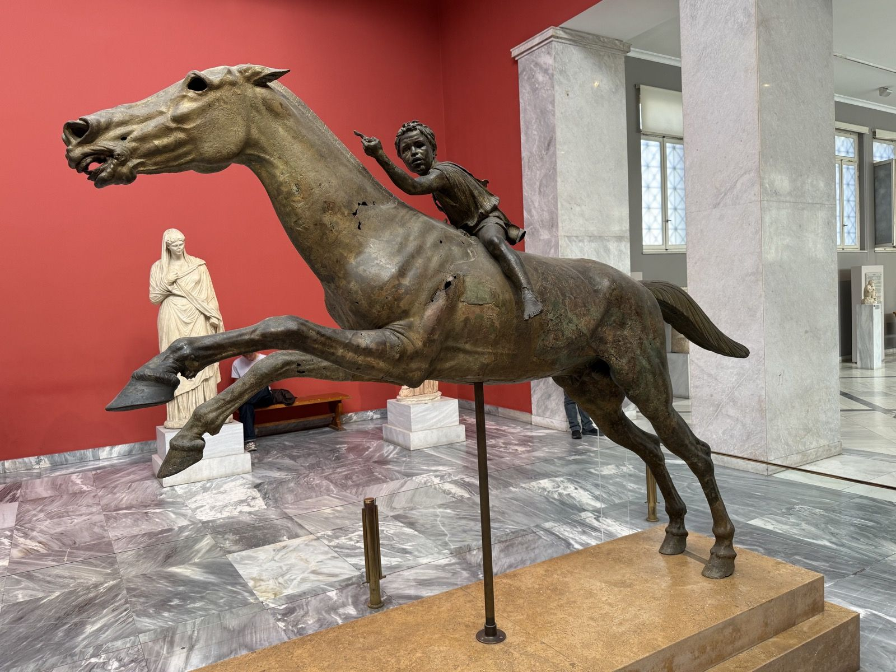{ loading=lazy }
  <figcaption>The Jockey of Artemision, bronze, about 140 BCE. Photo by Dan McCreary</figcaption>
</figure>

The Classical grave reliefs are the museum's quietest rooms and, for many visitors, its most moving. From the late 400s BCE until a law of about 317 BCE limited lavish tombs, Athenian families set carved marble slabs, called *stelai*, over their graves. The figures are calm. A seated woman clasps the hand of a standing man; a servant holds out a jewelry box; a father, a mother, and a grown child stand together. The handshake joins the living and the dead, and the faces show no grief: the sorrow is in the stillness.

<figure markdown="span" class="trip-photo">
  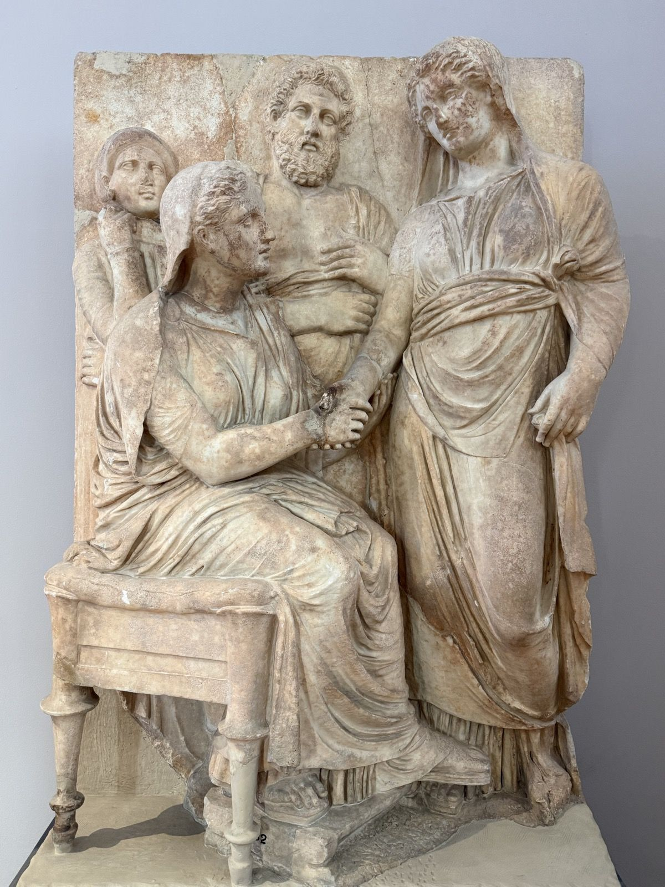{ loading=lazy }
  <figcaption>A Classical grave stele. Photo by Dan McCreary</figcaption>
</figure>

Horses appear in these galleries again and again, on reliefs, in bronze, and on painted vases, because in ancient Greece a horse was the clearest sign of wealth. Athens's cavalry came from its richest families, who kept their own mounts, and only the rich could enter a horse at the games. The boy on the Artemision racehorse rode for an owner like that, and families who could afford horses liked to be remembered with them.

<figure markdown="span" class="trip-photo">
  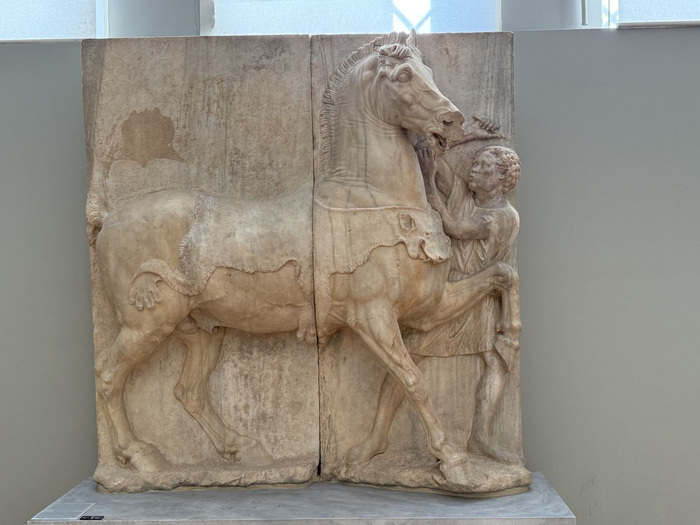{ loading=lazy }
  <figcaption>Marble relief of a horse and its handler. Photo by Dan McCreary</figcaption>
</figure>

The Hellenistic galleries turn playful. A marble group from the island of Delos, made about 100 BCE, shows Aphrodite raising her sandal to swat the goat-legged god Pan, who has grabbed her wrist, while a small winged Eros pushes Pan away by one horn. It was found in the clubhouse of a guild of merchants from Berytus, modern Beirut, who did business on Delos when it was the busiest free port in the Aegean: a reminder that Hellenistic art was made for a trading world that stretched from Italy to Syria.

<figure markdown="span" class="trip-photo">
  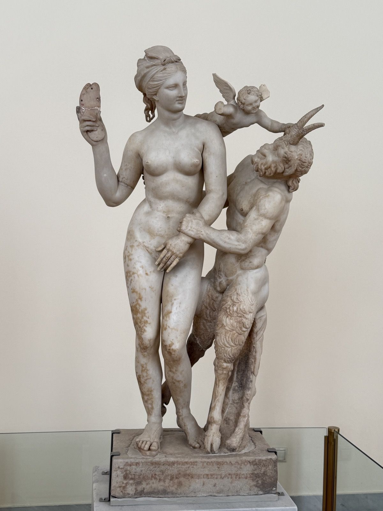{ loading=lazy }
  <figcaption>Aphrodite, Pan, and Eros, marble group from Delos. Photo by Dan McCreary</figcaption>
</figure>

!!! mascot-warning "Check Monday's Hours the Night Before"
    { class="mascot-admonition-img" }
    A common last-day trap is to plan the big museum for the afternoon and find it closing at 3:30 PM, because Greek state museums keep short winter hours and Monday hours often differ from the rest of the week. Check the museum's official hours the night before. If it opens late, do the Temple of Olympian Zeus first; if it closes early, swap the morning and the afternoon.

### The Antikythera Mechanism

The **Antikythera mechanism** is the remains of a hand-cranked device of bronze gears, made in the 2nd century BCE, that modeled the cycles of the Sun and the Moon, and probably the planets, so that its owner could turn a crank and read the sky on any date, past or future. In 1900 sponge divers sheltering from a storm off the small island of Antikythera, between Kythera and Crete, found a Roman-era shipwreck that had sunk about 70–60 BCE. Over the next year they brought up bronze and marble statues, among them the bronze Antikythera Youth that now stands in the museum, and a lump of corroded bronze and wood that no one noticed until 1902, when the archaeologist Valerios Stais saw a gear wheel in one of its broken pieces.

What survives is 82 fragments holding at least 30 gears, from a wooden box about the size of a shoebox, with a dial on the front, two on the back, and a crank on the side. The gears were cut by hand from thin bronze sheet, and every surface carried tiny Greek inscriptions, a built-in user's manual. The historian of science Derek de Solla Price called it "an ancient Greek computer" in 1959, and X-ray scans made in 2005 let researchers count teeth and read letters hidden inside the corroded lumps. The table lists the questions its owner could ask.

| Question the owner could ask | Dial that answered | Cycle set into the gears |
|---|---|---|
| Where are the Sun and the Moon among the stars on this date? | Front: zodiac and calendar rings | The solar year and the Moon's monthly circuit |
| What will the Moon look like that night? | Front: a turning half-silver, half-black ball | The month from new moon to new moon |
| Which month of the calendar is it, and are the Olympic Games this year? | Back, upper: a spiral of 235 months and a games dial | 19 years = 235 lunar months; the four-year games cycle |
| Could there be an eclipse that month, and at about what hour? | Back, lower: a spiral of 223 months | The Saros, 223 lunar months, about 18 years |

Who built it, and why the skill vanished for so long, is a story of its own, told in the appendix [Who Created the Antikythera Mechanism](../../appendices/antikythera-mechanism.md); the evidence points to a workshop, quite possibly on Rhodes, using the lunar theory of the astronomer Hipparchus. The MicroSim below lets us see how tooth counts turn one turn of a crank into different speeds for the Sun, the Moon, and a planet. Its gear ratios are simplified for teaching and do not reconstruct the real mechanism.

<iframe src="../../sims/antikythera-gears/main.html" height="699px" width="100%" scrolling="no" title="Simplified Antikythera gear model"></iframe>

[Run the Antikythera Gears MicroSim Fullscreen](../../sims/antikythera-gears/main.html){ .md-button .md-button--primary }

### Ancient Prediction Machines

**Ancient prediction machines** are devices built before the modern era that worked out the future from a model fixed into their structure, rather than from a god's answer or a new observation. The Antikythera mechanism is the most complex survivor, but the idea behind it was older and simpler. For centuries Babylonian astronomers had kept nightly records of the sky, and from them they had found that eclipses and the positions of the Moon and planets repeat in regular cycles, such as the 223-month Saros. Once a cycle is known, prediction becomes counting, and counting can be written on clay, carved in stone, or cut into gear teeth. Greek cities also set up the **parapegma**, a stone calendar with a hole for each day into which a peg was moved, listing the yearly risings and settings of the stars and the weather that was expected to come with them.

Set beside the oracle of Chapter 17, the mechanism changes three things. Its answer was the same for everyone who turned the crank, rich or poor, king or farmer. Its answer was fixed before the event, so it could be checked: an eclipse happens or it does not. And its answer came from a model that a person could inspect, gear by gear, rather than from the Pythia's trance and the priests' verses. Set beside the models of Chapter 19, it lacks one thing. Its rules were set once by its maker from centuries of records, and they never changed; a wrong ratio stayed wrong for as long as the gears turned. A machine-learning model, by contrast, adjusts its own rules from examples. One ancient device, then, sits between the tripod and the algorithm.

!!! mascot-thinking "Gears for What Repeats"
    { class="mascot-admonition-img" }
    Notice which half of the stone peg calendar worked. Star risings repeat exactly every year, so a fixed model could predict them for centuries; the weather does not, so the forecasts tied to the stars were far less reliable. Before trusting any prediction machine, ancient or modern, ask whether the thing it predicts actually repeats.

The sorter below asks us to tell the three ways of predicting apart by how each answer is produced, not by how old or impressive the source looks.

#### Diagram: Oracle, Gears, or Data?

<iframe src="../../sims/oracle-gears-or-data-sorter/main.html" height="660px" width="100%" scrolling="no"></iframe>

[Run the Oracle, Gears, or Data? MicroSim Fullscreen](../../sims/oracle-gears-or-data-sorter/main.html){ .md-button .md-button--primary }

Oracle, Gears, or Data?

Type: microsim
**sim-id:** oracle-gears-or-data-sorter 
**Library:** p5.js 
**Status:** Specified 
**Bloom Level:** Analyze 
**Bloom Verb:** differentiate 
**Learning Objective:** The learner will differentiate twelve predictions by how each answer is produced, as an oracle's answer, a cycle model, or a learned model, sorting at least 10 of the 12 correctly on the first attempt.

**Prerequisites:** the oracle consultation and the Pythia (Chapters 17 and 18); the Antikythera mechanism, the Saros cycle, the four-year games cycle, Babylonian eclipse records, the parapegma, and ancient prediction machines (Part One above); machine learning and the predictive model (Chapter 19).

**Evidence of Mastery:** The learner places each of the 12 statement cards in one of three bins and presses Check. A placement is correct when it matches the "Correct bin" column in Content. Mastery is at least 10 of 12 correct on the first Check. Reading the bin definitions and re-sorting after the first Check are practice, not evidence.

**Misconceptions:** (1) Anything ancient is guesswork or religion, so the mechanism and the Babylonian tables belong with the oracle. (2) Any machine that predicts must have learned from data, so the mechanism belongs with the learned models. (3) The bin depends on the material, clay, stone, bronze or software, rather than on the method that produced the answer.

**Instructional Rationale:** Differentiating is an Analyze task: the learner must look past the surface of each source (its age, its material, its prestige) to the process behind the answer. Sorting a mixed set, with the reason shown for each card, makes that process the deciding feature.

**Content:**

The three bins, each shown with its one-line definition:

- **Oracle:** a person gives an answer that the people asking must interpret.
- **Cycle model:** a rule built from regular cycles counted in past records, fixed in advance and the same for everyone.
- **Learned model:** a rule that a computer adjusted for itself from a very large number of past examples.

| # | Statement shown to the learner | Correct bin | Why (shown as feedback) |
|---|---|---|---|
| 1 | Athens's envoys are told to trust the "wooden wall" (480 BCE). | Oracle | The Pythia's words came through a person, and the Assembly had to argue over what they meant. |
| 2 | The mechanism's lower back dial marks a possible eclipse in a month 18 years from now. | Cycle model | The 223-month Saros cycle is cut into the gears, so the dial gives the same answer every time the crank is turned. |
| 3 | A phone keyboard suggests the next word of a message home. | Learned model | The keyboard learned which words usually follow which from an enormous amount of text. |
| 4 | Croesus is told that if he attacks Persia, he will destroy a great empire. | Oracle | The answer came from the Pythia, and Croesus heard the reading he wanted. |
| 5 | A Babylonian scribe's clay tablet lists the months, years ahead, when an eclipse may occur. | Cycle model | It counts the same repeating cycles as the gears; the method, not the material, decides the bin. |
| 6 | A bank's fraud system flags a card payment in Arachova as possibly not ours. | Learned model | The fraud check learned from millions of past genuine and fraudulent payments. |
| 7 | King Laius is told that his son will kill him. | Oracle | A personal answer from Delphi, given by a person and fulfilled in the story of Oedipus. |
| 8 | The mechanism's games dial shows that the Olympic Games fall in this year. | Cycle model | The four-year cycle of the games is fixed in the gearing. |
| 9 | A chatbot answers the question "Will the museum be open on Monday?" | Learned model | It predicts a likely answer from its training text; it cannot know this Monday's hours. |
| 10 | A stone peg calendar says that a certain star rises today and that a west wind will blow. | Cycle model | The parapegma counts the yearly cycle of star risings; its weather forecast was tied to that cycle. |
| 11 | Chaerephon is told that no one is wiser than Socrates. | Oracle | An answer from the Pythia that Socrates spent his life interpreting and testing. |
| 12 | A map app predicts how long the drive back from Delphi will take. | Learned model | It learned travel times from the movements of many other phones. |

Bin counts: Oracle 4 (cards 1, 4, 7, 11); Cycle model 4 (cards 2, 5, 8, 10); Learned model 4 (cards 3, 6, 9, 12).

**Provenance:** Cards 1, 4, 7 and 11 are the oracle stories told in Chapter 17. Cards 2, 5, 8 and 10 come from this chapter's sections "The Antikythera Mechanism" and "Ancient Prediction Machines" and from the appendix "Who Created the Antikythera Mechanism". Cards 3, 6, 9 and 12 are the everyday predictions described in Chapter 19 (Parts Two and Eight) and Chapter 2.

**Rules:** Each card belongs to exactly one bin. The 12 cards are presented in a shuffled order that is fixed for each session. Check is available only when all 12 cards are placed. Only the first Check is scored. After the first Check, wrongly placed cards are marked and may be moved again for practice; a later Check reports the practice result but does not change the first-attempt score.

**Learner Activity:**

1. The learner reads the three bin definitions and the question "How was each answer produced?"
2. The learner places each card in a bin. A placed card can be moved freely before Check.
3. The learner presses Check. Each card is marked correct or not yet correct, and its "Why" text appears.
4. The learner moves any wrongly placed cards and presses Check again for practice.
5. The learner should notice that cards 2, 5, 8 and 10 share a bin although they are made of bronze, clay and stone.

**Feedback:** One scored attempt for all 12 cards, then unlimited practice. For each correct card: "Correct: " followed by the card's Why text. For each wrong card: "Not quite: " followed by the card's Why text; if a cycle-model card was put with the oracle, add "Ancient does not mean guesswork: this answer was counted, not revealed."; if a cycle-model card was put with the learned models, add "This rule was set once by its maker and never adjusted itself." After the first Check the score "First attempt: n of 12" is shown, and at 10 or more the message "You can tell an oracle, a cycle model, and a learned model apart by how they work."

**Starting State:** The 12 cards are in a stack, the three bins are empty with their definitions visible, and the question "How was each answer produced?" is shown.

**Chapter Anchors:** Three ways of predicting. Twelve statements, four per bin. The Saros is 223 lunar months, about 18 years. The games dial follows a four-year cycle. Mastery is 10 of 12.

## Part Two: Hadrian's Temple and Aristotle's School

### The Temple of Olympian Zeus

The **Temple of Olympian Zeus** (the *Olympieion*) is the colossal Corinthian temple southeast of the Acropolis, begun about 520 BCE and finished about 650 years later by the Roman emperor Hadrian. It was one of the largest temples in the ancient Greek world: 104 columns, each about 17 m tall, of which 15 still stand; a sixteenth lies on the ground in sections, where a storm blew it down in 1852. Its long building history reads like a summary of Athens's masters.

| Date | Builder | What happened |
|---|---|---|
| c. 520 BCE | The family of the tyrant Peisistratus | A giant Doric temple is begun |
| 510 BCE | (The tyranny falls) | Work stops; the democracy leaves it unfinished |
| 174 BCE | King Antiochus IV of Syria | Work resumes with a Roman architect, Cossutius, and the design becomes Corinthian |
| 164 BCE | (Antiochus dies) | Work stops again |
| 86 BCE | The Roman general Sulla | He is said to have carried some of its columns to Rome |
| 131–132 CE | The emperor Hadrian | The temple is finished and dedicated |

Two names in the table will be familiar. Antiochus IV is the Seleucid king whose persecution of the Jews Chapter 9 described, the story behind Hanukkah; in Athens he played the generous patron. Sulla is the general who sacked Athens in 86 BCE. Aristotle, whom we meet next, used the unfinished temple as an example in his *Politics*: tyrants, he said, keep their subjects busy and poor with vast building projects, and he named the Peisistratids' temple of Olympian Zeus beside the pyramids of Egypt.

Hadrian (emperor 117–138 CE), who loved Greece, spent long stays in Athens and gave the city a library, an aqueduct, and a new quarter. Beside the temple stands **Hadrian's Arch**, a gateway put up around the time of the dedication. Its inscription on the side facing the Acropolis says, roughly, "This is Athens, the ancient city of Theseus"; the side facing the new quarter answers, "This is the city of Hadrian, and not of Theseus." Just south of the temple ran the little Ilissos River, now mostly buried under streets. It was on its banks, under a plane tree, that Plato set the conversation in the *Phaedrus* that the Learning for All section takes up.

A short walk east, past the Zappeion hall, is the **Panathenaic Stadium**, the long horseshoe of white marble where the first modern Olympic Games opened in 1896. It was first laid out in the 330s BCE for the Panathenaic Games, rebuilt in marble by the wealthy Herodes Atticus in the time of Hadrian's successor, about 144 CE, and restored for 1896 with money from the merchant George Averoff. Athenians call it the *Kallimarmaro* <audio id="audio-kallimarmaro" src="../../audio/kallimarmaro.mp3" preload="none"></audio><button onclick="document.getElementById('audio-kallimarmaro').play()" class="pronounce-btn">🔊 Pronounce</button> *kah-lee-MAR-mah-roh*, "beautiful marble." It was the finish line of the marathon at the 2004 Olympics, and the Olympic flame is still handed over here to each host city. We passed it at midday on Day 10, on our way to the Agora.

<figure markdown="span" class="trip-photo">
  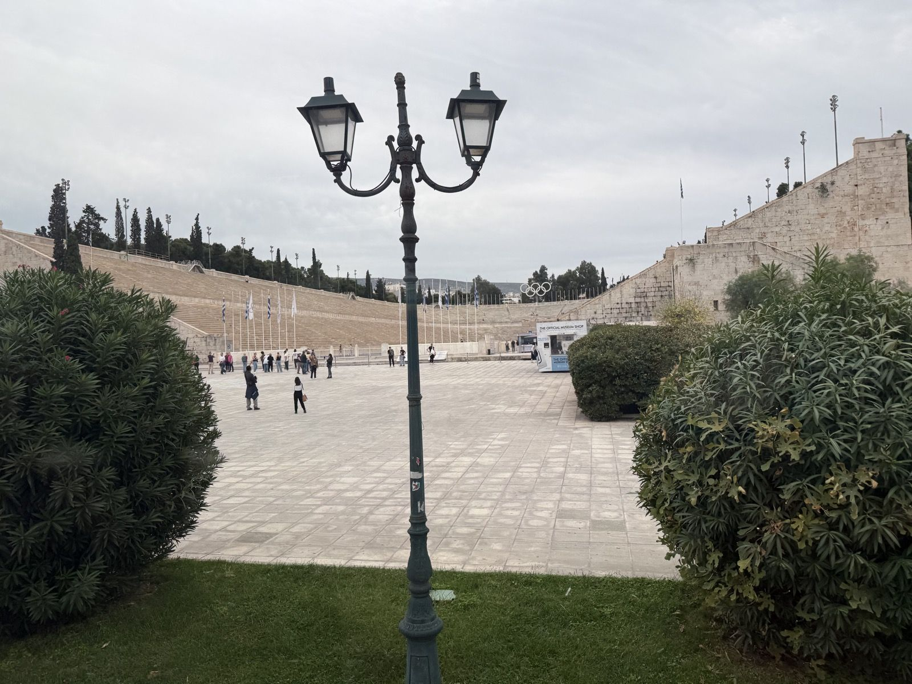{ loading=lazy }
  <figcaption>The Panathenaic Stadium, seen from the square at its entrance. Photo by Dan McCreary</figcaption>
</figure>

### The Lyceum

The **Lyceum** (*Lykeion*) was a gymnasium and sanctuary of Apollo Lykeios just outside the eastern walls of ancient Athens, where Aristotle founded his school in 335 BCE, as Chapter 9 told. Aristotle was a metic, a foreigner without citizen rights, so he could not own land in Athens; he taught in a public gymnasium, where men exercised, and Socrates had talked there before him. His school took the name *Peripatetic* from the *peripatos*, a covered walkway; the tradition that he lectured while walking may be a story built from the name. The Lyceum was a research school as much as a teaching one. Its members collected books, plant specimens, and animal descriptions, and they compiled descriptions of the constitutions of 158 states, most of them Greek cities, of which only the *Constitution of the Athenians* survives, recovered on a papyrus published in 1891. When Alexander died in 323 BCE, anti-Macedonian feeling turned against his old tutor, and Aristotle left Athens; a later story has him saying he would not let the Athenians sin twice against philosophy, the first time being Socrates. He died the next year.

For two thousand years no one knew exactly where the Lyceum had been. In 1996, digging for a new museum of modern art on Rigillis Street, near the Byzantine and Christian Museum and a short walk from the National Garden, uncovered the foundations of a wrestling ground, or *palaestra*, from the gymnasium, and the site opened to visitors in 2014. There is not much to see, a grid of low foundation walls, but it is the ground where a great deal of Western science began, and few tourists find it.

Back on Panepistimiou Street, the modern Academy of Athens, the scholarly society of today's Greece, honors the older school. Its neoclassical building, designed by the Danish architect Theophil Hansen and finished in 1885, has seated statues of Plato and Socrates beside the steps and Athena and Apollo on tall columns. There is no Aristotle among them: the Academy's name and its statues point to Plato's school, the one Aristotle left to start his own.

<figure markdown="span" class="trip-photo">
  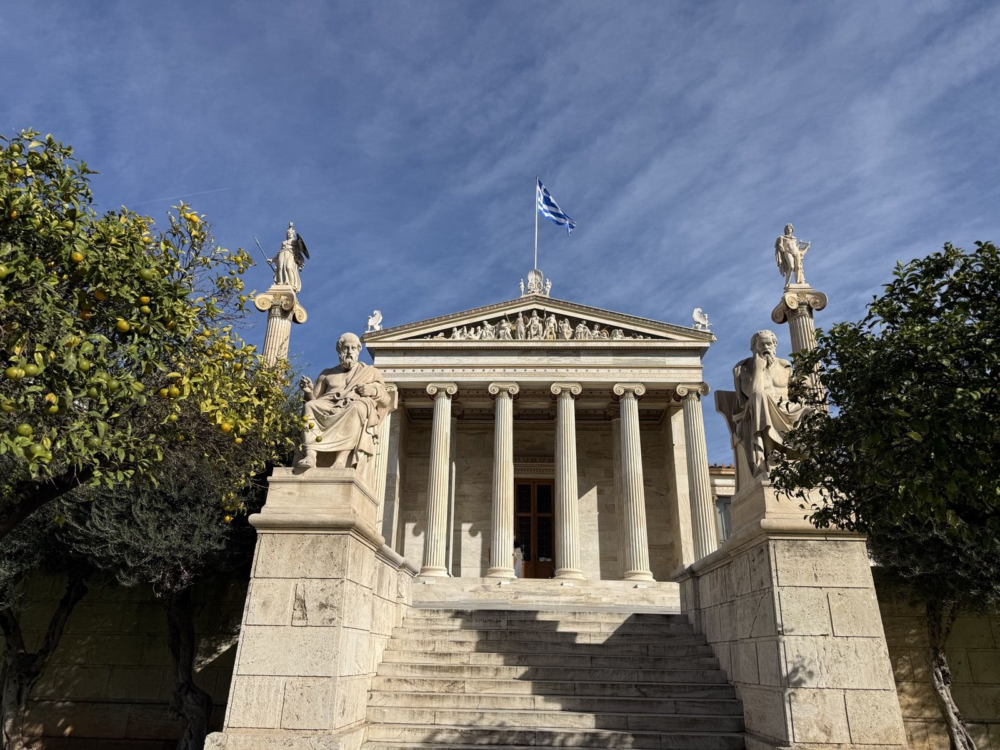{ loading=lazy }
  <figcaption>The Academy of Athens on Panepistimiou Street. Photo by Dan McCreary</figcaption>
</figure>

In the museum's sculpture galleries, bearded marble heads look out from every wall, and many visitors assume each must be a philosopher. A full beard in Greek art marked a mature man, a citizen, a god, or a thinker, so a beard alone tells us little. Aristotle's own portraits, known from Roman copies of a 4th-century BCE original, show a man with a short, neatly trimmed beard and a thoughtful frown. The head below has no label in our photo, and we cannot say whose it is, which is itself a good museum habit: read the card before naming the face.

<figure markdown="span" class="trip-photo">
  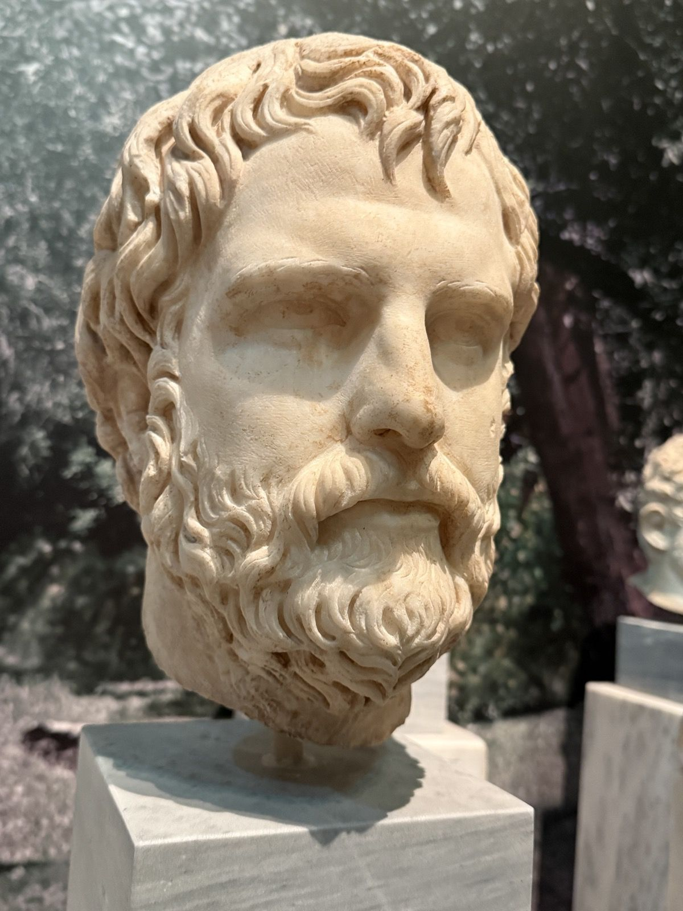{ loading=lazy }
  <figcaption>Marble head of a bearded man in the National Archaeological Museum. Photo by Dan McCreary</figcaption>
</figure>

## Part Three: Athens Today

### The Athens Polytechnic Uprising

The **Athens Polytechnic uprising** was the student occupation of the National Technical University of Athens, the *Polytechneio*, on Patission Street, from November 14 to 17, 1973, in protest against the military dictatorship that had ruled Greece since a group of army colonels seized power on April 21, 1967. The junta had banned parties, censored the press, and jailed and tortured opponents. Students barricaded the campus and broadcast from a makeshift radio station, calling on the people of Athens to join them, and thousands came. In the early hours of November 17, a tank crashed through the main gate. Later research has documented at least 24 civilians killed in the crackdown across the city. A week later harder-line officers overthrew the junta's leader, but the regime fell in July 1974, after it backed a coup in Cyprus that led to the Turkish military intervention there, as Part Five explains.

The Polytechnic stands right beside the museum on Patission Street, and the bent iron gate is preserved on the campus as a memorial. November 17 is now a day of remembrance in Greek schools. Each year people lay flowers at the gate, and in the afternoon a large march sets out from the Polytechnic, traditionally ending at the United States Embassy, because many Greeks believe Washington supported the junta. The pattern around the anniversary is predictable: metro stations in the center close, streets are blocked, and in the evening there are sometimes clashes between small groups and riot police around Exarchia <audio id="audio-exarchia" src="../../audio/exarchia.mp3" preload="none"></audio><button onclick="document.getElementById('audio-exarchia').play()" class="pronounce-btn">🔊 Pronounce</button> *ek-SAR-khee-ah*, the student neighborhood just behind the Polytechnic. By November 23 the anniversary has passed, but Exarchia's political walls, and its graffiti, tell the story all year.

!!! mascot-warning "A March Is Not a Street Festival"
    { class="mascot-admonition-img" }
    A common trap is to follow a lively crowd toward Exarchia or the Polytechnic on a protest evening because it looks festive. Most marches are peaceful, but tear gas drifts a long way. On a day with a march, check the news in the morning, use metro stations away from the route, and visit the museum in daylight.

### The Greek Debt Crisis

The **Greek debt crisis** was the financial and social collapse that began in 2009, when Greece could no longer borrow on the markets to pay its debts, and that lasted, through three international rescue loans and years of austerity, until 2018. Greece had joined the European Economic Community, forerunner of the European Union, in 1981 and adopted the euro in 2001, with notes and coins replacing the drachma in 2002. Borrowing in euros was cheap, and the state and the banks borrowed heavily. In October 2009 a newly elected government revealed that the budget deficit was more than twice as large as had been reported, and lenders took fright.

What followed is best told as a sequence.

1. **2010:** the first rescue loan, €110 billion from the other euro countries and the International Monetary Fund, in exchange for deep cuts to wages, pensions, and public spending.
2. **2012:** a second rescue and the largest government debt write-down in history to that date, in which private bondholders lost more than half the face value of their bonds.
3. **2015:** a new government, elected against austerity, called a referendum on the lenders' terms; to stop a run on the banks, they were closed and cash withdrawals limited to €60 a day. Voters rejected the terms on July 5, but within days the government accepted a third rescue on similar terms.
4. **2018:** Greece left its last rescue program in August.

The human cost was enormous. The economy shrank by about a quarter between 2008 and 2013. Unemployment reached about 27 percent in 2013, and more than half of young people were out of work. Several hundred thousand Greeks, many of them young and highly educated, left to work abroad. Syntagma Square, in front of the Parliament, filled with protesters again and again from 2010 to 2012.

<figure markdown="span" class="trip-photo">
  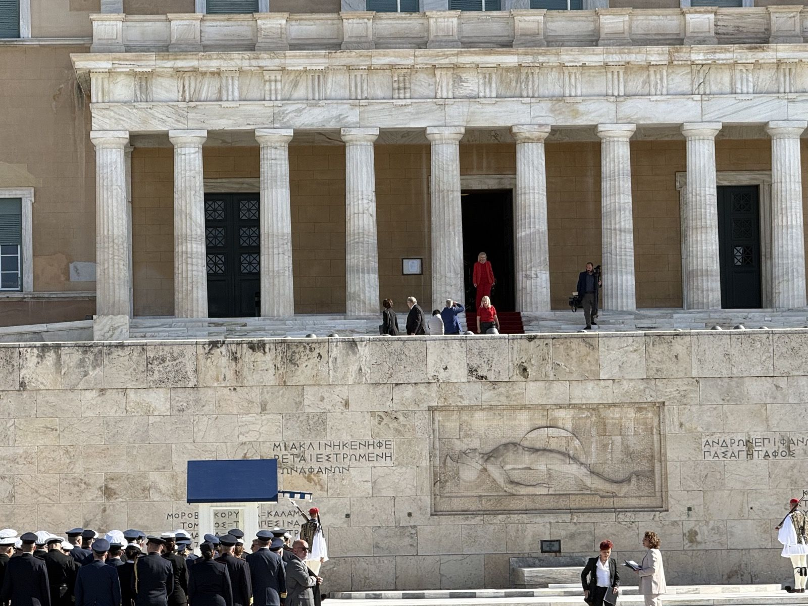{ loading=lazy }
  <figcaption>Parliament and the Tomb of the Unknown Soldier, Syntagma Square. Photo by Dan McCreary</figcaption>
</figure>

**Worked example: why a lost quarter takes so long to recover.** Let's put the economy at 100 before the crisis. A fall of about a quarter leaves 75. To climb back to 100, the economy must grow by 25 ÷ 75, or one third, not one quarter, because growth is measured from the new, lower base. At a steady 2 percent a year, a good pace for a mature European economy, the climb takes about 15 years, since 1.02 multiplied by itself 15 times is about 1.35. At 1 percent it would take about 29 years. These numbers are illustrative, but they explain why a crisis that "ended" in 2018 still shapes wages, rents, and family plans in the Athens we are visiting. Since about 2017 the economy has grown again, unemployment has fallen to well under half its peak, and in 2023 the rating agencies began to restore the country's investment-grade credit rating. Government debt is still among the highest in Europe, about one and a half times the country's yearly output.

### Daily Life in Athens

**Daily life in Athens** has a rhythm of its own: a long working morning, a late lunch, a quiet afternoon, and an evening that starts after dark and runs late. About a third of everyone in Greece lives in greater Athens, most of them in the concrete apartment blocks of Chapter 15, with balconies that serve as extra rooms for much of the year. Neighborhood life gathers around a few fixtures: the *periptero*, the street kiosk that sells newspapers, water, snacks, phone credit, and cigarettes; the weekly street market, the *laiki*, which takes over a different street in each neighborhood on its own day; and the café, where a single cold coffee can last an hour. Getting around changed with the 2004 Olympics, which, as Chapter 15 told, brought a new metro, a tram to the sea, and the rail and metro link to a new airport. Many small shops still keep a traditional split schedule, open in the morning every weekday and again in the early evening only on Tuesday, Thursday, and Friday, while big stores in the center stay open all day.

**Worked example: our last Monday on Athenian time.** Let's lay our day beside a typical Athenian's and see where they meet. The times are typical patterns, not rules.

| Time | A typical Athenian | Our plan |
|---|---|---|
| 8:00–9:00 AM | Coffee to go on the way to work | Temple of Olympian Zeus at opening |
| 10:00 AM–1:00 PM | Work; a mid-morning *koulouri*, the sesame ring that Istanbul calls *simit* | National Garden, the Lyceum, Syntagma |
| 2:00–4:00 PM | Lunch, the main meal, often at home | A light lunch, then the museum |
| 4:00–6:00 PM | Rest, errands; sunset about 5:10 PM | Museum until closing; the Polytechnic gate |
| 6:00–9:00 PM | The *volta*, the evening stroll; coffee with friends; shops reopen on some days | Plaka at dusk |
| 9:30 PM onward | Dinner with family or friends | Fish dinner; rebetiko after 10:30 PM |

The two days overlap best at the ends: a coffee in the morning and dinner late at night. A visitor who eats at 6:00 PM will dine alone in an empty taverna, while one who waits until 9:30 will hear the city at the table.

<figure markdown="span" class="trip-photo">
  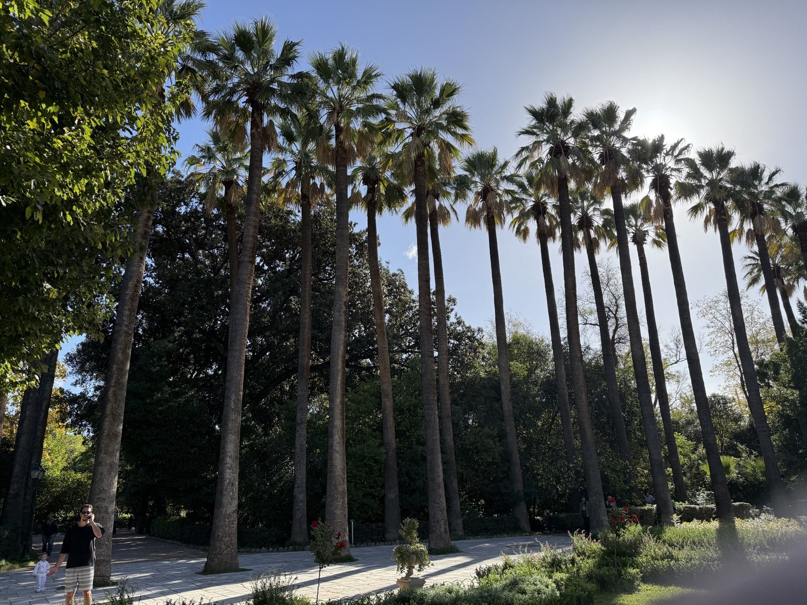{ loading=lazy }
  <figcaption>The palm avenue in the National Garden. Photo by Dan McCreary</figcaption>
</figure>

The National Garden, where we walked on the morning of Day 11, shows the other side of Athenian daily life: the search for shade and quiet in a city with little green space. It was planted from 1838 as the private garden of Queen Amalia, wife of King Otto, and opened to the public in 1923. Today it is where Athenians bring children, walk dogs, read on benches, and cut through between Syntagma and the Zappeion.

### Family Life Today

**Family life today** in Greece still centers on the extended family, more than in most of Western Europe. Young adults leave their parents' home later than almost anywhere else in the European Union, on average around age 30, partly from custom and partly because of the crisis years' wages and rents. Grandparents, the *yiayia* and *pappous*, often look after grandchildren while parents work, and Sunday lunch brings the generations to one table. Name days, the feast days of the saints people are named for, have traditionally mattered more than birthdays: on November 25, two days after our visit, every Katerina in Greece will receive calls and visitors on the feast of Saint Catherine, and on November 30 every Andreas, on the feast of Saint Andrew. The family is also changing. Greece has one of the lowest birth rates in Europe, about 1.3 children per woman, civil marriage has been possible since 1982, and in 2024 Greece became the first Orthodox-majority country to allow same-sex couples to marry.

### Orthodox Faith Today

**Orthodox faith today** is part of the texture of Greek life even for people who rarely attend church. The Greek constitution names Eastern Orthodoxy the "prevailing religion" of Greece, and most Greeks call themselves Orthodox, though far fewer attend the liturgy every week. The signs are everywhere, once we look for them.

- **On the street:** people cross themselves when a bus passes a church, and a small shrine stands at a roadside where someone died.
- **At home and at work:** a priest blesses a new shop or apartment, and many homes keep an icon corner with a small oil lamp.
- **In the calendar:** the great festival of the year is Easter, not Christmas, and name days follow the saints.

During our visit the faithful are in the Nativity Fast, which runs from November 15 to Christmas Eve, so devout Orthodox Christians are eating no meat, eggs, or dairy, and taverna menus offer more vegetable and bean dishes. In central Athens, the 19th-century cathedral, the Mitropoli, stands beside a tiny Byzantine church, probably of the 12th century, known as the Little Metropolis, whose walls are a patchwork of ancient and Byzantine carved stones, the *spolia* we learned to read in Chapter 4. The Church of Greece, as Chapter 4 explained, has governed itself since Constantinople recognized its independence in 1850, but the Ecumenical Patriarch, the senior bishop of the Orthodox world, still lives in Istanbul, where our trip began.

### Migration and Refugees Today

**Migration and refugees today** means the movement of people into and out of Greece in our own time, and Athens has been at the center of both. In 2015 more than 850,000 refugees and migrants, most of them fleeing the wars in Syria, Afghanistan, and Iraq, crossed the Aegean by sea from the Turkish coast to the Greek islands of Lesbos, Chios, Samos, Kos, and others, the same narrow waters our ship sailed. Most traveled on north toward Germany and Sweden; tens of thousands stayed. In March 2016 the European Union and Turkey agreed on a deal to reduce the crossings, and Turkey, which for several years hosted the largest refugee population in the world, kept millions of Syrians within its borders. Crossings and shipwrecks continue; in June 2023 an overcrowded fishing boat sank off Pylos, in the western Peloponnese, with hundreds of people lost.

Athens has been a city of arrival before. In 1922 and 1923 the Asia Minor refugees of Chapter 10 built whole new districts here, and the city's food and music still carry their memory. Greece has also been a country of departure: Greeks emigrated in great numbers to the United States and Australia in the 20th century, and to Germany and Britain during the debt crisis. Today Syrian, Afghan, African, and South Asian shops and bakeries in central neighborhoods are part of the city, and the arguments about how many people Greece can and should receive are part of its politics, as they are across Europe. The table sums up a century of arrivals and departures.

| When | Who | Direction |
|---|---|---|
| 1922–1923 | About 1.2 million Asia Minor refugees (Chapter 10) | Into Greece |
| Much of the 20th century | Greek emigrants to the United States, Australia, and Germany | Out of Greece |
| 2010–2018 | Several hundred thousand Greeks, many young and highly educated | Out, during the debt crisis |
| 2015 | More than 850,000 refugees and migrants by sea | Into Greece, most moving on north |

### Graffiti

**Graffiti** is writing or drawing on public walls without permission, from a scrawled name to a building-sized mural, and Athens is known across Europe for how much of it there is. We noticed it from the first day: tags on shutters and train cars, political slogans on university walls, and large painted murals on blank sides of buildings, especially in Exarchia, Psyrri, and the old industrial neighborhoods west of the center. Much of it grew during the crisis years, when empty shops, cuts to city budgets, and anger at politicians all left their mark, and some of the city's best street artists have since been invited to paint walls legally.

The word comes from the Italian for "scratchings," and the habit is ancient. The Dipylon jug in the museum carries a line scratched after the pot was made. In about 591 BCE, Greek soldiers serving an Egyptian pharaoh carved their names on the leg of a colossal statue of Ramesses II at Abu Simbel, among the oldest Greek inscriptions we have. Athenians argue about graffiti as other cities do. To some it is the art of the street and the voice of people without a newspaper; to others it is vandalism that defaces neoclassical facades and costs a poor city money to clean. Both views can be true of different walls, and reading which is which is a good exercise on a last walk through the city.

## Part Four: An Evening in Plaka

### The Plaka Neighborhood

The **Plaka neighborhood** (*Pláka*), often called the oldest quarter of Athens, is a maze of narrow streets, steps, and small squares on the northern and eastern slopes of the Acropolis. When Athens became the capital in 1834, as Chapter 15 told, Plaka was much of what was left of the town. Its houses are mostly 19th-century neoclassical, with tiled roofs and small balconies, built over Ottoman, Byzantine, and ancient foundations. Plaka is now largely free of cars, full of tavernas and souvenir shops, and busy even in November, so the quietest streets are the steepest ones. Three places are worth seeking out.

- **Adrianou Street,** Plaka's main thread, follows a line that is far older than the houses along it.
- **Anafiotika,** high under the Acropolis wall, is a cluster of whitewashed, island-style houses built by stonemasons from the Cycladic island of Anafi, who are said to have come in the 1840s to work on King Otto's palace and built homes like the ones they had left.
- **The Monument of Lysicrates,** on the eastern edge, was raised in 334 BCE to celebrate a victory in a theater competition, and it is the best preserved of the monuments that once lined the ancient Street of the Tripods.

### Greek Coffee

**Greek coffee** (*ellinikós kafés*) is coffee ground to a fine powder, boiled with water, and sugar if wanted, in a small long-handled pot, the *briki*, then poured unfiltered into a small cup with its foam on top and its grounds settling at the bottom. It is the same drink as the Turkish coffee of Chapter 3, made in the same way, and until the 1970s Greeks usually called it "Turkish coffee" too. After the Turkish military intervention in Cyprus in 1974, the name came to feel wrong to many Greeks, and within a few years "Greek coffee" had become the usual name. The coffee did not change. The word did, because a word can carry a wound.

| How sweet | In Athens | In Istanbul (Chapter 3) |
|---|---|---|
| No sugar | *skétos* | *sade* |
| Medium | *métrios* | *orta* |
| Sweet | *glykós* | *şekerli* |

Greek coffee is served with a glass of water and drunk slowly. The place to drink it is a **kafeneio**, the traditional coffeehouse, where older men play *tavli*, backgammon, and argue about politics, though many cafés now serve it alongside espresso. Younger Athenians are more likely to drink a *freddo espresso*, espresso shaken with ice, or a *frappé*, a foamy iced instant coffee invented at a trade fair in Thessaloniki in 1957. Order Greek coffee, as in Istanbul, with the sweetness up front, because the sugar boils in the pot, and stop before the last sip, which is mostly grounds.

### Fresh Fish

**Fresh fish** in Athens is eaten simply: grilled whole over charcoal, dressed with olive oil and lemon, and shared at the table, in a fish taverna called a *psarotaverna*. The best-known places are by the sea, around the small harbor of Mikrolimano in Piraeus and along the southern coast, but central Athens has good ones too, and the fish hall of the Central Market on Athinas Street shows what the city eats, best in the morning from Monday to Saturday. Two things surprise visitors. First, good fish is priced by the kilogram: we choose a whole fish from the ice, it is weighed in front of us, and the bill follows the weight. Second, much of the fish on Greek tables is farmed. Greece is the European Union's largest producer of farmed sea bream (*tsipoura*) and sea bass (*lavraki*), which are good and affordable, while wild red mullet (*barbounia*), larger bream, and other wild fish cost much more. Small fish such as *marides*, tiny fried fish eaten whole, and grilled octopus are cheaper ways to eat from the sea. Menus are required to mark frozen fish and seafood, often with an asterisk.

!!! mascot-tip "Ask the Weight Before It Hits the Grill"
    { class="mascot-admonition-img" }
    Here's a shortcut: when the waiter weighs our fish, ask for the weight and do the sum before it goes on the grill. A 600 g fish at €60 a kilo costs €36; a 900 g fish costs €54. If that is more than we want, a smaller fish or a farmed bream is a polite and normal choice.

### Rebetiko

**Rebetiko** is the urban folk music of Greece, songs of the poor, the outcast, and the displaced, often called the Greek blues. It grew up in the port districts of Piraeus, Thessaloniki, Smyrna, and Istanbul in the late 19th and early 20th centuries, and it was transformed after 1922, when the Asia Minor refugees, the subject of Chapter 10, brought the café music of Smyrna and Istanbul to the slums of Athens and Piraeus. Its instruments are the long-necked bouzouki and its small cousin, the *baglamas*; its songs tell of prison, exile, poverty, love, hashish, and longing for a lost home. Among its great names are Markos Vamvakaris, a Piraeus dockworker from the island of Syros, Vassilis Tsitsanis, who brought it into the mainstream in the 1940s and 1950s, and Roza Eskenazi, born in Istanbul to a Sephardic Jewish family, the community whose story Chapter 6 told. Its signature dance, the *zeibekiko*, is danced alone, slowly, improvised, for oneself rather than for an audience, and the other customers do not join in. The dictatorship of the 1930s censored rebetiko songs about hashish, and the music was long looked down on; in 2017 UNESCO added rebetiko to its list of the world's intangible cultural heritage. In Athens, small clubs called *rebetadika* play it late at night; few start before 10:30 PM, and many are closed early in the week, so check before going.

## Part Five: Across the Aegean

### Greek-Turkish Relations

**Greek-Turkish relations** are the political, cultural, and personal ties between Greece and Turkey, two neighbors who share a sea, a long history in one empire, much of a cuisine, and a list of grievances that each side tells differently. This trip began in Istanbul and ends in Athens, and nearly every chapter has touched the relationship: the fall of Constantinople in 1453 (Chapter 4), Greek independence from the Ottoman Empire in the 1820s (Chapter 7), the war of 1919 to 1922 and the population exchange of 1923 (Chapters 7 and 10), and the riots against Istanbul's Greeks in September 1955 (Chapter 7).

Three issues still divide the two governments. The first is **Cyprus**. In July 1974 the Athens junta backed a coup against the Cypriot president, and Turkey sent troops, saying it was protecting the Turkish Cypriot community; Greeks and Greek Cypriots call what followed an invasion and occupation. The island has been divided ever since. The Republic of Cyprus joined the European Union in 2004, while the Turkish Republic of Northern Cyprus is recognized only by Turkey. The second is the **Aegean** itself: the two countries disagree about territorial waters, airspace, and the rights to the seabed, and Greek islands such as Lesbos and Samos lie within sight of the Turkish shore. In 1996 a dispute over two uninhabited rocks, called Imia in Greek and Kardak in Turkish, brought warships face to face. The third is **migration**, the crossings described in Part Three.

And yet the relationship has warmed before, often from below. In August 1999 a great earthquake struck northwestern Turkey, and Greek rescue teams were among the first to arrive; when an earthquake hit Athens in September, Turkish teams came. The two foreign ministers of the time, George Papandreou and İsmail Cem, built a period of cooperation on that goodwill. In February 2023, after the earthquakes in southeastern Turkey, Greece again sent rescuers, and in December 2023 the Greek prime minister and the Turkish president signed the Athens Declaration on friendly relations, promising regular meetings and cooperation. Underneath the politics lies a shared daily life: the same coffee under two names, the same eggplant dishes (Chapter 15), rebetiko carried from Smyrna, and millions of visitors crossing the Aegean in both directions each year.

!!! mascot-neutral "Two Sides of One Sea"
    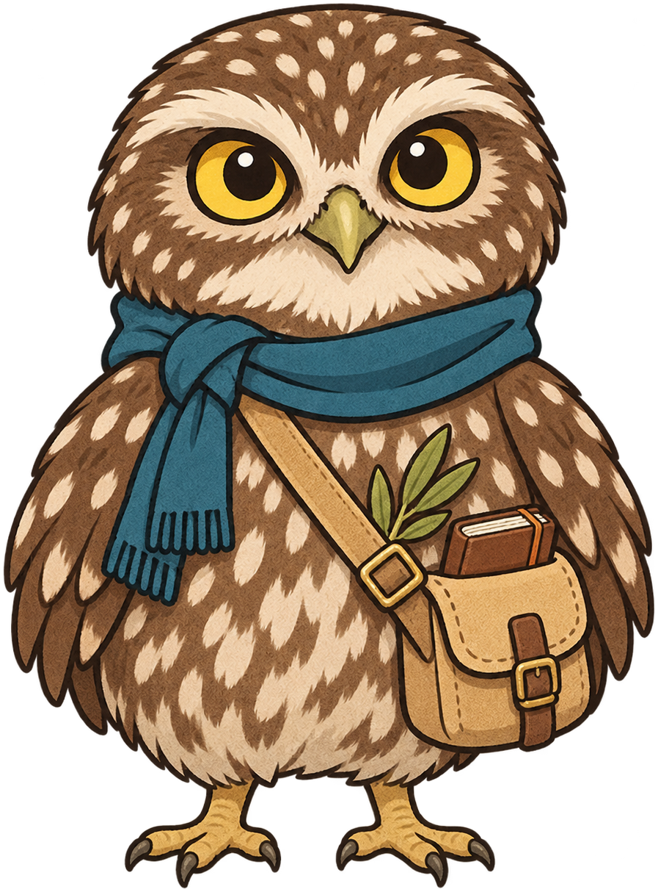{ class="mascot-admonition-img" }
    On this subject an Athenian and an Istanbul shopkeeper may tell us different stories, and both are stories their families lived. Ask someone who lives here, and listen more than we speak. We are guests on both shores.

The timeline below gathers the modern events from Parts Three and Five and asks us to use them to explain what we can see in Athens today.

#### Diagram: Why Athens Looks the Way It Does

<iframe src="../../sims/modern-athens-timeline/main.html" height="528px" width="100%" scrolling="no"></iframe>

[Run the Why Athens Looks the Way It Does MicroSim Fullscreen](../../sims/modern-athens-timeline/main.html){ .md-button .md-button--primary }

Why Athens Looks the Way It Does

Type: timeline
**sim-id:** modern-athens-timeline 
**Library:** vis-timeline 
**Status:** Specified 
**Bloom Level:** Understand 
**Bloom Verb:** infer 
**Learning Objective:** The learner will infer which event in modern Greek history, from 1967 to 2023, explains each of eight things a visitor can see in Athens today, matching at least 7 of the 8 correctly.

**Prerequisites:** the military dictatorship (junta), the Polytechnic uprising, the debt crisis, rescue loans and austerity, the 2015 sea crossings, the euro, the 2004 Olympics, Cyprus 1974, the 1999 earthquakes, the Athens Declaration, and the renaming of Greek coffee (all defined in Parts Three, Four and Five of this chapter).

**Evidence of Mastery:** For each of the 8 sights, the learner selects one event on the timeline and commits the choice. A match is correct when it agrees with the "Correct event" column in Content (sight S6 accepts either of two events). Mastery is at least 7 of 8 correct on the first attempt. Opening event descriptions on the timeline is exploration, not evidence.

**Misconceptions:** (1) Everything a visitor notices in Athens is explained by ancient history. (2) Greek coffee is a different drink from Turkish coffee, so its name has nothing to do with politics. (3) The debt crisis was a single bad year rather than a decade that still shapes the city. (4) The refugees in Athens arrived mainly by air.

**Instructional Rationale:** Inferring a cause from a present-day effect is an Understand task that makes the learner use the timeline rather than memorize it. Starting from things the learner can actually see on the street ties each date to a place, and the prediction is committed before the explanation is revealed.

**Content:**

Events on the timeline (all 14 are shown; some are context only):

| ID | Date | Event |
|---|---|---|
| E1 | April 21, 1967 | Army colonels seize power; the military dictatorship begins |
| E2 | November 14–17, 1973 | Polytechnic uprising; a tank breaks the main gate early on November 17 |
| E3 | July 1974 | After a junta-backed coup in Cyprus, Turkish troops land on the island; the junta falls days later |
| E4 | January 1, 1981 | Greece joins the European Economic Community |
| E5 | August–September 1999 | Earthquakes in Turkey and Athens; rescue teams from each country help the other |
| E6 | January 1, 2002 | Euro notes and coins replace the drachma |
| E7 | August 2004 | Athens hosts the Olympic Games |
| E8 | October 2009 | A new government reveals that the budget deficit was more than twice as large as reported |
| E9 | 2010 | First rescue loan; deep cuts to wages, pensions, and public spending begin |
| E10 | 2015 | More than 850,000 refugees and migrants reach Greece by sea, most crossing from Turkey |
| E11 | June–July 2015 | Banks close; cash withdrawals limited to €60 a day; referendum on July 5 |
| E12 | March 2016 | The European Union and Turkey agree on a deal to reduce the crossings |
| E13 | August 2018 | Greece leaves its last rescue program |
| E14 | December 2023 | Greek and Turkish leaders sign the Athens Declaration on friendly relations |

Sights, in this order:

| # | Sight shown to the learner | Correct event | Why (shown as feedback) |
|---|---|---|---|
| S1 | Flowers at a twisted iron gate on Patission Street, and a march every November 17 | E2 | The gate is the one the tank broke in 1973, and the march remembers the uprising. |
| S2 | A café menu offering "Greek coffee," where older Greeks remember ordering "Turkish coffee" | E3 | The name changed after 1974, when the war in Cyprus made the old name feel wrong to many Greeks. |
| S3 | Prices in a Plaka souvenir shop written in euros | E6 | The euro replaced the drachma in everyday use in 2002. |
| S4 | A metro line to the airport and a tram to the sea | E7 | Both were built for the 2004 Olympics. |
| S5 | An older Athenian who remembers queuing at a cash machine for a daily €60 | E11 | Withdrawals were limited to €60 a day when the banks closed in 2015. |
| S6 | Empty shops with "for rent" signs, and a family whose son now works in Germany | E9 (E8 also accepted) | The rescue loans brought cuts that shrank the economy by about a quarter and sent many young Greeks abroad; the 2009 revelation set them off. |
| S7 | A Syrian bakery and an Afghan grocery in central Athens | E10 | Most of the newcomers arrived in the sea crossings of 2015, and some stayed. |
| S8 | News photos of the Greek and Turkish leaders promising regular meetings | E14 | The Athens Declaration of 2023 committed them to regular contact. |

**Provenance:** All dates and events are from this chapter's sections "The Athens Polytechnic Uprising", "The Greek Debt Crisis", "Daily Life in Athens", "Migration and Refugees Today", "Greek Coffee" and "Greek-Turkish Relations", and from Chapter 15's section "Athens as Modern Capital" (the Olympic rebuilding). The sights are composites of things visitors commonly see in Athens and must be labeled "Typical sights, not specific places".

**Rules:** Each sight has exactly one correct event, except S6, which accepts E9 or E8. Events E1, E4, E5, E12 and E13 are context and are correct for no sight. An event may be chosen for more than one sight. The timeline shows all 14 events in date order from 1967 to 2023 from the start; event descriptions are visible on selection.

**Learner Activity:**

1. The learner reads sight S1 and the question "Which event explains this?"
2. The learner selects an event on the timeline and commits it. The selected event is highlighted.
3. The sim marks the match and shows the Why text. The matched event is labeled with the sight's number.
4. The learner continues through S2 to S8 in order.
5. At the end, the timeline shows all eight sights attached to their events, and the learner should notice that five of the eight fall between 2002 and 2023.

**Feedback:** Eight sights in fixed order, two attempts each. Correct: "Correct: " followed by the Why text. First wrong attempt: "Not this one. Look for an event that would leave this mark on the street." plus, for S2, "Think about what happened between Greece and Turkey." Second wrong attempt: the correct event is revealed with the Why text, and the sight counts as missed. A running score "n of 8 correct on the first attempt" is shown.

**Starting State:** The timeline of 14 events from 1967 to 2023 is shown with no sights attached. Sight S1 is displayed with the question "Which event explains this?"

**Chapter Anchors:** The junta began on April 21, 1967; the Polytechnic uprising ran November 14–17, 1973; the junta fell in July 1974; Greece joined the European Economic Community in 1981; the euro notes and coins arrived in 2002; the 2004 Olympics; the deficit revelation in October 2009; the first rescue loan in 2010; more than 850,000 sea arrivals in 2015; the €60 daily limit in 2015; the EU-Turkey deal of March 2016; the end of the rescues in August 2018; the 1999 earthquakes; the Athens Declaration of December 2023. Mastery is 7 of 8.

## Practical Notes for Day 13

- **Order of the day.** Start at the Temple of Olympian Zeus when it opens, walk through Hadrian's Arch and the National Garden to the Lyceum, and come back through Syntagma, where the guards at the Tomb of the Unknown Soldier change every hour. Take the metro or walk about 25 minutes up Panepistimiou Street, past the Academy and the National Library, to the National Archaeological Museum for the afternoon, with a look at the Polytechnic gate next door. End in Plaka.
- **Hours and closures.** Greek sites and museums keep shorter winter hours, Monday hours often differ from the rest of the week, and strikes occasionally close them. Check the National Archaeological Museum, the Temple of Olympian Zeus, and the Lyceum on the day, and swap the morning and afternoon if needed. The National Garden is free and open from sunrise to sunset.
- **Light and weather.** Sunset is about 5:10 PM. Expect mild weather, around 19–21 °C (66–70 °F) in the afternoon and cooler at night, with a chance of showers.
- **Food.** Greek coffee in a kafeneio in the morning; a late lunch near the museum or in Exarchia; a fish dinner in Plaka or by the water at Mikrolimano, ordered by weight; and, if a club is open, rebetiko after 10:30 PM.
- **Packing and the airport.** Pack in the afternoon or before dinner. Athens International Airport is about 30 km east of the center. The metro's blue Line 3 runs there from Syntagma and Monastiraki in about 40 minutes, an express bus runs from Syntagma around the clock, and taxis charge a fixed fare from the center, higher at night. Allow about three hours at the airport for an international flight, and check the times the evening before.
- **Tomorrow.** We fly home. Read Chapter 21 on the plane.

## Learning for All: The Prince's Tutor and the Philosopher's Warning

Chapter 2's route table gives our last day "Aristotle tutoring Alexander, and a bronze prediction machine." The machine was Part One. This section tells the other story, and a second one from the same circle of Athenian philosophers: Plato's warning that a new learning technology, writing, would weaken the memory of everyone who used it. Together they are the two halves of every argument about AI in education: the hope that a tutor could reach every child, and the fear that the tool will do the thinking for us.

### One-on-One Tutoring

**One-on-one tutoring** is teaching in which one tutor works with one learner, adjusting moment by moment to what the learner says and does. It is the oldest form of teaching and, for most of history, the most exclusive. The most famous example is the one Chapter 9 promised. In 343 BCE Philip II of Macedon hired Aristotle to teach his thirteen-year-old son, Alexander. According to Plutarch, writing about four centuries later, Philip gave them a quiet school in a sanctuary of the Nymphs at Mieza, away from the court at Pella, and part of Aristotle's fee was the rebuilding of his home town of Stagira, which Philip's army had destroyed. Aristotle taught the prince for about three years, along with a few sons of noble families, so it was a very small group rather than strictly one-on-one. He taught ethics, politics, and poetry, and Plutarch says that he gave Alexander a lasting interest in medicine and prepared an annotated copy of the *Iliad* that Alexander kept under his pillow, beside a dagger, on campaign. How much the lessons shaped the conqueror is impossible to say; Plutarch also reports that Alexander ignored his teacher's advice to lead the Greeks but rule the non-Greeks as a master.

**Worked example: the arithmetic of attention.** Let's compare Alexander's share of a teacher with a modern student's. In a class of 25 students and a 50-minute lesson, a teacher who divided the time equally could give each student 50 ÷ 25 = 2 minutes. Suppose, for illustration, that Aristotle taught for three hours a day and shared them among five pupils: each would have 180 ÷ 5 = 36 minutes, 18 times the modern share, every day, from the greatest mind of the age. The numbers for Mieza are invented, but the ratio makes the point. A tutor can ask a question, hear the answer, notice the hesitation, and adjust, and a teacher with 25 students simply cannot do that for each of them. For more than two thousand years, that advantage went to princes.

### Bloom's 2 Sigma Problem

**Bloom's 2 sigma problem** is the name the educational psychologist Benjamin Bloom gave, in a 1984 article, to a finding and the challenge it raised. Studies by his graduate students compared three ways of teaching the same unit: a conventional class; a class using mastery learning, described below; and one-on-one tutoring combined with mastery learning. The tutored students did best by a wide margin: the average tutored student scored higher than about 98 percent of the students in the conventional class. Bloom measured the gap as two standard deviations, written 2σ with the Greek letter sigma. The "problem" was practical. Tutoring for every child was far too expensive, so Bloom asked researchers to find group methods that came close to it.

!!! mascot-encourage "Standard Deviations Are Just a Ruler"
    { class="mascot-admonition-img" }
    If "two standard deviations" sounds like a statistics exam, that's normal; most readers need a minute with it. Think of it as a ruler for how spread out a class's scores are, and translate every effect into "the average student moves from the middle of the class to above X percent of it." The table below does that translation for us.

A **standard deviation** measures how spread out a set of scores is; in a typical class, about two-thirds of the students score within one standard deviation of the average. An **effect size** states the difference between two groups in standard deviations, so that studies with different tests can be compared. The useful translation is a **percentile**: an effect of *d* standard deviations moves the average student in the program from the middle of the comparison class, the 50th percentile, to the percentile shown below.

**Worked example: translating the famous number and its critics.** Let's convert the effect sizes from Bloom and from later research into percentiles of a conventional class.

| Study | Effect size | The average student outscores |
|---|---|---|
| Bloom's studies: tutoring with mastery learning | 2.0 | about 98 percent of the class |
| Bloom's studies: mastery learning in a class | 1.0 | about 84 percent |
| VanLehn's 2011 review: human tutoring | 0.79 | about 79 percent |
| Nickow, Oreopoulos, and Quan's 2020 review of school tutoring trials | 0.37 | about 64 percent |

The famous number has not held up at full size. Bloom's studies were small, lasted a few weeks, covered a single unit, and tested exactly what had been taught. When later researchers pooled many randomized trials of tutoring in real schools, they found much smaller average effects: the 2020 review found about 0.37 standard deviations, and a later published version reports somewhat less. The economist Paul von Hippel has argued that much of Bloom's gap came from the extra tests and feedback the tutored students received. Yet even the smaller effects are large by the standards of education research. A fair summary is that well-run tutoring moves the average student by something like a third to three-quarters of a standard deviation, which is still one of the strongest effects known, and that two sigma is the upper end of what small, careful studies have seen.

### Mastery Learning

**Mastery learning** is an approach to teaching in which students must show that they have mastered one unit, usually by scoring at or above a set threshold such as 80 or 90 percent on a short test, before moving on to the next, with corrective help and a second test for those who fall short. Bloom proposed it in 1968, building on the idea that almost every student can learn almost anything, given enough time and the right help. Conventional teaching holds time fixed and lets mastery vary: everyone gets three weeks on fractions, and the grades spread out. Mastery learning holds mastery fixed and lets time vary. A student who scores 70 percent on the fractions check does not move on with a C; she gets targeted practice on what she missed, takes a second check, and moves on when she reaches the threshold. That is why it appears in both of Bloom's stronger conditions, and why it is the engine of most adaptive learning software today.

### AI Tutoring

**AI tutoring** is tutoring delivered by an artificial intelligence system, usually built on a large language model, that converses with a student: asking questions, giving hints, explaining an idea in several ways, and adjusting to what the student says. It is the attempt to give every child something like the tutoring in Bloom's studies at the cost of software. The early evidence is promising and mixed. In a randomized study in a Harvard physics course, students who learned from a carefully designed AI tutor learned more, in less time, than students in an active-learning class. In a six-week after-school pilot in Edo State, Nigeria, a World Bank team reported gains of about 0.3 standard deviations in English, at very low cost per student. Both tutors were built on proven teaching methods, with guardrails, not left as open chatbots. Other reports describe AI tutors making math mistakes and students using them less than expected, and a study in Turkey, which the second note below takes up, shows how an AI helper can harm learning.

The explorer below lets us turn each of these effect sizes into the percentile it means, and test our sense of how big "big" is.

#### Diagram: Tutoring Effect Size Explorer

<iframe src="../../sims/tutoring-effect-size-explorer/main.html" height="450px" width="100%" scrolling="no"></iframe>

[Run the Tutoring Effect Size Explorer MicroSim Fullscreen](../../sims/tutoring-effect-size-explorer/main.html){ .md-button .md-button--primary }

Tutoring Effect Size Explorer

Type: chart
**sim-id:** tutoring-effect-size-explorer 
**Library:** Plotly 
**Status:** Specified 
**Template:** https://github.com/dmccreary/statistics-course/tree/main/docs/sims/standard-error-explorer 
**Bloom Level:** Understand 
**Bloom Verb:** interpret 
**Learning Objective:** The learner will interpret five reported effect sizes for tutoring and mastery learning, given in standard deviations, as the percentile of a conventional class that the average student in the program outscores, to within 5 percentage points.

**Prerequisites:** standard deviation, effect size, and percentile (defined in "Bloom's 2 Sigma Problem" above); one-on-one tutoring, mastery learning, and AI tutoring (defined in the sections above).

**Evidence of Mastery:** For each of five reported results, the learner types the percentile they predict before the curves move. A prediction is correct when it is within 5 percentage points of the model percentile (|prediction − model| <= 5). Mastery is at least 4 of 5 correct on the first attempt. Moving the free-exploration slider afterward is exploration, not evidence.

**Misconceptions:** (1) "Two sigma" means the students learned twice as much. (2) An effect of 0.3 standard deviations is too small to matter. (3) Bloom's 2.0 is the typical result of tutoring. (4) The percentile is the student's percentage score on the test.

**Instructional Rationale:** Interpreting an effect size means translating an abstract number into a picture of two overlapping groups. Predicting the percentile first, then seeing the shifted curve and the shaded share, corrects the learner's sense of scale one result at a time.

**Content:**

Two normal curves on a common axis of test scores measured in standard deviations: the conventional class (mean 0, standard deviation 1), fixed; and the program group (mean d, standard deviation 1), which moves as d changes. The share of the conventional class below the program group's mean is shaded, and the percentile is shown as a number.

The five reported results, in this order:

| # | Reported result | d | Model percentile | Feedback when wrong |
|---|---|---|---|---|
| 1 | Bloom's studies, one-on-one tutoring with mastery learning (1984) | 2.00 | 97.7 | Two standard deviations above the middle leaves only about 2 percent of the class higher, so the average tutored student outscores about 98 percent. |
| 2 | Bloom's studies, mastery learning in a class (1984) | 1.00 | 84.1 | One standard deviation above the middle is the 84th percentile: about a third of the class lies between the mean and one standard deviation. |
| 3 | VanLehn's review, human tutoring (2011) | 0.79 | 78.5 | A bit less than one standard deviation gives a bit less than 84: about the 79th percentile. |
| 4 | Nickow, Oreopoulos, and Quan's review of randomized school tutoring trials (2020) | 0.37 | 64.4 | About a third of a standard deviation moves the average student from the 50th to about the 64th percentile, a real gain. |
| 5 | Nigeria after-school AI tutor pilot, six weeks (World Bank) | 0.30 | 61.8 | Three-tenths of a standard deviation moves the average student to about the 62nd percentile, from a six-week program. |

**Provenance:** Bloom, "The 2 Sigma Problem: The Search for Methods of Group Instruction as Effective as One-to-One Tutoring," *Educational Researcher*, 1984 (results 1 and 2). VanLehn, "The Relative Effectiveness of Human Tutoring, Intelligent Tutoring Systems, and Other Tutoring Systems," *Educational Psychologist*, 2011 (result 3). Nickow, Oreopoulos, and Quan, NBER working paper, 2020; a later published version reports a smaller figure, about 0.29, which the sim mentions in result 4's feedback (result 4). The Nigeria figure is as summarized in *AI-Native Schools*, Chapter 11, "Mastery Learning and the Case for a Compressed Morning" (result 5). Model percentiles are computed by the Rules.

**Rules:** Model percentile = 100 × Φ(d), where Φ is the standard normal cumulative distribution function, rounded to 0.1. Predictions are whole numbers from 0 to 100. A prediction is correct when |prediction − model percentile| <= 5. In free exploration, d ranges from a minimum of 0.00 to a maximum of 2.00 in steps of 0.01, default 0.00, unit standard deviations; at d = 0.00 the curves coincide and the percentile is 50.0.

**Learner Activity:**

1. The learner reads result 1, its study, and its d, with the curves at d = 0.00 and the percentile hidden.
2. The learner types a predicted percentile and presses Check. The program curve slides to d, the shaded share fills in, and the model percentile appears beside the prediction.
3. The learner repeats for results 2 to 5.
4. After result 5, free exploration unlocks: the learner moves d and watches the percentile change, and markers show where the five results sit.
5. The learner should notice that the step from 0.0 to 1.0 adds 34 percentile points, while the step from 1.0 to 2.0 adds only about 14.

**Feedback:** Five results in fixed order, two attempts each. Correct: "Correct: an effect of d standard deviations puts the average student above P percent of the conventional class," with d and P filled in. Incorrect: that result's "Feedback when wrong" text; result 4 adds "A later version of this review reports about 0.29, near the 61st percentile." After the second wrong attempt, the model percentile is revealed and the result counts as missed. The score "n of 5 within 5 points on the first attempt" is shown.

**Starting State:** The two curves overlap at d = 0.00, the percentile reads 50.0, and result 1 is shown with the question "Where does the average tutored student land in the conventional class?"

**Chapter Anchors:** The chapter's table gives 2.0 → about 98 percent, 1.0 → about 84 percent, 0.79 → about 79 percent, and 0.37 → about 64 percent. The chapter gives the Nigeria pilot as about 0.3 standard deviations over six weeks. The chapter states that well-run tutoring moves the average student by about a third to three-quarters of a standard deviation.

### Teaching Comes to the Learner

**Teaching comes to the learner** names the reversal that AI tutoring promises: instead of the student traveling to the teacher, the teacher's attention travels to the student, wherever and whenever the student is ready. Chapter 12 told the old pattern. Cicero sailed to Rhodes, at great cost, because the best teacher of speaking lived there and could not be carried home. Alexander had the opposite privilege. The greatest teacher of his age came to him, because his father was a king. For most of history those were the only two choices: go to the teacher if you could afford the journey, or have the teacher brought to you if you could afford the teacher.

A tutor on a phone or a shared school tablet breaks that choice for the first time. A girl in a village school can, in principle, get something like Alexander's privilege at Mieza: questions shaped to her answers, in her own language, at the hour she is ready. The cautions are the ones Chapter 2 listed. More than two billion people still have no internet access, so the teacher can come only where the connection reaches. A tutor trained mostly on English text may serve smaller languages poorly. And Cicero found something on Rhodes besides correction: other students, a live audience, and a culture of speaking, which no tutor in a pocket replaces.

Run Chapter 2's four-step pattern on the tutor.

- *Locked up:* for two thousand years, one-on-one teaching from a great teacher belonged to princes like Alexander and to rich families who could send a son to Rhodes.
- *Opened:* mastery learning brought part of the tutor's advantage into ordinary classrooms, and AI tutoring may now bring more of it to anyone with a device.
- *Resisted:* the resistance this time is less from gatekeepers than from honest doubt, about cost, about evidence, and about what the tool does to a student's own thinking, which is the second note's subject.
- *Never all the way:* the children with no connection, no device, or no tutor in their language are left out first, and they are usually the ones who needed it most.

The companion book *AI-Native Schools* weighs this evidence carefully in [Mastery Learning and the Case for a Compressed Morning](https://dmccreary.github.io/ai-native-schools/chapters/11-mastery-learning-case-compressed-morning/), which sets Bloom's two-sigma problem beside the later, smaller estimates, prices human and AI tutoring for a whole district, and asks how much of a school day adaptive learning could free for other things. Its conclusion matches ours: plan for real but modest effects, not for two sigma, and design the tutor well, because design matters more than raw power.

### Phaedrus on Writing

**Phaedrus on writing** refers to the passage near the end of Plato's dialogue *Phaedrus*, written about 370 BCE, in which Socrates argues that writing weakens memory and gives only the appearance of wisdom. The dialogue is set, unusually for Socrates, outside the city walls, on the bank of the Ilissos near the Temple of Olympian Zeus, where he and the young Phaedrus sit in the shade of a plane tree. Socrates tells a story. The Egyptian god Theuth, inventor of numbers, geometry, astronomy, and letters, brings his inventions to King Thamus and praises writing as a remedy for memory and wisdom. The king disagrees. Those who learn letters, he says, will stop exercising their memories and rely on marks outside themselves; writing is, in Benjamin Jowett's old translation, "an aid not to memory, but to reminiscence." They will read much without being taught and seem to know a great deal while knowing little. Socrates adds a second complaint of his own: a written text is like a painting, which looks alive but stays silent when you question it. Ask a book what it means, and it can only say the same thing again.

The irony is famous. We know Socrates' warning only because his student Plato wrote it down, in one of the most carefully written books in Greek. Athens, whose writers turned a talking culture into a reading one, is where the first great argument against reading was recorded.

<figure markdown="span" class="trip-photo">
  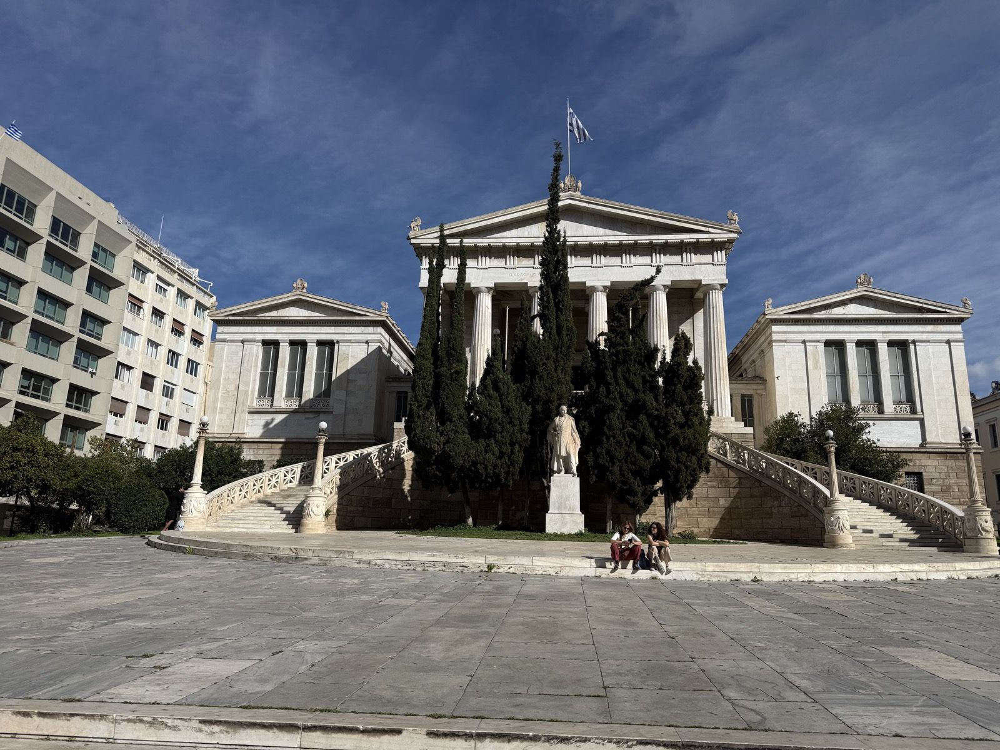{ loading=lazy }
  <figcaption>The National Library of Greece on Panepistimiou Street. Photo by Dan McCreary</figcaption>
</figure>

The building in the photo answers Socrates in marble. The National Library of Greece moved into this neoclassical home, designed like the Academy beside it by Theophil Hansen, in 1903, and kept its books here for more than a century before moving its collections to a new building by the sea in 2018. A library is writing's whole case: memory stored outside any one head, so that a child born today can read what Plato thought.

**Worked example: scoring Socrates' prediction.** Let's treat the warning as Chapter 19 taught us to treat any prediction: is it specific, and how did it turn out? Socrates made two claims. The first, that people who rely on writing will remember less, has partly held up. Studies of what psychologists call cognitive offloading have found that when people expect to be able to look information up later, they remember less of it; a well-known 2011 study in *Science* called this the "Google effect." The second, that a written text cannot answer back, was true of every book for 2,400 years. But the prediction missed the balance. Writing cost us some memorized poetry and gave us libraries, science, history, and laws that anyone can check. Verdict: right about the trade, wrong about which side of it would weigh more.

!!! mascot-thinking "Socrates' Two Complaints, Revisited"
    { class="mascot-admonition-img" }
    Notice that an AI tutor turns Socrates' two complaints upside down. It answers his second, because we can question it and it replies; and it sharpens his first, because a tool that answers back can also think for us. The question for AI is not whether to use it, but how to keep the exercise that writing and reading always demanded.

### Fear of New Learning Technology

The **fear of new learning technology** is the recurring worry that a new tool for storing or finding knowledge will make learners lazy, forgetful, or shallow. It is as old as the *Phaedrus*, and it returns with each new tool.

- **Writing,** about 370 BCE: Thamus' warning in the *Phaedrus*.
- **Printing,** 1492: the abbot Johannes Trithemius wrote *In Praise of Scribes*, urging monks to keep copying books by hand for the good of their souls, and had it printed; Chapter 6 told the longer story of scribes and presses.
- **Calculators,** 1970s and 1980s: teachers and parents argued over whether children who used them would ever learn arithmetic.
- **The internet and search,** 2008: the writer Nicholas Carr asked in *The Atlantic*, "Is Google Making Us Stupid?"
- **Generative AI,** 2020s: the worry that students will let a chatbot write and think for them.

Each time, the fear was partly right, because each tool did take over a skill, and largely wrong about the outcome, because people put the freed effort into new skills. Reading the list as "they always worry, so ignore it" misses the point, though. Each fear named a real cost, and the societies that did best were the ones that kept teaching the skill the tool threatened, as schools still teach arithmetic in the age of the calculator.

### AI Over-Reliance

**AI over-reliance** is depending on an AI system so heavily that we stop doing the thinking we are trying to learn, accepting its answers without checking them, or losing a skill we would otherwise have built. It is the form Socrates' first complaint takes today. The clearest evidence comes from a country we visited. In a randomized study at a high school in Turkey, students practicing math with open access to GPT-4 did much better on the practice problems, but on a later exam taken without AI they scored about 17 percent lower than students who had never had access. A second version of the tutor, designed to give hints instead of answers, removed most of that harm. The same model helped or hurt depending on how it was set up. Psychologists call the underlying habit cognitive offloading, handing mental work to a tool, and it is often wise: we write a phone number down instead of memorizing it. A useful rule is to offload the routine and keep the target. Let a calculator do the arithmetic after a child has learned what division means, not before, and let an AI check an essay after the student has written it, not write it.

### AI Guardrails

**AI guardrails** are the design rules and limits that keep an AI system's behavior within safe and educational bounds. In a tutor, the most important is **hints instead of answers**: when a student asks for help, the tutor gives the smallest nudge that keeps the student working and gives the full solution only after a real effort, the Socratic habit Chapter 19 called an answer as the start of an inquiry. Other guardrails tie the tutor's explanations to vetted course content, check its arithmetic with a calculator, refuse to write graded work for the student, keep conversation logs a teacher can review, and send a student who seems distressed to a person. The difference between a guided tutor and an open chatbot can be the same underlying model with different rules, as the Turkish study showed.

Run Chapter 2's four-step pattern on the second note.

- *Locked up:* in Socrates' Athens, wisdom lived in memory and conversation, among men with the leisure to talk.
- *Opened:* writing put knowledge in books that anyone who could read might consult, and AI now offers a book that can answer back.
- *Resisted:* Socrates himself resisted writing, and today parents, teachers, and researchers worry, with evidence, that AI will think for students.
- *Never all the way:* the benefit goes first to learners who already know how to question a source; those who accept every answer can end up knowing less than before.

The lesson for AI and education is that Socrates and Theuth were both right, and design decides which one wins. A tutor that hands over answers fulfills Thamus' warning; a tutor that asks questions, as Socrates did, may be the first written thing that can do what he said writing never could. *AI-Native Schools* turns that principle into a working design in [AI Guardrails: Teaching Thinking Without Over-Reliance](https://dmccreary.github.io/ai-native-schools/chapters/12-ai-guardrails-teaching-thinking-without/), which compares guided and open AI, sets out hints instead of answers and Socratic questioning, and shows how a tutor can adapt with little or no live AI. Aristotle taught one prince for three years. The real test of AI tutoring is whether it can teach every child as well as he taught Alexander, while leaving them better at thinking for themselves.

## Key Takeaways

- The **National Archaeological Museum** gathers the whole country, from the Mycenaean gold mask to the Artemision bronzes, Classical grave reliefs, and the Hellenistic group from Delos.
- The **Antikythera mechanism**, a geared bronze device of the 2nd century BCE found in a shipwreck of about 70–60 BCE, modeled the Sun, the Moon, the calendar, the games, and the eclipse cycles. It is one of the **ancient prediction machines** that turned regular cycles into answers anyone could check: it sits between the oracle and the learned model.
- The **Temple of Olympian Zeus** took about 650 years, from the Peisistratids about 520 BCE to Hadrian in 131–132 CE; the Panathenaic Stadium nearby hosted the 1896 Olympics.
- The **Lyceum**, where Aristotle taught from 335 BCE, was a research school; its site was found in 1996.
- The **Athens Polytechnic uprising** of November 14–17, 1973, helped bring down the junta, which fell in 1974; November 17 is remembered every year.
- The **Greek debt crisis** (2009–2018) cost about a quarter of the economy and drove many young Greeks abroad; a lost quarter needs a third more growth to recover.
- **Daily life in Athens** runs late: lunch at 2:00 PM, the evening *volta*, dinner after 9:00 PM. **Family life today** keeps grown children close and grandparents central; **Orthodox faith today** shows in name days, roadside shrines, and the Nativity Fast.
- **Migration and refugees today** made Greece a gateway in 2015, when more than 850,000 people crossed the Aegean. **Graffiti** covers the city, an old habit with a new crisis-era voice.
- The **Plaka neighborhood** is the oldest quarter, with Anafiotika under the Acropolis. **Greek coffee** is Turkish coffee renamed after 1974. **Fresh fish** is priced by weight and much of it is farmed. **Rebetiko**, carried from Smyrna by the refugees of 1922, has been UNESCO heritage since 2017.
- **Greek-Turkish relations** are divided by Cyprus, the Aegean, and migration, and warmed by earthquake rescues, the 2023 Athens Declaration, and a shared table.
- **One-on-one tutoring** was a prince's privilege: Aristotle taught Alexander from 343 BCE. **Bloom's 2 sigma problem** found tutored students above about 98 percent of a conventional class, though later reviews find much smaller effects. **Mastery learning** holds mastery fixed and lets time vary. **AI tutoring** shows early promise, and **teaching comes to the learner** for the first time, where the connection reaches.
- **Phaedrus on writing** warned that writing would weaken memory; the **fear of new learning tech** has returned with printing, calculators, search, and AI. **AI over-reliance** is real, and **AI guardrails**, above all hints instead of answers, decide whether a tutor helps or harms.

!!! mascot-celebration "From the Gears to the Tutor"
    { class="mascot-admonition-img" }
    You can now explain how a box of bronze gears predicted eclipses, and tell an oracle, a cycle model, and a learned model apart. You can translate "two sigma" into percentiles and say why the real effect of tutoring is smaller but still large, and you can read the city's last day, from the Polytechnic gate to a rebetiko club, as the story of modern Greece. Next stop: [Going Home: Learning With Communities, Not To Them](../21-going-home/index.md), the chapter for the flight home.
