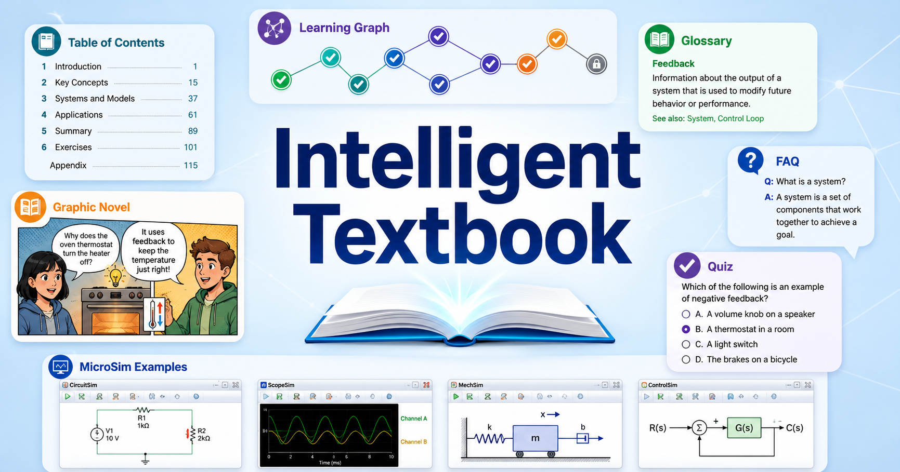

# Mediterranean Travels

<!-- Once docs/img/cover.png is the real cover and shows the guide's title, hide
     this duplicate h1 and start the image's alt text with the title. See the
     "Landing Page Title Rule" in book-installer/references/home-page-template.md. -->

<figure markdown>
  { width="100%" }
</figure>

A day-by-day travel guide for a November 2026 journey from Istanbul to Athens,
exploring the history of civilization, culture, cuisine, and the people who live
along the way.

## The Journey

Thirteen days through Turkey and Greece, **November 11–23, 2026**:

- **Nov 11–13: Istanbul on our own.** Three days in the city that straddles
  Europe and Asia.
- **Nov 14–20: the Viking Star cruise.** *Ancient Mediterranean Treasures*, from
  Istanbul past Troy and Ephesus to Rhodes, Crete, and Athens.
- **Nov 21–23: Athens on our own.** Three days in the city where democracy,
  philosophy, and theater began.

The [Trip Description](course-description.md) has the full day-by-day
itinerary, and the [Viking Cruise Map](sims/viking-cruise-map/index.md) shows
the route port by port.

## How to Use This Guide

There is **one chapter for each day** of the trip. Read it at breakfast or the
night before. Each chapter covers:

- what we will see that day, and the stories behind it
- details to notice that most visitors walk past
- food and drink to try, and the history in the dish
- the people who live there now, and how to be good guests
- practical notes on timing, closures, and November weather

The [Chapters](chapters/index.md) page lists every day. Use the search bar to
find a person, place, or dish.

## What's Inside

- **[Chapters](chapters/index.md):** one per day, plus a chapter to read before
  we leave and one for the trip home.
- **[MicroSims](sims/index.md):** interactive maps and other tools, starting
  with the cruise route.
- **[Learning Graph](learning-graph/index.md):** the map of ideas behind the
  guide. It lists the people, places, and events the chapters cover, and shows
  which ones help explain the others.
