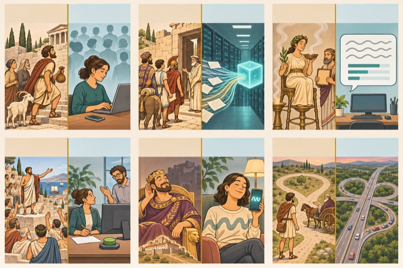
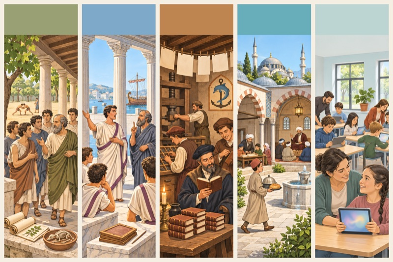

# List of Posters

Interactive infographics for the trip. Each poster is an illustration with an
overlay: hover over a region for its name, click it for details, and switch to
Quiz mode to test yourself. Some posters put two or more things **side by side**
to compare them. Others label the parts of one picture with numbered **call-outs**.

-   [{ loading=lazy }](column-types/index.md)

    **[The Three Classical Orders](column-types/index.md)** (Side by side)

    Doric, Ionic, and Corinthian columns, drawn at the same height, to compare their capitals, bases, flutes, and proportions.

-   [{ loading=lazy }](oracle-vs-algorithm/index.md)

    **[The Oracle and the Algorithm, Side by Side](oracle-vs-algorithm/index.md)** (Side by side)

    Six stages of a question, answered at Delphi and by a modern predictive model, with where each parallel breaks.

-   [{ loading=lazy }](five-classrooms/index.md)

    **[Five Classrooms Across Three Thousand Years](five-classrooms/index.md)** (Side by side)

    The Lyceum, Rhodes, a Venetian print shop, a medrese, and a modern tutor: who was inside, and who was left outside.

-   [{ loading=lazy }](acropolis-then-and-now/index.md)

    **[The Acropolis, Then and Now](acropolis-then-and-now/index.md)** (Side by side)

    The same aerial view drawn twice, about 406 BCE and today, to see what has been lost, rebuilt, or removed on purpose.

-   [{ loading=lazy }](bath-and-hamam/index.md)

    **[Roman Bath and Turkish Hamam](bath-and-hamam/index.md)** (Side by side)

    Two cutaway floor plans on one footprint, to compare five stages of the bath and see where the match breaks.

-   [{ loading=lazy }](anatomy-of-a-mosque/index.md)

    **[Anatomy of an Ottoman Mosque](anatomy-of-a-mosque/index.md)** (Call-outs)

    A cutaway of a mosque and its courtyard, with nine parts in the order a visitor meets them.

-   [{ loading=lazy }](delphi-sacred-way/index.md)

    **[Delphi: Climbing the Sacred Way](delphi-sacred-way/index.md)** (Call-outs)

    A stylized view of the sanctuary hillside, with nine places from the spring to the stadium.

-   [{ loading=lazy }](antikythera-opened/index.md)

    **[The Antikythera Mechanism, Opened Up](antikythera-opened/index.md)** (Call-outs)

    The crank, the gear train, and the front and back dials of an ancient prediction machine.

## More Posters Are Planned

Eight more posters have a written spec and an image prompt and are waiting for
their images: Hagia Sophia in four lives, a scribe's page and an Aldine page,
One Table, Two Names, the Colossus, the Library of Celsus, the Hagia Sophia dome,
the Hippodrome, and a trireme at Salamis. See [Poster Ideas](poster-ideas.md)
for the full list and where each one stands.
