# List of Posters

Interactive infographics for the trip. Each poster is an illustration with an
overlay: hover over a region for its name, click it for details, and switch to
Quiz mode to test yourself. Some posters put two or more things **side by side**
to compare them. Others label the parts of one picture with numbered **call-outs**.

-   [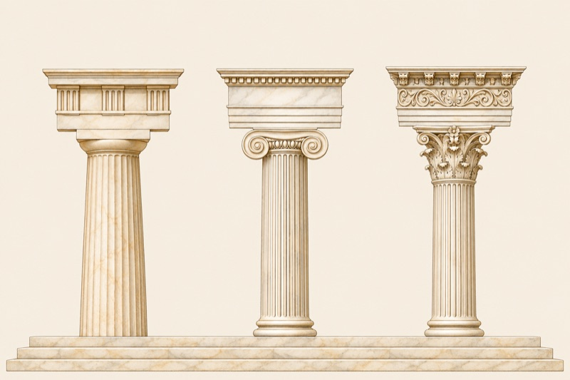{ loading=lazy }](column-types/index.md)

    **[The Three Classical Orders](column-types/index.md)** (Side by side)

    Doric, Ionic, and Corinthian columns, drawn at the same height, to compare their capitals, bases, flutes, and proportions.

-   [{ loading=lazy }](oracle-vs-algorithm/index.md)

    **[The Oracle and the Algorithm, Side by Side](oracle-vs-algorithm/index.md)** (Side by side)

    Six stages of a question, answered at Delphi and by a modern predictive model, with where each parallel breaks.

-   [{ loading=lazy }](five-classrooms/index.md)

    **[Five Classrooms Across Three Thousand Years](five-classrooms/index.md)** (Side by side)

    The Lyceum, Rhodes, a Venetian print shop, a medrese, and a modern tutor: who was inside, and who was left outside.

-   [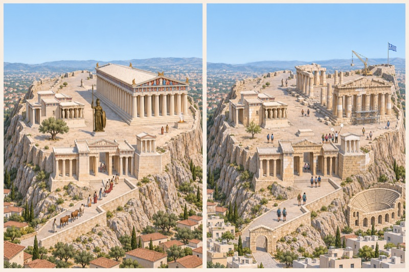{ loading=lazy }](acropolis-then-and-now/index.md)

    **[The Acropolis, Then and Now](acropolis-then-and-now/index.md)** (Side by side)

    The same aerial view drawn twice, about 406 BCE and today, to see what has been lost, rebuilt, or removed on purpose.

-   [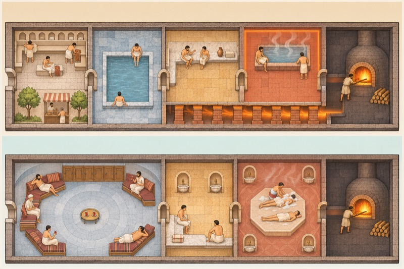{ loading=lazy }](bath-and-hamam/index.md)

    **[Roman Bath and Turkish Hamam](bath-and-hamam/index.md)** (Side by side)

    Two cutaway floor plans on one footprint, to compare five stages of the bath and see where the match breaks.

-   [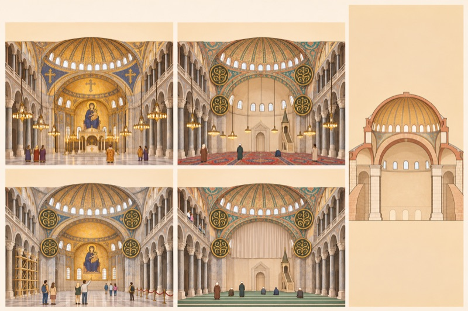{ loading=lazy }](hagia-sophia-four-lives/index.md)

    **[Hagia Sophia: One Building, Four Lives](hagia-sophia-four-lives/index.md)** (Side by side)

    The same view of the nave as a cathedral, a mosque, a museum, and a mosque again, beside what never changed.

-   [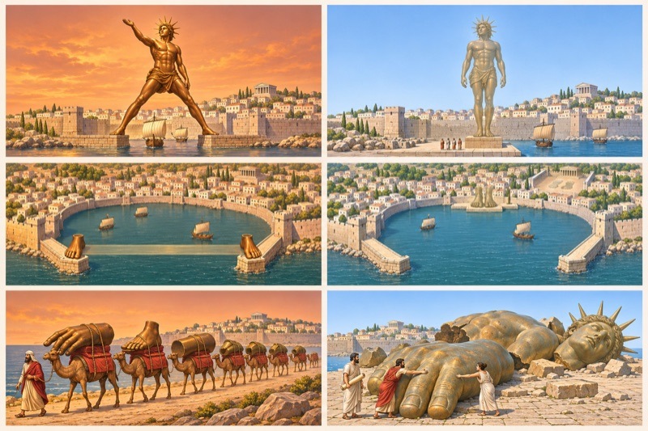{ loading=lazy }](colossus-myth-and-evidence/index.md)

    **[The Colossus: Popular Picture and Likely Truth](colossus-myth-and-evidence/index.md)** (Side by side)

    The giant most people imagine, beside what the evidence supports, for its pose, its place, and its end.

-   [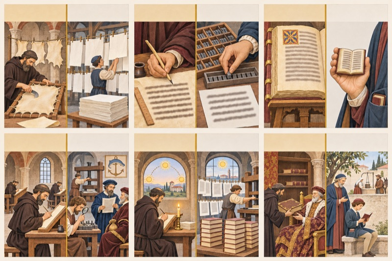{ loading=lazy }](scribe-and-aldine-page/index.md)

    **[A Scribe's Page and an Aldine Page](scribe-and-aldine-page/index.md)** (Side by side)

    A hand-copied Byzantine page and a small Venetian printed page, compared in six ways.

-   [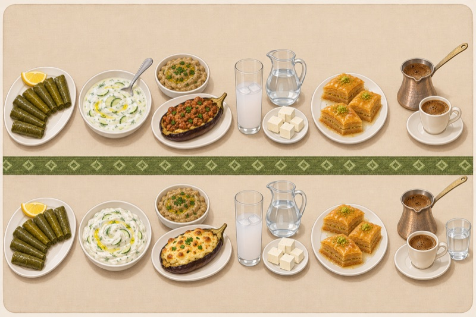{ loading=lazy }](one-table-two-names/index.md)

    **[One Table, Two Names](one-table-two-names/index.md)** (Side by side)

    Six pairs of Turkish and Greek dishes on one table, with both names and what the two kitchens share.

-   [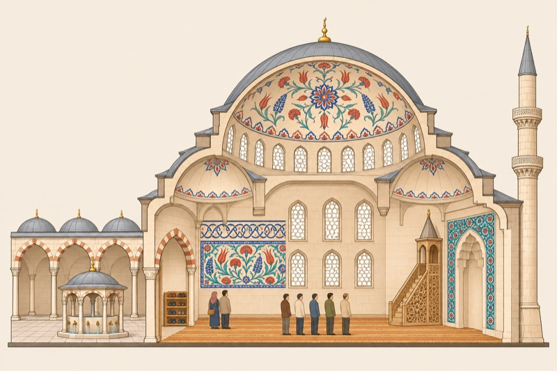{ loading=lazy }](anatomy-of-a-mosque/index.md)

    **[Anatomy of an Ottoman Mosque](anatomy-of-a-mosque/index.md)** (Call-outs)

    A cutaway of a mosque and its courtyard, with nine parts in the order a visitor meets them.

-   [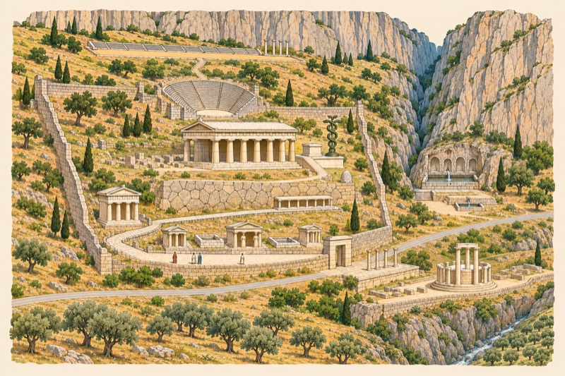{ loading=lazy }](delphi-sacred-way/index.md)

    **[Delphi: Climbing the Sacred Way](delphi-sacred-way/index.md)** (Call-outs)

    A stylized view of the sanctuary hillside, with nine places from the spring to the stadium.

-   [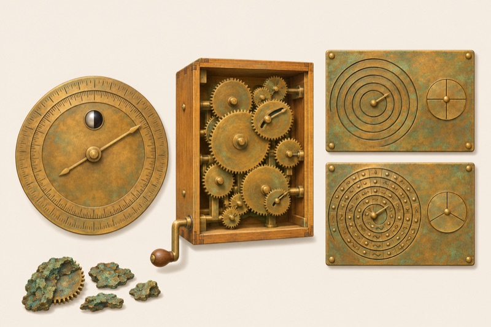{ loading=lazy }](antikythera-opened/index.md)

    **[The Antikythera Mechanism, Opened Up](antikythera-opened/index.md)** (Call-outs)

    The crank, the gear train, and the front and back dials of an ancient prediction machine.

-   [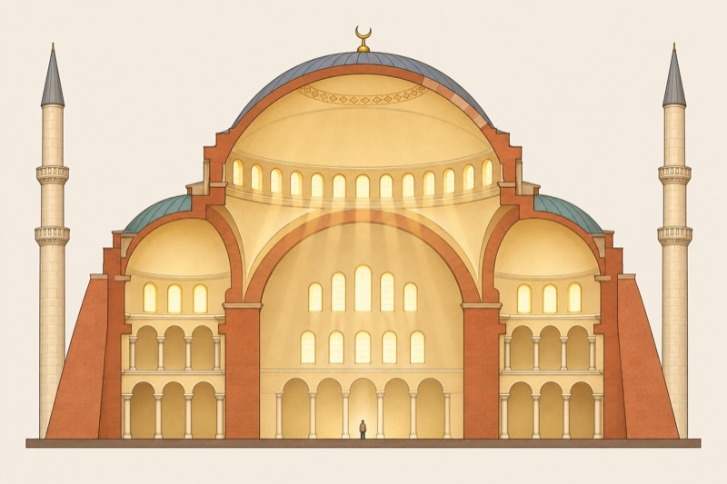{ loading=lazy }](hagia-sophia-dome/index.md)

    **[Inside the Hagia Sophia Dome](hagia-sophia-dome/index.md)** (Call-outs)

    A cross-section showing the piers, pendentives, windows, half-domes, and buttresses that hold up the dome.

-   [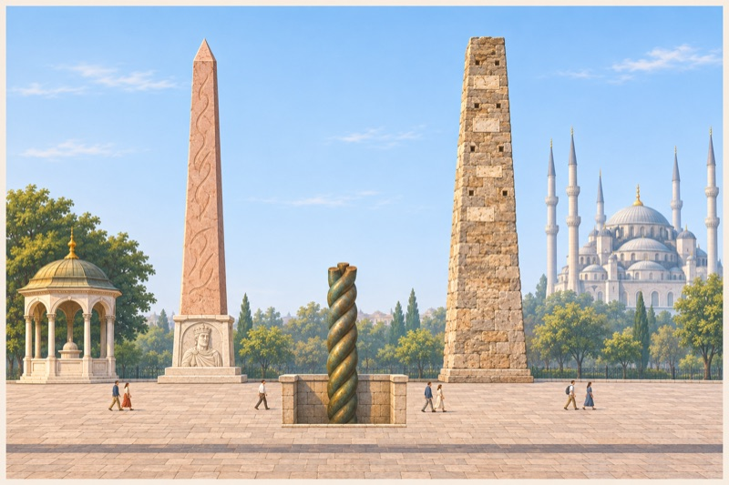{ loading=lazy }](hippodrome-walk/index.md)

    **[Walk Down the Hippodrome](hippodrome-walk/index.md)** (Call-outs)

    Three borrowed monuments on the old track line in Istanbul, and where each came from.

-   [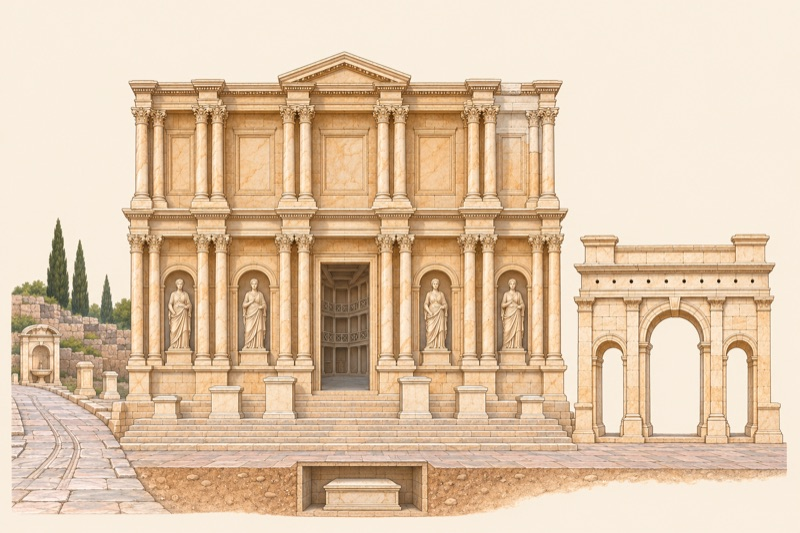{ loading=lazy }](library-of-celsus/index.md)

    **[The Library of Celsus Facade](library-of-celsus/index.md)** (Call-outs)

    Part by part, the front of the library at Ephesus, from the steps to the burial chamber under the floor.

-   [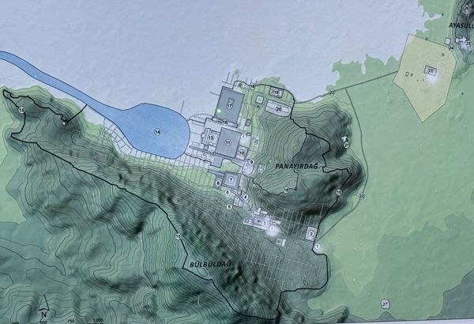{ loading=lazy }](ephesus-site-map/index.md)

    **[Map of Ancient Ephesus](ephesus-site-map/index.md)** (Call-outs)

    The site sign's map with its 27 numbered places, from the silted harbor to the Temple of Artemis and the hill of Ayasuluk.

-   [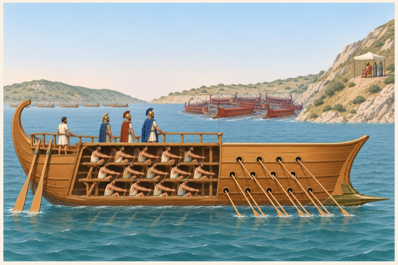{ loading=lazy }](trireme-at-salamis/index.md)

    **[A Trireme at Salamis](trireme-at-salamis/index.md)** (Call-outs)

    An Athenian warship cut open, and how the men who rowed it gave the poorest citizens a claim on the city.

The ideas behind these posters, and how each one was planned, are in
[Poster Ideas](poster-ideas.md).
