# MicroSims

MicroSims are small interactive tools, such as maps and timelines, that help us
see where we are going and how the places fit together. Each one can also be
embedded in a daily chapter. Click a card to open the MicroSim.

New MicroSims can be created with the `microsim-generator` skill, which routes
to the appropriate library (p5.js, Chart.js, vis-network, Mermaid, Leaflet,
Plotly, Venn.js).

-   **[A Day at the Oracle](./delphi-consultation-steps/index.md)**

    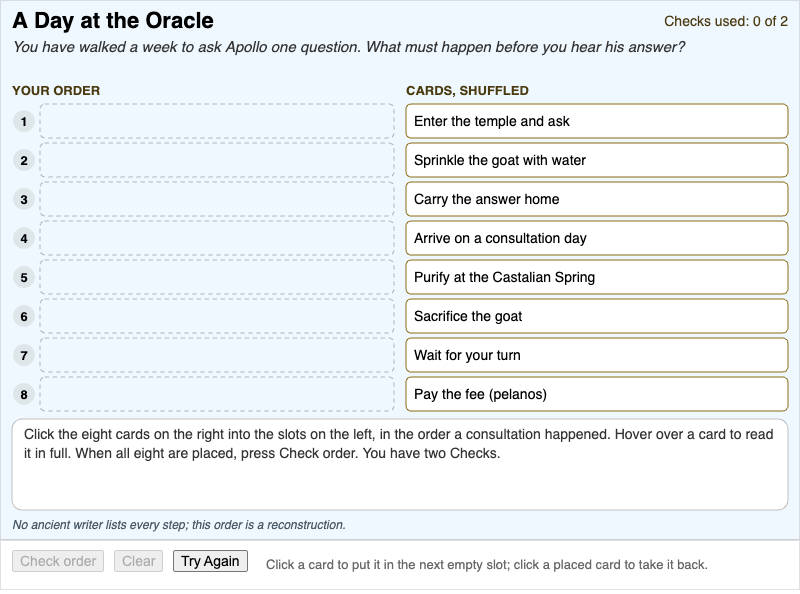

    Put the eight steps of a consultation at the Oracle of Delphi in order, from arriving on the seventh of the month to carrying the answer home, then walk through the day and predict what happens at three checkpoints - the goat test, the line, and the form of the answer.

-   **[Agreed Fact or Position?](./parthenon-marbles-fact-or-position/index.md)**

    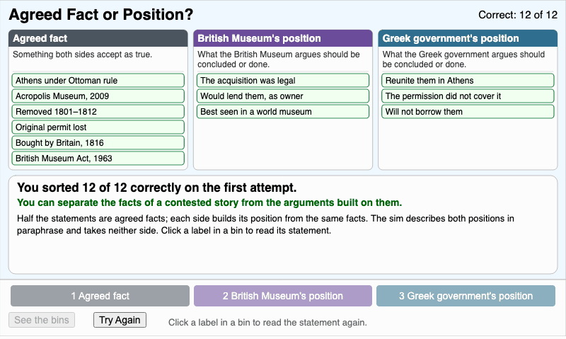

    Sort twelve statements about the Parthenon Marbles dispute into agreed facts, the British Museum's position, and the Greek government's position, and see how each side builds its case from the same facts.

-   **[Antikythera Gears](./antikythera-gears/index.md)**

    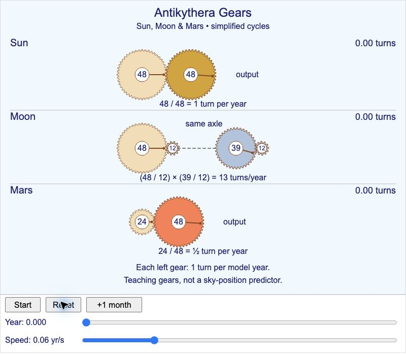

    Explore how gear tooth counts produce simplified Sun, Moon, and Mars cycles.

-   **[Can This Answer Lose?](./oracle-answer-hedging-test/index.md)**

    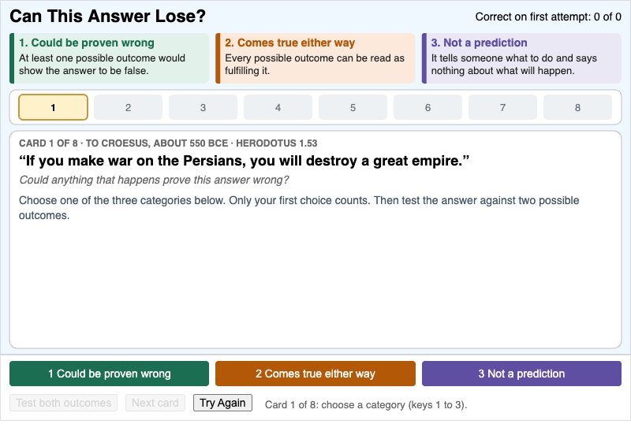

    Sort eight answers, from the Croesus prophecy and the "wooden wall" to a modern weather forecast, into answers that could be proven wrong, answers that come true either way, and answers that are not predictions at all, then test each one against two possible outcomes.

-   **[Crack Linear B Like Ventris](./crack-linear-b-like-ventris/index.md)**

    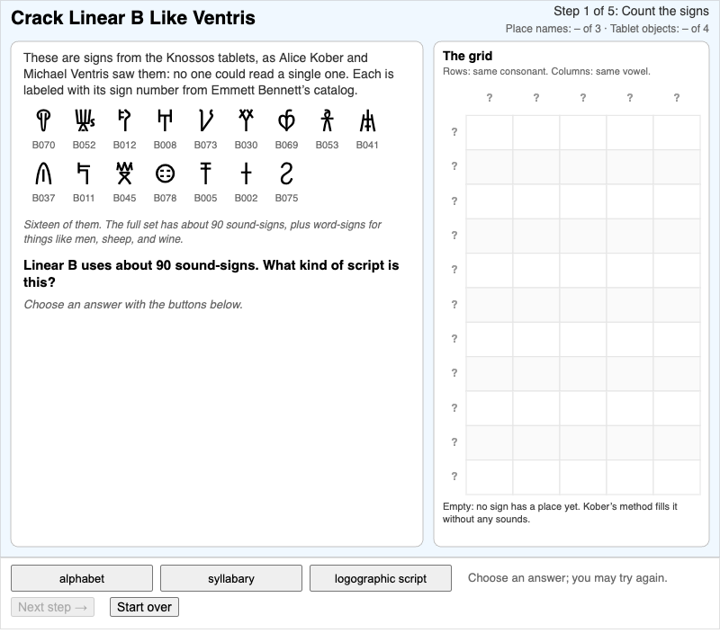

    Replay a simplified version of the 1952 decipherment of Linear B, from the sign count and Kober's triplet to the place-name guess, then test the values on the Pylos tripod tablet, whose pictograms confirm the reading.

-   **[Delphi After the Oracle](./delphi-after-the-oracle-timeline/index.md)**

    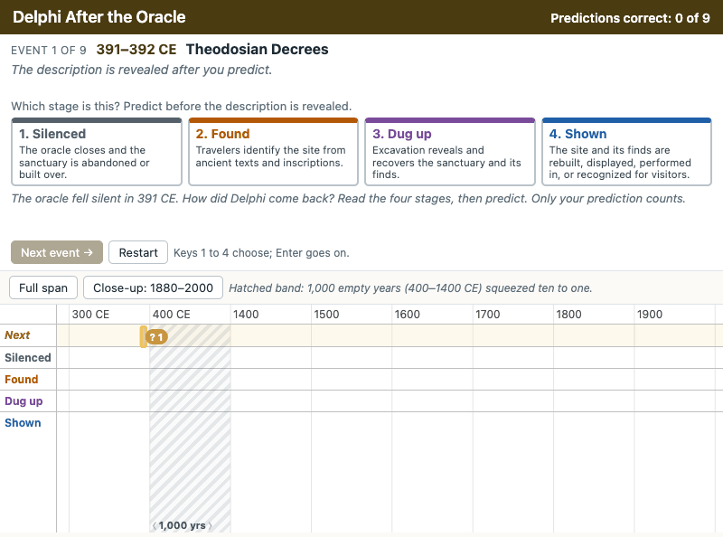

    Predict the stage of nine events in Delphi's history after the oracle closed, from the Theodosian Decrees of 391-392 CE to the UNESCO listing of 1987, as silenced, found, dug up, or shown, and watch each drop onto a timeline that squeezes the empty thousand years between them.

-   **[Democracy's Workplaces in the Agora](./agora-democracy-workplaces/index.md)**

    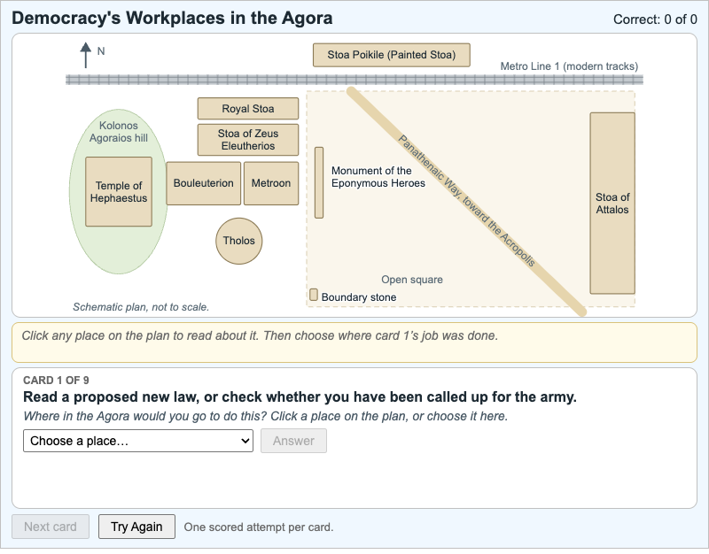

    Match nine jobs of Athenian public life, from posting notices to filing the charge against Socrates, to the building on a schematic plan of the Ancient Agora where each was done, and see the democracy's street of offices emerge along the west side.

-   **[Documented, Debated, or Tradition?](./ephesus-sites-evidence-judge/index.md)**

    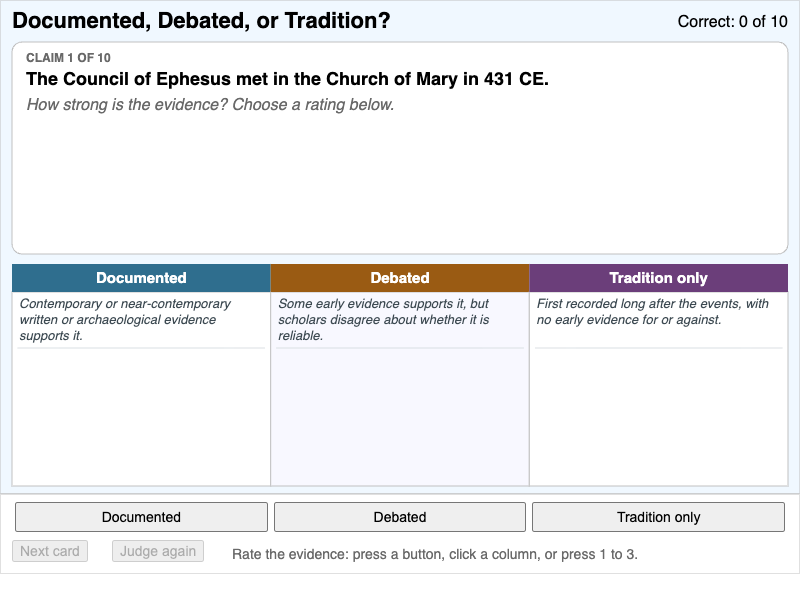

    Rate the evidence for ten claims about the Christian sites of Ephesus and Selçuk as documented, debated, or tradition only, and choose the reason that justifies each rating.

-   **[Doric, Ionic, or Corinthian?](./classical-orders-identifier/index.md)**

    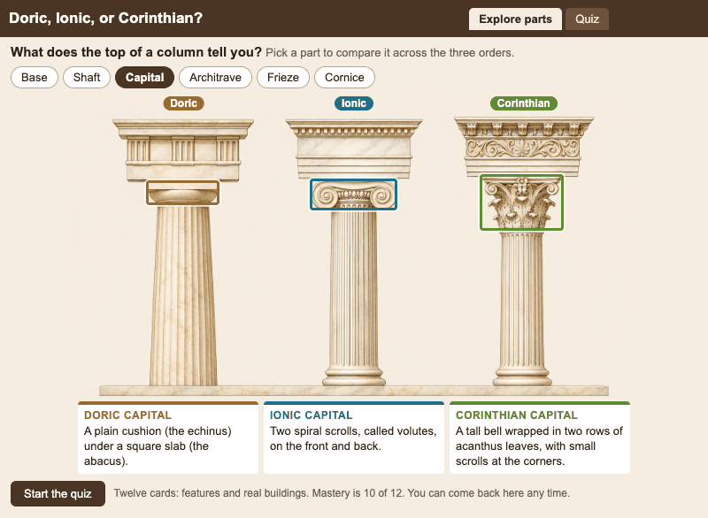

    Compare one part at a time across the Doric, Ionic, and Corinthian orders, then classify twelve column features and real buildings from our route, from the Parthenon to the Basilica Stoa of Ephesus.

-   **[Eleven Centuries of the Oracle](./delphi-oracle-strength-timeline/index.md)**

    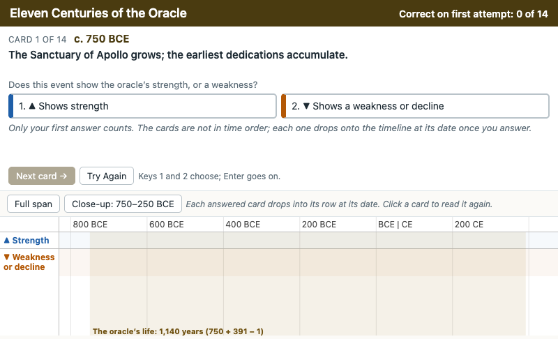

    Judge fourteen dated events from c. 750 BCE to 391-392 CE as signs of the Oracle of Delphi's strength or of its weakness and decline, watch each drop onto a timeline of the oracle's 1,140-year life, and find where the signs of decline begin to cluster.

-   **[Eras of the Eastern Mediterranean Timeline](./eastern-med-eras-timeline/index.md)**

    

    A to-scale timeline of the nine periods of Eastern Mediterranean history, from the Bronze Age to today, with six proportion questions to answer before the band lengths are revealed.

-   **[Essential or Inherited?](./essential-or-inherited-school-practices/index.md)**

    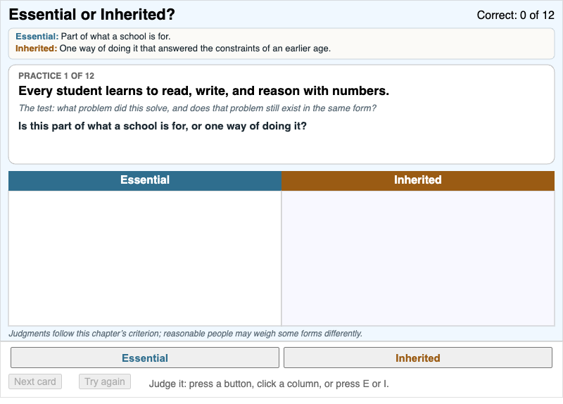

    Judge twelve school practices, from the Carnegie unit to being known by a caring adult, as an essential purpose of schooling or an inherited form that served that purpose under earlier constraints, and separate the trap pair of checking mastery and the same test on the same day.

-   **[Events of the Eastern Mediterranean Timeline](./eastern-med-events-timeline/index.md)**

    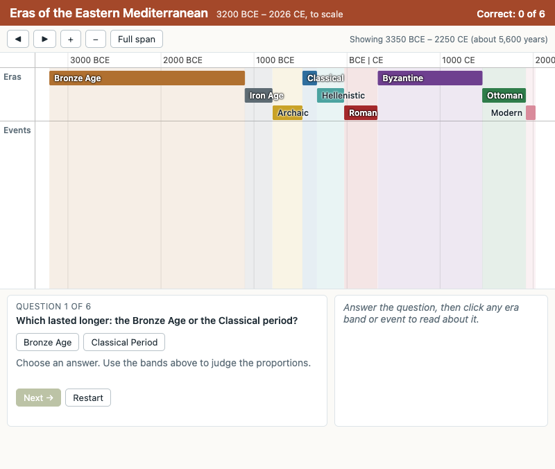

    A to-scale timeline of the nine periods of Eastern Mediterranean history with 29 key events on the trip route, each linked to the chapter that covers it, and six proportion questions to answer before the events are revealed.

-   **[Finish the Line Like a Homeric Singer](./homeric-formula-builder/index.md)**

    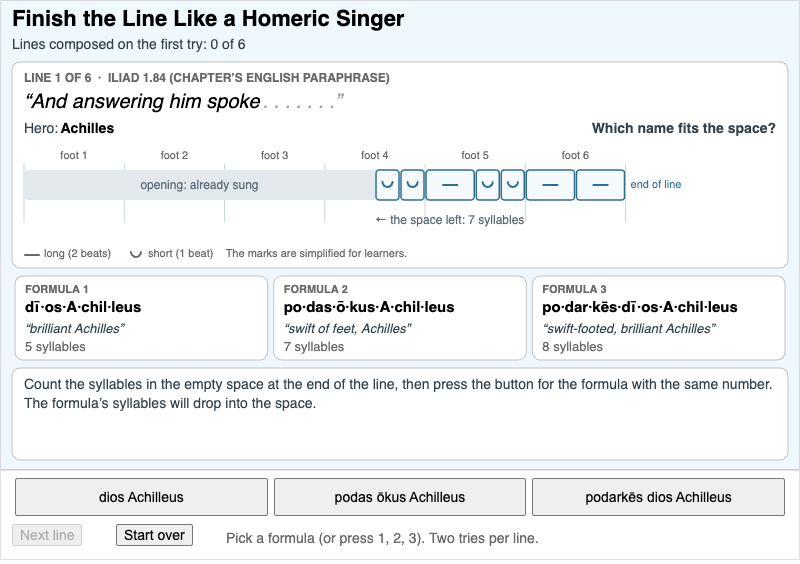

    Complete six Homeric hexameter lines by choosing the name formula for Achilles or Odysseus whose syllables exactly fill the space left at the end of the line, and discover Milman Parry's rule that the meter, not the moment, chooses the epithet.

-   **[Folding the Sheet: Folio, Quarto, Octavo](./folio-quarto-octavo-paper-calculator/index.md)**

    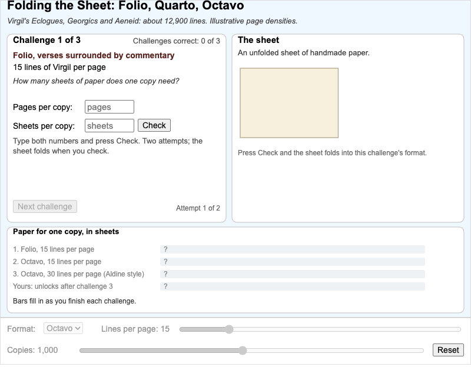

    Calculate the pages and sheets of paper in one copy of Virgil printed as a folio with commentary, a plain octavo, and an Aldine-style octavo in compact italic, and see a sheet fold into 2, 4, or 8 leaves.

-   **[From the Schism to the Sack, 1054–1261](./schism-to-sack-timeline/index.md)**

    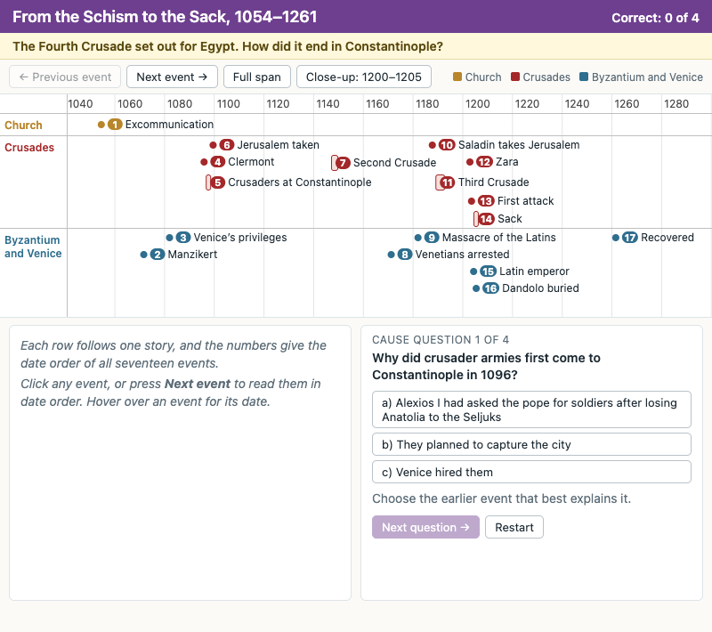

    A clickable timeline of seventeen events from the excommunication of 1054 to the recovery of Constantinople in 1261, with four cause questions on how a crusade bound for Egypt ended by sacking Constantinople in 1204.

-   **[How Calibrated Are You?](./calibration-confidence-game/index.md)**

    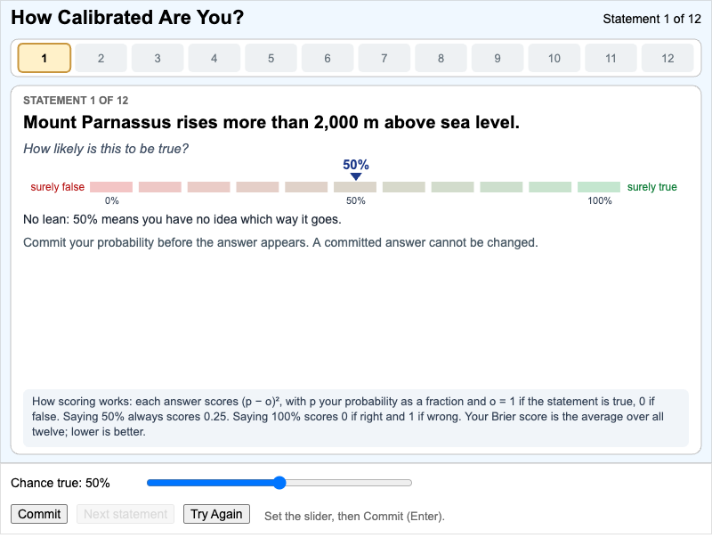

    State the probability that each of twelve statements from this book is true, see your Brier score, reliability table and calibration chart, judge whether you were overconfident, then judge two weather forecasters whose 70 and 90 percent forecasts came true 7 and 6 times in 10.

-   **[How Paul's Words Traveled](./how-pauls-words-traveled/index.md)**

    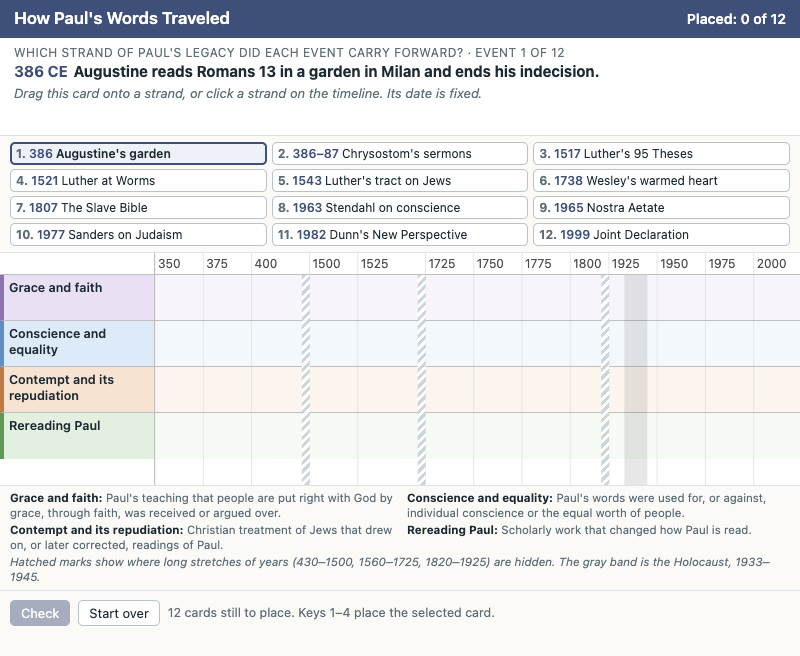

    Sort twelve dated events from 386 to 1999 into four strands of Paul's later influence (grace and faith, conscience and equality, contempt and its repudiation, rereading Paul) and see one man, Martin Luther, land in three of them.

-   **[Istanbul's Three Shores](./istanbul-three-shores-map/index.md)**

    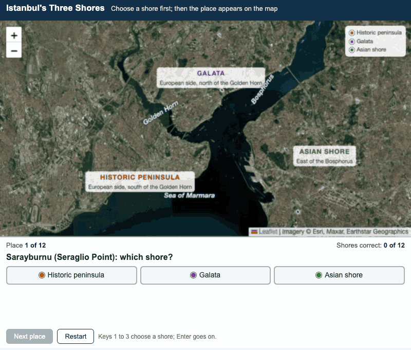

    Classify twelve Istanbul places, from Hagia Sophia to Rumeli Hisarı and Kadıköy, as on the historic peninsula, in Galata, or on the Asian shore, then see each one appear on a satellite map.

-   **[Knossos From Village to Decipherment](./knossos-village-to-decipherment-timeline/index.md)**

    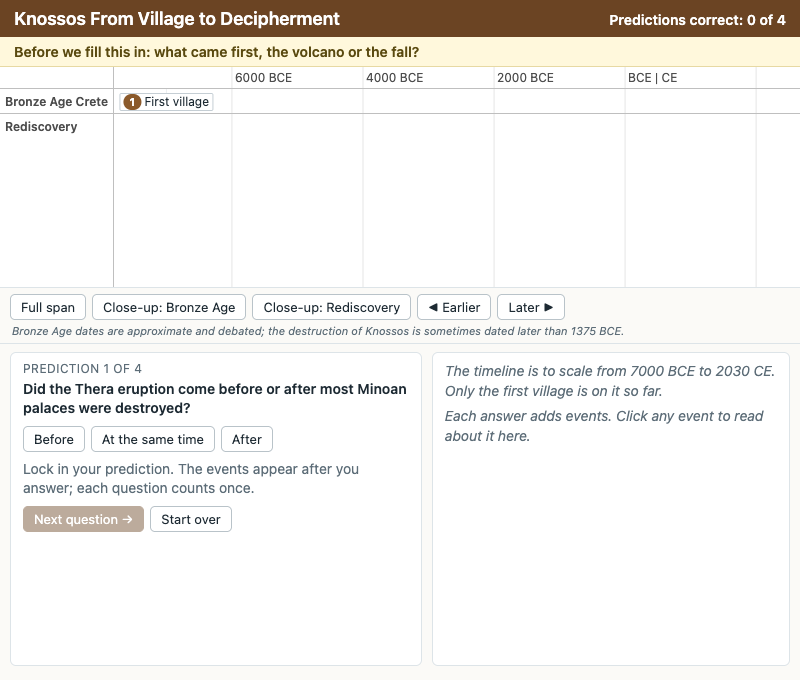

    A to-scale timeline of Knossos from its first village about 7000 BCE to the reading of Linear B in 1952, filled in one prediction at a time so the long gaps between the volcano, the fires, and the decipherment stand out.

-   **[Knossos: Minoan, Evans, or Copy?](./knossos-minoan-or-evans/index.md)**

    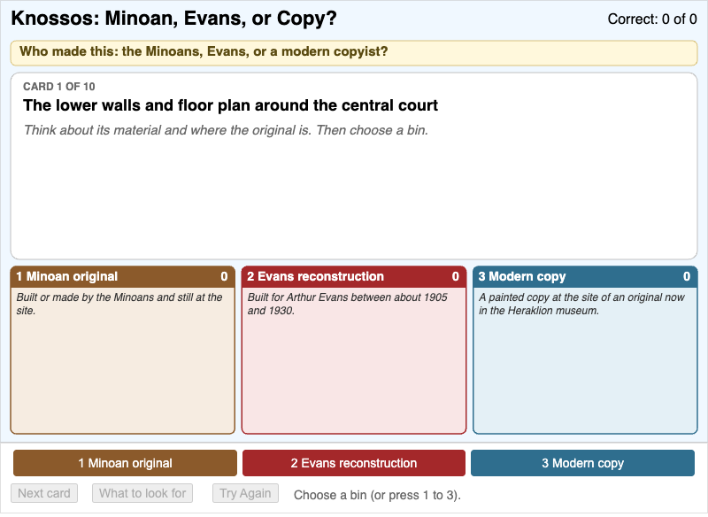

    Sort ten features a visitor sees at Knossos, from the gypsum throne to the red columns, into Minoan originals, Arthur Evans's reconstructions, and modern copies of paintings now in the Heraklion museum.

-   **[Layers of the Theodosian Walls](./theodosian-walls-layers/index.md)**

    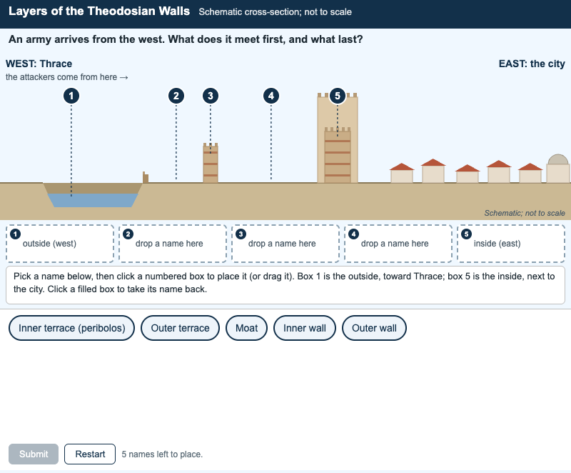

    Place the five layers of Constantinople's land walls, from the moat to the inner wall, on a schematic cross-section in the order an attacker from the west met them, then answer three questions on why the design worked.

-   **[Learning Graph Viewer](./graph-viewer/index.md)**

    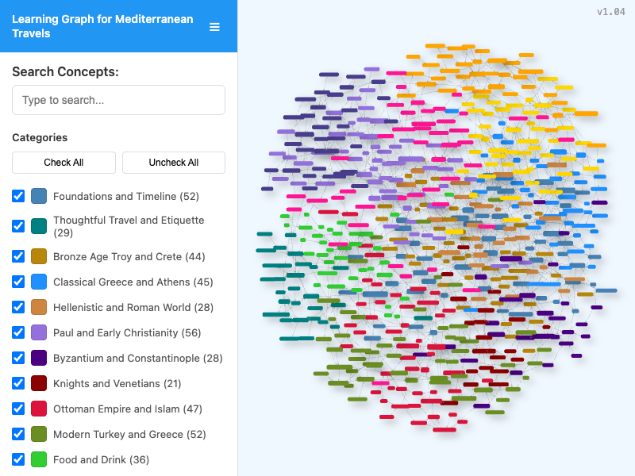

    An interactive viewer for the Mediterranean Travels learning graph of 598 concepts, with search, category filters, and node sizes scaled by each concept's impact.

-   **[Mind the Gap: How Old Is the Evidence?](./troy-gallipoli-evidence-gap/index.md)**

    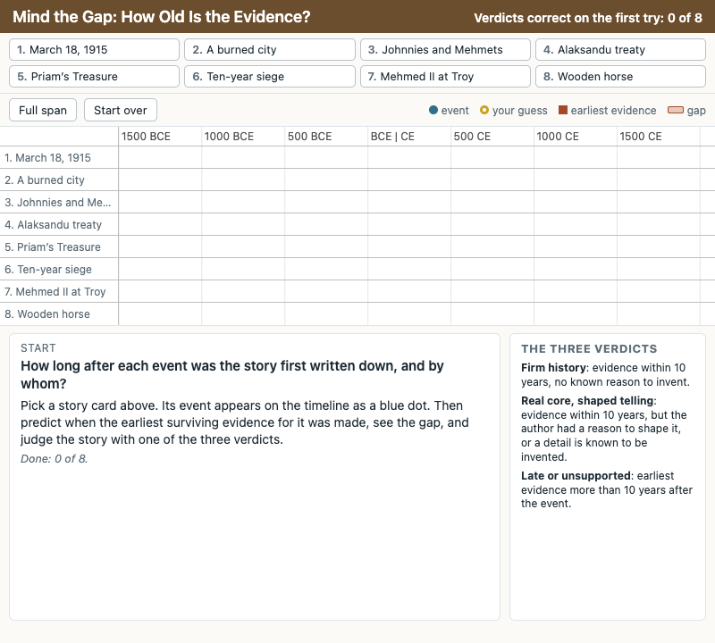

    Judge eight stories about Troy and Gallipoli as firm history, a real core with a shaped telling, or late or unsupported, by predicting and then measuring on a timeline the gap between each event and its earliest surviving evidence, and weighing the author's stake.

-   **[Next-Word Prediction and Temperature](./next-word-temperature-toy/index.md)**

    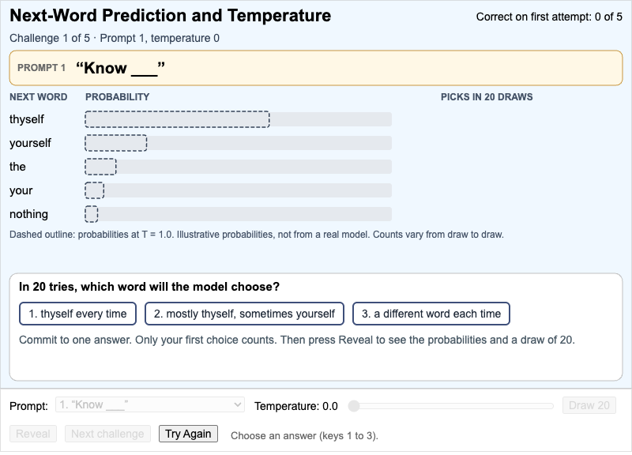

    Predict what the temperature setting does to a language model's choice of the next word, then reveal the adjusted probabilities and a draw of 20 sampled words, for four prompts from "Know ___" to "On Sundays the Grand Bazaar is ___."

-   **[November Weather at Our Stops](./november-weather-at-our-stops/index.md)**

    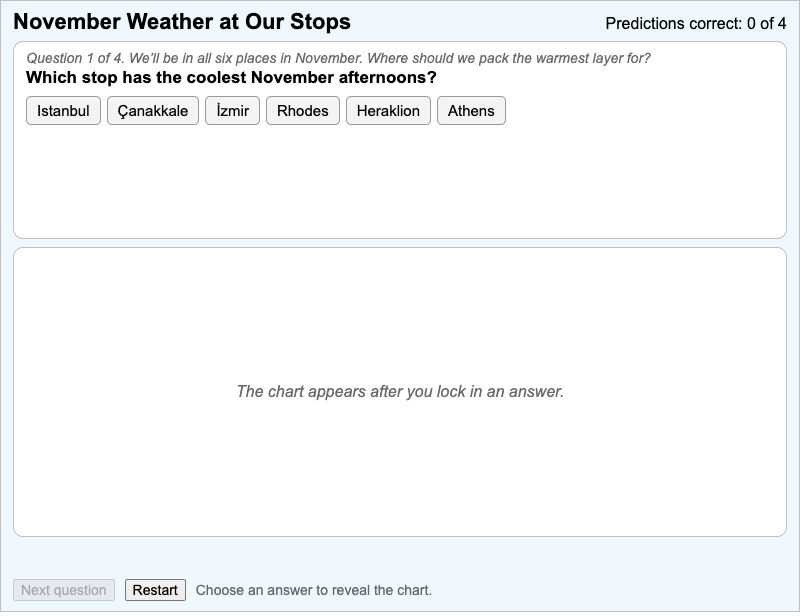

    Predict November temperature and rainfall at six stops on our route before the climate chart reveals the answer, then explore each stop's twelve-month climate.

-   **[One Walk, Seven Centuries](./ephesus-walk-timeline/index.md)**

    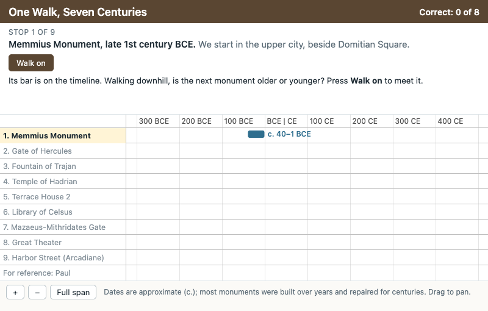

    Walk downhill through Ephesus monument by monument, predicting whether each one was begun before or after the one just passed, and watch the timeline zigzag across seven centuries.

-   **[Oracle, Gears, or Data?](./oracle-gears-or-data-sorter/index.md)**

    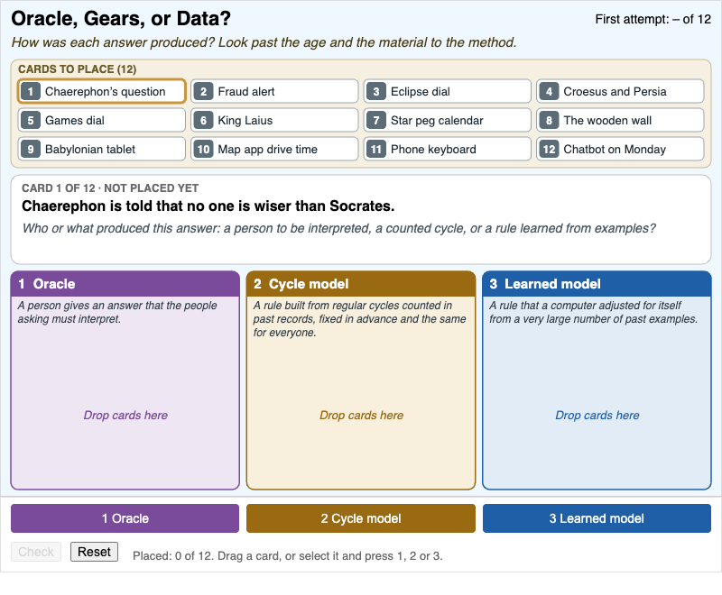

    Sort twelve predictions, from Delphi's oracle, the Antikythera mechanism, Babylonian tablets, a stone peg calendar, and modern phones and apps, by how each answer was produced, as an oracle's answer, a cycle model, or a learned model.

-   **[Paul's Journeys and Our Route](./paul-journeys-and-our-route/index.md)**

    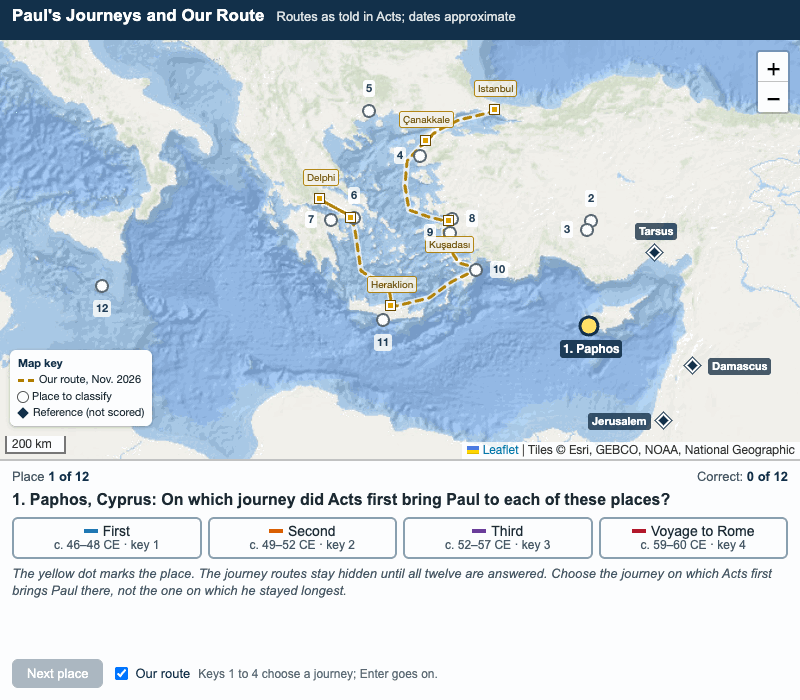

    Classify twelve places by the journey on which the Book of Acts first brings Paul there, then reveal Paul's three journeys and his voyage to Rome on one map with our own November 2026 route.

-   **[Paul's Speech Through Stoic Ears](./areopagus-speech-stoic-ears/index.md)**

    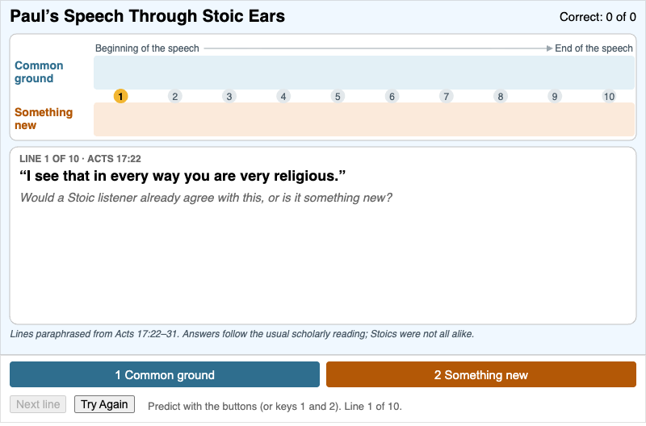

    Read ten lines of the speech Acts gives Paul on the Areopagus, predict for each whether a Stoic listener would hear common ground or something new, and see where the speech turns and where Luke says the audience scoffed.

-   **[Place the Site in Its Era](./place-the-site-in-its-era/index.md)**

    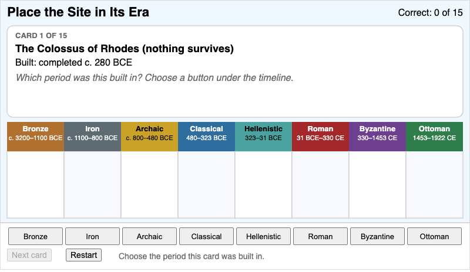

    Sort 15 sites and objects from our trip into eight period bins, from the Bronze Age to the Ottoman period, by the date each was built.

-   **[Planning Day 3 Around the Prayer Times](./day-3-prayer-time-planner/index.md)**

    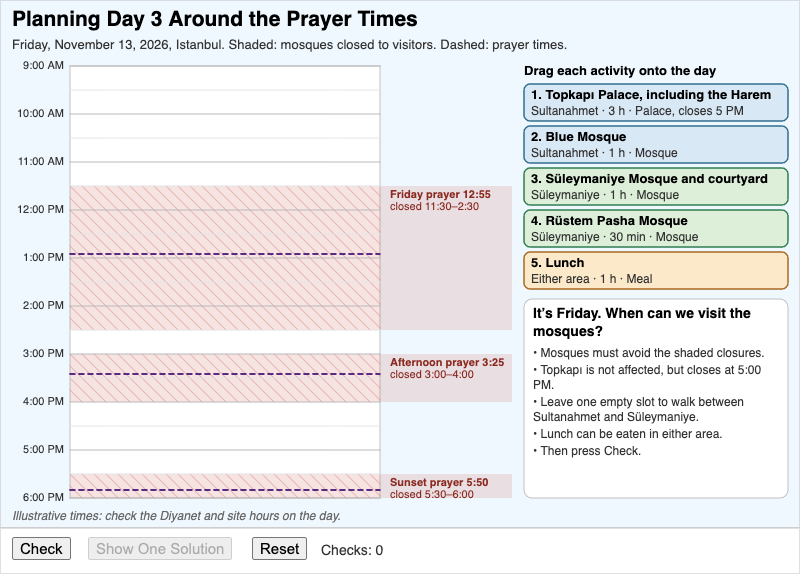

    Drag Topkapı Palace, three mosques and lunch onto a Friday in Istanbul so that every mosque visit misses the prayer closures, then press Check to see each broken rule named.

-   **[Read a Freedom Record on the Polygonal Wall](./delphi-freedom-record-reader/index.md)**

    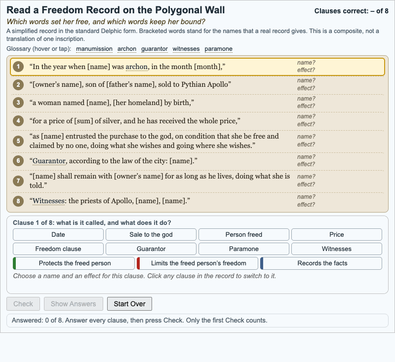

    Take apart a simplified Delphic manumission record, the kind carved by the hundreds on the polygonal wall below the Temple of Apollo, naming each of its eight clauses and judging whether it protects the freed woman, limits her freedom, or records the facts of the sale.

-   **[Read a Greek Sign](./read-a-greek-sign/index.md)**

    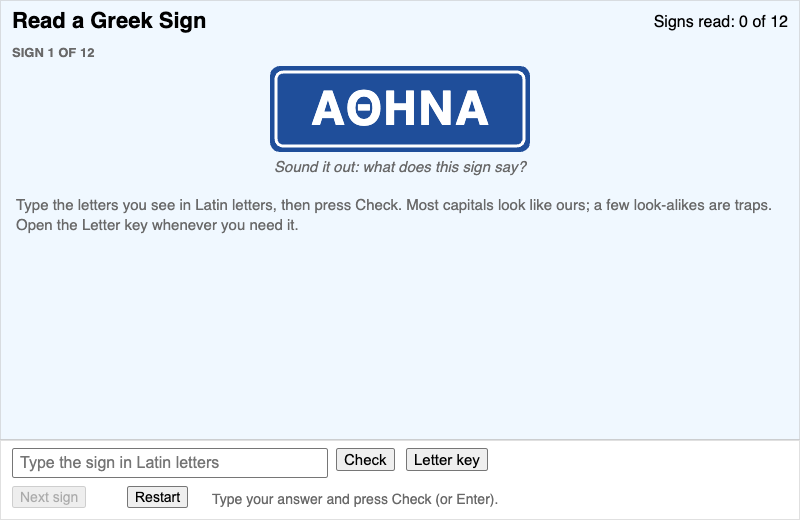

    Type twelve Greek signs from our route, from ΑΘΗΝΑ to ΚΛΕΙΣΤΟ, in Latin letters, with a letter key, trap-letter hints and a letter-by-letter breakdown.

-   **[Read the Olive Oil Label](./read-the-olive-oil-label/index.md)**

    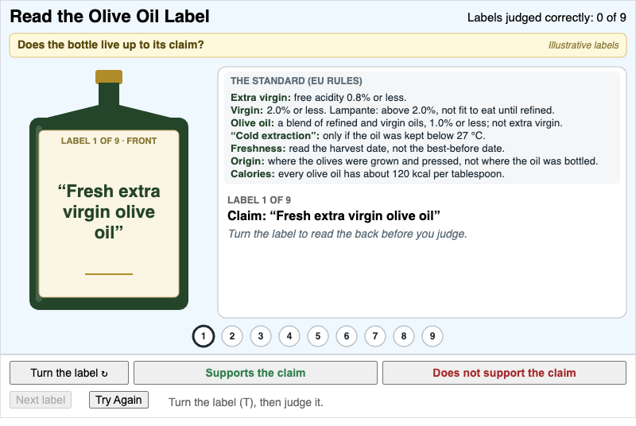

    Judge whether nine illustrative olive oil labels support the claims on their fronts, using the EU acidity limits, the 27 °C rule for "cold extraction", harvest dates, and origin wording.

-   **[Read the Ruin: Which Layer?](./read-the-ruin-layers/index.md)**

    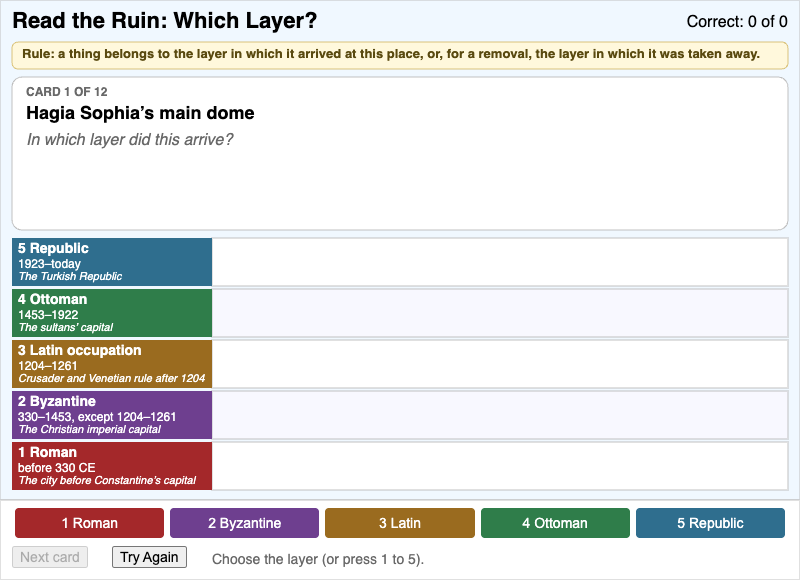

    Place twelve things seen on Day 2 in Istanbul, from the Hippodrome's Egyptian obelisk to the Basilica Cistern's new walkways, into the Roman, Byzantine, Latin, Ottoman or Republic layer in which they arrived.

-   **[Reading Food in Layers](./food-history-layers-sorter/index.md)**

    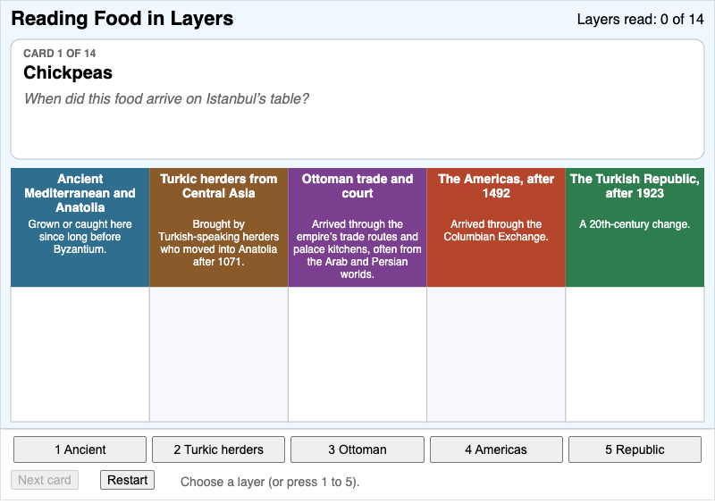

    Sort fourteen foods found in Istanbul, from olives and yogurt to coffee, tomatoes and tea, into the five historical layers they arrived with, and read a Turkish table like a history book.

-   **[Regions of the Eastern Mediterranean Map](./eastern-med-regions-map/index.md)**

    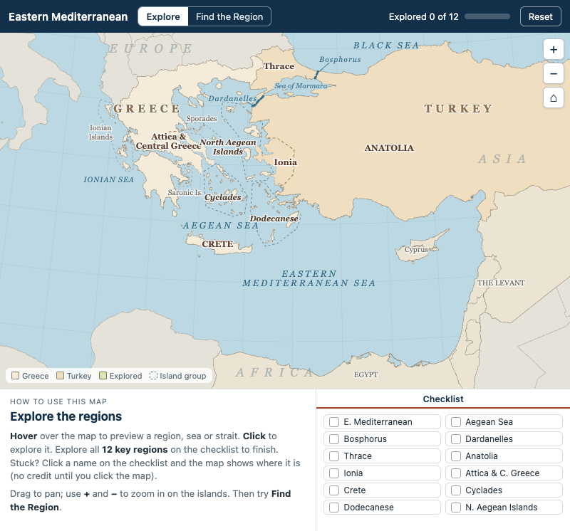

    An atlas-style map of the regions, island groups, seas, and straits named in Chapter 1, with hover infoboxes, a 12-region exploration checklist, a Find the Region challenge, and a live stream of xAPI learning events.

-   **[Reinforcing or Balancing? Loops From Ephesus to the Staff Room](./loops-ephesus-to-staff-room/index.md)**

    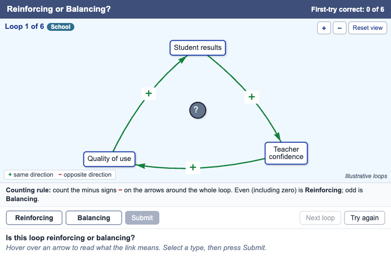

    Classify six causal loops, two from Paul's world and four from school change, as reinforcing or balancing by counting the minus signs around each one, and see that harmful loops can be reinforcing and that the Ephesus riot has the same structure as a rollout pushback.

-   **[Rhodes Changes Hands, 1912–1948](./rhodes-changes-hands-1912-1948/index.md)**

    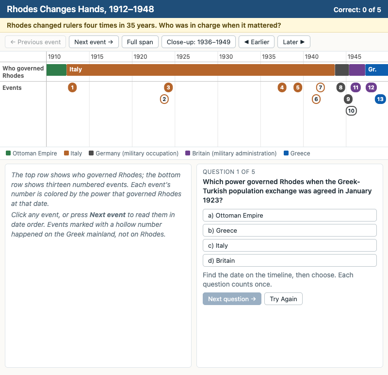

    A two-row timeline of who governed Rhodes from 1910 to 1949, Italy, Germany, Britain and Greece, with thirteen events and five questions on which power was in charge at each turning point.

-   **[Scribe or Press?](./scribe-or-press/index.md)**

    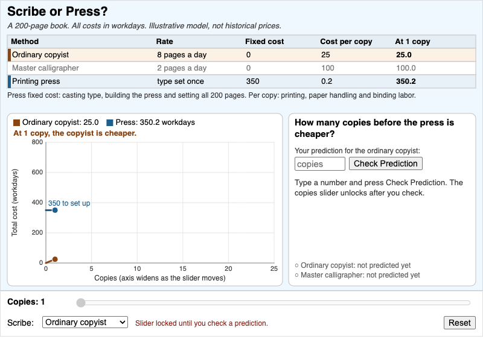

    Predict how many copies of a 200-page book it takes before printing becomes cheaper than hand-copying, for an ordinary copyist and a master calligrapher, then move a slider to watch the fixed-cost and per-copy lines cross.

-   **[Sort the Scripts](./sort-the-scripts/index.md)**

    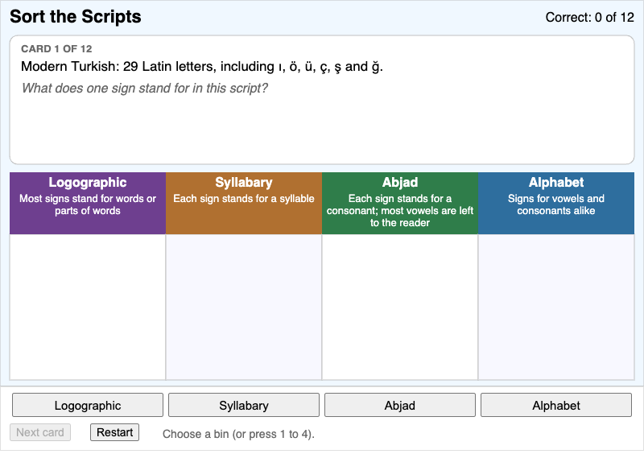

    Sort twelve writing systems, from Egyptian hieroglyphs and Linear B to Greek and modern Turkish, into logographic, syllabary, abjad and alphabet bins by what one sign stands for.

-   **[Source, Myth, or Contested?](./source-myth-or-contested/index.md)**

    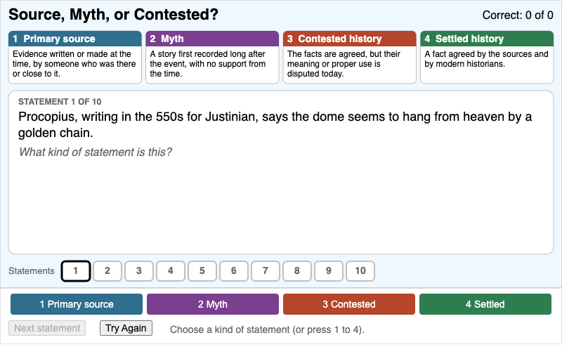

    Classify ten statements about Byzantine Constantinople, from Procopius's golden chain to the bronze horses of Venice, as a primary source, a myth, contested history or settled history.

-   **[Sèvres or Lausanne?](./sevres-versus-lausanne/index.md)**

    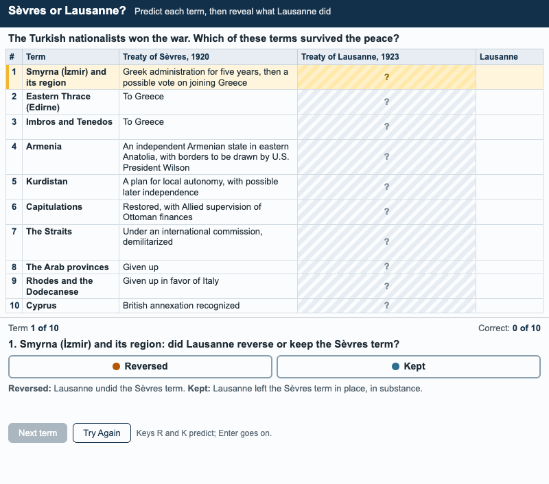

    Predict, term by term, which of ten terms of the 1920 Treaty of Sèvres the 1923 Treaty of Lausanne reversed and which it kept, then name the rule behind the pattern, the National Pact.

-   **[The Olympian Gods at Troy](./olympian-gods-at-troy/index.md)**

    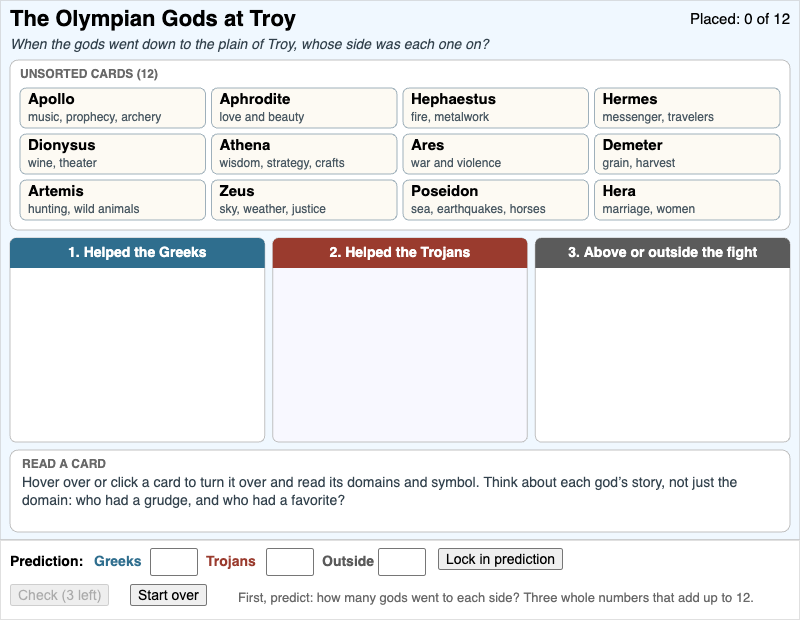

    Predict, then sort the twelve Olympian gods by the side each took in Homer's Iliad (the Greeks, the Trojans, or outside the fight), and discover that the gods chose sides for human reasons such as pride, old debts, and favorites.

-   **[The Parthenon's Five Lives](./parthenon-five-lives-timeline/index.md)**

    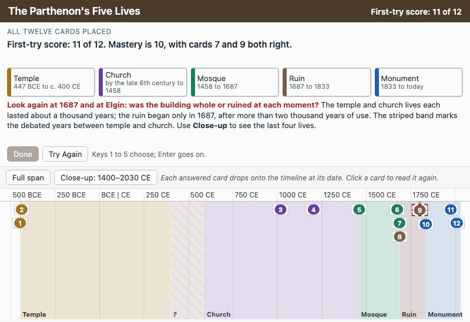

    Classify twelve events from 447 BCE to 2009 CE by which of the Parthenon's five lives it was living, temple, church, mosque, ruin or protected monument, and watch each card drop onto a timeline from 500 BCE to 2030 CE.

-   **[The Right Words at the Right Moment](./turkish-phrase-situations/index.md)**

    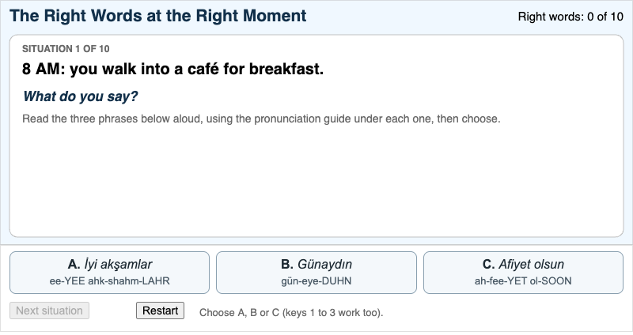

    Choose the right Turkish phrase, with its pronunciation guide, in ten everyday Istanbul situations, from breakfast at a café to thanking a home cook, and finish with a phrase sheet for the trip.

-   **[The Siege of 1453, Step by Step](./siege-of-1453-step-through/index.md)**

    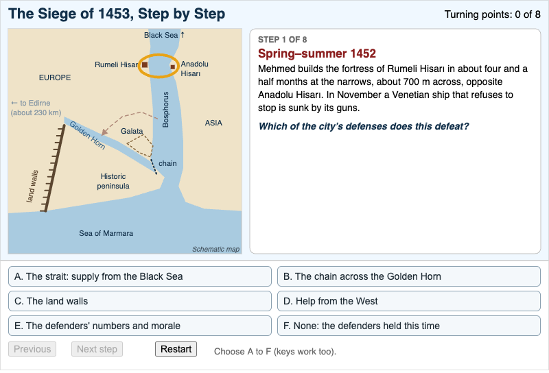

    Step through eight turning points of the 1453 siege of Constantinople on a schematic map, and for each one say which of the city's defenses it defeated, or whether the defenders held.

-   **[Thoughtful Traveler Choices](./thoughtful-traveler-choices/index.md)**

    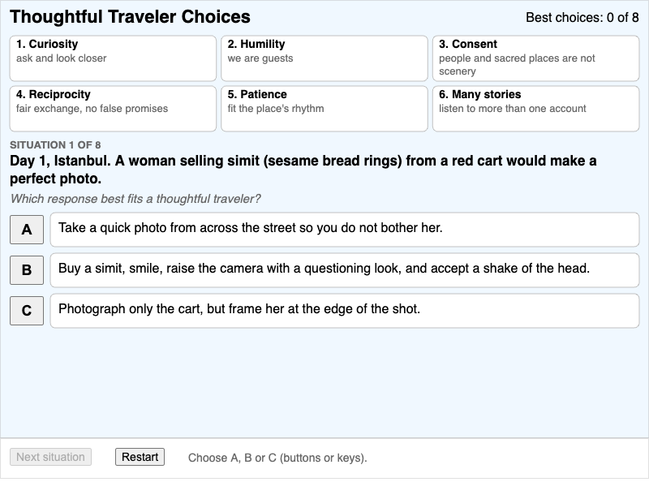

    Judge which of three responses best fits the six thoughtful-traveler principles in eight situations on our route, from a simit seller's photo to a closed Grand Bazaar.

-   **[Trade Routes of the Eastern Mediterranean](./eastern-med-trade-routes-map/index.md)**

    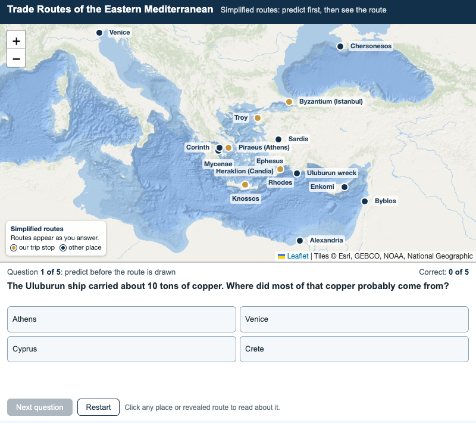

    Predict five route-based outcomes, then watch four simplified trade routes from the Bronze Age to Venetian Crete appear on a map of 16 ports and chokepoints.

-   **[Tutoring Effect Size Explorer](./tutoring-effect-size-explorer/index.md)**

    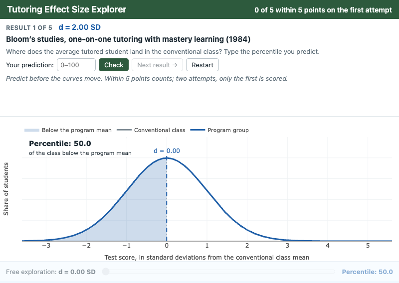

    Predict the percentile that five reported effect sizes for tutoring, mastery learning, and an AI tutor pilot put the average student at, then watch two normal curves separate to check, and explore how effect size in standard deviations turns into percentiles.

-   **[Two Ends of the Serpent Column](./serpent-column-two-ends/index.md)**

    

    Sort ten claims about the Serpent Column, the bronze monument to the Greek victory at Plataea that stood at Delphi and now stands in Istanbul's Hippodrome, by where their evidence can be checked, at Delphi, in Istanbul, or only in an ancient written source.

-   **[Viking Cruise Map](./viking-cruise-map/index.md)**

    

    An interactive map of the Viking Star Ancient Mediterranean Treasures cruise from Istanbul to Athens and our day trip to Delphi, with the route, times, key sights, and a tip for each of the eight stops.

-   **[Walking Venetian Candia](./walking-venetian-candia-map/index.md)**

    

    Locate eight landmarks of Venetian and Ottoman Heraklion, from the Morosini Fountain and the Loggia to Koules Fortress and the Martinengo Bastion, by clicking an unlabeled street map of the old town.

-   **[What Did the Külliye Do?](./suleymaniye-kulliye-sorter/index.md)**

    

    Sort twelve buildings of the Süleymaniye mosque complex by the public need each one served, from worship and learning to health, food, income and remembrance, and see the külliye as a whole system of public services.

-   **[When a Prediction Feeds Itself](./prediction-feedback-loops/index.md)**

    

    Label every link in three prediction loops, from predictive policing and student risk scores to a traffic forecast on the road to Delphi, as same or opposite direction, then classify each loop as reinforcing (self-fulfilling) or balancing (self-defeating).

-   **[When Printing Arrived](./when-printing-arrived/index.md)**

    

    A bar chart of the years from Gutenberg's Bible to the first printing in ten scripts and places, from Mainz to Istanbul, with an infobox for every bar and four questions that show who printed in Istanbul long before Müteferrika's press of 1729.

-   **[Where in Paul's Life Was Each Letter Written?](./paul-letters-on-his-timeline/index.md)**

    

    Drag the seven undisputed letters of Paul onto a timeline of his life, using one clue from inside each letter, and see that most of them come from the years around Ephesus while the prison letters remain debated.

-   **[Where the Empire Withdrew, 1683–1923](./ottoman-retreat-map/index.md)**

    

    Classify fourteen places of the former Ottoman Empire, from Buda and Crimea to Mecca and Damascus, by the era in which they left Ottoman rule, then replay the four eras on a map to see the shape of the retreat.

-   **[Who Built What We See in the Old Town?](./rhodes-old-town-layers-sorter/index.md)**

    

    Attribute twelve buildings and features of the city of Rhodes, from the Temple of Aphrodite to the Liberty Gate, to the Ancient, Knights, Ottoman or Italian builders who made what stands today.

-   **[Who Could Vote in Athens?](./athens-who-could-vote/index.md)**

    

    Calculate what share of Attica's people could vote around 431 BCE from scholarly estimates for four groups, push the estimates to their limits, and compare a full Assembly of 6,000 with everyone it governed.

-   **[Who Made a Greek Book in Venice?](./greek-book-makers-venice-network/index.md)**

    

    Attribute ten contributions to Greek printing in Venice around 1500 to Aldus Manutius, Marcus Musurus, Francesco Griffo, Zacharias Kallierges, and six others, and watch the network of editors, printers, financiers, and patrons grow one link at a time.

-   **[Who Says So? Sorting Claims About Paul](./who-says-so-paul-sources/index.md)**

    

    Sort fourteen familiar claims about the apostle Paul by their source (Paul's own letters, Acts only, scholars' inference, or later tradition) and see which parts of his story he told himself.

-   **[Who Was Exchanged in 1923?](./population-exchange-1923-cases/index.md)**

    

    Apply five simplified rules of the 1923 Greek–Turkish population exchange convention to ten illustrative households and decide whether each was sent to Greece, sent to Turkey, or not exchanged.

-   **[Why Athens Looks the Way It Does](./modern-athens-timeline/index.md)**

    

    Match eight things a visitor sees in Athens today, from the Polytechnic gate to euro prices and a Syrian bakery, to the events in modern Greek history from 1967 to 2023 that explain them, on an interactive timeline.

-   **[With or To?](./with-or-to-sorter/index.md)**

    

    Judge eight efforts to widen or control learning, six from the trip and two imagined AI projects, as done with the people they affected or done to them, using four questions about who chose, whose language, who was consulted, and who keeps it going.

-   **[World Literacy Over Two Centuries](./world-literacy-over-time/index.md)**

    

    Predict how many of the world's people could read in 1820, when more than half first could, and what share of adults still cannot, then see each answer on two centuries of literacy data.

-   **[Xerxes' Road to Salamis](./persian-wars-campaign-map/index.md)**

    

    Step through ten places of the Persian Wars, from Sardis and Marathon to Thermopylae, Salamis and Mycale, and predict at five of them why the fighting or the crossing happened there.

