# The Architect Who Cracked the Code

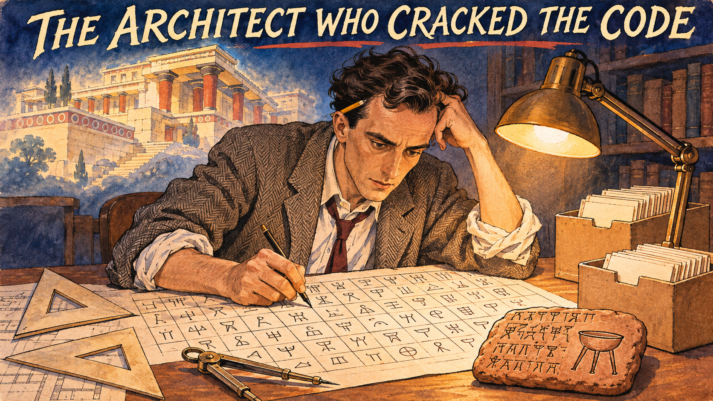

<details>
<summary>Cover Image Prompt</summary>
(This is the Cover Image. Do not include this label in the image.)
Style: a hand-drawn travel-sketchbook graphic-novel illustration, with clean dark ink outlines, flat softly shaded color fills and a faint watercolor paper texture, like a page from a traveler's journal; warm, sunlit, painterly lighting; no text, captions, signs, letters or speech bubbles anywhere in the image. Please generate a wide-landscape 16:9 cover image. Scene: a late-night desk lit by a single lamp. At the desk, bent over a large hand-ruled grid of small boxes, each holding an abstract incised sign, is Michael Ventris as an architect in his early thirties: a slim man with dark, slightly untidy hair, deep-set thoughtful eyes and a pale, intense face, wearing a gray tweed jacket over a white shirt with the sleeves pushed up, a loosened narrow tie, and a pencil behind one ear. Around him lie set squares, a drafting compass, stacks of index cards in plain cardboard cartons, and a small flat clay tablet with rows of tiny marks and a drawing of a three-legged cauldron. Behind him, on a shelf, a faint ghostly outline of a Bronze Age palace with red columns glows. Render the title as bold, hand-lettered text across the top: "THE ARCHITECT WHO CRACKED THE CODE" (exact spelling, no other text anywhere). Palette: warm clay red, cream, lamplight amber, ink black and lapis blue. Mood: quiet, intense, triumphant. Keep every character and place consistent with the other images in this story. Generate the image immediately without asking clarifying questions.
</details>

<details>
<summary>Narrative Prompt</summary>

**Story:** "The Architect Who Cracked the Code" tells how the clay tablets of Knossos, baked hard by the fire that destroyed the palace about 1375 BCE (some scholars argue for a later date), were found by Arthur Evans in 1900, called Linear B, and left unread for 52 years, until the English architect Michael Ventris showed in 1952 that they were written in Greek. It gives equal weight to the American classicist Alice Kober, whose roughly 180,000 index cards and grid of related word endings made the solution possible, and who died in May 1950, two years before it.

**Places and eras:** Mycenaean Knossos (about 1400 BCE); the Knossos excavation (1900); London (1936 and the 1940s and 1950s); Brooklyn (the 1940s); a radio studio (July 1, 1952); the Pylos tablet (found 1952, read 1953); the Heraklion Archaeological Museum (today). Panels 1 and 2 use the Bronze Age palette (terracotta red, ochre, lapis blue, cream plaster, olive green). The other palettes extend the series table for modern eras and are named in each prompt: dig years (dusty ochre, straw yellow, spring green, faded sky blue, terracotta), London (gray stone, cream plaster, oak brown, amber lamplight), Brooklyn (paper cream, ink black, brick brown, lamplight amber).

**House style:** hand-drawn travel-sketchbook graphic-novel illustration, as in docs/stories/characters.md. No lettering anywhere in panels, including on the tablets, cards, grids and notebooks: write them as rows of tiny abstract incised marks and plain boxes, not readable letters. Only the cover carries the title. The fire is shown only as glow and smoke; nobody is in the burning room.

**Legend versus evidence:** All of this story is documented history, with these cautions. The date of the palace fire is debated (about 1375 BCE in the most common dating). The story that fourteen-year-old Ventris heard Evans speak at a London exhibition in 1936 is a tradition about him, told as "the story goes." The tablets contain only accounts, never letters, laws, histories or poems.

**Creative liberties:** The rooms, clothing and faces of the scribe, the schoolboy, Ventris, Kober and the others are invented for the series; no portrait was copied. Evans, in his eighties in 1936, is not drawn in panel 5 (only a tiny distant speaker at a lectern with no features), and the series' Evans block (a man in his fifties) is used only for 1900 to the early 1900s, in panels 3 and 4. The travelers visited the museum on Day 9; whether the Linear B tablets are on display on a given day varies, so the last panel is a display case of clay tablets in general.

**Learning for All:** This story is part of the book's thread about who got to read and learn. Writing at Knossos was kept by a few dozen scribes, and then, in the 20th century, most of the Knossos texts were kept unpublished by Evans for decades; the decipherment moved quickly only after the texts were opened to others, and it needed Kober's patient groundwork, Emmett Bennett's careful sign list and edition of the Pylos tablets (1951), and John Chadwick's knowledge of early Greek.

**Cast:** Recurring characters (see docs/stories/characters.md and docs/img/mascot/character-sheet.md for Glaux): Arthur Evans (panels 3 and 4), the Palace of Knossos (panels 1, 2 and 3) and the Travelers (panel 14). Glaux hides in panel 13. Characters who appear only in this story:

The Mycenaean palace scribe (panel 1):

```text
A Mycenaean palace scribe: a lean man of about forty with a trimmed black beard and short dark hair, wearing a plain linen tunic with a narrow blue border and a clay-stained leather apron, kneeling at a low table and pressing a pointed bone stylus into a small flat tablet of damp clay.
```

Cretan workmen of 1900 (panel 3):

```text
Cretan workmen of 1900: sun-browned men in dark baggy breeches, white shirts, red sashes and black fringed headscarves, carrying picks, wicker baskets and wooden wheelbarrows.
```

Michael Ventris as a boy (panels 5 and 6):

```text
Michael Ventris as a boy of fourteen in 1936: a thin, serious schoolboy with short dark hair parted at the side, large attentive dark eyes and a pale face, wearing a gray wool school blazer, gray flannel trousers, a white shirt and a thin striped tie, holding a small notebook and a pencil.
```

Michael Ventris as an architect (panels 7, 10, 11 and 12):

```text
Michael Ventris as an architect in his early thirties: a slim man with dark, slightly untidy hair, deep-set thoughtful eyes and a pale, intense face, wearing a gray tweed jacket over a white shirt with the sleeves pushed up, a loosened narrow tie, and a pencil behind one ear.
```

Alice Kober (panels 8 and 9):

```text
Alice Kober, American classicist, in her early forties: a slim, serious woman with dark hair pinned back in a plain bun, rimless round glasses, a gray wool dress with a white collar and a cardigan, and ink-stained fingers; patient and focused.
```

</details>

### Prologue - A Fire, a Boy and a Count of Sheep

The fire that destroyed the palace of Knossos baked its clay records hard, and for more than three thousand years nobody could read them. In 1936, so the story goes, a fourteen-year-old schoolboy heard the archaeologist who had found them say that they were unreadable. He grew up to be an architect, and in 1952 he proved that they were written in Greek, with help from a Brooklyn classics teacher who had died two years earlier. The thrilling secret turned out to be an inventory.

**Find Glaux:** Glaux hides in one panel of this story. Can you spot the little owl?

## Panel 1: The Scribe Counts the Sheep
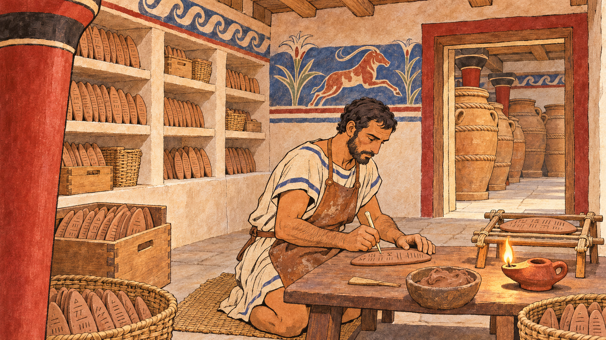
<details><summary>Image Prompt</summary>
(This is Panel 01. Do not include the panel number in the image.)
I am about to ask you to generate a series of images for a graphic novel. Please make the images have a consistent style and consistent characters. Do not ask any clarifying questions. Just generate the image immediately when asked.
Style: a hand-drawn travel-sketchbook graphic-novel illustration, with clean dark ink outlines, flat softly shaded color fills and a faint watercolor paper texture, like a page from a traveler's journal; warm, sunlit, painterly lighting; no text, captions, signs, letters or speech bubbles anywhere in the image.
Please generate a 16:9 image depicting panel 1 of 14. Setting: a palace archive room at Mycenaean Knossos, about 1400 BCE, warm lamplight on cream plaster. Palette: terracotta red, ochre, lapis blue, cream plaster and olive green. Camera: a medium view from the doorway, looking in along a row of shelves. Mood: orderly, calm, ordinary. In the foreground, kneeling at a low table: A Mycenaean palace scribe: a lean man of about forty with a trimmed black beard and short dark hair, wearing a plain linen tunic with a narrow blue border and a clay-stained leather apron, kneeling at a low table and pressing a pointed bone stylus into a small flat tablet of damp clay. Around him: wicker baskets and wooden boxes stacked with long thin leaf-shaped clay tablets, a bowl of damp clay, a second tablet drying on a rack, a clay lamp with a small flame, a red-painted tapered column at the edge of the frame, and through a far doorway the rows of giant jars of a storeroom. The Palace of Knossos on Crete: a sprawl of low, flat-roofed, honey-colored stone buildings around an open central court, with distinctive red-painted, downward-tapering wooden columns (wider at the top than the bottom) with black capitals, and colorful frescoes; storerooms hold giant human-tall clay jars (pithoi) with rope-like ridged bands. Keep the surfaces of the tablets as rows of tiny abstract incised marks and small tally strokes, not letters.
Keep every character and place consistent with the other images in this story. Generate the image immediately without asking clarifying questions.
</details>

About 1400 BCE, a scribe at the Palace of Knossos presses a pointed stylus into damp clay. He is one of only a few dozen palace scribes, and he is not writing poetry: he is counting sheep, oil and wool for the palace. The tablets are working records for the current year, kept in baskets and boxes, and meant to be smoothed over and reused.

## Panel 2: The Fire That Saved the Records
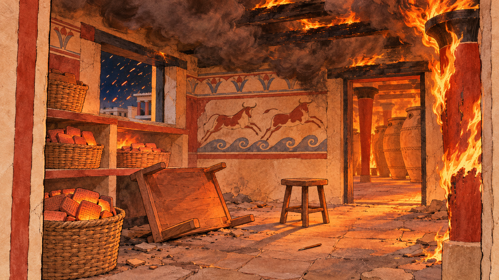
<details><summary>Image Prompt</summary>
(This is Panel 02. Do not include the panel number in the image.)
Style: a hand-drawn travel-sketchbook graphic-novel illustration, with clean dark ink outlines, flat softly shaded color fills and a faint watercolor paper texture, like a page from a traveler's journal; warm, sunlit, painterly lighting; no text, captions, signs, letters or speech bubbles anywhere in the image.
Please generate a 16:9 image depicting panel 2 of 14. Setting: the same archive room at Knossos as the previous image, seen from the same doorway, about 1375 BCE (some scholars date the fire later), at night. Palette: terracotta red, ochre and cream plaster, with deep orange firelight and dark smoke. Camera: the same medium view from the doorway as before. Mood: ominous, hushed, destructive but with no people anywhere. The low table is overturned, the scribe's stool stands empty, and the baskets of clay tablets glow orange as heat turns the soft clay hard and red. Smoke rolls along the ceiling under blackened timbers, a red column is wrapped in flame at the edge of the frame, and through the far door the giant storage jars stand in an orange-lit hall. A single dropped stylus lies on the floor, and the window shows a night sky streaked with sparks. The Palace of Knossos on Crete: a sprawl of low, flat-roofed, honey-colored stone buildings around an open central court, with distinctive red-painted, downward-tapering wooden columns (wider at the top than the bottom) with black capitals, and colorful frescoes; storerooms hold giant human-tall clay jars (pithoi) with rope-like ridged bands.
Keep every character and place consistent with the other images in this story. Generate the image immediately without asking clarifying questions.
</details>

Then the palace burns, most likely about 1375 BCE, though some scholars argue for a later date. The scribes do not survive, and neither does their script. But the fire bakes the clay tablets as hard as pottery, and they lie under the rubble for more than three thousand years. We have them only because of disaster.

## Panel 3: A Basket Full of Clay
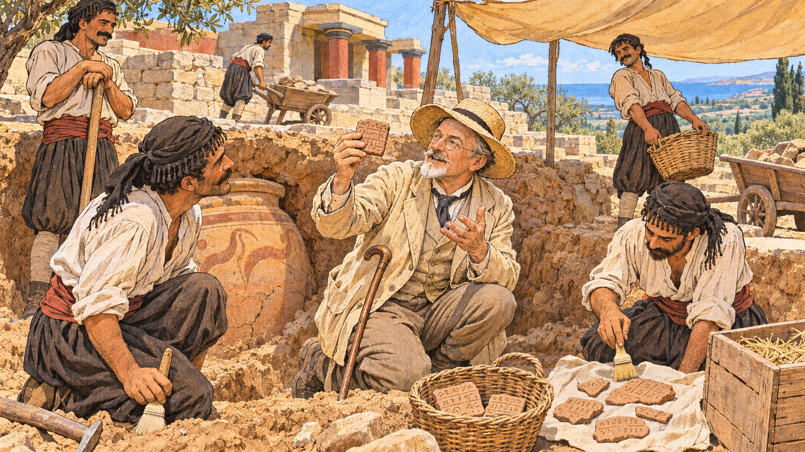
<details><summary>Image Prompt</summary>
(This is Panel 03. Do not include the panel number in the image.)
Style: a hand-drawn travel-sketchbook graphic-novel illustration, with clean dark ink outlines, flat softly shaded color fills and a faint watercolor paper texture, like a page from a traveler's journal; warm, sunlit, painterly lighting; no text, captions, signs, letters or speech bubbles anywhere in the image.
Please generate a 16:9 image depicting panel 3 of 14. Setting: a trench among the storerooms of the Palace of Knossos, April 1900, bright morning light. Palette: dusty ochre soil, straw yellow, spring green, faded sky blue and terracotta. Camera: a medium view from the trench lip, looking down. Mood: wonder and care. Kneeling in the trench, holding up a small flat clay tablet and examining it with eager gestures, is Sir Arthur Evans, British archaeologist: a short, energetic man in his fifties with a neat white beard, round wire glasses, a weathered face, wearing a rumpled cream linen jacket, a wide-brimmed straw hat and carrying a walking stick; he often carries a small ancient clay fragment in one hand and gestures eagerly. Around him, kneeling or standing with brushes and baskets, are Cretan workmen of 1900: sun-browned men in dark baggy breeches, white shirts, red sashes and black fringed headscarves, carrying picks, wicker baskets and wooden wheelbarrows. Details: the rim of a giant jar half exposed in the soil behind them, a wicker basket holding a few small flat clay tablets, a canvas awning for shade, a wooden crate with straw, spread-out fragments on a cloth, and the blue sea beyond the hill. Keep the tablets' surfaces as rows of tiny abstract marks, not letters.
Keep every character and place consistent with the other images in this story. Generate the image immediately without asking clarifying questions.
</details>

Evans began digging in March 1900, and within weeks the trenches yielded the Throne Room and the first clay tablets. He had come to Crete looking for early writing, and now he had thousands of tablets and fragments, more than at any other site. Nobody alive could read a word of them. The tablets were lists of people, flocks and goods, though no one knew it yet.

## Panel 4: Linear B, and Locked Drawers
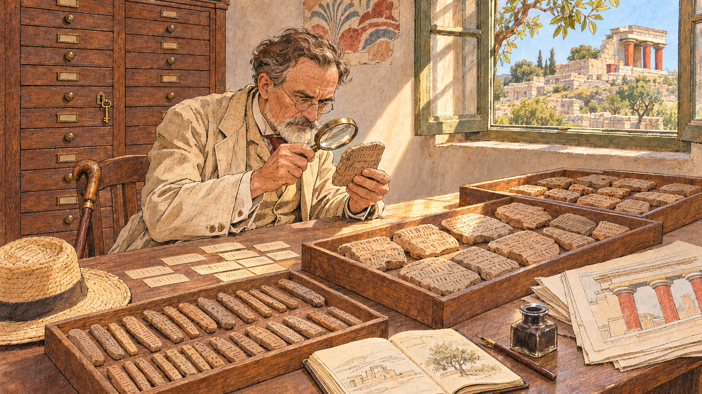
<details><summary>Image Prompt</summary>
(This is Panel 04. Do not include the panel number in the image.)
Style: a hand-drawn travel-sketchbook graphic-novel illustration, with clean dark ink outlines, flat softly shaded color fills and a faint watercolor paper texture, like a page from a traveler's journal; warm, sunlit, painterly lighting; no text, captions, signs, letters or speech bubbles anywhere in the image.
Please generate a 16:9 image depicting panel 4 of 14. Setting: a long worktable in the excavators' house at Knossos, about 1901 to 1905, warm afternoon light through a window overlooking the hill. Palette: dusty ochre soil, straw yellow, spring green, faded sky blue and terracotta, with oak brown for the furniture. Camera: a medium-wide view at eye level. Mood: absorbed, proprietary, a little remote. Sir Arthur Evans, British archaeologist: a short, energetic man in his fifties with a neat white beard, round wire glasses, a weathered face, wearing a rumpled cream linen jacket, a wide-brimmed straw hat and carrying a walking stick; he often carries a small ancient clay fragment in one hand and gestures eagerly. sits at the table, studying one flat tablet with a magnifying glass, his straw hat on the table beside him. The table holds neat wooden trays of sorted clay tablets in rows, some long and thin and some page-shaped, and small cards laid out in patterns. Behind him a tall wooden cabinet of narrow drawers stands closed, with a brass key in one lock. Details: a window showing the red columns of the hill, a notebook, an inkwell and pen, a stack of drawings, and a ray of sunlight across the tablets. Keep the tablets' surfaces as abstract rows of tiny marks, not letters.
Keep every character and place consistent with the other images in this story. Generate the image immediately without asking clarifying questions.
</details>

Evans sorts the tablets and gives the two scripts he finds their names. The signs are drawn with lines rather than pictures, so he calls them Linear A and Linear B. He spends the rest of his life on Knossos, and he never reads the tablets. He also publishes only a small part of them in his lifetime, so for decades almost nobody else can try.

## Panel 5: A Boy in the Audience
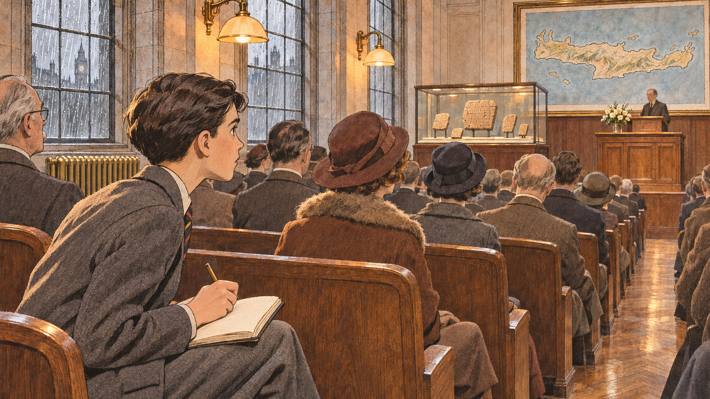
<details><summary>Image Prompt</summary>
(This is Panel 05. Do not include the panel number in the image.)
Style: a hand-drawn travel-sketchbook graphic-novel illustration, with clean dark ink outlines, flat softly shaded color fills and a faint watercolor paper texture, like a page from a traveler's journal; warm, sunlit, painterly lighting; no text, captions, signs, letters or speech bubbles anywhere in the image.
Please generate a 16:9 image depicting panel 5 of 14. Setting: a lecture hall at an exhibition in London, 1936, gray daylight from tall windows mixed with amber lamplight. Palette: gray London stone, cream plaster, polished oak brown and warm amber lamplight. Camera: a medium view from behind and slightly above the audience, with the boy near the front. Mood: wonder, a decisive moment. In the foreground, seated at the edge of a row, sits Michael Ventris as a boy of fourteen in 1936: a thin, serious schoolboy with short dark hair parted at the side, large attentive dark eyes and a pale face, wearing a gray wool school blazer, gray flannel trousers, a white shirt and a thin striped tie, holding a small notebook and a pencil. His eyes are fixed on the front of the hall, and the notebook is open on his knee. In the far background, tiny and without features, a distant speaker at a wooden lectern stands beside a glass case of clay tablets and a large map of Crete. Details: rows of adults in hats and overcoats, a polished oak floor, a brass radiator, tall windows with rain streaks, and a small spray of cream flowers on the lectern.
Keep every character and place consistent with the other images in this story. Generate the image immediately without asking clarifying questions.
</details>

In 1936, the story goes, a fourteen-year-old schoolboy named Michael Ventris goes to an exhibition in London and hears Arthur Evans speak about the Knossos tablets. He learns that nobody can read them, and he resolves to be the one who does. We cannot know exactly what was said, so this is a tradition about Ventris, not a documented scene.

## Panel 6: A Boy With a Notebook
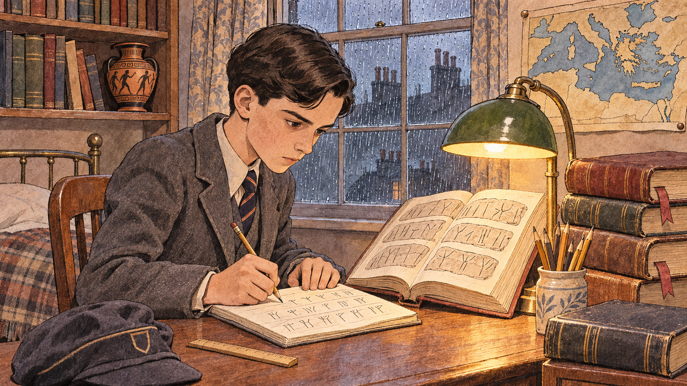
<details><summary>Image Prompt</summary>
(This is Panel 06. Do not include the panel number in the image.)
Style: a hand-drawn travel-sketchbook graphic-novel illustration, with clean dark ink outlines, flat softly shaded color fills and a faint watercolor paper texture, like a page from a traveler's journal; warm, sunlit, painterly lighting; no text, captions, signs, letters or speech bubbles anywhere in the image.
Please generate a 16:9 image depicting panel 6 of 14. Setting: a small upstairs study-bedroom in a London house, about 1937, evening, rain on the window. Palette: gray London stone, cream plaster, polished oak brown and warm amber lamplight. Camera: a close-medium view from the side, with the window behind. Mood: private, determined, quiet. Michael Ventris as a boy of fourteen in 1936: a thin, serious schoolboy with short dark hair parted at the side, large attentive dark eyes and a pale face, wearing a gray wool school blazer, gray flannel trousers, a white shirt and a thin striped tie, holding a small notebook and a pencil. He sits at a small desk under a green-shaded lamp, copying rows of small incised signs from a library book into his notebook with a pencil. On the desk: a stack of heavy library books with ribbon bookmarks, a jar of sharpened pencils, a dictionary, a school cap, a small ruler. A map of the Mediterranean is pinned to the wall, and a bookshelf holds schoolbooks and a model of a Greek vase. Through the rain-streaked window, the dim shapes of chimney pots. Keep the signs as abstract incised strokes, not letters.
Keep every character and place consistent with the other images in this story. Generate the image immediately without asking clarifying questions.
</details>

He has a gift for languages and a stubborn streak. Over the next years the boy studies what he can find about the signs, filling notebooks with copied rows and guesses. Nothing about him suggests a classicist, and in fact he will never take a degree in classics. He is learning to look for patterns.

## Panel 7: An Architect by Day
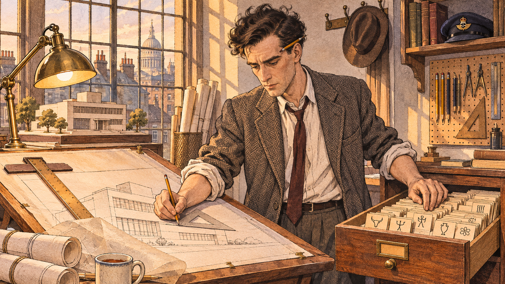
<details><summary>Image Prompt</summary>
(This is Panel 07. Do not include the panel number in the image.)
Style: a hand-drawn travel-sketchbook graphic-novel illustration, with clean dark ink outlines, flat softly shaded color fills and a faint watercolor paper texture, like a page from a traveler's journal; warm, sunlit, painterly lighting; no text, captions, signs, letters or speech bubbles anywhere in the image.
Please generate a 16:9 image depicting panel 7 of 14. Setting: an architect's office in London, about 1948, late afternoon with long golden light from a tall window. Palette: gray London stone, cream plaster, polished oak brown and warm amber lamplight. Camera: a medium three-quarter view with the drafting table in the foreground. Mood: focused, dual-minded, patient. At a tall drafting table stands Michael Ventris as an architect in his early thirties: a slim man with dark, slightly untidy hair, deep-set thoughtful eyes and a pale, intense face, wearing a gray tweed jacket over a white shirt with the sleeves pushed up, a loosened narrow tie, and a pencil behind one ear. He is working on a clean building drawing with a pencil and set square, but his other hand rests on a half-open wooden drawer beside him that is full of small index cards covered with tiny sign drawings. Details: tracing paper, rolled plans, a T-square, a scale model of a plain modern building in the corner, a mug of tea, a pegboard of pencils, a hat on a hook, and a view of rooftops. A navy-blue air-force cap sits on a shelf, a memory of war service.
Keep every character and place consistent with the other images in this story. Generate the image immediately without asking clarifying questions.
</details>

Ventris trains as an architect, serves as a navigator in the Royal Air Force during the Second World War, and then works on the script in his spare time. He has no classics degree, a gift for languages, and an architect's eye for visual pattern. The wartime navigator and the schoolboy are the same man: someone who can follow a route with nothing but a chart and patience.

## Panel 8: Kober's Cartons
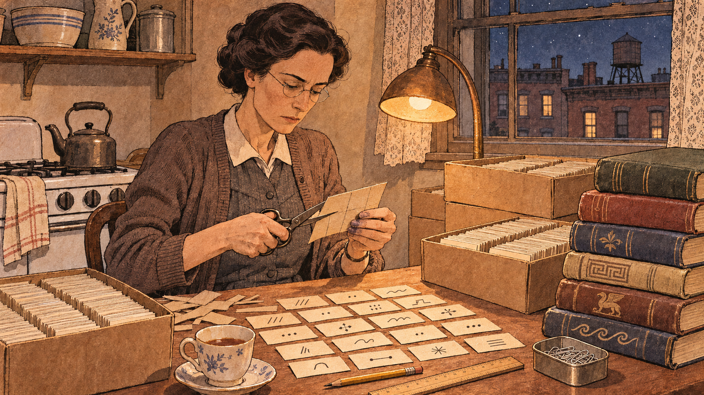
<details><summary>Image Prompt</summary>
(This is Panel 08. Do not include the panel number in the image.)
Style: a hand-drawn travel-sketchbook graphic-novel illustration, with clean dark ink outlines, flat softly shaded color fills and a faint watercolor paper texture, like a page from a traveler's journal; warm, sunlit, painterly lighting; no text, captions, signs, letters or speech bubbles anywhere in the image.
Please generate a 16:9 image depicting panel 8 of 14. Setting: a Brooklyn apartment kitchen, about 1944, late at night, a single warm lamp. Palette: warm paper cream, ink black, brick brown and lamplight amber. Camera: a medium-wide view across the table. Mood: patient, solitary, steady. At the table sits Alice Kober, American classicist, in her early forties: a slim, serious woman with dark hair pinned back in a plain bun, rimless round glasses, a gray wool dress with a white collar and a cardigan, and ink-stained fingers; patient and focused. She is cutting small cards from a scrap of cardboard with scissors, and neat rows of finished index cards are laid out in front of her. Around her are stacked plain cardboard cartons, packed tight with thousands of cards in neat rows, a pencil, a ruler, a cup of tea going cold, a thick stack of books in several languages, and a small tin of paper clips. Through the window: brownstone rooftops, a wooden water tower and a few stars. Keep the cards blank or marked with tiny abstract signs, never letters.
Keep every character and place consistent with the other images in this story. Generate the image immediately without asking clarifying questions.
</details>

In Brooklyn, a classics teacher called Alice Kober spends her evenings on the same puzzle. She teaches at Brooklyn College, carries a heavy teaching load, and works on Linear B in her spare time. With paper scarce in the war, she cuts scrap card by hand and builds a database of about 180,000 index cards in cigarette cartons, in a world with no computers. She refuses to guess what language the tablets were written in.

## Panel 9: The Triplet and the Empty Chair
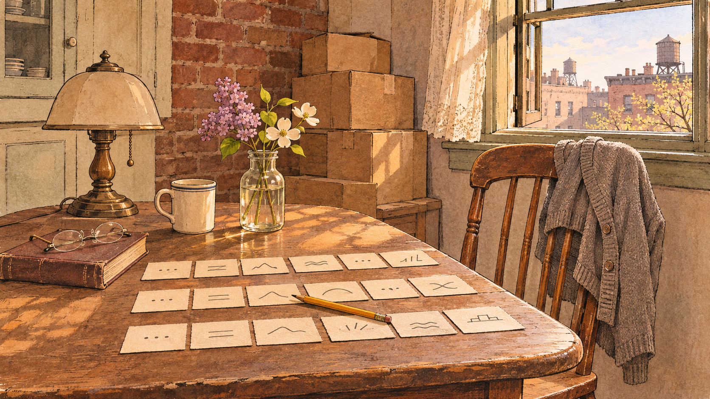
<details><summary>Image Prompt</summary>
(This is Panel 09. Do not include the panel number in the image.)
Style: a hand-drawn travel-sketchbook graphic-novel illustration, with clean dark ink outlines, flat softly shaded color fills and a faint watercolor paper texture, like a page from a traveler's journal; warm, sunlit, painterly lighting; no text, captions, signs, letters or speech bubbles anywhere in the image.
Please generate a 16:9 image depicting panel 9 of 14. Setting: the same Brooklyn kitchen as the previous panel, early morning in May 1950, pale gold light through the window. Palette: warm paper cream, ink black, brick brown and lamplight amber, softer and quieter. Camera: a calm, still medium view of the table, with no person present. Mood: gentle, respectful, a quiet absence. On the table, three rows of index cards are laid out in neat parallel lines, with the beginnings of each row matching and the endings differing, and a pencil lies across them. A wooden chair is pushed back slightly, with a gray cardigan hung over its back. Details: stacked plain cardboard cartons along the wall, a lamp switched off, a pair of rimless glasses folded on a book, a cup, a vase with a few spring flowers, and the window open to rooftops and a pale sky. Keep the cards as tiny abstract marks, never letters.
Keep every character and place consistent with the other images in this story. Generate the image immediately without asking clarifying questions.
</details>

Kober found a pattern. Some words came in three forms with the same beginning and different endings, so the language was inflected, like Latin or Greek, and the sign before the ending shared its consonant with its partners. From pairs like that she started a grid of signs, without assigning a single sound. She died after an illness in May 1950, at 43, two years before the decipherment she had made possible. The chair is empty; the cartons remain.

## Panel 10: A Wrong Guess
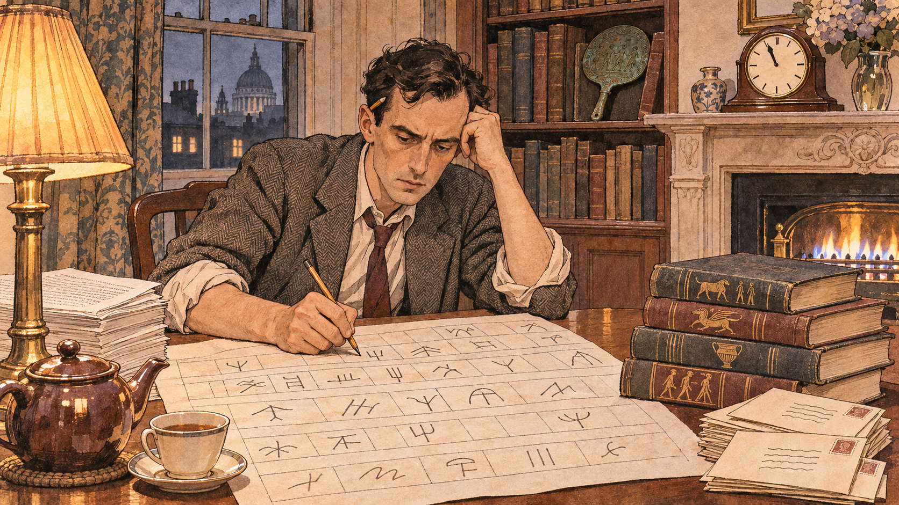
<details><summary>Image Prompt</summary>
(This is Panel 10. Do not include the panel number in the image.)
Style: a hand-drawn travel-sketchbook graphic-novel illustration, with clean dark ink outlines, flat softly shaded color fills and a faint watercolor paper texture, like a page from a traveler's journal; warm, sunlit, painterly lighting; no text, captions, signs, letters or speech bubbles anywhere in the image.
Please generate a 16:9 image depicting panel 10 of 14. Setting: the dining table of a London flat, 1951, late evening, lamplight and a gas fire. Palette: gray London stone, cream plaster, polished oak brown and warm amber lamplight. Camera: a medium view from across the table. Mood: concentrated, uncertain, slowly turning. Michael Ventris as an architect in his early thirties: a slim man with dark, slightly untidy hair, deep-set thoughtful eyes and a pale, intense face, wearing a gray tweed jacket over a white shirt with the sleeves pushed up, a loosened narrow tie, and a pencil behind one ear. sits hunched over a very large sheet of hand-ruled paper on the table, covered in rows of small boxes, a few holding abstract sign drawings, and a pencil in his hand. Around him: stacks of neatly typed pages, envelopes already addressed and stamped, a pot of tea, a pile of library books about ancient languages, and on a bookshelf behind him an Etruscan bronze hand-mirror leaning against a book. A clock on the mantelpiece shows after eleven. Keep every sign as an abstract stroke, never a letter.
Keep every character and place consistent with the other images in this story. Generate the image immediately without asking clarifying questions.
</details>

By 1951 Ventris is typing up his results as a series of 20 'Work Notes', sent to a small circle of scholars for criticism, and each version of his grid extends Kober's idea. He is sure the language will turn out to be Etruscan, and nobody would have bet on any other answer. He keeps following the grid, not his hunch.

## Panel 11: The Grid Speaks
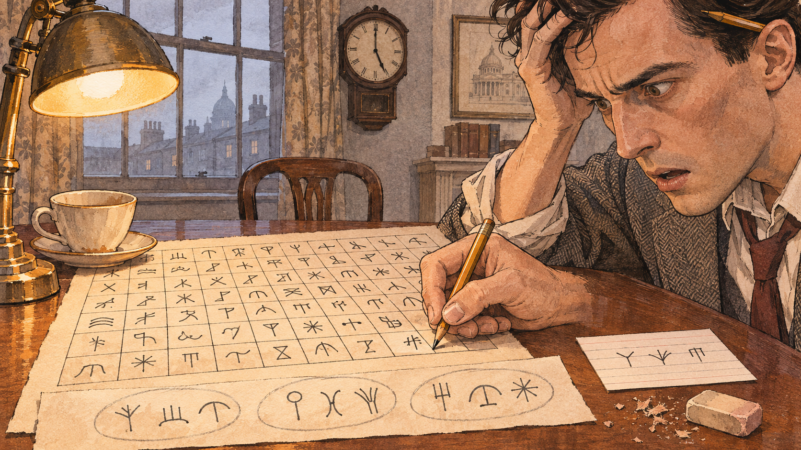
<details><summary>Image Prompt</summary>
(This is Panel 11. Do not include the panel number in the image.)
Style: a hand-drawn travel-sketchbook graphic-novel illustration, with clean dark ink outlines, flat softly shaded color fills and a faint watercolor paper texture, like a page from a traveler's journal; warm, sunlit, painterly lighting; no text, captions, signs, letters or speech bubbles anywhere in the image.
Please generate a 16:9 image depicting panel 11 of 14. Setting: the same London dining table, 1952, a few weeks later, early morning, a gray dawn in the window. Palette: gray London stone, cream plaster, polished oak brown and warm amber lamplight, with a pale gold lamp circle. Camera: a close, tight view of a hand and a sheet, with the man's face visible at the edge of the frame. Mood: a held breath, shock, disbelief. Michael Ventris as an architect in his early thirties: a slim man with dark, slightly untidy hair, deep-set thoughtful eyes and a pale, intense face, wearing a gray tweed jacket over a white shirt with the sleeves pushed up, a loosened narrow tie, and a pencil behind one ear. stares at the sheet, his pencil resting on one small box. The grid in front of him is now nearly filled with small abstract sign drawings, and three groups of signs on a separate strip have been lightly circled in pencil. Details: a scatter of eraser shavings, a cold cup of tea, a single index card slid next to the grid, a wall clock at dawn, the window with early light, and his hand pausing mid-stroke. Keep the signs as abstract strokes, never letters.
Keep every character and place consistent with the other images in this story. Generate the image immediately without asking clarifying questions.
</details>

Then he tries a guess about place names. Some words appear only on the Knossos tablets, never on those from Pylos, so they might be Cretan towns. If one is ko-no-so, Knossos, and another a-mi-ni-so, Amnisos, then a handful of signs get sound values, and every sign in the same row or column gets a partial value too. The words come out as Greek: ko-wo, 'boy', ko-wa, 'girl', po-me, 'shepherd'. The guess was the key, but the grid was the lock that let one guess open everything.

## Panel 12: A Voice on the Radio
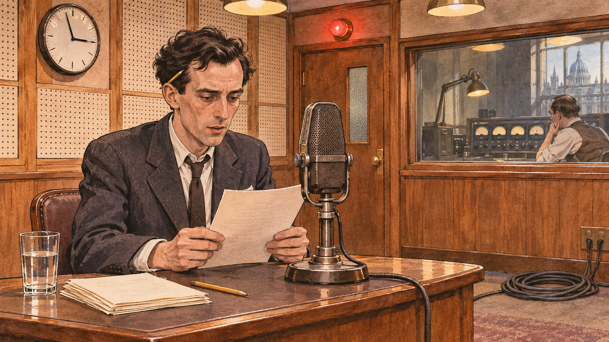
<details><summary>Image Prompt</summary>
(This is Panel 12. Do not include the panel number in the image.)
Style: a hand-drawn travel-sketchbook graphic-novel illustration, with clean dark ink outlines, flat softly shaded color fills and a faint watercolor paper texture, like a page from a traveler's journal; warm, sunlit, painterly lighting; no text, captions, signs, letters or speech bubbles anywhere in the image.
Please generate a 16:9 image depicting panel 12 of 14. Setting: a radio broadcasting studio in London, July 1, 1952, soft ceiling lights and warm wood panels. Palette: gray London stone, cream plaster, polished oak brown and warm amber lamplight. Camera: a medium view from slightly to the side. Mood: calm, historic, a little nervous. Michael Ventris as an architect in his early thirties: a slim man with dark, slightly untidy hair, deep-set thoughtful eyes and a pale, intense face, wearing a gray tweed jacket over a white shirt with the sleeves pushed up, a loosened narrow tie, and a pencil behind one ear. wearing a neat dark suit this time, sits at a desk in front of a large vintage ribbon microphone, reading carefully from a typed sheet he holds in both hands. Through a window to the control room, a technician in shirtsleeves watches a row of dials, and a small round red lamp glows above the door. Details: acoustic panels on the walls, a glass of water, a sheaf of papers, a pencil, a wall clock, and a heavy cable looped on the floor. No lettering on any sign or paper.
Keep every character and place consistent with the other images in this story. Generate the image immediately without asking clarifying questions.
</details>

On July 1, 1952, Ventris goes on BBC radio and announces that Linear B is Greek. He says it is a difficult and archaic Greek, older than Homer by some centuries. After the talk, John Chadwick, a Cambridge scholar of early Greek who had been a codebreaker in the Second World War, writes to offer help, and supplies what Ventris lacks: how Greek changed over time.

## Panel 13: The Tripod Tablet
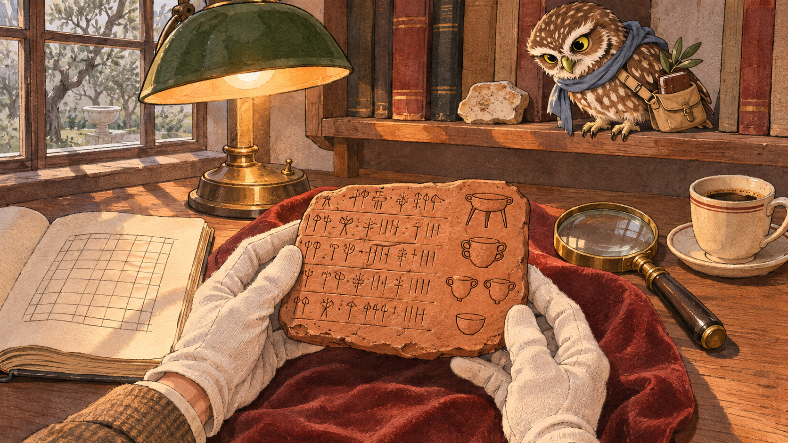
<details><summary>Image Prompt</summary>
(This is Panel 13. Do not include the panel number in the image.)
Style: a hand-drawn travel-sketchbook graphic-novel illustration, with clean dark ink outlines, flat softly shaded color fills and a faint watercolor paper texture, like a page from a traveler's journal; warm, sunlit, painterly lighting; no text, captions, signs, letters or speech bubbles anywhere in the image.
Please generate a 16:9 image depicting panel 13 of 14. Setting: a plain university study with a lamp and a worktable, 1953, warm late-afternoon light. Palette: warm clay red, cream, lamplight amber and charcoal. Camera: a close overhead-three-quarter view of the table. Mood: delighted vindication, quiet humor. A pair of hands in clean cotton gloves holds a small, flat, reddish clay tablet from Pylos, shown on a velvet cloth. Rows of tiny abstract marks cover it, and beside them, small line drawings: a three-legged cauldron, a cup with four handles, two cups with three handles, and a cup with none. Details: a lamp with a green shade, a magnifying glass, a notebook open to a sketch of a grid, a coffee cup, a window to a gray garden, and a shelf above the table. Glaux is drawn small, perched at the edge of the scene, noticeable on a second look. Glaux the Little Owl: a true little owl (Athene noctua), small, round and compact, with a flat rounded head and no ear tufts, warm earth-brown plumage with cream spots, bright lemon-yellow eyes under pale cream eyebrows, a cream-white throat patch and a short pale greenish-yellow beak. Glaux wears a small Aegean-blue scarf and a tan canvas satchel across the body with a small leather-bound travel notebook peeking out, and a sprig of three olive leaves tucked into the satchel strap. Alert, curious and warm expression. Glaux perches on the edge of the shelf above the tablet, looking down at it with approval.
Keep every character and place consistent with the other images in this story. Generate the image immediately without asking clarifying questions.
</details>

The test comes from the ground. In 1952 the American archaeologist Carl Blegen finds a new tablet at Pylos, and when it is read with Ventris's values in 1953 it describes tripods and cups, with a little drawing beside each word: ti-ri-po-de, 'tripods', next to a three-legged cauldron; qe-to-ro-we, 'four-handled', drawn with four handles; a-no-we, 'without handles', drawn with none. No one could have arranged the match in advance. The secret that the Mycenaeans left was not poetry or prophecy but sheep, wheat and chariot wheels. Glaux approves: most of history is bookkeeping.

## Panel 14: Then and Now: The Tablets Today
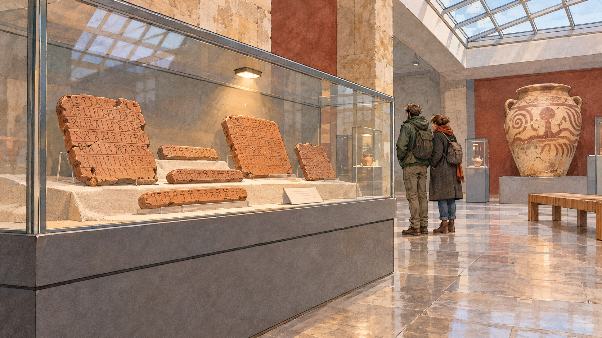
<details><summary>Image Prompt</summary>
(This is Panel 14. Do not include the panel number in the image.)
Style: a hand-drawn travel-sketchbook graphic-novel illustration, with clean dark ink outlines, flat softly shaded color fills and a faint watercolor paper texture, like a page from a traveler's journal; warm, sunlit, painterly lighting; no text, captions, signs, letters or speech bubbles anywhere in the image.
Please generate a 16:9 image depicting panel 14 of 14. Setting: a gallery of the Heraklion Archaeological Museum, Crete, today, calm daylight from a skylight, November. Palette: natural daylight, warm limestone, terracotta, lapis blue and museum gray. Camera: a low, slightly angled view of a display case at the same low angle as the doorway view in the first panel, with the travelers small in the frame. Mood: reflective, thankful. Two adult travelers seen from behind or in distant three-quarter view, dressed for cool November weather: one in a dark green rain jacket, the other in a charcoal wool coat with a rust-colored scarf, both with small daypacks, standing close together and looking at the view. Faces are never shown in detail. They stand at a glass case and look at it. In the case, on a pale cloth, lie several small reddish-brown clay tablets, some long and thin and some page-shaped, with rows of tiny abstract incised marks and small chips along their edges. Details: a soft spotlight inside the case, a small card label with no readable writing, a large pithos in the background, a wooden bench, a reflection of a skylight, and polished stone floor.
Keep every character and place consistent with the other images in this story. Generate the image immediately without asking clarifying questions.
</details>

Nearby, in the museum, are the small clay tablets of Bronze Age Crete: accounts kept by a few dozen scribes, baked by the fire that ended their world. We know their words because a schoolboy listened, a teacher in Brooklyn made her cards, and an architect found a grid that worked. The next time we hear a discovery described as one person's lightning flash, we will ask who did the groundwork.

### Epilogue - The Groundwork Behind the Breakthrough

The decipherment of Linear B is usually told as one man's lightning flash. It was a relay. Evans found the tablets and gave the script its name, but locked most of them away. Alice Kober showed that the language had endings and built the grid's first rows. Emmett Bennett's careful sign list and edition of the Pylos tablets (1951) gave everyone reliable texts. Ventris made the leap, and John Chadwick brought the Greek. For half a century the story was told as Ventris's alone, until Margalit Fox's 2013 book *The Riddle of the Labyrinth* brought Kober back into view.

| Challenge | How They Responded | Lesson for Today |
|---|---|---|
| An unknown script and an unknown language | Kober refused to guess and mined the structure of the signs | Find the pattern before you propose the answer |
| Evans kept most of the Knossos texts unpublished | Scholars worked from the few texts available, and Bennett produced a reliable edition of the Pylos tablets | Opening evidence to many people speeds discovery |
| A wrong guess (Etruscan) | Ventris followed his grid, not his expectation | Let the evidence overrule the hunch |
| A hero story with one name on it | Ventris credited the groundwork, and later writers restored Kober to the story | Name the people whose work you stand on |

### Call to Action

Linear B was locked up twice, first by a palace that let only a few scribes write and then by a gatekeeper who published little. It opened when more people could look. This is the Learning for All thread in miniature: knowledge spreads when more people are taught to read it, and breakthroughs often come from the outsiders and the patient groundwork that no one thought to credit. In the museum, look at the tablets, and remember how many people it took to read them.

---

## Voices from the Sources

- **Michael Ventris, radio talk, July 1, 1952 (as widely quoted; wording varies slightly between printings).** Ventris said that he had come to the conclusion that the Knossos and Pylos tablets must be written in Greek, a difficult and archaic Greek, about five hundred years older than Homer and written in a rather abbreviated form.
- **The tablets themselves.** The first words Ventris's grid produced are plain words from the palace's accounts: *ko-wo* ("boy"), *ko-wa* ("girl"), *po-me* ("shepherd"), *ti-ri-po-de* ("tripods"). They are not poetry; the Linear B tablets contain lists of people, livestock, land, goods and offerings, and no letters, laws or histories.
- **A book title.** *Documents in Mycenaean Greek* (1956), by Ventris and Chadwick, is the first full handbook of the decipherment. No safe quotation from Alice Kober's own papers is given here; her work is best seen in her publications of 1945 to 1948 and in the cards that became the grid.

## On the Trip

- **Chapter:** [13. Knossos, the Minoans, and Linear B](../../chapters/13-knossos-minoans-linear-b/index.md)
- **Where to look:** the clay tablets of Linear A and Linear B in the Heraklion Archaeological Museum, when on display (check on the day); the palace of Knossos itself; and the gypsum storerooms with their giant jars, which are where the palace kept the goods the tablets counted.
- **Explore further:** [Crack Linear B Like Ventris](../../sims/crack-linear-b-like-ventris/index.md)
- **Look Closer:** Glaux was perched on the shelf above the tripod tablet in panel 13. In the museum, look for the small drawn pictures that sit beside the words on a tablet, and notice how plain the accounts are.

## Characters and Style

This story follows the shared series bible: [Story Characters, Places and House Style](../characters.md). Glaux's identity comes from the mascot's [character sheet](../../img/mascot/character-sheet.md).

## References

1. [Wikipedia: Michael Ventris](https://en.wikipedia.org/wiki/Michael_Ventris) - The architect who deciphered Linear B
2. [Wikipedia: Alice Kober](https://en.wikipedia.org/wiki/Alice_Kober) - The classicist whose grids made the decipherment possible
3. [Wikipedia: Linear B](https://en.wikipedia.org/wiki/Linear_B) - The script, its tablets and its decipherment
4. [Encyclopaedia Britannica: Michael Ventris](https://www.britannica.com/biography/Michael-Ventris) - Overview of Ventris's life and decipherment
5. [Encyclopaedia Britannica: Linear B](https://www.britannica.com/topic/Linear-B) - Overview of the script
