# The Computer at the Bottom of the Sea

<!-- 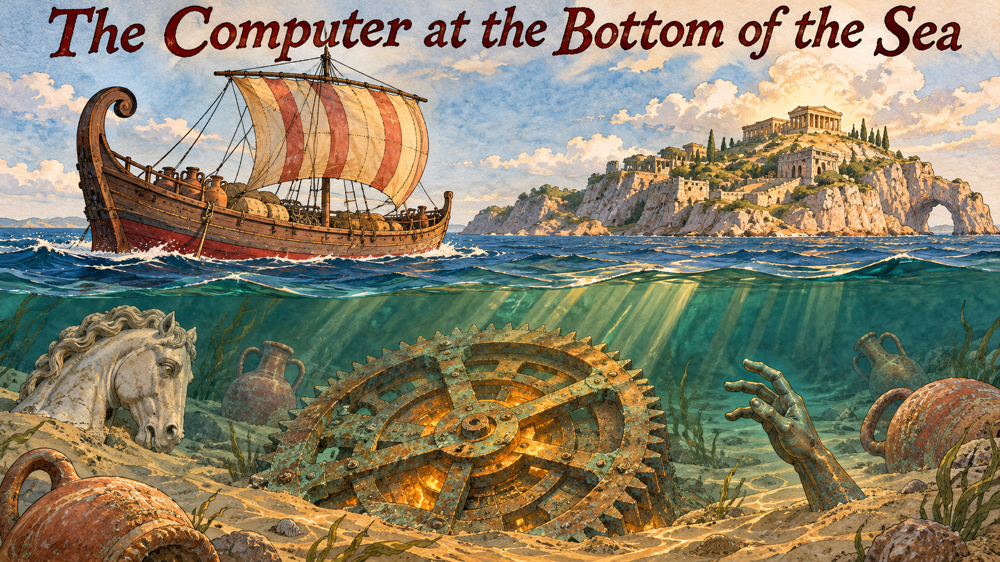 -->
<details>
<summary>Cover Image Prompt</summary>
(This is the Cover Image. Do not include this label in the image.)
Style: a hand-drawn travel-sketchbook graphic-novel illustration, with clean dark ink outlines, flat softly shaded color fills and a faint watercolor paper texture, like a page from a traveler's journal; warm, sunlit, painterly lighting; no text, captions, signs, letters or speech bubbles anywhere in the image. The one exception to the no-text rule is the title described below.

Please generate a wide-landscape 16:9 cover image for a graphic novel. Split the picture into two layers of the same scene. In the upper half, in bright afternoon light, a large ancient wooden cargo ship with a cream linen sail striped faded red and a curved swan-neck stern post sails across a deep sapphire sea toward a rocky island, with a few small clouds gathering. In the lower half, seen through clear green water, a single big corroded bronze gear wheel with tiny triangular teeth rests on the sandy seabed, glowing softly amber from within, surrounded by scattered clay amphorae, a marble horse's head half-buried in sand and one bronze hand reaching out of the sand; thin shafts of sunlight slant down through the water. Along the top edge, in bold, hand-lettered, slightly weathered title text, render exactly this title: "The Computer at the Bottom of the Sea". Color palette: warm limestone, sea-green, deep red, bronze and evening gold above, deep teal and amber below. Emotional tone: wonder and mystery, a secret waiting under the waves. Keep every character and place consistent with the other images in this story. Generate the image immediately without asking clarifying questions.
</details>

<details>
<summary>Narrative Prompt</summary>
**Era and place.** Two layers of time share one story. The first is the Hellenistic and early Roman Aegean of about 100-60 BCE, when a heavily loaded merchant ship sinks near the small island of Antikythera, between Kythera and Crete. The second is the modern discovery: sponge divers in 1900, the National Archaeological Museum in Athens in 1902, the historian of science Derek de Solla Price from the 1950s to the 1970s, and a research team with CT scanners in 2005. The last panel is the same museum today.

**Themes.** Looking closely at what everyone ignores; knowledge that is fragile when only a few people hold it; slow collective detective work across countries and generations; honesty about what we do not know. The maker's name is unknown, and the story keeps that as an open question, exactly as Chapter 20 and the appendix do: the evidence points to a skilled workshop, quite possibly on Rhodes, and the answer is still argued over. The Learning for All thread asks who gets to learn to make and read machines like this.

**Series house style.** Every prompt opens with the series house-style line (a hand-drawn travel-sketchbook graphic-novel illustration, clean dark ink outlines, flat softly shaded fills, a faint watercolor paper texture) and ends with the series consistency line. No lettering of any kind appears in panels; only the cover carries the title. All images are 16:9. See [Story Characters, Places and House Style](../characters.md).

**Palettes.** Panels 1, 2 and 13 (the 1st century BCE ship and the ancient workshop): warm limestone, sea-green, deep red, bronze and evening gold. Panels 3 to 7 (1900 and 1902): natural daylight, whitewashed walls, sea blue, terracotta and olive, with a faint sepia warmth of old photographs. Panels 8 to 10 (Price): warm lamplight, tweed brown and film-negative blue-gray. Panels 11 and 12 (2005): cool white laboratory light, steel gray and the amber glow of a screen. Panel 14: natural daylight, whitewashed walls, sea blue, terracotta and olive.

**Safe-image decisions.** The shipwreck is shown only by the ship at sea and then by the cargo on the seabed; no people drown and none appear underwater except one diver in 1900 dress. Statues are shown draped or partly hidden (an arm, a hand, a horse's head), never nude. The later diving accidents of 1901 are not shown.

**Creative liberties.** Faces of Valerios Stais, Derek de Solla Price and the 2005 team are imagined, because the prompts must not copy real portraits; they are drawn as likenesses of types, not portraits. The sponge-boat crew is anonymous. Panel 13's workshop is one possibility for where the mechanism was made, not a settled fact, and the two makers are invented types. The exact ship, route and owner of the mechanism are unknown. The CT-scan images in panel 12 are an artist's impression: tiny abstract engraved marks, never readable text.

**Cast.**

- **Glaux the Little Owl**, **the Travelers** (final panel): see [docs/stories/characters.md](../characters.md) and [docs/img/mascot/character-sheet.md](../../img/mascot/character-sheet.md) (Glaux). Glaux hides in exactly one panel (Panel 6).
- **Single-story characters and objects** (paste these blocks verbatim into the prompts where they appear):

The ancient cargo ship (Panels 1, 2):

```text
The cargo ship of about 65 BCE: a large, broad-hulled wooden merchant ship, heavily loaded, with one big square sail of cream linen with faded red stripes, a curved swan-neck stern post, a painted eye on each side of the bow and two long steering oars at the stern; her deck is stacked with pointed clay amphorae packed in straw and crates of wrapped statues, and a few sailors are seen only as tiny figures at a distance.
```

The sponge divers and their boat (Panels 3, 4, 5):

```text
The sponge divers of 1900, Greek islanders from a small Aegean island: lean, sun-browned men with thick dark mustaches, wearing dark wool caps, rolled-up shirtsleeves and baggy dark trousers; the diver in full diving dress wears a heavy patched gray-brown waterproofed canvas suit, a round copper helmet with small round glass portholes and a brass collar, lead-weighted boots, and a thick air hose and lifeline trailing up to the surface; two crewmen turn the crank of a brass hand air pump on deck. Their boat is a stout wooden Aegean sailing caique with one mast, a patched cream sail and a faded blue-and-white painted hull.
```

Valerios Stais (Panels 6, 7):

```text
Valerios Stais, Greek archaeologist, in 1902 (an imagined likeness, not a portrait): a man in middle age with a neat dark mustache and a high forehead, wearing a dark wool suit, a high white collar and a black tie, with dust on his sleeves and a magnifying glass in his hand; focused and quietly astonished.
```

The mechanism as found (Panels 5, 6, 7, 10, 11, 12, 14):

```text
The Antikythera mechanism as found: a crusted, corroded, green-and-gray lump of bronze and wood about the size of a shoebox, cracked into several pieces, one broken face showing a flat bronze gear wheel with tiny triangular teeth and fine concentric rings, and faint scratches of tiny engraved marks; the marks are drawn as scratches, never as readable letters.
```

The mechanism as first built, a reconstruction (Panel 13):

```text
The Antikythera mechanism as first built (a reconstruction): a shoebox-sized wooden case with a round bronze dial on the front ringed with fine engraved marks, a hand crank on the side, and a hinged back open to show a tightly packed train of small bronze gears with triangular teeth and two spiral dials; the marks are tiny scratches, never readable letters.
```

Derek de Solla Price (Panels 8, 9, 10):

```text
Derek de Solla Price, historian of science (an imagined likeness, not a portrait): a lean, intense man of about fifty with thick-rimmed glasses and swept-back dark hair, wearing a brown tweed jacket over an open-collared shirt, a pencil in his hand and ink on his fingers; patient, curious and a little rumpled.
```

The Greek physicist, 1971 (Panel 9):

```text
A Greek physicist in 1971: a man in his forties with dark hair and a mustache, in a white lab coat, carefully holding a large sheet of X-ray film by its edges; calm and precise.
```

The 2005 research team (Panels 11, 12):

```text
The 2005 research team: an international group of three scientists and museum staff in the National Archaeological Museum, shown in profile or three-quarter view: a woman researcher in her forties with short gray hair and a white lab coat, a tall man in his thirties in a dark sweater holding a laptop, and an older museum conservator in a blue smock and white cotton gloves; all intent and quietly excited.
```

The unknown makers (Panel 13):

```text
The unknown makers, about 100 BCE: an older bronze-worker with a gray beard and a leather apron, and a younger worker with rolled sleeves holding a fine metal file, both in plain undyed linen tunics, shown mostly from behind, in profile or in shadow so that no face is recognizable.
```
</details>

### Prologue - A Lump Nobody Wanted

In a glass case in the National Archaeological Museum in Athens lies something that looks like a few pieces of rock. It is the Antikythera mechanism, a hand-cranked machine of bronze gears made in the 2nd century BCE, and it is the oldest known geared calculating device. It spent about 2,000 years on the seabed and two more years in a museum storeroom before anyone noticed what it was. This story follows the people who looked closer: sponge divers, an archaeologist, a historian with an X-ray machine, and a team with a scanner.

**Find Glaux:** Glaux hides in one panel of this story. Can you spot the little owl?

## Panel 1: A Ship Heavy with Treasure
<!-- 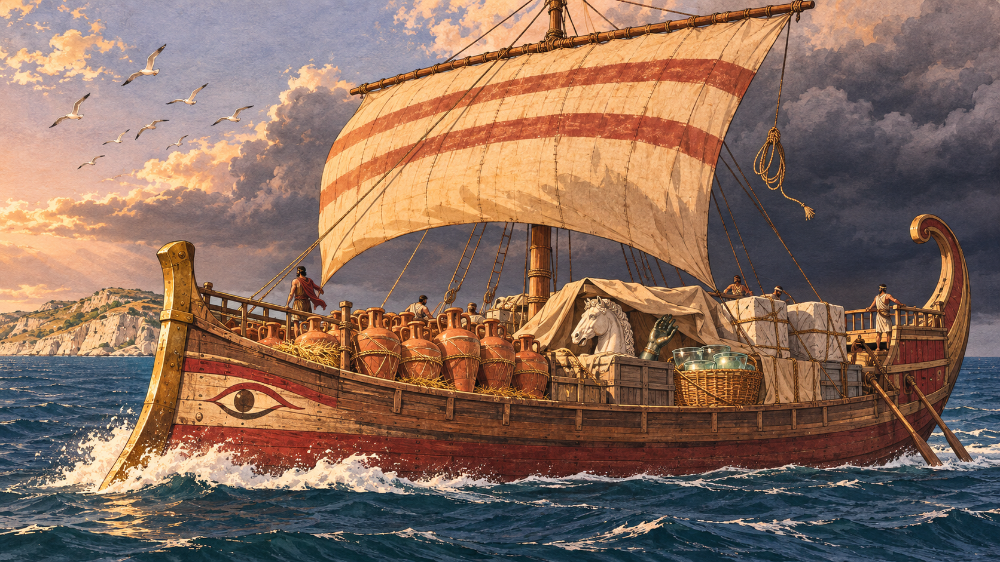 -->
<details><summary>Image Prompt</summary>
(This is Panel 01. Do not include the panel number in the image.)
I am about to ask you to generate a series of images for a graphic novel. Please make the images have a consistent style and consistent characters. Do not ask any clarifying questions. Just generate the image immediately when asked.

Style: a hand-drawn travel-sketchbook graphic-novel illustration, with clean dark ink outlines, flat softly shaded color fills and a faint watercolor paper texture, like a page from a traveler's journal; warm, sunlit, painterly lighting; no text, captions, signs, letters or speech bubbles anywhere in the image.

Please generate a 16:9 image depicting panel 1 of 14. Wide establishing shot from low on the water, the Aegean Sea off the small island of Antikythera, about 65 BCE, late afternoon with golden light from the west and a dark band of storm cloud rising in the south. Palette: warm limestone, sea-green, deep red, bronze and evening gold.

The cargo ship of about 65 BCE: a large, broad-hulled wooden merchant ship, heavily loaded, with one big square sail of cream linen with faded red stripes, a curved swan-neck stern post, a painted eye on each side of the bow and two long steering oars at the stern; her deck is stacked with pointed clay amphorae packed in straw and crates of wrapped statues, and a few sailors are seen only as tiny figures at a distance.

The ship fills the center of the frame, sailing from right to left with her bow wave white and foaming. Details: a tarp has slipped on the deck to show a marble horse's head and a bronze hand; a rolled-up sail rope sways; glass bowls are packed in a wicker basket; a pale limestone cliff of the island rises small in the distance; a flock of gulls turns ahead of the clouds; the water is deep sapphire. Emotional tone: confident prosperity under a quiet threat. Keep every character and place consistent with the other images in this story. Generate the image immediately without asking clarifying questions.
</details>

About 65 BCE, a heavily loaded merchant ship works across the Aegean, probably bound west for Italy. Her cargo is a floating museum: bronze and marble statues, glass, fine pottery, jewelry and coins from Pergamon and Ephesus, which is how scholars date the voyage to about 70-60 BCE. Somewhere among the crates travels a wooden box about the size of a shoebox, already decades old. Nobody knows who ordered it, who carried it, or where it was going.

## Panel 2: The Cargo Settles
<!-- 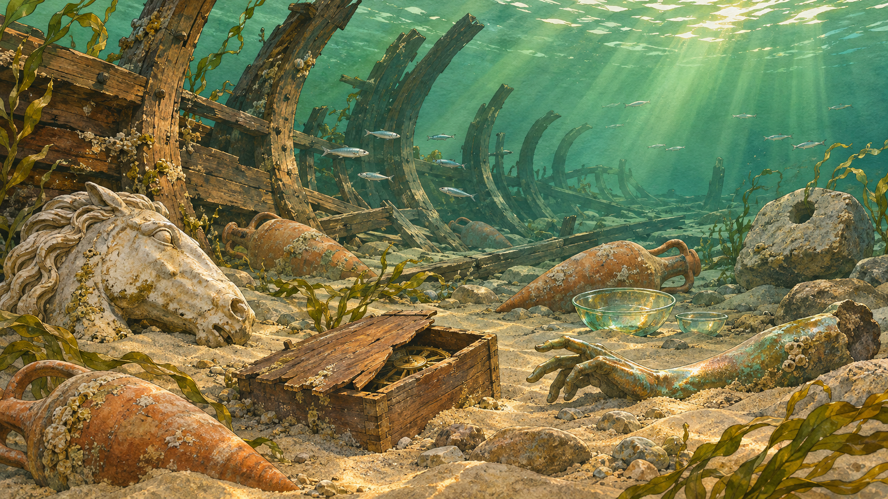 -->
<details><summary>Image Prompt</summary>
(This is Panel 02. Do not include the panel number in the image.)
Style: a hand-drawn travel-sketchbook graphic-novel illustration, with clean dark ink outlines, flat softly shaded color fills and a faint watercolor paper texture, like a page from a traveler's journal; warm, sunlit, painterly lighting; no text, captions, signs, letters or speech bubbles anywhere in the image.

Please generate a 16:9 image depicting panel 2 of 14. Wide underwater view of the seabed about 45 meters down off Antikythera, the same ship shown as a wreck, with no people or bodies anywhere in the frame. Time: a still, calm morning in about 65 BCE, after the storm has passed, with soft green light falling in slanting shafts from the surface. Palette: sea-green, deep teal, bronze, warm limestone and amber glints.

The ship's broken wooden ribs and planks curve out of the sand like the ribs of a great animal. Around them lie scattered pointed clay amphorae, half buried; a marble horse's head rests on its side; a bronze hand and forearm reach out of the sand; a few glass bowls glint among the stones; and in the center foreground a small wooden box with a split lid lies half buried, a little dull bronze gleaming inside. Small silver fish drift through the scene, seaweed sways, and a single anchor stone sits to one side. Camera: low angle at sand level looking along the wreck toward the bright surface. Emotional tone: silence, patience, a secret kept. Keep every character and place consistent with the other images in this story. Generate the image immediately without asking clarifying questions.
</details>

The storm is over, and the sea is empty. On the seabed, about 45 meters down, the wooden hull slowly gives way and the cargo comes to rest in the sand: amphorae, statues, glass, and the small box with its bronze inside. Salt water begins its slow work on the metal, turning it into a crust of corrosion. Because the wreck stays buried, it escapes the fate of nearly all ancient bronze, which people melted down and reused.

## Panel 3: Sheltering from the Wind
<!-- 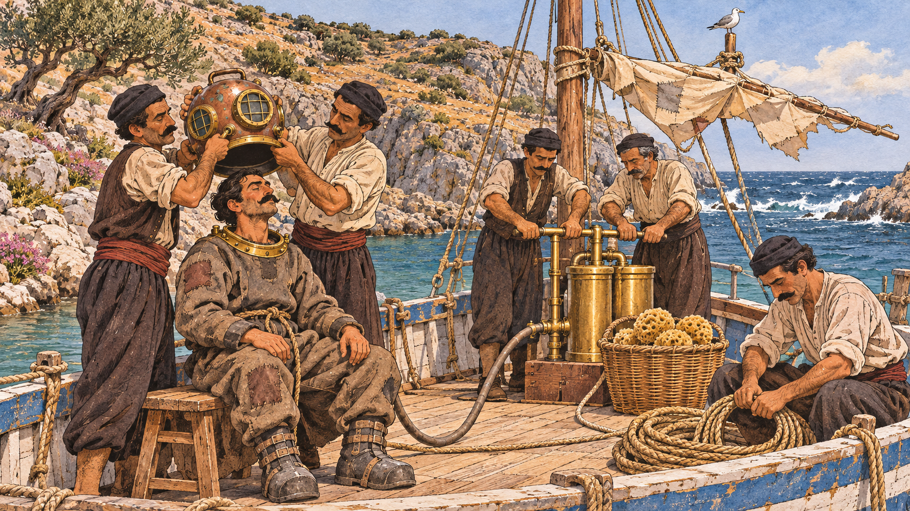 -->
<details><summary>Image Prompt</summary>
(This is Panel 03. Do not include the panel number in the image.)
Style: a hand-drawn travel-sketchbook graphic-novel illustration, with clean dark ink outlines, flat softly shaded color fills and a faint watercolor paper texture, like a page from a traveler's journal; warm, sunlit, painterly lighting; no text, captions, signs, letters or speech bubbles anywhere in the image.

Please generate a 16:9 image depicting panel 3 of 14. Medium-wide shot at a rocky cove on the island of Antikythera in spring 1900, a windy morning with white-capped waves beyond the cove mouth. Palette: natural daylight, whitewashed walls, sea blue, terracotta and olive, with a faint sepia warmth.

The sponge divers of 1900, Greek islanders from a small Aegean island: lean, sun-browned men with thick dark mustaches, wearing dark wool caps, rolled-up shirtsleeves and baggy dark trousers; the diver in full diving dress wears a heavy patched gray-brown waterproofed canvas suit, a round copper helmet with small round glass portholes and a brass collar, lead-weighted boots, and a thick air hose and lifeline trailing up to the surface; two crewmen turn the crank of a brass hand air pump on deck. Their boat is a stout wooden Aegean sailing caique with one mast, a patched cream sail and a faded blue-and-white painted hull.

The caique rides at anchor in the lee of a dry, rocky headland with gray-green scrub. In the foreground on deck, two crewmen lift the heavy copper helmet toward a diver sitting on a wooden bench; another crewman coils the lifeline. Details: the brass pump gleams, a wicker basket of sponges sits beside it, the sail is furled and flapping, a few wild olive trees cling to the cliff, and a small gull sits on the mast tip. Emotional tone: a calm working morning with a hint of boredom, a delay that will matter. Keep every character and place consistent with the other images in this story. Generate the image immediately without asking clarifying questions.
</details>

In 1900, a crew of sponge divers bound for the fishing grounds off North Africa stops at the small island of Antikythera to wait out bad weather. The sea beyond the cove is too rough to sail, so they use the delay to dive. Their gear is the standard dress of the age: a waterproofed canvas suit, a copper helmet, and air pumped down a hose by crewmen turning a hand crank. They have no idea what the delay is about to give them.

## Panel 4: The Heap on the Seabed
<!-- 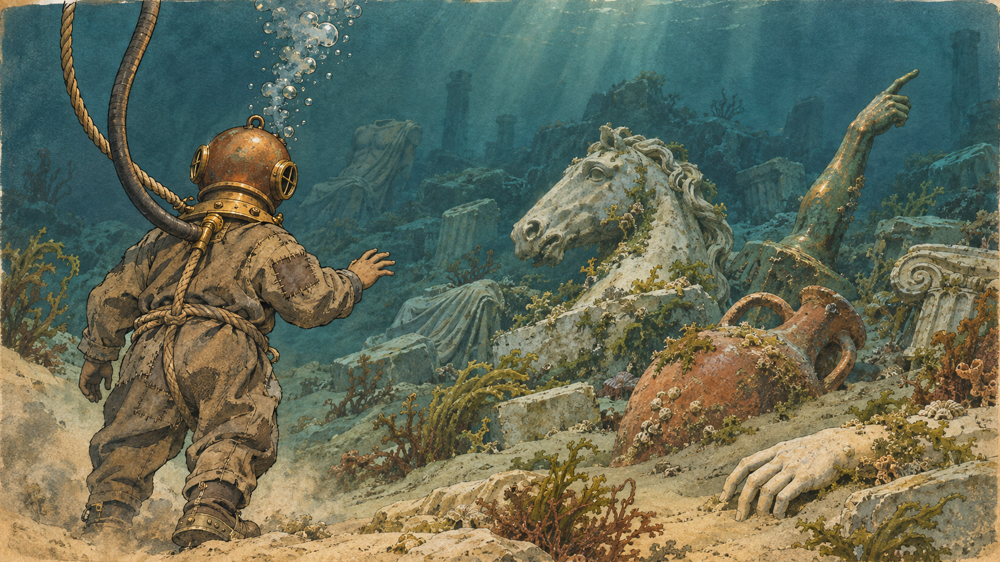 -->
<details><summary>Image Prompt</summary>
(This is Panel 04. Do not include the panel number in the image.)
Style: a hand-drawn travel-sketchbook graphic-novel illustration, with clean dark ink outlines, flat softly shaded color fills and a faint watercolor paper texture, like a page from a traveler's journal; warm, sunlit, painterly lighting; no text, captions, signs, letters or speech bubbles anywhere in the image.

Please generate a 16:9 image depicting panel 4 of 14. Underwater, about 45 meters down, spring 1900, seen from behind and slightly above the diver so his face is never visible. Dim blue-green light with a few weak shafts from the surface far above. Palette: sea blue, deep green, olive, pale limestone and a few bronze glints, with a sepia warmth.

The sponge divers of 1900, Greek islanders from a small Aegean island: lean, sun-browned men with thick dark mustaches, wearing dark wool caps, rolled-up shirtsleeves and baggy dark trousers; the diver in full diving dress wears a heavy patched gray-brown waterproofed canvas suit, a round copper helmet with small round glass portholes and a brass collar, lead-weighted boots, and a thick air hose and lifeline trailing up to the surface; two crewmen turn the crank of a brass hand air pump on deck. Their boat is a stout wooden Aegean sailing caique with one mast, a patched cream sail and a faded blue-and-white painted hull.

Show only the diver in the foreground, a small slow figure in the heavy suit, standing on the sandy slope with one hand outstretched. Ahead of him, scattered across the seabed like a silent crowd, are a marble horse's head, a bronze arm pointing upward, a half-buried clay amphora, a pale marble hand and a heap of dark shapes, all covered in sea growth. His air hose and lifeline curl upward in the water; bubbles rise from the helmet. Emotional tone: awe and eeriness, as if the sea had been keeping a gallery. Keep every character and place consistent with the other images in this story. Generate the image immediately without asking clarifying questions.
</details>

The first diver down comes back up in a hurry, struggling to describe what he saw on the bottom. The captain dives to see for himself and surfaces with the arm of a bronze statue. The crew finishes its fishing season, then returns to the island to dive on the heap. Hellenic Navy ships soon join the effort, and over the following months the divers bring up one of the great treasure finds of the ancient Mediterranean.

## Panel 5: Treasure on the Deck
<!-- 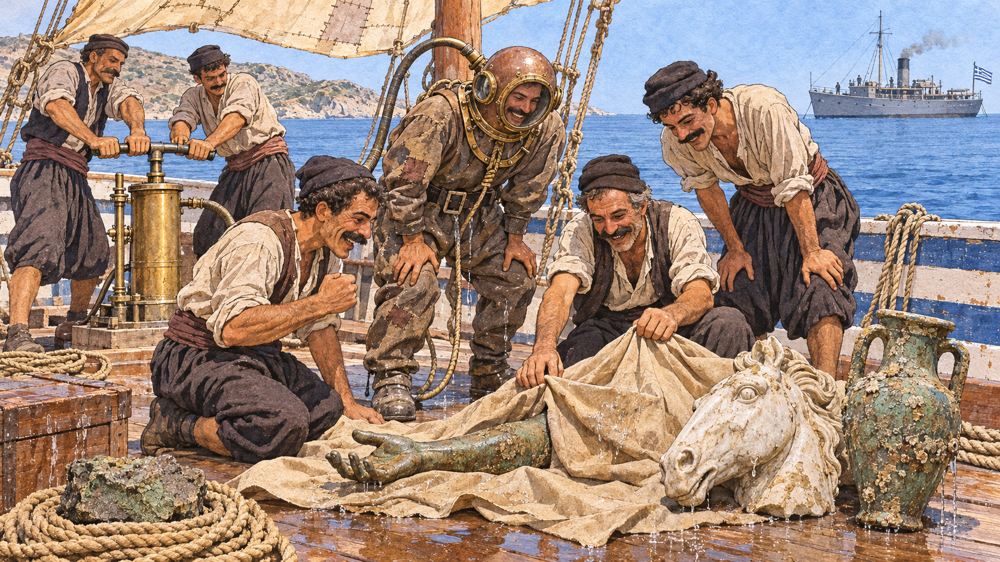 -->
<details><summary>Image Prompt</summary>
(This is Panel 05. Do not include the panel number in the image.)
Style: a hand-drawn travel-sketchbook graphic-novel illustration, with clean dark ink outlines, flat softly shaded color fills and a faint watercolor paper texture, like a page from a traveler's journal; warm, sunlit, painterly lighting; no text, captions, signs, letters or speech bubbles anywhere in the image.

Please generate a 16:9 image depicting panel 5 of 14. Medium shot on the deck of a wooden vessel anchored off Antikythera, about 1901, bright midday sun and a flat blue sea behind. Palette: natural daylight, whitewashed walls, sea blue, terracotta and olive, with a faint sepia warmth.

The sponge divers of 1900, Greek islanders from a small Aegean island: lean, sun-browned men with thick dark mustaches, wearing dark wool caps, rolled-up shirtsleeves and baggy dark trousers; the diver in full diving dress wears a heavy patched gray-brown waterproofed canvas suit, a round copper helmet with small round glass portholes and a brass collar, lead-weighted boots, and a thick air hose and lifeline trailing up to the surface; two crewmen turn the crank of a brass hand air pump on deck. Their boat is a stout wooden Aegean sailing caique with one mast, a patched cream sail and a faded blue-and-white painted hull.

The Antikythera mechanism as found: a crusted, corroded, green-and-gray lump of bronze and wood about the size of a shoebox, cracked into several pieces, one broken face showing a flat bronze gear wheel with tiny triangular teeth and fine concentric rings, and faint scratches of tiny engraved marks; the marks are drawn as scratches, never as readable letters. Here it is not yet cracked and shows only a gray-green crust, lying small and ignored on a coil of rope in the lower left foreground, beside a wet wooden crate.

In the center, four crewmen kneel and stand around a bronze statue laid on wet canvas, shown only as an outstretched bronze arm and hand while a canvas cloth covers the rest. Next to it lie a marble horse's head and a green-crusted amphora, dripping with sea water. In the background a small gray Hellenic Navy steam vessel with a black funnel lies at anchor. Emotional tone: triumphant excitement, with all eyes on the statues and none on the lump. Keep every character and place consistent with the other images in this story. Generate the image immediately without asking clarifying questions.
</details>

The deck fills with wonders. Bronze and marble statues come up out of the sea, including a bronze youth now known as the Antikythera Youth, along with glass and coins. The crew and the officials crowd around the statues, which are obviously priceless. Nobody gives a second glance to a shoebox-sized lump of corroded bronze and wood that comes up with the rest, and it is carried off to Athens with everything else.

## Panel 6: A Storeroom Full of Fragments
<!-- 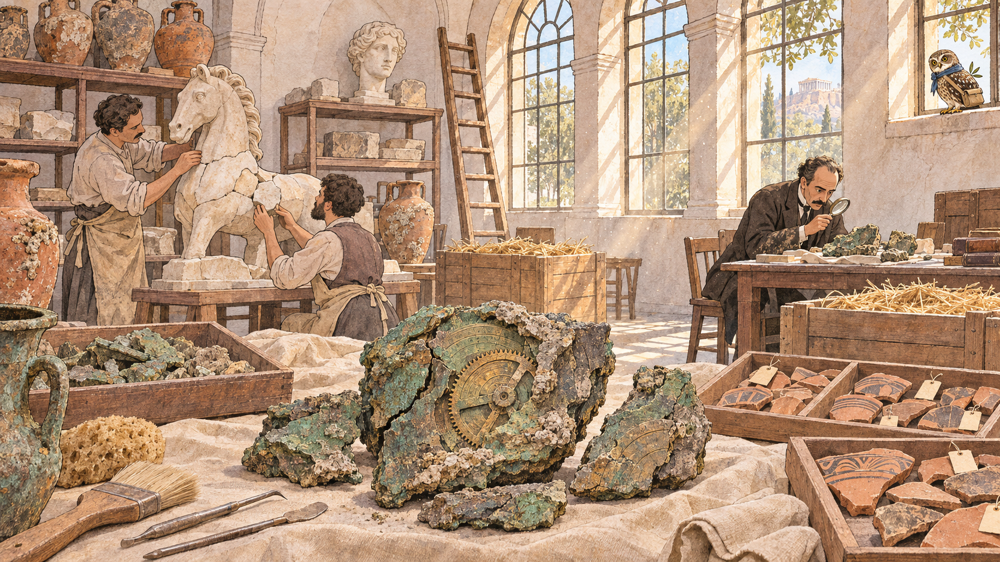 -->
<details><summary>Image Prompt</summary>
(This is Panel 06. Do not include the panel number in the image.)
Style: a hand-drawn travel-sketchbook graphic-novel illustration, with clean dark ink outlines, flat softly shaded color fills and a faint watercolor paper texture, like a page from a traveler's journal; warm, sunlit, painterly lighting; no text, captions, signs, letters or speech bubbles anywhere in the image.

Please generate a 16:9 image depicting panel 6 of 14. Wide interior shot of a workroom in the National Archaeological Museum in Athens, May 1902, late morning light pouring from tall arched windows with dust motes in the air. Palette: natural daylight, whitewashed walls, dusty cream, terracotta and olive, with a faint sepia warmth.

Valerios Stais, Greek archaeologist, in 1902 (an imagined likeness, not a portrait): a man in middle age with a neat dark mustache and a high forehead, wearing a dark wool suit, a high white collar and a black tie, with dust on his sleeves and a magnifying glass in his hand; focused and quietly astonished.

The Antikythera mechanism as found: a crusted, corroded, green-and-gray lump of bronze and wood about the size of a shoebox, cracked into several pieces, one broken face showing a flat bronze gear wheel with tiny triangular teeth and fine concentric rings, and faint scratches of tiny engraved marks; the marks are drawn as scratches, never as readable letters.

Stais is small in the far corner, bending over a table. Long worktables fill the room, covered with marble and bronze fragments from the wreck, trays of numbered pottery shards, and crates packed with straw; two restorers in aprons piece together a marble horse. Details: in the middle of the foreground table lies the crusted bronze lump, now dried and cracked into several pieces; a plaster cast of a head stands on a shelf; a ladder leans on the wall.

Glaux the Little Owl: a true little owl (Athene noctua), small, round and compact, with a flat rounded head and no ear tufts, warm earth-brown plumage with cream spots, bright lemon-yellow eyes under pale cream eyebrows, a cream-white throat patch and a short pale greenish-yellow beak. Glaux wears a small Aegean-blue scarf and a tan canvas satchel across the body with a small leather-bound travel notebook peeking out, and a sprig of three olive leaves tucked into the satchel strap. Alert, curious and warm expression. Glaux is drawn small, perched at the edge of the scene, noticeable on a second look: on a high windowsill at the upper right. Emotional tone: the busy, dusty calm before a discovery. Keep every character and place consistent with the other images in this story. Generate the image immediately without asking clarifying questions.
</details>

In the National Archaeological Museum, the statues get all the attention. The crust of corrosion on the shoebox-sized lump slowly dries and cracks, and for two years the pieces sit on a table among the more glamorous finds. This is how most discoveries are lost: not by being destroyed, but by being filed under "later." One May day in 1902, Valerios Stais is studying the finds from the wreck when his eye falls on the crumbling lump.

## Panel 7: Gear Teeth
<!-- 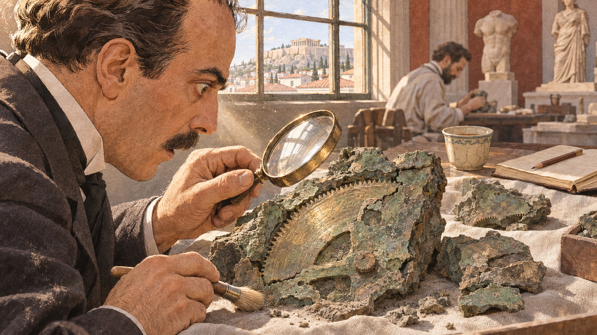 -->
<details><summary>Image Prompt</summary>
(This is Panel 07. Do not include the panel number in the image.)
Style: a hand-drawn travel-sketchbook graphic-novel illustration, with clean dark ink outlines, flat softly shaded color fills and a faint watercolor paper texture, like a page from a traveler's journal; warm, sunlit, painterly lighting; no text, captions, signs, letters or speech bubbles anywhere in the image.

Please generate a 16:9 image depicting panel 7 of 14. Close-up, over-the-shoulder shot at a worktable in the National Archaeological Museum in Athens, May 1902, in raking window light from the left that picks out every ridge of the metal. Palette: natural daylight, dusty cream, terracotta, olive and bronze glints, with a faint sepia warmth.

Valerios Stais, Greek archaeologist, in 1902 (an imagined likeness, not a portrait): a man in middle age with a neat dark mustache and a high forehead, wearing a dark wool suit, a high white collar and a black tie, with dust on his sleeves and a magnifying glass in his hand; focused and quietly astonished.

The Antikythera mechanism as found: a crusted, corroded, green-and-gray lump of bronze and wood about the size of a shoebox, cracked into several pieces, one broken face showing a flat bronze gear wheel with tiny triangular teeth and fine concentric rings, and faint scratches of tiny engraved marks; the marks are drawn as scratches, never as readable letters.

Stais is seen in profile on the left, his eyes wide, holding the magnifying glass an inch above the broken face, where a perfectly regular ring of tiny triangular teeth shows in the crust. His other hand holds a small brush. Details: a second restorer blurred in the background, a ceramic cup of cold tea, a notebook and pencil on the table, dust floating in the light, and a window with the Athens rooftops behind. Emotional tone: the sudden stillness of someone realizing something impossible. Keep every character and place consistent with the other images in this story. Generate the image immediately without asking clarifying questions.
</details>

On 17 May 1902, Stais sees a gear wheel embedded in the crust: a flat disk of bronze with regular, tiny triangular teeth. He guesses it is an astronomical clock. Most scholars of the day disagree, because a toothed machine seems far too complicated for the ancient Greeks, and the lump goes back to the shelf. Stais has seen something real; it will take most of the 20th century for the world to catch up.

> **Myth or Evidence?** Documented: Stais noticed the gear on 17 May 1902, suggested an astronomical clock, and most scholars thought the object too complex for its period. Retelling: popular accounts often add a dramatic moment of the lump "splitting open"; the sources say only that the corroded crust cracked and shrank as it dried. The mechanism itself is simply evidence that Greek makers could cut gears.

## Panel 8: The Man Who Counted Teeth
<!-- 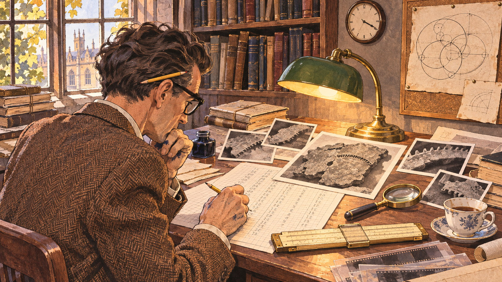 -->
<details><summary>Image Prompt</summary>
(This is Panel 08. Do not include the panel number in the image.)
Style: a hand-drawn travel-sketchbook graphic-novel illustration, with clean dark ink outlines, flat softly shaded color fills and a faint watercolor paper texture, like a page from a traveler's journal; warm, sunlit, painterly lighting; no text, captions, signs, letters or speech bubbles anywhere in the image.

Please generate a 16:9 image depicting panel 8 of 14. Medium shot, slightly from above and behind, of a university study in the late 1950s, with a green-shaded desk lamp glowing against late afternoon light from a tall window. Palette: warm lamplight, tweed brown, paper cream and film-negative blue-gray.

Derek de Solla Price, historian of science (an imagined likeness, not a portrait): a lean, intense man of about fifty with thick-rimmed glasses and swept-back dark hair, wearing a brown tweed jacket over an open-collared shirt, a pencil in his hand and ink on his fingers; patient, curious and a little rumpled.

Price sits hunched at an overflowing desk. Spread across it are black-and-white photographs of cracked bronze fragments with their tiny teeth visible, a sheet of graph paper full of columns of numbers, a brass slide rule, a hand lens and a teacup. Details: a bookcase of old books behind him, a small round clock on the wall, a half-finished diagram of interlocking circles pinned to a corkboard, and a pencil behind his ear. Emotional tone: quiet obsession, a puzzle being turned slowly in the light. Keep every character and place consistent with the other images in this story. Generate the image immediately without asking clarifying questions.
</details>

The lump keeps its secret until the British science historian Derek de Solla Price, a professor at Yale, becomes fascinated by it in 1951. He studies the photographs, counts tooth after tooth, and in 1959 publishes an article calling it an "ancient Greek computer." He knows the photographs are not enough. To count teeth that are hidden inside the crust, he needs to see inside the stone itself.

## Panel 9: Seeing Inside the Crust
<!-- 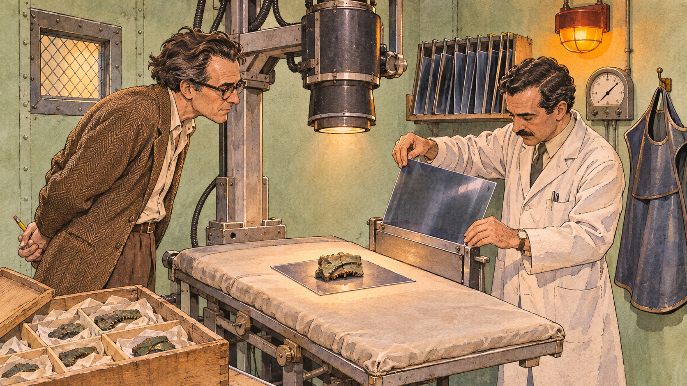 -->
<details><summary>Image Prompt</summary>
(This is Panel 09. Do not include the panel number in the image.)
Style: a hand-drawn travel-sketchbook graphic-novel illustration, with clean dark ink outlines, flat softly shaded color fills and a faint watercolor paper texture, like a page from a traveler's journal; warm, sunlit, painterly lighting; no text, captions, signs, letters or speech bubbles anywhere in the image.

Please generate a 16:9 image depicting panel 9 of 14. Wide interior shot of a radiography room in Athens in 1971, with thick lead-lined walls painted pale green, a small lead-glass window, and a heavy black X-ray tube on a steel arm hanging over a padded table. Palette: pale green, steel gray, warm lamplight, tweed brown and film-negative blue-gray.

Derek de Solla Price, historian of science (an imagined likeness, not a portrait): a lean, intense man of about fifty with thick-rimmed glasses and swept-back dark hair, wearing a brown tweed jacket over an open-collared shirt, a pencil in his hand and ink on his fingers; patient, curious and a little rumpled.

A Greek physicist in 1971: a man in his forties with dark hair and a mustache, in a white lab coat, carefully holding a large sheet of X-ray film by its edges; calm and precise.

On the padded table sits the cracked bronze fragment, no bigger than a hand, with a square film plate beneath it. The physicist slides a large sheet of film into a holder while Price leans in from the left, hands clasped behind his back to resist touching anything. Details: a rack of film sheets on the wall, a lead apron hanging on a hook, a round dial with a needle, an open wooden crate of numbered fragments in tissue paper, and a glow of amber light from a safelight. Emotional tone: careful teamwork, a long wait with high hopes. Keep every character and place consistent with the other images in this story. Generate the image immediately without asking clarifying questions.
</details>

In 1971, Price works with a Greek physicist, Charalampos Karakalos, in Athens. They take X-ray and gamma-ray images of all 82 fragments, laying each on film and exposing it. Each plate shows a faint ghost of the hidden structure: wheels within wheels, as if the crust had been made transparent. The pictures are blurry, but they show far more than anyone has seen before.

## Panel 10: A Wall of Gray Wheels
<!-- 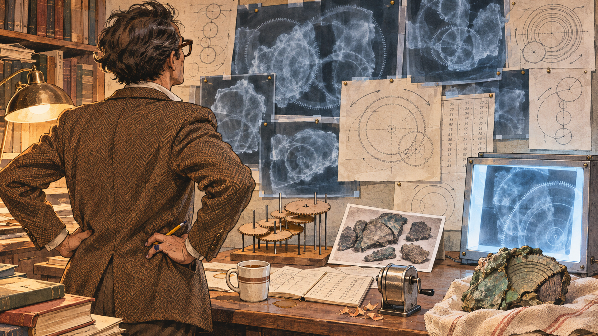 -->
<details><summary>Image Prompt</summary>
(This is Panel 10. Do not include the panel number in the image.)
Style: a hand-drawn travel-sketchbook graphic-novel illustration, with clean dark ink outlines, flat softly shaded color fills and a faint watercolor paper texture, like a page from a traveler's journal; warm, sunlit, painterly lighting; no text, captions, signs, letters or speech bubbles anywhere in the image.

Please generate a 16:9 image depicting panel 10 of 14. Over-the-shoulder shot looking past the man toward a wall, in a cluttered study in the early 1970s, with warm lamplight from the left and the cold blue glow of a light box on the right. Palette: warm lamplight, tweed brown, paper cream and film-negative blue-gray.

Derek de Solla Price, historian of science (an imagined likeness, not a portrait): a lean, intense man of about fifty with thick-rimmed glasses and swept-back dark hair, wearing a brown tweed jacket over an open-collared shirt, a pencil in his hand and ink on his fingers; patient, curious and a little rumpled.

The Antikythera mechanism as found: a crusted, corroded, green-and-gray lump of bronze and wood about the size of a shoebox, cracked into several pieces, one broken face showing a flat bronze gear wheel with tiny triangular teeth and fine concentric rings, and faint scratches of tiny engraved marks; the marks are drawn as scratches, never as readable letters.

Price stands seen from behind and slightly to one side, hands on hips. In front of him, the whole wall is covered with X-ray sheets showing ghostly circles of tiny teeth, pinned beside sheets of tracing paper with pencil circles, arrows and columns of numbers. On the desk beside him sits a small model of cardboard disks and wire pegs meshed like gears, and a photograph of the cracked fragments. Details: a hand-cranked pencil sharpener, cold tea, the light box glowing blue-gray, and a corner of the corroded lump on a cloth. Emotional tone: the slow thrill of a pattern coming into focus, tempered by caution. Keep every character and place consistent with the other images in this story. Generate the image immediately without asking clarifying questions.
</details>

Over the next years Price turns the shadows into numbers and the numbers into a gear train. In 1974 he publishes his conclusion: the box was a calendar-computer, a machine that modeled the movements of the Sun and Moon. Later researchers will correct many of his tooth counts, and add far more, but he has changed the question from "what is this lump?" to "how did they make it?"

## Panel 11: The Scanner Comes to the Museum
<!-- 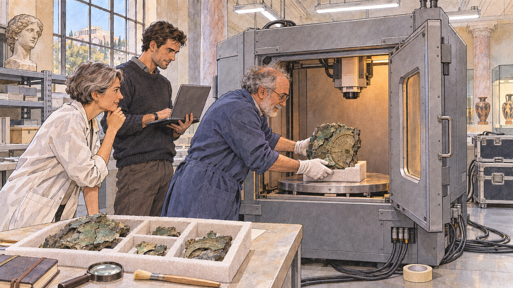 -->
<details><summary>Image Prompt</summary>
(This is Panel 11. Do not include the panel number in the image.)
Style: a hand-drawn travel-sketchbook graphic-novel illustration, with clean dark ink outlines, flat softly shaded color fills and a faint watercolor paper texture, like a page from a traveler's journal; warm, sunlit, painterly lighting; no text, captions, signs, letters or speech bubbles anywhere in the image.

Please generate a 16:9 image depicting panel 11 of 14. Wide shot inside a high-ceilinged workroom of the National Archaeological Museum in Athens in 2005, with cool white overhead light and daylight from a tall window. Palette: cool white laboratory light, steel gray, museum cream and the amber glow of a screen.

The 2005 research team: an international group of three scientists and museum staff in the National Archaeological Museum, shown in profile or three-quarter view: a woman researcher in her forties with short gray hair and a white lab coat, a tall man in his thirties in a dark sweater holding a laptop, and an older museum conservator in a blue smock and white cotton gloves; all intent and quietly excited.

The Antikythera mechanism as found: a crusted, corroded, green-and-gray lump of bronze and wood about the size of a shoebox, cracked into several pieces, one broken face showing a flat bronze gear wheel with tiny triangular teeth and fine concentric rings, and faint scratches of tiny engraved marks; the marks are drawn as scratches, never as readable letters.

Dominating the center is a huge, boxy, steel-gray industrial scanner with a heavy open door, a rotating turntable inside and thick black cables snaking across the floor. The conservator carefully lowers one cracked fragment onto the turntable on a foam cradle, while the woman researcher watches and the tall man checks a laptop. Details: foam trays holding other fragments, a roll of tape on the floor, a bust of a marble head watching from a shelf, and a stack of travel cases. Emotional tone: ceremony and suspense. Keep every character and place consistent with the other images in this story. Generate the image immediately without asking clarifying questions.
</details>

In 2005 an international team, with scientists from Britain and Greece and the museum's own conservators, hauls a huge CT scanner into the museum. CT stands for computed tomography: the scanner takes hundreds of X-ray slices from every angle and a computer builds them into a 3D picture. A fragment too fragile to clean can now be seen layer by layer, in far more detail than any X-ray plate could show.

## Panel 12: Letters Hidden in the Metal
<!-- 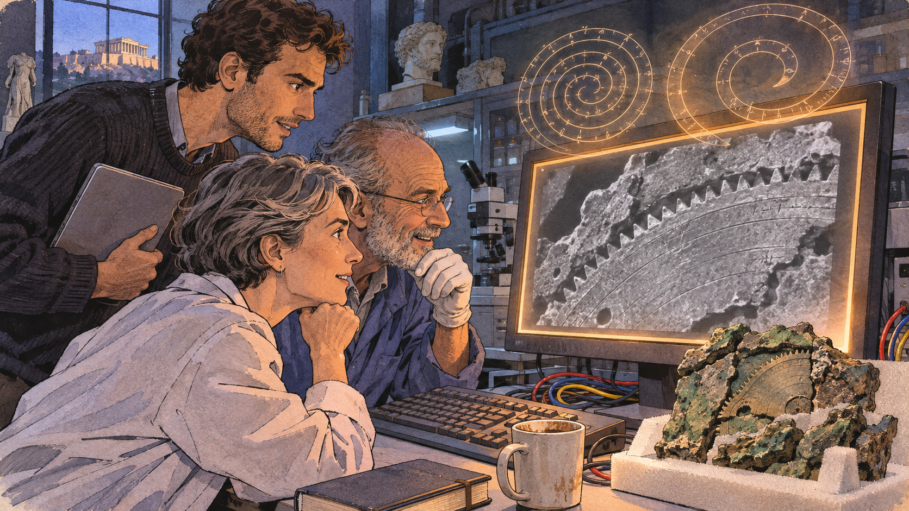 -->
<details><summary>Image Prompt</summary>
(This is Panel 12. Do not include the panel number in the image.)
Style: a hand-drawn travel-sketchbook graphic-novel illustration, with clean dark ink outlines, flat softly shaded color fills and a faint watercolor paper texture, like a page from a traveler's journal; warm, sunlit, painterly lighting; no text, captions, signs, letters or speech bubbles anywhere in the image.

Please generate a 16:9 image depicting panel 12 of 14. Over-the-shoulder shot at a computer desk in a dim laboratory in Athens in 2005, with the room lit mainly by the amber and white glow of a large monitor. Palette: cool white laboratory light, steel gray, deep blue shadow and the amber glow of a screen.

The 2005 research team: an international group of three scientists and museum staff in the National Archaeological Museum, shown in profile or three-quarter view: a woman researcher in her forties with short gray hair and a white lab coat, a tall man in his thirties in a dark sweater holding a laptop, and an older museum conservator in a blue smock and white cotton gloves; all intent and quietly excited.

The Antikythera mechanism as found: a crusted, corroded, green-and-gray lump of bronze and wood about the size of a shoebox, cracked into several pieces, one broken face showing a flat bronze gear wheel with tiny triangular teeth and fine concentric rings, and faint scratches of tiny engraved marks; the marks are drawn as scratches, never as readable letters.

The three of them crowd close in profile, faces lit by the screen, looking at an enlarged scan slice of a bronze fragment in gray tones. On the screen, a ring of gear teeth and rows of tiny engraved marks appear in the metal, drawn only as tiny abstract scratches, never legible text. Above the screen, as an artist's glowing visualization, two faint translucent spiral dials hover like ghostly overlays: one with five tight turns, one with a wider coil, each marked with tiny symbols. Details: a mug of coffee gone cold, a keyboard, a ring of colored cables, and the real fragment on a foam cradle at the screen's edge. Emotional tone: breathless discovery, goosebumps. Keep every character and place consistent with the other images in this story. Generate the image immediately without asking clarifying questions.
</details>

The scans reveal what no one could see: thousands of tiny Greek letters, engraved over the surfaces of the box as a built-in user's manual. The text describes dials for the Sun and Moon, a spiral of 223 lunar months that predicts eclipses, and a dial that tracks the cycle of the Games, including the Olympic festival. The mechanism is not a clock and not a toy: it is a machine for reading the future of the sky. Turn the crank, and the dials show an eclipse before it happens.

## Panel 13: Who Made It?
<!-- 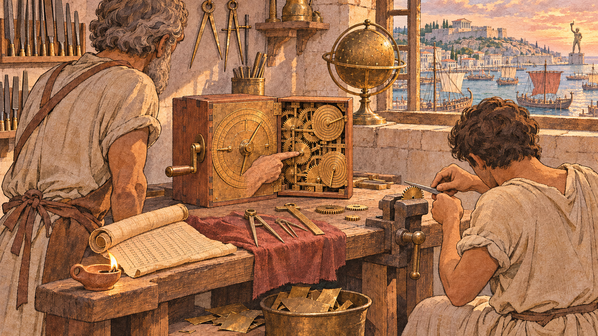 -->
<details><summary>Image Prompt</summary>
(This is Panel 13. Do not include the panel number in the image.)
Style: a hand-drawn travel-sketchbook graphic-novel illustration, with clean dark ink outlines, flat softly shaded color fills and a faint watercolor paper texture, like a page from a traveler's journal; warm, sunlit, painterly lighting; no text, captions, signs, letters or speech bubbles anywhere in the image.

Please generate a 16:9 image depicting panel 13 of 14. Medium-wide shot inside an upper-floor bronze workshop in a harbor city of the eastern Aegean, imagined as Rhodes, about 100 BCE, warm late-afternoon light from a wide window overlooking a harbor with ships. Palette: warm limestone, sea-green, deep red, bronze and evening gold.

The Antikythera mechanism as first built (a reconstruction): a shoebox-sized wooden case with a round bronze dial on the front ringed with fine engraved marks, a hand crank on the side, and a hinged back open to show a tightly packed train of small bronze gears with triangular teeth and two spiral dials; the marks are tiny scratches, never readable letters.

The unknown makers, about 100 BCE: an older bronze-worker with a gray beard and a leather apron, and a younger worker with rolled sleeves holding a fine metal file, both in plain undyed linen tunics, shown mostly from behind, in profile or in shadow so that no face is recognizable.

The two makers stand at a stout oak bench beside the open box, the younger one filing a single tiny tooth on a bronze gear held in a vise, while the older one points to a part of the mechanism. Details: racks of bronze files, calipers and compasses; a bronze sphere on a stand, a model of the heavens; a rolled papyrus of columns of tiny numbers on the bench; a small clay lamp; scraps of cut bronze sheet on the floor; and through the window the harbor, filled with ships. Emotional tone: quiet mastery, an unnamed craft whose names are lost. Keep every character and place consistent with the other images in this story. Generate the image immediately without asking clarifying questions.
</details>

Nobody signed the mechanism, and no ancient writer mentions this particular machine. The evidence points to a skilled workshop, quite possibly on Rhodes, in a tradition that ran from Archimedes to the astronomer Hipparchus and the philosopher Posidonius; the dials may have been set for a buyer from elsewhere in Greece. Other cities have been proposed, and the dating is still argued. Whoever the makers were, they combined astronomy, arithmetic and metalworking at a level nothing else we have matches for about 1,500 years.

> **Myth or Evidence?** Documented: Cicero describes geared models of the heavens made by Archimedes and by Posidonius, so the tradition is real, and Hipparchus observed on Rhodes. Inference: a Rhodian workshop fits the lunar theory, the latitude and the cargo, but no inscription names the maker. Open: the Metonic dial uses month names from a different region, which is why researchers still debate where it was built and for whom.

## Panel 14: Look Closer
<!-- 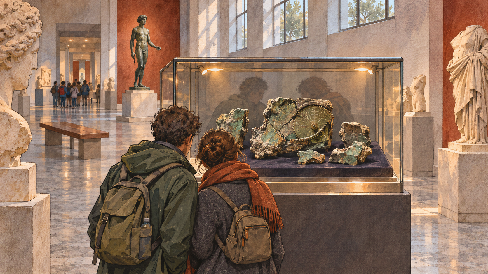 -->
<details><summary>Image Prompt</summary>
(This is Panel 14. Do not include the panel number in the image.)
Style: a hand-drawn travel-sketchbook graphic-novel illustration, with clean dark ink outlines, flat softly shaded color fills and a faint watercolor paper texture, like a page from a traveler's journal; warm, sunlit, painterly lighting; no text, captions, signs, letters or speech bubbles anywhere in the image.

Please generate a 16:9 image depicting panel 14 of 14, the Then and Now. Wide shot, from behind and slightly above, in a gallery of the National Archaeological Museum in Athens today, a November afternoon with soft daylight from high windows. Palette: natural daylight, whitewashed walls, sea blue, terracotta and olive.

Two adult travelers seen from behind or in distant three-quarter view, dressed for cool November weather: one in a dark green rain jacket, the other in a charcoal wool coat with a rust-colored scarf, both with small daypacks, standing close together and looking at the view. Faces are never shown in detail.

The Antikythera mechanism as found: a crusted, corroded, green-and-gray lump of bronze and wood about the size of a shoebox, cracked into several pieces, one broken face showing a flat bronze gear wheel with tiny triangular teeth and fine concentric rings, and faint scratches of tiny engraved marks; the marks are drawn as scratches, never as readable letters.

The travelers stand small in the lower center of the frame, leaning slightly toward a softly lit glass case in front of them. Inside it rest the cracked, crusted green-and-gray bronze fragments of the mechanism on dark velvet, with one tiny gear wheel visible on a broken face, and the faint reflections of the two travelers in the glass. Details: a darkened gallery with a tall bronze statue of a youth standing at the back in soft focus, a long bench, a school group of small silhouettes far down the hall, and warm spotlights picking out the case. Emotional tone: quiet wonder, the sense of looking at a long-kept secret. Keep every character and place consistent with the other images in this story. Generate the image immediately without asking clarifying questions.
</details>

Today the fragments rest in a case in Athens, a shoebox of crust and bronze that changed how we see the ancient world. The question of who built it is still open, and so is how many other machines like it were melted down or lost. Glaux, perched on a windowsill in the storeroom of panel 6, has seen it all. "Look closer," they say, "at what everyone else walked past."

### Epilogue - What a Lump of Bronze Teaches

The Antikythera mechanism survives because the ship that carried it sank and because several generations of people refused to ignore it. A diver reported what he saw, an archaeologist noticed a gear, a historian counted teeth, and a team with a scanner read what a human eye never could. Each step depended on the last, and no single person solved it. What the box teaches is a pattern about knowledge itself: it is easy to lose, and it takes patient, shared looking to get it back.

| Challenge | How They Responded | Lesson for Today |
|---|---|---|
| A crusted lump lay ignored among glamorous statues | In 1902 Valerios Stais looked closely and noticed a gear wheel | Discoveries often wait in plain sight for someone to look twice |
| The gears were hidden inside corroded metal | Price and Karakalos used X-rays in 1971; a team used CT scans in 2005 | New tools can read what older ones could not; revisit old questions |
| Nobody signed the machine, and the evidence is incomplete | Researchers from many countries argue openly, and Rhodes is a leading candidate | Say plainly what is known, what is inferred and what is open |
| Skills held by a few workshops vanished for about 1,500 years | Today the work is published and shared among researchers worldwide | Knowledge that is written down, taught and shared survives |

### Call to Action

When you stand before the case in Athens, do the slow thing: look at the broken face of the largest fragment until you see the ring of tiny teeth. Then think about who in your own life makes or knows something valuable that only a few people understand, and ask whether it is written down or taught. The book's Learning for All thread asks who gets to learn to build and read machines like this one, and how to make sure the next such skill is shared with everyone who wants it.

---

## Voices from the Sources

No words of the maker survive, so these are titles, honestly labeled, not spoken lines:

*"An Ancient Greek Computer"*
Derek de Solla Price, the title of his 1959 article in *Scientific American*, which gave the mechanism the name that stuck.

*"Gears from the Greeks"*
Derek de Solla Price, the title of his 1974 study of the mechanism, based on the X-ray and gamma-ray images of the fragments.

## On the Trip

- **Chapter:** [20. Athens, Museums, Tutors, and the City Today](../../chapters/20-athens-museums-city-today/index.md)
- **Where to look:** the fragments of the mechanism in the National Archaeological Museum in Athens; the bronze Antikythera Youth and other statues from the same wreck, shown in the museum's collection; the small dials and gear wheels visible on the broken faces of the fragments; any reconstruction model of the mechanism displayed nearby.
- **Explore further:** [Antikythera Gears](../../sims/antikythera-gears/index.md) and the appendix [Who Created the Antikythera Mechanism](../../appendices/antikythera-mechanism.md).
- **Look Closer:** Glaux says: look at the broken face of the largest fragment and find the ring of tiny triangular teeth that Stais saw in 1902. Glaux was hiding in Panel 6, on a high windowsill of the museum storeroom, watching the cracked lump on the table.

## Characters and Style

This story follows the shared series bible: [Story Characters, Places and House Style](../characters.md). Glaux's identity comes from the mascot's [character sheet](../../img/mascot/character-sheet.md).

## References

1. [Wikipedia: Antikythera mechanism](https://en.wikipedia.org/wiki/Antikythera_mechanism) - Overview of the device, its dials, discovery and research history
2. [Wikipedia: Antikythera wreck](https://en.wikipedia.org/wiki/Antikythera_wreck) - The 1900 discovery of the shipwreck, its cargo and the salvage work
3. [Wikipedia: Derek J. de Solla Price](https://en.wikipedia.org/wiki/Derek_J._de_Solla_Price) - The historian of science who first studied the mechanism in depth
4. [Smithsonian Magazine: Decoding the Antikythera Mechanism, the First Computer](https://www.smithsonianmag.com/history/decoding-antikythera-mechanism-first-computer-180953979) - A readable account of how the device was decoded
5. [Scientific Reports: A Model of the Cosmos in the ancient Greek Antikythera Mechanism](https://www.nature.com/articles/s41598-021-84310-w) - The 2021 University College London reconstruction of the planetary display
