# The Day the Imam Fainted

<!-- 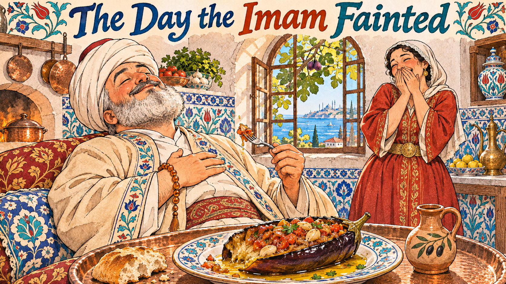 -->
<details>
<summary>Cover Image Prompt</summary>
(This is the Cover Image. Do not include this label in the image.)
Style: a hand-drawn travel-sketchbook graphic-novel illustration, with clean dark ink outlines, flat softly shaded color fills and a faint watercolor paper texture, like a page from a traveler's journal; warm, sunlit, painterly lighting; no text, captions, signs, letters or speech bubbles anywhere in the image. The one exception to the no-text rule is the title described below.

Please generate a wide-landscape 16:9 cover image for a graphic novel. In a warm Ottoman kitchen-dining room with white plaster walls and blue-and-turquoise Iznik tiles, a stout, dignified imam in a white cloth-wrapped turban and a long cream robe, holding amber prayer beads, sits at a low round copper tray and leans gently backward onto a heap of cushions with one hand on his chest and his eyes closed in bliss, a half-eaten fork in his other hand. On the tray in the foreground sits a glossy golden-purple eggplant split lengthwise and stuffed with onions, tomatoes and garlic, shining with olive oil, next to a small clay jug of oil. His new wife, in a tomato-red dress and white headscarf, stands behind him with both hands over her mouth, laughing. Through an arched window behind them, a fig tree and a glimpse of blue sea shine in the sun. Along the top edge, in bold, hand-lettered, warmly colorful title text, render exactly this title: "The Day the Imam Fainted". Color palette: Iznik turquoise, cobalt, tomato red, brass, saffron and white plaster. Emotional tone: warmth, humor and appetite, told with affection and respect. Keep every character and place consistent with the other images in this story. Generate the image immediately without asking clarifying questions.
</details>

<details>
<summary>Narrative Prompt</summary>
**Era and place.** A food story told in layers. The legend panels (1 to 3) are set in an undated Ottoman household, and the story does not claim a year, because the tellings are tradition, not history. Panels 4 to 6 move through an Anatolian home kitchen, the palace kitchens of Topkapı in Istanbul, and a palace banquet of 1869. Panels 7 to 9 are in Greece: a village kitchen, a taverna and a hotel kitchen of the early 20th century. Panels 10 and 11 show the 1923 population exchange between Greece and Turkey, and panel 12 is a table in the present day.

**Themes.** Food as history you can eat; shared dishes with contested ownership ("the dishes are agreed, and the argument is over whom they belong to," as Chapter 15 puts it); the legends of imam bayıldı and hünkâr beğendi told honestly as legends; the human cost of the 1923 exchange, which carried cooks and recipes across the sea; and the Learning for All thread, learning with the people who hold the knowledge, not about them. The eggplant itself reached the Mediterranean in the early Middle Ages through Persian and Arab cooking, and the tomatoes in the dishes came from the Americas after 1492: the dish is a layer cake of history (see the Reading Food in Layers MicroSim).

**Series house style.** Every prompt opens with the series house-style line (a hand-drawn travel-sketchbook graphic-novel illustration, clean dark ink outlines, flat softly shaded fills, a faint watercolor paper texture) and ends with the series consistency line. No lettering of any kind appears in panels; only the cover carries the title. All images are 16:9. See [Story Characters, Places and House Style](../characters.md).

**Palettes.** Panels 1 to 6 (Ottoman): Iznik turquoise, cobalt, tomato red, brass, saffron and white plaster. Panels 7 to 9 (Greece in the early 20th century): natural daylight, whitewashed walls, sea blue, terracotta and olive. Panels 10 and 11 (1923): muted pearl-gray dawn light, dusty ochre and weathered blue, with warm color kept for the cooking pots and kitchens. Panel 12: natural daylight, whitewashed walls, sea blue, terracotta and olive.

**Safe-image decisions.** The 1923 exchange is shown with restraint: families with bundles on a quay, a cooking pot carried, ships at a distance, people seen from behind. No crowds in distress, no violence, no soldiers. The imam's faint is shown gently and with respect, as a comic legend, never as mockery of a religious figure. No real brands. No lettering on menus, packages or trays.

**Creative liberties.** Both legends of the fainting imam are tradition, with no known date or named people; the imam and his wife are drawn as types. The Eugénie banquet is tradition that Chapter 5 calls "late and unproven." The Greek and Anatolian cooks, the two refugee kitchens and the chef's face are imagined; the chef Nikolaos Tselementes is a real person shown as an imagined likeness, not a portrait. How a dish moved between kitchens in any given year is not documented, so panels 7, 8 and 11 show plausible kitchens, not specific events.

**Cast.**

- **Glaux the Little Owl**, **the Travelers** (final panel): see [docs/stories/characters.md](../characters.md) and [docs/img/mascot/character-sheet.md](../../img/mascot/character-sheet.md) (Glaux). Glaux hides in exactly one panel (Panel 5).
- **Single-story characters and dishes** (paste these blocks verbatim into the prompts where they appear):

The imam of the legend (Panels 1, 2 and the cover):

```text
The imam of the legend: a stout, dignified man in his fifties with a short gray beard and a kind round face, wearing a tall white cloth-wrapped turban over a rounded cap, a long ankle-length cream robe over a pale blue under-robe, and holding a string of amber prayer beads; shown with gentle, respectful humor.
```

The imam's new wife of the legend (Panels 1, 2, 3 and the cover):

```text
The imam's new wife of the legend: a woman in her thirties with dark eyes and a proud, practical expression, wearing a long tomato-red dress with embroidered cuffs, a white headscarf pinned at the chin and a flour-dusted apron, her sleeves pushed up.
```

The Anatolian home cook (Panel 4):

```text
An Anatolian home cook: a woman of about fifty with a patterned cotton headscarf, a long dark-blue skirt under a floral apron, strong forearms and a warm, brisk manner.
```

The palace cook of Topkapı (Panels 5, 6):

```text
A palace cook of Topkapı: a heavyset middle-aged man with a bushy gray mustache, wearing a tall cylindrical white cloth cap, a long white apron over a striped brown robe, sleeves rolled to the elbow, holding a long-handled wooden spoon.
```

The Greek taverna cook (Panels 7, 8):

```text
A Greek taverna cook: a woman of about sixty with gray hair pinned in a bun, a black cardigan and a blue-checked apron, weathered hands and a quick, knowing smile.
```

Nikolaos Tselementes (Panel 9):

```text
Nikolaos Tselementes, Greek chef of the early 20th century (an imagined likeness, not a portrait): a man in his forties in a white double-breasted chef's jacket and a tall white toque, with a neat mustache and a precise, proud expression, whisking a pale sauce in a copper pot.
```

The families of the exchange (Panels 10, 11):

```text
A family of 1923 on a quay, seen from behind or at a distance: a woman in a dark headscarf carrying a cloth-wrapped copper cooking pot on her hip, a man with a rolled rug and a bundle tied in cloth on his back, a girl of about ten clutching a small bundle, and an older man leaning on a stick; faces never shown.
```

The dishes:

```text
Imam bayıldı: a whole purple eggplant split lengthwise down its belly and stuffed with soft onions, chopped tomatoes and garlic, glossy and golden with olive oil, served cool on a white plate with a sprig of parsley.
```

```text
Karnıyarık, "split belly": a row of purple eggplants slit along the belly and filled with minced meat, onion, tomato and parsley, each topped with a long green pepper, baked in a deep tin.
```

```text
Hünkâr beğendi, "the sultan liked it": tender chunks of lamb stew in a rich red-brown sauce, heaped on a bed of pale cream, silky smoked eggplant purée in a wide white bowl.
```

```text
Melitzanosalata: a smooth, pale gray-beige, smoky eggplant dip with flecks of dark skin, drizzled with olive oil and served in a small white bowl with torn bread.
```

```text
Moussaka: a thick square slice with layers of fried eggplant and spiced minced meat in tomato sauce under a tall golden-brown crust of béchamel, steaming on a white plate.
```
</details>

### Prologue - The Vegetable That Crossed the Sea

An eggplant is not an obvious hero. It came from South or Southeast Asia, reached the Mediterranean through Persian and Arab cooking in the early Middle Ages, and then became the vegetable at the heart of more shared Greek and Turkish dishes than any other. Everyone agrees the dishes are delicious, and everyone disagrees about whom they belong to. This story follows one eggplant through legend, palace, tavern and quay, and ends at a table where both languages are spoken at once.

**Find Glaux:** Glaux hides in one panel of this story. Can you spot the little owl?

## Panel 1: The Imam at the Table
<!-- 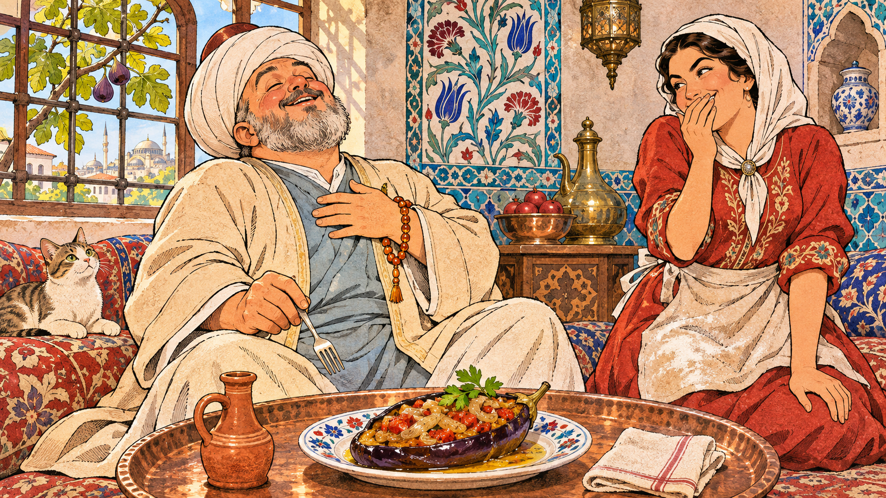 -->
<details><summary>Image Prompt</summary>
(This is Panel 01. Do not include the panel number in the image.)
I am about to ask you to generate a series of images for a graphic novel. Please make the images have a consistent style and consistent characters. Do not ask any clarifying questions. Just generate the image immediately when asked.

Style: a hand-drawn travel-sketchbook graphic-novel illustration, with clean dark ink outlines, flat softly shaded color fills and a faint watercolor paper texture, like a page from a traveler's journal; warm, sunlit, painterly lighting; no text, captions, signs, letters or speech bubbles anywhere in the image.

Please generate a 16:9 image depicting panel 1 of 12. Low, eye-level shot across a low round copper dining tray, in an undated Ottoman household, with an arched window on the left and warm midday light. Palette: Iznik turquoise, cobalt, tomato red, brass, saffron and white plaster.

The imam of the legend: a stout, dignified man in his fifties with a short gray beard and a kind round face, wearing a tall white cloth-wrapped turban over a rounded cap, a long ankle-length cream robe over a pale blue under-robe, and holding a string of amber prayer beads; shown with gentle, respectful humor.

The imam's new wife of the legend: a woman in her thirties with dark eyes and a proud, practical expression, wearing a long tomato-red dress with embroidered cuffs, a white headscarf pinned at the chin and a flour-dusted apron, her sleeves pushed up.

Imam bayıldı: a whole purple eggplant split lengthwise down its belly and stuffed with soft onions, chopped tomatoes and garlic, glossy and golden with olive oil, served cool on a white plate with a sprig of parsley.

The imam sits cross-legged on a cushion at the tray, his eyes closed and his head tilting back, one hand on his chest and a fork lowered, caught just at the moment of swooning with delight. His wife kneels beside him with a hand over her smile. Details: the plate in the center of the tray, a small clay oil jug, a folded cotton napkin, blue tiles on the wall, a fig tree in the window, and a cat watching from a cushion. Emotional tone: warm comedy and appetite. Keep every character and place consistent with the other images in this story. Generate the image immediately without asking clarifying questions.
</details>

*Imam bayıldı* means "the imam fainted," and there are two stories about why. In the first, an imam takes one bite of his wife's stuffed eggplant, cooked until it melts in olive oil, and swoons from pleasure. In the telling, his new wife watches him tip back among the cushions. The dish is real, and so is the name; the explanation is tradition.

> **Myth or Evidence?** Documented: the dish, the name and the Turkish table it belongs to. Tradition: both stories about the fainting. Chapter 6 says that neither is history, "but both are true to the dish." No date, village or imam is named in any telling.

## Panel 2: The Empty Jars
<!-- 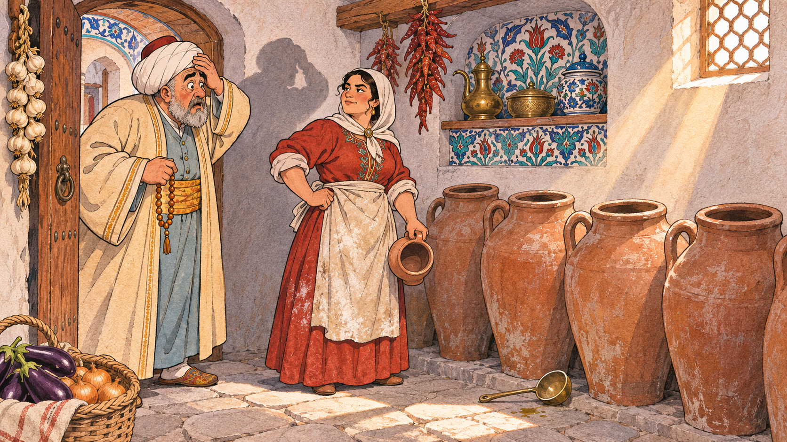 -->
<details><summary>Image Prompt</summary>
(This is Panel 02. Do not include the panel number in the image.)
Style: a hand-drawn travel-sketchbook graphic-novel illustration, with clean dark ink outlines, flat softly shaded color fills and a faint watercolor paper texture, like a page from a traveler's journal; warm, sunlit, painterly lighting; no text, captions, signs, letters or speech bubbles anywhere in the image.

Please generate a 16:9 image depicting panel 2 of 12. Medium-wide shot inside a cool, whitewashed stone pantry in an undated Ottoman household, with a single shaft of light from a small high window falling on a stone floor. Palette: Iznik turquoise, cobalt, tomato red, brass, saffron and white plaster.

The imam of the legend: a stout, dignified man in his fifties with a short gray beard and a kind round face, wearing a tall white cloth-wrapped turban over a rounded cap, a long ankle-length cream robe over a pale blue under-robe, and holding a string of amber prayer beads; shown with gentle, respectful humor.

The imam's new wife of the legend: a woman in her thirties with dark eyes and a proud, practical expression, wearing a long tomato-red dress with embroidered cuffs, a white headscarf pinned at the chin and a flour-dusted apron, her sleeves pushed up.

The imam stands in the doorway of the pantry with one hand raised to his forehead and his eyes wide, staring at a row of tall clay oil jars, all standing empty with their lids off. His wife stands beside him holding a small empty jug and looking steadily back, unashamed. Details: a bunch of dried peppers hanging from a beam, a basket of eggplants and onions on the floor, a ladle lying beside a jar, a tiny oil stain on the stone, the long shadow of the imam on the wall, and a string of garlic by the door. Emotional tone: comic dismay, an ordinary household crisis. Keep every character and place consistent with the other images in this story. Generate the image immediately without asking clarifying questions.
</details>

The second story is about money, not manners. In this telling, the imam is not overcome by the taste but by the bill: the dish takes a great deal of olive oil, a precious ingredient, and he faints when he sees how much of the household's supply his new wife has used. Some tellers add that the jars were her dowry. Either way, the point of the story is the same: this dish is rich, and it is made with a generous hand.

> **Myth or Evidence?** Both stories are legends. They explain a name, but no source names the imam, his wife, or the year. The Turkish name for the dish, "the imam fainted," is real and appears on menus today; the dish itself is documented by taste, by cookbooks and by generations of cooks.

## Panel 3: A Dish in Layers
<!-- 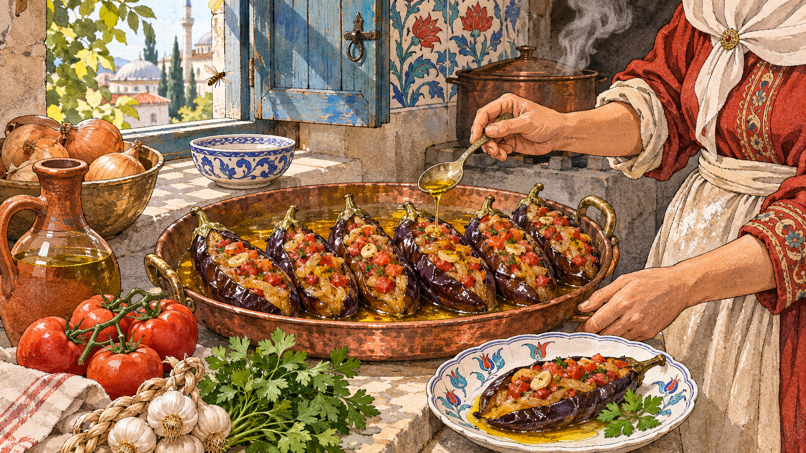 -->
<details><summary>Image Prompt</summary>
(This is Panel 03. Do not include the panel number in the image.)
Style: a hand-drawn travel-sketchbook graphic-novel illustration, with clean dark ink outlines, flat softly shaded color fills and a faint watercolor paper texture, like a page from a traveler's journal; warm, sunlit, painterly lighting; no text, captions, signs, letters or speech bubbles anywhere in the image.

Please generate a 16:9 image depicting panel 3 of 12. Close-up, slightly from above, on a stone kitchen counter beside an open window in an undated Ottoman household, with a soft midday glow. Palette: Iznik turquoise, cobalt, tomato red, brass, saffron and white plaster.

The imam's new wife of the legend: a woman in her thirties with dark eyes and a proud, practical expression, wearing a long tomato-red dress with embroidered cuffs, a white headscarf pinned at the chin and a flour-dusted apron, her sleeves pushed up.

Imam bayıldı: a whole purple eggplant split lengthwise down its belly and stuffed with soft onions, chopped tomatoes and garlic, glossy and golden with olive oil, served cool on a white plate with a sprig of parsley.

In the center a deep copper tray holds a row of six eggplants like this, packed side by side in a shining pool of olive oil, cooling on the sill. Only the wife's forearms and hands are in frame at the right, lifting a spoon of oil over one eggplant. Around the tray, a still life of the layers of the dish: a clay jug of olive oil, a pile of ripe red tomatoes, a braid of garlic, a bowl of onions, and a bunch of parsley. Details: a half-opened window with a blue shutter, a single wasp at the window, steam curling off a pot in the background, and a blue-and-white bowl. Emotional tone: patient craft, the quiet hours that make a dish. Keep every character and place consistent with the other images in this story. Generate the image immediately without asking clarifying questions.
</details>

The dish itself is simple and slow: a whole eggplant is split, stuffed with onions, tomatoes and garlic, cooked gently in olive oil and served cold. It is also a layer cake of history. Olive oil and garlic are ancient Mediterranean ingredients. The eggplant came in with Persian and Arab cooks in the early Middle Ages. The tomatoes are American, and reached the Mediterranean only after 1492; a recipe with tomatoes in it cannot be older than the voyages of Columbus. The Reading Food in Layers MicroSim lets us place other foods in their layers.

## Panel 4: Split Belly
<!-- 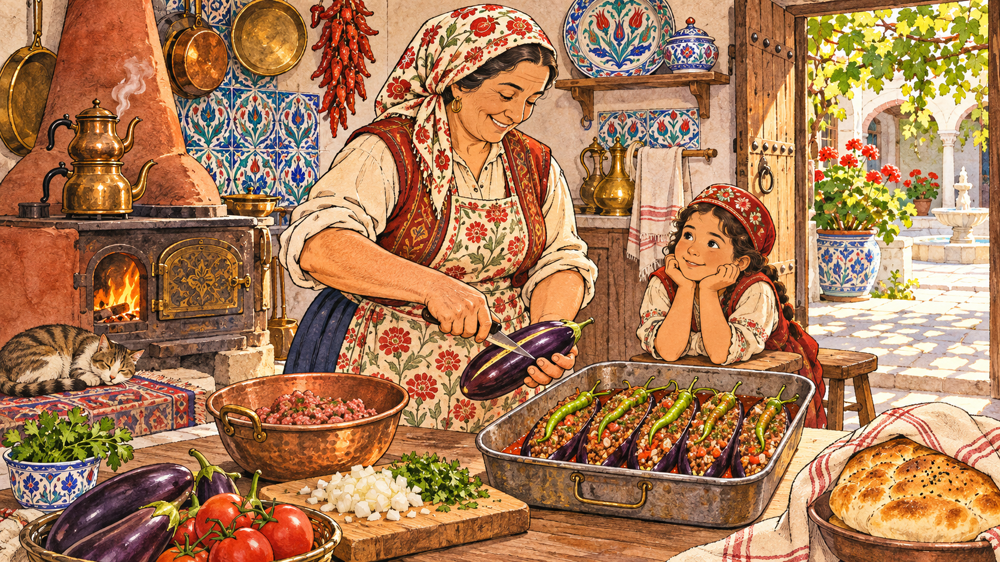 -->
<details><summary>Image Prompt</summary>
(This is Panel 04. Do not include the panel number in the image.)
Style: a hand-drawn travel-sketchbook graphic-novel illustration, with clean dark ink outlines, flat softly shaded color fills and a faint watercolor paper texture, like a page from a traveler's journal; warm, sunlit, painterly lighting; no text, captions, signs, letters or speech bubbles anywhere in the image.

Please generate a 16:9 image depicting panel 4 of 12. Medium shot in a lively Anatolian home kitchen in the Ottoman era, with a low wooden table, a clay-and-brass stove and a bright courtyard door at the back. Palette: Iznik turquoise, cobalt, tomato red, brass, saffron and white plaster.

An Anatolian home cook: a woman of about fifty with a patterned cotton headscarf, a long dark-blue skirt under a floral apron, strong forearms and a warm, brisk manner.

Karnıyarık, "split belly": a row of purple eggplants slit along the belly and filled with minced meat, onion, tomato and parsley, each topped with a long green pepper, baked in a deep tin.

The cook stands at the table, using a small knife to slit the belly of a long purple eggplant, with a row of already-filled eggplants lined up in a deep tin at her side, each topped with a long green pepper. A grandchild of about eight watches from a stool, chin on hands. Details: a mound of minced meat in a copper bowl, a chopping board with diced onion and parsley, a pot of tea on the stove, a string of drying peppers, a sleepy cat by the stove, and a cloth-covered round of bread. Emotional tone: affectionate, busy family cooking, a recipe passed hand to hand. Keep every character and place consistent with the other images in this story. Generate the image immediately without asking clarifying questions.
</details>

The second dish takes its name from what the cook does to it. *Karnıyarık*, "split belly," is an eggplant slit along its belly and filled with spiced minced meat, onion and tomato, then baked, often with a long green pepper on top. Unlike *imam bayıldı*, it is served hot and has meat in it. Its Greek cousin, *papoutsakia*, "little shoes," takes the same idea and adds a coat of béchamel.

## Panel 5: The Sultan Liked It
<!-- 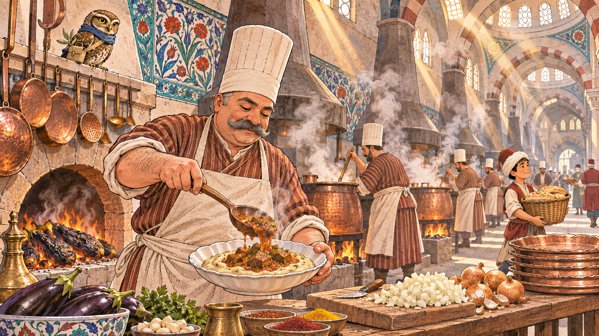 -->
<details><summary>Image Prompt</summary>
(This is Panel 05. Do not include the panel number in the image.)
Style: a hand-drawn travel-sketchbook graphic-novel illustration, with clean dark ink outlines, flat softly shaded color fills and a faint watercolor paper texture, like a page from a traveler's journal; warm, sunlit, painterly lighting; no text, captions, signs, letters or speech bubbles anywhere in the image.

Please generate a 16:9 image depicting panel 5 of 12. Wide interior shot of the palace kitchens of Topkapı in Istanbul, in the Ottoman era, a long row of high domed halls with tall chimneys, shafts of steam and smoke lit by sunbeams from above. Palette: Iznik turquoise, cobalt, tomato red, brass, saffron and white plaster.

A palace cook of Topkapı: a heavyset middle-aged man with a bushy gray mustache, wearing a tall cylindrical white cloth cap, a long white apron over a striped brown robe, sleeves rolled to the elbow, holding a long-handled wooden spoon.

Hünkâr beğendi, "the sultan liked it": tender chunks of lamb stew in a rich red-brown sauce, heaped on a bed of pale cream, silky smoked eggplant purée in a wide white bowl.

In the middle foreground the palace cook ladles lamb stew over a bed of cream eggplant purée in a wide white bowl, while behind him a line of cooks in matching caps stir giant copper cauldrons over open fires. Details: eggplants charring directly in the flames of one hearth, a long wooden table of chopped onions, a stack of copper trays, a hanging row of ladles, a boy carrying a basket of bread, and sunbeams cutting through the steam.

Glaux the Little Owl: a true little owl (Athene noctua), small, round and compact, with a flat rounded head and no ear tufts, warm earth-brown plumage with cream spots, bright lemon-yellow eyes under pale cream eyebrows, a cream-white throat patch and a short pale greenish-yellow beak. Glaux wears a small Aegean-blue scarf and a tan canvas satchel across the body with a small leather-bound travel notebook peeking out, and a sprig of three olive leaves tucked into the satchel strap. Alert, curious and warm expression. Glaux is drawn small, perched at the edge of the scene, noticeable on a second look: on a high ledge among the hanging copper pans at the upper left. Emotional tone: the grandeur and heat of an imperial kitchen. Keep every character and place consistent with the other images in this story. Generate the image immediately without asking clarifying questions.
</details>

The palace kitchens of Topkapı cook for several thousand people a day, and from them comes the empire's high cuisine. One of their dishes is *hünkâr beğendi*, "the sultan liked it": a stew of lamb spooned onto a smooth purée of eggplant roasted over a flame, then whipped with butter, flour, milk and cheese. It shows what the same vegetable looks like when it is dressed for a palace instead of a family table. The smoke you taste is the point.

## Panel 6: A Banquet for an Empress
<!-- 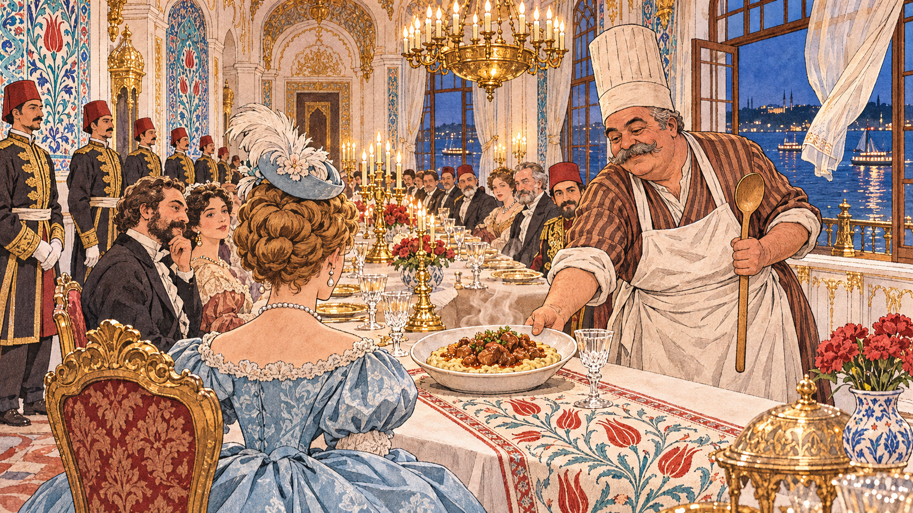 -->
<details><summary>Image Prompt</summary>
(This is Panel 06. Do not include the panel number in the image.)
Style: a hand-drawn travel-sketchbook graphic-novel illustration, with clean dark ink outlines, flat softly shaded color fills and a faint watercolor paper texture, like a page from a traveler's journal; warm, sunlit, painterly lighting; no text, captions, signs, letters or speech bubbles anywhere in the image.

Please generate a 16:9 image depicting panel 6 of 12. Wide shot of a long, candlelit banquet hall in an imperial palace on the Bosphorus in 1869 as the legend tells it, with tall windows showing a dark blue evening sea and the lights of boats. Palette: Iznik turquoise, cobalt, tomato red, brass, saffron and white plaster.

A palace cook of Topkapı: a heavyset middle-aged man with a bushy gray mustache, wearing a tall cylindrical white cloth cap, a long white apron over a striped brown robe, sleeves rolled to the elbow, holding a long-handled wooden spoon.

Hünkâr beğendi, "the sultan liked it": tender chunks of lamb stew in a rich red-brown sauce, heaped on a bed of pale cream, silky smoked eggplant purée in a wide white bowl.

In the foreground, seen only from behind, a European noblewoman in a wide hooped pale-blue silk gown with a small feathered hat sits at the head of a long table set with gold plates, crystal and candelabra. Across from her, a palace cook in the tall white cap proudly sets a wide white bowl of the lamb-on-eggplant dish in front of her. Details: footmen in gold-trimmed uniforms standing along the wall, a brass chandelier, a table runner embroidered with tulips, pale curtains blowing at an open window, and the steam rising from the bowl. Emotional tone: ceremony and hushed curiosity. Keep every character and place consistent with the other images in this story. Generate the image immediately without asking clarifying questions.
</details>

The story says that hünkâr beğendi was created for the French Empress Eugénie when she visited Istanbul in 1869. It is a charming tale, and it is late and unproven. The dish itself is very real, and the idea that a great meal was served to a European empress fits the Ottoman palace's habit of showing its cooking to the world.

> **Myth or Evidence?** Documented: the dish "the sultan liked it," its smoked eggplant purée, and Eugénie's 1869 visit. Legend: that the dish was invented for that dinner. Chapter 5 calls the story "late and unproven," and no early source ties the recipe to that banquet.

## Panel 7: Across the Sea, the Same Eggplant
<!-- 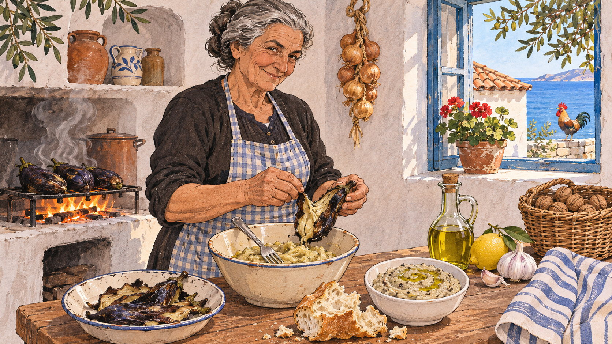 -->
<details><summary>Image Prompt</summary>
(This is Panel 07. Do not include the panel number in the image.)
Style: a hand-drawn travel-sketchbook graphic-novel illustration, with clean dark ink outlines, flat softly shaded color fills and a faint watercolor paper texture, like a page from a traveler's journal; warm, sunlit, painterly lighting; no text, captions, signs, letters or speech bubbles anywhere in the image.

Please generate a 16:9 image depicting panel 7 of 12. Medium shot in a whitewashed Greek village kitchen in the early 20th century, with a small window showing a bright blue Aegean sea and a terracotta roof. Palette: natural daylight, whitewashed walls, sea blue, terracotta and olive.

A Greek taverna cook: a woman of about sixty with gray hair pinned in a bun, a black cardigan and a blue-checked apron, weathered hands and a quick, knowing smile.

Melitzanosalata: a smooth, pale gray-beige, smoky eggplant dip with flecks of dark skin, drizzled with olive oil and served in a small white bowl with torn bread.

The cook stands at a wooden table peeling the blackened skin from eggplants that have been roasted on an open flame, mashing the soft pale flesh in a large bowl with a fork. On the table beside her stand a bowl of finished melitzanosalata, a bottle of olive oil, a lemon and a head of garlic. Details: the charred eggplants still smoking on a rack over the stove flame, a basket of walnuts, a rooster glimpsed outside the window, a string of onions, and a blue-and-white striped cloth. Emotional tone: familiarity, the same smell in a different language. Keep every character and place consistent with the other images in this story. Generate the image immediately without asking clarifying questions.
</details>

On the Greek side of the Aegean, the same vegetable meets the same fire. *Melitzanosalata* is eggplant roasted until the skin blackens, then mashed with garlic, olive oil and lemon or vinegar, and sometimes walnuts. It is the Greek cousin of the Turkish *patlıcan salatası*, and a visitor who has eaten one in Istanbul will recognize the other at once. The names change at the border, but the smoke does not.

## Panel 8: Whose Dish Is It?
<!-- 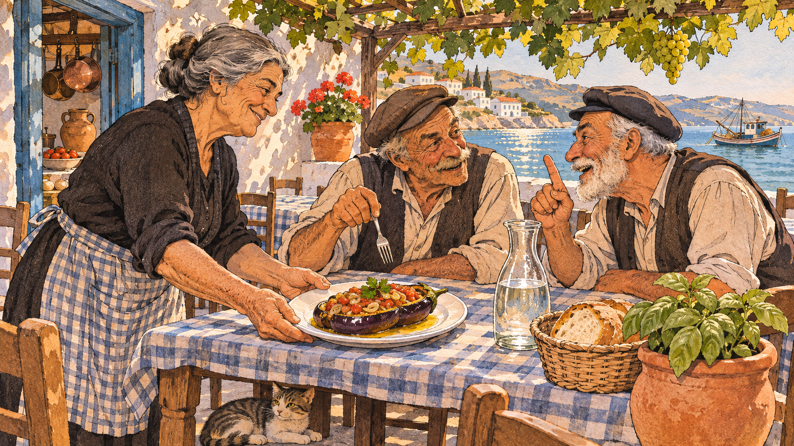 -->
<details><summary>Image Prompt</summary>
(This is Panel 08. Do not include the panel number in the image.)
Style: a hand-drawn travel-sketchbook graphic-novel illustration, with clean dark ink outlines, flat softly shaded color fills and a faint watercolor paper texture, like a page from a traveler's journal; warm, sunlit, painterly lighting; no text, captions, signs, letters or speech bubbles anywhere in the image.

Please generate a 16:9 image depicting panel 8 of 12. Medium-wide shot on the shaded terrace of a Greek seaside taverna in the early 20th century, late afternoon sunlight filtering through a grapevine trellis, with the sea sparkling beyond. Palette: natural daylight, whitewashed walls, sea blue, terracotta and olive.

A Greek taverna cook: a woman of about sixty with gray hair pinned in a bun, a black cardigan and a blue-checked apron, weathered hands and a quick, knowing smile.

Imam bayıldı: a whole purple eggplant split lengthwise down its belly and stuffed with soft onions, chopped tomatoes and garlic, glossy and golden with olive oil, served cool on a white plate with a sprig of parsley.

In the foreground, the cook sets a white plate of the stuffed eggplant on a wooden table covered with a blue-checked cloth, where two older men in waistcoats and caps lean over the dish, one gesturing with a fork and the other with a raised finger, mid-friendly-argument, both smiling. Details: a carafe of water, a basket of bread, a pot of basil on the table, a small bunch of grapes hanging from the trellis, a cat under the table, and a fishing boat on the water. Emotional tone: lively warmth, an old, affectionate quarrel. Keep every character and place consistent with the other images in this story. Generate the image immediately without asking clarifying questions.
</details>

In Greece the stuffed eggplant appears as *imam baildi*, and Athenian menus still list it under a Turkish name. Greeks and Turks both cook it, both name it, and both ask whose it is. Chapter 15 says it plainly: the dishes are agreed, and the argument is over whom they belong to. The honest answer is that each dish belongs to everyone who cooked it.

## Panel 9: The Chef and the Béchamel
<!-- 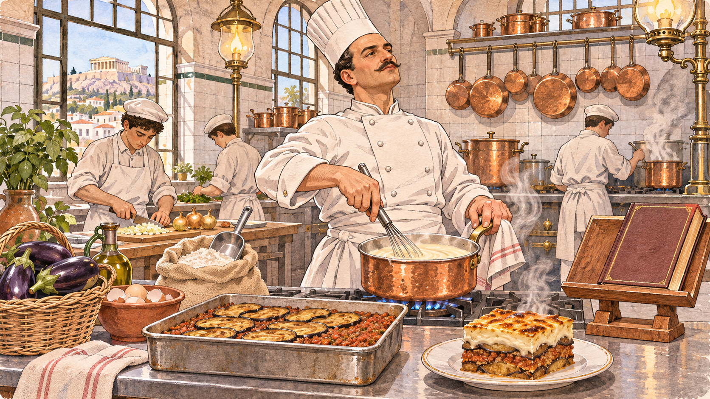 -->
<details><summary>Image Prompt</summary>
(This is Panel 09. Do not include the panel number in the image.)
Style: a hand-drawn travel-sketchbook graphic-novel illustration, with clean dark ink outlines, flat softly shaded color fills and a faint watercolor paper texture, like a page from a traveler's journal; warm, sunlit, painterly lighting; no text, captions, signs, letters or speech bubbles anywhere in the image.

Please generate a 16:9 image depicting panel 9 of 12. Wide shot of a busy hotel kitchen in Athens in the early 20th century, with a high ceiling, white tile walls and steam rising from copper pots under tall gas lamps. Palette: natural daylight, whitewashed walls, terracotta, copper gold and olive.

Nikolaos Tselementes, Greek chef of the early 20th century (an imagined likeness, not a portrait): a man in his forties in a white double-breasted chef's jacket and a tall white toque, with a neat mustache and a precise, proud expression, whisking a pale sauce in a copper pot.

Moussaka: a thick square slice with layers of fried eggplant and spiced minced meat in tomato sauce under a tall golden-brown crust of béchamel, steaming on a white plate.

The chef stands at center, whisking a pale, silky white sauce in a copper pot on a stove, in three-quarter view. In front of him on the steel table sits a large baking tin of layered eggplant and meat waiting to be topped, with a finished golden slice on a plate beside it. Details: young kitchen hands in white aprons chopping onions in the background, a rack of copper pans on the wall, a basket of eggplants, a bowl of cracked eggs, a sack of flour with a scoop, and a wooden cookbook stand holding a closed book with a blank cover. Emotional tone: pride, precision and a touch of French elegance. Keep every character and place consistent with the other images in this story. Generate the image immediately without asking clarifying questions.
</details>

Moussaka has an Arabic-derived name, *musaqqa'a*, usually explained as "chilled," and versions across the Ottoman world. The modern Greek form, layered eggplant and spiced meat under a thick béchamel, is usually credited to the European-trained chef Nikolaos Tselementes in the early 20th century. His influential cookbooks brought French technique to Greek kitchens, and the white sauce made the dish what many Greeks now think of as their own.

> **Myth or Evidence?** Documented: Tselementes was a real chef and cookbook author, and the béchamel-topped version is the modern Greek form. Tradition: that he alone invented it. Chapter 15 says only that the topping is "usually credited" to him; earlier eggplant-and-meat dishes existed across the Ottoman world.

## Panel 10: Two Ships on the Same Sea
<!-- 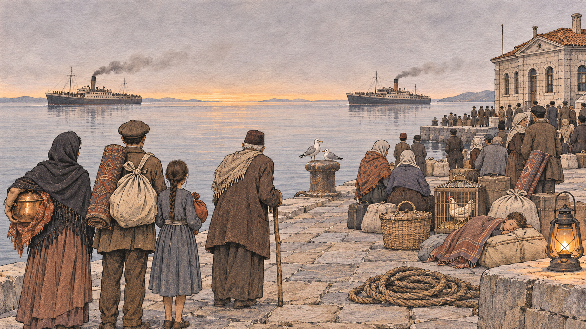 -->
<details><summary>Image Prompt</summary>
(This is Panel 10. Do not include the panel number in the image.)
Style: a hand-drawn travel-sketchbook graphic-novel illustration, with clean dark ink outlines, flat softly shaded color fills and a faint watercolor paper texture, like a page from a traveler's journal; warm, sunlit, painterly lighting; no text, captions, signs, letters or speech bubbles anywhere in the image.

Please generate a 16:9 image depicting panel 10 of 12. Wide shot from a stone quay on the Aegean coast at dawn in 1923, pearl-gray sky with a thin band of pale gold at the horizon, the sea flat and calm. Palette: muted pearl gray, dusty ochre and weathered blue, with warmth kept only in the cooking pot and a few cloth bundles.

A family of 1923 on a quay, seen from behind or at a distance: a woman in a dark headscarf carrying a cloth-wrapped copper cooking pot on her hip, a man with a rolled rug and a bundle tied in cloth on his back, a girl of about ten clutching a small bundle, and an older man leaning on a stick; faces never shown.

The family stands small in the lower left foreground, seen from behind, looking out at the water, with several other families waiting in quiet knots along the quay, each with bundles, sacks, a rolled rug, a basket, a cage with a hen. Out on the water, two crowded steamers pass each other far apart, one heading left and one heading right, their smoke trailing in the still air. Details: the warm glint of the copper pot, a coil of rope on the stones, a single lantern still lit, gulls on a bollard, the stone customs house in the distance, and a child asleep on a bundle. Emotional tone: weighted quiet and dignity, with no panic or violence. Keep every character and place consistent with the other images in this story. Generate the image immediately without asking clarifying questions.
</details>

On 30 January 1923 at Lausanne, the governments of Greece and Turkey signed a convention for a compulsory exchange of populations. About 1.2 million Orthodox Christians, most of whom had already fled in 1922, and about 400,000 Muslims were made to leave homes their families had lived in for centuries, and none could return. The rule that sorted them was religion, not language: Turkish-speaking Orthodox Christians from Cappadocia went to Greece, and Greek-speaking Muslims from Crete went to Turkey. People carried what they could, and a cooking pot was among the things a family might take.

## Panel 11: Two Kitchens, One Recipe Box
<!-- 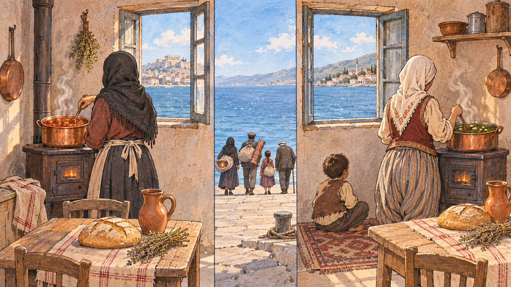 -->
<details><summary>Image Prompt</summary>
(This is Panel 11. Do not include the panel number in the image.)
Style: a hand-drawn travel-sketchbook graphic-novel illustration, with clean dark ink outlines, flat softly shaded color fills and a faint watercolor paper texture, like a page from a traveler's journal; warm, sunlit, painterly lighting; no text, captions, signs, letters or speech bubbles anywhere in the image.

Please generate a 16:9 image depicting panel 11 of 12. A wide diptych composition, divided down the middle by a thin vertical band of blue sea that both windows look out on. Left half: a small, plain refugee-district kitchen in Athens in the 1920s; right half: a small kitchen on the Turkish Aegean coast in the 1920s. Palette: warm kitchen colors of copper, saffron and tomato red against muted pearl-gray and weathered blue outside.

A family of 1923 on a quay, seen from behind or at a distance: a woman in a dark headscarf carrying a cloth-wrapped copper cooking pot on her hip, a man with a rolled rug and a bundle tied in cloth on his back, a girl of about ten clutching a small bundle, and an older man leaning on a stick; faces never shown.

In the left kitchen, the woman of the family from the quay, now seen from behind at the stove, stirs the same copper pot on a small stove, with a pot of tomato-and-cumin meatballs steaming and a little bundle of dried herbs hanging from a nail. In the right kitchen, a different woman in a white headscarf and loose trousers stirs her own pot of greens and oil at a similar stove, with a child sitting on the floor beside her. Details in both: bare plaster walls, a single window open to the same sea, a table with a loaf of bread, a small clay pitcher, and a bundle of dried herbs. Emotional tone: bittersweet continuity, the same sea and the same cooking. Keep every character and place consistent with the other images in this story. Generate the image immediately without asking clarifying questions.
</details>

Greece takes in about 1.2 million refugees, in a country of about five million, and whole new neighborhoods go up around Athens and Piraeus named for the places the refugees lost: Nea Smyrni, "New Smyrna," among them. The refugees carry Anatolian cooking with them; *soutzoukakia smyrneika*, meatballs in tomato sauce with cumin, are named for Smyrna. On the other shore, many Muslim families from Crete settle on the Turkish Aegean coast, where Cretan dishes and Greek words survive in their grandchildren's kitchens. Recipes cross the sea in both directions, and so do the grief and the resilience that cooked them.

## Panel 12: One Table, Two Languages
<!-- 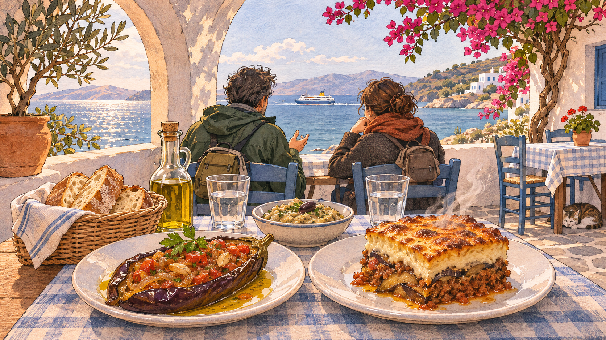 -->
<details><summary>Image Prompt</summary>
(This is Panel 12. Do not include the panel number in the image.)
Style: a hand-drawn travel-sketchbook graphic-novel illustration, with clean dark ink outlines, flat softly shaded color fills and a faint watercolor paper texture, like a page from a traveler's journal; warm, sunlit, painterly lighting; no text, captions, signs, letters or speech bubbles anywhere in the image.

Please generate a 16:9 image depicting panel 12 of 12, the Then and Now. Low, eye-level shot across a table, matching panel 1's viewpoint, on the terrace of a seaside taverna today in November, with an arched window or opening at the left showing the sea and soft afternoon sun. Palette: natural daylight, whitewashed walls, sea blue, terracotta and olive.

Two adult travelers seen from behind or in distant three-quarter view, dressed for cool November weather: one in a dark green rain jacket, the other in a charcoal wool coat with a rust-colored scarf, both with small daypacks, standing close together and looking at the view. Faces are never shown in detail. Here the two travelers are seated side by side at the table instead of standing.

Imam bayıldı: a whole purple eggplant split lengthwise down its belly and stuffed with soft onions, chopped tomatoes and garlic, glossy and golden with olive oil, served cool on a white plate with a sprig of parsley.

Moussaka: a thick square slice with layers of fried eggplant and spiced minced meat in tomato sauce under a tall golden-brown crust of béchamel, steaming on a white plate.

The two travelers sit at a small table in the lower center, seen from behind in their seats and small in the frame, looking out at the sea. On the table in front of them stand the two plates side by side, the cool stuffed eggplant on the left and the golden slice of moussaka on the right, with a basket of bread, a small bowl of melitzanosalata, a bottle of olive oil, and two glasses of water. Details: a blue-painted chair, a trailing bougainvillea, a cat under the next table, and a distant ferry on the water. Emotional tone: warmth, gratitude and quiet conversation. Keep every character and place consistent with the other images in this story. Generate the image immediately without asking clarifying questions.
</details>

Today the table in front of us holds two eggplant dishes, one Turkish-named and one Greek-named, and the cooks behind them may share more ancestors in the kitchen than either side admits. Order the eggplant on each side of the Aegean and compare. Do not stop at the menu: ask the cook where the recipe came from, and listen. The dish tastes better when you know whose hands carried it here.

### Epilogue - What One Eggplant Remembers

The eggplant dishes of the Aegean are shared property, and the fight over who owns them is part of the shared history. The legends about the fainting imam and the sultan's dinner explain a name or add a flavor of romance; the documented history is in the cooking pots, the tomatoes from the Americas, the Persian and Arab origins of the vegetable and the recipes that crossed the sea in 1923. A dish is a record that anyone can taste, and what it records is people.

| Challenge | How They Responded | Lesson for Today |
|---|---|---|
| Two legends explain the fainting imam, with no source for either | Cooks and tellers kept both, and the dish outlasted the argument | Tell legends as legends; let the documented dish speak |
| Dishes cross borders and both sides claim them | Greek and Turkish cooks kept cooking, under similar names | Shared heritage is richer than a single owner |
| A rule that moved people by religion, not language, in 1923 | Families carried recipes and pots across the sea in both directions | Knowledge travels in people, so protect the people |
| The people who keep a food tradition are rarely asked | Today's travelers can listen to the cooks | Learn with people, not only about them |

### Call to Action

Next time you eat in Istanbul, Athens or anywhere on the Aegean, order the eggplant, and ask the person who made it where the recipe came from. The book's Learning for All thread asks the same question of every story: learning with people, not about them. The Reading Food in Layers MicroSim and the 1923 cases MicroSim are a good place to practice both.

---

## Voices from the Sources

No cook's words survive from the legends, so these are documented names and a treaty phrase, not invented quotations:

*"The imam fainted"*
The meaning of the Turkish name *imam bayıldı*. Neither story about why is documented; the name is.

*"a compulsory exchange of Turkish nationals of the Greek Orthodox religion"*
Convention Concerning the Exchange of Greek and Turkish Populations, Article 1, signed at Lausanne on 30 January 1923. The rule sorted people by religion, not by language.

*"Odigos Mageirikis" (Cooking Guide)*
The title of the magazine the chef Nikolaos Tselementes began publishing in 1910.

## On the Trip

- **Chapter:** [21. Going Home](../../chapters/21-going-home/index.md)
- **Where to look:** every menu from Istanbul to Athens. Look for *imam bayıldı* and *hünkâr beğendi* in Istanbul, *melitzanosalata*, *papoutsakia* and moussaka in Athens, and the smoky eggplant dips on the meze trays on both sides of the sea.
- **Explore further:** [Reading Food in Layers](../../sims/food-history-layers-sorter/index.md) and [Who Was Exchanged in 1923?](../../sims/population-exchange-1923-cases/index.md)
- **Look Closer:** Glaux says: look at the olive oil on the plate, and ask who poured it. Glaux was hiding in Panel 5, on a high ledge among the copper pans of the Topkapı kitchens.

## Characters and Style

This story follows the shared series bible: [Story Characters, Places and House Style](../characters.md). Glaux's identity comes from the mascot's [character sheet](../../img/mascot/character-sheet.md).

## References

1. [Wikipedia: Imam bayıldı](https://en.wikipedia.org/wiki/Imam_bay%C4%B1ld%C4%B1) - The stuffed eggplant dish and the legends about its name
2. [Wikipedia: Moussaka](https://en.wikipedia.org/wiki/Moussaka) - Origins and variations of the dish, including the Greek version
3. [Wikipedia: Nikolaos Tselementes](https://en.wikipedia.org/wiki/Nikolaos_Tselementes) - The Greek chef and cookbook author credited with the modern Greek moussaka
4. [Wikipedia: Population exchange between Greece and Turkey](https://en.wikipedia.org/wiki/Population_exchange_between_Greece_and_Turkey) - The 1923 compulsory exchange, its terms and consequences
5. [Encyclopaedia Britannica: Eggplant](https://www.britannica.com/plant/eggplant) - Botany and history of the plant and its spread
