# The Giant Who Fell Down

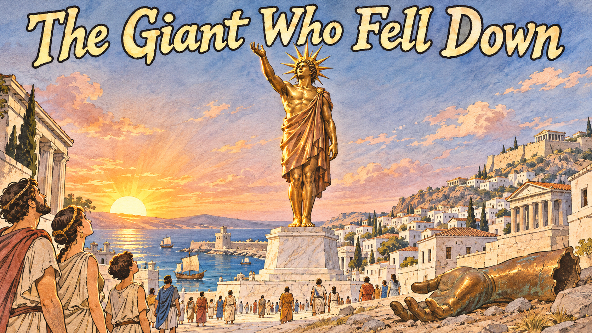
<details>
<summary>Cover Image Prompt</summary>
(This is the Cover Image. Do not include this label in the image.)
Style: a hand-drawn travel-sketchbook graphic-novel illustration, with clean dark ink outlines, flat softly shaded color fills and a faint watercolor paper texture, like a page from a traveler's journal; warm, sunlit, painterly lighting; no text, captions, signs, letters or speech bubbles anywhere in the image.
Please generate a wide-landscape 16:9 cover image for this graphic novel story. Scene at sunrise: show the statue. The Colossus of Rhodes as a statue of Helios: a gigantic bronze statue of the sun god, about 33 meters tall, a young beardless man standing upright with feet together on a tall white marble base, a bronze cloak falling from one shoulder to the knees, a crown of long spiky sun rays around his head, one arm raised toward the sky and the other at his side; the metal gleams warm gold-bronze. (A modern artist's guess; nobody knows the pose.) It stands proudly in the middle of a white-walled city, its bronze skin glowing gold, with the blue harbor and a few tiny sailing ships below, small figures of citizens looking up from the street, and at the bottom edge the faint silhouette of a broken bronze hand lying in the dust to hint at the ending. Across the top, render the story title as bold, hand-lettered title text in warm cream letters with a dark ink outline, reading exactly: "The Giant Who Fell Down". Palette: marble white, Aegean blue, honey gold, bronze and warm limestone. Emotional tone: awe tinged with melancholy.
Keep every character and place consistent with the other images in this story. Generate the image immediately without asking clarifying questions.
</details>

<details>
<summary>Narrative Prompt</summary>

**Era and place.** The island and city of Rhodes, in the Aegean off the southwest coast of Turkey, from the siege of 305-304 BCE through the building of the statue (about 292 to 280 BCE), the earthquake (about 226 BCE), the visitors of Roman times, and the sale of the bronze in the 650s CE, then today. The story follows the chapter [Day 8: Rhodes, From the Colossus to the Knights](../../chapters/12-rhodes/index.md).

**Themes.** A small city that survives a siege and turns an enemy's leftovers into a monument; how fame outlasts fact; telling legend from evidence (panel 10 is a Myth or Evidence? panel); and how "the wonder" can be completely absent from the place that carries its name.

**House style.** Every prompt starts with the series house style line from [Story Characters, Places and House Style](../characters.md). All images are 16:9 with no lettering in the panels; only the cover carries the title.

**Palette (Hellenistic and Roman era).** The shared table lists warm limestone, sea-green, deep red, bronze and evening gold for 300 BCE to 300 CE. This story leans on the lighter Aegean end of the chapter's Greek palette: marble white, Aegean blue, honey gold, bronze and warm limestone. Panel 10 is drawn as a sepia study on parchment with one red ink mark, panel 11 uses ochre, camel brown, bronze and deep blue for the 650s CE, and panel 12 uses natural daylight.

**Creative liberties and uncertainties.** Nobody knows the Colossus's pose, face, stance, or exact location; the statue shown is a modern artist's guess. Later writers described the interior as stone and iron bracing, and some say the builders used a mound of earth to raise it; both are hedged here. The siege tower is called the Helepolis in ancient sources, which describe it as many stories tall and plated with iron. The sale of the bronze to a merchant with camels comes from a Byzantine chronicle written centuries after the event and may be a story. The scene of defenders on the walls is invented.

**Cast.** Glaux the Little Owl and the Travelers follow [Story Characters, Places and House Style](../characters.md) and the [mascot character sheet](../../img/mascot/character-sheet.md); paste their blocks verbatim. Characters, objects and places that appear only in this story are below; paste each block verbatim into every prompt where they appear.

**Demetrius the Besieger (this story only)**

```text
Demetrius the Besieger, Macedonian king: a tall, handsome, broad-shouldered man of about thirty-two with thick wavy chestnut hair, a clean-shaven face and an arrogant, restless gaze, wearing a polished bronze breastplate, a purple military cloak and a thin gold diadem band around his head.
```

**Chares of Lindos (this story only)**

```text
Chares of Lindos, sculptor: a lean, sun-weathered man of about fifty with a short gray beard, a high bald forehead bound with a linen headband, forearms stained with clay and bronze dust, wearing a leather work apron over a plain tunic, and often holding a small clay model of a head crowned with sun rays; intent, patient and exacting.
```

**The Colossus as Helios (this story only)**

```text
The Colossus of Rhodes as a statue of Helios: a gigantic bronze statue of the sun god, about 33 meters tall, a young beardless man standing upright with feet together on a tall white marble base, a bronze cloak falling from one shoulder to the knees, a crown of long spiky sun rays around his head, one arm raised toward the sky and the other at his side; the metal gleams warm gold-bronze. (A modern artist's guess; nobody knows the pose.)
```

**Mandraki harbor (this story only)**

```text
Mandraki harbor on the northern tip of the island of Rhodes: a sheltered harbor basin with calm blue water, a broad opening toward the open Aegean, a low sandy shoreline and a distant line of pale hills inland.
```

**The Rhodian coin (this story only)**

```text
An ancient Rhodian silver coin: a thick round coin showing on one side the head of Helios, the sun god, facing forward with rays standing out around his hair, and on the other side a single rose with a bud, with a rough, hand-struck edge.
```

</details>

### Prologue - The Wonder That Wasn't Where You Think

Almost everyone has seen the picture: a giant bronze man straddling a harbor entrance, one foot on each side, with ships sailing between his legs. It is one of the most famous images in the ancient world, and it is almost certainly wrong. The real statue of the sun god Helios was built by a city that won a war and paid for the monument by selling what its defeated enemy left behind. It stood for only about 54 years, and then it lay on the ground for centuries as a tourist attraction.

**Find Glaux:** Glaux hides in one panel of this story. Can you spot the little owl?

## Panel 1: The Besieger Arrives

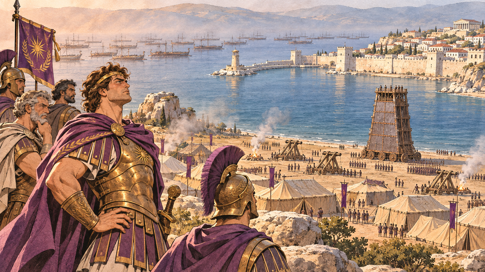
<details><summary>Image Prompt</summary>
(This is Panel 01. Do not include the panel number in the image.)
I am about to ask you to generate a series of images for a graphic novel. Please make the images have a consistent style and consistent characters. Do not ask any clarifying questions. Just generate the image immediately when asked.
Style: a hand-drawn travel-sketchbook graphic-novel illustration, with clean dark ink outlines, flat softly shaded color fills and a faint watercolor paper texture, like a page from a traveler's journal; warm, sunlit, painterly lighting; no text, captions, signs, letters or speech bubbles anywhere in the image.
Please generate a 16:9 image depicting panel 1 of 12. Setting: the shore at the harbor entrance of Rhodes, 305 BCE, early morning haze. Palette: marble white, Aegean blue, honey gold, bronze and warm limestone. Wide establishing shot from the shoreline across the harbor. Mandraki harbor on the northern tip of the island of Rhodes: a sheltered harbor basin with calm blue water, a broad opening toward the open Aegean, a low sandy shoreline and a distant line of pale hills inland. It is now cut off by the enemy. Dozens of warships with bronze rams and banks of oars sit anchored in a broad crescent on the open sea with sails furled. On the beach a great iron-plated siege tower many stories tall stands on wheels, ant-sized soldiers around it. Foreground: Demetrius the Besieger, Macedonian king: a tall, handsome, broad-shouldered man of about thirty-two with thick wavy chestnut hair, a clean-shaven face and an arrogant, restless gaze, wearing a polished bronze breastplate, a purple military cloak and a thin gold diadem band around his head. He stands on a rise with his officers, seen in three-quarter view, studying the city. Other details: tan military tents, purple banners, catapults on the sand, pale city walls with towers, smoke from camp fires. Tone: menacing, ominous.
Keep every character and place consistent with the other images in this story. Generate the image immediately without asking clarifying questions.
</details>

In 305 BCE a fleet appears off Rhodes, led by the Macedonian king Demetrius, whom history calls Poliorcetes, "the Besieger." He brings the finest siege machinery of the age, including a giant tower on wheels that ancient writers call the Helepolis, "the city-taker." Rhodes is a rich trading city that has chosen not to side with him, and he means to teach it a lesson. This is the same harbor where, more than two thousand years later, we will stand to look for his enemy's monument.

## Panel 2: The Tower at the Wall

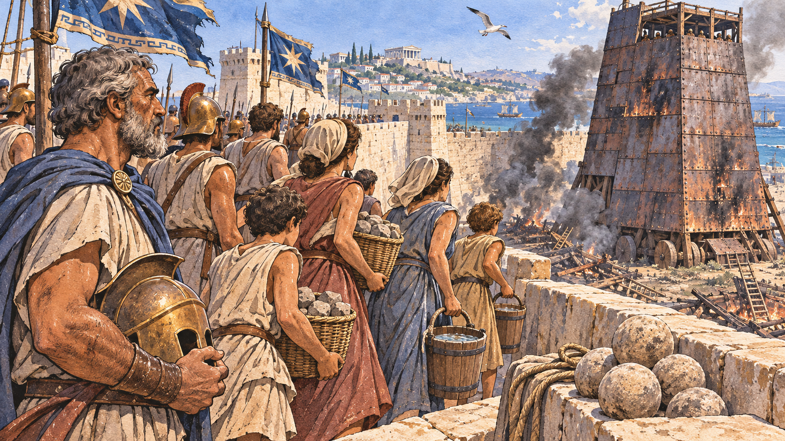
<details><summary>Image Prompt</summary>
(This is Panel 02. Do not include the panel number in the image.)
Style: a hand-drawn travel-sketchbook graphic-novel illustration, with clean dark ink outlines, flat softly shaded color fills and a faint watercolor paper texture, like a page from a traveler's journal; warm, sunlit, painterly lighting; no text, captions, signs, letters or speech bubbles anywhere in the image.
Please generate a 16:9 image depicting panel 2 of 12. Setting: the walls of Rhodes, 304 BCE, tense midafternoon light. Palette: marble white, Aegean blue, honey gold, bronze and warm limestone. Over-the-shoulder shot from the wall-walk: Rhodian defenders in bronze helmets and plain tunics, seen from behind, stand beside boys and women carrying baskets of stones and buckets of water. Just beyond the wall base the iron-plated siege tower looms, its plates scorched with black marks. Foreground: a sturdy gray-bearded Rhodian citizen holding his helmet in his hands, looking out. Other details: smoke from piles of burned timber, broken scaling ladders at the foot of the wall, banners snapping in the wind, a stack of round stone balls on the parapet, a gull overhead. Tone: tense, defiant and exhausted. Nobody is mid-strike.
Keep every character and place consistent with the other images in this story. Generate the image immediately without asking clarifying questions.
</details>

For a year the city holds. The defenders hold the walls, and the besiegers bring up their giant tower and still fail to take the city. In the picture, the townsfolk of Rhodes watch from behind their parapet, with boys and women carrying water and stone to the wall. The scene is a reconstruction, since we do not know the names or faces of the people on the wall, but the siege itself is solid history.

## Panel 3: What the Enemy Left Behind

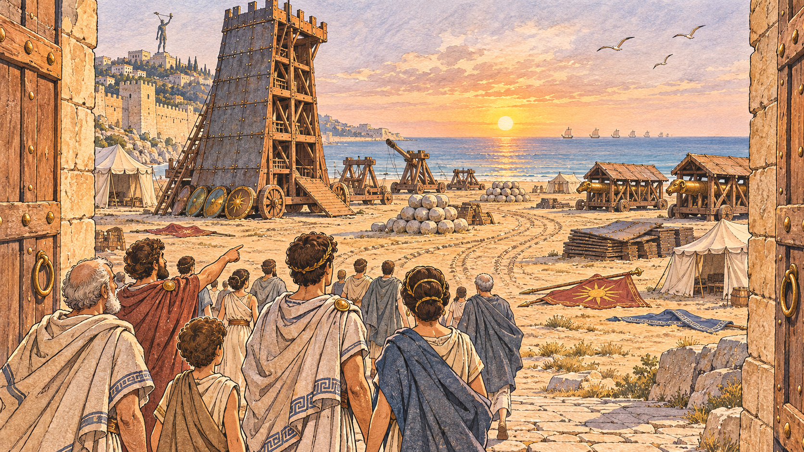
<details><summary>Image Prompt</summary>
(This is Panel 03. Do not include the panel number in the image.)
Style: a hand-drawn travel-sketchbook graphic-novel illustration, with clean dark ink outlines, flat softly shaded color fills and a faint watercolor paper texture, like a page from a traveler's journal; warm, sunlit, painterly lighting; no text, captions, signs, letters or speech bubbles anywhere in the image.
Please generate a 16:9 image depicting panel 3 of 12. Setting: the beach and plain outside the walls of Rhodes, 304 BCE, golden dawn. Palette: marble white, Aegean blue, honey gold, bronze and warm limestone. Wide shot: the besieging fleet sails away over the horizon as tiny sails, while on the beach the abandoned siege machines stand in the sunrise: the towering iron-plated siege tower, catapults, battering rams, stacks of stone balls and piles of iron plates. A group of Rhodian citizens in cloaks, seen from behind, walks out through the open gate to look, one pointing. Other details: dropped banners, wheel tracks in the sand, gulls, a few abandoned shields leaning against the tower, a calm blue sea, emptied tents. Tone: relief mixed with astonishment, a quiet victory.
Keep every character and place consistent with the other images in this story. Generate the image immediately without asking clarifying questions.
</details>

After about a year, in 304 BCE, Demetrius gives up and sails away, and he leaves much of his siege equipment on the beach. For the Rhodians the pile of iron, bronze and timber is a gift: it is worth a fortune. They walk out of the gate in the morning light and look at the machines that failed to take their city. Then someone has an idea about what to do with it.

## Panel 4: From Siege Engines to a Sun God

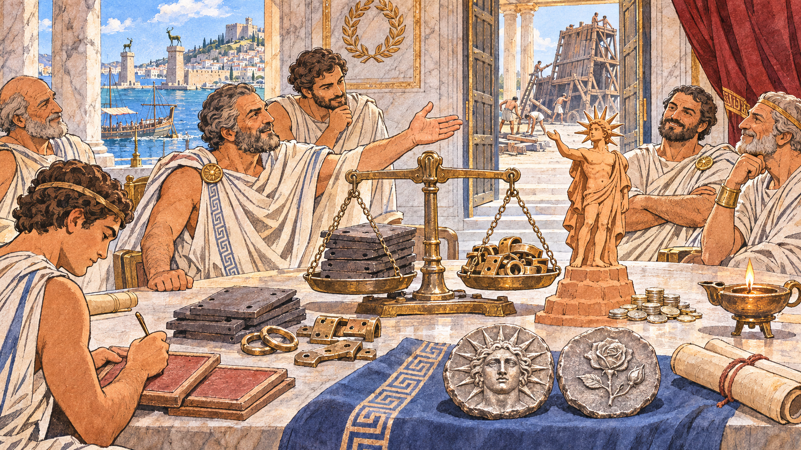
<details><summary>Image Prompt</summary>
(This is Panel 04. Do not include the panel number in the image.)
Style: a hand-drawn travel-sketchbook graphic-novel illustration, with clean dark ink outlines, flat softly shaded color fills and a faint watercolor paper texture, like a page from a traveler's journal; warm, sunlit, painterly lighting; no text, captions, signs, letters or speech bubbles anywhere in the image.
Please generate a 16:9 image depicting panel 4 of 12. Setting: the council hall of the city of Rhodes, 304 BCE, bright light. Palette: marble white, Aegean blue, honey gold, bronze and warm limestone. Medium shot of a long stone table where magistrates in white himations weigh heaps of iron plates and bronze fittings on large bronze scales, a clerk recording figures on wax tablets, and a small heap of coins on the table beside a clay model of a standing sun god with a radiant crown. An ancient Rhodian silver coin: a thick round coin showing on one side the head of Helios, the sun god, facing forward with rays standing out around his hair, and on the other side a single rose with a bud, with a rough, hand-struck edge. Draw the coins as described. One magistrate raises a hand toward the model while others nod. Through a tall doorway the siege tower is visible in the distance with workmen dismantling it. Other details: a dark red curtain, a bronze oil lamp, scrolls, a view of the harbor. Tone: shrewd, hopeful.
Keep every character and place consistent with the other images in this story. Generate the image immediately without asking clarifying questions.
</details>

The city decides to sell the abandoned machines and spend the money on a thank-offering to its patron god. Helios, the sun god, is the god of Rhodes: coins of the island carry his rayed head on one side and a rose, *rhodon* in Greek, on the other, a pun on the island's name. The city commissions a statue that will be about 33 m tall, as high as a ten-story building, paid for by the leftovers of the war. The plan is bold, practical and a little smug.

## Panel 5: Chares of Lindos

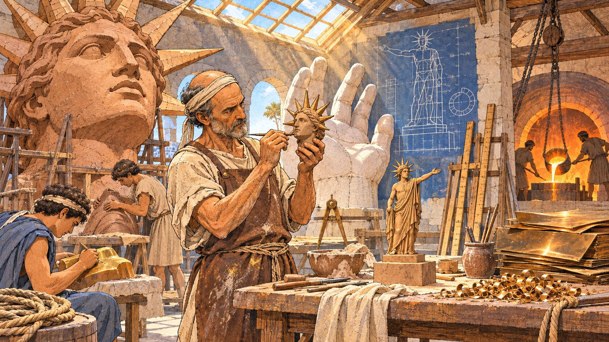
<details><summary>Image Prompt</summary>
(This is Panel 05. Do not include the panel number in the image.)
Style: a hand-drawn travel-sketchbook graphic-novel illustration, with clean dark ink outlines, flat softly shaded color fills and a faint watercolor paper texture, like a page from a traveler's journal; warm, sunlit, painterly lighting; no text, captions, signs, letters or speech bubbles anywhere in the image.
Please generate a 16:9 image depicting panel 5 of 12. Setting: a sculptor's workshop in Rhodes, about 292 BCE, warm light from a skylight. Palette: marble white, Aegean blue, honey gold, bronze and warm limestone. Medium-wide shot. Chares of Lindos, sculptor: a lean, sun-weathered man of about fifty with a short gray beard, a high bald forehead bound with a linen headband, forearms stained with clay and bronze dust, wearing a leather work apron over a plain tunic, and often holding a small clay model of a head crowned with sun rays; intent, patient and exacting. He stands among huge clay models and plaster casts of a giant hand and a head crowned with sun rays, a small clay maquette of a standing sun god on his workbench. Apprentices kneel and work wax and clay; in the background a furnace glows orange with figures in silhouette tending a ladle of molten bronze. Other details: wooden measuring rods, stacks of bronze sheets, coils of rope, a chalk plan on the wall, scattered bronze shavings. Tone: ambition, craftsmanship, the weight of a huge job.
Keep every character and place consistent with the other images in this story. Generate the image immediately without asking clarifying questions.
</details>

The sculptor is Chares, a Rhodian from the city of Lindos, and the job takes about twelve years. A statue this size cannot be cast in one piece. Later writers describe the work in sections, bronze skin over an interior of stone and iron bracing, but those descriptions come long after the fact, so we hold them loosely. What we do know is the scale: it is the biggest statue the Greek world has ever seen.

## Panel 6: A Giant Goes Up

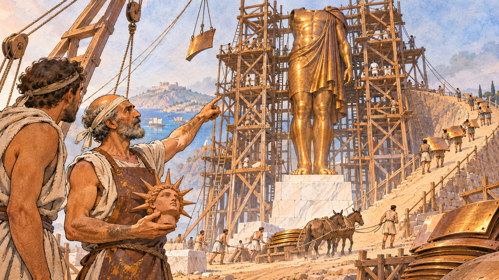
<details><summary>Image Prompt</summary>
(This is Panel 06. Do not include the panel number in the image.)
Style: a hand-drawn travel-sketchbook graphic-novel illustration, with clean dark ink outlines, flat softly shaded color fills and a faint watercolor paper texture, like a page from a traveler's journal; warm, sunlit, painterly lighting; no text, captions, signs, letters or speech bubbles anywhere in the image.
Please generate a 16:9 image depicting panel 6 of 12. Setting: a hilltop construction site in Rhodes, about 285 BCE, hazy morning. Palette: marble white, Aegean blue, honey gold, bronze and warm limestone. Low-angle shot of the statue half-built. The Colossus of Rhodes as a statue of Helios: a gigantic bronze statue of the sun god, about 33 meters tall, a young beardless man standing upright with feet together on a tall white marble base, a bronze cloak falling from one shoulder to the knees, a crown of long spiky sun rays around his head, one arm raised toward the sky and the other at his side; the metal gleams warm gold-bronze. (A modern artist's guess; nobody knows the pose.) In this view the legs and torso are complete in bright new bronze, the raised arm and the head are not yet fitted, and the whole figure stands inside a great earth ramp and wooden scaffolding. Tiny workers carry bronze plates up the ramp. In the foreground, Chares of Lindos, sculptor: a lean, sun-weathered man of about fifty with a short gray beard, a high bald forehead bound with a linen headband, forearms stained with clay and bronze dust, wearing a leather work apron over a plain tunic, and often holding a small clay model of a head crowned with sun rays; intent, patient and exacting. He stands pointing up at the statue and speaking with an assistant, seen in three-quarter view. Other details: pulleys and ropes, a mule team, stacked bronze sheets. Tone: awe and effort.
Keep every character and place consistent with the other images in this story. Generate the image immediately without asking clarifying questions.
</details>

Tradition says the builders raised the statue as they went, piling earth into a ramp that grew with the figure. When the work is done, the ramp is dug away and the giant stands free. Whether that is how it happened, or whether the story simply grew with the statue, we cannot say. Either way, the sight of a bronze body rising above a city built of limestone must have been astonishing.

## Panel 7: The Wonder Is Finished

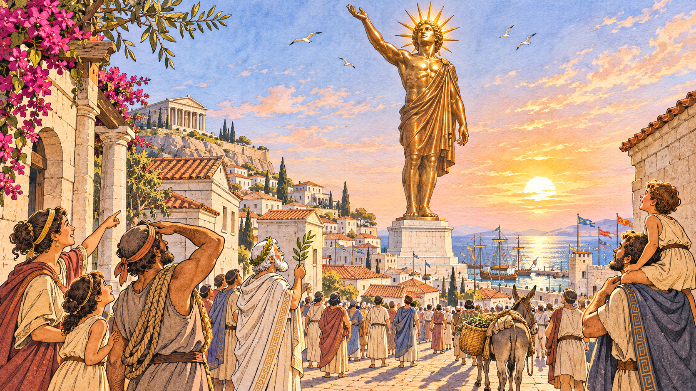
<details><summary>Image Prompt</summary>
(This is Panel 07. Do not include the panel number in the image.)
Style: a hand-drawn travel-sketchbook graphic-novel illustration, with clean dark ink outlines, flat softly shaded color fills and a faint watercolor paper texture, like a page from a traveler's journal; warm, sunlit, painterly lighting; no text, captions, signs, letters or speech bubbles anywhere in the image.
Please generate a 16:9 image depicting panel 7 of 12. Setting: the city of Rhodes, about 280 BCE, brilliant sunrise. Palette: marble white, Aegean blue, honey gold, bronze and warm limestone. Wide view of the finished statue. The Colossus of Rhodes as a statue of Helios: a gigantic bronze statue of the sun god, about 33 meters tall, a young beardless man standing upright with feet together on a tall white marble base, a bronze cloak falling from one shoulder to the knees, a crown of long spiky sun rays around his head, one arm raised toward the sky and the other at his side; the metal gleams warm gold-bronze. (A modern artist's guess; nobody knows the pose.) It gleams on its tall white marble base above the red-tiled rooftops of a white limestone city, towering over the masts of the ships in the harbor beyond; the head catches the first sun and glows gold. In the foreground, crowds in the street, tiny, look up: a mother pointing, a sailor shading his eyes, a priest in white with a laurel branch, a boy on his father's shoulders. Other details: flags on the quay, seabirds circling the head, a donkey with baskets, shadows long on the street. Tone: wonder. (The statue's true location is unknown; show it among the city with the sea glimpsed behind.)
Keep every character and place consistent with the other images in this story. Generate the image immediately without asking clarifying questions.
</details>

Around 280 BCE the Colossus of Rhodes is finished. Visitors from across the Mediterranean come to see it, and it becomes one of the Seven Wonders, the list of sights an educated traveler should see. We do not know exactly where it stood. The popular story places it at the harbor, but scholars think it more likely stood on land, either near the harbor or in a sanctuary of Helios higher in the city.

## Panel 8: Down in a Single Night

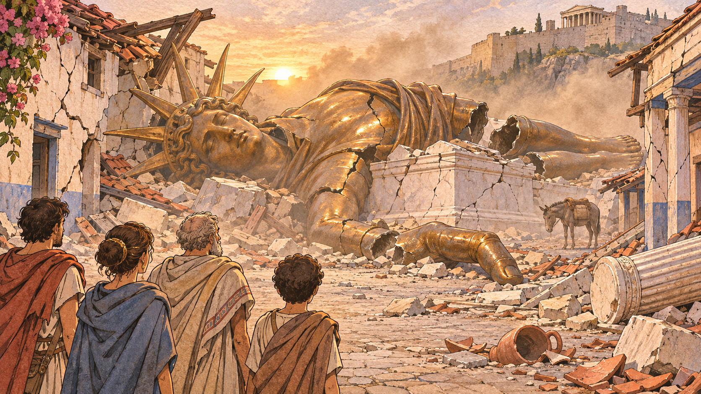
<details><summary>Image Prompt</summary>
(This is Panel 08. Do not include the panel number in the image.)
Style: a hand-drawn travel-sketchbook graphic-novel illustration, with clean dark ink outlines, flat softly shaded color fills and a faint watercolor paper texture, like a page from a traveler's journal; warm, sunlit, painterly lighting; no text, captions, signs, letters or speech bubbles anywhere in the image.
Please generate a 16:9 image depicting panel 8 of 12. Setting: the same street of Rhodes, about 226 BCE, dust-choked dawn after an earthquake. Palette: marble white, Aegean blue, honey gold, bronze and warm limestone. Wide shot of the statue shown fallen. The Colossus of Rhodes as a statue of Helios: a gigantic bronze statue of the sun god, about 33 meters tall, a young beardless man standing upright with feet together on a tall white marble base, a bronze cloak falling from one shoulder to the knees, a crown of long spiky sun rays around his head, one arm raised toward the sky and the other at his side; the metal gleams warm gold-bronze. (A modern artist's guess; nobody knows the pose.) The great bronze body lies in sections across the street and a cracked white base, the radiant head lying on its side, with the legs broken at the knees. Nearby houses are cracked with fallen roof tiles and beams, and dust still hangs in the air. A few survivors in cloaks, seen from behind, stand staring. Other details: a toppled column, shards of pottery, a donkey standing alone, gold light through dust, a bent bronze finger as big as a man. Tone: stunned silence, loss. No bodies are shown.
Keep every character and place consistent with the other images in this story. Generate the image immediately without asking clarifying questions.
</details>

Around 226 BCE an earthquake shakes Rhodes, and the giant comes down. It has stood for only about 54 years, less time than many people live. The people of the city wake to the sight of their patron god lying in pieces. Ancient writers say it snapped at the knees. The picture shows only the aftermath, a silent street, broken bronze and settling dust.

## Panel 9: A Thumb Too Big to Hold

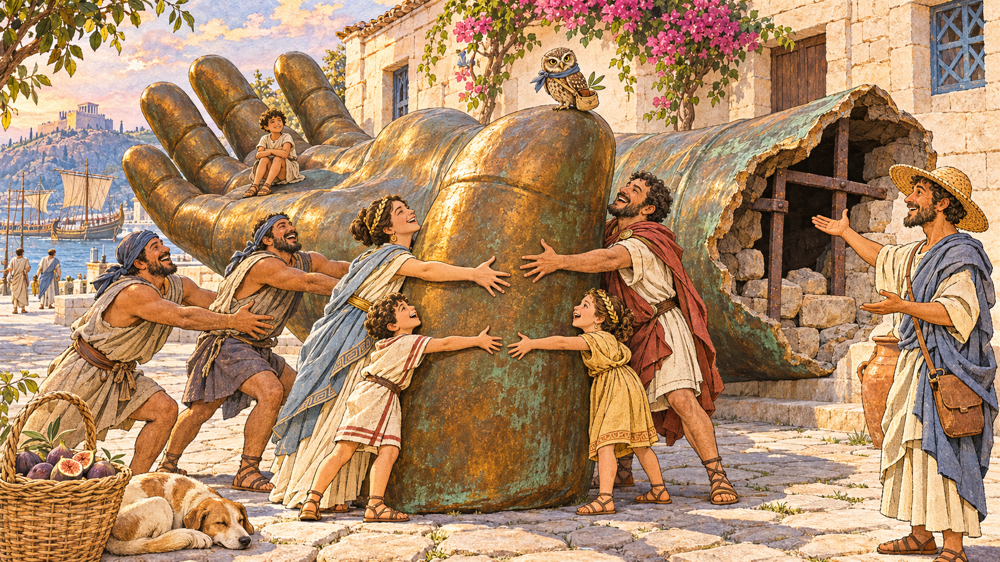
<details><summary>Image Prompt</summary>
(This is Panel 09. Do not include the panel number in the image.)
Style: a hand-drawn travel-sketchbook graphic-novel illustration, with clean dark ink outlines, flat softly shaded color fills and a faint watercolor paper texture, like a page from a traveler's journal; warm, sunlit, painterly lighting; no text, captions, signs, letters or speech bubbles anywhere in the image.
Please generate a 16:9 image depicting panel 9 of 12. Setting: a street in Rhodes, about 70 CE, warm late afternoon. Palette: marble white, Aegean blue, honey gold, bronze and warm limestone. Medium shot of an enormous fallen bronze hand lying on the ground, its thumb as thick as a barrel. A family of Roman-era visitors and two sailors try to wrap their arms around the thumb and cannot make their fingers meet; a child sits on the bronze palm; a guide in a straw hat gestures to the visitors. Beside them a broken limb gapes open, showing a dark hollow with rough stone blocks and iron bars inside. Glaux the Little Owl: a true little owl (Athene noctua), small, round and compact, with a flat rounded head and no ear tufts, warm earth-brown plumage with cream spots, bright lemon-yellow eyes under pale cream eyebrows, a cream-white throat patch and a short pale greenish-yellow beak. Glaux wears a small Aegean-blue scarf and a tan canvas satchel across the body with a small leather-bound travel notebook peeking out, and a sprig of three olive leaves tucked into the satchel strap. Alert, curious and warm expression. Glaux is perched on top of the bronze thumb. Glaux is drawn small, perched at the edge of the scene, noticeable on a second look. Other details: a wicker basket with figs, a sleeping dog, pale limestone houses. Tone: playful wonder.
Keep every character and place consistent with the other images in this story. Generate the image immediately without asking clarifying questions.
</details>

The fallen statue becomes an attraction. The Roman writer Pliny the Elder, who saw the pieces, wrote that few people could wrap their arms around its thumb. For centuries visitors come to Rhodes to marvel at the wreck of a wonder. Even broken, it draws a crowd.

## Panel 10: The Famous Picture Is Wrong

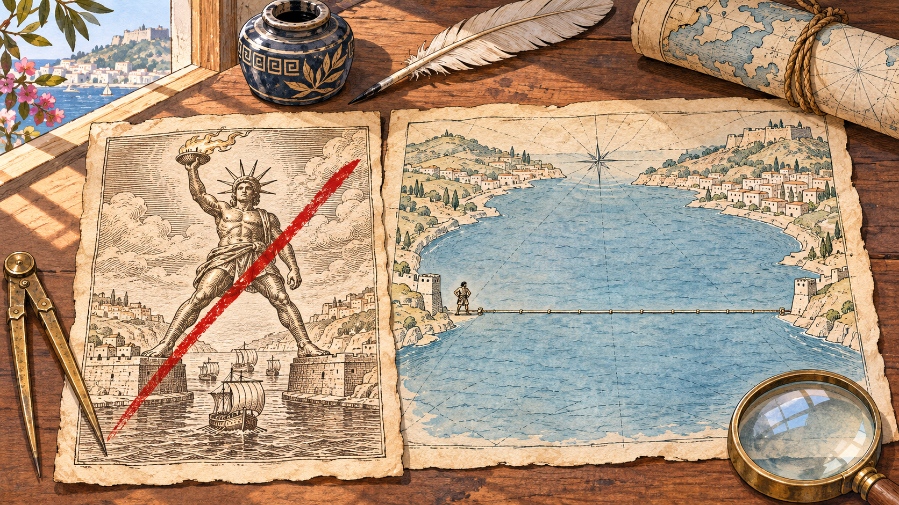
<details><summary>Image Prompt</summary>
(This is Panel 10. Do not include the panel number in the image.)
Style: a hand-drawn travel-sketchbook graphic-novel illustration, with clean dark ink outlines, flat softly shaded color fills and a faint watercolor paper texture, like a page from a traveler's journal; warm, sunlit, painterly lighting; no text, captions, signs, letters or speech bubbles anywhere in the image.
Please generate a 16:9 image depicting panel 10 of 12. Setting: a scholar's wooden desk, bright daylight from a window. Palette: parchment cream, sepia ink, Aegean blue and a single bold red ink mark. Overhead shot of two sheets side by side. On the left a sepia engraving in sixteenth-century style shows a bronze giant astride a harbor entrance with one foot on each side and ships sailing between his legs. On the right a harbor chart shows the same entrance drawn very wide, with a long measuring cord stretched across it and a tiny giant figure beside the cord looking far too small to reach. A single bold red ink slash crosses the left-hand picture. Other details: bronze dividers, an inkwell, a quill, a rolled map, a magnifying lens. Tone: skeptical, curious.
Keep every character and place consistent with the other images in this story. Generate the image immediately without asking clarifying questions.
</details>

Now the picture that everyone knows. The famous engravings show the statue astride the harbor mouth, but a bronze statue of that height could not have stood with its legs that far apart, and the harbor entrance was far too wide. As far as the surviving evidence shows, the straddling pose appears only long after the statue was gone.

> **Myth or Evidence?** Documented: a huge bronze statue of Helios, about 33 m tall, built by Chares of Lindos and brought down by an earthquake around 226 BCE. Tradition and later imagination: the statue straddling the harbor. Unknown: exactly where it stood, and what its pose was.

## Panel 11: Sold for Scrap

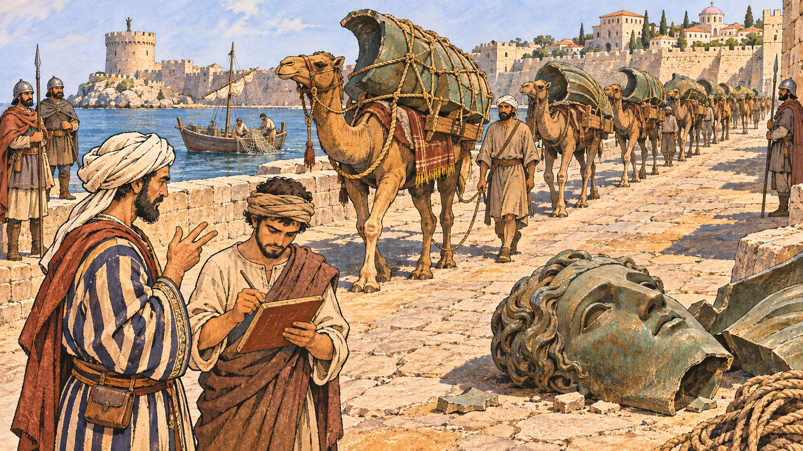
<details><summary>Image Prompt</summary>
(This is Panel 11. Do not include the panel number in the image.)
Style: a hand-drawn travel-sketchbook graphic-novel illustration, with clean dark ink outlines, flat softly shaded color fills and a faint watercolor paper texture, like a page from a traveler's journal; warm, sunlit, painterly lighting; no text, captions, signs, letters or speech bubbles anywhere in the image.
Please generate a 16:9 image depicting panel 11 of 12. Setting: the quay road at Rhodes, about 654 CE, dusty golden afternoon. Palette: ochre, camel brown, bronze, deep blue and cream. Wide shot of a long line of camels loaded with great curved pieces of dull green-bronze statue, led along a stony harbor-side road. In the foreground a merchant in a striped robe and white turban, in three-quarter view, counts pieces with an assistant who tallies on a wax tablet. A broken bronze head lies on the ground waiting to be loaded. Other details: plainly robed armed guards standing back, a rope net over a camel, a small fishing boat in the harbor, sun-bleached stone, a pale blue sea. Tone: sober, an ending.
Keep every character and place consistent with the other images in this story. Generate the image immediately without asking clarifying questions.
</details>

In the 650s CE, nearly nine centuries after the earthquake, the broken bronze meets its end. A Byzantine chronicle, written centuries later, says that Arab forces raiding Rhodes sold the metal to a merchant who carried it away on hundreds of camels.

> **Myth or Evidence?** The camel story is the kind of tale we are right to enjoy without quite believing. It may be true, but it comes from a source written long after, and the detail of "hundreds" of camels is exactly the kind of thing that grows in the telling.

## Panel 12: Two Deer at the Harbor Mouth

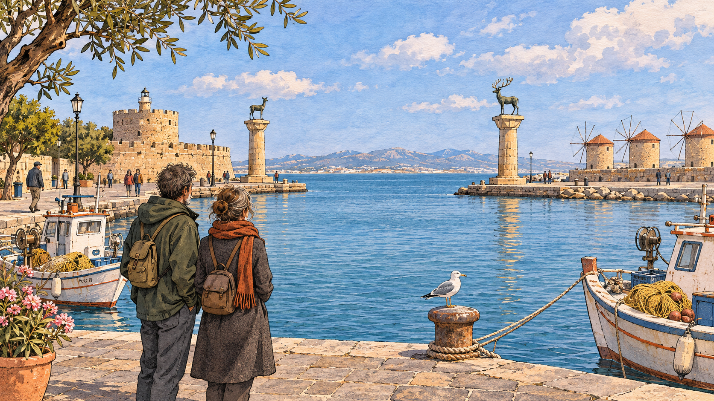
<details><summary>Image Prompt</summary>
(This is Panel 12. Do not include the panel number in the image.)
Style: a hand-drawn travel-sketchbook graphic-novel illustration, with clean dark ink outlines, flat softly shaded color fills and a faint watercolor paper texture, like a page from a traveler's journal; warm, sunlit, painterly lighting; no text, captions, signs, letters or speech bubbles anywhere in the image.
Please generate a 16:9 image depicting panel 12 of 12. Setting: the harbor entrance of Mandraki in Rhodes today, a bright November morning, matching the viewpoint of panel 1. Palette: natural daylight, sea blue, honey limestone and terracotta. Wide shot across the harbor today. Mandraki harbor on the northern tip of the island of Rhodes: a sheltered harbor basin with calm blue water, a broad opening toward the open Aegean, a low sandy shoreline and a distant line of pale hills inland. At the harbor mouth two tall stone columns stand, each topped with a bronze deer, one a stag and one a doe, in front of the open blue sea. Windmills line a long mole on one side. In the middle distance: Two adult travelers seen from behind or in distant three-quarter view, dressed for cool November weather: one in a dark green rain jacket, the other in a charcoal wool coat with a rust-colored scarf, both with small daypacks, standing close together and looking at the view. Faces are never shown in detail. Other details: moored fishing boats, a stone fortress tower on the mole, a few strolling locals, soft clouds, a seagull on a bollard. Tone: quiet, reflective, a little wry.
Keep every character and place consistent with the other images in this story. Generate the image immediately without asking clarifying questions.
</details>

Today there is no giant at the harbor mouth. Two bronze deer on columns mark the entrance to Mandraki, the old harbor, where the popular story places the statue's feet. Where the statue really stood, nobody knows for sure. The wonder is gone, but the question it leaves is a good one: what do we believe because we have seen the picture, and what because we have seen the evidence?

### Epilogue - What the Colossus Shows

The Colossus was a monument built from leftovers, a symbol of a small city's nerve, and it was brought down in a single night. Its fame has long outlived the statue, and its most famous image was invented after the fact. The only certain thing about it is how little is certain, and that is a useful lesson for any traveler who finds a wonder that is no longer there. Some scholars suggest the Antikythera Mechanism, an ancient astronomical computer, may have been built on Rhodes, which would make the island a home of both great monuments and clever machines.

| Challenge | How They Responded | Lesson for Today |
|---|---|---|
| A year-long siege | Rhodes held its walls until Demetrius sailed away | Resolve and good defenses can beat a bigger force |
| A pile of abandoned machines | The city sold them to pay for a monument to Helios | Turn what an enemy leaves behind into something lasting |
| An earthquake brought it down | The ruined bronze lay on the ground and became an attraction | Wonders can fail; what people do with the wreckage matters |
| A famous picture that cannot be right | Scholars ask what the evidence supports and admit what they do not know | Check the image against the evidence |

### Call to Action

On the quay at Mandraki, look at the two deer, then look at the width of the harbor mouth, and try to put a 33 m giant astride it. Ask your guide where the statue most likely stood and listen for the honest answer: nobody knows. The habit of checking a famous picture against the evidence is the same habit we use to learn anything for ourselves, and it is available to every curious person, Learning for All.

---

## Voices from the Sources

- *Pliny the Elder, Natural History (1st century CE), paraphrased.* After seeing the fallen Colossus, Pliny wrote that few people could wrap their arms around its thumb, and that its fingers were larger than most statues. This is documented, and it is our best eyewitness-level evidence of the statue's size.
- *Pindar, Olympian Ode 7 (464 BCE), paraphrased.* The poet told the island's founding myth: when the gods divided the earth, Helios was away driving his chariot and was left out, so he claimed an island he saw rising from the sea. This is legend, but it explains why Rhodes honored the sun god.
- *A Byzantine chronicle (centuries after the 650s).* It says the bronze was sold to a merchant who took it away on a train of camels. This is tradition from a late source and is hedged in the story. No words of Chares, Demetrius or any Rhodian of 304 BCE are invented here.

## On the Trip

- **Chapter:** [12. Day 8: Rhodes, From the Colossus to the Knights](../../chapters/12-rhodes/index.md)
- **Where to look:** the two bronze deer on columns at the entrance to Mandraki harbor; the windmills on the mole; the Rhodes city walls; and the Archaeological Museum of Rhodes in the old Hospital of the Knights for Hellenistic finds.
- **Explore further:** [Who Built What We See in the Old Town?](../../sims/rhodes-old-town-layers-sorter/index.md) has two cards on the ancient layers of Rhodes and the lost Colossus.
- **Look Closer:** "Look closer at the width of the harbor mouth, and ask where a 33 m statue could really have stood." Glaux hid in panel 9, perched on the thumb of the fallen bronze hand.

## Characters and Style

This story follows the shared series bible: [Story Characters, Places and House Style](../characters.md). Glaux's identity comes from the mascot's [character sheet](../../img/mascot/character-sheet.md).

## References

1. [Colossus of Rhodes - Wikipedia](https://en.wikipedia.org/wiki/Colossus_of_Rhodes): the statue, its construction, collapse and the debate over its location.
2. [Siege of Rhodes (305-304 BC) - Wikipedia](https://en.wikipedia.org/wiki/Siege_of_Rhodes_(305%E2%80%93304_BC)): the siege by Demetrius and the siege machines left behind.
3. [Chares of Lindos - Wikipedia](https://en.wikipedia.org/wiki/Chares_of_Lindos): the sculptor of the Colossus.
4. [Colossus of Rhodes - Encyclopaedia Britannica](https://www.britannica.com/topic/Colossus-of-Rhodes): an overview of the statue and its legend.
5. [Colossus of Rhodes - World History Encyclopedia](https://www.worldhistory.org/Colossus_of_Rhodes/): a museum-style summary of the sources and the straddling myth.
