# Glaux and the Gods Who Moved In

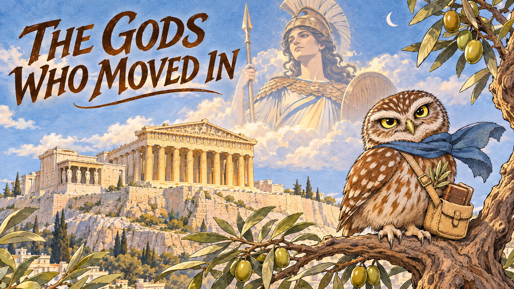

Cover Image Prompt

(This is the Cover Image. Do not include this label in the image.)
Style: a hand-drawn travel-sketchbook graphic-novel illustration, with clean dark ink outlines, flat softly shaded color fills and a faint watercolor paper texture, like a page from a traveler's journal; warm, sunlit, painterly lighting; no text, captions, signs, letters or speech bubbles anywhere in the image.
Please generate a wide-landscape 16:9 cover image for a graphic novel. Foreground right: Glaux perched on a gnarled olive branch heavy with green olives, looking out at us with a knowing, slightly amused expression. Background: the Acropolis of Athens at golden hour, with a few small white clouds drifting over it, and high in the clouds the faint, luminous outline of a calm armed goddess looking down. Add a small pale crescent moon in the upper sky and a scatter of olive leaves in the foreground. Palette: marble white, Aegean blue, olive green, honey gold, bronze. Emotional tone: wonder with a wink. Render the story title as bold, hand-lettered title text across the upper left of the image, exactly: "THE GODS WHO MOVED IN". No other text anywhere.
Glaux the Little Owl: a true little owl (Athene noctua), small, round and compact, with a flat rounded head and no ear tufts, warm earth-brown plumage with cream spots, bright lemon-yellow eyes under pale cream eyebrows, a cream-white throat patch and a short pale greenish-yellow beak. Glaux wears a small Aegean-blue scarf and a tan canvas satchel across the body with a small leather-bound travel notebook peeking out, and a sprig of three olive leaves tucked into the satchel strap. Alert, curious and warm expression.
The Acropolis of Athens: a steep, flat-topped, pale limestone rock rising above the city, crowned by the Parthenon, a long Doric temple of honey-colored marble with eight columns across the front, a low triangular pediment and a long carved frieze under the roof; to its left stands the smaller Erechtheion with its porch of six marble maidens. The sky behind is clear blue.
Athena, goddess of wisdom: a tall, composed woman with dark wavy hair and calm gray eyes, wearing a bronze Corinthian-style helmet pushed up on her forehead with a tall crest, a long white wool peplos with a deep Aegean-blue border, and a scaled bronze-gold aegis cloak over the shoulders. She carries a tall spear held upright at rest and a round shield with a plain olive-wood face. Her expression is thoughtful and steady.
Only Athena, Glaux and the Acropolis appear; no other gods. Keep every character and place consistent with the other images in this story. Generate the image immediately without asking clarifying questions.

Narrative Prompt

**Era and places.** Myth time on Mount Olympus and on the bare rock that will become the Acropolis of Athens (no fixed date; legend), then Athens in the 5th century BCE when owl coins are struck, then a modern view of the Acropolis. **Themes.** Who the gods are before we meet them on the route, why the olive beat the sea, and how a picture of an owl became trusted money. **Palette.** Myth-time panels: terracotta red, ochre, lapis blue, cream plaster and olive green. Athens panels: marble white, Aegean blue, olive green, honey gold and bronze. The final panel uses natural daylight, whitewashed walls, sea blue, terracotta and olive. **House style.** Every prompt begins with the series house-style line from [Story Characters, Places and House Style](../characters.md): a hand-drawn travel-sketchbook illustration with clean dark ink outlines, flat softly shaded fills and a faint watercolor paper texture. Panels contain no lettering; only the cover carries the title.

**Creative liberties and cautions.** This is the one story in which Glaux is an active character rather than a hidden observer; this book's first chapter calls Glaux "the same small owl that sat on Athena's shoulder," so Glaux stands in for Athena's owl in myth time and reacts with dry amusement. Glaux never speaks to or touches mortals in the mortal-world panels beyond perching near them. Athena's birth from Zeus's head is shown only as a burst of light and a calm, armed goddess stepping out. Poseidon plants his trident rather than swinging it. All gods wear draped clothing. Where a detail is a later Roman retelling (the vote in which women outnumbered men), the panel notes say so. There is only ever one living owl in a scene; coins may show more.

**Cast.** Recurring characters, places and objects follow the shared series bible; paste their blocks verbatim:

- Glaux: see [docs/stories/characters.md](../characters.md) and [docs/img/mascot/character-sheet.md](../../img/mascot/character-sheet.md).
- Athena, Zeus, Poseidon and Apollo, the Acropolis (final panel only; in myth time the rock is bare), the Owl Coin and the Travelers (final panel): see [docs/stories/characters.md](../characters.md).
- Early Athenians (a few ordinary men, women and children in simple, undyed wool tunics and cloaks, myth-time Bronze-Age style, never named) appear in panels 4 to 8; they are described in each prompt and need no block.

### Prologue - Meeting the Neighbors

Before this trip is over we will walk through the houses of half a dozen gods: Zeus on Crete, Artemis at Ephesus, Helios on Rhodes, Apollo at Delphi, and above all Athena in Athens. Glaux has watched all of them move in. In this story the little owl is not hiding but narrating from the front row, from the birth of a goddess to the day a small owl landed on the money of the richest city in Greece.

**Find Glaux:** Unlike the other stories, Glaux is in every panel of this one, stepping out of hiding to guide you. The game here is to notice what Glaux is doing in each scene.

## Panel 1: The Headache on Olympus
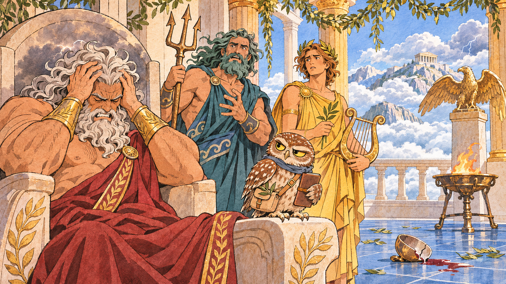

Image Prompt

(This is Panel 01. Do not include the panel number in the image.)
I am about to ask you to generate a series of images for a graphic novel. Please make the images have a consistent style and consistent characters. Do not ask any clarifying questions. Just generate the image immediately when asked.
Style: a hand-drawn travel-sketchbook graphic-novel illustration, with clean dark ink outlines, flat softly shaded color fills and a faint watercolor paper texture, like a page from a traveler's journal; warm, sunlit, painterly lighting; no text, captions, signs, letters or speech bubbles anywhere in the image.
Please generate a 16:9 image depicting panel 1 of 14. Mount Olympus in myth time, bright morning. Palette: terracotta red, ochre, lapis blue, cream plaster and olive green, with cloud white. Wide establishing shot, slightly low angle, of the gods' hall: a cream plaster court with ochre columns open to the sky, lapis-blue floor tiles, olive-green garlands, and clouds rolling below. Foreground left: Zeus seated on a huge throne with both hands pressed to his head, eyes squeezed shut. Standing beside the throne: Poseidon, anxious, and Apollo, holding his lyre limply. Foreground right: Glaux perched on the throne's armrest, one cream eyebrow lowered, wing holding the notebook, unimpressed. Details: a cracked-open wine bowl on the floor, a bronze tripod brazier, a golden eagle statue, thin lightning flickering in a far cloud, scattered laurel leaves. Tone: comic tension.
Zeus, king of the gods: a broad, powerfully built older man with a full curled silver-white beard and thick white hair, wearing a gold-edged crimson himation draped over one shoulder, holding a short gilded scepter topped with an eagle; a faint storm-cloud glow behind him. Poseidon, god of the sea: a muscular man with a windswept sea-green beard and hair, a deep teal himation, holding a three-pronged bronze trident. Apollo, god of light and prophecy: a graceful, beardless young man with shoulder-length golden-brown hair crowned with a laurel wreath, a saffron-yellow chiton, holding a small laurel branch and a gold lyre.
Glaux the Little Owl: a true little owl (Athene noctua), small, round and compact, with a flat rounded head and no ear tufts, warm earth-brown plumage with cream spots, bright lemon-yellow eyes under pale cream eyebrows, a cream-white throat patch and a short pale greenish-yellow beak. Glaux wears a small Aegean-blue scarf and a tan canvas satchel across the body with a small leather-bound travel notebook peeking out, and a sprig of three olive leaves tucked into the satchel strap. Alert, curious and warm expression.
Keep every character and place consistent with the other images in this story. Generate the image immediately without asking clarifying questions.

On a cloud-ringed peak the gods call home, Zeus, king of the gods, sits on his great throne with both hands pressed to his temples. Greek tradition says he has swallowed his first wife, the clever Metis, and has had a headache that nothing cures ever since. Poseidon and Apollo hover close, unsure how to help. Glaux, perched on the armrest with a notebook open, plainly has seen worse.

## Panel 2: A Flash of Light
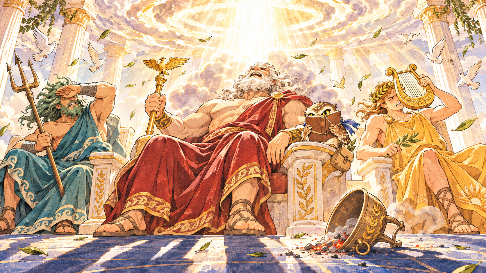

Image Prompt

(This is Panel 02. Do not include the panel number in the image.)
Style: a hand-drawn travel-sketchbook graphic-novel illustration, with clean dark ink outlines, flat softly shaded color fills and a faint watercolor paper texture, like a page from a traveler's journal; warm, sunlit, painterly lighting; no text, captions, signs, letters or speech bubbles anywhere in the image.
Please generate a 16:9 image depicting panel 2 of 14. Mount Olympus, myth time, the same hall, now flooded with light. Palette: terracotta red, ochre, lapis blue, cream plaster and olive green, drowned in radiant white-gold. Medium-wide shot from slightly below: a dazzling column of white-gold light rises from above the seated Zeus's head and spreads in rings through the clouds, bleaching the columns. Zeus leans back with his eyes shut and mouth open in relief. Poseidon shields his eyes with his forearm, trident tilted; Apollo shields his face with the lyre. Glaux, on the armrest, ducks behind the notebook with one yellow eye peeking out. Details: ring-shaped clouds spinning outward, floating laurel leaves, a toppled bronze brazier, shadows thrown long across the lapis tiles, a flock of startled doves. No figure is visible inside the light itself. Tone: awe and slapstick.
Zeus, king of the gods: a broad, powerfully built older man with a full curled silver-white beard and thick white hair, wearing a gold-edged crimson himation draped over one shoulder, holding a short gilded scepter topped with an eagle; a faint storm-cloud glow behind him. Poseidon, god of the sea: a muscular man with a windswept sea-green beard and hair, a deep teal himation, holding a three-pronged bronze trident. Apollo, god of light and prophecy: a graceful, beardless young man with shoulder-length golden-brown hair crowned with a laurel wreath, a saffron-yellow chiton, holding a small laurel branch and a gold lyre.
Glaux the Little Owl: a true little owl (Athene noctua), small, round and compact, with a flat rounded head and no ear tufts, warm earth-brown plumage with cream spots, bright lemon-yellow eyes under pale cream eyebrows, a cream-white throat patch and a short pale greenish-yellow beak. Glaux wears a small Aegean-blue scarf and a tan canvas satchel across the body with a small leather-bound travel notebook peeking out, and a sprig of three olive leaves tucked into the satchel strap. Alert, curious and warm expression.
Keep every character and place consistent with the other images in this story. Generate the image immediately without asking clarifying questions.

The headache ends in a burst of white-gold light that fills the hall and sends the clouds spinning outward. The gods shield their eyes. Glaux ducks behind the notebook, one yellow eye still fixed on the scene. Later tellings add a divine blacksmith with an axe; this telling keeps to the light.

## Panel 3: Athena Steps Out
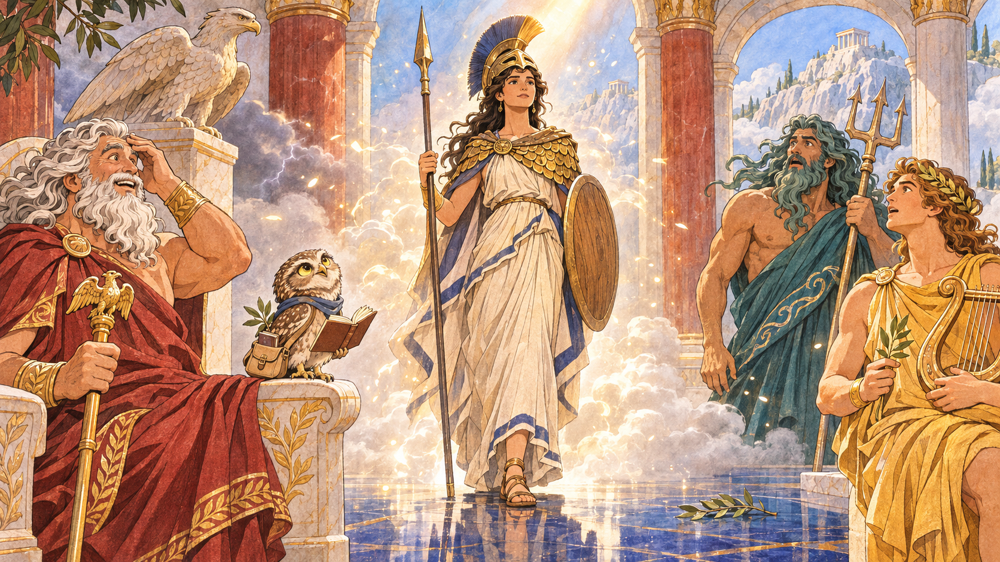

Image Prompt

(This is Panel 03. Do not include the panel number in the image.)
Style: a hand-drawn travel-sketchbook graphic-novel illustration, with clean dark ink outlines, flat softly shaded color fills and a faint watercolor paper texture, like a page from a traveler's journal; warm, sunlit, painterly lighting; no text, captions, signs, letters or speech bubbles anywhere in the image.
Please generate a 16:9 image depicting panel 3 of 14. Mount Olympus, myth time. Palette: terracotta red, ochre, lapis blue, cream plaster and olive green, with a fading white-gold glow. Medium-wide shot, eye level, centered on Athena stepping calmly out of the dissolving light in the middle of the hall, spear upright at rest, shield on her arm, helmet pushed up. Left: Zeus, relieved and wide-eyed, one hand still near his temple. Right: Poseidon and Apollo staring in astonishment. Glaux has hopped to the throne's edge near Athena, head tilted, pleased, notebook open. Details: fading glowing motes drifting down, the cracked light dissolving into clouds, a shaft of sun on her bronze helmet crest, the lapis floor reflecting her, an eagle statue looking on, one dropped laurel branch. Tone: wonder and quiet triumph.
Athena, goddess of wisdom: a tall, composed woman with dark wavy hair and calm gray eyes, wearing a bronze Corinthian-style helmet pushed up on her forehead with a tall crest, a long white wool peplos with a deep Aegean-blue border, and a scaled bronze-gold aegis cloak over the shoulders. She carries a tall spear held upright at rest and a round shield with a plain olive-wood face. Her expression is thoughtful and steady.
Zeus, king of the gods: a broad, powerfully built older man with a full curled silver-white beard and thick white hair, wearing a gold-edged crimson himation draped over one shoulder, holding a short gilded scepter topped with an eagle; a faint storm-cloud glow behind him. Poseidon, god of the sea: a muscular man with a windswept sea-green beard and hair, a deep teal himation, holding a three-pronged bronze trident. Apollo, god of light and prophecy: a graceful, beardless young man with shoulder-length golden-brown hair crowned with a laurel wreath, a saffron-yellow chiton, holding a small laurel branch and a gold lyre.
Glaux the Little Owl: a true little owl (Athene noctua), small, round and compact, with a flat rounded head and no ear tufts, warm earth-brown plumage with cream spots, bright lemon-yellow eyes under pale cream eyebrows, a cream-white throat patch and a short pale greenish-yellow beak. Glaux wears a small Aegean-blue scarf and a tan canvas satchel across the body with a small leather-bound travel notebook peeking out, and a sprig of three olive leaves tucked into the satchel strap. Alert, curious and warm expression.
Keep every character and place consistent with the other images in this story. Generate the image immediately without asking clarifying questions.

As the light fades, a calm, armed woman steps out of it. She does not shout or stumble. She holds her spear upright, pushes her helmet back, and looks around the room as if reading it. Glaux, delighted, hops closer and lets the notebook fall open to a clean page.

> **Myth or Evidence?** Legend. The poet Hesiod, about 700 BCE, tells that Zeus swallowed the goddess Metis and that Athena was born from his head. The scene was a favorite of vase painters, and the Parthenon's east pediment, above its main entrance, showed it; those sculptures survive only in damaged pieces. Nobody in antiquity claimed this was historical fact.

## Panel 4: A Rock Worth Having
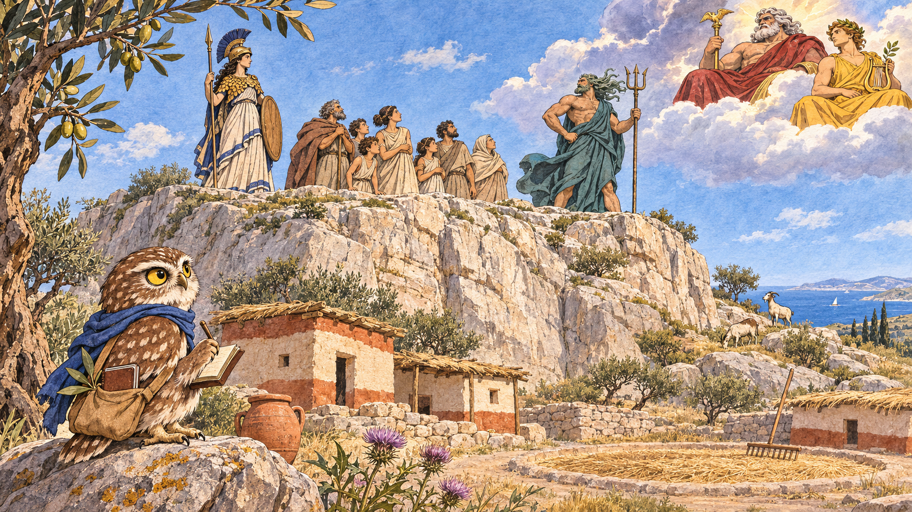

Image Prompt

(This is Panel 04. Do not include the panel number in the image.)
Style: a hand-drawn travel-sketchbook graphic-novel illustration, with clean dark ink outlines, flat softly shaded color fills and a faint watercolor paper texture, like a page from a traveler's journal; warm, sunlit, painterly lighting; no text, captions, signs, letters or speech bubbles anywhere in the image.
Please generate a 16:9 image depicting panel 4 of 14. The bare rock that will one day be the Acropolis, myth time, late-morning light; no temples exist yet. Palette: terracotta red, ochre, lapis blue, cream plaster and olive green, with pale limestone. Wide shot from below the rock looking up: a steep flat-topped rock of pale limestone, with a few simple mud-brick houses and a threshing floor at its foot. Left on the summit path: Athena, spear at rest. Right: Poseidon with his sea-green hair whipped by wind, trident planted beside him. A small group of early Athenians (men, women and children in undyed wool tunics and cloaks) stand between them, watching. High upper corner: Zeus and Apollo seated on a cloud, looking down. Foreground boulder: Glaux perched with the notebook, noting everything. Details: wild olive scrub, a distant glimpse of sea, goats on a slope, thistles, a clay jar. Tone: tense anticipation.
Athena, goddess of wisdom: a tall, composed woman with dark wavy hair and calm gray eyes, wearing a bronze Corinthian-style helmet pushed up on her forehead with a tall crest, a long white wool peplos with a deep Aegean-blue border, and a scaled bronze-gold aegis cloak over the shoulders. She carries a tall spear held upright at rest and a round shield with a plain olive-wood face. Her expression is thoughtful and steady.
Zeus, king of the gods: a broad, powerfully built older man with a full curled silver-white beard and thick white hair, wearing a gold-edged crimson himation draped over one shoulder, holding a short gilded scepter topped with an eagle; a faint storm-cloud glow behind him. Poseidon, god of the sea: a muscular man with a windswept sea-green beard and hair, a deep teal himation, holding a three-pronged bronze trident. Apollo, god of light and prophecy: a graceful, beardless young man with shoulder-length golden-brown hair crowned with a laurel wreath, a saffron-yellow chiton, holding a small laurel branch and a gold lyre.
Glaux the Little Owl: a true little owl (Athene noctua), small, round and compact, with a flat rounded head and no ear tufts, warm earth-brown plumage with cream spots, bright lemon-yellow eyes under pale cream eyebrows, a cream-white throat patch and a short pale greenish-yellow beak. Glaux wears a small Aegean-blue scarf and a tan canvas satchel across the body with a small leather-bound travel notebook peeking out, and a sprig of three olive leaves tucked into the satchel strap. Alert, curious and warm expression.
Keep every character and place consistent with the other images in this story. Generate the image immediately without asking clarifying questions.

Years of legend later, two gods want the same bare hill, a flat-topped rock above a handful of simple houses. Athena arrives with her spear at rest; Poseidon arrives with his trident and a gust of sea wind. High on a cloud, Zeus and Apollo watch, while Glaux settles on a boulder with the notebook.

## Panel 5: Poseidon's Gift
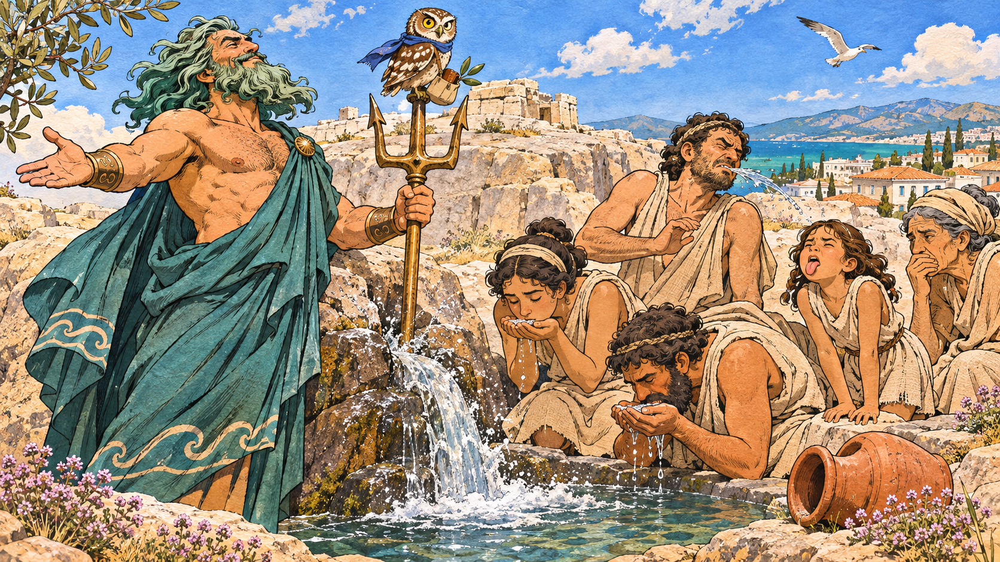

Image Prompt

(This is Panel 05. Do not include the panel number in the image.)
Style: a hand-drawn travel-sketchbook graphic-novel illustration, with clean dark ink outlines, flat softly shaded color fills and a faint watercolor paper texture, like a page from a traveler's journal; warm, sunlit, painterly lighting; no text, captions, signs, letters or speech bubbles anywhere in the image.
Please generate a 16:9 image depicting panel 5 of 14. The bare Acropolis rock, myth time, bright midday. Palette: terracotta red, ochre, lapis blue, cream plaster and olive green, with a flash of sea-teal. Medium shot, eye level: Poseidon, standing at left, has planted his trident in a crack of the rock; clear water bubbles out and splashes down the stone into a pool, foaming at the edges. Around the pool a small group of early Athenians in undyed wool kneel and cup their hands to drink, and one, tasting it, grimaces and spits. Poseidon spreads one arm proudly. Glaux perches on the top of the trident's shaft, one eyebrow raised. Details: wet dark stone, spray catching the sun, a clay water jar tipped on its side, a child holding her tongue out, wild thyme, a gull wheeling over. Only Poseidon from the gods' block is in this scene; Zeus and Apollo are not shown. Tone: comic disappointment.
Zeus, king of the gods: a broad, powerfully built older man with a full curled silver-white beard and thick white hair, wearing a gold-edged crimson himation draped over one shoulder, holding a short gilded scepter topped with an eagle; a faint storm-cloud glow behind him. Poseidon, god of the sea: a muscular man with a windswept sea-green beard and hair, a deep teal himation, holding a three-pronged bronze trident. Apollo, god of light and prophecy: a graceful, beardless young man with shoulder-length golden-brown hair crowned with a laurel wreath, a saffron-yellow chiton, holding a small laurel branch and a gold lyre.
Glaux the Little Owl: a true little owl (Athene noctua), small, round and compact, with a flat rounded head and no ear tufts, warm earth-brown plumage with cream spots, bright lemon-yellow eyes under pale cream eyebrows, a cream-white throat patch and a short pale greenish-yellow beak. Glaux wears a small Aegean-blue scarf and a tan canvas satchel across the body with a small leather-bound travel notebook peeking out, and a sprig of three olive leaves tucked into the satchel strap. Alert, curious and warm expression.
Keep every character and place consistent with the other images in this story. Generate the image immediately without asking clarifying questions.

Poseidon goes first. He plants his trident into the rock and a spring wells up, bright and plentiful. The Athenians kneel, cup their hands, taste it, and spit, because it is salt. Poseidon gestures grandly at the water while Glaux, perched on the trident's shaft, plainly agrees with the crowd.

## Panel 6: Athena's Gift
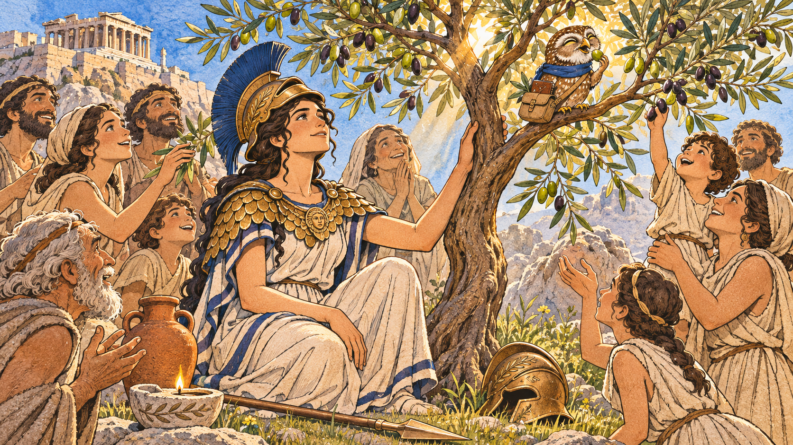

Image Prompt

(This is Panel 06. Do not include the panel number in the image.)
Style: a hand-drawn travel-sketchbook graphic-novel illustration, with clean dark ink outlines, flat softly shaded color fills and a faint watercolor paper texture, like a page from a traveler's journal; warm, sunlit, painterly lighting; no text, captions, signs, letters or speech bubbles anywhere in the image.
Please generate a 16:9 image depicting panel 6 of 14. The bare Acropolis rock, myth time, warm afternoon. Palette: terracotta red, ochre, lapis blue, cream plaster and olive green, with silver-green foliage. Medium shot, slightly low angle: Athena kneels at center in her white and blue peplos, spear laid beside her, one hand resting on the trunk of a young olive tree that is growing before our eyes, its silver-green branches full of ripe green and black olives. Early Athenians (men, women, children in undyed wool) crowd close, touching the leaves and holding up hands in wonder; one woman lifts a child to pick an olive. Glaux perches on a low branch holding a small olive in one foot, mid-nibble, looking pleased. Details: a stone oil lamp on the ground, a clay jar, a shaft of sun through the leaves, a bronze helmet resting in the grass. Tone: warmth and quiet wonder.
Athena, goddess of wisdom: a tall, composed woman with dark wavy hair and calm gray eyes, wearing a bronze Corinthian-style helmet pushed up on her forehead with a tall crest, a long white wool peplos with a deep Aegean-blue border, and a scaled bronze-gold aegis cloak over the shoulders. She carries a tall spear held upright at rest and a round shield with a plain olive-wood face. Her expression is thoughtful and steady.
Glaux the Little Owl: a true little owl (Athene noctua), small, round and compact, with a flat rounded head and no ear tufts, warm earth-brown plumage with cream spots, bright lemon-yellow eyes under pale cream eyebrows, a cream-white throat patch and a short pale greenish-yellow beak. Glaux wears a small Aegean-blue scarf and a tan canvas satchel across the body with a small leather-bound travel notebook peeking out, and a sprig of three olive leaves tucked into the satchel strap. Alert, curious and warm expression.
Keep every character and place consistent with the other images in this story. Generate the image immediately without asking clarifying questions.

Athena's turn is quiet. She kneels, plants a small sapling in the thin soil, and rests her hand on it, and the little tree thickens until it stands over her, silver-green and heavy with olives. The Athenians touch the leaves and begin to see food, lamp oil, firewood and shade in one gift. Glaux lands on a branch and nibbles an olive.

## Panel 7: The Vote
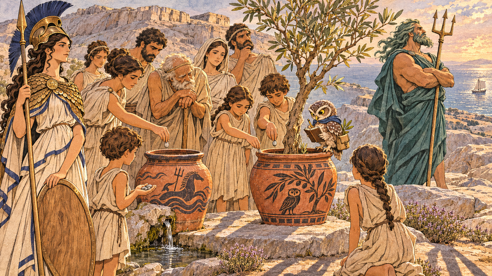

Image Prompt

(This is Panel 07. Do not include the panel number in the image.)
Style: a hand-drawn travel-sketchbook graphic-novel illustration, with clean dark ink outlines, flat softly shaded color fills and a faint watercolor paper texture, like a page from a traveler's journal; warm, sunlit, painterly lighting; no text, captions, signs, letters or speech bubbles anywhere in the image.
Please generate a 16:9 image depicting panel 7 of 14. The bare Acropolis rock, myth time, late afternoon, long golden light. Palette: terracotta red, ochre, lapis blue, cream plaster and olive green. Medium-wide shot from slightly above, centered on a ring of early Athenians (men, women and children in undyed wool) dropping small pebbles into two large clay jars set on a flat stone, one jar beside the little salt spring and one beside the new olive tree. Left edge: Athena, spear at rest, watching with composed patience. Right edge: Poseidon with arms crossed, trident planted, staring out to sea. Glaux perches on the rim of the olive-side jar, counting pebbles on the notebook. Details: pebbles in a child's open palm, an old man leaning on a staff, long shadows, a black-figure-style decorated jar, thyme on the rock, a sailing boat far out on the sea. Only Athena, Poseidon and Glaux are recurring figures here. Tone: suspense.
Athena, goddess of wisdom: a tall, composed woman with dark wavy hair and calm gray eyes, wearing a bronze Corinthian-style helmet pushed up on her forehead with a tall crest, a long white wool peplos with a deep Aegean-blue border, and a scaled bronze-gold aegis cloak over the shoulders. She carries a tall spear held upright at rest and a round shield with a plain olive-wood face. Her expression is thoughtful and steady.
Zeus, king of the gods: a broad, powerfully built older man with a full curled silver-white beard and thick white hair, wearing a gold-edged crimson himation draped over one shoulder, holding a short gilded scepter topped with an eagle; a faint storm-cloud glow behind him. Poseidon, god of the sea: a muscular man with a windswept sea-green beard and hair, a deep teal himation, holding a three-pronged bronze trident. Apollo, god of light and prophecy: a graceful, beardless young man with shoulder-length golden-brown hair crowned with a laurel wreath, a saffron-yellow chiton, holding a small laurel branch and a gold lyre.
Only Poseidon from the gods' block is in this scene; Zeus and Apollo are not shown.
Glaux the Little Owl: a true little owl (Athene noctua), small, round and compact, with a flat rounded head and no ear tufts, warm earth-brown plumage with cream spots, bright lemon-yellow eyes under pale cream eyebrows, a cream-white throat patch and a short pale greenish-yellow beak. Glaux wears a small Aegean-blue scarf and a tan canvas satchel across the body with a small leather-bound travel notebook peeking out, and a sprig of three olive leaves tucked into the satchel strap. Alert, curious and warm expression.
Keep every character and place consistent with the other images in this story. Generate the image immediately without asking clarifying questions.

Now the Athenians must choose. They gather in a ring and drop pebbles into two jars, one for the gift of the sea and one for the gift of the tree. Athena and Poseidon wait at either side, not looking at each other. Glaux counts with one wing against the notebook, though the owl already knows who the sensible people are.

## Panel 8: The City Takes a Name
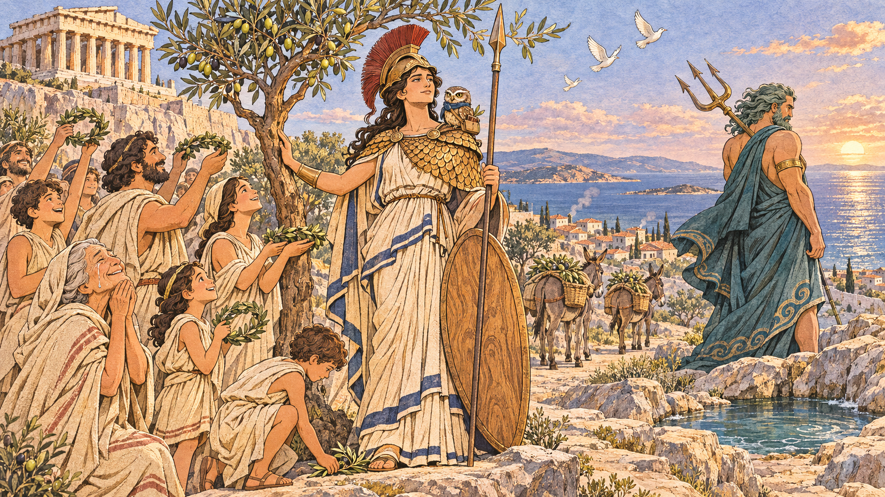

Image Prompt

(This is Panel 08. Do not include the panel number in the image.)
Style: a hand-drawn travel-sketchbook graphic-novel illustration, with clean dark ink outlines, flat softly shaded color fills and a faint watercolor paper texture, like a page from a traveler's journal; warm, sunlit, painterly lighting; no text, captions, signs, letters or speech bubbles anywhere in the image.
Please generate a 16:9 image depicting panel 8 of 14. The Acropolis rock, myth time, golden late afternoon. Palette: terracotta red, ochre, lapis blue, cream plaster and olive green. Medium-wide shot, eye level: Athena at center with one hand on the young olive tree, olive wreaths being offered to her by early Athenians (men, women and children in undyed wool) cheering quietly. Glaux perches on Athena's shoulder with the notebook. Right: Poseidon, dignified and calm, turning away toward the sea with the trident on his shoulder, a small salt-water pool at his feet. Details: a child placing an olive branch at Athena's feet, an old woman weeping with happiness, olive-laden donkeys on the path, a tiny settlement below with smoke, the sea shining beyond, doves overhead. Tone: gracious, warm, a little bittersweet for the loser.
Athena, goddess of wisdom: a tall, composed woman with dark wavy hair and calm gray eyes, wearing a bronze Corinthian-style helmet pushed up on her forehead with a tall crest, a long white wool peplos with a deep Aegean-blue border, and a scaled bronze-gold aegis cloak over the shoulders. She carries a tall spear held upright at rest and a round shield with a plain olive-wood face. Her expression is thoughtful and steady.
Zeus, king of the gods: a broad, powerfully built older man with a full curled silver-white beard and thick white hair, wearing a gold-edged crimson himation draped over one shoulder, holding a short gilded scepter topped with an eagle; a faint storm-cloud glow behind him. Poseidon, god of the sea: a muscular man with a windswept sea-green beard and hair, a deep teal himation, holding a three-pronged bronze trident. Apollo, god of light and prophecy: a graceful, beardless young man with shoulder-length golden-brown hair crowned with a laurel wreath, a saffron-yellow chiton, holding a small laurel branch and a gold lyre.
Only Poseidon from the gods' block is in this scene; Zeus and Apollo are not shown.
Glaux the Little Owl: a true little owl (Athene noctua), small, round and compact, with a flat rounded head and no ear tufts, warm earth-brown plumage with cream spots, bright lemon-yellow eyes under pale cream eyebrows, a cream-white throat patch and a short pale greenish-yellow beak. Glaux wears a small Aegean-blue scarf and a tan canvas satchel across the body with a small leather-bound travel notebook peeking out, and a sprig of three olive leaves tucked into the satchel strap. Alert, curious and warm expression.
Keep every character and place consistent with the other images in this story. Generate the image immediately without asking clarifying questions.

The olive jar fills fastest, and the city is named for Athena. Poseidon accepts it with dignity, turns to the sea, and the salt spring settles into a small pool that visitors in later centuries will be shown. Athena rests a hand on the olive tree. Glaux, on her shoulder, writes one word in the notebook and underlines it twice.

> **Myth or Evidence?** Legend, but with a trace in the landscape. Ancient visitors to the Acropolis, such as Herodotus, said the Erechtheion held an olive tree and a pool of sea water, and the Athenians showed marks in the rock as Poseidon's trident strikes. The Persians burned the olive in 480 BCE, and Herodotus says a new shoot about half a meter long had sprouted the next day. The olive growing beside the Erechtheion today is a modern planting. Roman writers later added that women voted in the contest, outnumbered the men by one and so gave Athena the win, and that Athens afterward took the vote from women; that is a late tradition, not a record.

## Panel 9: The Owl Takes the Night Shift
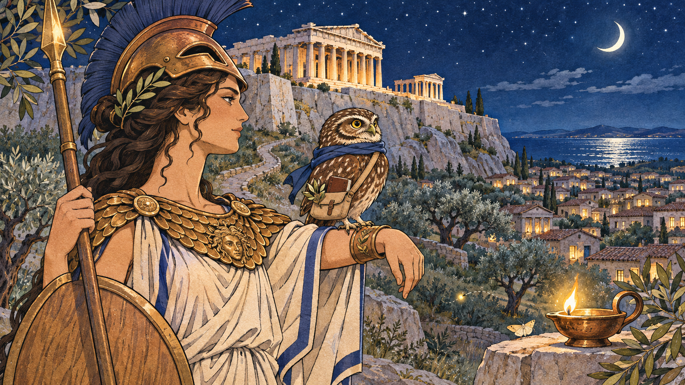

Image Prompt

(This is Panel 09. Do not include the panel number in the image.)
Style: a hand-drawn travel-sketchbook graphic-novel illustration, with clean dark ink outlines, flat softly shaded color fills and a faint watercolor paper texture, like a page from a traveler's journal; warm, sunlit, painterly lighting; no text, captions, signs, letters or speech bubbles anywhere in the image.
Please generate a 16:9 image depicting panel 9 of 14. The Acropolis rock at night, myth time shading into early Athens. Palette: marble white, Aegean blue, olive green, honey gold and bronze, in deep blue night with warm lamp gold. Medium shot from slightly below: Athena at left, in profile, holding out her forearm; Glaux is perched on her wrist, looking out over the city. Behind and below: a spread of small houses with warm oil-lamp windows climbing the slope, olive groves silvered by a crescent moon, the sea glinting far away. Details: stars, a bronze lamp on a stone, olive leaves in her hair, the faint glow of the spear's tip, a donkey path winding up the rock, crickets implied by a small drifting firefly, a pale moth near the lamp. Tone: serene, intimate.
Athena, goddess of wisdom: a tall, composed woman with dark wavy hair and calm gray eyes, wearing a bronze Corinthian-style helmet pushed up on her forehead with a tall crest, a long white wool peplos with a deep Aegean-blue border, and a scaled bronze-gold aegis cloak over the shoulders. She carries a tall spear held upright at rest and a round shield with a plain olive-wood face. Her expression is thoughtful and steady.
Glaux the Little Owl: a true little owl (Athene noctua), small, round and compact, with a flat rounded head and no ear tufts, warm earth-brown plumage with cream spots, bright lemon-yellow eyes under pale cream eyebrows, a cream-white throat patch and a short pale greenish-yellow beak. Glaux wears a small Aegean-blue scarf and a tan canvas satchel across the body with a small leather-bound travel notebook peeking out, and a sprig of three olive leaves tucked into the satchel strap. Alert, curious and warm expression.
Keep every character and place consistent with the other images in this story. Generate the image immediately without asking clarifying questions.

Athens grows. Athena, goddess of wisdom and craft, keeps an owl at her side, because owls see in the dark and are therefore a fair symbol of a mind that sees what others miss. Glaux perches on her wrist on the moonlit rock, over a city of oil lamps. Little owls still live around the Acropolis today.

## Panel 10: Striking an Owl
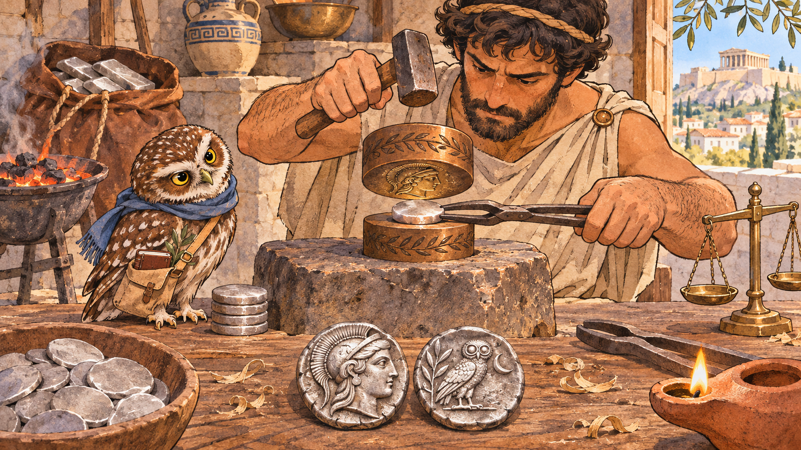

Image Prompt

(This is Panel 10. Do not include the panel number in the image.)
Style: a hand-drawn travel-sketchbook graphic-novel illustration, with clean dark ink outlines, flat softly shaded color fills and a faint watercolor paper texture, like a page from a traveler's journal; warm, sunlit, painterly lighting; no text, captions, signs, letters or speech bubbles anywhere in the image.
Please generate a 16:9 image depicting panel 10 of 14. A coin workshop in Athens, about 500 BCE, warm interior light from a doorway. Palette: marble white, Aegean blue, olive green, honey gold and bronze. Medium close shot, slightly above: a craftsman in a short undyed tunic seated at a heavy wooden bench, holding a glowing silver blank between two engraved bronze dies with tongs and raising a small hammer over the upper die. A finished owl coin lies in the foreground on the bench, shown in full view. Glaux perches on the edge of the bench beside a small stack of silver blanks, head tilted, interested. Details: a charcoal brazier, a leather bag of silver ingots, a small balance scale, iron tongs, wood shavings, clay lamp, hammer-scarred stone anvil, a pile of unstruck discs in a bowl. The hammer is shown above the die, not mid-strike. Tone: concentrated craft.
An ancient Athenian silver tetradrachm coin: a thick round silver coin showing the head of Athena in a crested helmet on one side and, on the other, a standing little owl beside an olive sprig and a crescent moon, with a rough, hand-struck edge.
Glaux the Little Owl: a true little owl (Athene noctua), small, round and compact, with a flat rounded head and no ear tufts, warm earth-brown plumage with cream spots, bright lemon-yellow eyes under pale cream eyebrows, a cream-white throat patch and a short pale greenish-yellow beak. Glaux wears a small Aegean-blue scarf and a tan canvas satchel across the body with a small leather-bound travel notebook peeking out, and a sprig of three olive leaves tucked into the satchel strap. Alert, curious and warm expression.
Keep every character and place consistent with the other images in this story. Generate the image immediately without asking clarifying questions.

By the late 500s BCE Athens is stamping silver coins, with Athena on one face and the owl on the other. The silver comes from the mines at Laurion, worked in harsh conditions by enslaved laborers. In a workshop, a smith sets a blank disk between two carved dies and strikes it with a hammer. Glaux watches from the bench as the first owl takes shape.

## Panel 11: Owls in Every Market
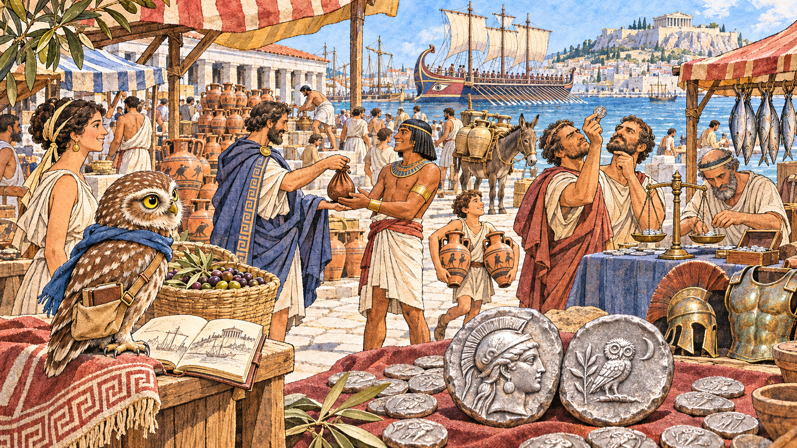

Image Prompt

(This is Panel 11. Do not include the panel number in the image.)
Style: a hand-drawn travel-sketchbook graphic-novel illustration, with clean dark ink outlines, flat softly shaded color fills and a faint watercolor paper texture, like a page from a traveler's journal; warm, sunlit, painterly lighting; no text, captions, signs, letters or speech bubbles anywhere in the image.
Please generate a 16:9 image depicting panel 11 of 14. An Athenian harbor market near Piraeus, about 450 BCE, bright morning sun. Palette: marble white, Aegean blue, olive green, honey gold and bronze, with colorful striped awnings. Wide shot from slightly above: a lively quayside market. Foreground: a merchant in a blue cloak handing a leather pouch to an Egyptian-looking sailor in a white kilt while a third man examines an owl coin held up to the light. A woman with a basket of olives, a boy carrying amphorae, a trader weighing coins on a balance. Glaux perches on the corner of a market stall, notebook open, watching. Details: a triple-masted warship in the harbor, stacked amphorae, a donkey with water jars, bronze scales, hanging fish, a spread of silver coins on a cloth, one coin close-up in the foreground. Tone: busy and prosperous.
An ancient Athenian silver tetradrachm coin: a thick round silver coin showing the head of Athena in a crested helmet on one side and, on the other, a standing little owl beside an olive sprig and a crescent moon, with a rough, hand-struck edge.
Glaux the Little Owl: a true little owl (Athene noctua), small, round and compact, with a flat rounded head and no ear tufts, warm earth-brown plumage with cream spots, bright lemon-yellow eyes under pale cream eyebrows, a cream-white throat patch and a short pale greenish-yellow beak. Glaux wears a small Aegean-blue scarf and a tan canvas satchel across the body with a small leather-bound travel notebook peeking out, and a sprig of three olive leaves tucked into the satchel strap. Alert, curious and warm expression.
Keep every character and place consistent with the other images in this story. Generate the image immediately without asking clarifying questions.

The owls spread. Sailors, merchants and soldiers all over the Mediterranean learn to trust the coin with Athena's owl, and people begin calling the coins simply "owls." A comic poet jokes that bringing owls to Athens is as pointless as selling water to a river. Glaux sits on a market stall, watching coins change hands.

> **Myth or Evidence?** Evidence. Owl tetradrachms were struck in Athens for centuries and are found all over the Mediterranean and beyond, and Athenians and others did call them "owls." The comic poet Aristophanes plays on the proverb about bringing owls to Athens in his comedy The Birds, in 414 BCE. A picture of an owl needed no reading, so it worked in places where few people read Greek.

## Panel 12: Where the Gods Live on Our Route
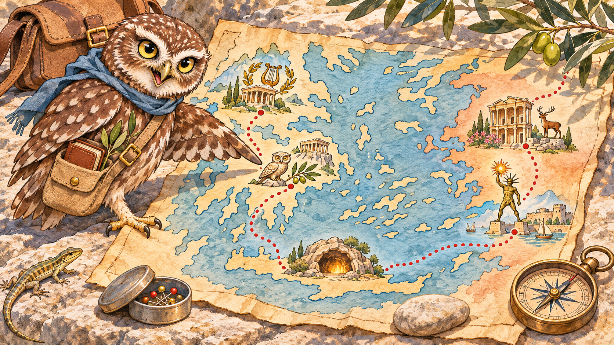

Image Prompt

(This is Panel 12. Do not include the panel number in the image.)
Style: a hand-drawn travel-sketchbook graphic-novel illustration, with clean dark ink outlines, flat softly shaded color fills and a faint watercolor paper texture, like a page from a traveler's journal; warm, sunlit, painterly lighting; no text, captions, signs, letters or speech bubbles anywhere in the image.
Please generate a 16:9 image depicting panel 12 of 14. A hand-drawn parchment travel map spread on a sun-warm limestone rock beside an olive branch, daylight, close three-quarter view from above. Palette: parchment cream, Aegean blue, olive green, terracotta, honey gold. The map shows the Aegean Sea in blue ink wash with the coast of Turkey on the right and the Greek mainland and islands on the left, a dotted red route line running from the top right down and across to the left. Five small colorful pictograms mark the route: a cave mouth with a golden glow (Crete), a temple with a stag silhouette (Ephesus), a tall bronze sun-god statue by a harbor (Rhodes), a laurel sprig and lyre over temple columns (Delphi), and a little owl beside an olive sprig on a rock (Athens). The map has no lettering of any kind, only pictograms. Glaux stands on the map's corner, holding one edge down with a foot and pointing with a wing at the olive-and-owl mark. Details: a small tin of pins, a compass, a pebble paperweight, a satchel, a lizard on the rock. Tone: planning, eager.
Glaux the Little Owl: a true little owl (Athene noctua), small, round and compact, with a flat rounded head and no ear tufts, warm earth-brown plumage with cream spots, bright lemon-yellow eyes under pale cream eyebrows, a cream-white throat patch and a short pale greenish-yellow beak. Glaux wears a small Aegean-blue scarf and a tan canvas satchel across the body with a small leather-bound travel notebook peeking out, and a sprig of three olive leaves tucked into the satchel strap. Alert, curious and warm expression.
Keep every character and place consistent with the other images in this story. Generate the image immediately without asking clarifying questions.

Back on a sun-warm rock, Glaux unrolls a hand-drawn map of the trip. Five small pictures mark five homes of the gods: a cave on Crete, a temple at Ephesus, a harbor on Rhodes, a sanctuary at Delphi, and the rock in Athens. The route runs west from Istanbul across the Aegean, a little owl's flight away from each. The gods did not stay on Olympus, the map says; they moved in wherever people were willing to build them a house.

## Panel 13: Five Doorsteps
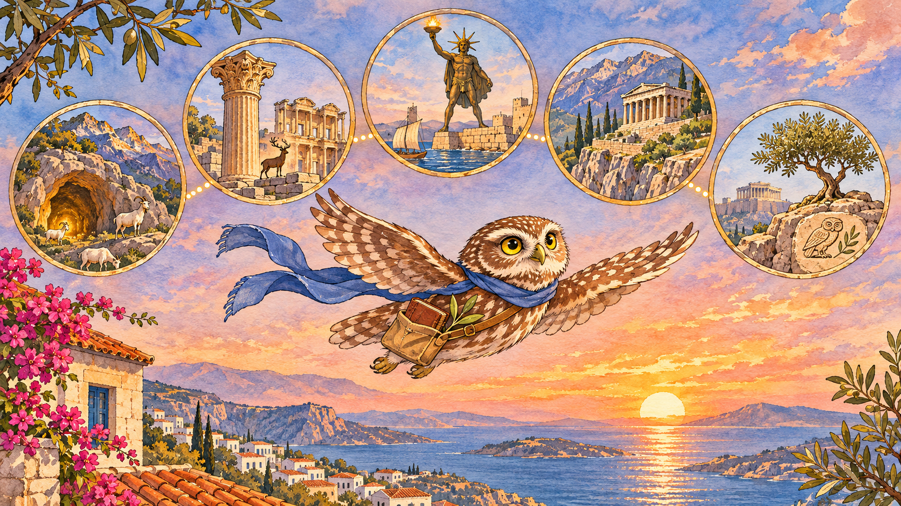

Image Prompt

(This is Panel 13. Do not include the panel number in the image.)
Style: a hand-drawn travel-sketchbook graphic-novel illustration, with clean dark ink outlines, flat softly shaded color fills and a faint watercolor paper texture, like a page from a traveler's journal; warm, sunlit, painterly lighting; no text, captions, signs, letters or speech bubbles anywhere in the image.
Please generate a 16:9 image depicting panel 13 of 14. A composite illustration in myth-time sunrise colors, wide shot. Palette: terracotta red, ochre, lapis blue, honey gold, olive green. Five round framed vignettes arranged in a gentle arc across the image like portholes, each lit by warm light, linked by a glowing dotted thread, no lettering anywhere. Vignette one: a mountain cave mouth with golden light and a few goats on Crete. Vignette two: a single ancient column and the silhouette of a stag at a ruined temple, Ephesus. Vignette three: a tall bronze sun-god statue with a radiating crown on a harbor mole, Rhodes. Vignette four: a Doric temple with laurel trees on a steep cliff terrace, Delphi. Vignette five: a flat-topped rock with a small olive tree and a little owl-and-olive emblem, Athens. Across the center, Glaux flies in a gentle arc between the vignettes with satchel and scarf fluttering, wings spread. Tone: adventurous and expansive.
Glaux the Little Owl: a true little owl (Athene noctua), small, round and compact, with a flat rounded head and no ear tufts, warm earth-brown plumage with cream spots, bright lemon-yellow eyes under pale cream eyebrows, a cream-white throat patch and a short pale greenish-yellow beak. Glaux wears a small Aegean-blue scarf and a tan canvas satchel across the body with a small leather-bound travel notebook peeking out, and a sprig of three olive leaves tucked into the satchel strap. Alert, curious and warm expression.
Keep every character and place consistent with the other images in this story. Generate the image immediately without asking clarifying questions.

Five round windows open along the route, each a doorstep where a god lives. Tradition says baby Zeus was hidden in a cave on Crete, Artemis had her great temple at Ephesus, and the bronze Helios once stood over the harbor on Rhodes, though nothing of him survives. Apollo has Delphi and Athena has Athens, and Glaux flies between them, a small brown speck with a satchel.

## Panel 14: The Owl Comes Home
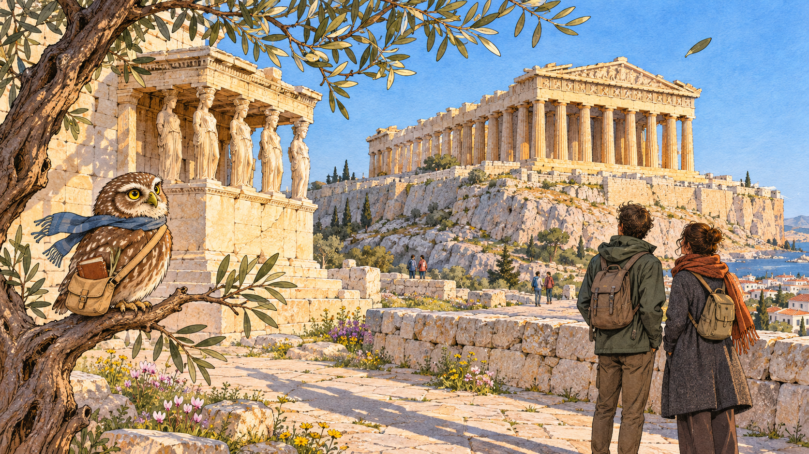

Image Prompt

(This is Panel 14. Do not include the panel number in the image.)
Style: a hand-drawn travel-sketchbook graphic-novel illustration, with clean dark ink outlines, flat softly shaded color fills and a faint watercolor paper texture, like a page from a traveler's journal; warm, sunlit, painterly lighting; no text, captions, signs, letters or speech bubbles anywhere in the image.
Please generate a 16:9 image depicting panel 14 of 14. The Acropolis of Athens today, late afternoon in November, golden low sun. Palette: natural daylight, whitewashed walls, sea blue, terracotta and olive, with honey-colored marble. Wide shot, eye level, with a slightly low angle: in the foreground, an olive tree with silver-green leaves beside the Erechtheion's porch, its trunk gnarled but young. Two travelers stand on the pale limestone path at the right, seen from behind, looking up at the Parthenon; at the left, on a low olive branch, Glaux perches with the satchel and scarf, watching them. Details: a few other small tourists in the far background, a low stone wall, scattered wild flowers in the cracks, a bright blue November sky, a blown olive leaf, long soft shadows on the marble. Tone: quiet, reflective, warm.
The Acropolis of Athens: a steep, flat-topped, pale limestone rock rising above the city, crowned by the Parthenon, a long Doric temple of honey-colored marble with eight columns across the front, a low triangular pediment and a long carved frieze under the roof; to its left stands the smaller Erechtheion with its porch of six marble maidens. The sky behind is clear blue.
Two adult travelers seen from behind or in distant three-quarter view, dressed for cool November weather: one in a dark green rain jacket, the other in a charcoal wool coat with a rust-colored scarf, both with small daypacks, standing close together and looking at the view. Faces are never shown in detail.
Glaux the Little Owl: a true little owl (Athene noctua), small, round and compact, with a flat rounded head and no ear tufts, warm earth-brown plumage with cream spots, bright lemon-yellow eyes under pale cream eyebrows, a cream-white throat patch and a short pale greenish-yellow beak. Glaux wears a small Aegean-blue scarf and a tan canvas satchel across the body with a small leather-bound travel notebook peeking out, and a sprig of three olive leaves tucked into the satchel strap. Alert, curious and warm expression.
Keep every character and place consistent with the other images in this story. Generate the image immediately without asking clarifying questions.

Today the gods are quiet, but the places are still there. An olive tree grows beside the Erechtheion on the Acropolis, a modern planting that keeps the old story alive. Two travelers stand in the late-afternoon light looking up at the Parthenon, and on a branch of the olive a small owl looks back. Look closer.

### Epilogue - What the Gods Show Us

The three great stories here are really stories about choosing. The Athenians pick a gift they can live on rather than a gift that dazzles; a city turns a handful of silver into a currency strangers trust, simply by stamping a picture on it; and a small bird that sees in the dark becomes the symbol of a mind that sees clearly. None of it is documented history, but all of it shaped how Athenians described themselves. And one detail stays true on the ground: the olive, then and now, is a gift you can eat, burn and press.

| Challenge | How They Responded | Lesson for Today |
|---|---|---|
| Two gods offer two gifts | The citizens judge by usefulness, not by drama: the olive gives food, oil and wood, the salt spring gives nothing to drink. | Judge a gift by what it lets you do tomorrow, not by how it looks today. |
| Strangers must trust money | Athens stamps a standard picture and weight on its silver, and the owl becomes the trusted mark in every market. | A reliable symbol lets people who cannot read a language still trade with confidence. |
| A city needs a story about itself | Athens ties its name, its coins and its temples to Athena, her olive and her owl. | Shared stories give a community its identity; asking who first told them tells you why. |
| Who decides? | The tale makes the contest a public vote, whatever its truth, and later tradition remembers who was and was not allowed to vote. | Ask who gets a voice in a community's choices, then and now. |

### Call to Action

On this trip you can stand a few steps from the Erechtheion's olive tree, and Athens' museums keep owl coins for you to look at. When you meet a god in a statue, a story or a vase painting, ask the Learning-for-All question: who got to hear this story, and who got to decide what it meant? Choose one god on our route and look closer.

---

## Voices from the Sources

- **Herodotus, *Histories* 8.55 (about 430 BCE), paraphrased.** He reports that the Acropolis contained a shrine of Erechtheus with an olive tree and a pool of sea water, which the Athenians said Poseidon and Athena had left as tokens in their contest. This is a paraphrase, not a direct quotation.
- **Aristophanes, *The Birds* (414 BCE), the proverb about owls.** The comedy plays on the saying about bringing "owls to Athens," meaning to bring something to a place that already has plenty. The proverb survives because Athenian owl coins were so common.
- **Homer's standard epithet for Athena, *glaukopis*.** Greek poets use this word again and again for the goddess. It is usually translated "bright-eyed" or "gleaming-eyed," and it shares its root with *glaux*, the Greek word for owl, which is where this guide's mascot gets its name. This is a single word, not a full quotation.

## On the Trip

- **Chapter:** [1. The Long Timeline](../../chapters/01-long-timeline/index.md)
- **Where to look:** the olive tree beside the Erechtheion on the Acropolis (a modern planting where the myth places Athena's tree); the Parthenon's east and west pediments, which showed Athena's birth and her contest with Poseidon, mostly now in museums in Athens and London; and owl tetradrachms in Athens museums.
- **Explore further:** [The Olympian Gods at Troy](../../sims/olympian-gods-at-troy/index.md), which asks which gods took sides in the Trojan War, and [The Parthenon's Five Lives](../../sims/parthenon-five-lives-timeline/index.md).
- **Look Closer:** Glaux's pointer: *"Little owls really do live on and around the Acropolis. At dusk, look at the ledges and the old stones, and then look closer."* In this story Glaux is in every panel; the owl on the olive branch in panel 14 is the one to find on site.

## Characters and Style

This story follows the shared series bible: [Story Characters, Places and House Style](../characters.md). Glaux's identity comes from the mascot's [character sheet](../../img/mascot/character-sheet.md).

## References

1. [Wikipedia: Athena](https://en.wikipedia.org/wiki/Athena) - The goddess, her birth from Zeus's head, and her cult in Athens
2. [Wikipedia: Erechtheion](https://en.wikipedia.org/wiki/Erechtheion) - The temple that held the sacred olive, the salt spring and the marks of the trident
3. [Wikipedia: Owl of Athena](https://en.wikipedia.org/wiki/Owl_of_Athena) - The owl as Athena's symbol and as the emblem on Athenian coins
4. [Britannica: Athena](https://www.britannica.com/topic/Athena-Greek-mythology) - Overview of the goddess in Greek myth and religion
5. [UNESCO World Heritage: Acropolis, Athens](https://whc.unesco.org/en/list/404) - The official listing and description of the Acropolis
