# Great Is Artemis!

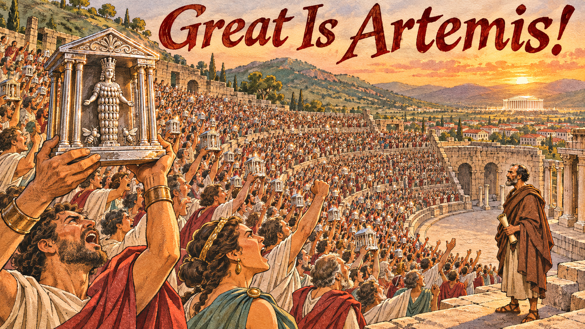
<details>
<summary>Cover Image Prompt</summary>
(This is the Cover Image. Do not include this label in the image.)
Style: a hand-drawn travel-sketchbook graphic-novel illustration, with clean dark ink outlines, flat softly shaded color fills and a faint watercolor paper texture, like a page from a traveler's journal; warm, sunlit, painterly lighting; no text, captions, signs, letters or speech bubbles anywhere in the image. Please generate a wide-landscape 16:9 cover image for this story. Inside the Great Theater of Ephesus at golden hour, thousands of people in pale tunics fill the stone seats in a deep curve, many with raised arms, and a field of small silver shrines flashes among them like stars. A small silver shrine of Artemis of Ephesus: a hand-sized hammered-silver model temple with slim columns and a low pediment, holding a stiff, upright goddess figure in a tall crown, her body covered from chest to feet with rows of carved ornaments, a small bee on each side. In the lower right foreground, small against the roaring crowd, a plain figure in a brown cloak stands quietly holding a rolled papyrus letter. Paul of Tarsus, about fifty years old: a lean, wiry man of middle height with a weathered olive complexion, receding dark hair graying at the temples, a short graying beard and deep-set, intense dark eyes, wearing a plain undyed wool tunic under a brown traveler's cloak, rope sandals, and calloused, leather-stained hands; earnest, patient and tireless. Behind and above the theater are the hills and, far off on the plain, a faint white glimmer of the great temple. Across the top, render the title in bold, hand-lettered title text: "Great Is Artemis!" Palette: warm limestone, sea-green, deep red, bronze, evening gold. Emotional tone: dramatic, noisy and a little ironic. Keep every character and place consistent with the other images in this story. Generate the image immediately without asking clarifying questions.
</details>

<details markdown="1">
<summary>Narrative Prompt</summary>

This story is set in Ephesus, the capital of the Roman province of Asia, during the years Paul spent there, about 52 to 55 CE, as the chapters give them (Acts says "three years" in his farewell speech; the letters and Acts together suggest two to three). It is built on Acts 19:23-41, on 1 Corinthians (written from Ephesus about 54 CE) and on the Ephesus chapter's evidence from inscriptions. It is a story of **law, money, honor and words that travel**.

**Look and palette.** House style per the series bible. The whole story uses the Hellenistic and Roman palette (warm limestone, sea-green, deep red, bronze, evening gold), with natural modern daylight in the last panel.

**Documented versus tradition.** Documented: Paul's years in Ephesus; his writing of 1 Corinthians there; the existence of the Temple of Artemis, the Great Theater and the Salutaris inscription; the offices named in Acts (the town clerk, the Asiarchs, the title *neokoros*). Told by Acts alone: the hall of Tyrannus, the silversmiths' riot and its details. Acts was written a generation later; its speeches are the author's own composition; the daily 11 AM to 4 PM schedule appears only in a later manuscript. **No physical description of Paul survives from his lifetime**, so his portrait below is an invented, respectful type. Likewise no image of Demetrius or the town clerk exists. No named person in this story is invented: Priscilla, Aquila, Gaius, Aristarchus and Alexander appear in the sources. Chloe's household is named in 1 Corinthians. No dialogue is quoted that is not in the sources.

**Creative liberties.** The Great Theater's stage building is shown in a form closer to its later Roman look. The hall of Tyrannus is imagined. The carrier and the scribe are anonymous types. The temple's surroundings are simplified. The Arcadiane, the grand colonnaded harbor street, was built later, about 400 CE; panels 1 and 16 show a colonnaded harbor road in a generic way.

**Safety.** The riot is shown by noise, dust, raised arms and silver, never by violence. Two travelers are carried along by the crowd but never hurt. No lettering anywhere, including on the papyrus.

**Cast.** Paste each block below verbatim into every prompt where that character, place or object appears.

- **Glaux the Little Owl:** see docs/stories/characters.md and docs/img/mascot/character-sheet.md (Glaux). Glaux appears in exactly one panel, Panel 13, as a small hidden observer on the theater's top row.
- **The Travelers (final panel):** see docs/stories/characters.md; seen from behind in Panel 16 only.

**Paul of Tarsus (not in characters.md; this story only)**

```text
Paul of Tarsus, about fifty years old: a lean, wiry man of middle height with a weathered olive complexion, receding dark hair graying at the temples, a short graying beard and deep-set, intense dark eyes, wearing a plain undyed wool tunic under a brown traveler's cloak, rope sandals, and calloused, leather-stained hands; earnest, patient and tireless.
```

**Demetrius the silversmith (this story only)**

```text
Demetrius, a prosperous Ephesian silversmith: a stout, confident man of about fifty with a curled black beard shot with gray, a rich deep-red tunic with a bronze-and-gold border under a cream mantle, heavy silver rings, and thick forearms smudged with forge soot, holding a small silver temple model with a tiny goddess inside; persuasive, anxious and proud.
```

**The town clerk of Ephesus (this story only)**

```text
The town clerk of Ephesus, the city's chief official: a calm, spare, white-haired man of about sixty with a clean-shaven, lined face and a thoughtful, steady gaze, wearing a long cream wool mantle with a narrow purple stripe and a laurel wreath of office, a few papyrus scrolls tucked under one arm; composed and authoritative.
```

**Priscilla and Aquila (this story only)**

```text
Priscilla and Aquila, a married couple of tentmakers: Aquila a sturdy man of about forty-five with a short black beard, wearing a leather apron over a rust-colored tunic and holding a curved needle; Priscilla a capable woman of about forty with dark hair under a sage-green headscarf and a plain ochre dress, stitching a length of goat-hair cloth; both with strong, quick hands and kind, practical expressions.
```

**The silver shrine of Artemis (object, this story only)**

```text
A small silver shrine of Artemis of Ephesus: a hand-sized hammered-silver model temple with slim columns and a low pediment, holding a stiff, upright goddess figure in a tall crown, her body covered from chest to feet with rows of carved ornaments, a small bee on each side.
```

**The Great Theater of Ephesus (place, this story only)**

```text
The Great Theater of Ephesus: an enormous Greek-plan theater cut into the western slope of a hill, holding about 25,000 people, with a little more than a half circle of pale limestone seats rising in three tiers separated by walkways, a flat circular orchestra at the bottom, and a tall columned stage building with niches and statues, facing down a wide colonnaded street toward a distant harbor.
```

**The Temple of Artemis (place, this story only)**

```text
The Temple of Artemis at Ephesus: a colossal Ionic marble temple on a high stepped platform on a flat plain, surrounded by a double ring of slender fluted white columns about eighteen meters tall with scrolled capitals, gleaming gold-white in the sun, with smoke from offerings rising from an altar in front.
```

**The hall of Tyrannus (place, imagined, this story only)**

```text
The hall of Tyrannus (imagined, since no building has been identified): an airy rectangular lecture hall of whitewashed stone with a row of tall arched windows letting in bright midday light, plain wooden benches in rows, one wooden stool at the front, a small table with a water jug and papyrus rolls, and a simple geometric mosaic floor.
```

</details>

### Prologue - A Tentmaker and a Goddess

A traveling tentmaker starts teaching in a borrowed lecture hall in Ephesus, a city that makes much of its living from its famous goddess. Within two or three years, according to Acts, the silversmiths who sell her small silver shrines fill the great theater and shout for two hours that Artemis is great. This story follows how a message and a trade collide, how a quiet letter becomes a loud one, and how a city official saves the day with an argument about law. We take care throughout to say which parts come from Paul's own letters and which come from Acts.

**Find Glaux:** Glaux hides in one panel of this story. Can you spot the little owl?

## Panel 1: The Road from the Harbor

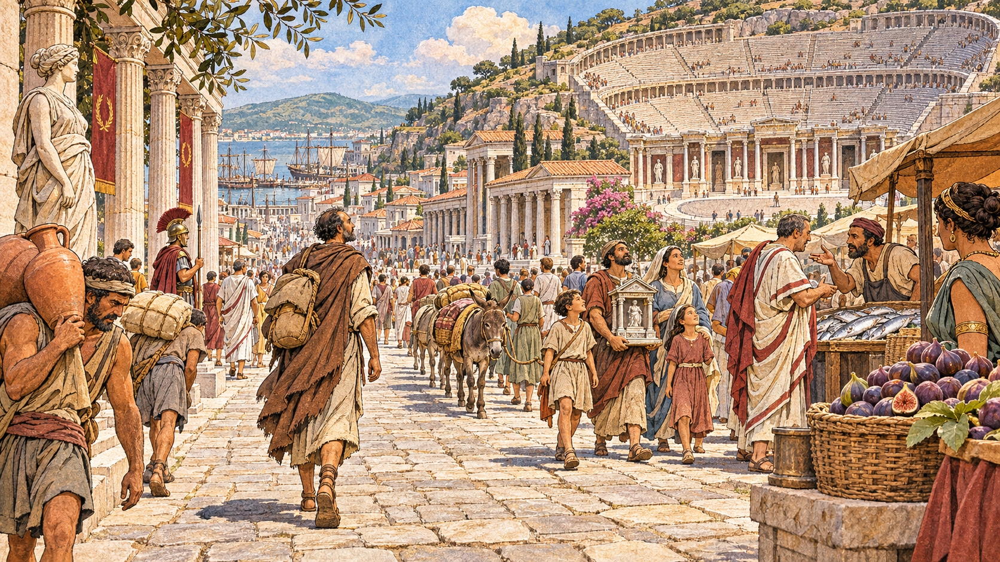
<details><summary>Image Prompt</summary>
(This is Panel 01. Do not include the panel number in the image.)
I am about to ask you to generate a series of images for a graphic novel. Please make the images have a consistent style and consistent characters. Do not ask any clarifying questions. Just generate the image immediately when asked.

Style: a hand-drawn travel-sketchbook graphic-novel illustration, with clean dark ink outlines, flat softly shaded color fills and a faint watercolor paper texture, like a page from a traveler's journal; warm, sunlit, painterly lighting; no text, captions, signs, letters or speech bubbles anywhere in the image. Please generate a 16:9 image depicting panel 1 of 16. Ephesus, capital of the Roman province of Asia, about 52 CE, late morning. Roman palette: warm limestone, sea-green, deep red, bronze, evening gold. Wide establishing view looking up the busy harbor road toward the city and the great theater on its hillside: The Great Theater of Ephesus: an enormous Greek-plan theater cut into the western slope of a hill, holding about 25,000 people, with a little more than a half circle of pale limestone seats rising in three tiers separated by walkways, a flat circular orchestra at the bottom, and a tall columned stage building with niches and statues, facing down a wide colonnaded street toward a distant harbor. On the road, small in the middle ground, one traveler walks toward the city with a pack on his back: Paul of Tarsus, about fifty years old: a lean, wiry man of middle height with a weathered olive complexion, receding dark hair graying at the temples, a short graying beard and deep-set, intense dark eyes, wearing a plain undyed wool tunic under a brown traveler's cloak, rope sandals, and calloused, leather-stained hands; earnest, patient and tireless. Around him porters carry amphorae and rolled sacks, a donkey train plods past, merchants argue at roadside stalls of figs and fish, a pilgrim family carries a small silver shrine, and ship masts crowd the harbor behind. Mood: bustle, scale and possibility. Keep every character and place consistent with the other images in this story. Generate the image immediately without asking clarifying questions.
</details>

Around 52 CE a traveler on foot arrives in Ephesus, the capital of the Roman province of Asia and one of the largest cities in the empire. It is a busy port with roads running north, south and east, and the pilgrim city of a famous goddess. A man who wants to reach a whole province could hardly choose a better place to settle. This traveler is Paul, and he is about to stay longer than he has stayed anywhere by choice.

## Panel 2: The Tentmakers' Workbench

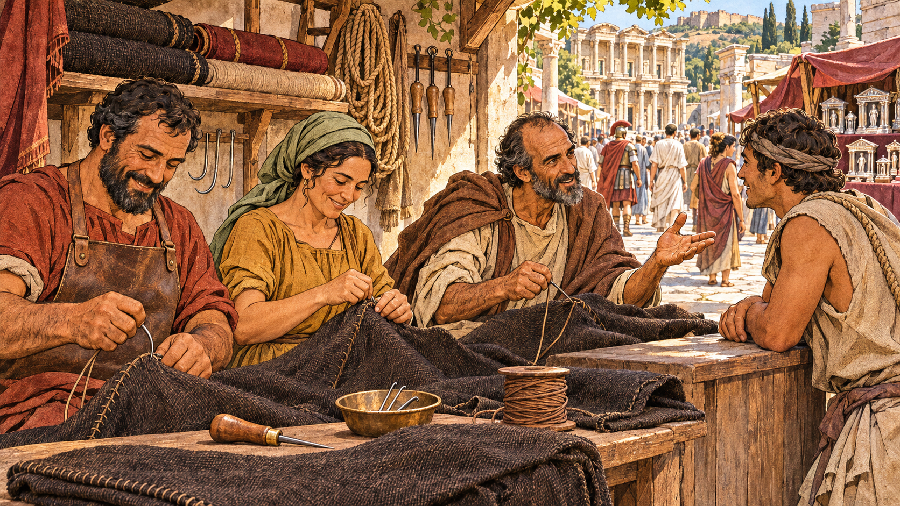
<details><summary>Image Prompt</summary>
(This is Panel 02. Do not include the panel number in the image.)
Style: a hand-drawn travel-sketchbook graphic-novel illustration, with clean dark ink outlines, flat softly shaded color fills and a faint watercolor paper texture, like a page from a traveler's journal; warm, sunlit, painterly lighting; no text, captions, signs, letters or speech bubbles anywhere in the image. Please generate a 16:9 image depicting panel 2 of 16. A tentmaker's workshop on a busy street in Ephesus, about 52 CE, morning. Roman palette: warm limestone, sea-green, deep red, bronze, evening gold. Medium shot inside an open-fronted shop, seen from the street: three people work shoulder to shoulder at a long bench cutting and stitching panels of dark goat-hair cloth. Priscilla and Aquila, a married couple of tentmakers: Aquila a sturdy man of about forty-five with a short black beard, wearing a leather apron over a rust-colored tunic and holding a curved needle; Priscilla a capable woman of about forty with dark hair under a sage-green headscarf and a plain ochre dress, stitching a length of goat-hair cloth; both with strong, quick hands and kind, practical expressions. Beside them sits Paul of Tarsus, about fifty years old: a lean, wiry man of middle height with a weathered olive complexion, receding dark hair graying at the temples, a short graying beard and deep-set, intense dark eyes, wearing a plain undyed wool tunic under a brown traveler's cloak, rope sandals, and calloused, leather-stained hands; earnest, patient and tireless. He pulls a leather thread through the cloth while talking to a customer, a young dockworker leaning on the counter. Bolts of cloth, awls, curved needles and a coil of rope hang on the walls; across the street a stall sells small silver shrines glinting in the sun. Mood: warm, hardworking, easy conversation. Keep every character and place consistent with the other images in this story. Generate the image immediately without asking clarifying questions.
</details>

Paul finds work, and friends. Priscilla and Aquila are a married couple of tentmakers whom he knew in Corinth, and now they share a workbench again. Acts says Paul supported himself by this trade, and his own letters confirm that he "worked night and day." Some historians think much of his teaching happened here, over cloth and thread.

## Panel 3: The Hall of Tyrannus

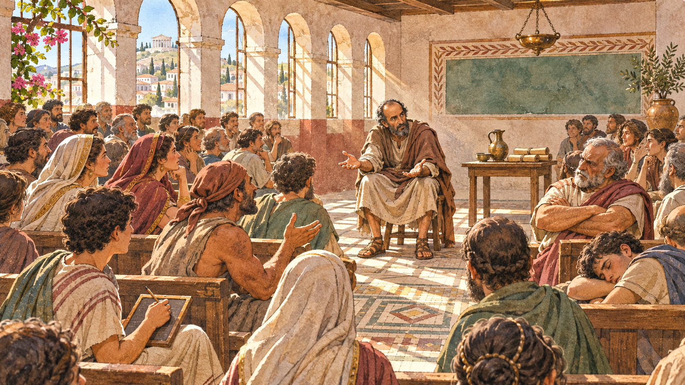
<details><summary>Image Prompt</summary>
(This is Panel 03. Do not include the panel number in the image.)
Style: a hand-drawn travel-sketchbook graphic-novel illustration, with clean dark ink outlines, flat softly shaded color fills and a faint watercolor paper texture, like a page from a traveler's journal; warm, sunlit, painterly lighting; no text, captions, signs, letters or speech bubbles anywhere in the image. Please generate a 16:9 image depicting panel 3 of 16. A lecture hall in Ephesus, about 53 CE, hot early afternoon. Roman palette: warm limestone, sea-green, deep red, bronze, evening gold. Medium-wide shot from the back of the room looking toward a speaker. The hall of Tyrannus (imagined, since no building has been identified): an airy rectangular lecture hall of whitewashed stone with a row of tall arched windows letting in bright midday light, plain wooden benches in rows, one wooden stool at the front, a small table with a water jug and papyrus rolls, and a simple geometric mosaic floor. Paul of Tarsus, about fifty years old: a lean, wiry man of middle height with a weathered olive complexion, receding dark hair graying at the temples, a short graying beard and deep-set, intense dark eyes, wearing a plain undyed wool tunic under a brown traveler's cloak, rope sandals, and calloused, leather-stained hands; earnest, patient and tireless. He sits on the stool, leaning forward with open hands as if asking a question, while about thirty listeners sit on the benches: a young scholar with a wax tablet, a dockworker, two women in veils, an older man frowning with arms crossed, a student who has fallen asleep. Bars of strong light and floating dust fall across the floor. Mood: lively, patient, a discussion rather than a speech. Keep every character and place consistent with the other images in this story. Generate the image immediately without asking clarifying questions.
</details>

After three months in the synagogue, Paul moves his teaching to a lecture hall run by a man named Tyrannus, and teaches there daily for two years. The Greek word Acts uses for how he taught means "reasoning," the root of our word "dialogue." It is a school, not a pulpit, and anyone can walk in. Acts says that, as a result, "all the residents of Asia" heard the message.

> **Myth or Evidence?** Acts names the hall and the two years. No building in Ephesus has been identified as the hall of Tyrannus, and the detail that Paul taught from about 11 AM to 4 PM comes only from a later manuscript of Acts, not the oldest ones. It is a believable picture, not a documented one.

## Panel 4: News from Corinth

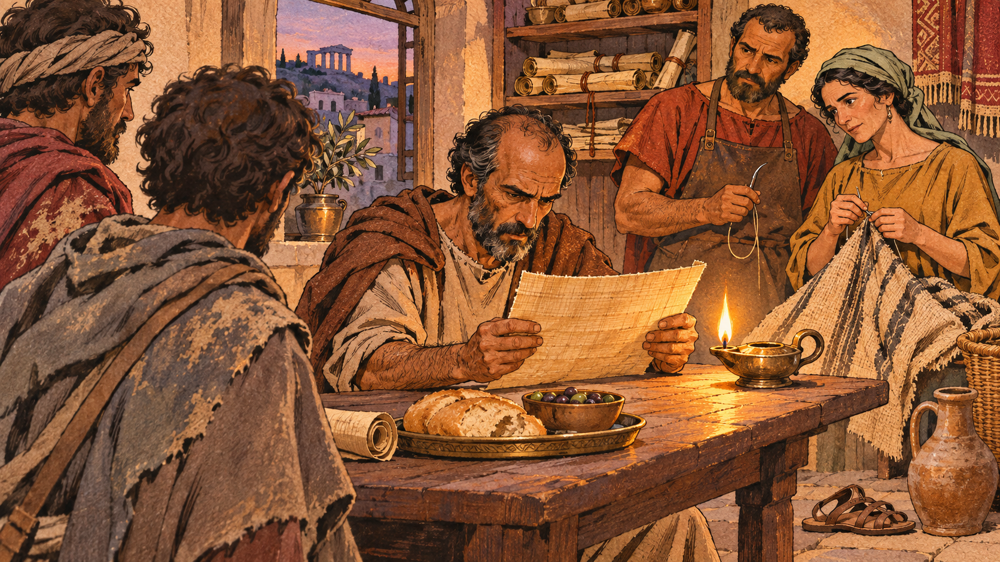
<details><summary>Image Prompt</summary>
(This is Panel 04. Do not include the panel number in the image.)
Style: a hand-drawn travel-sketchbook graphic-novel illustration, with clean dark ink outlines, flat softly shaded color fills and a faint watercolor paper texture, like a page from a traveler's journal; warm, sunlit, painterly lighting; no text, captions, signs, letters or speech bubbles anywhere in the image. Please generate a 16:9 image depicting panel 4 of 16. A room in the house of Priscilla and Aquila in Ephesus, about 54 CE, evening. Roman palette: warm limestone, sea-green, deep red, bronze, evening gold, with lamp-gold and soft shadow. Medium shot, over the shoulder of one of two dusty travelers, toward a man reading by an oil lamp. Seated at a wooden table: Paul of Tarsus, about fifty years old: a lean, wiry man of middle height with a weathered olive complexion, receding dark hair graying at the temples, a short graying beard and deep-set, intense dark eyes, wearing a plain undyed wool tunic under a brown traveler's cloak, rope sandals, and calloused, leather-stained hands; earnest, patient and tireless. He holds an unrolled papyrus letter in both hands and frowns in concentration. Two travelers from Corinth in cloaks stained by the road stand beside the table; a sandal and a water jug lie on the floor, a bronze lamp burns, scrolls fill a shelf, and bread and olives sit on a tray. Priscilla and Aquila, a married couple of tentmakers: Aquila a sturdy man of about forty-five with a short black beard, wearing a leather apron over a rust-colored tunic and holding a curved needle; Priscilla a capable woman of about forty with dark hair under a sage-green headscarf and a plain ochre dress, stitching a length of goat-hair cloth; both with strong, quick hands and kind, practical expressions. stand a little back, listening. Mood: concern, urgent news, intimacy. Keep every character and place consistent with the other images in this story. Generate the image immediately without asking clarifying questions.
</details>

Visitors arrive from Corinth, the quarrelsome church Paul founded across the Aegean. Some come from the household of a woman named Chloe, and they bring bad news of factions, each group saying "I belong to" its favorite leader. They also bring a letter full of the Corinthians' own questions. Paul reads, and begins to answer.

## Panel 5: A Letter Goes Out

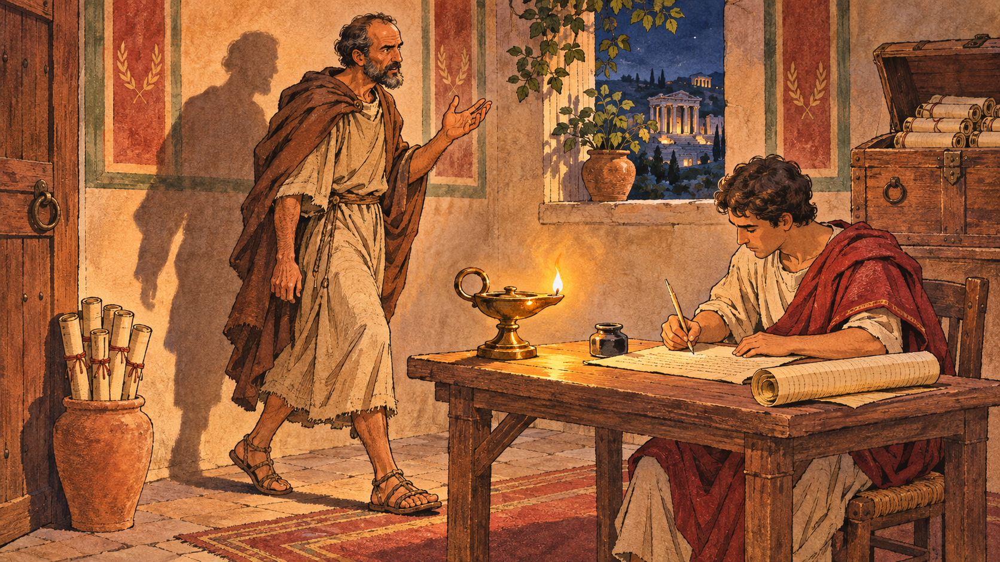
<details><summary>Image Prompt</summary>
(This is Panel 05. Do not include the panel number in the image.)
Style: a hand-drawn travel-sketchbook graphic-novel illustration, with clean dark ink outlines, flat softly shaded color fills and a faint watercolor paper texture, like a page from a traveler's journal; warm, sunlit, painterly lighting; no text, captions, signs, letters or speech bubbles anywhere in the image. Please generate a 16:9 image depicting panel 5 of 16. A quiet back room in Ephesus, about 54 CE, night. Roman palette: warm limestone, sea-green, deep red, bronze, evening gold, with warm lamp-gold. Medium shot of a man pacing in front of a seated scribe. Paul of Tarsus, about fifty years old: a lean, wiry man of middle height with a weathered olive complexion, receding dark hair graying at the temples, a short graying beard and deep-set, intense dark eyes, wearing a plain undyed wool tunic under a brown traveler's cloak, rope sandals, and calloused, leather-stained hands; earnest, patient and tireless. He walks with one hand raised, speaking slowly. A young scribe sits at a low desk writing with a reed pen on a sheet of papyrus, a small ink pot beside him; a half-written scroll curls on the desk. A bronze lamp throws long shadows on the wall; a pile of finished letters in clay tubes waits by the door; a wooden chest of scrolls stands in the corner. Mood: focused, generous, working late. Keep every character and place consistent with the other images in this story. Generate the image immediately without asking clarifying questions.
</details>

Paul answers point by point, in the order of their questions: "now concerning" this, "now concerning" that. Like most letters of the age, it was probably dictated to a scribe. He tells them where he is, and says he will stay in Ephesus "until Pentecost" because "a wide door for effective work has opened," though there are "many adversaries." That letter, 1 Corinthians, written around 54 CE, is one of the few pieces of writing we can place in Ephesus with certainty.

## Panel 6: The Carrier

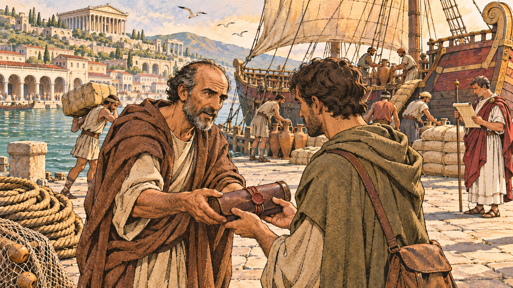
<details><summary>Image Prompt</summary>
(This is Panel 06. Do not include the panel number in the image.)
Style: a hand-drawn travel-sketchbook graphic-novel illustration, with clean dark ink outlines, flat softly shaded color fills and a faint watercolor paper texture, like a page from a traveler's journal; warm, sunlit, painterly lighting; no text, captions, signs, letters or speech bubbles anywhere in the image. Please generate a 16:9 image depicting panel 6 of 16. The harbor of Ephesus, about 54 CE, early morning. Roman palette: warm limestone, sea-green, deep red, bronze, evening gold. Wide establishing view along a stone quay: in the foreground a man in a plain traveler's cloak accepts a sealed papyrus roll in a leather case from Paul of Tarsus, about fifty years old: a lean, wiry man of middle height with a weathered olive complexion, receding dark hair graying at the temples, a short graying beard and deep-set, intense dark eyes, wearing a plain undyed wool tunic under a brown traveler's cloak, rope sandals, and calloused, leather-stained hands; earnest, patient and tireless. who presses it into his hands, speaking earnestly. Behind, a merchant ship with a square sail is loading amphorae and sacks; porters carry bales; gulls wheel; a harbor official with a staff checks a list; a stack of rope and nets lies on the dock. Mood: trust, farewell, a message about to cross the sea. Keep every character and place consistent with the other images in this story. Generate the image immediately without asking clarifying questions.
</details>

A letter cannot answer follow-up questions, so Paul does not post it. He gives it to a trusted carrier who can explain what he meant. The ship will cross the Aegean to Corinth, about 380 km to the west. The text travels, and so does the person who knows how to read it.

## Panel 7: Hand to Hand

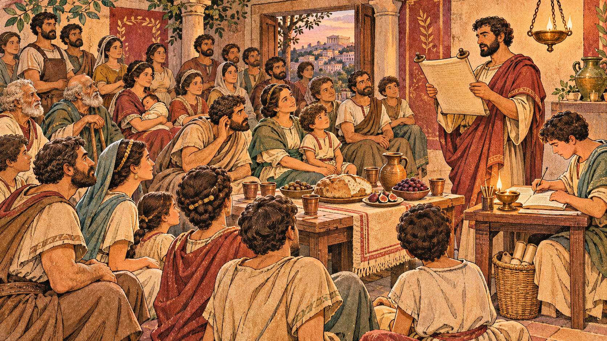
<details><summary>Image Prompt</summary>
(This is Panel 07. Do not include the panel number in the image.)
Style: a hand-drawn travel-sketchbook graphic-novel illustration, with clean dark ink outlines, flat softly shaded color fills and a faint watercolor paper texture, like a page from a traveler's journal; warm, sunlit, painterly lighting; no text, captions, signs, letters or speech bubbles anywhere in the image. Please generate a 16:9 image depicting panel 7 of 16. A crowded room in a private house in Ephesus, about 55 CE, evening. Roman palette: warm limestone, sea-green, deep red, bronze, evening gold, with lamp-gold and warm shadow. Wide view of about twenty-five people sitting on benches and the floor: families, a few craftsmen, a woman with a baby, two old men. At the front a man stands reading aloud from an unrolled papyrus; at a side table a young scribe copies it on a fresh sheet by lamplight; one listener leans forward with a cupped hand at his ear, a child sits on a lap, a woman nods; bread and cups sit on a long table. Mood: attention, community, knowledge shared by voice. Keep every character and place consistent with the other images in this story. Generate the image immediately without asking clarifying questions.
</details>

Once a letter arrives, it is read aloud. Many listeners probably cannot read, so a text meant for a whole room has to be heard before it can be read. Someone copies it for the next house, and the next. That is how a letter becomes a collection: a durable text, passed from hand to hand, with a person to read it.

## Panel 8: Silver Shrines

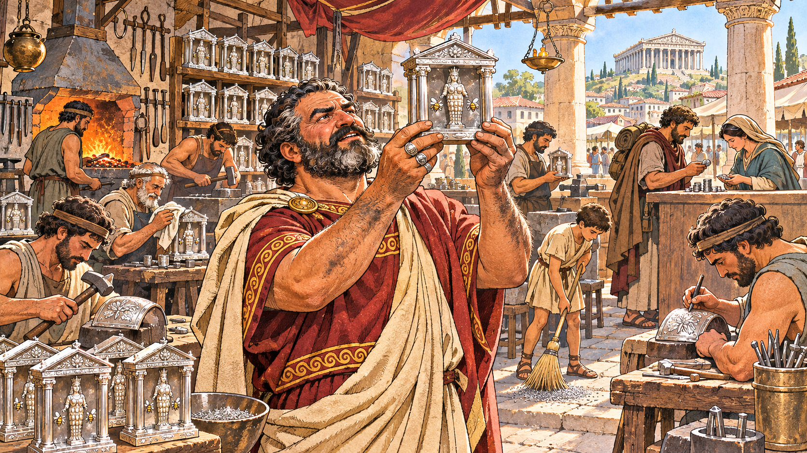
<details><summary>Image Prompt</summary>
(This is Panel 08. Do not include the panel number in the image.)
Style: a hand-drawn travel-sketchbook graphic-novel illustration, with clean dark ink outlines, flat softly shaded color fills and a faint watercolor paper texture, like a page from a traveler's journal; warm, sunlit, painterly lighting; no text, captions, signs, letters or speech bubbles anywhere in the image. Please generate a 16:9 image depicting panel 8 of 16. A silversmith's workshop in Ephesus, about 55 CE, bright morning. Roman palette: warm limestone, sea-green, deep red, bronze, evening gold. Medium-wide view inside a busy open workshop. Demetrius, a prosperous Ephesian silversmith: a stout, confident man of about fifty with a curled black beard shot with gray, a rich deep-red tunic with a bronze-and-gold border under a cream mantle, heavy silver rings, and thick forearms smudged with forge soot, holding a small silver temple model with a tiny goddess inside; persuasive, anxious and proud. stands at the center inspecting a finished piece against the light. A small silver shrine of Artemis of Ephesus: a hand-sized hammered-silver model temple with slim columns and a low pediment, holding a stiff, upright goddess figure in a tall crown, her body covered from chest to feet with rows of carved ornaments, a small bee on each side. Around him eight craftsmen hammer, polish and chase silver at benches; rows of finished shrines gleam on shelves; a small forge glows with orange coals; a pilgrim couple in travel cloaks counts coins at the counter; a boy sweeps silver filings. Mood: prosperous, proud, skilled work. Keep every character and place consistent with the other images in this story. Generate the image immediately without asking clarifying questions.
</details>

Across town, a silversmith named Demetrius runs a thriving business making small silver shrines of the goddess Artemis. Pilgrims buy them as souvenirs and offerings, and many craftsmen depend on the trade. He is known only from Acts. Acts describes him as a man who makes his living from the city's goddess, which is why the new teaching worries him.

## Panel 9: Our Trade Is in Danger

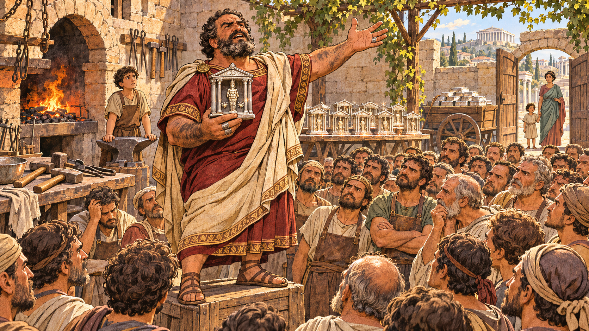
<details><summary>Image Prompt</summary>
(This is Panel 09. Do not include the panel number in the image.)
Style: a hand-drawn travel-sketchbook graphic-novel illustration, with clean dark ink outlines, flat softly shaded color fills and a faint watercolor paper texture, like a page from a traveler's journal; warm, sunlit, painterly lighting; no text, captions, signs, letters or speech bubbles anywhere in the image. Please generate a 16:9 image depicting panel 9 of 16. The yard of a silversmith's workshop in Ephesus, about 55 CE, afternoon. Roman palette: warm limestone, sea-green, deep red, bronze, evening gold. Medium shot from slightly below. Demetrius, a prosperous Ephesian silversmith: a stout, confident man of about fifty with a curled black beard shot with gray, a rich deep-red tunic with a bronze-and-gold border under a cream mantle, heavy silver rings, and thick forearms smudged with forge soot, holding a small silver temple model with a tiny goddess inside; persuasive, anxious and proud. stands on an overturned crate, one arm raised toward a crowd of about forty craftsmen in aprons gathered closely around him, listening hard. A small silver shrine of Artemis of Ephesus: a hand-sized hammered-silver model temple with slim columns and a low pediment, holding a stiff, upright goddess figure in a tall crown, her body covered from chest to feet with rows of carved ornaments, a small bee on each side. In the background a dozen shrines on a trestle table catch the light. Hammers and tongs lie idle on the benches, a boy holds an anvil, a cart of silver ingots waits, and a woman at the gate holds a child by the hand. Mood: persuasion, fear for livelihood, rising heat. Keep every character and place consistent with the other images in this story. Generate the image immediately without asking clarifying questions.
</details>

Demetrius calls his guild together. As Acts tells it, he says Paul is persuading people across Asia that gods made by human hands are no gods at all. That threatens the craftsmen's income, he says, and worse, the honor of the goddess and her temple. Notice that he gives both motives, honestly: money and pride.

> **Myth or Evidence?** Documented: Acts is the only source for the speech, and the speeches in Acts are the author's own composition. But a pagan governor writing around 112 CE, Pliny the Younger, reported the same economic pattern in Bithynia: where the new movement grew, trade in sacrificial animals fell. Demetrius was not irrational; he was right about his market.

## Panel 10: The Cry Goes Out

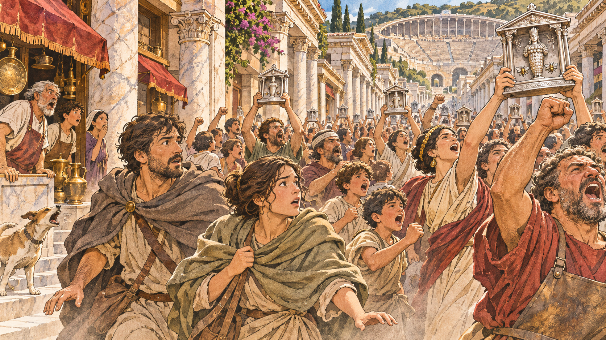
<details><summary>Image Prompt</summary>
(This is Panel 10. Do not include the panel number in the image.)
Style: a hand-drawn travel-sketchbook graphic-novel illustration, with clean dark ink outlines, flat softly shaded color fills and a faint watercolor paper texture, like a page from a traveler's journal; warm, sunlit, painterly lighting; no text, captions, signs, letters or speech bubbles anywhere in the image. Please generate a 16:9 image depicting panel 10 of 16. A marble-paved street in Ephesus, about 55 CE, midday. Roman palette: warm limestone, sea-green, deep red, bronze, evening gold. Wide, slightly low-angle view of a surging crowd flowing down a colonnaded street toward the theater: craftsmen in aprons, women, children and onlookers, many with open mouths in mid-shout and fists raised, some holding small silver shrines high above their heads. A small silver shrine of Artemis of Ephesus: a hand-sized hammered-silver model temple with slim columns and a low pediment, holding a stiff, upright goddess figure in a tall crown, her body covered from chest to feet with rows of carved ornaments, a small bee on each side. In the front two dazed, bewildered travelers in plain cloaks are swept along by the press of the crowd, unhurt. Stunned shopkeepers watch from doorways; a dog barks; dust rises; the great theater looms at the end of the street. Mood: noise, momentum, a mob forming. Keep every character and place consistent with the other images in this story. Generate the image immediately without asking clarifying questions.
</details>

The craftsmen begin to shout, "Great is Artemis of the Ephesians!" The chant spreads through the city, and the crowd rushes toward the theater, dragging along two of Paul's Macedonian travelling companions, Gaius and Aristarchus. A shout becomes a movement in the space of one street.

## Panel 11: Into the Great Theater

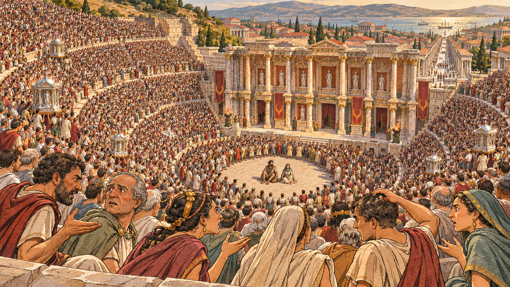
<details><summary>Image Prompt</summary>
(This is Panel 11. Do not include the panel number in the image.)
Style: a hand-drawn travel-sketchbook graphic-novel illustration, with clean dark ink outlines, flat softly shaded color fills and a faint watercolor paper texture, like a page from a traveler's journal; warm, sunlit, painterly lighting; no text, captions, signs, letters or speech bubbles anywhere in the image. Please generate a 16:9 image depicting panel 11 of 16. The Great Theater of Ephesus, about 55 CE, afternoon. Roman palette: warm limestone, sea-green, deep red, bronze, evening gold. Wide, high view from the top row looking down into a packed theater. The Great Theater of Ephesus: an enormous Greek-plan theater cut into the western slope of a hill, holding about 25,000 people, with a little more than a half circle of pale limestone seats rising in three tiers separated by walkways, a flat circular orchestra at the bottom, and a tall columned stage building with niches and statues, facing down a wide colonnaded street toward a distant harbor. About 25,000 people fill every tier, a restless sea of pale tunics, cloaks and veils; silver shrines glint among the crowd like scattered stars; people at the back stand on the walkways; a group of confused onlookers asks the person beside them what is going on; two bewildered travelers sit in the orchestra below, surrounded; the harbor glimmers far beyond. Mood: overwhelming size, confusion, tension. Keep every character and place consistent with the other images in this story. Generate the image immediately without asking clarifying questions.
</details>

Within minutes the theater, which held about 25,000 people, is full. Acts says most of the crowd does not even know why they have come. It is the city's usual place for a public assembly, where inscriptions show that even the statues of the goddess were carried in and set among the seats.

## Panel 12: Friends Hold Paul Back

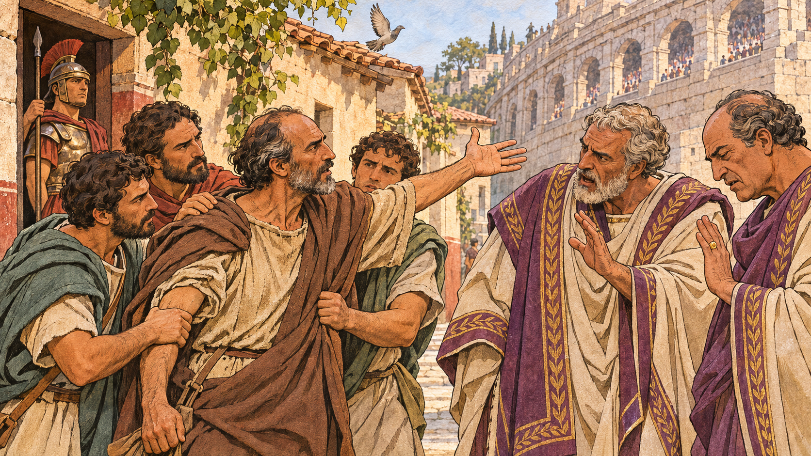
<details><summary>Image Prompt</summary>
(This is Panel 12. Do not include the panel number in the image.)
Style: a hand-drawn travel-sketchbook graphic-novel illustration, with clean dark ink outlines, flat softly shaded color fills and a faint watercolor paper texture, like a page from a traveler's journal; warm, sunlit, painterly lighting; no text, captions, signs, letters or speech bubbles anywhere in the image. Please generate a 16:9 image depicting panel 12 of 16. A side street near the theater in Ephesus, about 55 CE, afternoon. Roman palette: warm limestone, sea-green, deep red, bronze, evening gold. Medium shot, with the theater wall and a distant roar behind. Paul of Tarsus, about fifty years old: a lean, wiry man of middle height with a weathered olive complexion, receding dark hair graying at the temples, a short graying beard and deep-set, intense dark eyes, wearing a plain undyed wool tunic under a brown traveler's cloak, rope sandals, and calloused, leather-stained hands; earnest, patient and tireless. stands in the center of a small group, one hand outstretched toward the theater, clearly wanting to go in. Three followers hold him gently by the arm and cloak; two dignified older men in long purple-bordered robes and gold rings, the leading men of the province, stand beside him speaking urgently and shaking their heads. A city guard watches from a doorway; a pigeon rises from a roof. Mood: urgency, tension, friendship as protection. Keep every character and place consistent with the other images in this story. Generate the image immediately without asking clarifying questions.
</details>

Paul wants to go in and speak. His friends will not let him, and the Asiarchs, the leading men of the province, who are friendly to him, send word urging him not to risk it. There is a quiet courage in being told to stay out of the room. In his own letters, Paul says he faced "many adversaries" in these years, and fought "with wild beasts," probably as a figure of speech.

## Panel 13: Two Hours of Chanting

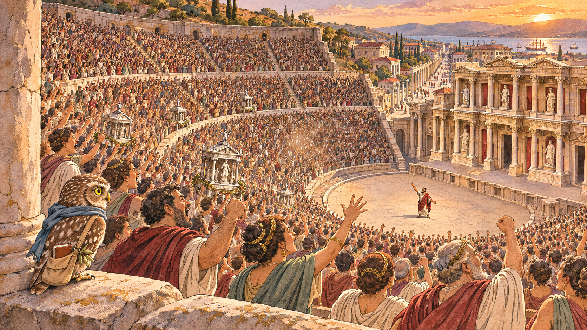
<details><summary>Image Prompt</summary>
(This is Panel 13. Do not include the panel number in the image.)
Style: a hand-drawn travel-sketchbook graphic-novel illustration, with clean dark ink outlines, flat softly shaded color fills and a faint watercolor paper texture, like a page from a traveler's journal; warm, sunlit, painterly lighting; no text, captions, signs, letters or speech bubbles anywhere in the image. Please generate a 16:9 image depicting panel 13 of 16. The Great Theater of Ephesus, about 55 CE, late afternoon. Roman palette: warm limestone, sea-green, deep red, bronze, evening gold. Wide view from a high corner looking across the packed seats toward the orchestra. The Great Theater of Ephesus: an enormous Greek-plan theater cut into the western slope of a hill, holding about 25,000 people, with a little more than a half circle of pale limestone seats rising in three tiers separated by walkways, a flat circular orchestra at the bottom, and a tall columned stage building with niches and statues, facing down a wide colonnaded street toward a distant harbor. The crowd chants as one, thousands of mouths open and arms raised; silver shrines flash; a single man in the orchestra with a hand raised tries to speak and is drowned out; dust glows in low gold light. Glaux is perched on the top row's stone parapet in the foreground, partly hidden behind a pillar: Glaux the Little Owl: a true little owl (Athene noctua), small, round and compact, with a flat rounded head and no ear tufts, warm earth-brown plumage with cream spots, bright lemon-yellow eyes under pale cream eyebrows, a cream-white throat patch and a short pale greenish-yellow beak. Glaux wears a small Aegean-blue scarf and a tan canvas satchel across the body with a small leather-bound travel notebook peeking out, and a sprig of three olive leaves tucked into the satchel strap. Alert, curious and warm expression. Glaux is drawn small, perched at the edge of the scene, noticeable on a second look. Mood: overwhelming noise, collective emotion. Keep every character and place consistent with the other images in this story. Generate the image immediately without asking clarifying questions.
</details>

For about two hours the crowd shouts the same words. A man named Alexander, put forward by the Jews of the city, tries to speak, perhaps to show they have nothing to do with Paul, but when the crowd recognizes him as a Jew, they shout him down. The same phrase, repeated for about two hours, is all anyone hears.

## Panel 14: The Town Clerk Stands Up

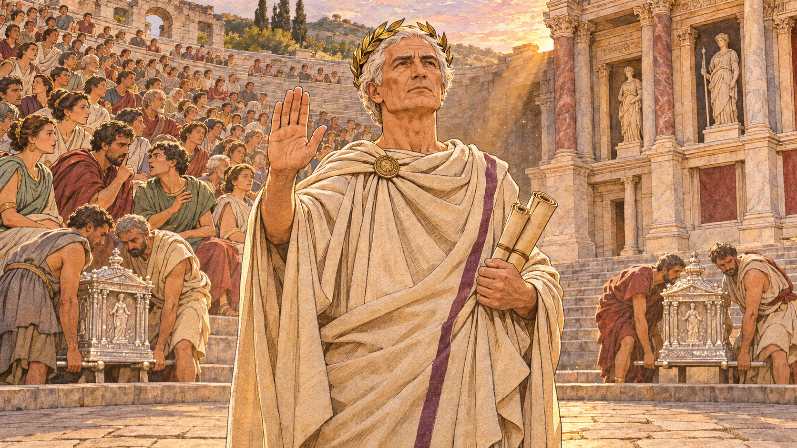
<details><summary>Image Prompt</summary>
(This is Panel 14. Do not include the panel number in the image.)
Style: a hand-drawn travel-sketchbook graphic-novel illustration, with clean dark ink outlines, flat softly shaded color fills and a faint watercolor paper texture, like a page from a traveler's journal; warm, sunlit, painterly lighting; no text, captions, signs, letters or speech bubbles anywhere in the image. Please generate a 16:9 image depicting panel 14 of 16. The orchestra floor of the Great Theater of Ephesus, about 55 CE, golden evening light. Roman palette: warm limestone, sea-green, deep red, bronze, evening gold. Medium shot, slightly low angle, centered on a single official standing alone on the flat orchestra, one hand raised for quiet. The town clerk of Ephesus, the city's chief official: a calm, spare, white-haired man of about sixty with a clean-shaven, lined face and a thoughtful, steady gaze, wearing a long cream wool mantle with a narrow purple stripe and a laurel wreath of office, a few papyrus scrolls tucked under one arm; composed and authoritative. Behind him the packed theater begins to fall silent: heads turn, mouths close, raised arms lower, and the silver shrines are lowered. Dust drifts in the slanting light; a few late shouters are shushed by their neighbors; a stage building with statues frames the scene. Mood: authority arriving, a held breath. Keep every character and place consistent with the other images in this story. Generate the image immediately without asking clarifying questions.
</details>

Finally the town clerk, the city's chief official, quiets the crowd. Everyone knows, he says, that Ephesus is the temple warden of great Artemis, so there is no need for violence. If Demetrius has a complaint, the courts are open and there are proconsuls; anything further belongs to the lawful assembly. And as things stand, the city is in danger of being charged with rioting. With that he dismisses the gathering.

> **Myth or Evidence?** Every local detail of this scene fits what inscriptions say about Ephesus: the theater as the place of assembly, the title temple warden (neokoros), the town clerk (grammateus) as a leading magistrate, and the Asiarchs. That shows the author knew how Ephesus worked. It does not prove every word of the scene happened as told.

## Panel 15: Paul Leaves

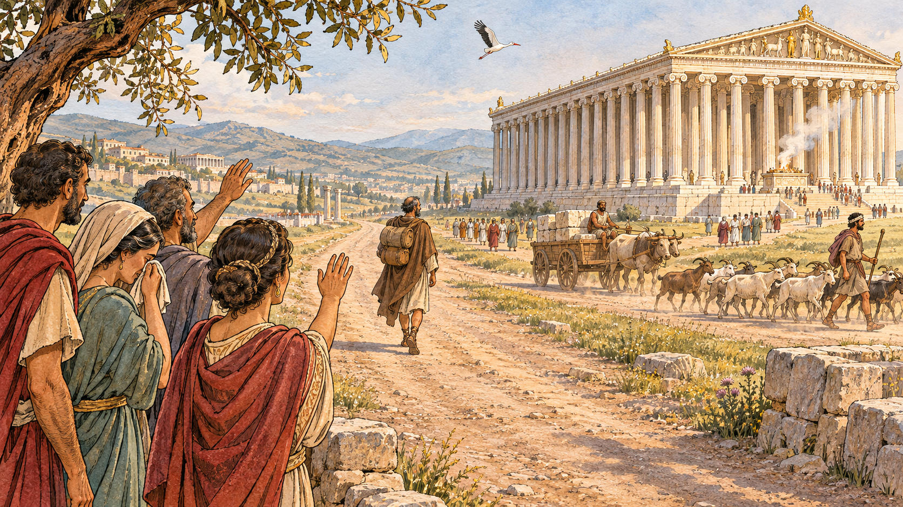
<details><summary>Image Prompt</summary>
(This is Panel 15. Do not include the panel number in the image.)
Style: a hand-drawn travel-sketchbook graphic-novel illustration, with clean dark ink outlines, flat softly shaded color fills and a faint watercolor paper texture, like a page from a traveler's journal; warm, sunlit, painterly lighting; no text, captions, signs, letters or speech bubbles anywhere in the image. Please generate a 16:9 image depicting panel 15 of 16. The road out of Ephesus toward the north, about 55 CE, early morning. Roman palette: warm limestone, sea-green, deep red, bronze, evening gold. Wide establishing view along a dusty road across a flat plain. In the middle distance a small traveler walks away with a pack on his back: Paul of Tarsus, about fifty years old: a lean, wiry man of middle height with a weathered olive complexion, receding dark hair graying at the temples, a short graying beard and deep-set, intense dark eyes, wearing a plain undyed wool tunic under a brown traveler's cloak, rope sandals, and calloused, leather-stained hands; earnest, patient and tireless. A little group of friends stands at the road's edge behind him, waving, one wiping an eye. Beside the road, across the plain: The Temple of Artemis at Ephesus: a colossal Ionic marble temple on a high stepped platform on a flat plain, surrounded by a double ring of slender fluted white columns about eighteen meters tall with scrolled capitals, gleaming gold-white in the sun, with smoke from offerings rising from an altar in front. Pilgrims move toward it in small groups; a cart of stone and a herd of goats cross the road; a stork wheels in the pale sky. Mood: parting, a long road ahead. Keep every character and place consistent with the other images in this story. Generate the image immediately without asking clarifying questions.
</details>

Soon after, Acts says, Paul sends for his friends, encourages them, and leaves for Macedonia. The temple he passes will stand for two more centuries, until the Goths damage it in the 260s CE. When the pagan temples are closed at the end of the 4th century, it becomes a quarry. Paul's letters, meanwhile, are copied and carried from house to house.

## Panel 16: The Theater Today

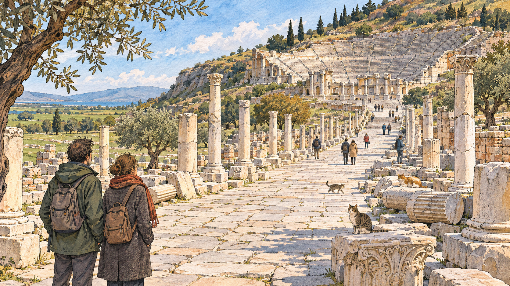
<details><summary>Image Prompt</summary>
(This is Panel 16. Do not include the panel number in the image.)
Style: a hand-drawn travel-sketchbook graphic-novel illustration, with clean dark ink outlines, flat softly shaded color fills and a faint watercolor paper texture, like a page from a traveler's journal; warm, sunlit, painterly lighting; no text, captions, signs, letters or speech bubbles anywhere in the image. Please generate a 16:9 image depicting panel 16 of 16. Ephesus, today, bright November morning. natural daylight, whitewashed pale stone, sea blue, terracotta, olive. Wide establishing view looking up the wide colonnaded street from the old harbor road toward the great theater on its hillside, matching the viewpoint of panel 1 as closely as possible. The theater's pale limestone seats and the ruined stage building rise above the street, now empty except for scattered visitors in coats; broken columns, fallen drums and a few stray cats line the paving; olive and cypress trees stand on the slope; the former harbor is a green field in the distance. In the foreground, seen small and from behind: Two adult travelers seen from behind or in distant three-quarter view, dressed for cool November weather: one in a dark green rain jacket, the other in a charcoal wool coat with a rust-colored scarf, both with small daypacks, standing close together and looking at the view. Faces are never shown in detail. Mood: reflective, quiet, the noise of the past gone. Keep every character and place consistent with the other images in this story. Generate the image immediately without asking clarifying questions.
</details>

Today the same street runs between broken columns toward the same theater, now silent. The harbor has silted up into fields, and of the Temple of Artemis only one re-erected column stands in a hollow near Selçuk, often with a stork's nest on top. The silver shrines have not survived, because silver was usually melted down. The letters, copied and read for nearly two thousand years, are still read every week.

### Epilogue - Why the Letters Outlived the Temple

Demetrius was not a villain. He saw a new idea threatening both his income and his world, and he said so plainly. The town clerk did not defend Paul; he defended the city's courts and procedures, and the crowd went home. Paul left, and his words stayed, carried by trusted couriers, read aloud to rooms of people who could not read, and copied from house to house, while the great temple was damaged, then quarried, until a single column stands. This is a Learning for All story: a letter read aloud lets a whole room share a text, and a copy lets the next room do the same, long before there was a printing press.

| Challenge | How They Responded | Lesson for Today |
|---|---|---|
| A new teaching threatens a livelihood | Demetrius gathered the craftsmen and named both the money and the honor at stake | Resistance has reasons; hear those who stand to lose. |
| A mob in a theater | The town clerk calmed it with the city's courts, its assembly, and the danger of a charge of rioting | Procedure can cool a crowd better than argument. |
| Teaching a whole province from one city | Paul based himself in a hub, worked at a trade, taught daily, and wrote letters | Choose a hub, stay long enough, and write things down. |
| A text that must travel without its author | He sent each letter with a trusted carrier who could explain it, and listeners copied it | A durable text plus a person to interpret it is a teaching technology. |

### Call to Action

When you stand in the Great Theater, look up at the top rows and imagine 25,000 voices, then walk to Selçuk and find the single column of the Temple of Artemis. Ask your guide the two questions from the chapter: does this come from Acts, from Paul's letters, or from tradition, and how old is the earliest source? Then notice how many people still read Paul's words aloud on Sunday, and who could not read them in his day.

---

## Voices from the Sources

- "Great is Artemis of the Ephesians!": the chant of the crowd in Acts 19, repeated for about two hours. It is quoted in the chapters from Acts, whose scene is told a generation after the events.
- "I will stay in Ephesus until Pentecost" and "a wide door for effective work has opened to me, though there are many adversaries": from Paul's own first letter to the Corinthians (16:8-9), one of the few pieces of writing we can place in Ephesus with certainty.
- We do not quote the town clerk or Demetrius: their speeches in Acts are the author's own composition, as the chapters explain, so we paraphrase them in the panels and mark them as Acts' telling.

## On the Trip

- **Chapters:** [9. Paul's Life and Letters](../../chapters/09-paul-life-letters/index.md) and [11. Paul's Ideas and Leadership](../../chapters/11-paul-ideas-leadership/index.md); the city itself is in [10. Ephesus, a Greco-Roman City](../../chapters/10-ephesus-greco-roman-city/index.md)
- **Where to look:** the Great Theater of Ephesus, which in its final Roman form held about 25,000 people; the long inscription on its wall recording silver statues of Artemis carried into the theater in 104 CE; and, in Selçuk, the single re-erected column that is all that stands of the Temple of Artemis.
- **Explore further:** [How Paul's Words Traveled](../../sims/how-pauls-words-traveled/index.md) and [Where in Paul's Life Was Each Letter Written?](../../sims/paul-letters-on-his-timeline/index.md)
- **Look Closer:** Glaux says: "Look closer. The top rows of the theater are worth a climb." Glaux hid in Panel 13 (Two Hours of Chanting), perched on the stone parapet of the theater's top row, partly hidden behind a pillar.

## Characters and Style

This story follows the shared series bible: [Story Characters, Places and House Style](../characters.md). Glaux's identity comes from the mascot's [character sheet](../../img/mascot/character-sheet.md).

## References

1. [Wikipedia: Ephesus](https://en.wikipedia.org/wiki/Ephesus) - History and archaeology of the city
2. [Wikipedia: Temple of Artemis](https://en.wikipedia.org/wiki/Temple_of_Artemis) - The temple, one of the Seven Wonders, and its fate
3. [Wikipedia: Paul the Apostle](https://en.wikipedia.org/wiki/Paul_the_Apostle) - Biography, letters and the Ephesus years
4. [Encyclopaedia Britannica: Saint Paul the Apostle](https://www.britannica.com/biography/Saint-Paul-the-Apostle) - Overview of Paul's life and letters
5. [UNESCO World Heritage Centre: Ephesus](https://whc.unesco.org/en/list/1018) - Official listing and description of the site
