# Halfdan Was Here

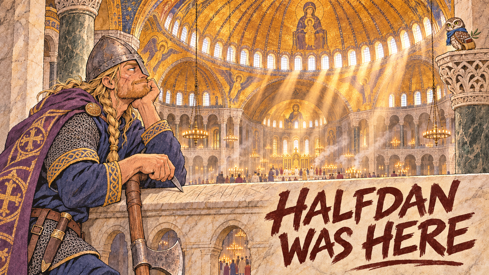
<details>
<summary>Cover Image Prompt</summary>
(This is the Cover Image. Do not include this label in the image.)
Style: a hand-drawn travel-sketchbook graphic-novel illustration, with clean dark ink outlines, flat softly shaded color fills and a faint watercolor paper texture, like a page from a traveler's journal; warm, sunlit, painterly lighting; no text, captions, signs, letters or speech bubbles anywhere in the image.
Please generate a wide-landscape 16:9 cover image for a graphic novel. Interior of Hagia Sophia's upper gallery in about 1000 CE, seen from low behind a marble balustrade. Foreground left: Halfdan, in profile, leaning on the marble railing with his axe grounded and scratching with a knife point, looking bored. Beyond the railing, the immense golden dome seems to float on its ring of forty windows, with shafts of amber light falling through candle smoke over tiny figures far below. Glaux sits tiny on a column capital in the upper right. Palette: gold leaf, deep blue, imperial purple, candle amber and cream marble. Emotional tone: wonder with a grin. Render the story title as bold, hand-lettered title text across the lower right, exactly: "HALFDAN WAS HERE". No other text anywhere. Do not draw any legible runes or letters on the railing, only abstract scratch marks.
Halfdan, a Norse soldier of the emperor's Varangian Guard: a tall, broad-shouldered man of about thirty with long braided blond hair, a trimmed reddish-blond beard, pale blue eyes and a weathered, bored expression, wearing a conical steel helmet with a nose guard, a mail shirt under a deep-blue tunic edged in gold, and a long-handled axe held upright at rest, with a small knife at his belt.
Hagia Sophia in Constantinople: a vast cream-and-ochre brick church crowned by one enormous shallow central dome ringed with a band of forty small arched windows, with a half-dome on either side and four tall minarets (add the minarets only in scenes after 1453); gold mosaics glowing inside.
This scene is inside the church, in about 1000 CE. Glaux the Little Owl: a true little owl (Athene noctua), small, round and compact, with a flat rounded head and no ear tufts, warm earth-brown plumage with cream spots, bright lemon-yellow eyes under pale cream eyebrows, a cream-white throat patch and a short pale greenish-yellow beak. Glaux wears a small Aegean-blue scarf and a tan canvas satchel across the body with a small leather-bound travel notebook peeking out, and a sprig of three olive leaves tucked into the satchel strap. Alert, curious and warm expression. Glaux is drawn small, perched at the edge of the scene, noticeable on a second look.
Keep every character and place consistent with the other images in this story. Generate the image immediately without asking clarifying questions.
</details>

<details>
<summary>Narrative Prompt</summary>
**Era and places.** Constantinople in January 532 CE (after the Nika riots), the building years 532 to 537, the dome's collapse in 558 and rebuilding to 562, then about 1000 CE (the era usually proposed for the Norse graffiti), and finally Hagia Sophia today. **Themes.** How a building's design solves a geometry problem, how a great church shows its long afterlife, and how an ordinary person leaves a mark that outlives empires. **Palette.** gold leaf, deep blue, imperial purple, candle amber and cream marble; the final panel uses natural daylight, sea blue, terracotta and olive-green accents. **House style.** Every prompt begins with the series house-style line from [Story Characters, Places and House Style](../characters.md). Panels contain no lettering; only the cover carries the title. The runes in panels 11 and 12 are drawn only as abstract angular scratch marks, never as readable text.

**Creative liberties and cautions.** The designers, the emperor and the historian Procopius are real people whose faces are not securely known, so each is a plausible invention. Halfdan is a character built around a real inscription: we do not know who carved it, when, or why, and the guard is a plausible reading rather than a fact. The first dome and the ring of forty windows follow the book's [chapter on Byzantine Constantinople](../../chapters/04-byzantine-constantinople/index.md), which says the original dome was shallower than today's. This story uses Hagia Sophia before 1453, so no minarets appear. The Nika riots are shown only by smoke, ashes and an empty racetrack; no casualties are shown. The dome's collapse is shown by rubble and daylight, with no victims.

**Cast.**

- Glaux: see [docs/stories/characters.md](../characters.md) and [docs/img/mascot/character-sheet.md](../../img/mascot/character-sheet.md). Glaux is a silent observer and appears in one panel (panel 10).
- Hagia Sophia and the Travelers: see [docs/stories/characters.md](../characters.md).
- Justinian, Anthemius, Isidore of Miletus, Isidore the Younger, Procopius and Halfdan appear only in this story; paste their blocks verbatim:

```text
Emperor Justinian I, about fifty years old: a broad-faced man with short, thinning dark-brown hair, a clean-shaven, serious face and dark, restless eyes, wearing a long imperial-purple cloak pinned at the right shoulder with a gold brooch and a gold-embroidered rectangular panel on the chest, a white tunic with gold bands, red leather shoes and a jeweled gold-and-pearl diadem.
```

```text
Anthemius of Tralles, mathematician and architect: a thin man of about fifty-five with a long gray beard, a high bald forehead and sharp, thoughtful eyes, wearing a plain dark-blue tunic with an ink-stained cuff and a gray cloak, holding a bronze compass and a straightedge.
```

```text
Isidore of Miletus, geometer: a sturdy man of about forty-five with a short black beard, a round, kind face and quick hands, wearing an ochre tunic and a brown cloak, holding a rolled parchment plan and a small wooden model of a dome.
```

```text
Isidore the Younger, nephew of Isidore of Miletus: a lean man of about thirty-five with a short brown beard and a broad nose like his uncle's, wearing an ochre tunic and a brown cloak, holding a rolled parchment plan.
```

```text
Procopius of Caesarea, historian: a lean man of about fifty with a neat gray beard and ink-stained fingers, wearing a plain dark-green tunic and cloak, holding a reed pen and a blank parchment scroll.
```

```text
Halfdan, a Norse soldier of the emperor's Varangian Guard: a tall, broad-shouldered man of about thirty with long braided blond hair, a trimmed reddish-blond beard, pale blue eyes and a weathered, bored expression, wearing a conical steel helmet with a nose guard, a mail shirt under a deep-blue tunic edged in gold, and a long-handled axe held upright at rest, with a small knife at his belt.
```
</details>

### Prologue - A Name on a Railing

In January 532 CE the center of Constantinople is on fire, and the emperor Justinian has just nearly lost his throne. Within six years he opens a church with a dome so wide and so bright that it seems to hang from heaven. Then, centuries later, someone leans on a marble railing in the upper gallery, gets bored, and scratches a name into it. The name is still there.

**Find Glaux:** Glaux hides in one panel of this story. Can you spot the little owl?

## Panel 1: The Ashes of Nika
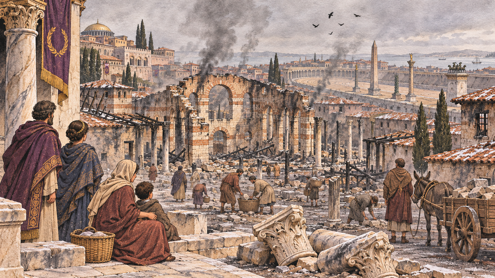
<details><summary>Image Prompt</summary>
(This is Panel 01. Do not include the panel number in the image.)
I am about to ask you to generate a series of images for a graphic novel. Please make the images have a consistent style and consistent characters. Do not ask any clarifying questions. Just generate the image immediately when asked.
Style: a hand-drawn travel-sketchbook graphic-novel illustration, with clean dark ink outlines, flat softly shaded color fills and a faint watercolor paper texture, like a page from a traveler's journal; warm, sunlit, painterly lighting; no text, captions, signs, letters or speech bubbles anywhere in the image.
Please generate a 16:9 image depicting panel 1 of 12. Constantinople in January 532 CE, the week after the Nika riots, gray winter light with smoke drifting. Palette: gold leaf, deep blue, imperial purple, candle amber and cream marble, dulled by ash gray and charcoal black. Wide establishing shot from a raised terrace looking across a smoking district: the roofless, blackened walls of a burned church stand at center, rows of burnt columns and charred roof beams around it, thin smoke columns rising. In the middle distance, the long empty curve of the Hippodrome racetrack with its row of old monuments. Foreground: small groups of townspeople seen from behind, carrying baskets and clearing rubble, a woman sitting on a stone with a child, a man with a donkey cart. Details: scorched marble capitals lying in the street, a few surviving cypress trees, a flock of crows, the pale Sea of Marmara glimpsed beyond, ash-streaked walls. No bodies or violence shown. Tone: stunned, solemn, quiet.
Hagia Sophia is not the building shown here; this is the earlier, burned church on the same site, drawn only as a roofless shell of cream-and-ochre brick.
Keep every character and place consistent with the other images in this story. Generate the image immediately without asking clarifying questions.
</details>

In January 532 CE the Nika riots, whose rallying cry means "Conquer!", burn the center of Constantinople for a week. The Hagia Sophia of the day, the city's cathedral, is a blackened shell. Citizens pick through the ashes in silence beneath a gray sky. Justinian has survived the uprising, but the city he rules is in ruins.

## Panel 2: An Emperor Decides
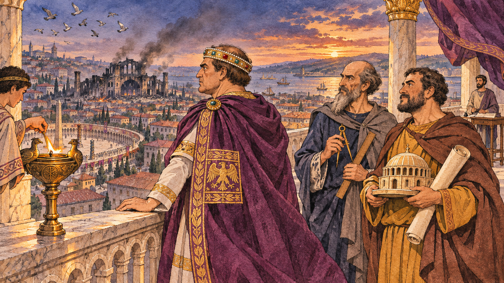
<details><summary>Image Prompt</summary>
(This is Panel 02. Do not include the panel number in the image.)
Style: a hand-drawn travel-sketchbook graphic-novel illustration, with clean dark ink outlines, flat softly shaded color fills and a faint watercolor paper texture, like a page from a traveler's journal; warm, sunlit, painterly lighting; no text, captions, signs, letters or speech bubbles anywhere in the image.
Please generate a 16:9 image depicting panel 2 of 12. A palace terrace overlooking Constantinople at dusk, February 532 CE. Palette: gold leaf, deep blue, imperial purple, candle amber and cream marble, with a sky of deep blue and amber. Medium-wide shot from behind and slightly to the side: Justinian in profile at left, one hand resting on a marble parapet and looking out over the smoke-stained city and the black shell of the burned church; at his right, Anthemius and Isidore of Miletus stand a little behind him, Anthemius with a compass and straightedge, Isidore with his plan roll and a small dome model. Details: a bronze oil lamp being lit on a stand, a purple curtain stirring in the wind, a scribe waiting at a distance, a flock of pigeons over the Hippodrome, distant fishing boats on the Bosphorus, warm lamplight on the marble. Tone: resolve after disaster.
Emperor Justinian I, about fifty years old: a broad-faced man with short, thinning dark-brown hair, a clean-shaven, serious face and dark, restless eyes, wearing a long imperial-purple cloak pinned at the right shoulder with a gold brooch and a gold-embroidered rectangular panel on the chest, a white tunic with gold bands, red leather shoes and a jeweled gold-and-pearl diadem.
Anthemius of Tralles, mathematician and architect: a thin man of about fifty-five with a long gray beard, a high bald forehead and sharp, thoughtful eyes, wearing a plain dark-blue tunic with an ink-stained cuff and a gray cloak, holding a bronze compass and a straightedge.
Isidore of Miletus, geometer: a sturdy man of about forty-five with a short black beard, a round, kind face and quick hands, wearing an ochre tunic and a brown cloak, holding a rolled parchment plan and a small wooden model of a dome.
Keep every character and place consistent with the other images in this story. Generate the image immediately without asking clarifying questions.
</details>

Justinian stands on a palace terrace and looks at the ashes. Instead of choosing a master builder, he sends for two scholars: Anthemius of Tralles, a mathematician, and Isidore of Miletus, a geometer. He asks for a church unlike any in the world. According to the book's chapter, work begins on February 23, 532, only five weeks after the fires.

## Panel 3: Drawing a Dome
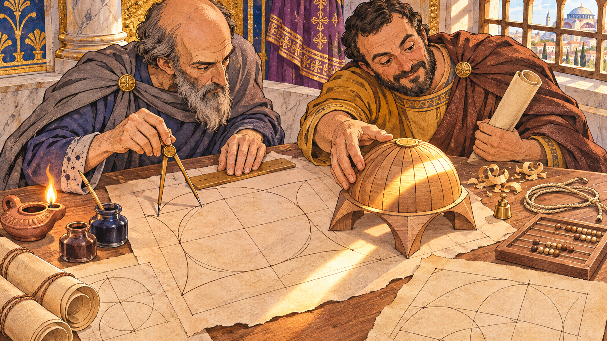
<details><summary>Image Prompt</summary>
(This is Panel 03. Do not include the panel number in the image.)
Style: a hand-drawn travel-sketchbook graphic-novel illustration, with clean dark ink outlines, flat softly shaded color fills and a faint watercolor paper texture, like a page from a traveler's journal; warm, sunlit, painterly lighting; no text, captions, signs, letters or speech bubbles anywhere in the image.
Please generate a 16:9 image depicting panel 3 of 12. A workroom in the imperial palace, Constantinople, early 532 CE, warm candle and window light. Palette: gold leaf, deep blue, imperial purple, candle amber and cream marble. Close, high-angle shot onto a wooden table: parchment sheets covered in circles, squares and arcs drawn with a bronze compass; a small wooden dome model resting on four curved wooden triangles at its corners. Left: Anthemius, leaning in, pointing with the compass. Right: Isidore of Miletus, turning the model so a shaft of light crosses it. Details: ink pots, a clay lamp, rolled plans, a measuring cord, a counting board, wood shavings, a tiny brass weight. The drawings are only abstract geometric lines, no lettering. Tone: absorbed, curious.
Anthemius of Tralles, mathematician and architect: a thin man of about fifty-five with a long gray beard, a high bald forehead and sharp, thoughtful eyes, wearing a plain dark-blue tunic with an ink-stained cuff and a gray cloak, holding a bronze compass and a straightedge.
Isidore of Miletus, geometer: a sturdy man of about forty-five with a short black beard, a round, kind face and quick hands, wearing an ochre tunic and a brown cloak, holding a rolled parchment plan and a small wooden model of a dome.
Keep every character and place consistent with the other images in this story. Generate the image immediately without asking clarifying questions.
</details>

The two scholars face a geometry problem: how to set a round dome on a square room. Their answer is the pendentive, a curved triangle of masonry that fills each corner between two arches. On a table, Anthemius draws circles and Isidore turns a small wooden model so the light falls from the right side. The dome they plan is shallower than the one we see today.

## Panel 4: Six Years of Stone
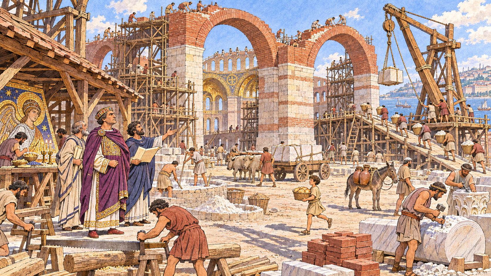
<details><summary>Image Prompt</summary>
(This is Panel 04. Do not include the panel number in the image.)
Style: a hand-drawn travel-sketchbook graphic-novel illustration, with clean dark ink outlines, flat softly shaded color fills and a faint watercolor paper texture, like a page from a traveler's journal; warm, sunlit, painterly lighting; no text, captions, signs, letters or speech bubbles anywhere in the image.
Please generate a 16:9 image depicting panel 4 of 12. The building site of Hagia Sophia, Constantinople, about 535 CE, bright afternoon light. Palette: gold leaf, deep blue, imperial purple, candle amber and cream marble, with brick red and pale dust. Wide establishing shot, slightly raised: four huge brick-and-stone piers and great curved arches rising from the foundations, lashed timber scaffolding and ramps swarming with workers in short tunics carrying baskets of mortar, ox-carts hauling pale marble blocks, a wooden crane with a rope and pulley lifting a stone. Near a work shed, a tiny figure in purple (Justinian) inspects with his two scholars. Details: stacked bricks, lime pits, men sawing timber, a donkey with water jars, stonecutters chiseling a column drum, a child delivering bread, a line of shadows on the dust. Tone: energy, scale.
Hagia Sophia in Constantinople: a vast cream-and-ochre brick church crowned by one enormous shallow central dome ringed with a band of forty small arched windows, with a half-dome on either side and four tall minarets (add the minarets only in scenes after 1453); gold mosaics glowing inside.
This scene is unfinished construction in the 530s, so draw only partly built piers and arches, no minarets and no finished dome.
Emperor Justinian I, about fifty years old: a broad-faced man with short, thinning dark-brown hair, a clean-shaven, serious face and dark, restless eyes, wearing a long imperial-purple cloak pinned at the right shoulder with a gold brooch and a gold-embroidered rectangular panel on the chest, a white tunic with gold bands, red leather shoes and a jeweled gold-and-pearl diadem.
Keep every character and place consistent with the other images in this story. Generate the image immediately without asking clarifying questions.
</details>

Thousands of workers pour onto the site. Ox-carts bring marble and brick from across the empire, masons set great piers, and carpenters raise timber scaffolding taller than a ship's mast. The church goes up fast, in less than six years, and the whole city can watch it grow. Somewhere in the crowd, a small figure of the emperor appears to inspect the work.

## Panel 5: The Ring of Light
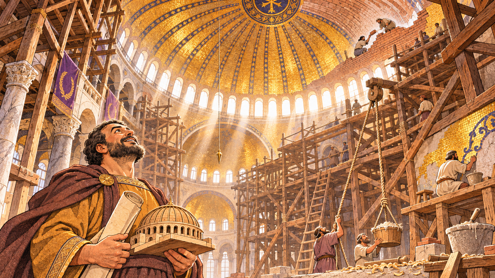
<details><summary>Image Prompt</summary>
(This is Panel 05. Do not include the panel number in the image.)
Style: a hand-drawn travel-sketchbook graphic-novel illustration, with clean dark ink outlines, flat softly shaded color fills and a faint watercolor paper texture, like a page from a traveler's journal; warm, sunlit, painterly lighting; no text, captions, signs, letters or speech bubbles anywhere in the image.
Please generate a 16:9 image depicting panel 5 of 12. The interior of Hagia Sophia's dome under construction, about 537 CE, light streaming through newly opened windows. Palette: gold leaf, deep blue, imperial purple, candle amber and cream marble. Dramatic low-angle shot from the floor looking up through a forest of wooden scaffolding at the nearly complete shallow dome, where small figures of masons place the final bricks; a ring of forty arched windows around the dome's base is flooded with white-gold daylight. Foreground bottom: Isidore of Miletus with his roll of plans, head tilted back, looking up in awe. Details: dust motes in the light shafts, a hanging plumb line, a hoist rope, half-set gold mosaic patches on a wall, scattered wood chips, ladders, a bucket of mortar. Tone: awe, breathless anticipation.
Hagia Sophia in Constantinople: a vast cream-and-ochre brick church crowned by one enormous shallow central dome ringed with a band of forty small arched windows, with a half-dome on either side and four tall minarets (add the minarets only in scenes after 1453); gold mosaics glowing inside.
This scene is inside the church while it is being completed.
Isidore of Miletus, geometer: a sturdy man of about forty-five with a short black beard, a round, kind face and quick hands, wearing an ochre tunic and a brown cloak, holding a rolled parchment plan and a small wooden model of a dome.
Keep every character and place consistent with the other images in this story. Generate the image immediately without asking clarifying questions.
</details>

At last the dome closes. Masons on scaffolding lay the final courses, and below them forty arched windows open around the base, letting daylight pour in. Seen from the floor, the light hides the supports, so the dome seems to float. Isidore of Miletus watches from below with his plan in hand.

## Panel 6: The Dedication
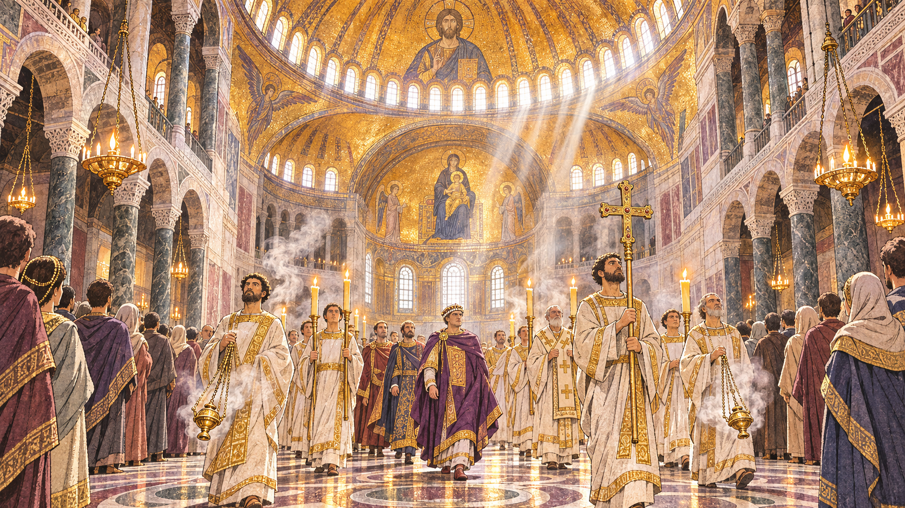
<details><summary>Image Prompt</summary>
(This is Panel 06. Do not include the panel number in the image.)
Style: a hand-drawn travel-sketchbook graphic-novel illustration, with clean dark ink outlines, flat softly shaded color fills and a faint watercolor paper texture, like a page from a traveler's journal; warm, sunlit, painterly lighting; no text, captions, signs, letters or speech bubbles anywhere in the image.
Please generate a 16:9 image depicting panel 6 of 12. The interior of Hagia Sophia on December 27, 537 CE, midday, candle and window light. Palette: gold leaf, deep blue, imperial purple, candle amber and cream marble. Wide shot from the floor level, looking up the great nave toward the east end: a procession of clergy in white and gold robes with tall candles, incense smoke rising, Justinian small at the center walking forward beneath the dome, a few courtiers behind him. The dome above seems to float on its ring of forty windows. Details: gold-leaf mosaics glinting on the vaults, colored marble floors in swirling patterns, incense censers on chains, hanging oil lamps, a deacon holding a tall cross, shafts of white-gold light, worshippers lining the aisles seen from behind. Tone: grandeur, reverence.
Hagia Sophia in Constantinople: a vast cream-and-ochre brick church crowned by one enormous shallow central dome ringed with a band of forty small arched windows, with a half-dome on either side and four tall minarets (add the minarets only in scenes after 1453); gold mosaics glowing inside.
This scene is inside the church in 537.
Emperor Justinian I, about fifty years old: a broad-faced man with short, thinning dark-brown hair, a clean-shaven, serious face and dark, restless eyes, wearing a long imperial-purple cloak pinned at the right shoulder with a gold brooch and a gold-embroidered rectangular panel on the chest, a white tunic with gold bands, red leather shoes and a jeweled gold-and-pearl diadem.
Keep every character and place consistent with the other images in this story. Generate the image immediately without asking clarifying questions.
</details>

On December 27, 537, Justinian enters the finished church in procession, candles lit and the light from forty windows falling on the gold. A famous line says he cries out, "Solomon, I have outdone thee!", comparing his church with Solomon's Temple. The scene is easy to picture but the line is a much later story.

> **Myth or Evidence?** Legend. The line "Solomon, I have outdone thee" first appears in an anonymous text called the Diegesis, written about three hundred years after Justinian. Procopius, who wrote in the 550s, and Paul the Silentiary, who wrote in 563, do not mention it. The dedication on December 27, 537 is documented.

## Panel 7: A Golden Chain from Heaven
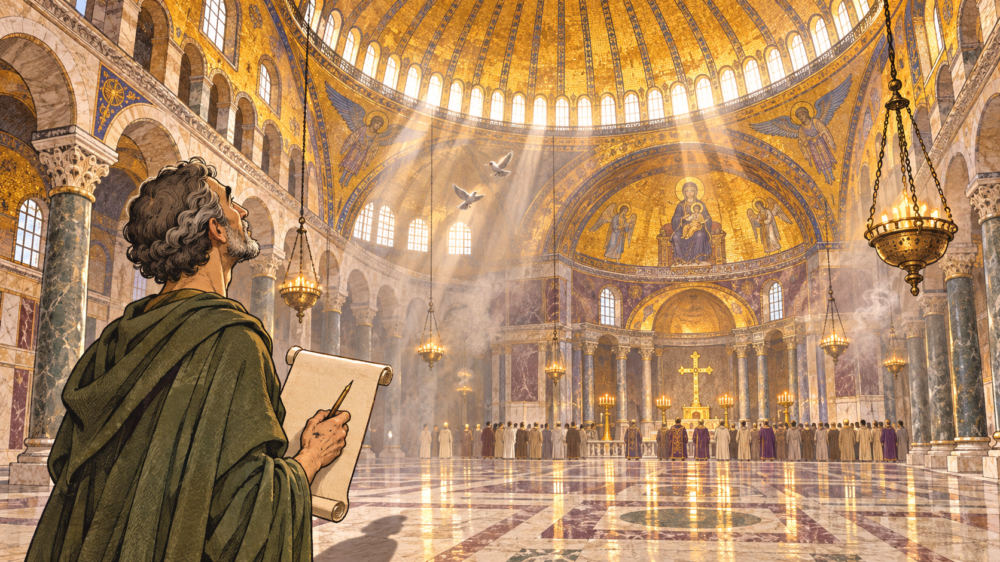
<details><summary>Image Prompt</summary>
(This is Panel 07. Do not include the panel number in the image.)
Style: a hand-drawn travel-sketchbook graphic-novel illustration, with clean dark ink outlines, flat softly shaded color fills and a faint watercolor paper texture, like a page from a traveler's journal; warm, sunlit, painterly lighting; no text, captions, signs, letters or speech bubbles anywhere in the image.
Please generate a 16:9 image depicting panel 7 of 12. The nave of Hagia Sophia, 550s CE, morning. Palette: gold leaf, deep blue, imperial purple, candle amber and cream marble. Medium shot from behind and slightly below: Procopius at lower left, in profile three-quarters from behind, head tilted back, holding a reed pen and a blank parchment scroll, looking up at the dome that glows over him on its ring of forty windows. Light streams down in angled shafts through the incense haze. Details: a polished marble floor with reflections, hanging bronze lamps, a distant row of worshippers, a gold cross in an apse, two gray doves in the light, his own small shadow on the marble. Tone: wonder and reflection.
Hagia Sophia in Constantinople: a vast cream-and-ochre brick church crowned by one enormous shallow central dome ringed with a band of forty small arched windows, with a half-dome on either side and four tall minarets (add the minarets only in scenes after 1453); gold mosaics glowing inside.
This scene is inside the church.
Procopius of Caesarea, historian: a lean man of about fifty with a neat gray beard and ink-stained fingers, wearing a plain dark-green tunic and cloak, holding a reed pen and a blank parchment scroll.
Keep every character and place consistent with the other images in this story. Generate the image immediately without asking clarifying questions.
</details>

A historian named Procopius stands in the nave and looks up. He will write that the dome seems not to rest on stone at all but to hang from heaven by a golden chain. He is writing for the emperor, so we read his praise with that in mind, but the sensation he describes is what visitors still feel.

## Panel 8: The Dome Falls
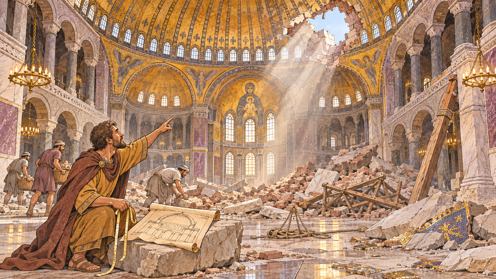
<details><summary>Image Prompt</summary>
(This is Panel 08. Do not include the panel number in the image.)
Style: a hand-drawn travel-sketchbook graphic-novel illustration, with clean dark ink outlines, flat softly shaded color fills and a faint watercolor paper texture, like a page from a traveler's journal; warm, sunlit, painterly lighting; no text, captions, signs, letters or speech bubbles anywhere in the image.
Please generate a 16:9 image depicting panel 8 of 12. The interior of Hagia Sophia after the partial collapse, 558 CE, a few days later. Palette: gold leaf, deep blue, imperial purple, candle amber and cream marble, dulled with dust and pale gray. Wide shot from the nave looking east: a heap of fallen bricks, broken ribs of masonry and a splintered piece of scaffolding across the floor, a jagged gap in the eastern part of the dome through which a broad shaft of daylight falls with swirling dust. Foreground: Isidore the Younger kneeling beside a flat stone, unrolling a parchment plan and pointing upward, a tape cord in his other hand. Behind him, a few workers with baskets begin clearing rubble. Details: shattered marble slabs, a leaning wooden prop, scattered mosaic pieces glinting, a rope sling, dust on the polished floor. No injured people shown. Tone: sobered, determined.
Hagia Sophia in Constantinople: a vast cream-and-ochre brick church crowned by one enormous shallow central dome ringed with a band of forty small arched windows, with a half-dome on either side and four tall minarets (add the minarets only in scenes after 1453); gold mosaics glowing inside.
This scene is inside the church after a partial dome collapse in 558.
Isidore the Younger, nephew of Isidore of Miletus: a lean man of about thirty-five with a short brown beard and a broad nose like his uncle's, wearing an ochre tunic and a brown cloak, holding a rolled parchment plan.
Keep every character and place consistent with the other images in this story. Generate the image immediately without asking clarifying questions.
</details>

Earthquakes weaken the shallow dome, and in May 558 its eastern part comes down. Isidore the Younger, nephew of the original designer, raises the new dome about six or seven meters higher, so that its steeper curve pushes outward less. The rebuilt dome is dedicated in 562.

## Panel 9: Men from the North
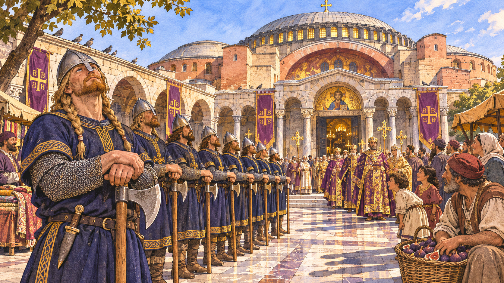
<details><summary>Image Prompt</summary>
(This is Panel 09. Do not include the panel number in the image.)
Style: a hand-drawn travel-sketchbook graphic-novel illustration, with clean dark ink outlines, flat softly shaded color fills and a faint watercolor paper texture, like a page from a traveler's journal; warm, sunlit, painterly lighting; no text, captions, signs, letters or speech bubbles anywhere in the image.
Please generate a 16:9 image depicting panel 9 of 12. The square before Hagia Sophia, Constantinople, about 1000 CE, bright feast-day morning. Palette: gold leaf, deep blue, imperial purple, candle amber and cream marble. Wide shot, eye level: a ceremonial line of eight to ten tall Varangian Guards in conical helmets, mail shirts under deep-blue tunics edged in gold, long axes upright at rest, standing in formation on a polished marble pavement in front of the church. In the foreground: Halfdan, the nearest guard, three-quarter view, looking up. Behind them, a procession of Byzantine nobles in purple and gold, a cluster of merchants and children watching, the enormous dome rising behind. Details: gold crosses gleaming, pigeons on the cornices, a street seller with a basket of figs, cobblestones with long shadows, banners hanging motionless. Tone: ceremony and boredom.
Halfdan, a Norse soldier of the emperor's Varangian Guard: a tall, broad-shouldered man of about thirty with long braided blond hair, a trimmed reddish-blond beard, pale blue eyes and a weathered, bored expression, wearing a conical steel helmet with a nose guard, a mail shirt under a deep-blue tunic edged in gold, and a long-handled axe held upright at rest, with a small knife at his belt.
Hagia Sophia in Constantinople: a vast cream-and-ochre brick church crowned by one enormous shallow central dome ringed with a band of forty small arched windows, with a half-dome on either side and four tall minarets (add the minarets only in scenes after 1453); gold mosaics glowing inside.
This is before 1453, so draw no minarets.
Keep every character and place consistent with the other images in this story. Generate the image immediately without asking clarifying questions.
</details>

Centuries pass. By about the year 1000 the emperors keep a bodyguard of tall foreign soldiers, many of them from Scandinavia and Rus, called the Varangian Guard. On a feast day a line of them in blue tunics and polished helmets stands before the great church. One of them, whom we will call Halfdan, studies the dome overhead with the attention of a man who has seen a lot of ceilings.

## Panel 10: The Long Service
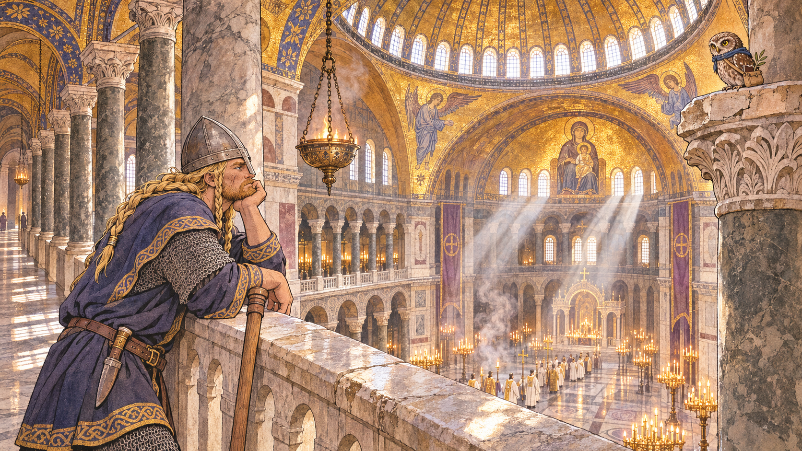
<details><summary>Image Prompt</summary>
(This is Panel 10. Do not include the panel number in the image.)
Style: a hand-drawn travel-sketchbook graphic-novel illustration, with clean dark ink outlines, flat softly shaded color fills and a faint watercolor paper texture, like a page from a traveler's journal; warm, sunlit, painterly lighting; no text, captions, signs, letters or speech bubbles anywhere in the image.
Please generate a 16:9 image depicting panel 10 of 12. The south gallery of Hagia Sophia, about 1000 CE, mid-morning, with amber candlelight and white window light. Palette: gold leaf, deep blue, imperial purple, candle amber and cream marble. Medium-wide shot from slightly behind and to one side of the gallery's marble balustrade: Halfdan at left, leaning on the railing with his axe grounded, chin on his hand, gazing down at the candlelit nave far below where tiny clergy in white and gold process. Rows of gray marble columns recede in the gallery, polished by centuries of use. Details: shafts of light cutting through incense smoke, gold mosaic gleams on the vault, a bronze lamp hanging from a chain, a chipped stone capital with a delicate acanthus leaf pattern, far below the glow of countless candles. In the upper right of the image, Glaux perches tiny on a column capital, watching Halfdan. Glaux is drawn small, perched at the edge of the scene, noticeable on a second look. Tone: boredom and drift.
Halfdan, a Norse soldier of the emperor's Varangian Guard: a tall, broad-shouldered man of about thirty with long braided blond hair, a trimmed reddish-blond beard, pale blue eyes and a weathered, bored expression, wearing a conical steel helmet with a nose guard, a mail shirt under a deep-blue tunic edged in gold, and a long-handled axe held upright at rest, with a small knife at his belt.
Hagia Sophia in Constantinople: a vast cream-and-ochre brick church crowned by one enormous shallow central dome ringed with a band of forty small arched windows, with a half-dome on either side and four tall minarets (add the minarets only in scenes after 1453); gold mosaics glowing inside.
This scene is inside the church before 1453.
Glaux the Little Owl: a true little owl (Athene noctua), small, round and compact, with a flat rounded head and no ear tufts, warm earth-brown plumage with cream spots, bright lemon-yellow eyes under pale cream eyebrows, a cream-white throat patch and a short pale greenish-yellow beak. Glaux wears a small Aegean-blue scarf and a tan canvas satchel across the body with a small leather-bound travel notebook peeking out, and a sprig of three olive leaves tucked into the satchel strap. Alert, curious and warm expression.
Keep every character and place consistent with the other images in this story. Generate the image immediately without asking clarifying questions.
</details>

Inside, the service goes on and on. The guard stands in the upper gallery, above the candlelit nave, resting his axe against the marble railing. Below, chanting rolls up to the dome and the incense smoke drifts through the shafts of light. Halfdan has been on his feet for hours, and his mind wanders to a village far to the north.

## Panel 11: A Knife and a Railing
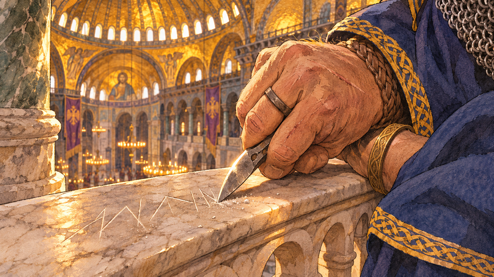
<details><summary>Image Prompt</summary>
(This is Panel 11. Do not include the panel number in the image.)
Style: a hand-drawn travel-sketchbook graphic-novel illustration, with clean dark ink outlines, flat softly shaded color fills and a faint watercolor paper texture, like a page from a traveler's journal; warm, sunlit, painterly lighting; no text, captions, signs, letters or speech bubbles anywhere in the image.
Please generate a 16:9 image depicting panel 11 of 12. A close-up detail of a marble balustrade in the south gallery of Hagia Sophia, about 1000 CE, warm light from the side. Palette: gold leaf, deep blue, imperial purple, candle amber and cream marble. Extreme close shot at slightly above eye level: a large, weathered hand (Halfdan's, with a plain iron ring) holds a small iron knife and scratches a row of thin, angular, straight-line marks into the cream-white, faintly veined marble railing. Fresh pale scratches contrast with the polished surface worn by many hands. Behind, softly blurred: the great gold dome glowing and the candlelit nave far below. Details: tiny marble dust on the railing, the guard's blue sleeve edged in gold, a braided cuff, a bronze arm-ring, a light shaft crossing the knife blade. The marks must be abstract angular scratches only, not legible letters. Tone: intimate, mischievous.
Halfdan, a Norse soldier of the emperor's Varangian Guard: a tall, broad-shouldered man of about thirty with long braided blond hair, a trimmed reddish-blond beard, pale blue eyes and a weathered, bored expression, wearing a conical steel helmet with a nose guard, a mail shirt under a deep-blue tunic edged in gold, and a long-handled axe held upright at rest, with a small knife at his belt.
Hagia Sophia in Constantinople: a vast cream-and-ochre brick church crowned by one enormous shallow central dome ringed with a band of forty small arched windows, with a half-dome on either side and four tall minarets (add the minarets only in scenes after 1453); gold mosaics glowing inside.
This scene is inside the church before 1453.
Keep every character and place consistent with the other images in this story. Generate the image immediately without asking clarifying questions.
</details>

The guard takes out a small knife, glances around, and begins to scratch into the marble. He cuts a few angular strokes, the straight-lined letters of the runic alphabet of his homeland. It takes a few minutes and is gone from his mind by the time the service ends. Almost no one ever notices.

> **Myth or Evidence?** Evidence, with limits. Runic graffiti survive on the marble railing of the upper south gallery. Scholars usually read them as a Norse name, Halfdan, and the line is often rendered as 'Halfdan was here.' The date is debated, roughly between 800 and 1100 CE. We do not know whether Halfdan was a guard, a merchant or a visitor; the Varangian Guard, formed around 988, is a plausible but unproven context.

## Panel 12: Find the Runes
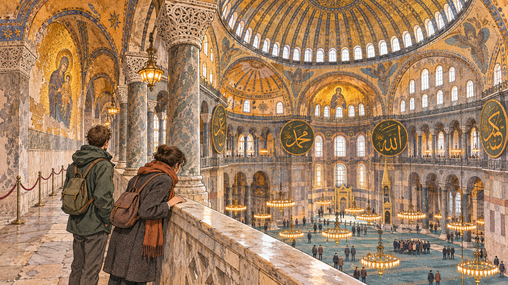
<details><summary>Image Prompt</summary>
(This is Panel 12. Do not include the panel number in the image.)
Style: a hand-drawn travel-sketchbook graphic-novel illustration, with clean dark ink outlines, flat softly shaded color fills and a faint watercolor paper texture, like a page from a traveler's journal; warm, sunlit, painterly lighting; no text, captions, signs, letters or speech bubbles anywhere in the image.
Please generate a 16:9 image depicting panel 12 of 12. The south gallery of Hagia Sophia today, late morning in November, soft daylight with gentle amber lamp glow. Palette: natural daylight, cream marble, gold leaf, deep blue and terracotta accents. Medium-wide shot, matching the earlier gallery view from slightly behind and to the side of the marble balustrade: two travelers stand at the railing at left, seen from behind, one leaning forward to look closely at the marble. Below: the vast nave with low hanging ring lamps, a carpeted floor with small figures, huge round dark-green panels with gold calligraphy high on the piers, and the dome floating overhead on its forty windows. Details: a silent museum-style rope line, worn stone flooring, light on the railing's polished edge, a distant tour group. Tone: quiet discovery, continuity.
Hagia Sophia in Constantinople: a vast cream-and-ochre brick church crowned by one enormous shallow central dome ringed with a band of forty small arched windows, with a half-dome on either side and four tall minarets (add the minarets only in scenes after 1453); gold mosaics glowing inside.
This scene is inside the church today.
Two adult travelers seen from behind or in distant three-quarter view, dressed for cool November weather: one in a dark green rain jacket, the other in a charcoal wool coat with a rust-colored scarf, both with small daypacks, standing close together and looking at the view. Faces are never shown in detail.
Keep every character and place consistent with the other images in this story. Generate the image immediately without asking clarifying questions.
</details>

Today the upper gallery is a quiet place above a busy floor. Two visitors lean on the same marble railing, searching for scratches the size of a thumbnail, while low circular lamps hang around them and the golden dome still seems to float. They find the marks and stand a long time looking. A name has outlived an empire.

### Epilogue - What Hagia Sophia Shows Us

Hagia Sophia is a building made by two scholars and a determined emperor, rebuilt by a nephew after a collapse, and visited by people from across the world, one of whom left a name on the railing. The great dome's story is a story of problem-solving and persistence. Halfdan's scratch is something different and just as valuable: evidence of an ordinary person, not a king or an architect, who could write in his own alphabet and wanted to leave his mark.

| Challenge | How They Responded | Lesson for Today |
|---|---|---|
| The 532 fires destroy the old church | Justinian chooses two scholars, a mathematician and a geometer, over a traditional builder. | Use the right expertise for a new kind of problem. |
| A round dome on a square room | Anthemius and Isidore invent a bold use of pendentives and a ring of windows. | A clever geometric idea can turn a limit into a masterpiece. |
| The dome falls in 558 | Isidore the Younger rebuilds it higher, with a steeper, safer curve. | Learn from failure and improve the design. |
| Who gets remembered? | A Norse soldier scratches runes in a few minutes, and they last a thousand years. | Ordinary writing is evidence too; ask who in a place could write, and what they chose to say. |

### Call to Action

When you climb to the upper gallery, slow down at the marble railing and look for the thin scratches. Remember that literacy, even a single name in a runic alphabet, was once a skill that set people apart, and that part of this book's Learning-for-All thread is the question of who got to write and who got their writing kept. Look closer, then try to read what you find.

---

## Voices from the Sources

- **Procopius, *Buildings* (written in the 550s), paraphrased.** He says the great dome seems not to rest on solid masonry but to hang from heaven by a golden chain. The book's [chapter on Byzantine Constantinople](../../chapters/04-byzantine-constantinople/index.md) notes that he saw the church new and wrote for the emperor, so the praise is partly propaganda. This is a paraphrase, not a direct quotation.
- **"Nika!" (532 CE).** The rallying cry of the riots means "Conquer!" and was normally shouted to cheer on a charioteer in the Hippodrome. It is documented in the sources for the riots.
- **"Solomon, I have outdone thee," attributed to Justinian.** First recorded in the Diegesis about three hundred years later, so it is a legend and not a documented sentence. We give it as "attributed to" because the earliest sources, Procopius and Paul the Silentiary, do not report it.

## On the Trip

- **Chapter:** [4. Byzantine Constantinople and Hagia Sophia](../../chapters/04-byzantine-constantinople/index.md)
- **Where to look:** the runic graffiti on the marble railing of the south gallery; the ring of forty windows at the dome's base and the curved pendentives beneath it; the great round calligraphy roundels on the piers; and the building's four lives as church, mosque, museum and mosque again.
- **Explore further:** [Source, Myth, or Contested?](../../sims/source-myth-or-contested/index.md), which tests the same skill of telling Procopius from the Solomon legend.
- **Look Closer:** Glaux's pointer: *"The runes are small and easy to miss. Look closer at the railing, not at the dome."* Glaux was hiding in panel 10, on a column capital in the upper gallery, above Halfdan's shoulder.

## Characters and Style

This story follows the shared series bible: [Story Characters, Places and House Style](../characters.md). Glaux's identity comes from the mascot's [character sheet](../../img/mascot/character-sheet.md).

## References

1. [Wikipedia: Hagia Sophia](https://en.wikipedia.org/wiki/Hagia_Sophia) - History, architecture and the building's changes of use
2. [Wikipedia: Nika riots](https://en.wikipedia.org/wiki/Nika_riots) - The 532 uprising that destroyed the earlier church
3. [Wikipedia: Varangian Guard](https://en.wikipedia.org/wiki/Varangian_Guard) - The elite guard of the Byzantine emperors, recruited from Scandinavia and Rus
4. [Britannica: Hagia Sophia](https://www.britannica.com/topic/Hagia-Sophia) - Overview of the building, its dome and its history
5. [UNESCO World Heritage: Historic Areas of Istanbul](https://whc.unesco.org/en/list/356) - The official listing that includes Hagia Sophia
