# The Head Teacher in the Park

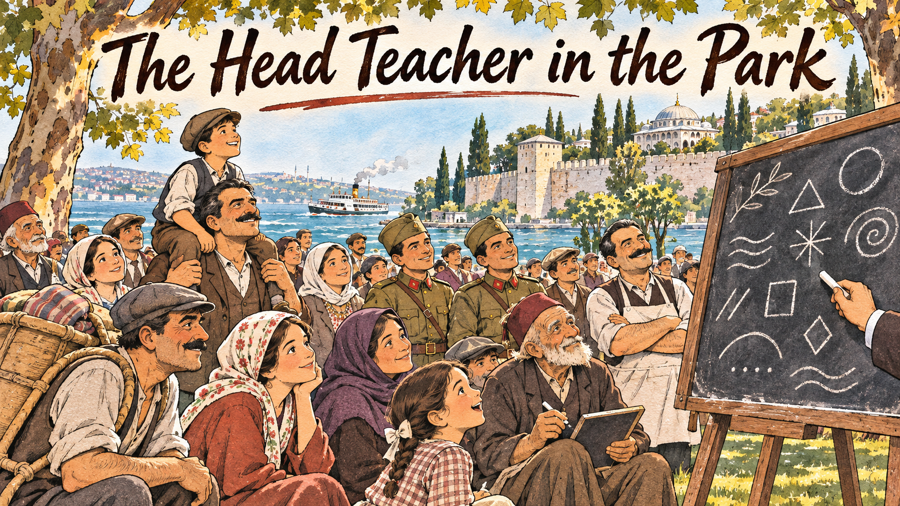
<details>
<summary>Cover Image Prompt</summary>
(This is the Cover Image. Do not include this label in the image.)
Style: a hand-drawn travel-sketchbook graphic-novel illustration, with clean dark ink outlines, flat softly shaded color fills and a faint watercolor paper texture, like a page from a traveler's journal; warm, sunlit, painterly lighting; no text, captions, signs, letters or speech bubbles anywhere in the image.

Please generate a wide-landscape 16:9 cover image for a graphic novel called "The Head Teacher in the Park". Render the title as bold, hand-lettered title text across the upper third, spelled exactly: "The Head Teacher in the Park". Beneath it, on a green lawn in an Istanbul park in 1928 with tall plane trees and cypresses, a large portable blackboard on a wooden easel stands covered in white chalk marks that are abstract shapes and not readable letters, with a stick of white chalk in a hand reaching in from the edge. Seated and standing before it is a crowd of ordinary people: a porter in a flat cap, women in headscarves, a boy on his father's shoulders, soldiers, a shopkeeper in an apron, an old man with a slate. Behind them a calm sea blue strait with a ferry, and the stone walls of an old palace. Palette: natural daylight, whitewashed walls, sea blue, terracotta and olive, with chalk white and slate gray. Mood: hopeful, curious and warm, a whole country going back to school. No other text.

Keep every character and place consistent with the other images in this story. Generate the image immediately without asking clarifying questions.
</details>

<details>
<summary>Narrative Prompt</summary>
**Era and place.** Istanbul and provincial Turkey, 1927 to about 1974, with a closing scene today. The central moment is the evening of August 9, 1928, when Mustafa Kemal announced the new alphabet at a gathering in Gülhane Park, at Sarayburnu below the walls of Topkapı. Other settings: a street corner by a mosque courtyard wall, an old-style school, a provincial town square, a newspaper print shop, a coffeehouse classroom, a village room and an Istanbul street.

**Themes.** Learning for All: a script that fits the language, a government that organizes free classes for adults, and what the reform cost. The story follows one imagined learner from 1929 to the 1970s. It also stays honest about limits: the classes reached towns before villages and men before women, and the change cut a generation off from its written past.

**House style and palette.** Follow the series house style in [Story Characters, Places and House Style](../characters.md). Palette for this story (modern Turkey): natural daylight, whitewashed walls, sea blue, terracotta and olive, with chalk white and slate gray. Panels contain no lettering of any kind; wherever writing, a blackboard or a sign appears, draw only abstract strokes and angle signs edge-on so that no letters are legible. Only the cover carries the title. Use the 1928 Atatürk block for Mustafa Kemal (never as an old man).

**Creative liberties and uncertainties.** The Learner, her grandchild, the letter-writer, the villager and the teacher are imagined composites, not documented people, and their scenes are illustrations of typical experiences. Photographs show Mustafa Kemal chalking letters before crowds; panel 4 shows this as it is remembered rather than as a verified record of the evening of August 9. His title *Başöğretmen*, "Head Teacher," dates to November 24, 1928, so panels 4 and 5 show the role before the name. The 1927 census figure of about one in ten readers is a published census answer to a particular question, not an exact count.

Cast and consistency notes:

- **Glaux the Little Owl:** see [docs/stories/characters.md](../characters.md) and [docs/img/mascot/character-sheet.md](../../img/mascot/character-sheet.md) (Glaux). Glaux appears in exactly one panel (Panel 4) as a small hidden observer.
- **The Travelers:** see [docs/stories/characters.md](../characters.md); they appear only in the final Then-and-Now panel.
- **Mustafa Kemal Atatürk (1928 block):** see [docs/stories/characters.md](../characters.md).

**The Street Letter-Writer** (appears only in this story; paste this block verbatim wherever the character appears):

```text
The street letter-writer of 1927: a thin man of about fifty with round wire spectacles, a gray mustache, a worn gray wool cap and a brown jacket with ink-stained cuffs, seated at a small folding table with reed pens, an inkpot and sheets of paper; patient and kindly.
```

**The Villager** (appears only in this story; paste this block verbatim wherever the character appears):

```text
The villager at the letter-writer's table: a woman of about forty in a plain brown headscarf and a long dark cotton dress with a wool shawl, hands clasped, leaning forward anxiously.
```

**The Learner (1929)** (appears only in this story; paste this block verbatim wherever the character appears):

```text
The Learner in 1929: a young woman of about twenty with strong dark eyebrows, gentle gray eyes and a determined mouth, wearing a dark green headscarf with a thin yellow border and a plain brown wool coat, holding a small slate and a stub of chalk.
```

**The Learner as a Grandmother (about 1974)** (appears only in this story; paste this block verbatim wherever the character appears):

```text
The Learner as a grandmother in about 1974: the same strong dark eyebrows and gentle gray eyes in a lined, warm face, wearing the same dark green headscarf with a thin yellow border, a gray cardigan over a floral dress and carrying a woven shopping bag on one arm.
```

**The Grandchild** (appears only in this story; paste this block verbatim wherever the character appears):

```text
The grandchild: a girl of about seven with two dark braids tied with red ribbons, wearing a navy school pinafore with a white collar and carrying a red satchel; bright and curious.
```

**The Nation's School Teacher** (appears only in this story; paste this block verbatim wherever the character appears):

```text
The Nation's School teacher: a young man of about twenty-five in a gray wool suit and tie with chalk dust on his sleeve, short dark hair, patient and encouraging.
```

</details>

### Prologue - A Head of State at the Blackboard

In the summer of 1928 a head of state stands at a blackboard in a public park. He is not giving a speech. He is teaching letters. Until then Turkish had been written in the Arabic script, which fits Turkish sounds badly, and only about one person in ten could read. Within months the new Latin-based alphabet becomes law, and adults across the country go to school in the evenings. This is the story of that alphabet, of one imagined learner who lived through it, and of the real costs that came with the gains.

**Find Glaux:** Glaux hides in one panel of this story. Can you spot the little owl?

## Panel 1: Letters for Hire
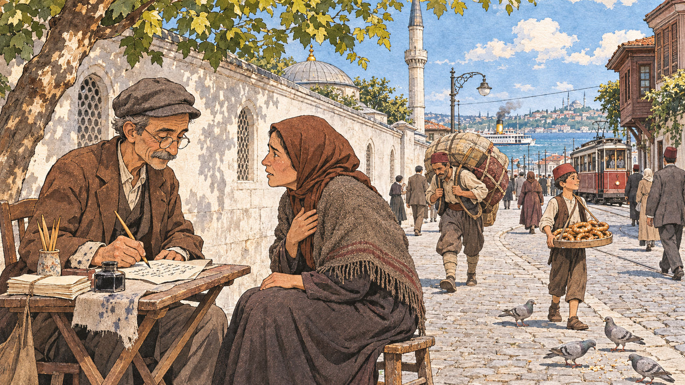
<details><summary>Image Prompt</summary>
(This is Panel 01. Do not include the panel number in the image.)
I am about to ask you to generate a series of images for a graphic novel. Please make the images have a consistent style and consistent characters. Do not ask any clarifying questions. Just generate the image immediately when asked.
Style: a hand-drawn travel-sketchbook graphic-novel illustration, with clean dark ink outlines, flat softly shaded color fills and a faint watercolor paper texture, like a page from a traveler's journal; warm, sunlit, painterly lighting; no text, captions, signs, letters or speech bubbles anywhere in the image.

Please generate a 16:9 image depicting panel 1 of 10. Place and time: a street corner beside the wall of a mosque courtyard in Istanbul, 1927 CE, midday. Palette: natural daylight, whitewashed walls, sea blue, terracotta and olive, with chalk white and slate gray. Medium-wide view from the street, with a slender minaret above the wall, a ferry funnel over the rooftops and the sea beyond. In the foreground The street letter-writer of 1927: a thin man of about fifty with round wire spectacles, a gray mustache, a worn gray wool cap and a brown jacket with ink-stained cuffs, seated at a small folding table with reed pens, an inkpot and sheets of paper; patient and kindly. sits at his folding table writing with a reed pen on a sheet of paper covered in abstract flowing marks. Opposite him The villager at the letter-writer's table: a woman of about forty in a plain brown headscarf and a long dark cotton dress with a wool shawl, hands clasped, leaning forward anxiously. sits on a low stool, speaking and pressing a hand to her chest. A porter with a heavy load passes behind, a boy sells simit bread rings from a tray, a tram runs at the end of the street, and pigeons peck at the cobbles. Mood: tender, a bit sad, ordinary life.

Keep every character and place consistent with the other images in this story. Generate the image immediately without asking clarifying questions.
</details>

In 1927 the corner by the mosque wall is an office. A letter-writer sits at a folding table, and for a few coins he writes for people who cannot write for themselves. Ottoman Turkish is written in the Arabic script, which takes years of schooling to learn, and most people never had those years. By the census of 1927 only about one person in ten could read, far fewer among women and in villages, though the exact figure depends on what was counted.

## Panel 2: Eight Vowels, Three Letters
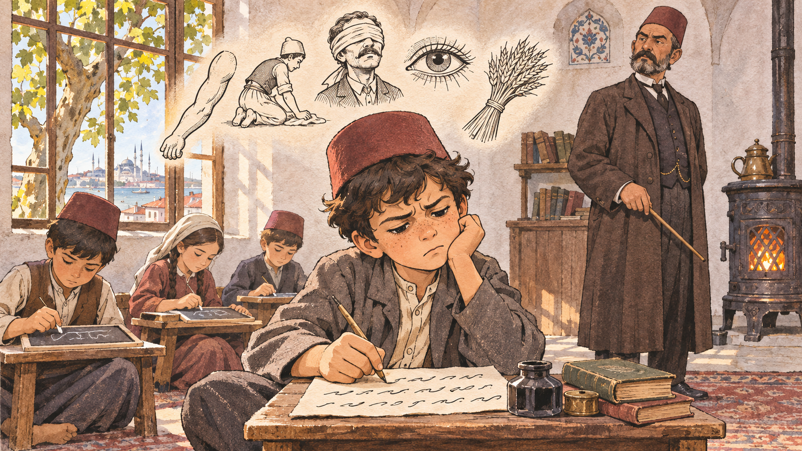
<details><summary>Image Prompt</summary>
(This is Panel 02. Do not include the panel number in the image.)
Style: a hand-drawn travel-sketchbook graphic-novel illustration, with clean dark ink outlines, flat softly shaded color fills and a faint watercolor paper texture, like a page from a traveler's journal; warm, sunlit, painterly lighting; no text, captions, signs, letters or speech bubbles anywhere in the image.

Please generate a 16:9 image depicting panel 2 of 10. Place and time: a small old-style schoolroom in Istanbul, 1920s CE, morning. Palette: natural daylight, whitewashed walls, sea blue, terracotta and olive, with chalk white and slate gray. Medium close shot at the boy's level. In the foreground a boy of about eight in a plain gray jacket sits cross-legged at a low desk, frowning over a page of flowing script drawn as abstract strokes. Above the page, five small ink-drawn pictures float in a loose fan, unframed: a bare arm, a kneeling servant, a blindfolded man, a wide-open eye and a full sheaf of wheat. Behind him a stern teacher in a long coat holds a thin wooden pointer, three other children copy from slates, and a stove glows in the corner. A window shows a plane tree. Mood: puzzled, patient, a little discouraged.

Keep every character and place consistent with the other images in this story. Generate the image immediately without asking clarifying questions.
</details>

The old script has a deeper problem than difficulty. Turkish has eight vowels, but the Arabic script has only three letters that can stand for vowels, and it normally leaves short vowels unwritten. Five common words, *kol* (arm), *kul* (servant), *kör* (blind), *gör* (see) and *gür* (abundant), end up squeezed into only two spellings, so the reader has to guess from context. A script that makes the reader guess is a script that few people master.

## Panel 3: A Summer Evening at Sarayburnu
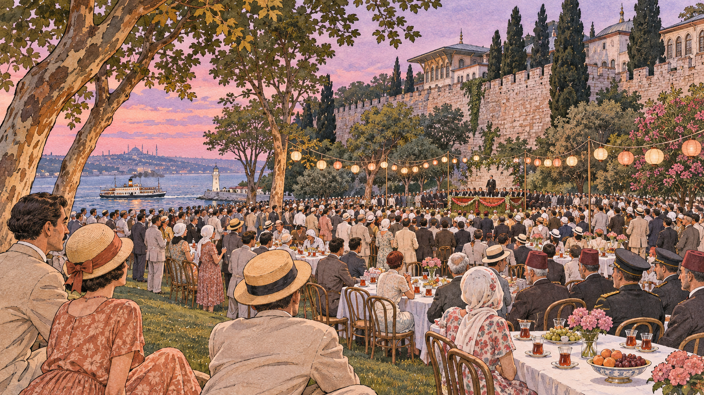
<details><summary>Image Prompt</summary>
(This is Panel 03. Do not include the panel number in the image.)
Style: a hand-drawn travel-sketchbook graphic-novel illustration, with clean dark ink outlines, flat softly shaded color fills and a faint watercolor paper texture, like a page from a traveler's journal; warm, sunlit, painterly lighting; no text, captions, signs, letters or speech bubbles anywhere in the image.

Please generate a 16:9 image depicting panel 3 of 10. Place and time: Gülhane Park at Sarayburnu, below the walls of Topkapı Palace, Istanbul, the evening of August 9, 1928 CE, dusk. Palette: natural daylight, whitewashed walls, sea blue, terracotta and olive, with chalk white and slate gray, with a pink and violet sky. Wide establishing shot from a slight rise looking over the lawn. Long tables under strings of paper lanterns hold tea glasses and fruit. Around them stand and sit hundreds of guests in light summer suits, straw hats and brimmed caps, women in headscarves and summer dresses, officials in dark suits. At the far end a small platform with a standing figure in a dark suit seen only from a distance. Behind the park rise old stone palace walls and cypress trees, and below them a strait with a ferry and a lighthouse. Mood: festive, expectant, an announcement about to be made.

Keep every character and place consistent with the other images in this story. Generate the image immediately without asking clarifying questions.
</details>

On the evening of August 9, 1928, there is a party in Gülhane Park, at Sarayburnu below the walls of Topkapı. Mustafa Kemal, the founder and president of the new Republic, stands up and announces that the Turkish nation will write with new letters. A commission of scholars and writers has been preparing the alphabet over the summer, and now it goes public. The guests do not yet know they are about to become students.

## Panel 4: Chalk in the Park
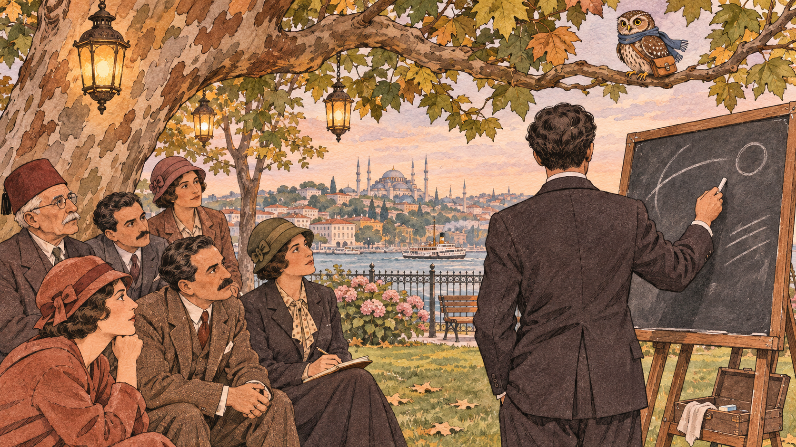
<details><summary>Image Prompt</summary>
(This is Panel 04. Do not include the panel number in the image.)
Style: a hand-drawn travel-sketchbook graphic-novel illustration, with clean dark ink outlines, flat softly shaded color fills and a faint watercolor paper texture, like a page from a traveler's journal; warm, sunlit, painterly lighting; no text, captions, signs, letters or speech bubbles anywhere in the image.

Please generate a 16:9 image depicting panel 4 of 10. Place and time: Gülhane Park, Istanbul, summer 1928 CE, early evening, drawn as it is remembered. Palette: natural daylight, whitewashed walls, sea blue, terracotta and olive, with chalk white and slate gray. Medium-wide shot from the audience, slightly low angle. Mustafa Kemal Atatürk in 1928: a man of forty-seven with penetrating light blue-gray eyes, short light-brown hair combed back and a thin mustache, wearing a well-cut dark Western suit with a white collar and tie, standing at a large portable blackboard with a piece of white chalk in his hand, a teacherly, patient expression. stands at the left of the blackboard facing the crowd, writing one large chalk letter on the board, which is covered with other large, clear chalk shapes drawn as abstract marks. The crowd sits and stands in a half circle on the lawn: a porter in a flat cap, a mother with a toddler, officials in straw hats, an old man with a slate on his knees, a boy sitting cross-legged at the front. Lanterns glow, and a tall plane tree arches overhead. On a low branch of the plane tree sits a tiny owl. Glaux the Little Owl: a true little owl (Athene noctua), small, round and compact, with a flat rounded head and no ear tufts, warm earth-brown plumage with cream spots, bright lemon-yellow eyes under pale cream eyebrows, a cream-white throat patch and a short pale greenish-yellow beak. Glaux wears a small Aegean-blue scarf and a tan canvas satchel across the body with a small leather-bound travel notebook peeking out, and a sprig of three olive leaves tucked into the satchel strap. Alert, curious and warm expression. Glaux is drawn small, perched at the edge of the scene, noticeable on a second look. Mood: warm, focused, the first lesson.

Keep every character and place consistent with the other images in this story. Generate the image immediately without asking clarifying questions.
</details>

In the tellings and photographs that survive, a blackboard appears, and Mustafa Kemal picks up the chalk. He writes the new letters one by one and explains them like a teacher at a school desk rather than a head of state at a podium. The alphabet has 29 letters, one letter for each sound, and every letter is always pronounced the same way. That is why it can be learned in weeks, not years.

## Panel 5: Head Teacher on Tour
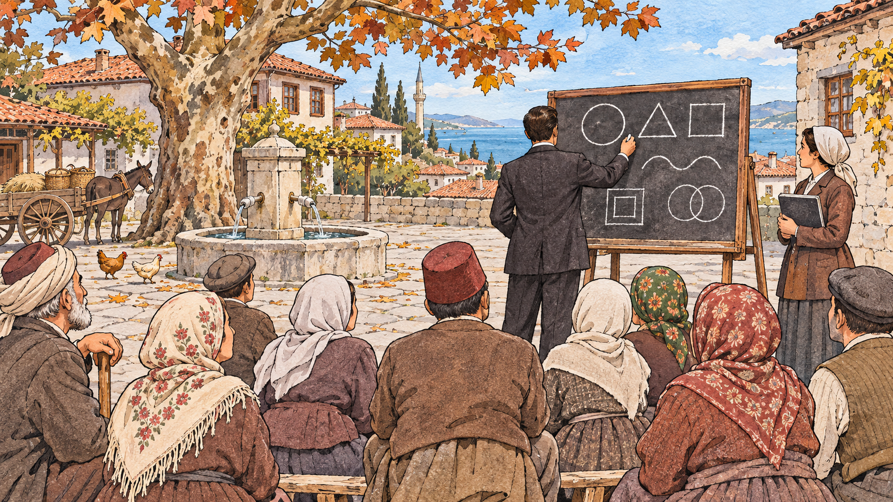
<details><summary>Image Prompt</summary>
(This is Panel 05. Do not include the panel number in the image.)
Style: a hand-drawn travel-sketchbook graphic-novel illustration, with clean dark ink outlines, flat softly shaded color fills and a faint watercolor paper texture, like a page from a traveler's journal; warm, sunlit, painterly lighting; no text, captions, signs, letters or speech bubbles anywhere in the image.

Please generate a 16:9 image depicting panel 5 of 10. Place and time: the square of a provincial Turkish town with a stone fountain and a plane tree, autumn 1928 CE, bright afternoon. Palette: natural daylight, whitewashed walls, sea blue, terracotta and olive, with chalk white and slate gray. Wide shot from the back of the crowd, looking across their heads. Mustafa Kemal Atatürk in 1928: a man of forty-seven with penetrating light blue-gray eyes, short light-brown hair combed back and a thin mustache, wearing a well-cut dark Western suit with a white collar and tie, standing at a large portable blackboard with a piece of white chalk in his hand, a teacherly, patient expression. stands beside the portable blackboard, chalk raised, explaining to a crowd of townspeople. Farmers in wool caps and baggy trousers, a shopkeeper in an apron, a mother with a child on her hip, women in headscarves standing in the second row, soldiers in khaki, and a boy sitting on the fountain's rim listen closely. A village teacher stands to one side holding a slate. A donkey cart waits in the road and chickens scratch nearby. Mood: hopeful, intent, a nation as a classroom.

Keep every character and place consistent with the other images in this story. Generate the image immediately without asking clarifying questions.
</details>

After Gülhane, Mustafa Kemal tours the provinces with a portable blackboard, and photographs show him chalking letters in front of crowds. On November 24, 1928, he is named Head Teacher, *Başöğretmen*, of the Nation's Schools. Turkey still celebrates that date as Teachers' Day. The name attaches to a man who is also a one-party head of state, a combination we should keep in mind.

## Panel 6: A Law and a Printing Shop
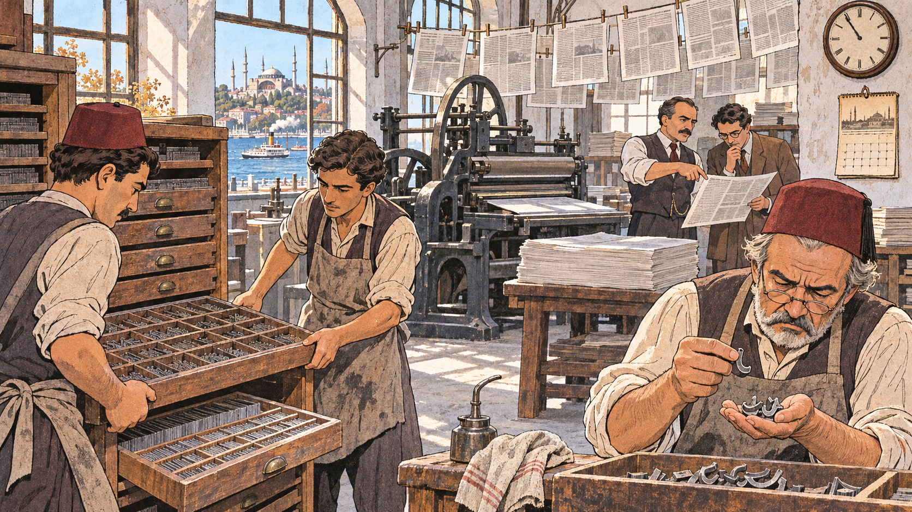
<details><summary>Image Prompt</summary>
(This is Panel 06. Do not include the panel number in the image.)
Style: a hand-drawn travel-sketchbook graphic-novel illustration, with clean dark ink outlines, flat softly shaded color fills and a faint watercolor paper texture, like a page from a traveler's journal; warm, sunlit, painterly lighting; no text, captions, signs, letters or speech bubbles anywhere in the image.

Please generate a 16:9 image depicting panel 6 of 10. Place and time: the print shop of a newspaper in Istanbul, late November 1928 CE, bright morning. Palette: natural daylight, whitewashed walls, sea blue, terracotta and olive, with chalk white and slate gray. Medium-wide interior shot. In the foreground two compositors in aprons and rolled sleeves lift a shallow wooden type case from a rack and slide in a new one while an older compositor holds a handful of curved old type pieces and looks at them with a frown. Behind them a large flatbed press stands with a ream of fresh newsprint, printed sheets hang on lines to dry as gray textures of tiny marks, and an editor in a vest points at a proof. On the wall hang a clock and a calendar page. Mood: brisk, uncertain, a profession remaking itself.

Keep every character and place consistent with the other images in this story. Generate the image immediately without asking clarifying questions.
</details>

The Grand National Assembly passes the alphabet law on November 1, 1928, and the old script is banned from public use. Newspapers switch to the new letters from December 1, government offices follow in the following months, and printing books in the Arabic script ends. Overnight, a trade built on one script must learn another. Behind every print shop, schools and teachers will be needed to teach the people who read what it prints.

## Panel 7: School in a Coffeehouse
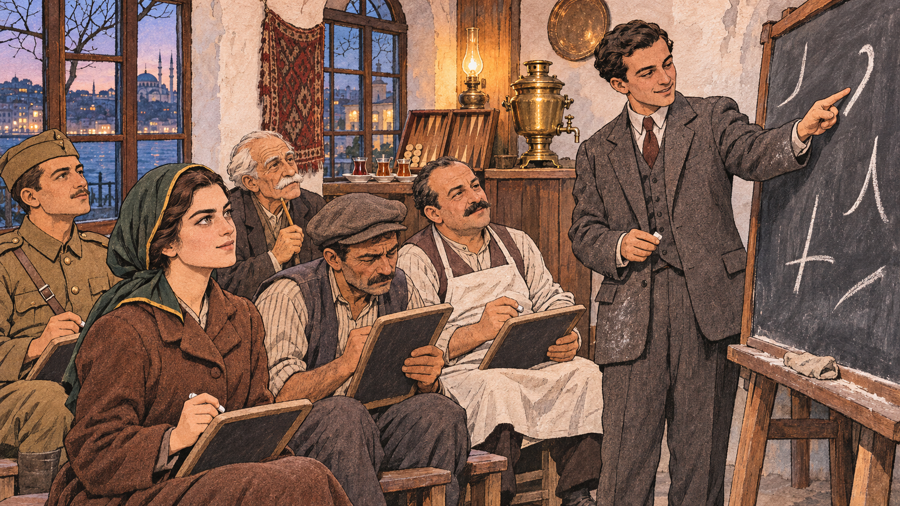
<details><summary>Image Prompt</summary>
(This is Panel 07. Do not include the panel number in the image.)
Style: a hand-drawn travel-sketchbook graphic-novel illustration, with clean dark ink outlines, flat softly shaded color fills and a faint watercolor paper texture, like a page from a traveler's journal; warm, sunlit, painterly lighting; no text, captions, signs, letters or speech bubbles anywhere in the image.

Please generate a 16:9 image depicting panel 7 of 10. Place and time: a coffeehouse turned classroom in an Istanbul neighborhood, January 1929 CE, evening. Palette: natural daylight, whitewashed walls, sea blue, terracotta and olive, with chalk white and slate gray. Medium-wide interior. The Nation's School teacher: a young man of about twenty-five in a gray wool suit and tie with chalk dust on his sleeve, short dark hair, patient and encouraging. stands at a blackboard chalked with large abstract marks, pointing at one. On low benches and stools sit adult learners: The Learner in 1929: a young woman of about twenty with strong dark eyebrows, gentle gray eyes and a determined mouth, wearing a dark green headscarf with a thin yellow border and a plain brown wool coat, holding a small slate and a stub of chalk. in the front row holding her slate; beside her a porter in a flat cap squinting at his, a shopkeeper in an apron, an old man with white mustache holding a pencil like a stick, and a soldier in khaki. Tea glasses and a backgammon board are pushed aside onto a shelf, and an oil lamp and a brass samovar glow at the back. Mood: shy, determined and quietly proud.

Keep every character and place consistent with the other images in this story. Generate the image immediately without asking clarifying questions.
</details>

On January 1, 1929, the Nation's Schools open: free adult literacy classes, held in the evenings in school buildings, coffeehouses and village rooms. Adults roughly between 16 and 45 who cannot read are expected to attend a few months of classes and earn a certificate when they pass. Even soldiers learn in the army. Beside the backgammon boards of the old coffeehouses, a new kind of conversation begins.

## Panel 8: A Lamp in the Village Room
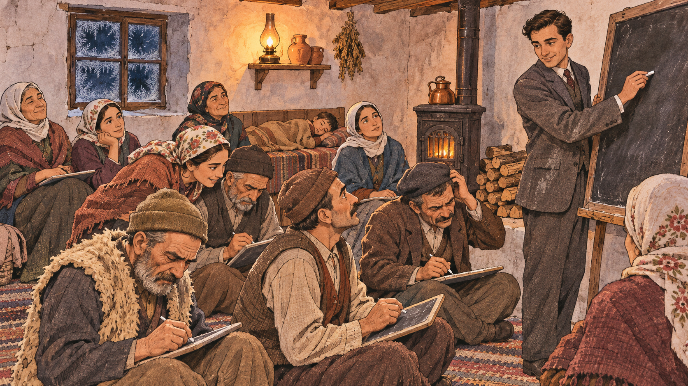
<details><summary>Image Prompt</summary>
(This is Panel 08. Do not include the panel number in the image.)
Style: a hand-drawn travel-sketchbook graphic-novel illustration, with clean dark ink outlines, flat softly shaded color fills and a faint watercolor paper texture, like a page from a traveler's journal; warm, sunlit, painterly lighting; no text, captions, signs, letters or speech bubbles anywhere in the image.

Please generate a 16:9 image depicting panel 8 of 10. Place and time: a plain village room in Anatolia, winter 1929 CE, night. Palette: natural daylight, whitewashed walls, sea blue, terracotta and olive, with chalk white and slate gray, lit by the amber glow of an oil lamp. Medium-wide interior. The Nation's School teacher: a young man of about twenty-five in a gray wool suit and tie with chalk dust on his sleeve, short dark hair, patient and encouraging. stands at a small blackboard leaning against a whitewashed wall, chalk in hand. A group of adults sit on woven mats: farmers in wool caps and sheepskin vests in front, with slates on their knees, and behind them several women in headscarves, some sitting at the edges, one leaning in to see over a shoulder. A cast-iron stove glows in the corner and a stack of firewood sits beside it. A child sleeps on a bench. Frost is on the single small window. Mood: earnest, effortful and uneven.

Keep every character and place consistent with the other images in this story. Generate the image immediately without asking clarifying questions.
</details>

By the government's own count, more than a million adults earn certificates in the schools' first years. The count does not tell the whole story. The classes reach towns faster than villages and men faster than women, and many adults who pass lose the skill because they have no books to practice on. Learning for All meets its limits in a village room with one lamp, one teacher and not enough hours.

## Panel 9: The Sign Read Aloud
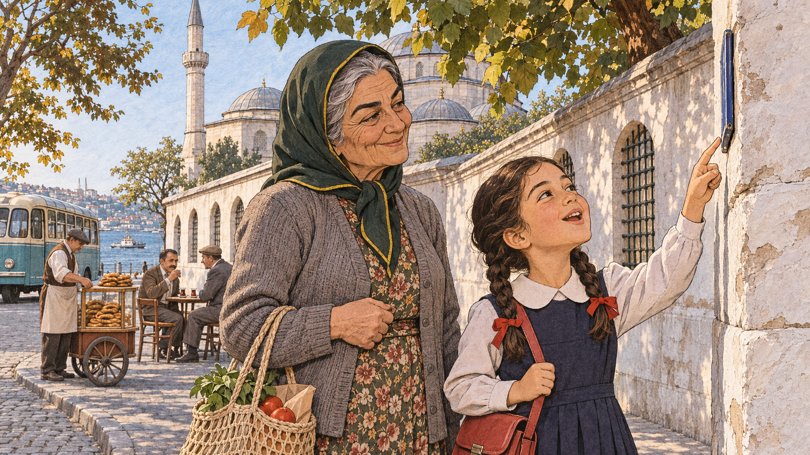
<details><summary>Image Prompt</summary>
(This is Panel 09. Do not include the panel number in the image.)
Style: a hand-drawn travel-sketchbook graphic-novel illustration, with clean dark ink outlines, flat softly shaded color fills and a faint watercolor paper texture, like a page from a traveler's journal; warm, sunlit, painterly lighting; no text, captions, signs, letters or speech bubbles anywhere in the image.

Please generate a 16:9 image depicting panel 9 of 10. Place and time: the same street corner beside the mosque courtyard wall as panel 1, Istanbul, about 1974 CE, late afternoon. Palette: natural daylight, whitewashed walls, sea blue, terracotta and olive, with chalk white and slate gray. Medium shot from the street, matching panel 1's viewpoint. The Learner as a grandmother in about 1974: the same strong dark eyebrows and gentle gray eyes in a lined, warm face, wearing the same dark green headscarf with a thin yellow border, a gray cardigan over a floral dress and carrying a woven shopping bag on one arm. stands beside The grandchild: a girl of about seven with two dark braids tied with red ribbons, wearing a navy school pinafore with a white collar and carrying a red satchel; bright and curious., her hand raised toward a blue enamel street-name plate on the corner wall, which is shown edge-on so that nothing on it is legible; her lips are moving as if reading aloud and she is smiling with quiet pride. The girl looks up at the plate and at her. Behind them the mosque wall, a tall minaret, a parked blue-green bus, a baker's cart and a pair of men drinking tea at a pavement table. Mood: proud, intimate and warm.

Keep every character and place consistent with the other images in this story. Generate the image immediately without asking clarifying questions.
</details>

Decades later, an imagined grandmother who learned to read in 1929 stands at the same corner, reading a street sign aloud to her granddaughter. For her that moment was once impossible. The cost is on the other side of the ledger: the girl's generation can no longer read the letters her great-grandparents wrote, or the inscriptions on old fountains and gravestones. This scene is invented, but the pride and the loss it shows were real for many families.

## Panel 10: Then and Now: Sounding It Out
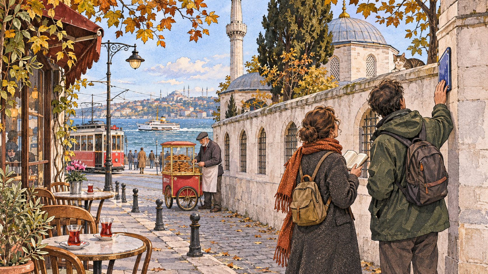
<details><summary>Image Prompt</summary>
(This is Panel 10. Do not include the panel number in the image.)
Style: a hand-drawn travel-sketchbook graphic-novel illustration, with clean dark ink outlines, flat softly shaded color fills and a faint watercolor paper texture, like a page from a traveler's journal; warm, sunlit, painterly lighting; no text, captions, signs, letters or speech bubbles anywhere in the image.

Please generate a 16:9 image depicting panel 10 of 10. Place and time: the same street corner beside the mosque courtyard wall as panels 1 and 9, Istanbul, today, a cool November afternoon. Palette: natural daylight, whitewashed walls, sea blue, terracotta and olive. Medium-wide shot from the street, matching panel 1's viewpoint. In the foreground stand Two adult travelers seen from behind or in distant three-quarter view, dressed for cool November weather: one in a dark green rain jacket, the other in a charcoal wool coat with a rust-colored scarf, both with small daypacks, standing close together and looking at the view. Faces are never shown in detail. One lifts a hand toward a blue enamel street-name plate on the corner wall, shown edge-on so that nothing on it is legible, as if sounding it out; the other holds a small phrasebook. The mosque wall and a slender minaret stand behind them. Café tables with tulip-shaped tea glasses, a tram passing at the end of the street, a ferry on the water, a simit seller with his red cart and a cat on the wall complete the scene. Mood: pleased, curious and quietly moved.

Keep every character and place consistent with the other images in this story. Generate the image immediately without asking clarifying questions.
</details>

Today every sign in Turkey is written in the alphabet of 1928, and two travelers can sound out the signs they pass, even without knowing the language. *Giriş* means "entrance," and *Çıkış* means "exit." The next time you read a Turkish sign aloud, you are using the tool the Head Teacher chalked on a board. It took years of schooling to read the old script and takes weeks to learn the new one, and that difference is the story.

### Epilogue - A Nation Goes Back to School

The alphabet reform of 1928 widened the circle of readers by lowering the cost of the first step: a script that fit the language, plus free classes for every adult. It also left costs behind. A generation lost easy access to its written past, the reform came from the top of a one-party state without a vote of the people, and its reach was uneven. The numbers behind it, a literacy rate of about one in ten in 1927, are a census answer to a particular question, which is why historians treat them with care.

| Challenge | How They Responded | Lesson for Today |
|---|---|---|
| Script fits Turkish badly; about one in ten could read | A 29-letter Latin-based alphabet, one letter for each sound, announced in 1928 | Lowering the cost of the first step widens the circle |
| Millions of adults could not read | The Nation's Schools opened January 1, 1929, with free evening classes and certificates | Pair a better tool with teaching and a place to learn |
| Reach was uneven | Classes reached towns before villages and men before women; many lost the skill without books | Access needs books and practice, not just a classroom |
| The change was ordered from the top | A generation became cut off from Ottoman letters, fountains and gravestones | Every big change has losses; ask who decided and who paid |

### Call to Action

When you read a Turkish sign today, say it aloud and notice that every letter has one sound. Then ask the question the book keeps asking: who is still locked out of reading, in any language, and what would open the door? Try the Sort the Scripts MicroSim to see the alphabets side by side, and look for the places in your own town where adults learn to read.

---

## Voices from the Sources

No verbatim line from Mustafa Kemal or from the learners of 1929 is quoted here, because none could be confirmed in the sources used for this book. The documented words below are titles and names.

- *Türk Harflerinin Kabul ve Tatbiki Hakkında Kanun*: the title of the law of November 1, 1928, usually translated as "Law on the Adoption and Application of Turkish Letters."
- *Başöğretmen*: "Head Teacher," the title given to Mustafa Kemal as head of the Nation's Schools on November 24, 1928, and the reason Turkey celebrates Teachers' Day on that date.
- *Millet Mektepleri*: "Nation's Schools," the name of the free adult literacy classes that opened on January 1, 1929.

## On the Trip

- **Chapter:** [7. The End of Empire and the Birth of Modern Turkey](../../chapters/07-end-of-empire-modern-turkey/index.md)
- **Where to look:** every Turkish sign you read, such as *Giriş* ("entrance") and *Çıkış* ("exit"); Gülhane Park below the walls of Topkapı; and Dolmabahçe Palace, where a clock in the room in which Atatürk died still shows 9:05, the minute of his death in 1938.
- **Explore further:** [Sort the Scripts](../../sims/sort-the-scripts/index.md) puts the alphabets side by side.
- **Look Closer:** Glaux's pointer: "Look up into the plane trees." Glaux hid in Panel 4, on a low branch above the blackboard in the park; today the plane trees of Gülhane Park still offer branches just the right height for a small owl.

## Characters and Style

This story follows the shared series bible: [Story Characters, Places and House Style](../characters.md). Glaux's identity comes from the mascot's [character sheet](../../img/mascot/character-sheet.md).

## References

1. [Wikipedia: Mustafa Kemal Atatürk](https://en.wikipedia.org/wiki/Mustafa_Kemal_Atat%C3%BCrk) - Biography of the founder and first president of the Turkish Republic
2. [Wikipedia: Turkish alphabet](https://en.wikipedia.org/wiki/Turkish_alphabet) - The 29-letter Latin-based alphabet adopted in 1928
3. [Wikipedia: Atatürk's Reforms](https://en.wikipedia.org/wiki/Atat%C3%BCrk%27s_Reforms) - The changes in law, dress, calendar, names and script from 1922 to 1938
4. [Encyclopaedia Britannica: Atatürk](https://www.britannica.com/biography/Ataturk) - Overview of Atatürk's life and reforms
5. [Directorate of National Palaces](https://millisaraylar.gov.tr/) - Official site of the body that runs Dolmabahçe Palace, where Atatürk died in 1938
