# The Horse at the Gates

<!-- 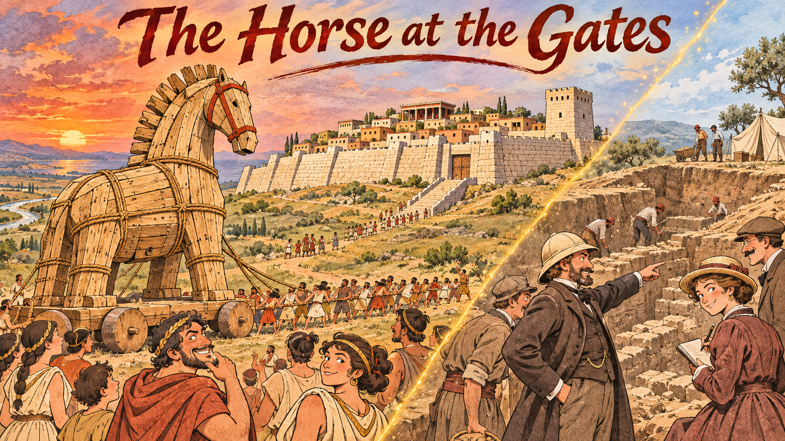 -->
<details>
<summary>Cover Image Prompt</summary>
(This is the Cover Image. Do not include this label in the image.)
Style: a hand-drawn travel-sketchbook graphic-novel illustration, with clean dark ink outlines, flat softly shaded color fills and a faint watercolor paper texture, like a page from a traveler's journal; warm, sunlit, painterly lighting; no text, captions, signs, letters or speech bubbles anywhere in the image. Please generate a wide-landscape 16:9 cover image for this story as a split composition in one picture. On the left, Troy in the Bronze Age at dusk, with The Wooden Horse of legend: a gigantic horse of rough-hewn pale pine planks, as tall as a three-story house, with a long arched neck, a plank body bound with rope-lashed beams, a mane of upright carved wooden spikes, a plain terracotta-red bridle, standing on a low timber platform with four heavy wooden rollers, with a small hidden hatch in its belly; no decoration and no lettering. standing before Troy in the Bronze Age, about 1180 BCE: a hilltop citadel on a low ridge above a windswept plain, ringed by a sloping wall of pale limestone about five meters thick, built in neat stepped sections, with a tall square stone tower at the northeast corner, a gate with a stone ramp, and small flat-roofed mud-brick houses crowded against the inside of the walls, in cream and ochre; below it a plain crossed by a winding river runs to a distant bay. and a crowd of tiny Trojans in ochre and cream clothing dragging it by ropes. On the right, a curve of the same ridge in the 1870s, where small figures in Victorian clothing and cloth caps work in an enormous trench in the mound, one man in a frock coat and pale cork sun helmet pointing. A diagonal seam of golden light runs between the two halves, with a few specks of gold in it. Across the sky, render the title in bold, hand-lettered title text: "The Horse at the Gates". Palette: terracotta red, ochre, lapis blue, cream plaster, olive green on the left; sepia earth brown, dusty khaki, faded sky blue on the right. Emotional tone: mysterious, playful and a little mischievous. Keep every character and place consistent with the other images in this story. Generate the image immediately without asking clarifying questions.
</details>

<details markdown="1">
<summary>Narrative Prompt</summary>

This story runs on two timelines in one picture book. Panels 1-7 are **myth and legend** set in the Bronze Age, about 1180 BCE, on the plain and walls of Troy in northwest Anatolia (and one panel in Rome about 19 BCE where the horse story is written down). Panels 8-15 are **documented history** from the 1860s to 1993: Frank Calvert, Heinrich Schliemann, and the fate of the gold. Panel 16 is today.

**Look and palette.** The house style is the series' hand-drawn travel-sketchbook look. The myth panels use the Bronze Age palette from the series bible (terracotta red, ochre, lapis blue, cream plaster, olive green); the Roman panel uses the Hellenistic and Roman palette (warm limestone, sea-green, deep red, bronze, evening gold); the excavation panels use a Victorian palette (sepia earth brown, dusty khaki, faded sky blue, ochre, off-white linen) and Victorian-era clothing in the same ink-and-watercolor house style; the last two panels move to modern and Cold-War-era light. The two timelines must read as the same book, so keep the ink outline weight and watercolor texture identical.

**Themes.** How a war becomes a story; the difference between a poem and a layer of ash; who gets credit (Calvert and Schliemann); how an object can be famous for the wrong name; and the Learning for All thread, because the horse story survives only because Greek singers' songs were later written down in the Greek alphabet.

**Safety.** Troy's fall is shown by fire, smoke, silhouettes and ships, never by violence. Soldiers' weapons stay at rest. The 1945 panel shows only a truck, crates and a damaged building. The harbor-side horse in Çanakkale is not shown in any panel and, if mentioned, is described only as a big wooden horse built as a movie prop; name no studio or brand.

**Creative liberties and uncertainties.** No image of Laocoön, the Greek soldiers or the Trojan crowds exists; these are invented types. The architecture of Troy follows the late Bronze Age citadel, Troy VI and VIIa, with simplified walls; whether the Trojans ever pulled down a gate or saw a horse is legend. Schliemann's and Calvert's appearances are invented respectful likenesses based on their period, age and dress; the 1868 meeting is documented, its exact scene is imagined. The 1945 loading scene is generic and does not depict a documented event or place. No Cyrillic, German or Turkish lettering appears anywhere. The wooden horse always has the same plank, rope and spiked-mane look.

**Cast.** Paste each block below verbatim into every prompt where that character, place or object appears.

- **Glaux the Little Owl:** see docs/stories/characters.md and docs/img/mascot/character-sheet.md (Glaux). Glaux appears in exactly one panel, Panel 10, as a small hidden observer on a stone block.
- **The Travelers (final panel):** see docs/stories/characters.md; seen from behind in Panel 16 only.

**Laocoön (this story only)**

```text
Laocoön, priest of Troy: a lean, gray-bearded man of about fifty with deep-set, alarmed eyes, wearing a long white linen robe with a saffron border and a band of laurel leaves around his head, one arm raised and pointing, a short carved wooden ritual staff in the other hand.
```

**Frank Calvert (this story only)**

```text
Frank Calvert, English consular agent at the Dardanelles in the 1860s: a lean, sun-browned man of about forty with a trimmed brown beard flecked with gray, wearing a worn tan linen suit, a soft wide-brimmed cloth hat and dusty boots, with a small leather notebook in his hand; quiet, patient and watchful.
```

**Heinrich Schliemann (this story only)**

```text
Heinrich Schliemann, German excavator, in the 1870s: a stocky, restless man of about fifty with a high forehead, short thinning gray hair, a neat gray mustache and no beard, wearing a dark Victorian wool frock coat and waistcoat with a watch chain, high leather boots and a pale cork sun helmet, usually pointing or hurrying; energetic, impatient and sure of himself.
```

**Sophia Schliemann (this story only)**

```text
Sophia Schliemann, in the 1870s: a young Greek woman of about twenty-two with dark hair parted in the middle and pinned back, a dark, high-collared Victorian dress, a straight posture and a solemn, composed expression.
```

**A Roman poet (this story only)**

```text
A Roman poet of about 19 BCE: a thin, pale man of about fifty with a high forehead, short dark hair and tired, kind eyes, wearing a long cream wool mantle over a tunic, reading aloud from an unrolled papyrus scroll held in both hands.
```

**Troy in the Bronze Age (place, this story only)**

```text
Troy in the Bronze Age, about 1180 BCE: a hilltop citadel on a low ridge above a windswept plain, ringed by a sloping wall of pale limestone about five meters thick, built in neat stepped sections, with a tall square stone tower at the northeast corner, a gate with a stone ramp, and small flat-roofed mud-brick houses crowded against the inside of the walls, in cream and ochre; below it a plain crossed by a winding river runs to a distant bay.
```

**The Wooden Horse (object, this story only)**

```text
The Wooden Horse of legend: a gigantic horse of rough-hewn pale pine planks, as tall as a three-story house, with a long arched neck, a plank body bound with rope-lashed beams, a mane of upright carved wooden spikes, a plain terracotta-red bridle, standing on a low timber platform with four heavy wooden rollers, with a small hidden hatch in its belly; no decoration and no lettering.
```

**The mound at Hisarlık in the 1870s (place, this story only)**

```text
The mound at Hisarlık in the 1870s: a long, low, grassy hill on a ridge above a wide plain, its top cut by one enormous straight trench with steep earth walls showing bands of dark ash, rubble and old stone walls, with spoil heaps beside it, wooden ladders and plank ramps, and a few canvas tents and a wooden hut along the rim.
```

**The replica horse at Troy today (object, this story only)**

```text
The replica horse at Troy today: a large modern wooden horse of weathered gray-brown planks, about two stories tall, standing on a low wooden base beside a gravel path, with a small opening and wooden steps in its flank so visitors can climb inside.
```

</details>

### Prologue - A Horse That Is Not in the Poem

Everyone knows the Trojan Horse. Almost nobody knows that the *Iliad*, the great poem of the war, ends before the horse ever appears, or that the man who "found" Troy dug right through the city he was looking for. This story follows the legend from its siege to its burning, then follows the people who went looking for the real place in the 1860s and 1870s, and the gold that traveled from a trench in Turkey to Berlin and then to Moscow. Along the way we sort what is documented from what is legend, a habit worth having on the mound at Hisarlık.

**Find Glaux:** Glaux hides in one panel of this story. Can you spot the little owl?

## Panel 1: Ten Years Under the Walls

<!-- 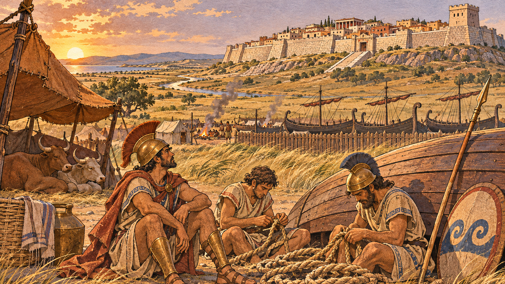 -->
<details><summary>Image Prompt</summary>
(This is Panel 01. Do not include the panel number in the image.)
I am about to ask you to generate a series of images for a graphic novel. Please make the images have a consistent style and consistent characters. Do not ask any clarifying questions. Just generate the image immediately when asked.

Style: a hand-drawn travel-sketchbook graphic-novel illustration, with clean dark ink outlines, flat softly shaded color fills and a faint watercolor paper texture, like a page from a traveler's journal; warm, sunlit, painterly lighting; no text, captions, signs, letters or speech bubbles anywhere in the image. Please generate a 16:9 image depicting panel 1 of 16. Troy, northwest Anatolia, about 1180 BCE, late afternoon in the tenth year of a siege. Palette: Bronze Age palette: terracotta red, ochre, lapis blue, cream plaster, olive green. Wide establishing view from the Greek camp on the plain looking up toward the citadel on its ridge: Troy in the Bronze Age, about 1180 BCE: a hilltop citadel on a low ridge above a windswept plain, ringed by a sloping wall of pale limestone about five meters thick, built in neat stepped sections, with a tall square stone tower at the northeast corner, a gate with a stone ramp, and small flat-roofed mud-brick houses crowded against the inside of the walls, in cream and ochre; below it a plain crossed by a winding river runs to a distant bay. Golden low light, a steady wind bending the grass, a weary, tense mood. In the foreground a row of dark ships drawn up on the sand behind a wooden palisade, curls of smoke from camp fires, three tired soldiers in bronze helmets and linen tunics mending a rope beside an upturned boat, a spear leaning at rest against it, and a pair of oxen resting in the shade of a tent of stretched hides. Keep every character and place consistent with the other images in this story. Generate the image immediately without asking clarifying questions.
</details>

For ten years the Greeks have camped on the plain below the windy citadel, and for ten years the walls have held. The legend says an alliance of Greek kings crossed the sea to win back Helen, the wife of a king of Sparta, who had left with the Trojan prince Paris. The soldiers mend ropes and wait. Somewhere up on the ridge, the Trojans wait too.

## Panel 2: The Empty Beach

<!-- 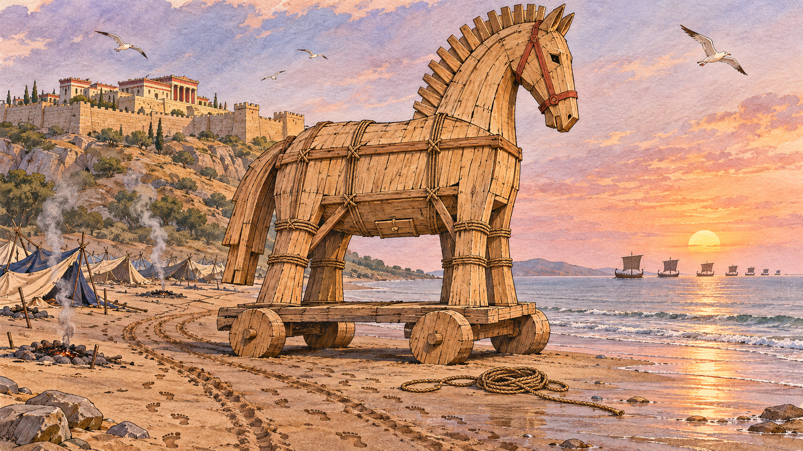 -->
<details><summary>Image Prompt</summary>
(This is Panel 02. Do not include the panel number in the image.)
Style: a hand-drawn travel-sketchbook graphic-novel illustration, with clean dark ink outlines, flat softly shaded color fills and a faint watercolor paper texture, like a page from a traveler's journal; warm, sunlit, painterly lighting; no text, captions, signs, letters or speech bubbles anywhere in the image. Please generate a 16:9 image depicting panel 2 of 16. The beach below Troy, about 1180 BCE, at dawn. Palette: Bronze Age palette: terracotta red, ochre, lapis blue, cream plaster, olive green. Medium-wide view across the empty sand: The Wooden Horse of legend: a gigantic horse of rough-hewn pale pine planks, as tall as a three-story house, with a long arched neck, a plank body bound with rope-lashed beams, a mane of upright carved wooden spikes, a plain terracotta-red bridle, standing on a low timber platform with four heavy wooden rollers, with a small hidden hatch in its belly; no decoration and no lettering. It stands alone and enormous at the center of the frame. Behind it the Greek camp is empty, its tents collapsed and its fires still smoking, and a line of small dark ships sails out toward the horizon on a calm, pearl-colored sea. Footprints and wheel ruts cross the wet sand, a discarded rope coil lies near the horse's hooves, and gulls wheel overhead. In the far background the citadel stands on its ridge. Mood: eerie, quiet, suspicious relief. Keep every character and place consistent with the other images in this story. Generate the image immediately without asking clarifying questions.
</details>

One morning the Trojans wake to silence. The camp is deserted, the ships are specks on the horizon, and on the beach stands a horse of timber taller than a house. In the legend the Greeks have only pretended to leave, hiding their fleet behind a nearby island, and the horse is a trap with soldiers inside. The Trojans do not know that yet.

## Panel 3: A Gift for the Goddess

<!-- 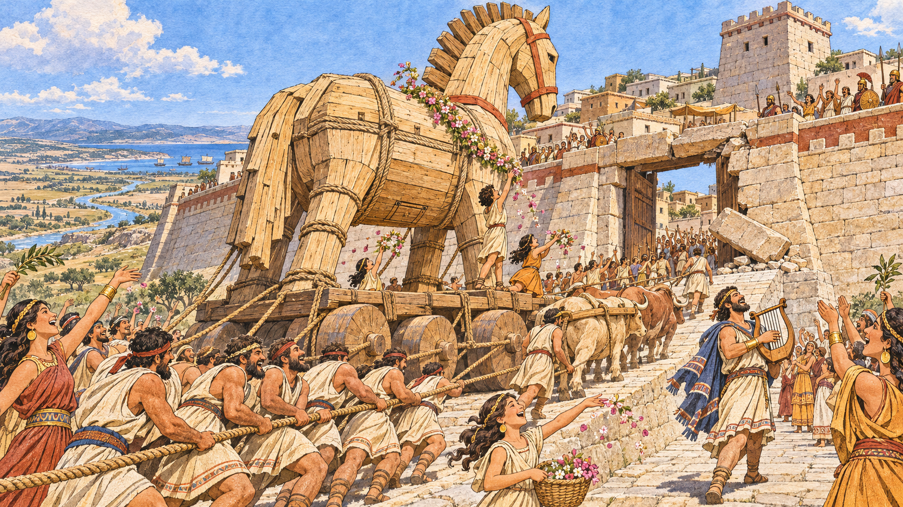 -->
<details><summary>Image Prompt</summary>
(This is Panel 03. Do not include the panel number in the image.)
Style: a hand-drawn travel-sketchbook graphic-novel illustration, with clean dark ink outlines, flat softly shaded color fills and a faint watercolor paper texture, like a page from a traveler's journal; warm, sunlit, painterly lighting; no text, captions, signs, letters or speech bubbles anywhere in the image. Please generate a 16:9 image depicting panel 3 of 16. The gate of Troy, about 1180 BCE, midday. Palette: Bronze Age palette: terracotta red, ochre, lapis blue, cream plaster, olive green. Wide, slightly low-angle view of a joyful crowd hauling the wooden horse up the stone ramp toward the citadel gate. The Wooden Horse of legend: a gigantic horse of rough-hewn pale pine planks, as tall as a three-story house, with a long arched neck, a plank body bound with rope-lashed beams, a mane of upright carved wooden spikes, a plain terracotta-red bridle, standing on a low timber platform with four heavy wooden rollers, with a small hidden hatch in its belly; no decoration and no lettering. Beside it, the walls: Troy in the Bronze Age, about 1180 BCE: a hilltop citadel on a low ridge above a windswept plain, ringed by a sloping wall of pale limestone about five meters thick, built in neat stepped sections, with a tall square stone tower at the northeast corner, a gate with a stone ramp, and small flat-roofed mud-brick houses crowded against the inside of the walls, in cream and ochre; below it a plain crossed by a winding river runs to a distant bay. Dozens of Trojan men and women in linen tunics and long ochre dresses pull on thick ropes; children throw flower garlands over its neck, a lyre player walks ahead, and oxen are yoked to the rollers. Part of the gate's stone lintel has been pulled down to let the horse pass. Mood: festive, loud, dangerously confident. Keep every character and place consistent with the other images in this story. Generate the image immediately without asking clarifying questions.
</details>

The Trojans take the horse for a gift. In the version the Roman poet Virgil tells, they decide to bring it inside as an offering to the goddess Athena, and they pull down part of the gate to fit it through. Children hang garlands on its neck. After ten years of war, a festival feels like a victory.

## Panel 4: I Fear the Greeks

<!-- 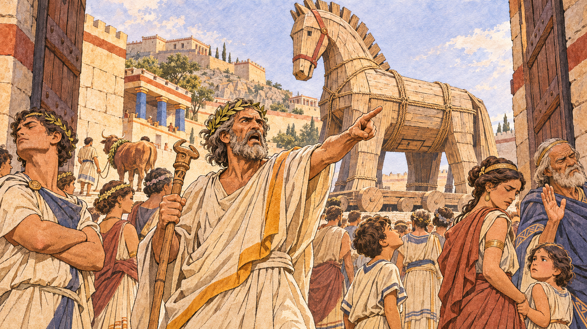 -->
<details><summary>Image Prompt</summary>
(This is Panel 04. Do not include the panel number in the image.)
Style: a hand-drawn travel-sketchbook graphic-novel illustration, with clean dark ink outlines, flat softly shaded color fills and a faint watercolor paper texture, like a page from a traveler's journal; warm, sunlit, painterly lighting; no text, captions, signs, letters or speech bubbles anywhere in the image. Please generate a 16:9 image depicting panel 4 of 16. Just inside the gate of Troy, about 1180 BCE, afternoon. Palette: Bronze Age palette: terracotta red, ochre, lapis blue, cream plaster, olive green. Medium shot, slightly low angle, centered on the priest warning the crowd while the horse looms behind him. Laocoön, priest of Troy: a lean, gray-bearded man of about fifty with deep-set, alarmed eyes, wearing a long white linen robe with a saffron border and a band of laurel leaves around his head, one arm raised and pointing, a short carved wooden ritual staff in the other hand. Behind him rises The Wooden Horse of legend: a gigantic horse of rough-hewn pale pine planks, as tall as a three-story house, with a long arched neck, a plank body bound with rope-lashed beams, a mane of upright carved wooden spikes, a plain terracotta-red bridle, standing on a low timber platform with four heavy wooden rollers, with a small hidden hatch in its belly; no decoration and no lettering. Around him the crowd of Trojans in linen tunics, some with garlands, turn their heads away or look doubtful; a young boy stares up at the horse; a woman clutches a child's hand; a Trojan elder shakes his head. A sacrificial bull is being led away along the street. Warm, dusty light and long shadows. Mood: urgent warning that nobody wants to hear. Keep every character and place consistent with the other images in this story. Generate the image immediately without asking clarifying questions.
</details>

A priest named Laocoön steps out of the crowd and tells them to stop. In Virgil's poem he says the line still quoted in Latin, *timeo Danaos et dona ferentes*: "I fear the Greeks, even bearing gifts." The crowd is not listening. Trojans who warn of danger are rarely as popular as Trojans who cheer.

## Panel 5: Down the Ropes at Night

<!-- 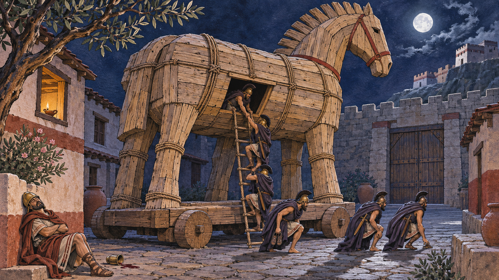 -->
<details><summary>Image Prompt</summary>
(This is Panel 05. Do not include the panel number in the image.)
Style: a hand-drawn travel-sketchbook graphic-novel illustration, with clean dark ink outlines, flat softly shaded color fills and a faint watercolor paper texture, like a page from a traveler's journal; warm, sunlit, painterly lighting; no text, captions, signs, letters or speech bubbles anywhere in the image. Please generate a 16:9 image depicting panel 5 of 16. A quiet courtyard inside Troy near the citadel gate, about 1180 BCE, deep night. Palette: Bronze Age palette: terracotta red, ochre, lapis blue, cream plaster, olive green, deepened to indigo shadow with silver moonlight. Wide view, looking slightly up at the wooden horse in the middle of the courtyard: The Wooden Horse of legend: a gigantic horse of rough-hewn pale pine planks, as tall as a three-story house, with a long arched neck, a plank body bound with rope-lashed beams, a mane of upright carved wooden spikes, a plain terracotta-red bridle, standing on a low timber platform with four heavy wooden rollers, with a small hidden hatch in its belly; no decoration and no lettering. Its belly hatch is open and a rope ladder hangs down; six Greek soldiers in bronze helmets and dark cloaks climb down silently, one holding his sandals in his hand to be quiet, another helping the next, all with their weapons still sheathed. A Trojan guard sleeps sitting against the wall, a wine cup tipped over beside him. Houses are dark, a single oil lamp glows in one window, and a gate stands at the far end of the courtyard. Mood: hushed, tense, inevitable. Keep every character and place consistent with the other images in this story. Generate the image immediately without asking clarifying questions.
</details>

That night, after the festival, the city sleeps. A hatch opens in the horse's belly and armed Greeks lower themselves down on ropes, and in the tradition they open the gates to the fleet that has sailed back in the dark. The tale is a master class in a single trick: the best way to get past a wall is to be invited in.

## Panel 6: Troy Burns

<!-- 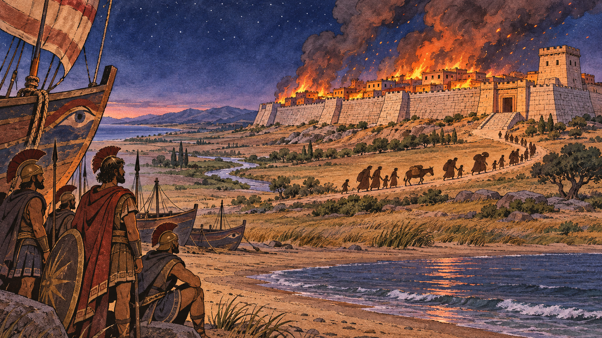 -->
<details><summary>Image Prompt</summary>
(This is Panel 06. Do not include the panel number in the image.)
Style: a hand-drawn travel-sketchbook graphic-novel illustration, with clean dark ink outlines, flat softly shaded color fills and a faint watercolor paper texture, like a page from a traveler's journal; warm, sunlit, painterly lighting; no text, captions, signs, letters or speech bubbles anywhere in the image. Please generate a 16:9 image depicting panel 6 of 16. The plain below Troy, about 1180 BCE, before dawn. Palette: Bronze Age palette: terracotta red, ochre, lapis blue, cream plaster, olive green, with orange fire-glow against deep indigo sky. Wide establishing view from the beach looking up at the citadel: Troy in the Bronze Age, about 1180 BCE: a hilltop citadel on a low ridge above a windswept plain, ringed by a sloping wall of pale limestone about five meters thick, built in neat stepped sections, with a tall square stone tower at the northeast corner, a gate with a stone ramp, and small flat-roofed mud-brick houses crowded against the inside of the walls, in cream and ochre; below it a plain crossed by a winding river runs to a distant bay. The houses inside the walls are ablaze, tall columns of smoke rise into the stars, and sparks drift on the wind. In the foreground, dark ships are drawn up on the sand again and a small group of Greek soldiers stands in silhouette, watching without moving. Along the road a line of Trojan families in silhouette flee with bundles and a donkey. No bodies, no fighting visible. Mood: solemn and sorrowful, the cost of the story. Keep every character and place consistent with the other images in this story. Generate the image immediately without asking clarifying questions.
</details>

By morning the city is gone. Archaeologists do find a Troy that burned, the layer they call Troy VIIa, destroyed by fire around 1180 BCE, and in its ruins excavators found arrowheads and human remains. Whether Greeks, raiders or some war we cannot name set the fire, the stones do not say.

> **Myth or Evidence?** Troy VIIa really burned, around 1180 BCE; that is documented. That it fell to a Greek army, after ten years, over Helen, is the legend. No evidence from the time says so.

## Panel 7: The Poet Who Built the Horse

<!-- 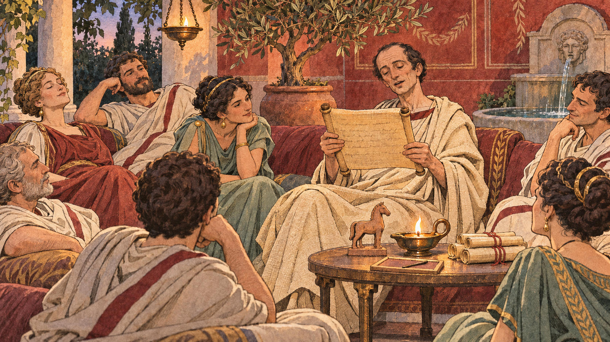 -->
<details><summary>Image Prompt</summary>
(This is Panel 07. Do not include the panel number in the image.)
Style: a hand-drawn travel-sketchbook graphic-novel illustration, with clean dark ink outlines, flat softly shaded color fills and a faint watercolor paper texture, like a page from a traveler's journal; warm, sunlit, painterly lighting; no text, captions, signs, letters or speech bubbles anywhere in the image. Please generate a 16:9 image depicting panel 7 of 16. Rome, about 19 BCE, early evening in a lamplit villa courtyard. Palette: Roman palette: warm limestone, sea-green, deep red, bronze, evening gold. Medium shot, over the shoulder of a listener, of a poet reading to a small circle of friends. A Roman poet of about 19 BCE: a thin, pale man of about fifty with a high forehead, short dark hair and tired, kind eyes, wearing a long cream wool mantle over a tunic, reading aloud from an unrolled papyrus scroll held in both hands. On the low table beside him sit a small clay model of a horse, a bronze lamp, a wax tablet and a stack of papyrus rolls tied with red cord; six listeners recline on couches in togas and long stolas, one leaning forward, one with eyes closed. An olive tree grows in a pot, a fountain trickles in the corner, painted red walls behind them. The scroll bears only faint, illegible marks. Mood: hushed absorption, a story being born. Keep every character and place consistent with the other images in this story. Generate the image immediately without asking clarifying questions.
</details>

Here is the surprise. The wooden horse is not in the *Iliad*, which ends with Hector's funeral, before Troy falls. The *Odyssey* mentions it three times, briefly. The fullest telling, including Laocoön and his famous warning, comes from the Roman poet Virgil in the *Aeneid*, written around 19 BCE, more than eleven centuries after Troy VIIa burned.

> **Myth or Evidence?** Documented: the horse appears in the Odyssey (briefly) and in Virgil's Aeneid, written about 19 BCE. Tradition: that any such horse ever stood at Troy. Historians have suggested it might remember a siege engine or an earthquake (Poseidon was the god of both horses and earthquakes), but there is no evidence for either.

## Panel 8: The Consul on the Hill

<!-- 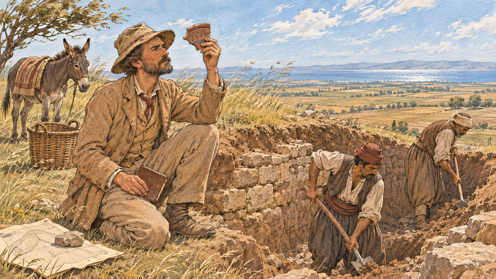 -->
<details><summary>Image Prompt</summary>
(This is Panel 08. Do not include the panel number in the image.)
Style: a hand-drawn travel-sketchbook graphic-novel illustration, with clean dark ink outlines, flat softly shaded color fills and a faint watercolor paper texture, like a page from a traveler's journal; warm, sunlit, painterly lighting; no text, captions, signs, letters or speech bubbles anywhere in the image. Please generate a 16:9 image depicting panel 8 of 16. The Hisarlık mound, northwest Turkey, about 1862, a bright windy morning. Palette: Victorian excavation palette: sepia earth brown, dusty khaki, faded sky blue, ochre, off-white linen. Medium-wide view of a small trial trench cut into the grassy slope of a hill above a wide plain: Frank Calvert, English consular agent at the Dardanelles in the 1860s: a lean, sun-browned man of about forty with a trimmed brown beard flecked with gray, wearing a worn tan linen suit, a soft wide-brimmed cloth hat and dusty boots, with a small leather notebook in his hand; quiet, patient and watchful. He kneels at the edge of a shallow trench, holding a broken piece of old pottery up to the light; two local laborers in baggy trousers, vests and cloth caps dig with wooden-handled spades, and the stones of an ancient wall show in the cut. A donkey stands beside a wicker basket, a folded survey map weighted with a stone lies on the grass, and the wide Trojan plain stretches behind to a distant glint of sea. Mood: quiet conviction and limited means. Keep every character and place consistent with the other images in this story. Generate the image immediately without asking clarifying questions.
</details>

Frank Calvert, an Englishman who works as a consular agent at the Dardanelles, owns part of the mound at Hisarlık, and has been studying the plain for years. In the early 1860s he digs trial trenches on his own land and finds ancient walls. He is convinced that Homer's Troy lies inside, but he does not have the money for a full excavation.

## Panel 9: The Rich Visitor

<!-- 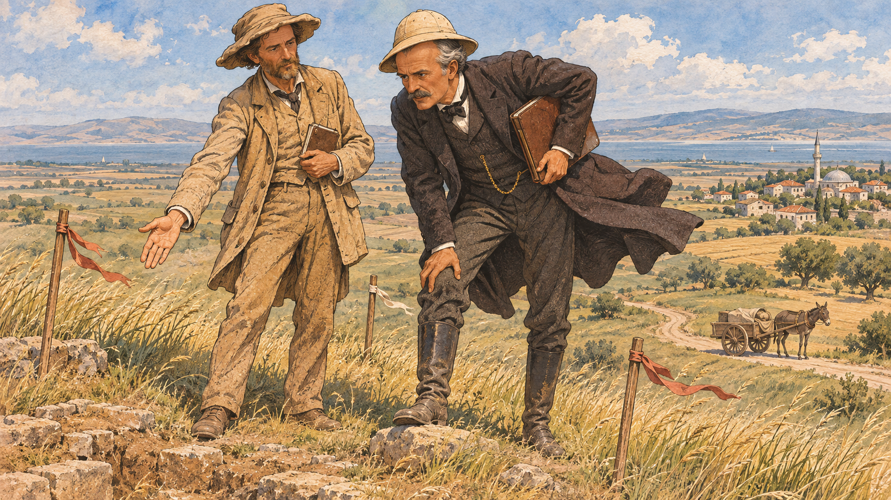 -->
<details><summary>Image Prompt</summary>
(This is Panel 09. Do not include the panel number in the image.)
Style: a hand-drawn travel-sketchbook graphic-novel illustration, with clean dark ink outlines, flat softly shaded color fills and a faint watercolor paper texture, like a page from a traveler's journal; warm, sunlit, painterly lighting; no text, captions, signs, letters or speech bubbles anywhere in the image. Please generate a 16:9 image depicting panel 9 of 16. On top of the Hisarlık mound, about 1868, midday wind. Palette: Victorian excavation palette: sepia earth brown, dusty khaki, faded sky blue, ochre, off-white linen. Medium two-shot from slightly below, of two men standing on the grassy hilltop with the vast plain behind them. Frank Calvert, English consular agent at the Dardanelles in the 1860s: a lean, sun-browned man of about forty with a trimmed brown beard flecked with gray, wearing a worn tan linen suit, a soft wide-brimmed cloth hat and dusty boots, with a small leather notebook in his hand; quiet, patient and watchful. stands on the left, one arm outstretched toward the ground at their feet, calm and sure; Heinrich Schliemann, German excavator, in the 1870s: a stocky, restless man of about fifty with a high forehead, short thinning gray hair, a neat gray mustache and no beard, wearing a dark Victorian wool frock coat and waistcoat with a watch chain, high leather boots and a pale cork sun helmet, usually pointing or hurrying; energetic, impatient and sure of himself. stands on the right, leaning forward with a leather portfolio under one arm, impatient, his frock coat flapping in the wind. A donkey cart waits on the path below, a small village with a mosque minaret lies in the distance, and survey stakes with cloth ribbons mark the grass. Mood: an idea changing hands. Keep every character and place consistent with the other images in this story. Generate the image immediately without asking clarifying questions.
</details>

In 1868 a wealthy German businessman, Heinrich Schliemann, comes to see Calvert. He listens, and he takes up the idea. Calvert has the knowledge and the land; Schliemann has the money and a great hurry. Historians would later use the letters of both men to give Calvert back his share of the credit.

## Panel 10: The Great Trench

<!-- 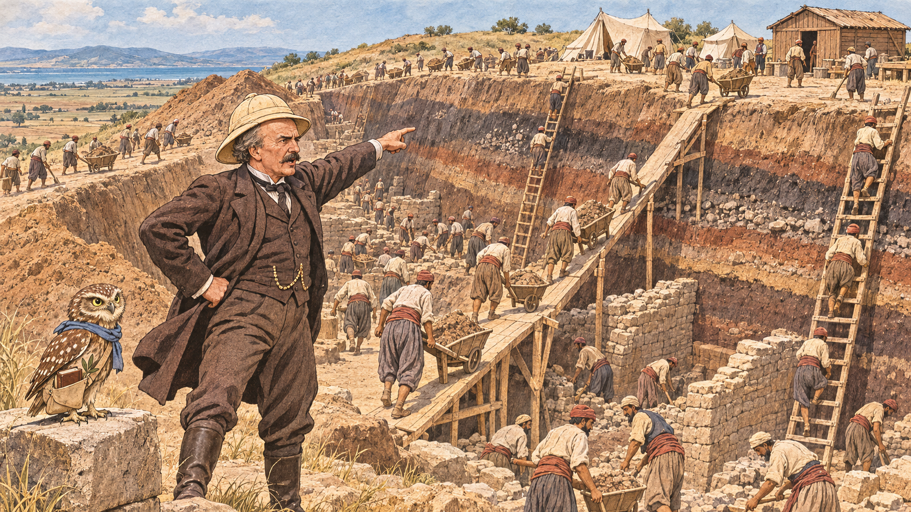 -->
<details><summary>Image Prompt</summary>
(This is Panel 10. Do not include the panel number in the image.)
Style: a hand-drawn travel-sketchbook graphic-novel illustration, with clean dark ink outlines, flat softly shaded color fills and a faint watercolor paper texture, like a page from a traveler's journal; warm, sunlit, painterly lighting; no text, captions, signs, letters or speech bubbles anywhere in the image. Please generate a 16:9 image depicting panel 10 of 16. The Hisarlık mound, about 1872, hot afternoon. Palette: Victorian excavation palette: sepia earth brown, dusty khaki, faded sky blue, ochre, off-white linen. Wide, slightly raised view of a huge excavation: The mound at Hisarlık in the 1870s: a long, low, grassy hill on a ridge above a wide plain, its top cut by one enormous straight trench with steep earth walls showing bands of dark ash, rubble and old stone walls, with spoil heaps beside it, wooden ladders and plank ramps, and a few canvas tents and a wooden hut along the rim. About forty local laborers in baggy trousers, sashes and cloth caps push wheelbarrows up plank ramps and climb wooden ladders. In the foreground Heinrich Schliemann, German excavator, in the 1870s: a stocky, restless man of about fifty with a high forehead, short thinning gray hair, a neat gray mustache and no beard, wearing a dark Victorian wool frock coat and waistcoat with a watch chain, high leather boots and a pale cork sun helmet, usually pointing or hurrying; energetic, impatient and sure of himself. stands at the lip of the trench, one arm flung out, directing the work. The cut walls show clear colored bands of ash and rubble and old stone walls. Glaux is perched on a squared stone block at the trench edge: Glaux the Little Owl: a true little owl (Athene noctua), small, round and compact, with a flat rounded head and no ear tufts, warm earth-brown plumage with cream spots, bright lemon-yellow eyes under pale cream eyebrows, a cream-white throat patch and a short pale greenish-yellow beak. Glaux wears a small Aegean-blue scarf and a tan canvas satchel across the body with a small leather-bound travel notebook peeking out, and a sprig of three olive leaves tucked into the satchel strap. Alert, curious and warm expression. Glaux is drawn small, perched at the edge of the scene, noticeable on a second look. Mood: huge energy, speed, and a hint of recklessness. Keep every character and place consistent with the other images in this story. Generate the image immediately without asking clarifying questions.
</details>

Schliemann starts digging in 1871, and he digs big. His crews cut a huge trench straight through the middle of the mound. It is a spectacular piece of work, and it also slices through layers that lie close to Homer's age, so that he cuts away the very Troy he is looking for. The trench itself is now evidence: a cut is always younger than everything it cuts through.

## Panel 11: A Glint of Gold

<!-- 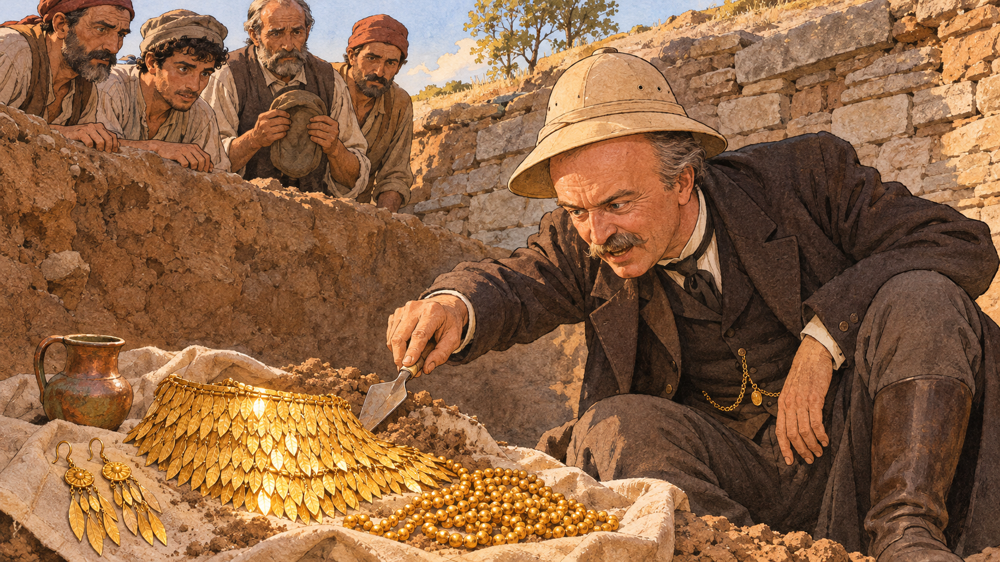 -->
<details><summary>Image Prompt</summary>
(This is Panel 11. Do not include the panel number in the image.)
Style: a hand-drawn travel-sketchbook graphic-novel illustration, with clean dark ink outlines, flat softly shaded color fills and a faint watercolor paper texture, like a page from a traveler's journal; warm, sunlit, painterly lighting; no text, captions, signs, letters or speech bubbles anywhere in the image. Please generate a 16:9 image depicting panel 11 of 16. Deep in the Hisarlık trench, about 1873, late afternoon. Palette: Victorian excavation palette: sepia earth brown, dusty khaki, faded sky blue, ochre, off-white linen, with a flash of bright gold. Close-medium shot from the side of the trench wall. Heinrich Schliemann, German excavator, in the 1870s: a stocky, restless man of about fifty with a high forehead, short thinning gray hair, a neat gray mustache and no beard, wearing a dark Victorian wool frock coat and waistcoat with a watch chain, high leather boots and a pale cork sun helmet, usually pointing or hurrying; energetic, impatient and sure of himself. crouches in the trench with a small trowel, brushing earth from a spread of gold objects on a piece of cloth: a bright diadem of thousands of tiny gold leaf-shaped pieces, a heap of gold beads, long gold earrings and a small copper vessel, all catching the sun. Four laborers in cloth caps gather quietly at the edge of the cut, one holding his cap in both hands. A stone wall of an ancient house is half exposed behind them. Mood: breathless wonder and secrecy. Keep every character and place consistent with the other images in this story. Generate the image immediately without asking clarifying questions.
</details>

In 1873 Schliemann finds a hoard of gold, silver and bronze objects, including two gold diadems made of thousands of small gold pieces. He names it Priam's Treasure, after Homer's king of Troy. The name is a wish. The hoard comes from Troy II, about a thousand years too early for Priam.

> **Myth or Evidence?** Documented: a real treasure, found in 1873 and dated by later archaeologists to Troy II. The name 'Priam's Treasure' is Schliemann's hope, not a date.

## Panel 12: The Diadems

<!-- 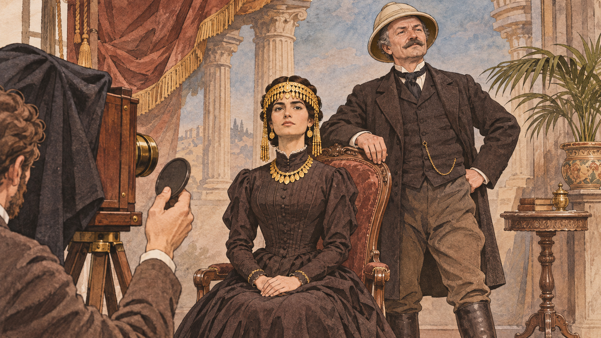 -->
<details><summary>Image Prompt</summary>
(This is Panel 12. Do not include the panel number in the image.)
Style: a hand-drawn travel-sketchbook graphic-novel illustration, with clean dark ink outlines, flat softly shaded color fills and a faint watercolor paper texture, like a page from a traveler's journal; warm, sunlit, painterly lighting; no text, captions, signs, letters or speech bubbles anywhere in the image. Please generate a 16:9 image depicting panel 12 of 16. A photographic studio in the 1870s, early afternoon. Palette: Victorian excavation palette: sepia earth brown, dusty khaki, faded sky blue, ochre, off-white linen, with the gold as the only bright color. Medium shot in a Victorian studio with a painted backdrop of columns and drapery. Sophia Schliemann, in the 1870s: a young Greek woman of about twenty-two with dark hair parted in the middle and pinned back, a dark, high-collared Victorian dress, a straight posture and a solemn, composed expression. sits very upright wearing a magnificent ancient gold diadem across her forehead with dangling gold chains, gold earrings and a gold necklace; Heinrich Schliemann, German excavator, in the 1870s: a stocky, restless man of about fifty with a high forehead, short thinning gray hair, a neat gray mustache and no beard, wearing a dark Victorian wool frock coat and waistcoat with a watch chain, high leather boots and a pale cork sun helmet, usually pointing or hurrying; energetic, impatient and sure of himself. stands behind her chair, hand on its back, proud. In the foreground a wooden box camera on a tripod with a black focusing cloth, and a photographer's hand holding up a lens cap. A potted palm and a small side table fill the corner. Mood: solemn, theatrical, a story being staged. Keep every character and place consistent with the other images in this story. Generate the image immediately without asking clarifying questions.
</details>

Schliemann has a famous photograph made of his young wife, Sophia, wearing the diadems. In his book he says she carried the treasure away in her shawl. Years later he admitted that she had been in Athens at the time. The treasure was real, but the scene he told was a piece of publicity.

> **Myth or Evidence?** Documented: the photograph, and Schliemann's later admission that Sophia was in Athens at the time of the find. Legend: the shawl scene, which Schliemann invented.

## Panel 13: Crates in the Night

<!-- 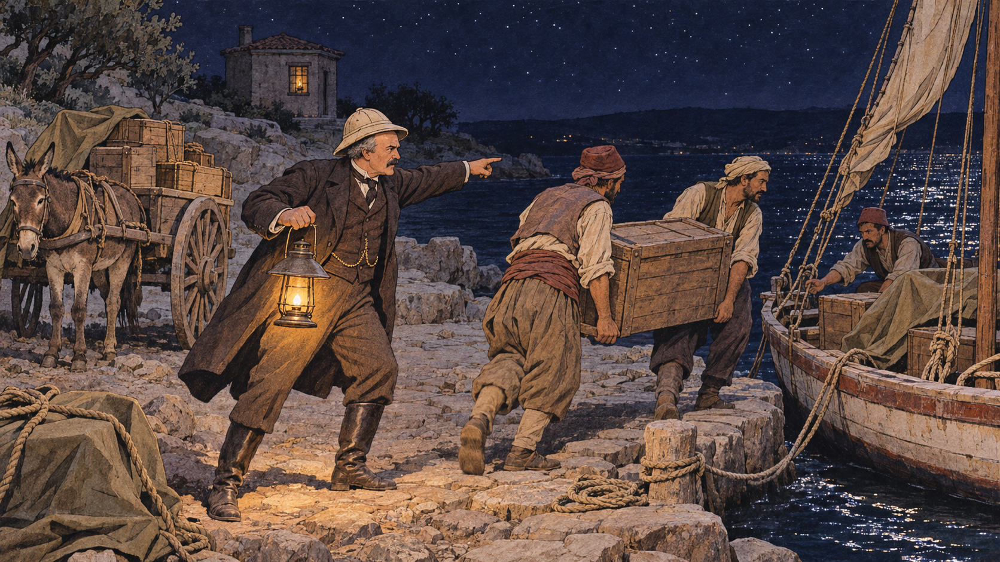 -->
<details><summary>Image Prompt</summary>
(This is Panel 13. Do not include the panel number in the image.)
Style: a hand-drawn travel-sketchbook graphic-novel illustration, with clean dark ink outlines, flat softly shaded color fills and a faint watercolor paper texture, like a page from a traveler's journal; warm, sunlit, painterly lighting; no text, captions, signs, letters or speech bubbles anywhere in the image. Please generate a 16:9 image depicting panel 13 of 16. A rocky shore on the Dardanelles coast, about 1873, a moonless night. Palette: Victorian excavation palette: sepia earth brown, dusty khaki, faded sky blue, ochre, off-white linen, deepened to indigo and lamplight yellow. Medium-wide shot of a shadowy loading scene. Heinrich Schliemann, German excavator, in the 1870s: a stocky, restless man of about fifty with a high forehead, short thinning gray hair, a neat gray mustache and no beard, wearing a dark Victorian wool frock coat and waistcoat with a watch chain, high leather boots and a pale cork sun helmet, usually pointing or hurrying; energetic, impatient and sure of himself. stands at the water's edge with a shaded lantern, urging two men along; two laborers carry a heavy wooden crate toward a small sailing boat riding at a rough stone jetty; more crates are stacked on a donkey cart; tarpaulin and ropes; a small square customs hut stands dark in the distance, a single oil lamp showing in its window. Dark water glitters under starlight. Mood: furtive, hurried, a bargain being broken. Keep every character and place consistent with the other images in this story. Generate the image immediately without asking clarifying questions.
</details>

Schliemann has agreed to share the finds with the Ottoman government. He smuggles the treasure out instead. The Ottoman government sues him, and he pays a settlement. Most of the treasure goes to Berlin in 1881.

## Panel 14: Berlin, 1945

<!-- 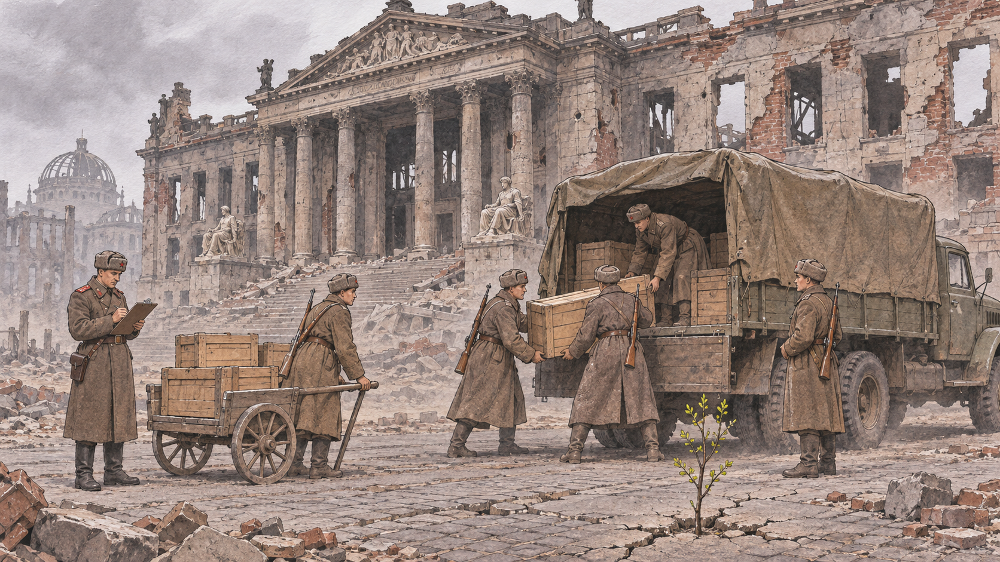 -->
<details><summary>Image Prompt</summary>
(This is Panel 14. Do not include the panel number in the image.)
Style: a hand-drawn travel-sketchbook graphic-novel illustration, with clean dark ink outlines, flat softly shaded color fills and a faint watercolor paper texture, like a page from a traveler's journal; warm, sunlit, painterly lighting; no text, captions, signs, letters or speech bubbles anywhere in the image. Please generate a 16:9 image depicting panel 14 of 16. Berlin, spring 1945, gray overcast. Palette: ash gray, brick red, dust brown, with a faint pale sky; still in the same ink-and-watercolor style. Wide establishing view across a rubble-strewn street: a large stone museum building with a damaged, windowless facade stands in the background; in the foreground a canvas-covered truck is being loaded with plain wooden crates by six soldiers in long winter overcoats and fur caps, seen as figures at moderate distance with their rifles slung and at rest; an officer stands checking a clipboard; a handcart of crates waits; dust drifts; a lone sapling grows in the cracked paving. Mood: heavy, quiet, history in transit. Keep every character and place consistent with the other images in this story. Generate the image immediately without asking clarifying questions.
</details>

At the end of the Second World War, Soviet troops take the treasure from Berlin to Moscow. Then it vanishes. For decades nobody outside Russia knows whether it still exists.

## Panel 15: The Case in Moscow

<!-- 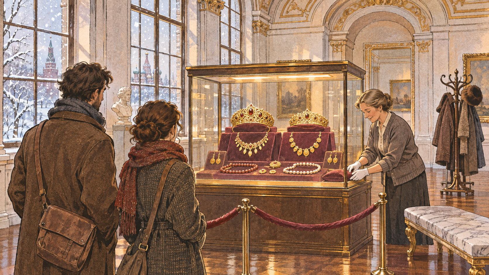 -->
<details><summary>Image Prompt</summary>
(This is Panel 15. Do not include the panel number in the image.)
Style: a hand-drawn travel-sketchbook graphic-novel illustration, with clean dark ink outlines, flat softly shaded color fills and a faint watercolor paper texture, like a page from a traveler's journal; warm, sunlit, painterly lighting; no text, captions, signs, letters or speech bubbles anywhere in the image. Please generate a 16:9 image depicting panel 15 of 16. Moscow, 1993, winter afternoon. Palette: natural daylight, with dark wood floors, white walls and pale gold; the same ink-and-watercolor style. Medium shot across a polished museum gallery with tall windows showing falling snow. In the center, a softly lit glass case holds the two gold diadems, necklaces and beads of the treasure. A woman curator in a gray cardigan and white cotton gloves stands beside it, adjusting a small cushion; two visitors in winter coats stand at a respectful distance, seen from behind; high ceilings, a marble bench, a coat rack, and a velvet rope. Mood: relieved wonder, a lost thing found. Keep every character and place consistent with the other images in this story. Generate the image immediately without asking clarifying questions.
</details>

In 1993 Russia confirms that the gold has been in the Pushkin Museum in Moscow all along, and it remains there today. A few pieces are in the Istanbul Archaeology Museums, and the Troy Museum, opened in 2018, shows what the region still holds. A visitor who wanted to see the finds from Troy in one room would need tickets in four countries.

## Panel 16: Climbing the Horse

<!-- 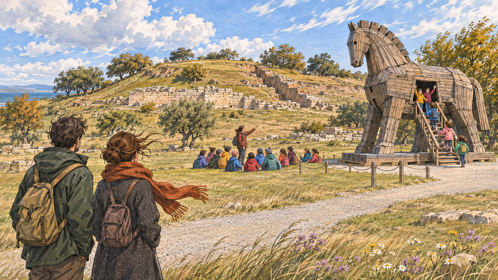 -->
<details><summary>Image Prompt</summary>
(This is Panel 16. Do not include the panel number in the image.)
Style: a hand-drawn travel-sketchbook graphic-novel illustration, with clean dark ink outlines, flat softly shaded color fills and a faint watercolor paper texture, like a page from a traveler's journal; warm, sunlit, painterly lighting; no text, captions, signs, letters or speech bubbles anywhere in the image. Please generate a 16:9 image depicting panel 16 of 16. Troy archaeological site, northwest Turkey, today, a bright, windy November morning. Palette: natural daylight, whitewashed clouds, sea blue, terracotta, olive. Wide establishing view from the plain looking up toward the low grassy ridge and mound, matching the viewpoint of panel 1 as closely as possible, with the exposed pale walls and the long cut of the old trench visible on the mound. The replica horse at Troy today: a large modern wooden horse of weathered gray-brown planks, about two stories tall, standing on a low wooden base beside a gravel path, with a small opening and wooden steps in its flank so visitors can climb inside. Children in colorful coats climb its steps and wave from its opening; a school group sits on the grass; a guide stands with a raised hand. On the plain in the foreground a gravel path and a few wild flowers. Two small figures in the foreground: Two adult travelers seen from behind or in distant three-quarter view, dressed for cool November weather: one in a dark green rain jacket, the other in a charcoal wool coat with a rust-colored scarf, both with small daypacks, standing close together and looking at the view. Faces are never shown in detail. Mood: warm, windy, layered with time. Keep every character and place consistent with the other images in this story. Generate the image immediately without asking clarifying questions.
</details>

Today the legend and the dig sit side by side. Children climb the replica horse at the entrance and clamber about in it, while behind them the great trench still cuts through nine stacked cities. In Çanakkale, on the waterfront, a second horse stands: a big wooden horse built as a movie prop and given to the town. A Bronze Age war, a Roman poem, a Victorian excavation and a film: the horse is a layer of cultural memory all by itself.

### Epilogue - What the Horse Teaches

A horse that is not in the poem, a treasure that is not Priam's, and a discoverer who dug through his own prize: Troy is a place where names run ahead of evidence. The legend gives the city its meaning, and the layers of the mound give it its dates, and the two do not have to be forced into agreement. Calvert's patience and Schliemann's speed both left their mark, and the best of what the mound still tells us comes from reading the layers carefully, a habit the architect Wilhelm Dörpfeld began to bring to the site from 1882. This is also a Learning for All story. The horse reaches us only because Greek singers' songs were eventually written down in the Greek alphabet, the new script that made reading easier to learn.

| Challenge | How They Responded | Lesson for Today |
|---|---|---|
| A name run ahead of the evidence | Later archaeologists dated the treasure to Troy II, a thousand years before Priam's time | Believe the layer number, not the label on the case. |
| Credit given to the loudest voice | Historians used Calvert's and Schliemann's letters to restore Calvert's share | Ask who did the quiet work before the famous work. |
| A discoverer in a hurry | The great trench cut through layers close to Homer's age; a trained architect later brought careful recording | Speed without method destroys the thing you are looking for. |
| A story that outgrew its source | The horse appears only in the Odyssey (briefly) and the Aeneid; the Iliad never mentions it | Check the earliest source before trusting a famous scene. |

### Call to Action

Before you climb the replica horse, walk over to Schliemann's trench and read its walls from the top down. Look for the bands of ash, then ask which of the nine cities each one belongs to. If you can, find the layer number beside any name on a label, and believe the number.

---

## Voices from the Sources

- "I fear the Greeks, even bearing gifts" (*timeo Danaos et dona ferentes*): Laocoön's warning in Virgil's *Aeneid*, Book 2, written about 19 BCE. The line belongs to a Roman poem about the legend, not to anyone who lived at Troy.
- *Mēnin*, "wrath": the first word of the *Iliad* in Greek, and its subject. The poem follows one hero's anger for about fifty days of the war's tenth year and ends with Hector's funeral, not with Troy's fall. We quote the word, not a translation.
- No documented words of Calvert or of the Troy-era Trojans survive for this story, so we do not quote them. Schliemann's own books are rich sources, but he shaped his stories for publicity, as the shawl scene shows.

## On the Trip

- **Chapter:** [8. Troy and Gallipoli](../../chapters/08-troy-and-gallipoli/index.md)
- **Where to look:** Schliemann's great trench through the mound, where nine cities show in a single cross-section; the sloping Troy VI wall and tower; the replica wooden horse at the entrance, which visitors can climb inside; and, on the Çanakkale waterfront, a second, bigger wooden horse built as a movie prop.
- **Explore further:** [Mind the Gap: How Old Is the Evidence?](../../sims/troy-gallipoli-evidence-gap/index.md), which asks how old the earliest evidence is for stories from Troy and Gallipoli.
- **Look Closer:** Glaux says: "Look closer. At the lip of the great trench, find a squared stone block." Glaux hid in Panel 10 (The Great Trench), perched on a squared stone at the trench edge, looking over the work. Little owls really do live in ruins like these.

## Characters and Style

This story follows the shared series bible: [Story Characters, Places and House Style](../characters.md). Glaux's identity comes from the mascot's [character sheet](../../img/mascot/character-sheet.md).

## References

1. [Wikipedia: Troy](https://en.wikipedia.org/wiki/Troy) - Overview of the Bronze Age city, its nine layers and the debate over Homer's war
2. [Wikipedia: Trojan Horse](https://en.wikipedia.org/wiki/Trojan_Horse) - The legend, its sources in the Odyssey and the Aeneid, and its later reception
3. [Wikipedia: Priam's Treasure](https://en.wikipedia.org/wiki/Priam%27s_Treasure) - The 1873 hoard, its smuggling, and its journey to Berlin and Moscow
4. [Encyclopaedia Britannica: Troy](https://www.britannica.com/place/Troy-ancient-city-Turkey) - Overview of the site and its excavations
5. [UNESCO World Heritage Centre: Archaeological Site of Troy](https://whc.unesco.org/en/list/849) - Official listing and description of the site
