# Graphic Novel Stories

These twenty-two short graphic novels follow the trip from Istanbul to
Athens, so each one can be read the evening before or after standing in the
place where it happened. Every story is built around something a traveler can
actually see, and every one ends with a "Look Closer" pointer to a detail to
find on site.

**Series devices.** Find Glaux, the little owl, hidden in one panel of each
story. Look for the *Myth or Evidence?* callouts, which separate documented
history from legend. Each story ends with a "Then and Now" view of the same
place today.

Behind the scenes, every story shares one visual bible:
[Story Characters, Places and House Style](characters.md). The idea list the
stories came from is [Story Ideas](story-ideas.md).

*The cover and panel images are written as detailed text-to-image prompts in
each story's page and are not yet generated, so the cards below show text
only.*

- **[1. Glaux and the Gods Who Moved In](gods-who-moved-in/index.md)** (14 panels)

    <!-- 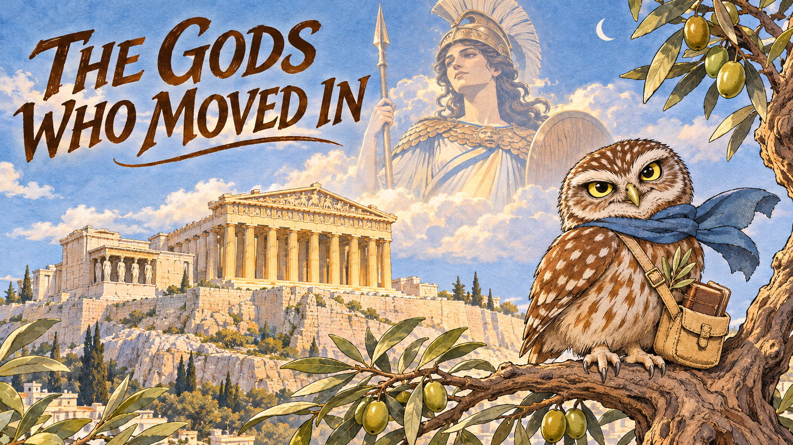 -->
    Glaux the little owl guides you through Athena's odd birth, her olive-tree duel with Poseidon, and how an owl ended up on the silver money of Athens, so you know the gods before the trip.

- **[2. Halfdan Was Here](halfdan-was-here/index.md)** (12 panels)

    <!-- 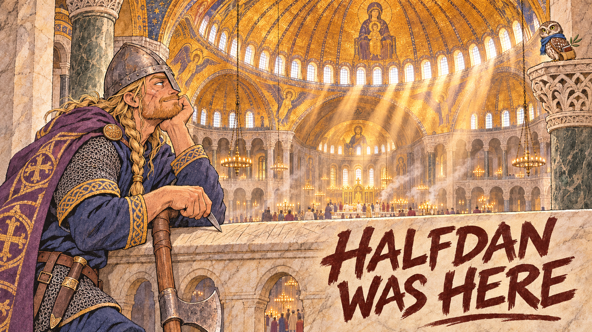 -->
    Justinian builds the biggest dome in the world, and about five hundred years later a bored Norse guard scratches his name into its marble railing. Find the runes, and meet the builders.

- **[3. Ships Over the Hill](ships-over-the-hill/index.md)** (16 panels)

    <!-- 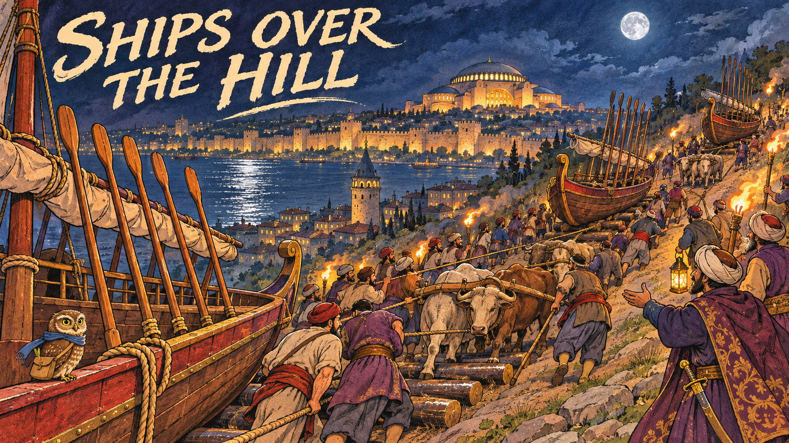 -->
    When an iron chain blocks the Golden Horn, a twenty-one-year-old sultan sails his ships over a hill. Follow the siege that ended the Byzantine Empire and made Constantinople into Istanbul.

- **[4. The Sultan's Sweet Tooth](sultans-sweet-tooth/index.md)** (12 panels)

    <!-- 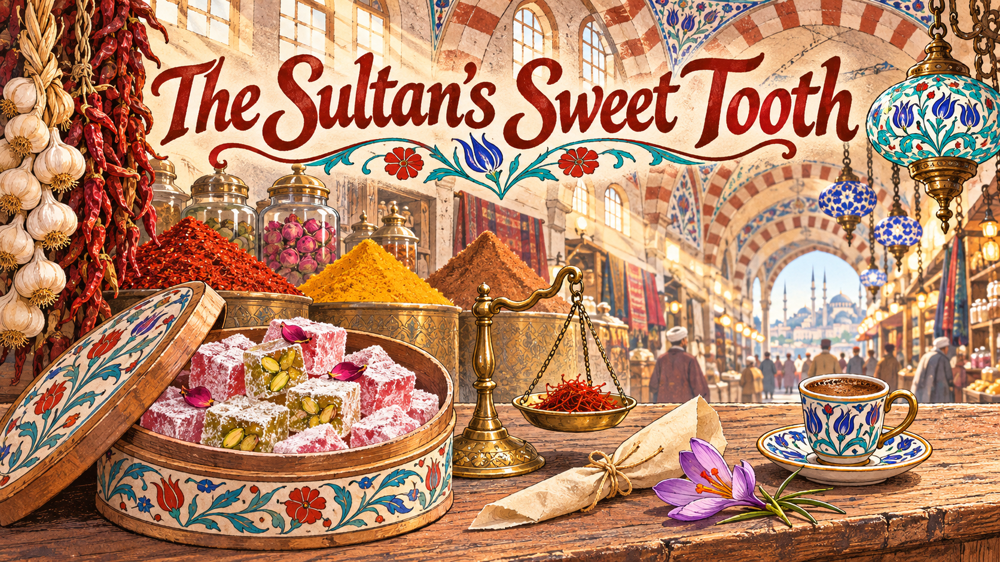 -->
    Follow one box of Turkish delight and one pinch of saffron through Istanbul's Spice Bazaar, past coffeehouses a sultan tried to close, and into the hands of two travelers heading home.

- **[5. The Press That Waited](the-press-that-waited/index.md)** (12 panels)

    <!-- 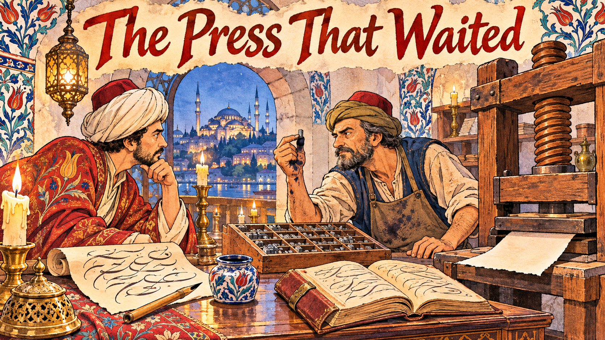 -->
    Istanbul had printing presses in the 1490s, yet the first Ottoman Turkish book in Arabic script appeared only in 1729. Meet the refugees, scribes and printer in a puzzle with disputed answers.

- **[6. The Head Teacher in the Park](head-teacher-in-the-park/index.md)** (10 panels)

    <!-- 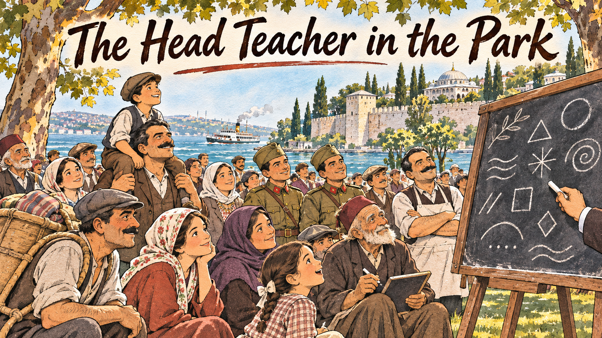 -->
    In August 1928 a head of state stood at a blackboard in an Istanbul park and taught a nation new letters. See how one alphabet sent adults back to school, and what that change cost and gave.

- **[7. The Horse at the Gates](horse-at-the-gates/index.md)** (16 panels)

    <!-- 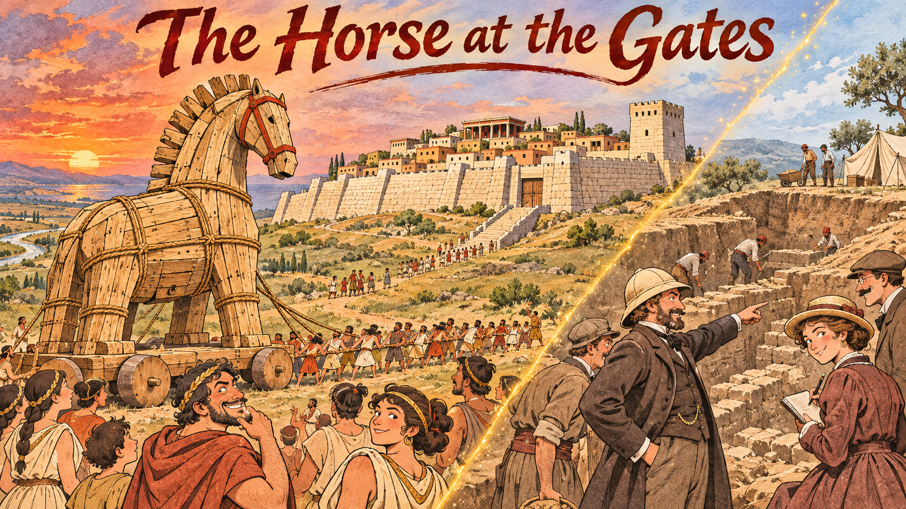 -->
    The wooden horse is not in the Iliad, and the man who found Troy dug through the city he sought. Follow the legend, the 1870s dig, and a gold hoard that went from Troy to Berlin to Moscow.

- **[8. The Soldier Who Carried His Enemy](soldier-who-carried-his-enemy/index.md)** (12 panels)

    <!-- 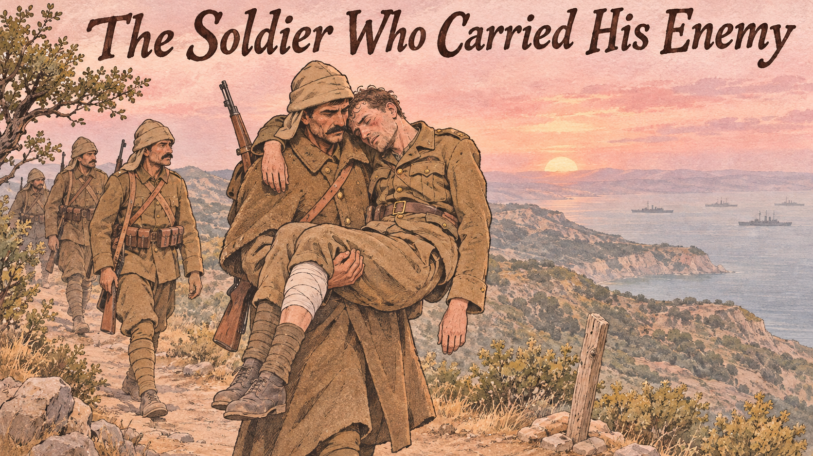 -->
    A famous statue shows a Turkish soldier carrying a wounded enemy officer to safety. Follow Gallipoli from the mines to the truce, and learn what is documented, what is legend, and why both matter.

- **[9. Great Is Artemis!](great-is-artemis/index.md)** (16 panels)

    <!-- 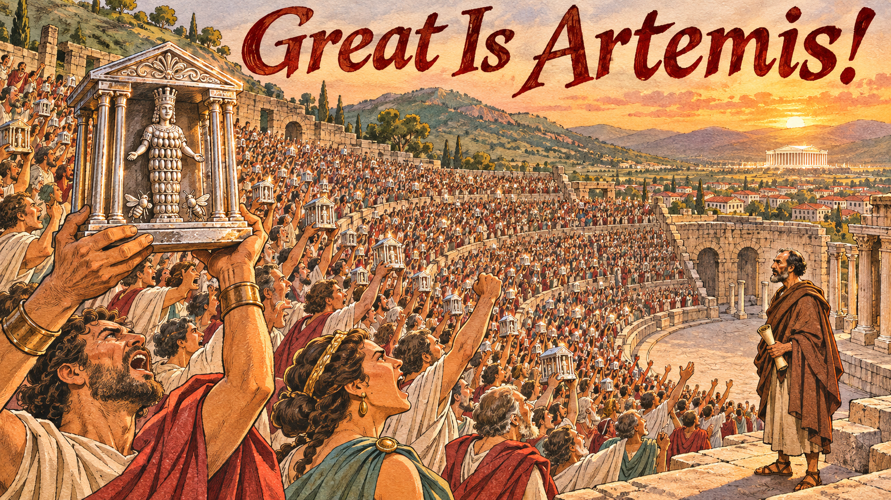 -->
    A tentmaker teaches in a borrowed lecture hall, and two years later a city shouts for two hours. Meet Paul, Demetrius and the town clerk in Ephesus, and see why his letters outlived the temple.

- **[10. The Library With a Tomb](library-with-a-tomb/index.md)** (12 panels)

    <!-- 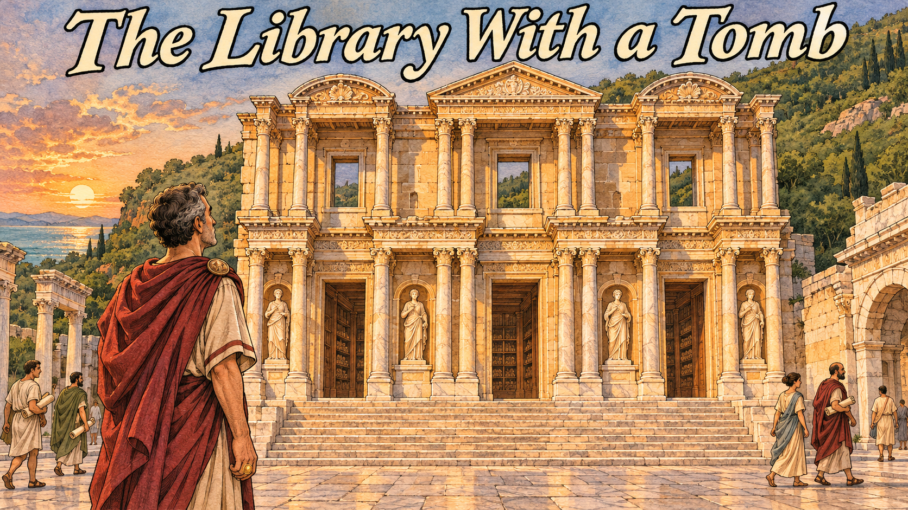 -->
    A grieving son builds his father a library and lays him to rest beneath the reading room. Then the river quietly fills the harbor, and Ephesus slowly loses its sea. Look closer.

- **[11. The Giant Who Fell Down](giant-who-fell-down/index.md)** (12 panels)

    <!-- 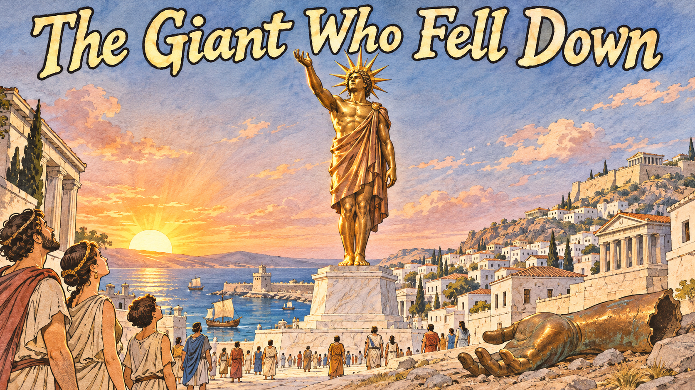 -->
    Rhodes pays for a bronze giant by selling its enemy's abandoned siege machines. It stands for only about 54 years, lies broken for centuries, and is almost certainly not what you imagine.

- **[12. The Knights' Last Stand](knights-last-stand/index.md)** (14 panels)

    <!-- 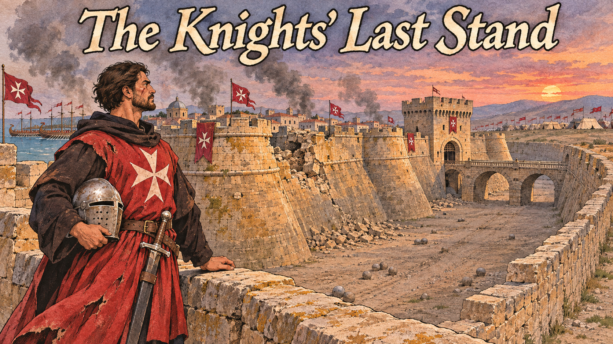 -->
    For two centuries a military order holds Rhodes. In 1522 Suleiman arrives with an army, and after six months of tunnels and cannon the siege ends in an honorable surrender and a surprising rebuild.

- **[13. Into the Labyrinth](into-the-labyrinth/index.md)** (14 panels)

    <!-- 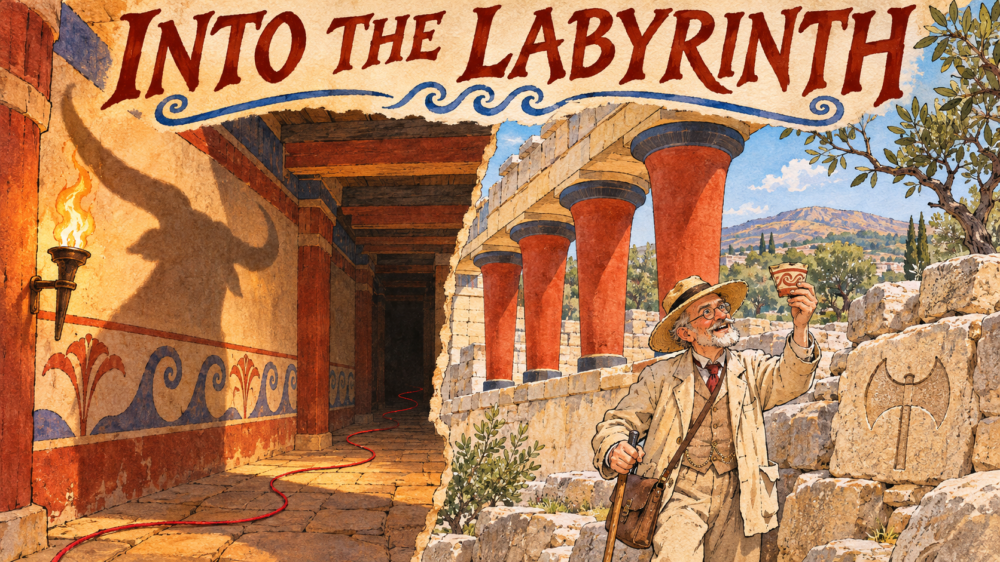 -->
    Follow Theseus and Ariadne's thread through the myth of the Labyrinth, then meet Arthur Evans, who rebuilt Knossos in red concrete. What did the Minoans make, and what did Evans imagine?

- **[14. The Architect Who Cracked the Code](architect-who-cracked-the-code/index.md)** (14 panels)

    <!-- 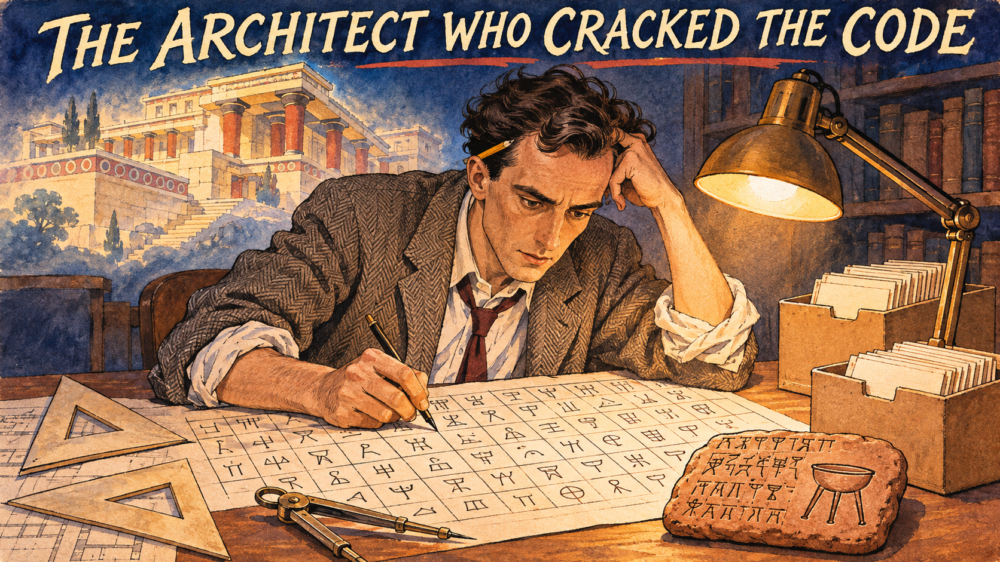 -->
    A palace fire bakes the clay tablets of Knossos hard, and 52 years later an architect and a Brooklyn teacher's index cards turn them into words. The secret turns out to be a count of sheep.

- **[15. Twenty-One Years of Candia](twenty-one-years-of-candia/index.md)** (12 panels)

    <!-- 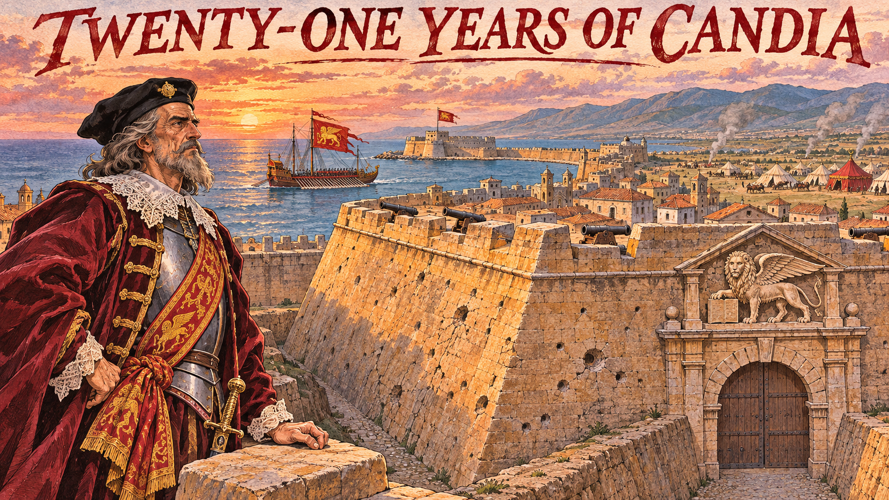 -->
    One of the longest sieges in history: Venice holds walled Candia for 21 years until Francesco Morosini surrenders it in 1669, and the same man turns up in Athens eighteen years later.

- **[16. The Jar Makers of Thrapsano](jar-makers-of-thrapsano/index.md)** (10 panels)

    <!-- 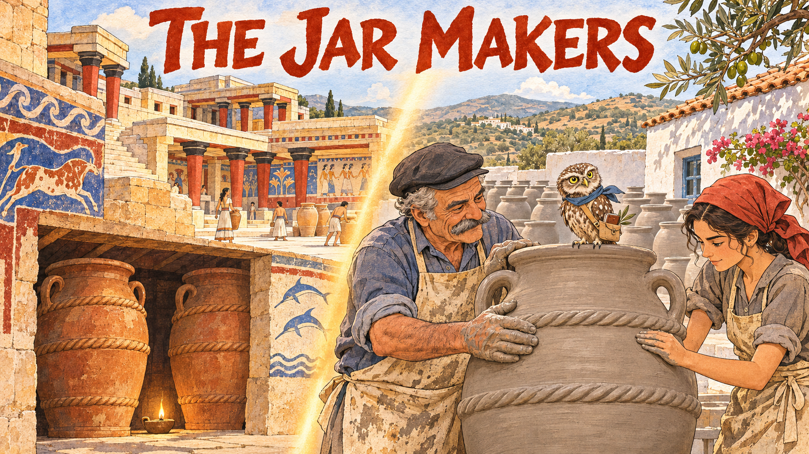 -->
    In the Knossos storerooms stand clay jars taller than a person. In a Cretan village, potters still build them by hand. Follow one jar shape across about 3,500 years.

- **[17. Wooden Walls](wooden-walls/index.md)** (16 panels)

    <!-- 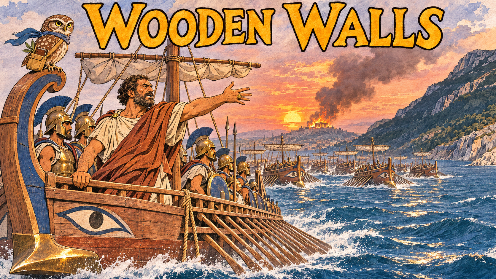 -->
    Delphi tells terrified Athens to trust a wooden wall. One politician says the wall is a fleet. Follow the Persian Wars from Marathon to Salamis, then to a bronze column now in Istanbul.

- **[18. Pericles' Building Site](pericles-building-site/index.md)** (16 panels)

    <!-- 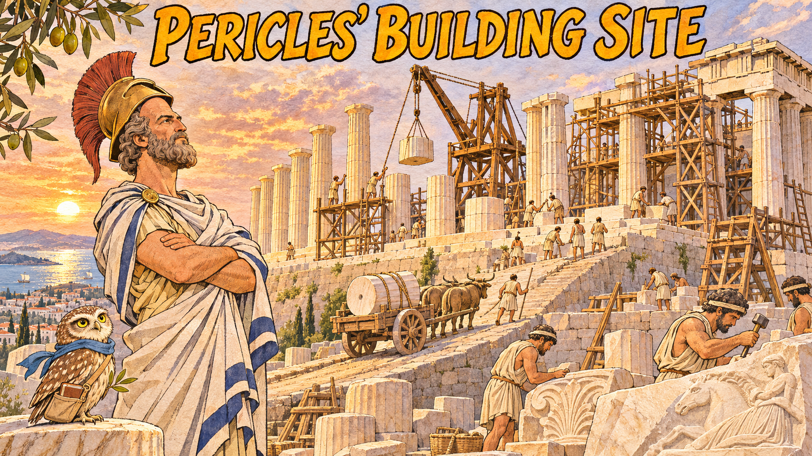 -->
    Pericles spends the allies' treasury on a temple with almost no straight lines. Follow the Parthenon from quarry to cranes, through church, mosque and a 1687 explosion.

- **[19. The Man Who Asked Too Many Questions](man-who-asked-too-many-questions/index.md)** (14 panels)

    <!-- 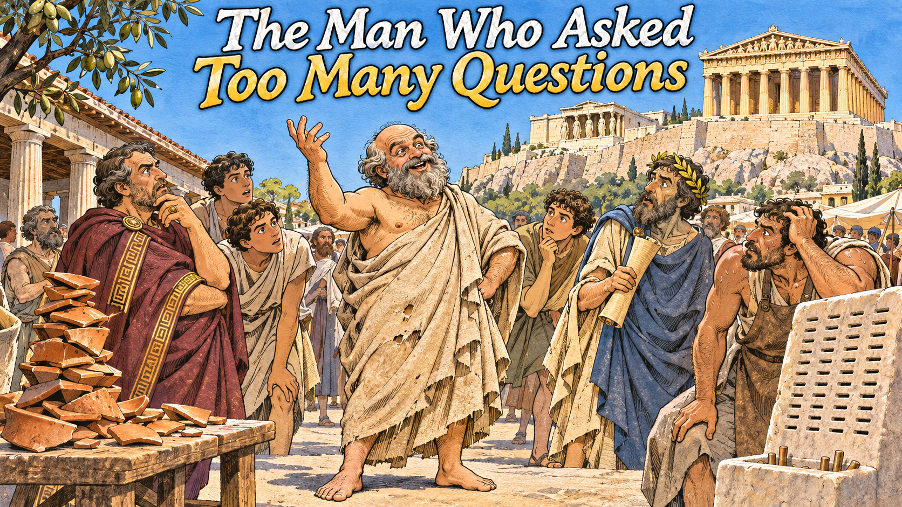 -->
    An oracle says no one is wiser than Socrates, so he questions everyone in the Athenian Agora to prove it wrong, in a democracy run by raffles and broken pots, and the city eventually puts him on trial.

- **[20. The Pythia's Busy Day](pythias-busy-day/index.md)** (16 panels)

    <!-- 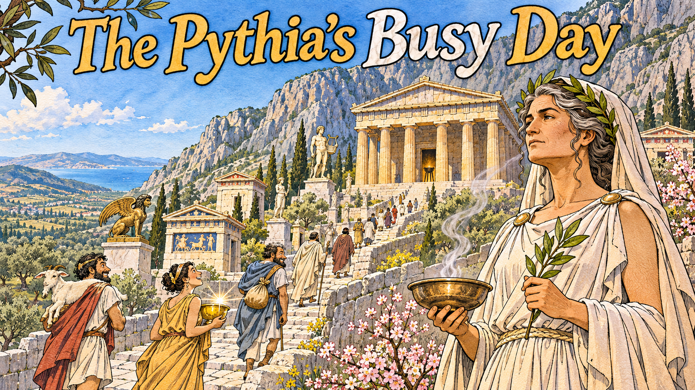 -->
    Follow a nervous farmer and a king's envoys through consultation day at Delphi, from a cold spring and a trembling goat to an answer that ruins an empire, and a question asked of a chatbot today.

- **[21. The Computer at the Bottom of the Sea](computer-at-the-bottom-of-the-sea/index.md)** (14 panels)

    <!-- 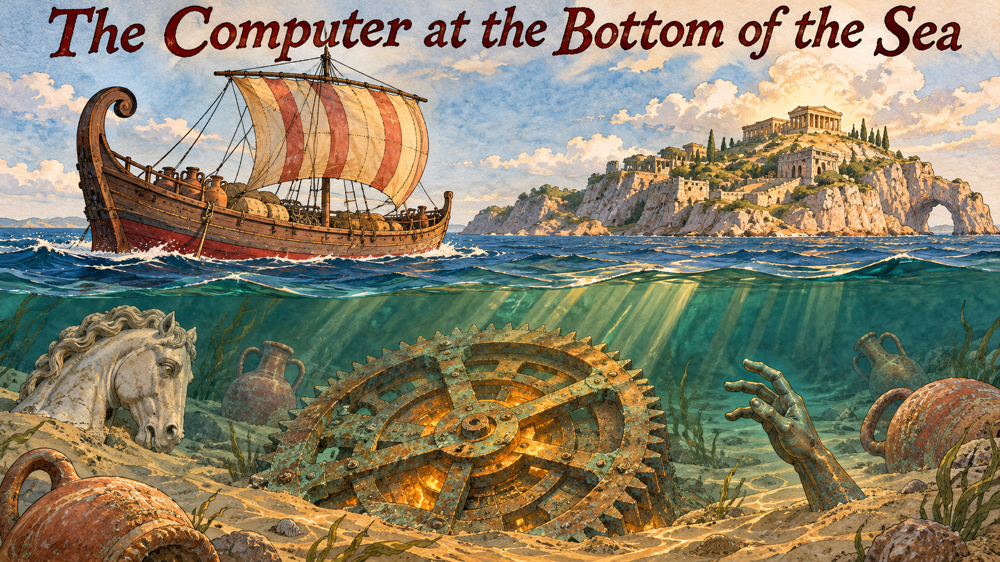 -->
    Sponge divers sheltering from a storm find a sunken ship. In a crusted lump of its bronze, scientists find a 2,000-year-old machine of gears that predicted eclipses. Who built it?

- **[22. The Day the Imam Fainted](day-the-imam-fainted/index.md)** (12 panels)

    <!-- 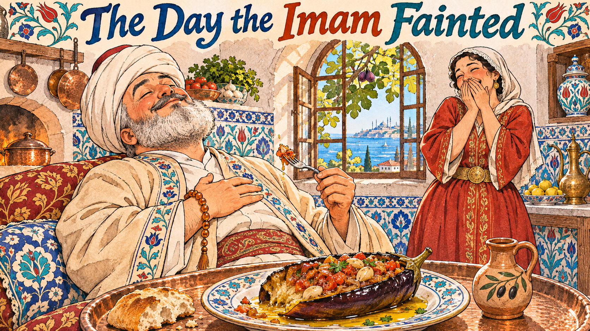 -->
    A stuffed eggplant so good, or so rich in olive oil, that an imam fainted. Follow the vegetable from Ottoman kitchens to Greek tavernas, and through the exchange of 1923 that carried recipes across the sea.
