# Into the Labyrinth

<!-- 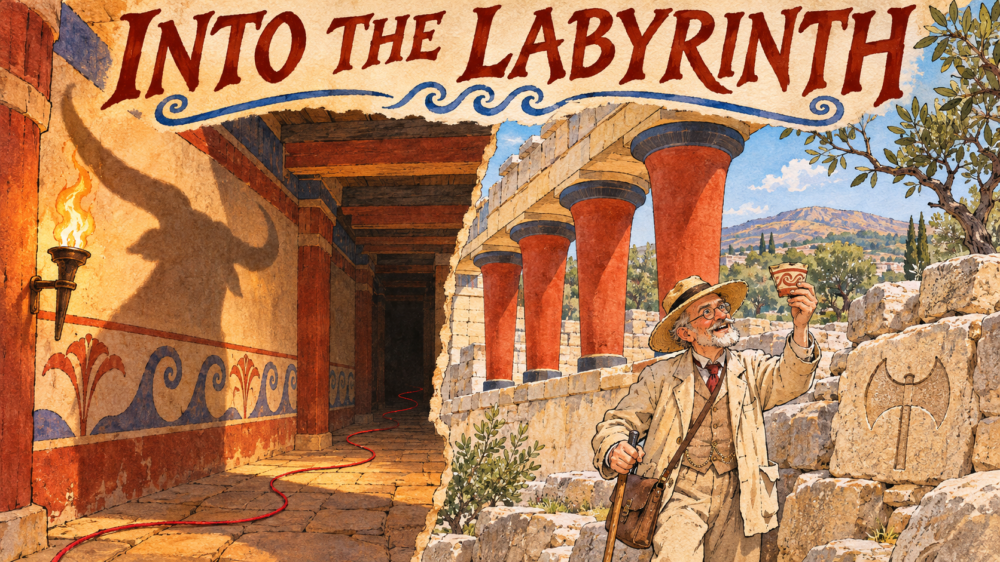 -->

<details>
<summary>Cover Image Prompt</summary>
(This is the Cover Image. Do not include this label in the image.)
Style: a hand-drawn travel-sketchbook graphic-novel illustration, with clean dark ink outlines, flat softly shaded color fills and a faint watercolor paper texture, like a page from a traveler's journal; warm, sunlit, painterly lighting; no text, captions, signs, letters or speech bubbles anywhere in the image. Please generate a wide-landscape 16:9 cover image. Scene: a dramatic split view at golden hour. On the left, in a torchlit Bronze Age corridor of cream plaster painted with red and lapis bands, a single red thread winds across the floor and away into darkness, while a huge bull-headed shadow with long curved horns falls across the far wall (shadow only, no figure, no gore). On the right, in bright daylight, a row of smooth modern red-painted concrete columns, wider at the top than the bottom, stands beside rough ancient limestone blocks carved with a double axe. Between them, small in the frame, stands Sir Arthur Evans, British archaeologist: a short, energetic man in his fifties with a neat white beard, round wire glasses, a weathered face, wearing a rumpled cream linen jacket, a wide-brimmed straw hat and carrying a walking stick; he often carries a small ancient clay fragment in one hand and gestures eagerly. He holds up a clay fragment. Render the title as bold, hand-lettered text across the top: "INTO THE LABYRINTH" (exact spelling, no other text anywhere). Palette: terracotta red, ochre, lapis blue, cream plaster and olive green. Mood: mysterious, adventurous, a little playful. Keep every character and place consistent with the other images in this story. Generate the image immediately without asking clarifying questions.
</details>

<details>
<summary>Narrative Prompt</summary>

**Story:** "Into the Labyrinth" retells the Greek legend of Theseus, Ariadne and the Minotaur (myth time, imagined at Bronze Age Knossos, about 1500 BCE) and then follows the English archaeologist Arthur Evans, who bought the hill of Kephala and began digging in March 1900 and went on to rebuild parts of the palace in reinforced concrete. The story asks one question: what did the Minoans make, and what did Evans imagine?

**Places and eras:** Knossos, Crete (the palace in legend, the excavation of 1900, the rebuilding of about 1905 to 1930); the Heraklion Archaeological Museum (today). Panels 1 to 7 are myth time and use the Bronze Age palette from the series bible: terracotta red, ochre, lapis blue, cream plaster and olive green. Panels 8 to 11 are 1900 to the 1920s and use dusty ochre soil, straw yellow, spring green, faded sky blue and terracotta (an extension of the "Modern" palette for the dig years). Panels 12 to 14 use natural museum and daylight tones with the Bronze Age colors in the frescoes.

**House style:** hand-drawn travel-sketchbook graphic-novel illustration, as in docs/stories/characters.md. No lettering anywhere in panels; only the cover carries the title. Safe-Image Rules apply: the Minotaur is only ever a shadow on a wall or a silhouette of horns, there is no combat, and every figure is draped or dressed.

**Legend versus evidence:** The earliest written pieces of the Minotaur story are centuries younger than the palace, and the thread and the tribute of fourteen Athenians are first told in full by Roman-era writers. Panels 1 to 6 are legend; panel 7 mixes a documented symbol (the double axe) with a disputed word origin; panels 8 to 14 are documented history. The prompts mark which is which.

**Creative liberties:** The legend gives no description of Minos, Daedalus, Ariadne or Theseus, so their appearance is invented for the series. Evans is drawn from the shared block only in panels where he is in his fifties (1900 to about 1905); in the 1920s rebuilding he was in his seventies, so he is not drawn in panel 11. Minoan men and women are dressed modestly in the prompts (the real frescoes show bare chests). The travelers visited the Heraklion Archaeological Museum on Day 9 and chose a village excursion instead of the palace, so the final panel is set in the museum, in front of the palace's scale model, not at the site.

**Cast:** Recurring characters (see docs/stories/characters.md and docs/img/mascot/character-sheet.md for Glaux): Arthur Evans (panels 8, 9 and 10 and the cover), Zeus (panel 1), the Palace of Knossos and the Travelers. Glaux hides in panel 7. Characters who appear only in this story:

King Minos (panel 1):

```text
King Minos of Crete: a tall, stern man of about fifty with dark curled shoulder-length hair and a short black beard, a thin gold circlet on his head, a short embroidered ochre-and-lapis tunic with a broad woven belt, a long white cloak with a red border, gold bracelets and an ivory-headed staff; majestic and wary.
```

Daedalus (panel 2):

```text
Daedalus, the legendary inventor: a lean, wiry man of about sixty with thinning gray hair, a short gray beard, deep-set clever eyes and callused hands, wearing a plain cream linen tunic with a leather apron and a belt holding a small saw, a drill and a pair of bronze dividers.
```

Ariadne (panels 4 and 6):

```text
Ariadne, princess of Crete: a young woman of about twenty with long black ringleted hair tied with a blue ribbon, wearing a flounced terracotta-and-ochre Minoan skirt with a fitted, high-necked blue-and-cream embroidered jacket and a gold bracelet, holding a ball of bright red thread.
```

Theseus (panels 3, 4, 5 and 6):

```text
Theseus, prince of Athens: a strong, clean-shaven young man of about twenty with short dark curls and steady dark eyes, wearing a plain cream tunic belted with leather, a short deep-blue cloak and leather sandals laced to the knee, with no weapon in his hands.
```

The young Athenians (panels 3 and 6):

```text
The fourteen young Athenians: seven young men and seven young women in plain cream wool tunics and long gowns under dark-blue traveling cloaks, tired but upright, standing close together.
```

The Minotaur as a shadow only (panels 5 and 6):

```text
The Minotaur, shown only as a shadow: a huge dark silhouette of a broad-shouldered figure with a bull's head and long curving horns, cast on a plaster wall by torchlight; no face, no body detail, no weapon and no blood.
```

Cretan workmen of 1900 (panels 8 and 9):

```text
Cretan workmen of 1900: sun-browned men in dark baggy breeches, white shirts, red sashes and black fringed headscarves, carrying picks, wicker baskets and wooden wheelbarrows.
```

The painter-restorer (panel 10):

```text
A painter-restorer of the early 1900s: a slim man of about forty with a trim dark mustache, a gray smock stained with pigment and a fine brush behind his ear, working at a table covered in small fragments.
```

The 1920s building crew (panel 11):

```text
The 1920s building crew: a few men in rolled shirtsleeves and flat caps carrying rolled plans, plumb lines and set squares, beside laborers in dust-gray work clothes with wooden forms and buckets.
```

</details>

### Prologue - A Maze, a Thread and a Bucket of Concrete

The legend says that beneath the palace at Knossos lay a maze so confusing that nobody who went in could find the way out, until a prince with a ball of thread did. Three thousand years later, an English archaeologist dug up the real palace, rebuilt much of it in reinforced concrete, and painted the columns red. Today's visitors find themselves in a second kind of maze: which of these walls are Minoan, and which are from the 1920s? This story walks through both.

**Find Glaux:** Glaux hides in one panel of this story. Can you spot the little owl?

## Panel 1: The Palace of King Minos
<!-- 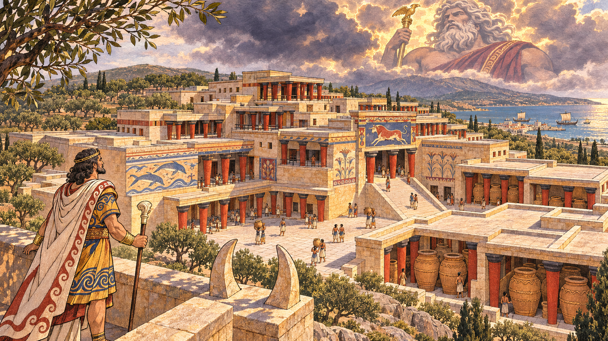 -->
<details><summary>Image Prompt</summary>
(This is Panel 01. Do not include the panel number in the image.)
I am about to ask you to generate a series of images for a graphic novel. Please make the images have a consistent style and consistent characters. Do not ask any clarifying questions. Just generate the image immediately when asked.
Style: a hand-drawn travel-sketchbook graphic-novel illustration, with clean dark ink outlines, flat softly shaded color fills and a faint watercolor paper texture, like a page from a traveler's journal; warm, sunlit, painterly lighting; no text, captions, signs, letters or speech bubbles anywhere in the image.
Please generate a 16:9 image depicting panel 1 of 14. Setting: the Palace of Knossos on Crete as the legend imagines it, about 1500 BCE, late-afternoon golden light. Palette: terracotta red, ochre, lapis blue, cream plaster and olive green. Camera: a high bird's-eye view from the northwest, looking down across the whole palace, the same angle as looking down on a museum's scale model. Mood: majestic and faintly uneasy. The Palace of Knossos on Crete: a sprawl of low, flat-roofed, honey-colored stone buildings around an open central court, with distinctive red-painted, downward-tapering wooden columns (wider at the top than the bottom) with black capitals, and colorful frescoes; storerooms hold giant human-tall clay jars (pithoi) with rope-like ridged bands. Small in the foreground, on a rooftop terrace, stands King Minos of Crete: a tall, stern man of about fifty with dark curled shoulder-length hair and a short black beard, a thin gold circlet on his head, a short embroidered ochre-and-lapis tunic with a broad woven belt, a long white cloak with a red border, gold bracelets and an ivory-headed staff; majestic and wary. Below him the central court is dotted with tiny figures carrying jars, and a ramp leads to a North Entrance with a painted bull relief. Stone horns crown the roof edge, olive groves ring the hill, and far off a harbor glints with sails. Above a distant mountain a towering golden-edged storm cloud holds the faint, shadowy, giant figure of a god: Zeus, king of the gods: a broad, powerfully built older man with a full curled silver-white beard and thick white hair, wearing a gold-edged crimson himation draped over one shoulder, holding a short gilded scepter topped with an eagle; a faint storm-cloud glow behind him. Poseidon, god of the sea: a muscular man with a windswept sea-green beard and hair, a deep teal himation, holding a three-pronged bronze trident. Apollo, god of light and prophecy: a graceful, beardless young man with shoulder-length golden-brown hair crowned with a laurel wreath, a saffron-yellow chiton, holding a small laurel branch and a gold lyre. Only Zeus appears, in the clouds; Poseidon and Apollo do not appear in this image.
Keep every character and place consistent with the other images in this story. Generate the image immediately without asking clarifying questions.
</details>

In the Greek legend, King Minos rules Crete from a palace at Knossos, and tradition makes him a son of the god Zeus. Ships from across the Aegean owe him tribute, and his craftsmen are the finest anywhere. The real palace stood on this hill for more than a thousand years, and Arthur Evans will later name its people the Minoans after this king. In the legend, though, something troubling is growing in the palace cellars.

## Panel 2: Daedalus Builds the Maze
<!-- 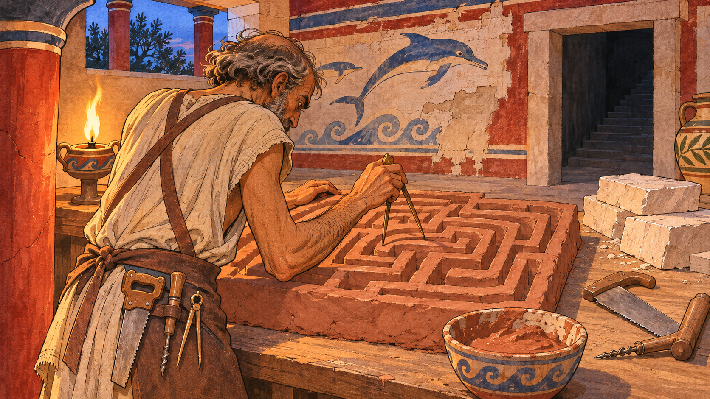 -->
<details><summary>Image Prompt</summary>
(This is Panel 02. Do not include the panel number in the image.)
Style: a hand-drawn travel-sketchbook graphic-novel illustration, with clean dark ink outlines, flat softly shaded color fills and a faint watercolor paper texture, like a page from a traveler's journal; warm, sunlit, painterly lighting; no text, captions, signs, letters or speech bubbles anywhere in the image.
Please generate a 16:9 image depicting panel 2 of 14. Setting: a craftsman's workroom in the legendary palace of Knossos, about 1500 BCE, warm lamplight against the blue dusk in a high window. Palette: terracotta red, ochre, lapis blue, cream plaster and olive green. Camera: over-the-shoulder, looking past the inventor at the work. Mood: concentrated, secretive, uneasy. In the foreground Daedalus, the legendary inventor: a lean, wiry man of about sixty with thinning gray hair, a short gray beard, deep-set clever eyes and callused hands, wearing a plain cream linen tunic with a leather apron and a belt holding a small saw, a drill and a pair of bronze dividers. He leans over a long wooden bench, tracing with bronze dividers the coiling passages of a clay model of a maze. Around him: a bowl of wet clay, a stack of cut gypsum blocks, a saw and drill, a lamp with a tall flame, a red-painted column at the room's edge, and on the wall behind him a half-finished fresco of dolphins. A tall, empty doorway at the back opens on a dark staircase going down.
Keep every character and place consistent with the other images in this story. Generate the image immediately without asking clarifying questions.
</details>

Minos calls on his master craftsman, Daedalus, to build a prison for a monster. The legend says the creature is the Minotaur, 'the bull of Minos', born after Poseidon sent the king a white bull and the king would not sacrifice it. Daedalus designs the Labyrinth so cleverly that no one who enters can find the way out, and Athens is made to send seven young men and seven young women into it as tribute. Whatever the Minotaur is, it is the poets' work: the Labyrinth is a story about a building that confuses.

## Panel 3: Fourteen From Athens
<!-- 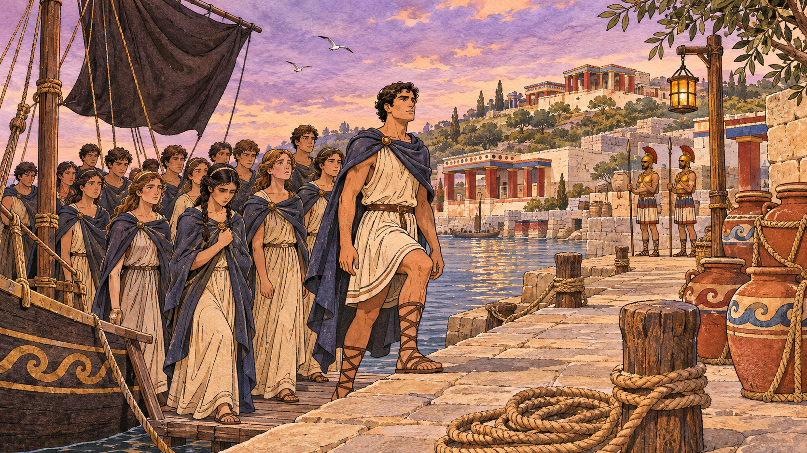 -->
<details><summary>Image Prompt</summary>
(This is Panel 03. Do not include the panel number in the image.)
Style: a hand-drawn travel-sketchbook graphic-novel illustration, with clean dark ink outlines, flat softly shaded color fills and a faint watercolor paper texture, like a page from a traveler's journal; warm, sunlit, painterly lighting; no text, captions, signs, letters or speech bubbles anywhere in the image.
Please generate a 16:9 image depicting panel 3 of 14. Setting: the harbor of Amnisos, the port of Knossos on Crete's north coast, about 1500 BCE, dusk with a lavender-and-gold sky. Palette: terracotta red, ochre, lapis blue, cream plaster and olive green. Camera: a wide, low dockside view looking along the quay. Mood: solemn, tense, quiet. A dark-hulled ship with a black sail hangs slack beside the stone quay. In the foreground, stepping onto the quay: Theseus, prince of Athens: a strong, clean-shaven young man of about twenty with short dark curls and steady dark eyes, wearing a plain cream tunic belted with leather, a short deep-blue cloak and leather sandals laced to the knee, with no weapon in his hands. Behind him, The fourteen young Athenians: seven young men and seven young women in plain cream wool tunics and long gowns under dark-blue traveling cloaks, tired but upright, standing close together. Details: coils of rope and wooden bollards, stacked wine jars with rope bands, two Cretan guards in kilts and bronze helmets standing at a distance holding spears upright at rest, gulls, a lantern on a pole, and the distant red columns of the palace on the hill.
Keep every character and place consistent with the other images in this story. Generate the image immediately without asking clarifying questions.
</details>

A ship with black sails comes in to Amnisos, the harbor town of Knossos. On board are the fourteen young Athenians who must enter the maze, and with them, tradition says, a prince named Theseus who has volunteered to go. The details come from writers of the Roman era such as Plutarch, long after the palace fell. The Cretan guards walk them up the hill toward the palace.

## Panel 4: Ariadne's Thread
<!-- 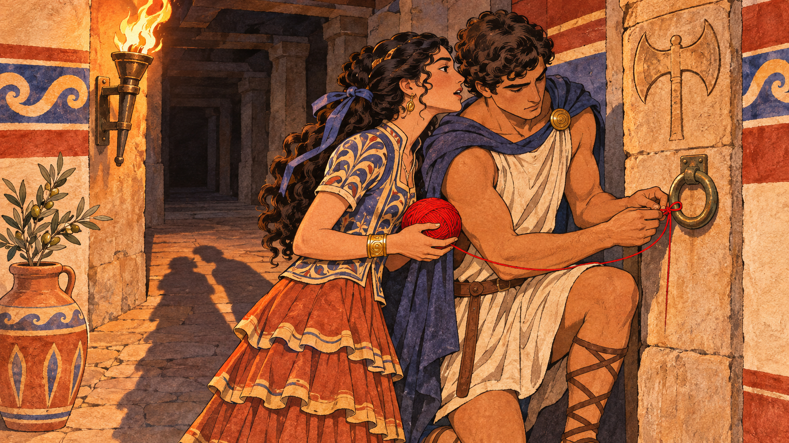 -->
<details><summary>Image Prompt</summary>
(This is Panel 04. Do not include the panel number in the image.)
Style: a hand-drawn travel-sketchbook graphic-novel illustration, with clean dark ink outlines, flat softly shaded color fills and a faint watercolor paper texture, like a page from a traveler's journal; warm, sunlit, painterly lighting; no text, captions, signs, letters or speech bubbles anywhere in the image.
Please generate a 16:9 image depicting panel 4 of 14. Setting: a torchlit stone doorway at the entrance to the Labyrinth beneath the palace of Knossos, night, about 1500 BCE. Palette: terracotta red, ochre, lapis blue, cream plaster and olive green, with orange torchlight. Camera: an intimate medium two-shot from the side, with the dark corridor opening behind them. Mood: tender, urgent, secret. Ariadne, princess of Crete: a young woman of about twenty with long black ringleted hair tied with a blue ribbon, wearing a flounced terracotta-and-ochre Minoan skirt with a fitted, high-necked blue-and-cream embroidered jacket and a gold bracelet, holding a ball of bright red thread. She presses the ball of bright red thread into the hands of Theseus, prince of Athens: a strong, clean-shaven young man of about twenty with short dark curls and steady dark eyes, wearing a plain cream tunic belted with leather, a short deep-blue cloak and leather sandals laced to the knee, with no weapon in his hands. She is whispering to him, and he is tying the free end of the thread to a stone ring set in the doorframe. Details: a flaming torch in a bronze bracket, painted bands of red and lapis on the plaster walls, a carved double axe on the doorpost, a single olive branch in a clay jar, and a long shadow of the two figures on the floor.
Keep every character and place consistent with the other images in this story. Generate the image immediately without asking clarifying questions.
</details>

Ariadne, the daughter of Minos, falls for the young prince and slips him a ball of thread. He ties one end to the doorway and unwinds it as he walks, so that the way back stays in his hand. The thread is first told in full by writers such as Plutarch and Apollodorus, in the 1st and 2nd centuries CE. It is a very practical idea: if you cannot see the whole maze, at least leave a path you can follow home.

> **Myth or Evidence?** Legend. The earliest scenes of Theseus and the Minotaur are on Greek pottery from the 7th century BCE, some 600 or 700 years after the palace fell, and the tribute and the thread are written down more than a thousand years after that.

## Panel 5: The Shadow on the Wall
<!-- 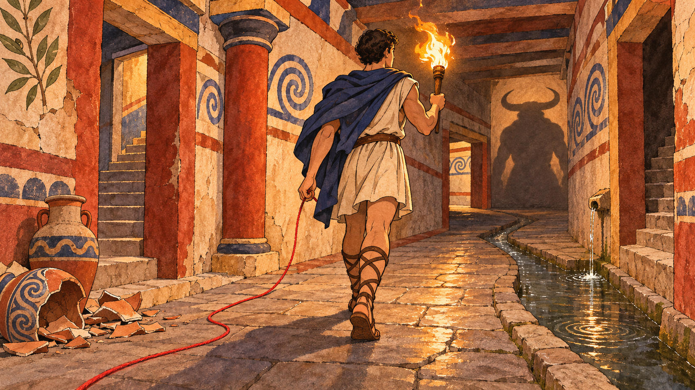 -->
<details><summary>Image Prompt</summary>
(This is Panel 05. Do not include the panel number in the image.)
Style: a hand-drawn travel-sketchbook graphic-novel illustration, with clean dark ink outlines, flat softly shaded color fills and a faint watercolor paper texture, like a page from a traveler's journal; warm, sunlit, painterly lighting; no text, captions, signs, letters or speech bubbles anywhere in the image.
Please generate a 16:9 image depicting panel 5 of 14. Setting: a long, narrow corridor of the legendary Labyrinth beneath Knossos, about 1500 BCE, lit by a single torch. Palette: terracotta red, ochre, lapis blue, cream plaster and olive green, with deep shadow. Camera: a low angle from behind the young man, looking down the corridor. Mood: dread, suspense, awe; no violence. In the foreground, seen from behind, walks Theseus, prince of Athens: a strong, clean-shaven young man of about twenty with short dark curls and steady dark eyes, wearing a plain cream tunic belted with leather, a short deep-blue cloak and leather sandals laced to the knee, with no weapon in his hands. holding a flickering torch in one hand and letting a bright red thread unspool from his other hand along the floor behind him. At the end of the corridor, on the plaster wall, falls The Minotaur, shown only as a shadow: a huge dark silhouette of a broad-shouldered figure with a bull's head and long curving horns, cast on a plaster wall by torchlight; no face, no body detail, no weapon and no blood. Details: the corridor bends sharply in three places with doors and stairways leading off, painted spirals on the wall, a pile of broken pottery, a dripping water channel in the floor, and the red thread running back into the light.
Keep every character and place consistent with the other images in this story. Generate the image immediately without asking clarifying questions.
</details>

Theseus walks into the dark with the thread running out behind him. Ahead, on the wall, he sees a vast shadow with the horns of a bull. In the legend he faces the creature and kills it; this picture stays with the shadow, because the story is about the maze and the thread, not the fight.

> **Myth or Evidence?** Legend. Bulls really are everywhere in Minoan art, in paintings, on seals and in the stone 'horns' on rooftops, so a Cretan monster with a bull's head is a natural thing for later Greeks to imagine. No bones, monster or maze have ever been found.

## Panel 6: Out Into the Light
<!-- 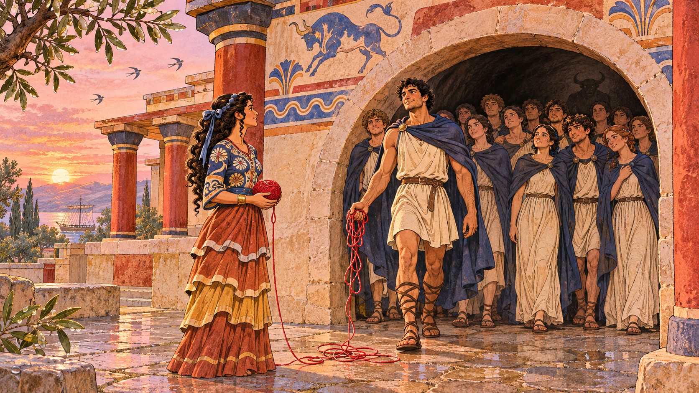 -->
<details><summary>Image Prompt</summary>
(This is Panel 06. Do not include the panel number in the image.)
Style: a hand-drawn travel-sketchbook graphic-novel illustration, with clean dark ink outlines, flat softly shaded color fills and a faint watercolor paper texture, like a page from a traveler's journal; warm, sunlit, painterly lighting; no text, captions, signs, letters or speech bubbles anywhere in the image.
Please generate a 16:9 image depicting panel 6 of 14. Setting: the low arched exit of the Labyrinth at the palace of Knossos, dawn, about 1500 BCE, pink and gold light spilling over the court. Palette: terracotta red, ochre, lapis blue, cream plaster and olive green. Camera: a wide shot from outside, looking back at the doorway. Mood: relief, quiet triumph. Theseus, prince of Athens: a strong, clean-shaven young man of about twenty with short dark curls and steady dark eyes, wearing a plain cream tunic belted with leather, a short deep-blue cloak and leather sandals laced to the knee, with no weapon in his hands. steps out of the dark archway holding the red thread, now tangled and shortened, in one hand. Behind him, The fourteen young Athenians: seven young men and seven young women in plain cream wool tunics and long gowns under dark-blue traveling cloaks, tired but upright, standing close together. Ariadne stands waiting by the doorway: Ariadne, princess of Crete: a young woman of about twenty with long black ringleted hair tied with a blue ribbon, wearing a flounced terracotta-and-ochre Minoan skirt with a fitted, high-necked blue-and-cream embroidered jacket and a gold bracelet, holding a ball of bright red thread. Far back in the black passage only a faint horned shadow lingers on the wall. Details: dew on the stone, a dawn sky streaked with orange, the red-painted columns of the court, a skein of thread coiled at their feet, a distant ship's mast in the harbor, and swallows in the sky.
Keep every character and place consistent with the other images in this story. Generate the image immediately without asking clarifying questions.
</details>

The thread leads Theseus and the fourteen young Athenians back to the doorway at dawn, and Ariadne is there. The legend ends with the pair sailing away, and with Daedalus escaping Crete on wings of feathers and wax. The story that survives is really a memory of a place: a vast palace with a confusing plan, a powerful ruler, and bulls at the center of ritual and sport.

## Panel 7: The House of the Double Axe
<!-- 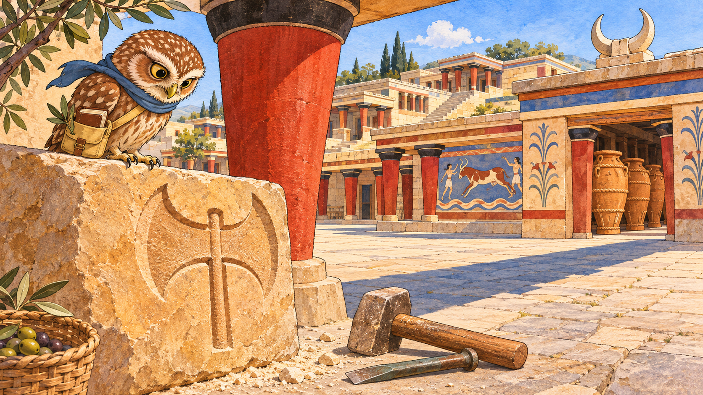 -->
<details><summary>Image Prompt</summary>
(This is Panel 07. Do not include the panel number in the image.)
Style: a hand-drawn travel-sketchbook graphic-novel illustration, with clean dark ink outlines, flat softly shaded color fills and a faint watercolor paper texture, like a page from a traveler's journal; warm, sunlit, painterly lighting; no text, captions, signs, letters or speech bubbles anywhere in the image.
Please generate a 16:9 image depicting panel 7 of 14. Setting: a sunlit gypsum wall at the Palace of Knossos at the height of its glory, about 1500 BCE, bright mid-morning light. Palette: terracotta red, ochre, lapis blue, cream plaster and olive green. Camera: a close, low-angle detail of a stone block in the foreground, a wide view of the palace fading behind. Mood: curious, quiet, observant. The Palace of Knossos on Crete: a sprawl of low, flat-roofed, honey-colored stone buildings around an open central court, with distinctive red-painted, downward-tapering wooden columns (wider at the top than the bottom) with black capitals, and colorful frescoes; storerooms hold giant human-tall clay jars (pithoi) with rope-like ridged bands. In the foreground the smooth, honey-colored stone block is carved with a deep double-headed axe, the Minoan labrys; a mason's stone hammer and a bronze chisel lie on the ground nearby with fine pale dust. Details: a red-painted tapered column beside the block, a bull's-horn stone ornament on the roofline, a row of tall storage jars through a doorway, a basket of olives, and a long blue shadow of the roof across the court. Glaux is drawn small, perched at the edge of the scene, noticeable on a second look. Glaux the Little Owl: a true little owl (Athene noctua), small, round and compact, with a flat rounded head and no ear tufts, warm earth-brown plumage with cream spots, bright lemon-yellow eyes under pale cream eyebrows, a cream-white throat patch and a short pale greenish-yellow beak. Glaux wears a small Aegean-blue scarf and a tan canvas satchel across the body with a small leather-bound travel notebook peeking out, and a sprig of three olive leaves tucked into the satchel strap. Alert, curious and warm expression. Glaux perches on a ledge just above the carved axe, looking down at it.
Keep every character and place consistent with the other images in this story. Generate the image immediately without asking clarifying questions.
</details>

This is the labrys, the double-headed axe, carved on blocks all over the palace and treated as a sacred symbol. Since Evans, many writers have said that 'labyrinth' means 'house of the double axe'. Glaux, perched above the carving, would say: look closer.

> **Myth or Evidence?** Documented, with a disputed word origin. The double axe is real, and a Linear B tablet from Knossos records an offering of honey to 'the Mistress of the Labyrinth', so a place or shrine of that name existed. But linguists are divided on whether the word really comes from labrys.

## Panel 8: March 1900: The Digger Arrives
<!-- 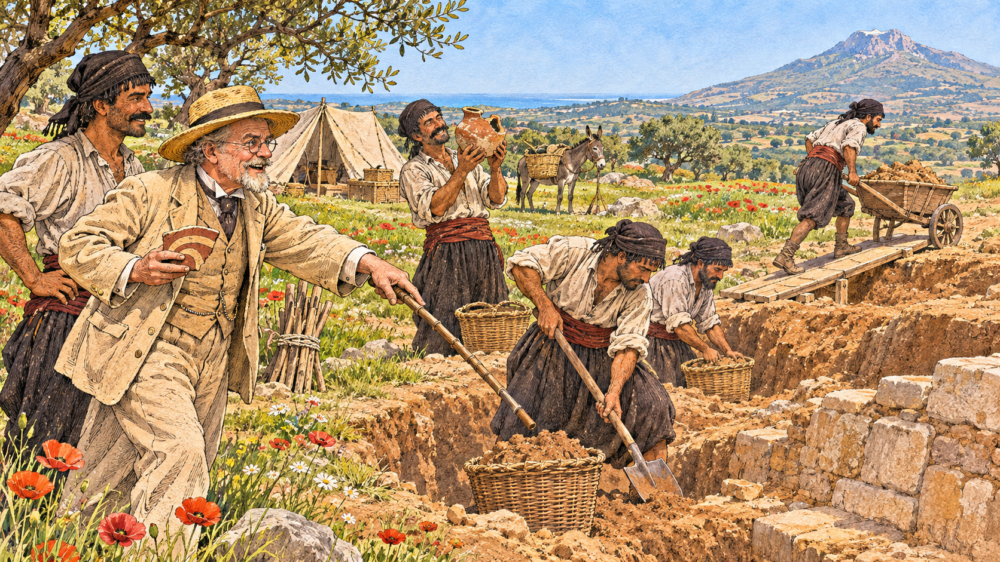 -->
<details><summary>Image Prompt</summary>
(This is Panel 08. Do not include the panel number in the image.)
Style: a hand-drawn travel-sketchbook graphic-novel illustration, with clean dark ink outlines, flat softly shaded color fills and a faint watercolor paper texture, like a page from a traveler's journal; warm, sunlit, painterly lighting; no text, captions, signs, letters or speech bubbles anywhere in the image.
Please generate a 16:9 image depicting panel 8 of 14. Setting: the hill of Kephala at Knossos, Crete, March 1900, bright clear spring morning. Palette: dusty ochre soil, straw yellow, spring green, faded sky blue and terracotta. Camera: wide, eye-level, looking across a fresh trench toward the sea and Mount Juktas. Mood: energetic, hopeful, dusty. In the foreground at the lip of the trench stands Sir Arthur Evans, British archaeologist: a short, energetic man in his fifties with a neat white beard, round wire glasses, a weathered face, wearing a rumpled cream linen jacket, a wide-brimmed straw hat and carrying a walking stick; he often carries a small ancient clay fragment in one hand and gestures eagerly. He points toward a patch of exposed stone with his walking stick. Beside him are Cretan workmen of 1900: sun-browned men in dark baggy breeches, white shirts, red sashes and black fringed headscarves, carrying picks, wicker baskets and wooden wheelbarrows. Some shovel soil into wicker baskets, one pushes a loaded wheelbarrow up a wooden plank, and one holds up a broken clay pot. Details: neat mounds of earth, a spring carpet of green weeds and red poppies on the hill, a small canvas tent, a donkey with panniers, a tied bundle of wooden stakes, and the pale line of the sea far off.
Keep every character and place consistent with the other images in this story. Generate the image immediately without asking clarifying questions.
</details>

Arthur Evans first came to Crete in 1894 looking for early writing, after seeing tiny signs engraved on seal stones that Cretan women wore as charms. In 1878 a Heraklion merchant, Minos Kalokairinos, had dug trenches on this hill and found giant storage jars, but the Ottoman authorities, who still governed Crete, stopped him. Once Crete became autonomous, Evans bought the land and began digging in March 1900, with the Scottish archaeologist Duncan Mackenzie keeping the daily records and a large crew of Cretan workers. Within weeks they find the Throne Room and the first clay tablets.

## Panel 9: The Throne Room
<!-- 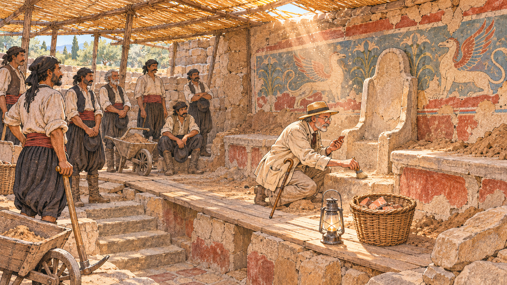 -->
<details><summary>Image Prompt</summary>
(This is Panel 09. Do not include the panel number in the image.)
Style: a hand-drawn travel-sketchbook graphic-novel illustration, with clean dark ink outlines, flat softly shaded color fills and a faint watercolor paper texture, like a page from a traveler's journal; warm, sunlit, painterly lighting; no text, captions, signs, letters or speech bubbles anywhere in the image.
Please generate a 16:9 image depicting panel 9 of 14. Setting: the Throne Room at the Palace of Knossos, April 1900, soft afternoon light through a gap in a temporary reed roof. Palette: dusty ochre soil, straw yellow, spring green, faded sky blue and terracotta. Camera: a medium-wide shot from slightly above and across the room. Mood: wonder, silence, held breath. A tall, high-backed gypsum throne is half uncovered from the soil, flanked by low stone benches; faded griffin-and-plant paintings survive in patches on the plaster behind it. Kneeling in front of it, brushing earth from a bench with a small brush, is Sir Arthur Evans, British archaeologist: a short, energetic man in his fifties with a neat white beard, round wire glasses, a weathered face, wearing a rumpled cream linen jacket, a wide-brimmed straw hat and carrying a walking stick; he often carries a small ancient clay fragment in one hand and gestures eagerly. He holds a small clay fragment in his other hand. Standing back in a half-circle, watching quietly with caps in hand, are Cretan workmen of 1900: sun-browned men in dark baggy breeches, white shirts, red sashes and black fringed headscarves, carrying picks, wicker baskets and wooden wheelbarrows. Details: a wooden plank walkway, a lantern on the floor, a wicker basket of pottery sherds, stone steps leading down into a small sunken area, and swirls of dust in the light.
Keep every character and place consistent with the other images in this story. Generate the image immediately without asking clarifying questions.
</details>

In April 1900 the team uncovers a small room with a high-backed gypsum seat still standing against the wall. Evans calls it the throne of Minos, and it becomes famous as the oldest throne in Europe. It is one of the few things in the palace that is exactly where the Bronze Age left it.

> **Myth or Evidence?** The throne is documented. The name is Evans's. The room in its present form dates from the last phase of the palace, after about 1450 BCE, and who sat there is unknown; some scholars think it was a priestess, not a king.

## Panel 10: A Puzzle of Painted Plaster
<!-- 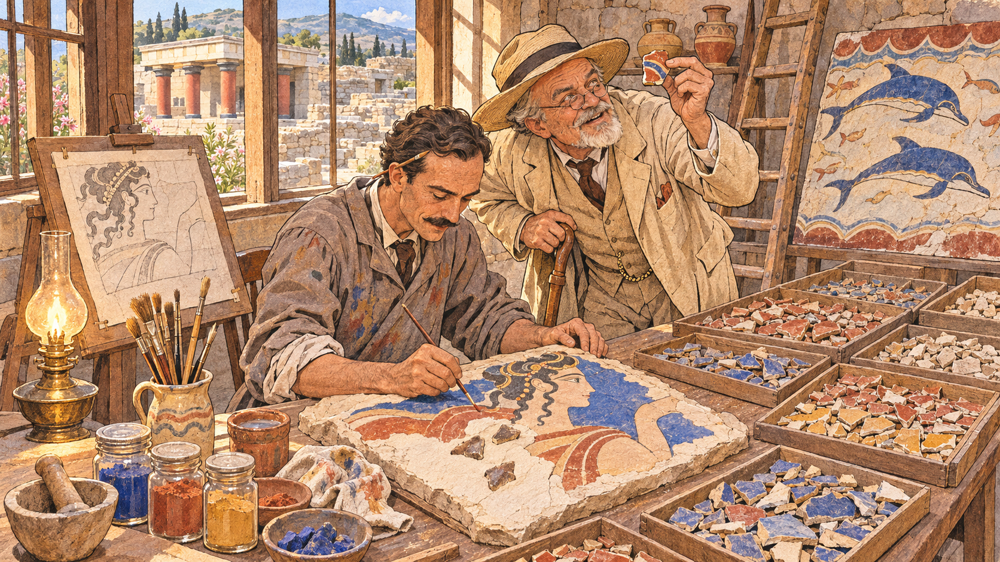 -->
<details><summary>Image Prompt</summary>
(This is Panel 10. Do not include the panel number in the image.)
Style: a hand-drawn travel-sketchbook graphic-novel illustration, with clean dark ink outlines, flat softly shaded color fills and a faint watercolor paper texture, like a page from a traveler's journal; warm, sunlit, painterly lighting; no text, captions, signs, letters or speech bubbles anywhere in the image.
Please generate a 16:9 image depicting panel 10 of 14. Setting: a covered work-shed beside the dig at Knossos, about 1903 to 1905, warm window light and a lamp. Palette: dusty ochre soil, straw yellow, spring green, faded sky blue and terracotta, with the colors of the frescoes: lapis blue, ochre and terracotta. Camera: a high three-quarter view looking down on a long worktable. Mood: absorbed, inventive, slightly overconfident. At the table sits A painter-restorer of the early 1900s: a slim man of about forty with a trim dark mustache, a gray smock stained with pigment and a fine brush behind his ear, working at a table covered in small fragments. He is painting in the missing parts of a fresco around a few small dark fragments pressed into fresh pale plaster. Leaning over his shoulder, holding a fragment up to the light, is Sir Arthur Evans, British archaeologist: a short, energetic man in his fifties with a neat white beard, round wire glasses, a weathered face, wearing a rumpled cream linen jacket, a wide-brimmed straw hat and carrying a walking stick; he often carries a small ancient clay fragment in one hand and gestures eagerly. Details: trays of hundreds of tiny colored fragments sorted into piles, jars of mineral pigments, a drawing board with a half-finished sketch of a figure, brushes in a jar, a ladder, and a finished panel of dolphins leaning against the wall.
Keep every character and place consistent with the other images in this story. Generate the image immediately without asking clarifying questions.
</details>

The palace's wall paintings did not survive on the walls. They fell when the palace burned and came out of the ground as heaps of fragments, often a few centimeters across. Evans hired artists, including a father-and-son team of Swiss painters both named Émile Gilliéron, to fit the pieces together and paint in the gaps. The results are lovely and partly guesswork: one figure, restored as a boy gathering crocuses, later turned out to be a blue monkey.

## Panel 11: Concrete Columns, Painted Red
<!-- 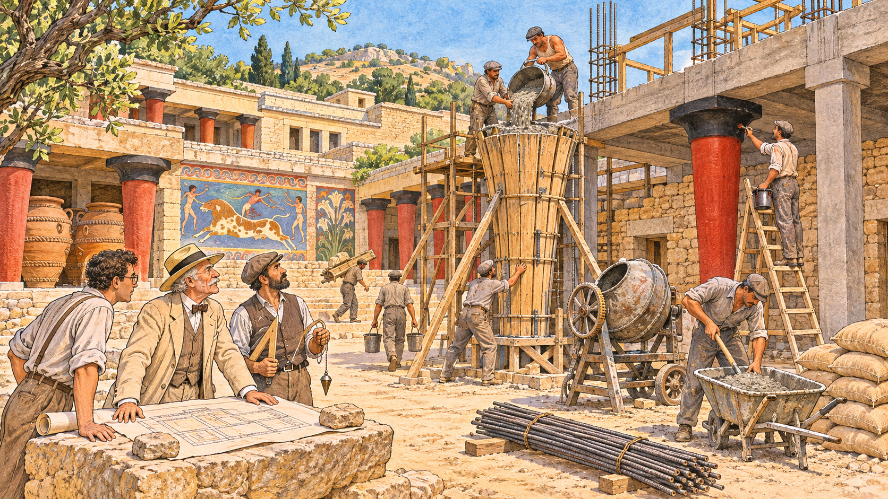 -->
<details><summary>Image Prompt</summary>
(This is Panel 11. Do not include the panel number in the image.)
Style: a hand-drawn travel-sketchbook graphic-novel illustration, with clean dark ink outlines, flat softly shaded color fills and a faint watercolor paper texture, like a page from a traveler's journal; warm, sunlit, painterly lighting; no text, captions, signs, letters or speech bubbles anywhere in the image.
Please generate a 16:9 image depicting panel 11 of 14. Setting: the Palace of Knossos during the rebuilding of the 1920s, mid-morning summer light, dusty and bright. Palette: dusty ochre soil, straw yellow, spring green, faded sky blue and terracotta, with strong red on the columns. Camera: a wide, slightly low view across the central court toward a half-rebuilt wing. Mood: busy, proud, a little uneasy. The Palace of Knossos on Crete: a sprawl of low, flat-roofed, honey-colored stone buildings around an open central court, with distinctive red-painted, downward-tapering wooden columns (wider at the top than the bottom) with black capitals, and colorful frescoes; storerooms hold giant human-tall clay jars (pithoi) with rope-like ridged bands. In the middle ground, The 1920s building crew: a few men in rolled shirtsleeves and flat caps carrying rolled plans, plumb lines and set squares, beside laborers in dust-gray work clothes with wooden forms and buckets. are pouring wet gray concrete into a tall tapered wooden form for a column that is wider at the top, while a man on a ladder paints a finished concrete column bright red and a black capital. Details: wheelbarrows of concrete, a cement mixer drum, bundles of iron rods for reinforcing, an upper floor rising in gray concrete beside original rough stone below, a rolled plan held open with stones, and a stack of sacks.
Keep every character and place consistent with the other images in this story. Generate the image immediately without asking clarifying questions.
</details>

Wooden columns and beams had burned or rotted away, and the soft gypsum stone was dissolving in the rain, so from about 1905 Evans rebuilt, first in wood and stone and mainly from the 1920s in reinforced concrete. His architects, Christian Doll and later Piet de Jong, rebuilt the Grand Staircase, the North Entrance and an upper floor over the Throne Room, and painted concrete columns red in the Minoan shape, wider at the top than the bottom. The result is the only Bronze Age palace where visitors can feel a room's height, and also a palace partly designed in the 1920s.

## Panel 12: Fragments and Fresco, Side by Side
<!-- 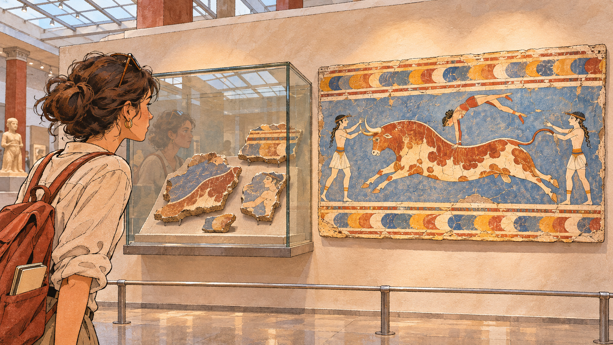 -->
<details><summary>Image Prompt</summary>
(This is Panel 12. Do not include the panel number in the image.)
Style: a hand-drawn travel-sketchbook graphic-novel illustration, with clean dark ink outlines, flat softly shaded color fills and a faint watercolor paper texture, like a page from a traveler's journal; warm, sunlit, painterly lighting; no text, captions, signs, letters or speech bubbles anywhere in the image.
Please generate a 16:9 image depicting panel 12 of 14. Setting: a gallery of the Heraklion Archaeological Museum, Crete, today, calm even daylight from a skylight. Palette: cream plaster, terracotta, lapis blue, ochre and warm museum grays. Camera: a close, slightly low frontal view of one display wall. Mood: thoughtful, precise, a quiet reveal. On the left, in a glass case, a shallow tray holds small darker, rougher, slightly raised fragments of real painted plaster in warm brown, blue and ochre. On the right, beside it, hangs the restored Bull-Leaping Fresco panel, less than a meter high: a charging bull in rust and cream, a young acrobat in mid-handspring over its back, and two figures at its head and tail, painted in smooth bright color on pale plaster. Details: the edge of the real fragments clearly visible inside the larger painted rectangle, a soft spotlight, a polished stone floor, a low barrier rail, and the reflection of a visitor in the glass.
Keep every character and place consistent with the other images in this story. Generate the image immediately without asking clarifying questions.
</details>

Here, in the museum, the two layers sit next to each other. The darker, rougher, slightly raised patches are real Bronze Age plaster, about 3,500 years old; the smooth bright areas around them are a restorer's work. The Bull-Leaping Fresco, made about 1450 to 1400 BCE, shows a charging bull and three young athletes, and it is a good example of how much of a famous image can be painted in later. Before admiring a whole figure, find the edges of the real pieces.

## Panel 13: Minoan, Evans, or Copy?
<!-- 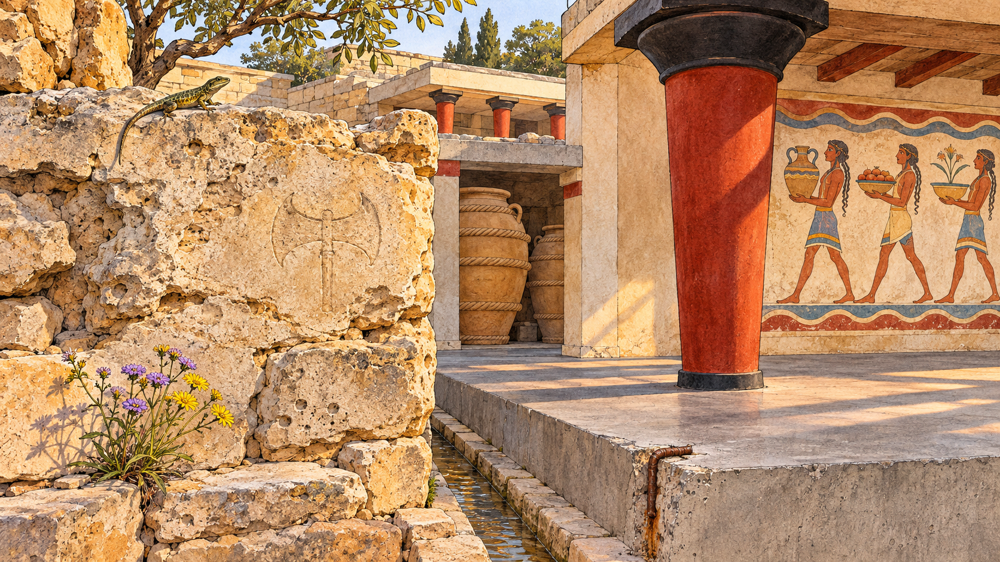 -->
<details><summary>Image Prompt</summary>
(This is Panel 13. Do not include the panel number in the image.)
Style: a hand-drawn travel-sketchbook graphic-novel illustration, with clean dark ink outlines, flat softly shaded color fills and a faint watercolor paper texture, like a page from a traveler's journal; warm, sunlit, painterly lighting; no text, captions, signs, letters or speech bubbles anywhere in the image.
Please generate a 16:9 image depicting panel 13 of 14. Setting: a corner of the Palace of Knossos, today, late-afternoon light. Palette: warm honey stone, concrete gray, bright red and black on the columns, cream plaster, olive green. Camera: a close frontal detail shot. Mood: curious, playful, like a puzzle with the answer almost visible. The Palace of Knossos on Crete: a sprawl of low, flat-roofed, honey-colored stone buildings around an open central court, with distinctive red-painted, downward-tapering wooden columns (wider at the top than the bottom) with black capitals, and colorful frescoes; storerooms hold giant human-tall clay jars (pithoi) with rope-like ridged bands. In the left half of the frame, a rough, pitted, weathered wall of original gypsum and limestone blocks with uneven edges and a faint carved double axe. In the right half, a smooth gray concrete floor slab with crisp edges and a bright red tapered concrete column with a black capital, beside it a painted fresco copy of a procession of figures on a wall. Details: a lizard on the old stone, a tuft of wildflowers in a crack, a narrow drainage channel of stone, a rusty iron reinforcing bar showing at the corner of the concrete, and long late shadows. No people.
Keep every character and place consistent with the other images in this story. Generate the image immediately without asking clarifying questions.
</details>

A simple test works at almost any wall in Knossos: look at the material before the color. Rough rubble, worn limestone and pitted gypsum are almost always Minoan; smooth gray concrete and anything bright red or black above head height is almost always Evans; and a painting on an outdoor wall is a copy, because the originals are in the museum. Later conservation rules turned against rebuilding; the Venice Charter of 1964 says reconstruction should be ruled out on archaeological sites, and the iron inside Evans's concrete is now rusting. The concrete has itself become part of the site's history.

## Panel 14: Then and Now: The Palace in Miniature
<!-- 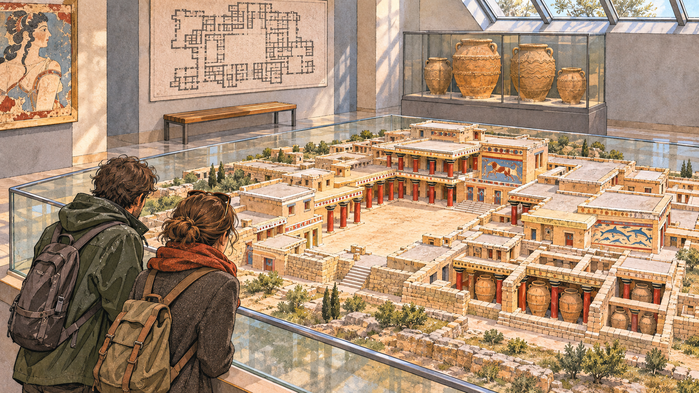 -->
<details><summary>Image Prompt</summary>
(This is Panel 14. Do not include the panel number in the image.)
Style: a hand-drawn travel-sketchbook graphic-novel illustration, with clean dark ink outlines, flat softly shaded color fills and a faint watercolor paper texture, like a page from a traveler's journal; warm, sunlit, painterly lighting; no text, captions, signs, letters or speech bubbles anywhere in the image.
Please generate a 16:9 image depicting panel 14 of 14. Setting: a gallery of the Heraklion Archaeological Museum, Crete, today, soft late-morning daylight in November. Palette: natural daylight, warm limestone, terracotta, lapis blue and museum gray. Camera: a high three-quarter angle looking down on a large scale model of the Palace of Knossos, the same angle as the bird's-eye view of the palace in panel 1. Mood: reflective, satisfied, a quiet closing. Two adult travelers seen from behind or in distant three-quarter view, dressed for cool November weather: one in a dark green rain jacket, the other in a charcoal wool coat with a rust-colored scarf, both with small daypacks, standing close together and looking at the view. Faces are never shown in detail. They lean slightly over a glass case and look down at the model. The Palace of Knossos on Crete: a sprawl of low, flat-roofed, honey-colored stone buildings around an open central court, with distinctive red-painted, downward-tapering wooden columns (wider at the top than the bottom) with black capitals, and colorful frescoes; storerooms hold giant human-tall clay jars (pithoi) with rope-like ridged bands. The model shows the central court, the rooflines, the red columns and the storerooms in miniature. Details: the model's tiny painted red columns, a printed floor plan on a wall behind, a case of storage jars in the background, a bench, a skylight, and a framed fresco panel faintly visible at the edge of the gallery.
Keep every character and place consistent with the other images in this story. Generate the image immediately without asking clarifying questions.
</details>

We have come back to the angle of the first panel, now through a glass case in Heraklion. On Day 9 we chose the village excursion over the palace, so our palace is the museum's scale model, and it is a good way to see how a maze-like plan could have started a legend. The next time we are at Knossos, we will know to ask the question that this story keeps asking: who made this, the Minoans, Evans, or a copyist?

### Epilogue - What the Labyrinth Teaches

The Labyrinth never existed as the legend tells it, but the palace that inspired it did, and so did the man who rebuilt it. Evans gave the world a vivid Minoan Crete, and he gave it a palace you can feel the height of; he also painted his own picture of the past onto the real one. The skill the legend rewards, leaving a path you can follow back, is the same skill a visitor needs at Knossos: always be able to trace what is original, what is rebuilt and what is guessed.

| Challenge | How They Responded | Lesson for Today |
|---|---|---|
| Finding the way out of a maze | Theseus tied a thread at the entrance and followed it back | Keep a trail you can retrace |
| A heap of tiny painted fragments | Evans's artists fitted the pieces together and painted in the gaps | Mark what is found and what is guessed |
| Burned timbers and crumbling stone | Evans rebuilt in reinforced concrete and painted the columns red | A repair becomes history too, and later rules (the Venice Charter of 1964) discourage rebuilding |
| Telling Minoan from Evans | Visitors check the material first, the color second | Ask who made it before you admire it |

### Call to Action

At Knossos, or in front of the scale model in Heraklion, find one wall and decide whether it is Minoan, Evans or a copy, then check your answer against the Knossos sim. Learning for All also means being told honestly what is original and what is a guess, so that anyone, not just an expert, can read the evidence for themselves.

---

## Voices from the Sources

- **Homer, *Iliad* (Book 18), paraphrased.** In the description of the shield of Achilles, the poet compares a dancing floor to the one that Daedalus once made in broad Knossos for Ariadne. This is the earliest written mention of the Knossos story that we have, set down some 600 or 700 years after the palace fell.
- **A Linear B tablet from Knossos.** It records an offering of honey to "the Mistress of the Labyrinth" (as the chapter reads it). The tablet is documented evidence that a place or shrine called the Labyrinth existed at Mycenaean Knossos, and it says nothing about a Minotaur.
- **Arthur Evans, the title of his great work.** *The Palace of Minos* (published in four volumes between 1921 and 1935) shows how Evans named the Bronze Age people of Crete after a king from the legend.

## On the Trip

- **Chapter:** [13. Knossos, the Minoans, and Linear B](../../chapters/13-knossos-minoans-linear-b/index.md)
- **Where to look:** the red-painted concrete columns, wider at the top than the bottom; the Throne Room, seen from the antechamber; the painted copies of frescoes on the palace walls; and the originals, including the Bull-Leaping Fresco and the fragments set in plaster, in the Heraklion Archaeological Museum.
- **Explore further:** [Knossos: Minoan, Evans, or Copy?](../../sims/knossos-minoan-or-evans/index.md)
- **Look Closer:** Glaux was perched in panel 7, just above the carved double axe on the palace block. At the site, look for the labrys carved on the stone itself, and in the museum look for the darker edges of real fresco fragments inside the bright restored plaster.

## Characters and Style

This story follows the shared series bible: [Story Characters, Places and House Style](../characters.md). Glaux's identity comes from the mascot's [character sheet](../../img/mascot/character-sheet.md).

## References

1. [Wikipedia: Knossos](https://en.wikipedia.org/wiki/Knossos) - The Bronze Age palace and its excavation
2. [Wikipedia: Arthur Evans](https://en.wikipedia.org/wiki/Arthur_Evans) - The archaeologist who dug and rebuilt the palace
3. [Wikipedia: Labyrinth](https://en.wikipedia.org/wiki/Labyrinth) - The legend and the word
4. [Encyclopaedia Britannica: Knossos](https://www.britannica.com/place/Knossos-ancient-city-Crete-Greece) - Overview of the site and its history
5. [Encyclopaedia Britannica: Sir Arthur Evans](https://www.britannica.com/biography/Arthur-Evans) - Evans's life and the controversy over his reconstructions
