# The Jar Makers of Thrapsano

<!-- 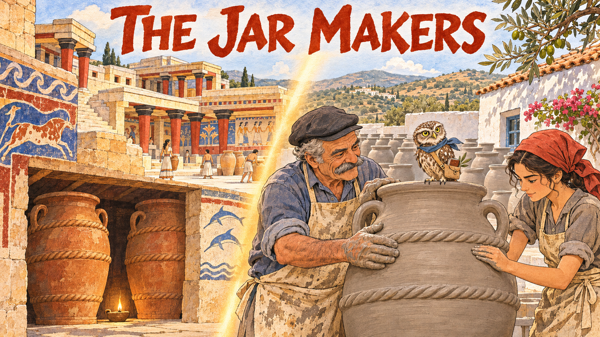 -->
<details>
<summary>Cover Image Prompt</summary>
(This is the Cover Image. Do not include this label in the image.)
Style: a hand-drawn travel-sketchbook graphic-novel illustration, with clean dark ink outlines, flat softly shaded color fills and a faint watercolor paper texture, like a page from a traveler's journal; warm, sunlit, painterly lighting; no text, captions, signs, letters or speech bubbles anywhere in the image.

Please generate a wide-landscape 16:9 cover image for a graphic novel. Exception to the no-text rule, for this cover only: render the title as bold, hand-lettered terracotta-red capital letters reading exactly "The Jar Makers" across the top, the only text in the image. Composition: a split scene joined in the middle by a shaft of golden light. Left half, about 1450 BCE: The Palace of Knossos on Crete: a sprawl of low, flat-roofed, honey-colored stone buildings around an open central court, with distinctive red-painted, downward-tapering wooden columns (wider at the top than the bottom) with black capitals, and colorful frescoes; storerooms hold giant human-tall clay jars (pithoi) with rope-like ridged bands. Two human-tall jars with rope-like bands stand in a dim storeroom, a small oil lamp glowing between them. Right half, today: a sunlit Cretan workshop where the potter and apprentice stand beside a new gray jar of the very same shape, with rows of gray pots drying behind them. Cast: The Thrapsano potter: a weathered Cretan man of about sixty-five with a thick gray mustache, a dark flat cap, a faded blue work shirt with rolled sleeves under a clay-stained canvas apron, and large hands gray with wet clay. The potter's apprentice: a lean young woman of about twenty with dark hair tied in a red kerchief, a gray work shirt with rolled sleeves and a clay-smeared apron; focused and patient. Glaux the Little Owl: a true little owl (Athene noctua), small, round and compact, with a flat rounded head and no ear tufts, warm earth-brown plumage with cream spots, bright lemon-yellow eyes under pale cream eyebrows, a cream-white throat patch and a short pale greenish-yellow beak. Glaux wears a small Aegean-blue scarf and a tan canvas satchel across the body with a small leather-bound travel notebook peeking out, and a sprig of three olive leaves tucked into the satchel strap. Alert, curious and warm expression. Glaux is drawn small, perched at the edge of the scene, noticeable on a second look. Glaux perches on the shoulder of the central jar. Palette: terracotta red, ochre, lapis blue and cream plaster on the left; whitewashed walls, terracotta and olive on the right. Tone: warm, patient, quietly proud. Keep every character and place consistent with the other images in this story. Generate the image immediately without asking clarifying questions.
</details>

<details markdown="1">
<summary>Narrative Prompt</summary>
**Era and places.** Two time layers joined by one object. The first is the palace of Knossos on Crete, in its storerooms (the "West Magazines" behind the Throne Room), about 1450 BCE; the great storage jars (*pithoi*) in use there date from roughly 1700 to 1450 BCE, so this date sits at the end of that range. The second is today, in the village of Thrapsano in the hills southeast of Heraklion and at a village winery on the same excursion afternoon. The story is told from the Villages of Crete excursion that followed a museum morning.

**Themes.** One skill, 3,500 years: a very large jar cannot be made in one piece, so the potter builds it in stages and fires it at high heat. The craft outlived every use it was invented for. Also: the palace economy (oil is wealth only if someone records it), and craft knowledge handed from hand to hand, a form of Learning for All that never needed a textbook.

**Series house style.** Hand-drawn travel-sketchbook graphic-novel illustration, clean dark ink outlines, flat softly shaded color fills, faint watercolor paper texture. No lettering in any panel; only the cover carries the title. All images are 16:9. The full style line is pasted at the top of every prompt (see [Story Characters, Places and House Style](../characters.md)).

**Palette.** Panels 1 to 3 use the Bronze Age Crete palette: terracotta red, ochre, lapis blue, cream plaster, olive green. Panels 4 to 10 use the modern Greece palette: natural daylight, whitewashed walls, sea blue, terracotta, olive. Panel 10 shows both, split down the middle.

**Creative liberties and uncertainties.**

- The storeroom date of about 1450 BCE is chosen so that a clay tablet can appear: the tablets we can read, in Linear B, date from about 1450 BCE onward at Knossos, and who ran the palace at that moment is still debated by scholars. The storekeeper and porters are invented, anonymous figures.
- Minoan dress is drawn modestly (tunic, kilt, fitted bodice) rather than as in the famous frescoes.
- The traveling potters of panel 4 belong to "the past" in the chapter's words; the exact period is left open, and the clothing is a generic Cretan village style of an earlier time.
- The potter and apprentice are invented, anonymous composites. The traditional method (an apprentice turning a wheel while the potter shapes the jar) is drawn from how the craft is generally described. Our own visit saw freshly made pots drying in the shade, waiting for a kiln; panel 8, the firing, shows a step we did not witness.
- Nothing here is a real brand or sign; the winery in panel 9 is drawn without any name or label.

**Cast.** Glaux the Little Owl hides in exactly one panel (panel 2): see docs/stories/characters.md and docs/img/mascot/character-sheet.md (Glaux). The Travelers appear in panels 9 and 10 (see docs/stories/characters.md). The Knossos and giant-jar place block comes from docs/stories/characters.md. The following characters appear only in this story; their blocks are pasted verbatim into each prompt that shows them.

Minoan storekeeper and porters (panels 1 to 3):

```text
Minoan palace storekeeper and porters, about 1450 BCE: a slim storekeeper with long curled black hair, a short patterned linen tunic and a wide embroidered belt, a small clay oil lamp in one hand and a clay tablet in the other; a porter in a plain kilt carrying a pointed clay jar on his shoulder; a woman porter in a long flounced banded skirt and fitted short-sleeved bodice, her hair in a thick braid, carrying a flat basket of barley.
```

The Thrapsano potter (panels 5 to 8, 10 and the cover):

```text
The Thrapsano potter: a weathered Cretan man of about sixty-five with a thick gray mustache, a dark flat cap, a faded blue work shirt with rolled sleeves under a clay-stained canvas apron, and large hands gray with wet clay.
```

The potter's apprentice (panels 5 to 8, 10 and the cover):

```text
The potter's apprentice: a lean young woman of about twenty with dark hair tied in a red kerchief, a gray work shirt with rolled sleeves and a clay-smeared apron; focused and patient.
```

A traveling team of Thrapsano potters from an earlier time (panel 4):

```text
A traveling team of Thrapsano potters from an earlier time: four men in flat caps, dark waistcoats and baggy dark trousers, leading two mules loaded with a wooden wheel, wooden tools and wicker baskets.
```
</details>

### Prologue - A Jar Taller Than You

In the long storerooms of Knossos, behind the Throne Room, clay jars taller than a person still stand where they were found. They held the palace's wealth: olive oil, wine, grain. About 3,500 years later, in a hill village on the same island, potters still build jars that size by hand, one band of clay at a time. This story follows one shape across all those centuries, from a palace storeroom to a workshop we visited on an afternoon excursion. The craft has outlived every ruler in between.

**Find Glaux:** Glaux hides in one panel of this story. Can you spot the little owl?

## Panel 1: The Long Storeroom
<!-- 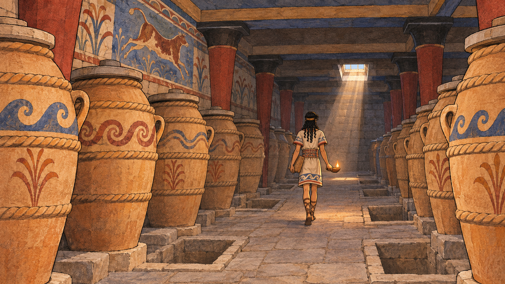 -->
<details><summary>Image Prompt</summary>
(This is Panel 01. Do not include the panel number in the image.)
I am about to ask you to generate a series of images for a graphic novel. Please make the images have a consistent style and consistent characters. Do not ask any clarifying questions. Just generate the image immediately when asked.
Style: a hand-drawn travel-sketchbook graphic-novel illustration, with clean dark ink outlines, flat softly shaded color fills and a faint watercolor paper texture, like a page from a traveler's journal; warm, sunlit, painterly lighting; no text, captions, signs, letters or speech bubbles anywhere in the image.

Please generate a 16:9 image in the style above depicting panel 1 of 10. Setting: a long, narrow storeroom on the west side of the palace of Knossos, Crete, about 1450 BCE; cool and dim, with one shaft of afternoon sun from a light-well at the far end. Camera: wide establishing view straight down the aisle (the same viewpoint as the final panel). The Palace of Knossos on Crete: a sprawl of low, flat-roofed, honey-colored stone buildings around an open central court, with distinctive red-painted, downward-tapering wooden columns (wider at the top than the bottom) with black capitals, and colorful frescoes; storerooms hold giant human-tall clay jars (pithoi) with rope-like ridged bands. Rows of human-tall jars with raised rope-like bands, small handles and flat lids line both walls, with stone-lined pits sunk in the floor between them. Cast: Minoan palace storekeeper and porters, about 1450 BCE: a slim storekeeper with long curled black hair, a short patterned linen tunic and a wide embroidered belt, a small clay oil lamp in one hand and a clay tablet in the other; a porter in a plain kilt carrying a pointed clay jar on his shoulder; a woman porter in a long flounced banded skirt and fitted short-sleeved bodice, her hair in a thick braid, carrying a flat basket of barley. Only the storekeeper is in the aisle, small in the middle distance, walking away from us with the lamp held low. Palette: terracotta red, ochre, lapis blue, cream plaster, olive green. Tone: hushed, cool, quietly abundant. Keep every character and place consistent with the other images in this story. Generate the image immediately without asking clarifying questions.
</details>

About 1450 BCE, on the west side of the palace at Knossos, a long, narrow storeroom runs away into shadow. Along both walls stand *pithoi* (PITH-oy; one jar is a *pithos*), clay jars taller than the people who tend them. A storekeeper walks the aisle with a small lamp, counting. The air is cool, and it smells of oil and clay.

## Panel 2: Filling the Jar
<!-- 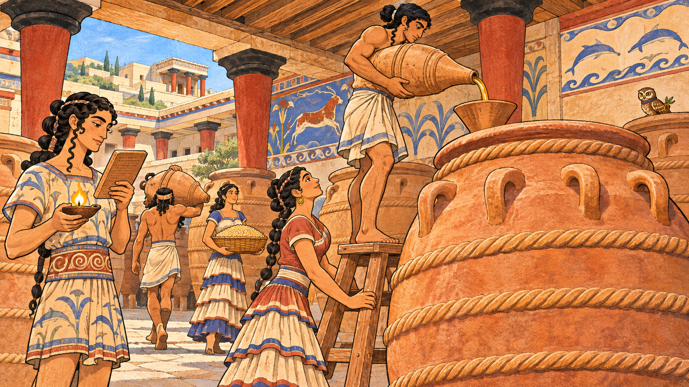 -->
<details><summary>Image Prompt</summary>
(This is Panel 02. Do not include the panel number in the image.)
Style: a hand-drawn travel-sketchbook graphic-novel illustration, with clean dark ink outlines, flat softly shaded color fills and a faint watercolor paper texture, like a page from a traveler's journal; warm, sunlit, painterly lighting; no text, captions, signs, letters or speech bubbles anywhere in the image.

Please generate a 16:9 image in the style above depicting panel 2 of 10. Setting: the same Knossos storeroom, about 1450 BCE, now busy; low three-quarter angle looking up at a giant jar. The Palace of Knossos on Crete: a sprawl of low, flat-roofed, honey-colored stone buildings around an open central court, with distinctive red-painted, downward-tapering wooden columns (wider at the top than the bottom) with black capitals, and colorful frescoes; storerooms hold giant human-tall clay jars (pithoi) with rope-like ridged bands. In the foreground a porter on a wooden step stool tips a pointed jar so a thin stream of golden olive oil runs through a clay funnel into the mouth of a giant jar, while the woman porter steadies the stool. Close detail: the giant jar's raised rope-pattern bands and its row of lug handles. Cast: Minoan palace storekeeper and porters, about 1450 BCE: a slim storekeeper with long curled black hair, a short patterned linen tunic and a wide embroidered belt, a small clay oil lamp in one hand and a clay tablet in the other; a porter in a plain kilt carrying a pointed clay jar on his shoulder; a woman porter in a long flounced banded skirt and fitted short-sleeved bodice, her hair in a thick braid, carrying a flat basket of barley. On the rim of a distant jar at the far edge of the picture, a tiny owl perches. Glaux the Little Owl: a true little owl (Athene noctua), small, round and compact, with a flat rounded head and no ear tufts, warm earth-brown plumage with cream spots, bright lemon-yellow eyes under pale cream eyebrows, a cream-white throat patch and a short pale greenish-yellow beak. Glaux wears a small Aegean-blue scarf and a tan canvas satchel across the body with a small leather-bound travel notebook peeking out, and a sprig of three olive leaves tucked into the satchel strap. Alert, curious and warm expression. Glaux is drawn small, perched at the edge of the scene, noticeable on a second look. Palette: terracotta red, ochre, lapis blue, cream plaster, olive green. Tone: busy, orderly, warm. Keep every character and place consistent with the other images in this story. Generate the image immediately without asking clarifying questions.
</details>

Porters bring the harvest in smaller, pointed jars and pour it through a funnel into the great ones. The giant jars held olive oil, wine, grain and pulses, and some carry raised bands of clay in a rope pattern, with rows of handles for lifting and tying on covers. Each jar is filled, covered and counted before the next one is opened.

> **Myth or Evidence?** The raised bands and handles are documented on the jars themselves. That the bands imitate the ropes used to move the jars is a reasonable suggestion, not a certainty.

## Panel 3: The Tally
<!-- 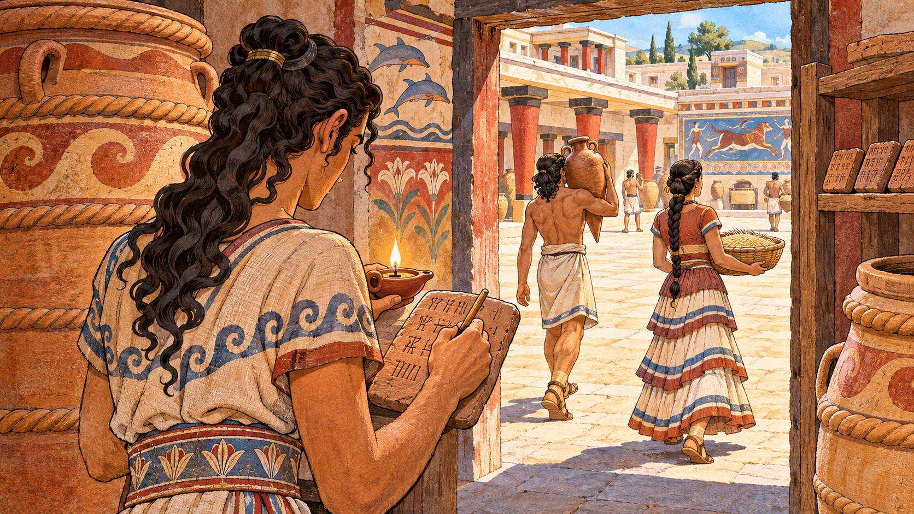 -->
<details><summary>Image Prompt</summary>
(This is Panel 03. Do not include the panel number in the image.)
Style: a hand-drawn travel-sketchbook graphic-novel illustration, with clean dark ink outlines, flat softly shaded color fills and a faint watercolor paper texture, like a page from a traveler's journal; warm, sunlit, painterly lighting; no text, captions, signs, letters or speech bubbles anywhere in the image.

Please generate a 16:9 image in the style above depicting panel 3 of 10. Setting: the doorway of the Knossos storeroom and the sunlit court beyond it, about 1450 BCE. Camera: close over-the-shoulder view from behind the storekeeper as he presses a reed stylus into a damp clay tablet, a giant jar looming beside him. The Palace of Knossos on Crete: a sprawl of low, flat-roofed, honey-colored stone buildings around an open central court, with distinctive red-painted, downward-tapering wooden columns (wider at the top than the bottom) with black capitals, and colorful frescoes; storerooms hold giant human-tall clay jars (pithoi) with rope-like ridged bands. Cast: Minoan palace storekeeper and porters, about 1450 BCE: a slim storekeeper with long curled black hair, a short patterned linen tunic and a wide embroidered belt, a small clay oil lamp in one hand and a clay tablet in the other; a porter in a plain kilt carrying a pointed clay jar on his shoulder; a woman porter in a long flounced banded skirt and fitted short-sleeved bodice, her hair in a thick braid, carrying a flat basket of barley. Through the doorway the porter and woman porter file past toward the court with baskets and jars, and a row of small dried tablets sits on a wooden shelf. Details: the grain of the clay, the cool shadow of the doorway against the hot yellow court. Palette: terracotta red, ochre, lapis blue, cream plaster, olive green. Tone: precise, businesslike, a little sleepy. Keep every character and place consistent with the other images in this story. Generate the image immediately without asking clarifying questions.
</details>

A jar of oil is wealth only if someone writes it down. The storekeeper presses a few signs and numbers into a damp clay tablet: the product, the amount, the place it came from. This is the palace economy, in which goods flow into a center and out again as rations, wages, gifts and offerings. The tablets we can read, written in Linear B, date from about 1450 BCE onward; they are bookkeeping, not literature.

## Panel 4: The Traveling Workshop
<!-- 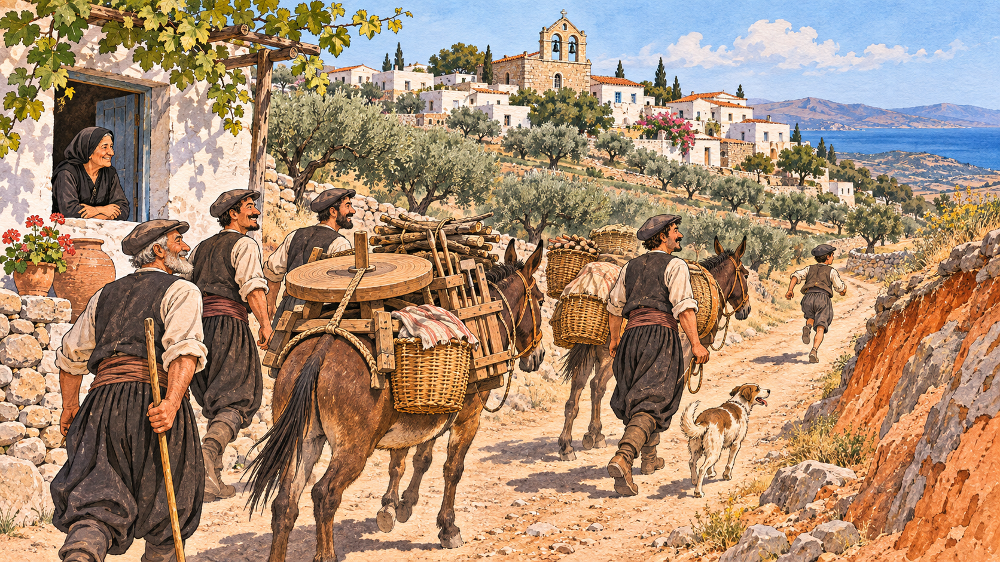 -->
<details><summary>Image Prompt</summary>
(This is Panel 04. Do not include the panel number in the image.)
Style: a hand-drawn travel-sketchbook graphic-novel illustration, with clean dark ink outlines, flat softly shaded color fills and a faint watercolor paper texture, like a page from a traveler's journal; warm, sunlit, painterly lighting; no text, captions, signs, letters or speech bubbles anywhere in the image.

Please generate a 16:9 image in the style above depicting panel 4 of 10. Setting: a dirt track entering a hill village on Crete in an earlier era, a hot summer morning. Camera: wide landscape view, whitewashed houses and a stone church bell-gable on the ridge, silver-green olive terraces, and a raw orange-gray clay bank cut into the roadside in the foreground. Cast: A traveling team of Thrapsano potters from an earlier time: four men in flat caps, dark waistcoats and baggy dark trousers, leading two mules loaded with a wooden wheel, wooden tools and wicker baskets. Details: a wooden potter's wheel strapped across one mule, a bundle of firewood, a woman in a black headscarf watching from a doorway, a boy running ahead of the mules, a dog trotting alongside. Palette: natural daylight, whitewashed walls, sea blue, terracotta, olive. Tone: dusty, cheerful, full of purpose. Keep every character and place consistent with the other images in this story. Generate the image immediately without asking clarifying questions.
</details>

In the past, teams of Thrapsano potters traveled the island through the summer. They set up temporary workshops wherever they found good clay and firewood, and they made jars for the villages around them. A village that needs a dozen big jars does not have to haul them up the mountain; the potters bring the workshop instead.

## Panel 5: One Band at a Time
<!-- 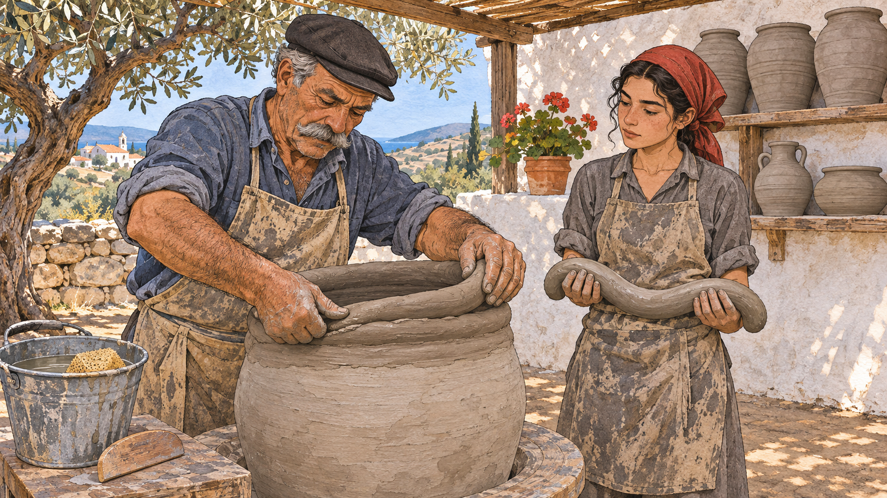 -->
<details><summary>Image Prompt</summary>
(This is Panel 05. Do not include the panel number in the image.)
Style: a hand-drawn travel-sketchbook graphic-novel illustration, with clean dark ink outlines, flat softly shaded color fills and a faint watercolor paper texture, like a page from a traveler's journal; warm, sunlit, painterly lighting; no text, captions, signs, letters or speech bubbles anywhere in the image.

Please generate a 16:9 image in the style above depicting panel 5 of 10. Setting: a pottery workshop in Thrapsano, Crete, today, a shaded open-sided yard with a dirt floor and a whitewashed wall. Camera: eye-level three-quarter view. In the foreground a half-built jar, waist-high, sits on a low turntable; the potter lays a thick coil of wet gray clay around its rim and smooths the seam with his thumb, while the apprentice beside him holds a second soft coil across her forearms. Cast: The Thrapsano potter: a weathered Cretan man of about sixty-five with a thick gray mustache, a dark flat cap, a faded blue work shirt with rolled sleeves under a clay-stained canvas apron, and large hands gray with wet clay. The potter's apprentice: a lean young woman of about twenty with dark hair tied in a red kerchief, a gray work shirt with rolled sleeves and a clay-smeared apron; focused and patient. Details: the lower jar is already stiff and paler, a bucket of water with a sponge, a wooden scraping rib, finished gray pots on a plank shelf. Palette: natural daylight, whitewashed walls, sea blue, terracotta, olive. Tone: calm, absorbed, patient. Keep every character and place consistent with the other images in this story. Generate the image immediately without asking clarifying questions.
</details>

A very large jar cannot be made in one piece. The potter adds a band of clay, lets it stiffen, then adds the next, and the wall of the jar climbs a hand-width at a time. The Minoan potters worked in stages too, in coils or sections. In the workshop, the old rule is the same: patience first, height second.

## Panel 6: The Turning Wheel
<!-- 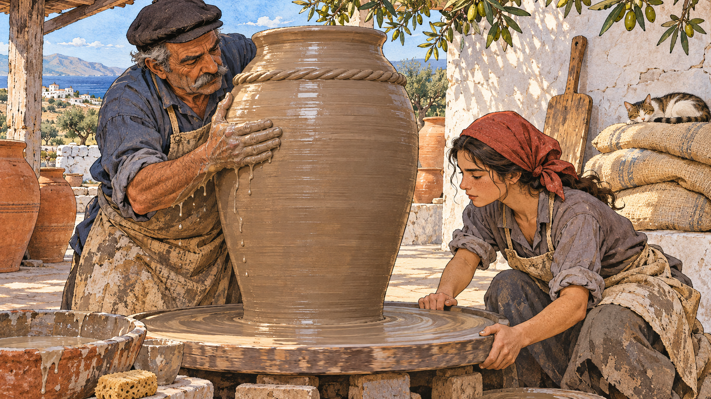 -->
<details><summary>Image Prompt</summary>
(This is Panel 06. Do not include the panel number in the image.)
Style: a hand-drawn travel-sketchbook graphic-novel illustration, with clean dark ink outlines, flat softly shaded color fills and a faint watercolor paper texture, like a page from a traveler's journal; warm, sunlit, painterly lighting; no text, captions, signs, letters or speech bubbles anywhere in the image.

Please generate a 16:9 image in the style above depicting panel 6 of 10. Setting: the same Thrapsano workshop yard, mid-morning, a bar of warm light across the floor. Camera: close, low angle on a tall, nearly finished jar, taller than the apprentice's shoulder, on a heavy low wheel. The potter stands facing the jar with both wet hands cupped along its wall; the apprentice crouches at the wheel's edge and turns it steadily by hand, watching his hands. Cast: The Thrapsano potter: a weathered Cretan man of about sixty-five with a thick gray mustache, a dark flat cap, a faded blue work shirt with rolled sleeves under a clay-stained canvas apron, and large hands gray with wet clay. The potter's apprentice: a lean young woman of about twenty with dark hair tied in a red kerchief, a gray work shirt with rolled sleeves and a clay-smeared apron; focused and patient. Details: slip dripping from the potter's fingers, a rope-like band of clay around the jar's shoulder, a wooden paddle leaning on the wall, a cat asleep on a stack of sacks. Palette: natural daylight, whitewashed walls, sea blue, terracotta, olive. Tone: rhythmic, intimate. Keep every character and place consistent with the other images in this story. Generate the image immediately without asking clarifying questions.
</details>

In the traditional way of working, one person turns the wheel while the other shapes the wall, and the two have to trust each other. The apprentice's job is to keep the rhythm; the potter's job is to read the clay. Nobody writes the method down. It lives in the hands of whoever has done it a thousand times.

## Panel 7: Gray Pots in the Shade
<!-- 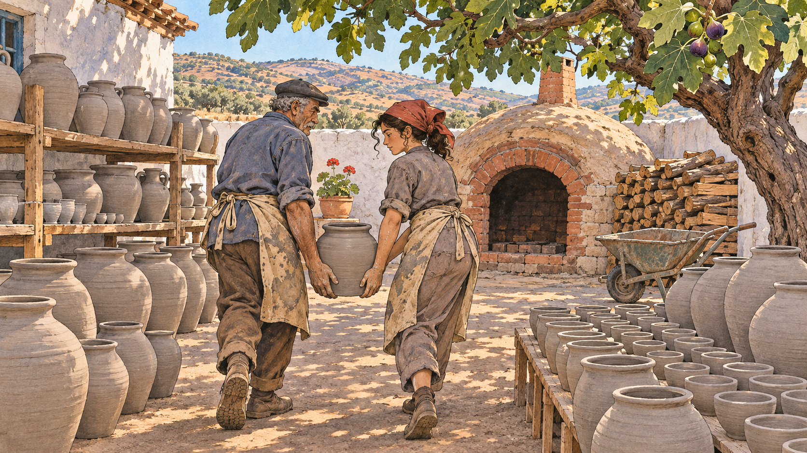 -->
<details><summary>Image Prompt</summary>
(This is Panel 07. Do not include the panel number in the image.)
Style: a hand-drawn travel-sketchbook graphic-novel illustration, with clean dark ink outlines, flat softly shaded color fills and a faint watercolor paper texture, like a page from a traveler's journal; warm, sunlit, painterly lighting; no text, captions, signs, letters or speech bubbles anywhere in the image.

Please generate a 16:9 image in the style above depicting panel 7 of 10. Setting: the shaded side yard of the Thrapsano workshop, late afternoon. Camera: wide view of long rows of freshly made pots and jars of every size, still dull gray and unfired, drying on the swept dirt floor and on timber shelves. In the foreground the potter and the apprentice carry a mid-sized gray pot between them toward a low brick kiln with an arched mouth at the back of the yard. Cast: The Thrapsano potter: a weathered Cretan man of about sixty-five with a thick gray mustache, a dark flat cap, a faded blue work shirt with rolled sleeves under a clay-stained canvas apron, and large hands gray with wet clay. The potter's apprentice: a lean young woman of about twenty with dark hair tied in a red kerchief, a gray work shirt with rolled sleeves and a clay-smeared apron; focused and patient. Details: stacked firewood beside the kiln, a wheelbarrow, a fig tree overhead, dry hills beyond the wall. Palette: natural daylight, whitewashed walls, sea blue, terracotta, olive. Tone: patient, expectant. Keep every character and place consistent with the other images in this story. Generate the image immediately without asking clarifying questions.
</details>

Rows of freshly made pots stand drying in the shade, still gray, waiting for the kiln that will turn them the orange of terracotta. This is what we saw on the day. The pots look finished and are not: a jar that dries too fast, or sits in a draft, can crack before it ever meets fire.

## Panel 8: Fire
<!-- 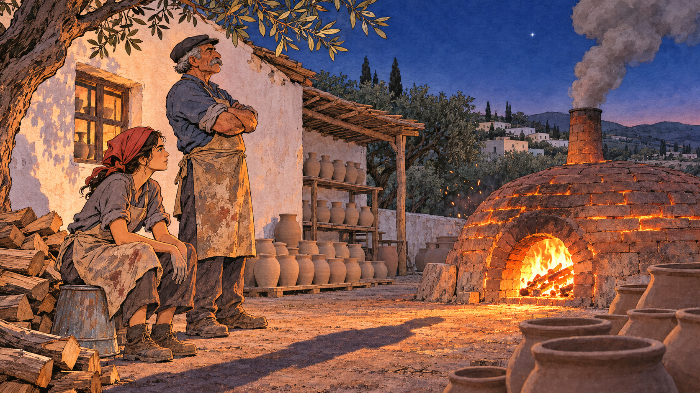 -->
<details><summary>Image Prompt</summary>
(This is Panel 08. Do not include the panel number in the image.)
Style: a hand-drawn travel-sketchbook graphic-novel illustration, with clean dark ink outlines, flat softly shaded color fills and a faint watercolor paper texture, like a page from a traveler's journal; warm, sunlit, painterly lighting; no text, captions, signs, letters or speech bubbles anywhere in the image.

Please generate a 16:9 image in the style above depicting panel 8 of 10. Setting: the same Thrapsano workshop yard at dusk, a deep blue sky with the first star. Camera: wide low angle across the yard; the low brick kiln glows orange from its arched stoking mouth and the seams between its bricks, a column of gray smoke rising from a short chimney. The potter stands at a safe distance with arms folded; the apprentice sits on an upturned bucket by the firewood, watching with him. Cast: The Thrapsano potter: a weathered Cretan man of about sixty-five with a thick gray mustache, a dark flat cap, a faded blue work shirt with rolled sleeves under a clay-stained canvas apron, and large hands gray with wet clay. The potter's apprentice: a lean young woman of about twenty with dark hair tied in a red kerchief, a gray work shirt with rolled sleeves and a clay-smeared apron; focused and patient. Details: warm light on their faces and the whitewashed wall, drifting sparks, the potter's long shadow across the yard, rows of unfired pots waiting in the dusk. Palette: dusk blue, whitewashed walls, terracotta, olive. Tone: tense, glowing, reverent. Keep every character and place consistent with the other images in this story. Generate the image immediately without asking clarifying questions.
</details>

Fire turns clay into pottery, and at this size it takes real skill: the kiln must climb to a high heat slowly and hold it, and then cool slowly too. We saw pots waiting for the kiln, not a firing, so this panel shows the step we did not witness. Overnight the gray jars become terracotta orange, and by morning the potter knows which ones survived.

## Panel 9: The Wine and the Jar
<!-- 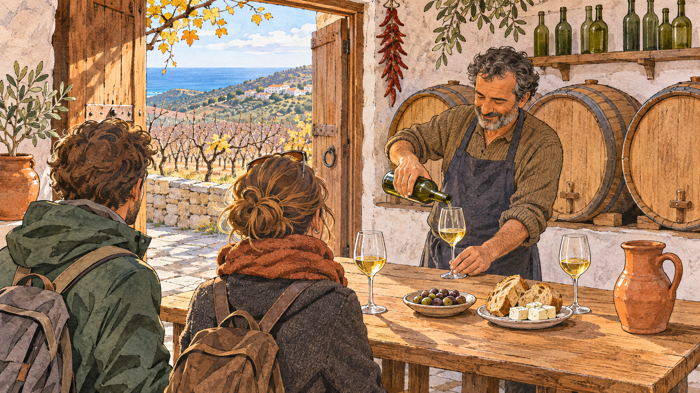 -->
<details><summary>Image Prompt</summary>
(This is Panel 09. Do not include the panel number in the image.)
Style: a hand-drawn travel-sketchbook graphic-novel illustration, with clean dark ink outlines, flat softly shaded color fills and a faint watercolor paper texture, like a page from a traveler's journal; warm, sunlit, painterly lighting; no text, captions, signs, letters or speech bubbles anywhere in the image.

Please generate a 16:9 image in the style above depicting panel 9 of 10. Setting: a village winery tasting room in the hills south of Heraklion, Crete, today, late autumn, soft afternoon light through a wooden doorway onto a stone floor. Camera: over-the-shoulder view from behind two visitors toward the host, who pours pale golden wine into a stemmed glass at a plain oak table. Cast: Two adult travelers seen from behind or in distant three-quarter view, dressed for cool November weather: one in a dark green rain jacket, the other in a charcoal wool coat with a rust-colored scarf, both with small daypacks, standing close together and looking at the view. Faces are never shown in detail. Details: oak barrels along the back wall, unlabeled green bottles on a shelf, a plate of olives, bread and white cheese, bare grapevines glimpsed through the doorway with a few last yellow leaves, a string of dried red peppers. Palette: natural daylight, whitewashed walls, sea blue, terracotta, olive. Tone: warm, convivial, unhurried. Keep every character and place consistent with the other images in this story. Generate the image immediately without asking clarifying questions.
</details>

Before the potters, there is a glass of Cretan wine. Crete grows wine grapes found almost nowhere else, and the Minoans made wine here too: a Minoan country house at Vathypetro still has its stone wine press. Sitting with a glass a few hours after standing beside the palace jars, the morning's word "redistribution" suddenly makes sense. The wine was the wealth, and the jar was the bank.

## Panel 10: Then and Now
<!-- 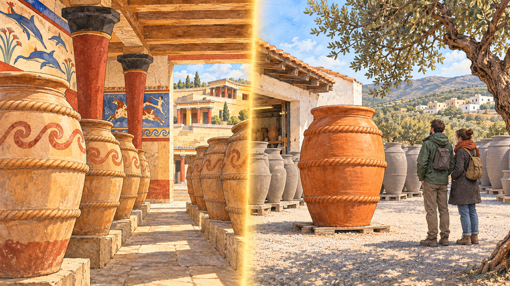 -->
<details><summary>Image Prompt</summary>
(This is Panel 10. Do not include the panel number in the image.)
Style: a hand-drawn travel-sketchbook graphic-novel illustration, with clean dark ink outlines, flat softly shaded color fills and a faint watercolor paper texture, like a page from a traveler's journal; warm, sunlit, painterly lighting; no text, captions, signs, letters or speech bubbles anywhere in the image.

Please generate a 16:9 image in the style above depicting panel 10 of 10, the "Then and Now" panel, as a split composition divided by one soft vertical band of golden light, no border lines or text. Left half, about 1450 BCE: the same Knossos storeroom as panel 1, same camera angle, looking down an aisle of giant jars. The Palace of Knossos on Crete: a sprawl of low, flat-roofed, honey-colored stone buildings around an open central court, with distinctive red-painted, downward-tapering wooden columns (wider at the top than the bottom) with black capitals, and colorful frescoes; storerooms hold giant human-tall clay jars (pithoi) with rope-like ridged bands. Right half, today: a Thrapsano workshop yard at the same low eye level, a freshly fired orange-terracotta jar of exactly the same shape and rope-pattern bands in the center, rows of gray unfired pots drying behind it. Cast: Two adult travelers seen from behind or in distant three-quarter view, dressed for cool November weather: one in a dark green rain jacket, the other in a charcoal wool coat with a rust-colored scarf, both with small daypacks, standing close together and looking at the view. Faces are never shown in detail. They stand in the right half, small in the frame, looking at the jar. Palette: terracotta red, ochre, lapis blue, cream plaster on the left; natural daylight, whitewashed walls, terracotta, olive on the right. Tone: continuity across time, quiet wonder. Keep every character and place consistent with the other images in this story. Generate the image immediately without asking clarifying questions.
</details>

Same shape, about 3,500 years apart. Both jars are built in stages and fired at high heat. What changed is the job: the Minoan jar held a palace's oil and grain, the Cretan farmhouse jar held a family's wine and oil within living memory, and most big jars today hold flowers in a garden. The craft outlived every use it was invented for.

### Epilogue - What a Jar Remembers

A pithos is a small lesson in how knowledge survives. The palace that filled the Minoan jars fell, and the scribes' writing was lost for more than three thousand years. The jar-making did not fall, because it lived in the hands of families who passed it down, summer by summer. When the uses changed, the craft found new ones. Tablets, wheels and kilns come and go; the habit of making things well and teaching them to the next pair of hands is what lasts.

| Challenge | How They Responded | Lesson for Today |
|---|---|---|
| A jar too large to make in one piece | Build it in stages, letting each band of clay stiffen before the next | Big results are often many small, patient steps |
| Clay, firewood and customers scattered across the island | Potters traveled in summer and built temporary workshops where the materials were | Bring the skill to the people, not only the people to the skill |
| Wealth that is easily lost or stolen | The palace counted every jar on clay tablets | Records turn stored goods into a system people can trust |
| The old uses of the craft disappearing | The same jar shape found a new life as garden pots | A craft can outlive its original purpose |

### Call to Action

When you next pick up a bottle of olive oil, think of the jar it might once have lived in, then turn the bottle around and read the label: the harvest date and the origin tell you more than the picture on the front. The jar makers never needed a textbook, but they needed a teacher, and that is the Learning for All thread of this book: skills that stay open to whoever is willing to learn them. Try the [Read the Olive Oil Label](../../sims/read-the-olive-oil-label/index.md) MicroSim, then ask a potter, a farmer or a cook near you how they learned what they know.

---

## Voices from the Sources

No Minoan voice survives: the Minoans' own script, Linear A, has never been deciphered, and the Linear B tablets are accounts, not stories. Two ancient texts give the jar a voice instead.

- Hesiod, an early Greek poet, tells in his *Works and Days* (about 700 BCE) how the first woman, Pandora, lifted the great lid of a *pithos* and let its troubles loose, leaving only hope inside. (Our paraphrase.) The "box" in the later phrase "Pandora's box" comes from a mistranslation made in the 16th century; the original vessel was a jar like these.
- An ancient tradition, reported by the biographer Diogenes Laertius, says the philosopher Diogenes of Sinope lived in a large *pithos* in Athens. (An attributed tradition, not a quotation.)

## On the Trip

- **Chapter:** [14. Venetian Heraklion and Crete Today](../../chapters/14-venetian-heraklion/index.md)
- **Where to look:** the Minoan storage jars (pithoi) in the Heraklion Archaeological Museum, the rows of pithoi in the West Magazines of the Knossos palace, the gray pots drying in the shade of a Thrapsano workshop, and the raised rope-like bands that run around a Minoan jar.
- **Explore further:** [Read the Olive Oil Label](../../sims/read-the-olive-oil-label/index.md)
- **Look Closer:** Glaux says: "Look closer at the rope-like bands running around a Minoan jar, then find the line where a potter has added the next band of clay." Glaux was perched on the rim of a distant jar in Panel 2 (Filling the Jar), small enough to miss on a first look.

## Characters and Style

This story follows the shared series bible: [Story Characters, Places and House Style](../characters.md). Glaux's identity comes from the mascot's [character sheet](../../img/mascot/character-sheet.md).

## References

1. [Wikipedia: Pithos](https://en.wikipedia.org/wiki/Pithos) - The large storage jar of the ancient Mediterranean
2. [Wikipedia: Knossos](https://en.wikipedia.org/wiki/Knossos) - The Minoan palace and its storerooms
3. [Wikipedia: Thrapsano](https://en.wikipedia.org/wiki/Thrapsano) - The Cretan pottery village and its jar makers
4. [Encyclopaedia Britannica: Knossos](https://www.britannica.com/place/Knossos) - Overview of the palace site and its excavation
5. [Encyclopaedia Britannica: Minoan civilization](https://www.britannica.com/place/Minoan-civilization) - The Bronze Age culture of Crete
