# The Knights' Last Stand

<!-- 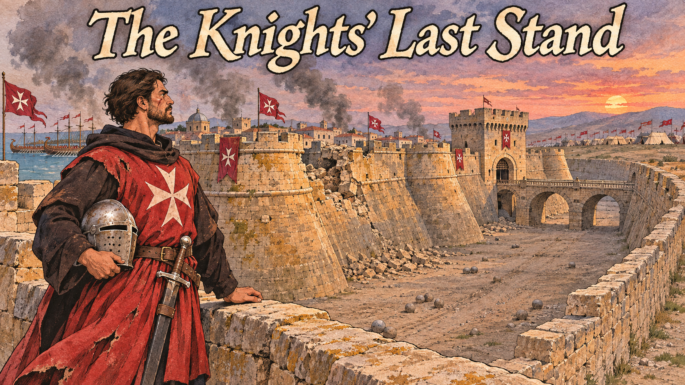 -->
<details>
<summary>Cover Image Prompt</summary>
(This is the Cover Image. Do not include this label in the image.)
Style: a hand-drawn travel-sketchbook graphic-novel illustration, with clean dark ink outlines, flat softly shaded color fills and a faint watercolor paper texture, like a page from a traveler's journal; warm, sunlit, painterly lighting; no text, captions, signs, letters or speech bubbles anywhere in the image.
Please generate a wide-landscape 16:9 cover image for this graphic novel story. Scene at dusk after a day of bombardment: show the walls of Rhodes under drifting gray smoke. The walls of Rhodes: thick, low, sloped sandstone walls with rounded projecting bastions, battlements, a very wide dry moat below, a stone outer wall on the far side of the moat, and a gate tower reached by a bridge over the moat; the stone is honey-gold weathered to gray. A gap is newly broken in one bastion, crimson banners marked with a white eight-pointed cross still flying from the battlements, round stone cannonballs scattered in the moat, and a pale harbor with a line of galleys behind. In the foreground, A Knight Hospitaller: a man in a black monastic habit marked with a white eight-pointed cross, over which he wears a bright crimson surcoat in battle, with a steel helmet carried under one arm and a longsword resting in its scabbard; determined and disciplined. He stands alone on the rampart looking toward the distant enemy camp of tents and red pennants. Across the top, render the story title as bold, hand-lettered title text in warm cream letters with a dark ink outline, reading exactly: "The Knights' Last Stand". Palette: sandstone, steel gray, Mediterranean blue and banner crimson. Emotional tone: defiant and elegiac.
Keep every character and place consistent with the other images in this story. Generate the image immediately without asking clarifying questions.
</details>

<details>
<summary>Narrative Prompt</summary>

**Era and place.** The island and city of Rhodes, in the Dodecanese off the southwest coast of Turkey: the arrival of the knights (1306-1310), the Street of the Knights and the walls rebuilt after 1480, the siege of June to December 1522, the departure of the knights on January 1, 1523, then the 1930s Italian rebuilding of the Palace of the Grand Master, and finally today. The story follows the chapter [Day 8: Rhodes, From the Colossus to the Knights](../../chapters/12-rhodes/index.md).

**Themes.** An order of monks who were also soldiers; walls built for cannon; a siege fought underground; an honorable surrender that both sides claimed as a victory; and the layers of the Old Town: the "medieval" palace is largely a 1930s Italian reconstruction.

**House style.** Every prompt starts with the series house style line from [Story Characters, Places and House Style](../characters.md). All images are 16:9 with no lettering in the panels; only the cover carries the title.

**Palette.** Medieval Rhodes: sandstone, steel gray, Mediterranean blue and banner crimson. Panels 5 and 7 (the sultan's camp and the tunnel mouths) use the Ottoman palette: Iznik turquoise, cobalt, tomato red, brass, saffron and white plaster. Panels 13 and 14 use natural daylight with sandstone and whitewash.

**Safe imagery.** The siege is shown only by walls, smoke, the mouths of tunnels, cannonballs and banners, with no wounds, no bodies and no one mid-strike. Panel 10 shows the aftermath of the great assault of September 24.

**Creative liberties and uncertainties.** The army's size is unknown; sources run from about 100,000 to 200,000 men, most of them laborers and support troops, and the story shows no numbers. The listening drum is told as "some say" in the chapter. Faces and ages of the Grand Master and sultan are artistic approximations. The Grand Master and the envoy in panel 11 are staged as a plausible moment, not a record. The 1856 explosion that wrecked the palace may have involved gunpowder stored "possibly since the siege of 1522"; this is hedged.

**Cast.** Glaux the Little Owl and the Travelers follow [Story Characters, Places and House Style](../characters.md) and the [mascot character sheet](../../img/mascot/character-sheet.md); paste their blocks verbatim. Characters and places that appear only in this story are below; paste each block verbatim into every prompt where they appear.

**The Grand Master (this story only)**

```text
Philippe Villiers de L'Isle-Adam, Grand Master of the Knights of Rhodes: a lean, weathered man of about fifty-eight with a long silvery-gray beard, a high forehead and deep-set, tired dark eyes, wearing a plain black monastic habit with a white eight-pointed cross on the chest, a steel breastplate over it and a long black mantle; dignified, resolute and exhausted.
```

**Sultan Suleiman (this story only)**

```text
Sultan Suleiman the Magnificent in 1522: a slim man of about twenty-seven with dark eyes, a thin dark mustache and a short pointed beard, wearing a tall white turban with a small jeweled plume, a cobalt-blue silk caftan over a tomato-red robe and gold brocade; calm, young and watchful.
```

**A Knight Hospitaller (this story only)**

```text
A Knight Hospitaller: a man in a black monastic habit marked with a white eight-pointed cross, over which he wears a bright crimson surcoat in battle, with a steel helmet carried under one arm and a longsword resting in its scabbard; determined and disciplined.
```

**Ottoman soldiers and miners (this story only)**

```text
Ottoman soldiers and laborers in 1522: infantrymen in tall white felt caps with a trailing back flap, dark-blue knee-length coats with red trim and sashes, and miners in plain brown tunics with cloth head wraps carrying baskets, picks and timber props.
```

**The Street of the Knights (this story only)**

```text
The Street of the Knights, Rhodes: a long, straight, narrow cobbled street climbing gently uphill between continuous two-story walls of honey-colored sandstone, with plain pointed-arch and rectangular doorways topped by carved stone coats of arms, small shuttered upper windows and plain flat buttresses; there are no shops, and at the top a large fortress-palace closes the view.
```

**The Palace of the Grand Master (this story only)**

```text
The Palace of the Grand Master, Rhodes: a large square fortress-palace of pale sandstone with massive round towers flanking its gate, a battlemented top, tall narrow windows and high plain outer walls, set on the high northwest corner of the walled town.
```

**The walls of Rhodes (this story only)**

```text
The walls of Rhodes: thick, low, sloped sandstone walls with rounded projecting bastions, battlements, a very wide dry moat below, a stone outer wall on the far side of the moat, and a gate tower reached by a bridge over the moat; the stone is honey-gold weathered to gray.
```

</details>

### Prologue - Six Months, Then a Handshake

In 1522 the Knights Hospitaller, a Catholic order that began as a hospital for pilgrims, hold the island of Rhodes against the Ottoman Empire. The young sultan Suleiman arrives with an enormous army, and for six months the knights and their Greek neighbors hold on behind the strongest walls in the Mediterranean. The ending surprises both sides: no massacre, but terms, a bow, and a fleet sailing out of the harbor. And the palace that visitors tour today? Mostly built by a government that did not exist when the knights left.

**Find Glaux:** Glaux hides in one panel of this story. Can you spot the little owl?

## Panel 1: The Knights Arrive

<!-- 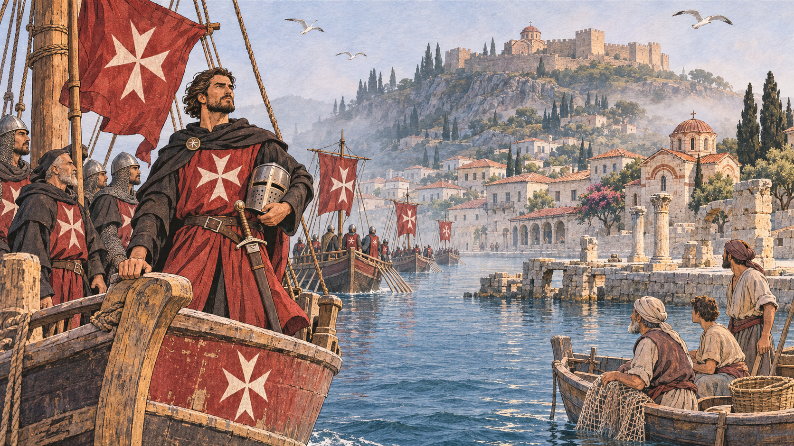 -->
<details><summary>Image Prompt</summary>
(This is Panel 01. Do not include the panel number in the image.)
I am about to ask you to generate a series of images for a graphic novel. Please make the images have a consistent style and consistent characters. Do not ask any clarifying questions. Just generate the image immediately when asked.
Style: a hand-drawn travel-sketchbook graphic-novel illustration, with clean dark ink outlines, flat softly shaded color fills and a faint watercolor paper texture, like a page from a traveler's journal; warm, sunlit, painterly lighting; no text, captions, signs, letters or speech bubbles anywhere in the image.
Please generate a 16:9 image depicting panel 1 of 14. Setting: the harbor of Rhodes, 1310 CE, hazy early morning. Palette: sandstone, steel gray, Mediterranean blue and banner crimson. Wide view from the water up toward a hill crowned with a small Byzantine citadel above a Greek harbor town. A line of galleys with oars raised and crimson banners marked with a white cross arrives at a stone quay. In the foreground, A Knight Hospitaller: a man in a black monastic habit marked with a white eight-pointed cross, over which he wears a bright crimson surcoat in battle, with a steel helmet carried under one arm and a longsword resting in its scabbard; determined and disciplined. He stands in the prow of the first galley beside a banner. Other details: Greek fishermen in small boats watching from the side, a ruined pier, a small domed church, gulls, dark cypress trees on the hill, calm blue water. Tone: uncertain arrival, a new home.
Keep every character and place consistent with the other images in this story. Generate the image immediately without asking clarifying questions.
</details>

Between 1306 and 1310 the knights conquer Rhodes from the Byzantines. They are the Knights Hospitaller, officially the Order of the Hospital of St. John, a Catholic order that began as a hospital for pilgrims in Jerusalem and became a military order of knights who were also monks. They have lost every base they ever held in the Holy Land, and Rhodes, with its fine harbor, is now their own island state. On the hill above the town stands an old Byzantine citadel, which will one day become their palace.

## Panel 2: An Inn for Every Tongue

<!-- 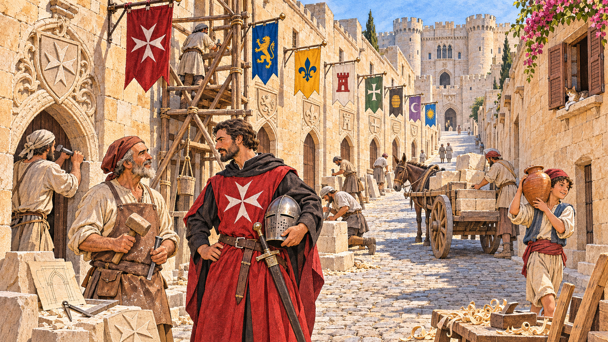 -->
<details><summary>Image Prompt</summary>
(This is Panel 02. Do not include the panel number in the image.)
Style: a hand-drawn travel-sketchbook graphic-novel illustration, with clean dark ink outlines, flat softly shaded color fills and a faint watercolor paper texture, like a page from a traveler's journal; warm, sunlit, painterly lighting; no text, captions, signs, letters or speech bubbles anywhere in the image.
Please generate a 16:9 image depicting panel 2 of 14. Setting: the future Street of the Knights, Rhodes, about 1450 CE, bright morning. Palette: sandstone, steel gray, Mediterranean blue and banner crimson. Medium-wide shot of the street under construction. The Street of the Knights, Rhodes: a long, straight, narrow cobbled street climbing gently uphill between continuous two-story walls of honey-colored sandstone, with plain pointed-arch and rectangular doorways topped by carved stone coats of arms, small shuttered upper windows and plain flat buttresses; there are no shops, and at the top a large fortress-palace closes the view. It is still pale and new, with stonemasons carving shields in the stone above doorways, scaffolding against a wall, and a mule cart of cut blocks. A Knight Hospitaller: a man in a black monastic habit marked with a white eight-pointed cross, over which he wears a bright crimson surcoat in battle, with a steel helmet carried under one arm and a longsword resting in its scabbard; determined and disciplined. He stands in the foreground talking with a master carver who holds a mallet and chisel. Other details: eight different colored banners hung from poles, each marking one inn, a Greek boy carrying a water jar, wood shavings on the cobbles, a cat on a windowsill, sun slanting down the street. Tone: confidence and community.
Keep every character and place consistent with the other images in this story. Generate the image immediately without asking clarifying questions.
</details>

The knights come from all over Catholic Europe and are organized into national groups called langues, or tongues: by 1462 there are eight, among them Provence, Italy, Aragon and England. Each tongue has its own inn, an auberge, which serves as club, barracks and dining hall, and the inns line the street that climbs toward the palace. Look up and you see the carved coats of arms over the doors, because the knights signed their work. The town is divided: the northern part, the Collachium, is reserved for the knights, and the bigger southern part holds the Greeks, the Latin merchants and the Jewish community.

## Panel 3: Walls for the Age of Cannon

<!-- 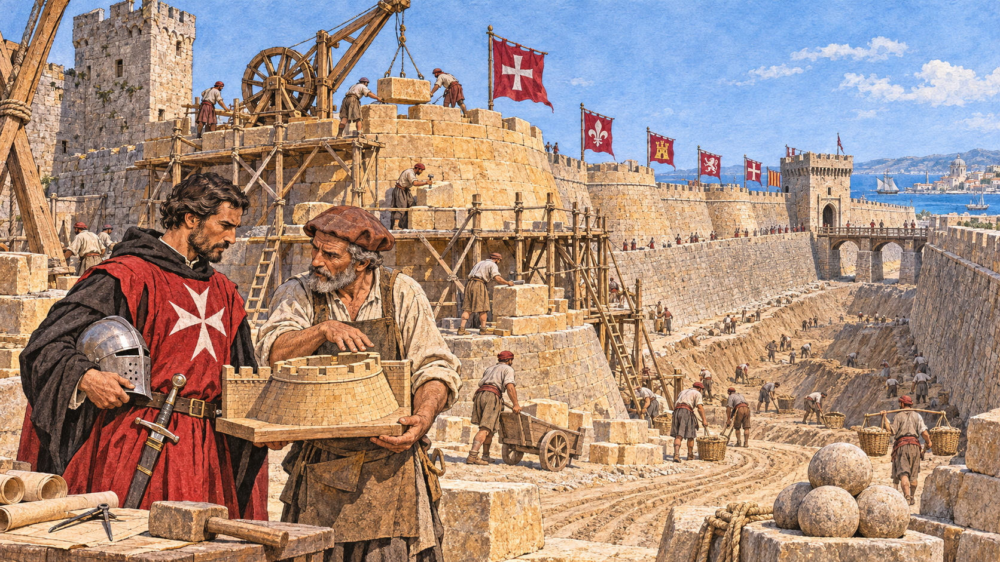 -->
<details><summary>Image Prompt</summary>
(This is Panel 03. Do not include the panel number in the image.)
Style: a hand-drawn travel-sketchbook graphic-novel illustration, with clean dark ink outlines, flat softly shaded color fills and a faint watercolor paper texture, like a page from a traveler's journal; warm, sunlit, painterly lighting; no text, captions, signs, letters or speech bubbles anywhere in the image.
Please generate a 16:9 image depicting panel 3 of 14. Setting: the land walls of Rhodes, about 1490 CE, hard bright light. Palette: sandstone, steel gray, Mediterranean blue and banner crimson. Wide shot of masons building the walls. The walls of Rhodes: thick, low, sloped sandstone walls with rounded projecting bastions, battlements, a very wide dry moat below, a stone outer wall on the far side of the moat, and a gate tower reached by a bridge over the moat; the stone is honey-gold weathered to gray. They work on wooden scaffolds, laying massive sandstone blocks into a low, rounded, thick bastion beside an older tall square tower that looks thin and old by comparison. Laborers with baskets deepen and widen the dry moat. In the foreground, A Knight Hospitaller: a man in a black monastic habit marked with a white eight-pointed cross, over which he wears a bright crimson surcoat in battle, with a steel helmet carried under one arm and a longsword resting in its scabbard; determined and disciplined. He and a master mason hold a small wooden model of a rounded bastion, seen in three-quarter view. Other details: wooden cranes, stacked round stone balls, banners of the tongues marking each stretch of the walls, cart tracks in the dust. Tone: sober preparation.
Keep every character and place consistent with the other images in this story. Generate the image immediately without asking clarifying questions.
</details>

Cannon change everything. After surviving a siege in 1480 by the army of Mehmed II, the conqueror of Constantinople, the knights rebuild their walls. Tall, thin medieval walls shatter under cannon fire, so they make them lower and much thicker, and add rounded bastions that let defenders fire along the wall face. They deepen the dry moat as well, a killing ground between the outer and main walls. Each tongue defends its own stretch, so the defense is organized by nation, like the inns.

## Panel 4: The Fleet Appears

<!-- 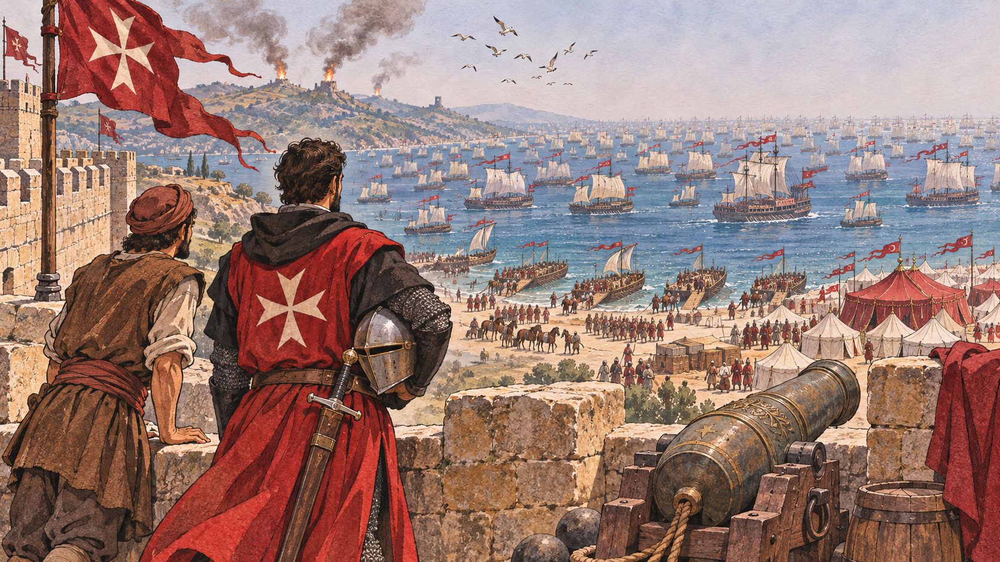 -->
<details><summary>Image Prompt</summary>
(This is Panel 04. Do not include the panel number in the image.)
Style: a hand-drawn travel-sketchbook graphic-novel illustration, with clean dark ink outlines, flat softly shaded color fills and a faint watercolor paper texture, like a page from a traveler's journal; warm, sunlit, painterly lighting; no text, captions, signs, letters or speech bubbles anywhere in the image.
Please generate a 16:9 image depicting panel 4 of 14. Setting: the sea off Rhodes seen from the walls, late June 1522, hot hazy noon. Palette: sandstone, steel gray, Mediterranean blue and banner crimson. Wide shot over the shoulders of two defenders on the rampart. A Knight Hospitaller: a man in a black monastic habit marked with a white eight-pointed cross, over which he wears a bright crimson surcoat in battle, with a steel helmet carried under one arm and a longsword resting in its scabbard; determined and disciplined. He and a Rhodian Greek militiaman in a brown tunic and cloth cap, both seen from behind, look out at hundreds of Ottoman ships with white sails and red pennants filling the blue sea to the horizon. On the beach boats unload troops and horses and a tent city begins to appear. Other details: smoke from signal fires on the hills, a flock of startled birds, a bronze cannon on the rampart, crimson banners stirring. Tone: dread and resolve.
Keep every character and place consistent with the other images in this story. Generate the image immediately without asking clarifying questions.
</details>

In late June 1522 an Ottoman fleet of perhaps 300 to 400 ships lands an army on the island. The size of the army is unknown, with estimates from about 100,000 to 200,000 men, most of them laborers and support troops. Against it the Grand Master, Philippe Villiers de L'Isle-Adam, has about 600 to 700 knights and perhaps 6,000 or so other defenders: hired soldiers, Rhodian Greek militia and townspeople. Greeks fight on the walls beside the knights.

## Panel 5: The Sultan Takes Command

<!-- 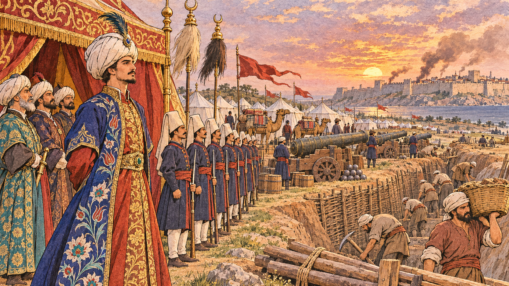 -->
<details><summary>Image Prompt</summary>
(This is Panel 05. Do not include the panel number in the image.)
Style: a hand-drawn travel-sketchbook graphic-novel illustration, with clean dark ink outlines, flat softly shaded color fills and a faint watercolor paper texture, like a page from a traveler's journal; warm, sunlit, painterly lighting; no text, captions, signs, letters or speech bubbles anywhere in the image.
Please generate a 16:9 image depicting panel 5 of 14. Setting: the Ottoman camp outside Rhodes, late July 1522, golden dusk. Palette: Iznik turquoise, cobalt, tomato red, brass, saffron and white plaster. Medium-wide shot. Sultan Suleiman the Magnificent in 1522: a slim man of about twenty-seven with dark eyes, a thin dark mustache and a short pointed beard, wearing a tall white turban with a small jeweled plume, a cobalt-blue silk caftan over a tomato-red robe and gold brocade; calm, young and watchful. He stands before a huge gold-and-red command tent with horsetail standards, looking toward the distant walls of Rhodes, with a respectful group of officers in turbans at a distance. Ottoman soldiers and laborers in 1522: infantrymen in tall white felt caps with a trailing back flap, dark-blue knee-length coats with red trim and sashes, and miners in plain brown tunics with cloth head wraps carrying baskets, picks and timber props. Soldiers are lined up at attention. Other details: rows of white tents, a siege trench in the middle ground, heavy cannons on wooden carriages, red banners snapping, camels with supplies, smoke on the horizon where the walls stand. Tone: young authority, patience.
Keep every character and place consistent with the other images in this story. Generate the image immediately without asking clarifying questions.
</details>

At the end of July the young Sultan Suleiman arrives to take command in person, two years into his reign. He is the Suleiman for whom Istanbul's Süleymaniye is named, and a mosque of his name will later stand inside these walls. Mehmed II failed to take Rhodes in 1480, and the young sultan means to finish the job. The siege will be fought with cannon and with shovels.

## Panel 6: Cannon and Smoke

<!-- 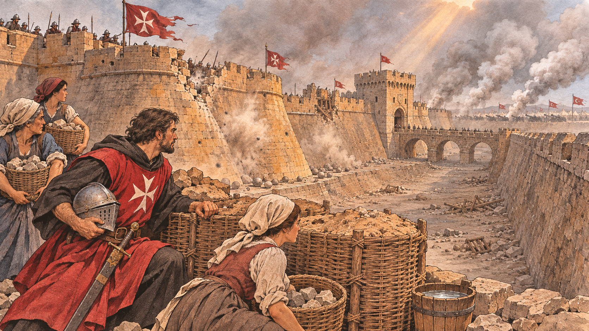 -->
<details><summary>Image Prompt</summary>
(This is Panel 06. Do not include the panel number in the image.)
Style: a hand-drawn travel-sketchbook graphic-novel illustration, with clean dark ink outlines, flat softly shaded color fills and a faint watercolor paper texture, like a page from a traveler's journal; warm, sunlit, painterly lighting; no text, captions, signs, letters or speech bubbles anywhere in the image.
Please generate a 16:9 image depicting panel 6 of 14. Setting: the walls of Rhodes, August 1522, hazy afternoon. Palette: sandstone, steel gray, Mediterranean blue and banner crimson. Wide shot of the walls under bombardment. The walls of Rhodes: thick, low, sloped sandstone walls with rounded projecting bastions, battlements, a very wide dry moat below, a stone outer wall on the far side of the moat, and a gate tower reached by a bridge over the moat; the stone is honey-gold weathered to gray. Clouds of white-gray smoke rise from distant rows of Ottoman cannon, round stone balls lie scattered at the foot of the bastions, a corner of the parapet is chipped and crumbling, and dust hangs in the air. In the foreground, A Knight Hospitaller: a man in a black monastic habit marked with a white eight-pointed cross, over which he wears a bright crimson surcoat in battle, with a steel helmet carried under one arm and a longsword resting in its scabbard; determined and disciplined. He crouches behind a wall of earth-filled wicker baskets next to townswomen carrying stones in baskets. Other details: crimson banners still flying, a shattered battlement, a sunbeam through the smoke, rubble in the moat, a bucket of water. Tone: heavy, relentless. Nobody is injured and nobody is mid-strike.
Keep every character and place consistent with the other images in this story. Generate the image immediately without asking clarifying questions.
</details>

The Ottomans bombard the walls with heavy cannon, but at first they do not try to climb them. The thick, low walls absorb much of the shot, and defenders, including women who carry stones and supplies, repair the damage. Round stone balls like these still lie in the grass of the moat today. The worst is still to come, and it comes from below.

## Panel 7: The Mouths of the Tunnels

<!-- 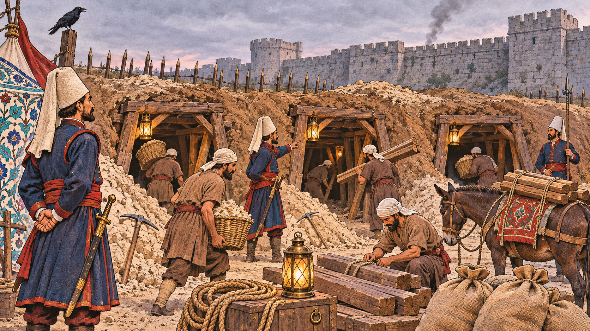 -->
<details><summary>Image Prompt</summary>
(This is Panel 07. Do not include the panel number in the image.)
Style: a hand-drawn travel-sketchbook graphic-novel illustration, with clean dark ink outlines, flat softly shaded color fills and a faint watercolor paper texture, like a page from a traveler's journal; warm, sunlit, painterly lighting; no text, captions, signs, letters or speech bubbles anywhere in the image.
Please generate a 16:9 image depicting panel 7 of 14. Setting: the siege trenches outside the walls of Rhodes, September 1522, gray dawn. Palette: Iznik turquoise, cobalt, tomato red, brass, saffron and white plaster. Medium-wide shot of three dark, timber-framed tunnel mouths opening in a long earthen mound, with spoil heaps of fresh pale earth beside them. Ottoman soldiers and laborers in 1522: infantrymen in tall white felt caps with a trailing back flap, dark-blue knee-length coats with red trim and sashes, and miners in plain brown tunics with cloth head wraps carrying baskets, picks and timber props. The miners carry baskets of soil and wooden props toward the openings. Beyond, the gray wall with a thin plume of smoke rises. Other details: coils of rope, oil lanterns, sacks, a mule with a timber load, a crow on a post, a line of stakes. Tone: patient menace.
Keep every character and place consistent with the other images in this story. Generate the image immediately without asking clarifying questions.
</details>

Teams of Ottoman miners tunnel under the walls to blow them up with gunpowder, and the diggers' work shows only as dark mouths in the earth and growing heaps of spoil. A single mine, packed with powder, can bring down a section of wall in a moment. The defenders cannot see the miners, only the evidence they leave behind. To stop them, they must hear them.

## Panel 8: Listening

<!-- 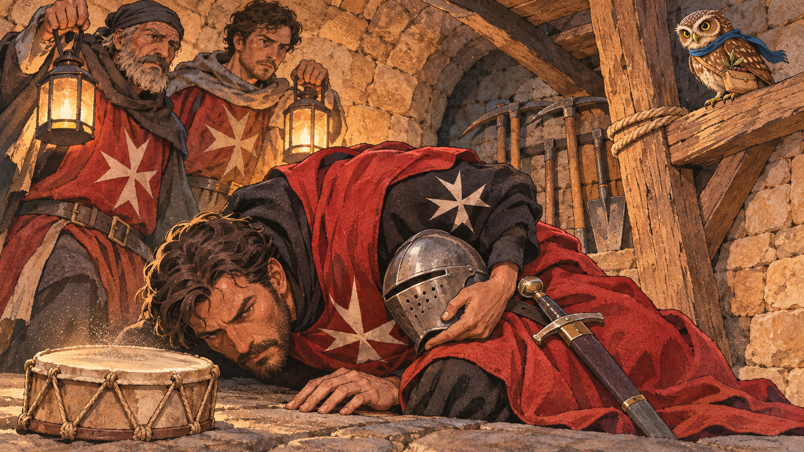 -->
<details><summary>Image Prompt</summary>
(This is Panel 08. Do not include the panel number in the image.)
Style: a hand-drawn travel-sketchbook graphic-novel illustration, with clean dark ink outlines, flat softly shaded color fills and a faint watercolor paper texture, like a page from a traveler's journal; warm, sunlit, painterly lighting; no text, captions, signs, letters or speech bubbles anywhere in the image.
Please generate a 16:9 image depicting panel 8 of 14. Setting: a stone cellar by the inner side of the wall in Rhodes, September 1522, lamplit predawn. Palette: sandstone, steel gray, Mediterranean blue and banner crimson. Low close shot. A Knight Hospitaller: a man in a black monastic habit marked with a white eight-pointed cross, over which he wears a bright crimson surcoat in battle, with a steel helmet carried under one arm and a longsword resting in its scabbard; determined and disciplined. He kneels with his ear near the floor beside a small parchment-skinned drum set on the stones, its skin trembling with fine dust dancing on it. Two defenders behind him hold lanterns. Other details: rough sandstone blocks, shoring beams, a rack of picks and shovels. Glaux the Little Owl: a true little owl (Athene noctua), small, round and compact, with a flat rounded head and no ear tufts, warm earth-brown plumage with cream spots, bright lemon-yellow eyes under pale cream eyebrows, a cream-white throat patch and a short pale greenish-yellow beak. Glaux wears a small Aegean-blue scarf and a tan canvas satchel across the body with a small leather-bound travel notebook peeking out, and a sprig of three olive leaves tucked into the satchel strap. Alert, curious and warm expression. Glaux is perched on a wooden shoring beam in the upper right. Glaux is drawn small, perched at the edge of the scene, noticeable on a second look. Tone: held breath.
Keep every character and place consistent with the other images in this story. Generate the image immediately without asking clarifying questions.
</details>

The defenders listen for the digging, some say with drums whose skins tremble at the vibrations, and they dig their own tunnels to meet the enemy's.

> **Myth or Evidence?** That the Ottomans mined under the walls and that the defenders dug countermines is documented. The trembling drum is a vivid detail some tellings add; the chapter marks it as "some say."

## Panel 9: Where the Tunnels Meet

<!-- 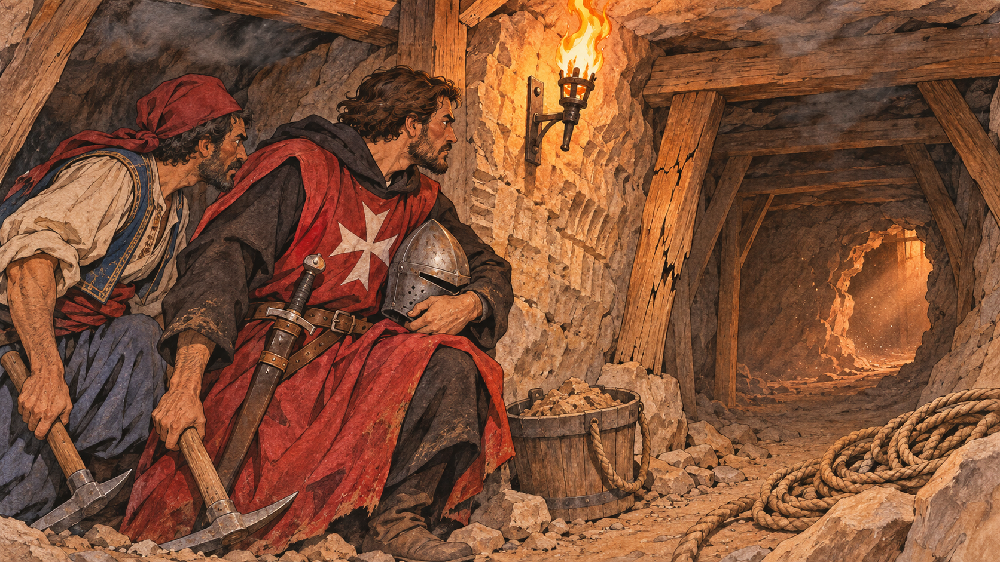 -->
<details><summary>Image Prompt</summary>
(This is Panel 09. Do not include the panel number in the image.)
Style: a hand-drawn travel-sketchbook graphic-novel illustration, with clean dark ink outlines, flat softly shaded color fills and a faint watercolor paper texture, like a page from a traveler's journal; warm, sunlit, painterly lighting; no text, captions, signs, letters or speech bubbles anywhere in the image.
Please generate a 16:9 image depicting panel 9 of 14. Setting: underground in a countermine under the walls of Rhodes, September 1522, torchlit. Palette: sandstone, steel gray, Mediterranean blue and banner crimson. Wide low view down a rough-hewn tunnel supported by timber props, a torch in an iron bracket on the wall, and at the far end a small ragged opening where a second tunnel meets it, with warm orange light and drifting dust on the other side. In the foreground, A Knight Hospitaller: a man in a black monastic habit marked with a white eight-pointed cross, over which he wears a bright crimson surcoat in battle, with a steel helmet carried under one arm and a longsword resting in its scabbard; determined and disciplined. He and a Greek militiaman crouch, picks held down at their sides, listening. Other details: chisel marks on the stone, a bucket of earth, coils of rope, a wooden prop cracking, thin smoke along the ceiling. Tone: claustrophobic, tense. Nobody is fighting.
Keep every character and place consistent with the other images in this story. Generate the image immediately without asking clarifying questions.
</details>

Underground, the siege becomes a game of nerves. When a countermine meets an enemy tunnel, the two sides are suddenly face to face in the dark, with only flickering torchlight between them. A tunnel found in time is a wall saved, and a tunnel found too late is a breach. We cannot know how many such meetings there were, only that the sources describe a war underneath the war.

## Panel 10: September 24

<!-- 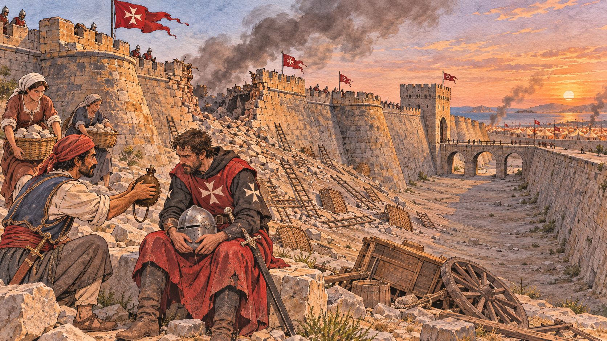 -->
<details><summary>Image Prompt</summary>
(This is Panel 10. Do not include the panel number in the image.)
Style: a hand-drawn travel-sketchbook graphic-novel illustration, with clean dark ink outlines, flat softly shaded color fills and a faint watercolor paper texture, like a page from a traveler's journal; warm, sunlit, painterly lighting; no text, captions, signs, letters or speech bubbles anywhere in the image.
Please generate a 16:9 image depicting panel 10 of 14. Setting: a breach in the walls of Rhodes, the evening of 24 September 1522, drifting smoke. Palette: sandstone, steel gray, Mediterranean blue and banner crimson. Wide shot of the walls. The walls of Rhodes: thick, low, sloped sandstone walls with rounded projecting bastions, battlements, a very wide dry moat below, a stone outer wall on the far side of the moat, and a gate tower reached by a bridge over the moat; the stone is honey-gold weathered to gray. A broad gap in one bastion is piled with rubble, thick smoke drifting past, dozens of abandoned scaling ladders and wicker shields scattered on the slope below, and the order's crimson banners still flying from the top. In the foreground, A Knight Hospitaller: a man in a black monastic habit marked with a white eight-pointed cross, over which he wears a bright crimson surcoat in battle, with a steel helmet carried under one arm and a longsword resting in its scabbard; determined and disciplined. He sits wearily on a stone with his helmet in his hands while a Greek militiaman hands him a water flask; two townswomen carry stones in baskets behind them. Far below, Ottoman tents glow orange in the sunset. Other details: broken battlements, an overturned cart, long shadows. Tone: exhausted survival. No bodies.
Keep every character and place consistent with the other images in this story. Generate the image immediately without asking clarifying questions.
</details>

Assaults through the breaches in September culminate in a great general assault on September 24, and the defenders throw it back with heavy losses on both sides. The picture shows only the aftermath: smoke, abandoned ladders, and banners still flying. But no help comes from Christian Europe, and food and gunpowder run low. The walls have bought time, and time is not rescue.

## Panel 11: The Terms

<!-- 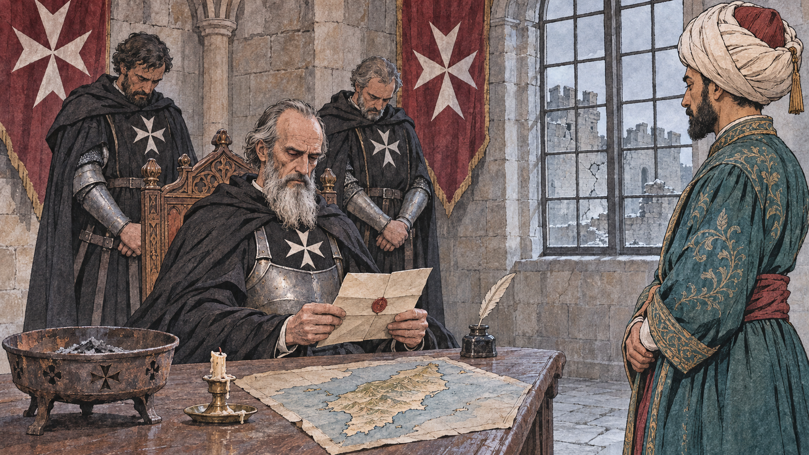 -->
<details><summary>Image Prompt</summary>
(This is Panel 11. Do not include the panel number in the image.)
Style: a hand-drawn travel-sketchbook graphic-novel illustration, with clean dark ink outlines, flat softly shaded color fills and a faint watercolor paper texture, like a page from a traveler's journal; warm, sunlit, painterly lighting; no text, captions, signs, letters or speech bubbles anywhere in the image.
Please generate a 16:9 image depicting panel 11 of 14. Setting: the Grand Master's council chamber in the Palace of the Grand Master, Rhodes, 20 December 1522, cold gray winter light. Palette: sandstone, steel gray, Mediterranean blue and banner crimson. Medium shot. Philippe Villiers de L'Isle-Adam, Grand Master of the Knights of Rhodes: a lean, weathered man of about fifty-eight with a long silvery-gray beard, a high forehead and deep-set, tired dark eyes, wearing a plain black monastic habit with a white eight-pointed cross on the chest, a steel breastplate over it and a long black mantle; dignified, resolute and exhausted. He sits at a long table reading a folded document with a red wax seal, with a cold brazier, a burned-down candle and a map of the island on the table. An Ottoman envoy in a white turban and teal robe stands before him in side view, hands folded. Two knights stand behind the Grand Master, heads bowed. Other details: through a tall window a view of broken battlements, cracked stone, an inkpot, a bare stone floor. Tone: sorrow and dignity.
Keep every character and place consistent with the other images in this story. Generate the image immediately without asking clarifying questions.
</details>

By December the walls are broken in many places, and on December 20 the Grand Master accepts Suleiman's terms. A city taken by storm in this age can expect to be sacked, its people killed or enslaved. Rhodes instead surrenders on terms: the knights may leave with their arms, relics and honor, inhabitants who wish may leave with them, and those who stay keep their faith and their churches. Both sides can tell the story as a victory, and both do.

## Panel 12: January 1, 1523

<!-- 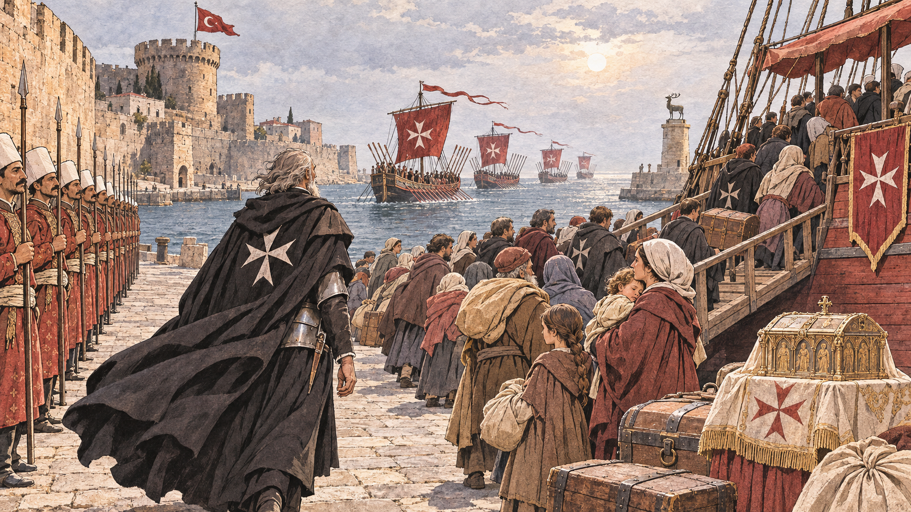 -->
<details><summary>Image Prompt</summary>
(This is Panel 12. Do not include the panel number in the image.)
Style: a hand-drawn travel-sketchbook graphic-novel illustration, with clean dark ink outlines, flat softly shaded color fills and a faint watercolor paper texture, like a page from a traveler's journal; warm, sunlit, painterly lighting; no text, captions, signs, letters or speech bubbles anywhere in the image.
Please generate a 16:9 image depicting panel 12 of 14. Setting: the harbor of Rhodes, 1 January 1523, pale winter morning. Palette: sandstone, steel gray, Mediterranean blue and banner crimson. Wide shot of galleys with crimson banners marked with a white cross moving slowly out of the harbor mouth, oars rising together. On the quay two straight rows of Ottoman soldiers in white caps stand at attention, holding spears upright. A crowd of Rhodian families with bundles and chests boards the ships. In the foreground, Philippe Villiers de L'Isle-Adam, Grand Master of the Knights of Rhodes: a lean, weathered man of about fifty-eight with a long silvery-gray beard, a high forehead and deep-set, tired dark eyes, wearing a plain black monastic habit with a white eight-pointed cross on the chest, a steel breastplate over it and a long black mantle; dignified, resolute and exhausted. Seen from behind, he steps toward a gangplank with his cloak lifted by the wind. Other details: a chest of relics under a cloth, a child in a mother's arms, an Ottoman red flag on a tower, gray-blue water. Tone: solemn, dignified farewell.
Keep every character and place consistent with the other images in this story. Generate the image immediately without asking clarifying questions.
</details>

On January 1, 1523 the knights sail out with several thousand Rhodians. After seven years of wandering they receive Malta, where in 1565 they withstand another great Ottoman siege. For Suleiman, the terms end a siege that cost him dearly and give him the island intact. The Order of St. John still exists, as a medical and relief charity, more than nine centuries after it began.

## Panel 13: The Palace the Italians Built

<!-- 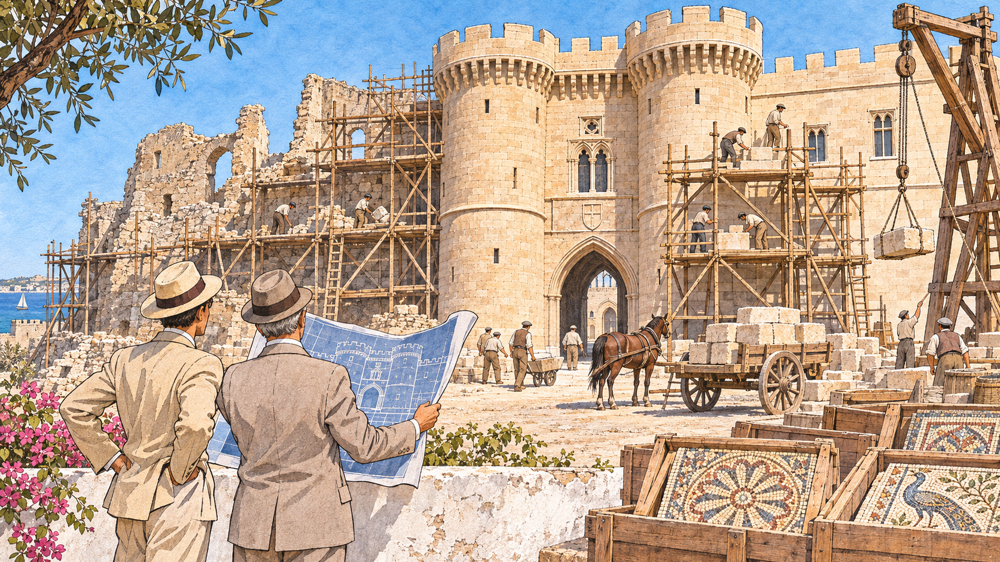 -->
<details><summary>Image Prompt</summary>
(This is Panel 13. Do not include the panel number in the image.)
Style: a hand-drawn travel-sketchbook graphic-novel illustration, with clean dark ink outlines, flat softly shaded color fills and a faint watercolor paper texture, like a page from a traveler's journal; warm, sunlit, painterly lighting; no text, captions, signs, letters or speech bubbles anywhere in the image.
Please generate a 16:9 image depicting panel 13 of 14. Setting: the Palace of the Grand Master, Rhodes, 1938, bright spring morning. Palette: sandstone, whitewash, raw timber and sea blue. Wide shot of the palace under heavy timber scaffolding. The Palace of the Grand Master, Rhodes: a large square fortress-palace of pale sandstone with massive round towers flanking its gate, a battlemented top, tall narrow windows and high plain outer walls, set on the high northwest corner of the walled town. It is half still in rubble stumps and half already rebuilt in pale freshly cut stone, with masons and laborers in 1930s work caps, trousers and waistcoats on the scaffolds. In the foreground two men in light suits and hats, seen from behind, study large blueprints held open against the wind. Other details: carts with pale stone blocks, a hoist, crates of mosaic panels waiting to be installed, a clear sky, a whitewashed wall. Tone: ambition, a stage being set.
Keep every character and place consistent with the other images in this story. Generate the image immediately without asking clarifying questions.
</details>

The palace that visitors tour is mostly not medieval. In 1856, under Ottoman rule, lightning struck the nearby Church of St. John and ignited gunpowder stored in its vaults, possibly since the siege of 1522, and the explosion wrecked much of the palace. The Italian governor had it rebuilt from 1937 to 1940, intended as a residence for the king of Italy and for Mussolini, and filled it with Hellenistic and early Christian mosaics brought from the island of Kos. It is a good museum, but it is an Italian reconstruction of the 1930s on medieval foundations.

## Panel 14: Walking the Street Today

<!-- 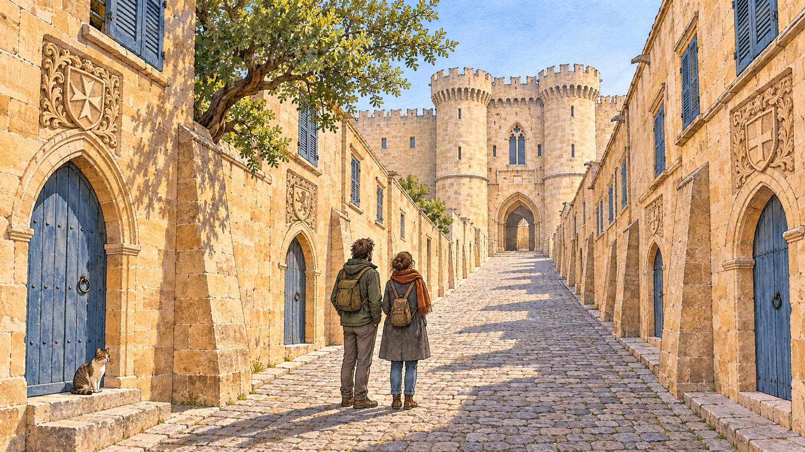 -->
<details><summary>Image Prompt</summary>
(This is Panel 14. Do not include the panel number in the image.)
Style: a hand-drawn travel-sketchbook graphic-novel illustration, with clean dark ink outlines, flat softly shaded color fills and a faint watercolor paper texture, like a page from a traveler's journal; warm, sunlit, painterly lighting; no text, captions, signs, letters or speech bubbles anywhere in the image.
Please generate a 16:9 image depicting panel 14 of 14. Setting: the Street of the Knights, Rhodes, a bright November morning today. Palette: natural daylight, honey sandstone, whitewash and Mediterranean blue. Wide shot looking uphill along the street toward the palace at the top, with long soft shadows and empty cobbles. The Street of the Knights, Rhodes: a long, straight, narrow cobbled street climbing gently uphill between continuous two-story walls of honey-colored sandstone, with plain pointed-arch and rectangular doorways topped by carved stone coats of arms, small shuttered upper windows and plain flat buttresses; there are no shops, and at the top a large fortress-palace closes the view. The Palace of the Grand Master, Rhodes: a large square fortress-palace of pale sandstone with massive round towers flanking its gate, a battlemented top, tall narrow windows and high plain outer walls, set on the high northwest corner of the walled town. In the middle distance: Two adult travelers seen from behind or in distant three-quarter view, dressed for cool November weather: one in a dark green rain jacket, the other in a charcoal wool coat with a rust-colored scarf, both with small daypacks, standing close together and looking at the view. Faces are never shown in detail. Other details: carved coats of arms over the doors, a green tree leaning over a wall, shuttered windows, wooden doors painted blue, a cat on a step, pale blue sky. Tone: quiet, thoughtful, early-morning calm.
Keep every character and place consistent with the other images in this story. Generate the image immediately without asking clarifying questions.
</details>

Early on a November morning, before the groups arrive, the Street of the Knights is quiet enough to hear our own footsteps. It is medieval in plan and largely medieval in stone, with careful modern repairs; the palace at the top, in contrast, is mostly a 1930s rebuilding. Look up at the coats of arms and ask which shield belongs to which Grand Master, and which layer built what we see.

### Epilogue - What the Walls Show

The knights held Rhodes for 212 years, then lost it after a six-month siege, and both sides could call the ending a win. What the story shows is how much of a "medieval" place is a later layer: Ottoman mosques, Italian restoration, and an Italian-built palace on the knights' foundations. Walls buy time, not victory, and a fortress is a promise that someone outside will come.

| Challenge | How They Responded | Lesson for Today |
|---|---|---|
| A new weapon: cannon | The knights made the walls lower, thicker and rounded, with a wider moat | Defenders must adapt to new technology |
| A siege fought underground | Defenders listened for tunnels and dug their own | Quiet, careful work can matter as much as bravery |
| No help from Europe | After six months, the Grand Master accepted terms | Even the best defense needs someone coming to help |
| A palace that burned and was rebuilt | The Italian government rebuilt it in 1937-1940 | Check the date on what is labeled medieval |

### Call to Action

On the Street of the Knights, read the coats of arms like date stamps, then walk down into the dry moat and find the round stone balls in the grass. At the palace, ask who built what you are standing in. The habit of asking which layer is original is the same habit that serves a learner anywhere, which is what Learning for All is about: a good question is available to everyone who walks through the gate.

---

## Voices from the Sources

- *"Our lords the sick."* The Hospitallers' rule required that the sick be treated as "our lords," and knights took turns serving in the wards of their hospital. This is documented in the order's rule and is why the building at the foot of the Street of the Knights is called a hospital.
- *Tuitio fidei et obsequium pauperum.* The order's modern Latin motto, "defense of the faith and assistance to the poor." It is a motto the order uses today, not a quotation from the siege.
- No words of Philippe Villiers de L'Isle-Adam or Suleiman from December 1522 are quoted here, because the surviving reports are retellings made later and we cannot be sure of the exact words.

## On the Trip

- **Chapter:** [12. Day 8: Rhodes, From the Colossus to the Knights](../../chapters/12-rhodes/index.md)
- **Where to look:** the coats of arms over the inn doors on the Street of the Knights; the dry moat and the round stone balls in its grass; the d'Amboise Gate with its bridge; the Palace of the Grand Master, and the Hospital of the Knights (now the Archaeological Museum).
- **Explore further:** [Who Built What We See in the Old Town?](../../sims/rhodes-old-town-layers-sorter/index.md) and [Rhodes Changes Hands, 1912-1948](../../sims/rhodes-changes-hands-1912-1948/index.md).
- **Look Closer:** "Look closer at the carved shields over the doors, and ask which Grand Master put each one there." Glaux hid in panel 8, perched on a wooden shoring beam in the cellar where the knight listens.

## Characters and Style

This story follows the shared series bible: [Story Characters, Places and House Style](../characters.md). Glaux's identity comes from the mascot's [character sheet](../../img/mascot/character-sheet.md).

## References

1. [Siege of Rhodes (1522) - Wikipedia](https://en.wikipedia.org/wiki/Siege_of_Rhodes_(1522)): the siege, the mining war and the terms of surrender.
2. [Knights Hospitaller - Wikipedia](https://en.wikipedia.org/wiki/Knights_Hospitaller): the history of the order from Jerusalem to Rhodes, Malta and Rome.
3. [Palace of the Grand Master of the Knights of Rhodes - Wikipedia](https://en.wikipedia.org/wiki/Palace_of_the_Grand_Master_of_the_Knights_of_Rhodes): the palace, its destruction in 1856 and the Italian rebuilding.
4. [Medieval City of Rhodes - UNESCO World Heritage Centre](https://whc.unesco.org/en/list/493): the official description of the Old Town as a World Heritage site.
5. [Hospitallers - Encyclopaedia Britannica](https://www.britannica.com/topic/Hospitallers): an overview of the order.
