# The Library With a Tomb in the Basement

<!-- 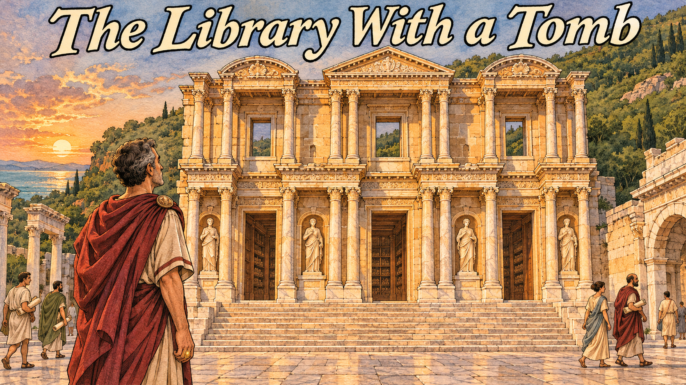 -->
<details>
<summary>Cover Image Prompt</summary>
(This is the Cover Image. Do not include this label in the image.)
Style: a hand-drawn travel-sketchbook graphic-novel illustration, with clean dark ink outlines, flat softly shaded color fills and a faint watercolor paper texture, like a page from a traveler's journal; warm, sunlit, painterly lighting; no text, captions, signs, letters or speech bubbles anywhere in the image.
Please generate a wide-landscape 16:9 cover image for this graphic novel story. Scene at golden hour: show the whole façade glowing in the low evening sun in front of a green hillside. The Library of Celsus at Ephesus: a two-story façade of warm cream limestone and marble, with paired Corinthian columns on both levels, a broad flight of steps leading up to three tall doorways, four niches between the lower columns holding draped female statues, three windows on the upper story, and gently curved and triangular pediments crowning the front; the building stands hard against a green hillside. A small figure stands at the foot of its steps, seen from behind, looking up. Tiberius Julius Aquila, Celsus's son: a man of about forty-five with short dark curly hair graying at the temples, a clean-shaven, thoughtful face with deep-set brown eyes, wearing a cream wool tunic under a deep-red mantle pinned at the shoulder with a bronze brooch, and a heavy gold ring on his left hand; a quiet, determined bearing. A faint blue-green sea shimmers far in the background, and a few small citizens in tunics and mantles walk across the marble square with scrolls. Across the top, render the story title as bold, hand-lettered title text in warm cream letters with a dark ink outline, reading exactly: "The Library With a Tomb". Palette: warm limestone, sea-green, deep red, bronze and evening gold. Emotional tone: grand, quiet and a little melancholy.
Keep every character and place consistent with the other images in this story. Generate the image immediately without asking clarifying questions.
</details>

<details>
<summary>Narrative Prompt</summary>

**Era and place.** Ephesus, a Greek city in the Roman province of Asia (western Turkey), about 110 CE for the building of the library, about 120 CE for its opening, then centuries later for the silting of the harbor and the ruin, and finally today for the rebuilt façade. The story follows the chapter [Day 7: Ephesus, a Greco-Roman City](../../chapters/10-ephesus-greco-roman-city/index.md).

**Themes.** Memory and monument; a private fortune given for public learning (the book's Learning for All thread); a city that slowly loses its sea; what archaeologists rebuild and what they do not know.

**House style.** Every prompt starts with the series house style line from [Story Characters, Places and House Style](../characters.md). All images are 16:9 with no lettering in the panels; only the cover carries the title.

**Palette (Hellenistic and Roman era).** Warm limestone, sea-green, deep red, bronze and evening gold. The final panel uses Modern natural daylight.

**Creative liberties and uncertainties.** Aquila's face, clothing and feelings, the librarian, the architect, the poses of the four virtue statues and the shape of the burial chamber are imagined. The 12,000-scroll figure is a modern estimate from the number and size of the wall niches. The "warm marble seats" joke about the latrines has no ancient source. The exact date of Celsus's death is not known; the library was begun around 110 CE. The silting of the harbor took centuries, so panel 10 deliberately jumps ahead.

**Cast.** Glaux the Little Owl and the Travelers follow [Story Characters, Places and House Style](../characters.md) and the [mascot character sheet](../../img/mascot/character-sheet.md); paste their blocks verbatim. Characters and places who appear only in this story are below; paste each block verbatim into every prompt where they appear.

**Tiberius Julius Aquila (this story only)**

```text
Tiberius Julius Aquila, Celsus's son: a man of about forty-five with short dark curly hair graying at the temples, a clean-shaven, thoughtful face with deep-set brown eyes, wearing a cream wool tunic under a deep-red mantle pinned at the shoulder with a bronze brooch, and a heavy gold ring on his left hand; a quiet, determined bearing.
```

**The portrait bust of Celsus (this story only)**

```text
The portrait bust of Celsus: a white marble bust of an elderly Roman governor from the Greek East, with a lined, dignified face, a strong nose, short receding hair, and the folds of a toga carved over the shoulders; calm, stern and kind.
```

**The librarian of Ephesus (this story only)**

```text
The librarian of Ephesus: a slim, elderly, clean-shaven Greek man with thin gray hair and ink-stained fingers, wearing a pale linen tunic with a narrow blue border, carrying a few rolled scrolls tied with red cord in the crook of one arm.
```

**The Library of Celsus (this story only)**

```text
The Library of Celsus at Ephesus: a two-story façade of warm cream limestone and marble, with paired Corinthian columns on both levels, a broad flight of steps leading up to three tall doorways, four niches between the lower columns holding draped female statues, three windows on the upper story, and gently curved and triangular pediments crowning the front; the building stands hard against a green hillside.
```

</details>

### Prologue - A Gift That Is Also a Grave

Most families remember their dead with a statue or a carved stone. In about 110 CE a man in Ephesus, on the western coast of today's Turkey, chose something stranger: a public library, with his father's marble coffin waiting in a chamber below the reading room. Today the front of that building is the most photographed sight in the city. This is the story of why it was built, what happened to the sea that once lapped at the city, and how a ruin was put back together.

**Find Glaux:** Glaux hides in one panel of this story. Can you spot the little owl?

## Panel 1: A Funeral at the Foot of the Hill

<!-- 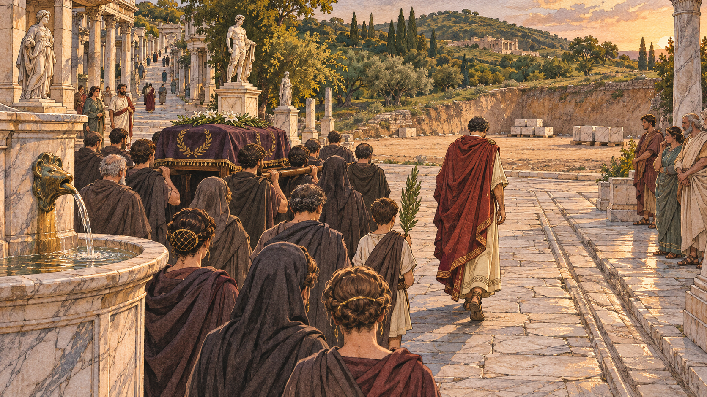 -->
<details><summary>Image Prompt</summary>
(This is Panel 01. Do not include the panel number in the image.)
I am about to ask you to generate a series of images for a graphic novel. Please make the images have a consistent style and consistent characters. Do not ask any clarifying questions. Just generate the image immediately when asked.
Style: a hand-drawn travel-sketchbook graphic-novel illustration, with clean dark ink outlines, flat softly shaded color fills and a faint watercolor paper texture, like a page from a traveler's journal; warm, sunlit, painterly lighting; no text, captions, signs, letters or speech bubbles anywhere in the image.
Please generate a 16:9 image depicting panel 1 of 12. Setting: the marble-paved square at the foot of Curetes Street in Ephesus, about 110 CE, late afternoon. Palette: warm limestone, sea-green, deep red, bronze and evening gold. Wide establishing shot from the square toward a cleared, level plot cut into a green hillside, with a few stacked marble blocks waiting on it. A funeral procession of about twenty mourners in dark wool mantles crosses the paving, seen from behind, carrying a covered wooden bier on poles. Foreground: Tiberius Julius Aquila, Celsus's son: a man of about forty-five with short dark curly hair graying at the temples, a clean-shaven, thoughtful face with deep-set brown eyes, wearing a cream wool tunic under a deep-red mantle pinned at the shoulder with a bronze brooch, and a heavy gold ring on his left hand; a quiet, determined bearing. He walks alone at the head of the procession, seen from behind, head bowed. Other details: a bronze-spouted fountain, statue bases along the street, a boy carrying a cypress branch, a few citizens watching in silence, wheel ruts worn into the marble. Tone: solemn, a city holding its breath.
Keep every character and place consistent with the other images in this story. Generate the image immediately without asking clarifying questions.
</details>

About 110 CE, a funeral crosses the marble square at the foot of Curetes Street in Ephesus. The man on the bier is Tiberius Julius Celsus Polemaeanus, a Greek from Sardis who rose to become a Roman consul in 92 CE, one of the first men from the Greek East to reach that rank, and later governor of the province of Asia. His son, Tiberius Julius Aquila, walks at the head of the mourners. Behind them lies only a cleared slope and a few stacked blocks, though not for long.

## Panel 2: The Empty Chair

<!-- 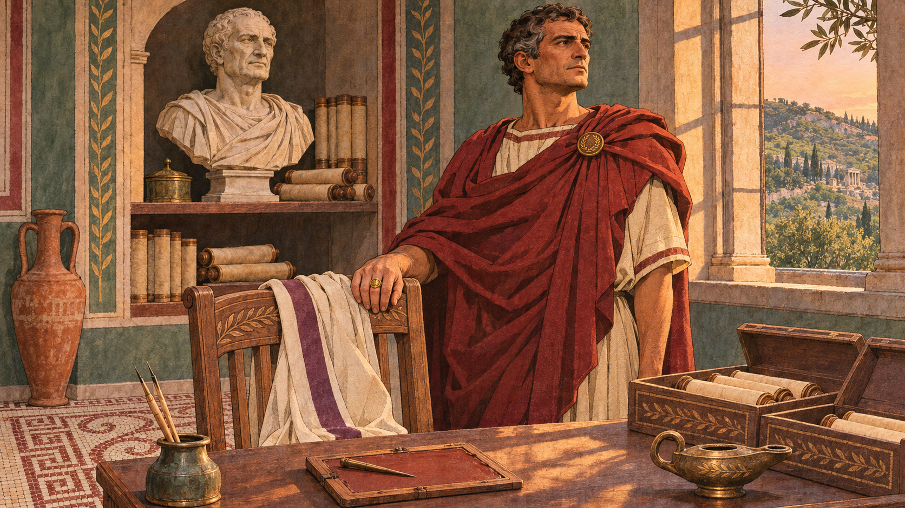 -->
<details><summary>Image Prompt</summary>
(This is Panel 02. Do not include the panel number in the image.)
Style: a hand-drawn travel-sketchbook graphic-novel illustration, with clean dark ink outlines, flat softly shaded color fills and a faint watercolor paper texture, like a page from a traveler's journal; warm, sunlit, painterly lighting; no text, captions, signs, letters or speech bubbles anywhere in the image.
Please generate a 16:9 image depicting panel 2 of 12. Setting: the study of a Roman governor's house in Ephesus, about 110 CE, low evening light through a window. Palette: warm limestone, sea-green, deep red, bronze and evening gold. Medium shot of a plain carved wooden chair standing empty at a writing desk, a folded white toga with a broad purple stripe laid over its back, an unlit bronze oil lamp beside open scroll boxes. On a shelf stands a portrait bust. The portrait bust of Celsus: a white marble bust of an elderly Roman governor from the Greek East, with a lined, dignified face, a strong nose, short receding hair, and the folds of a toga carved over the shoulders; calm, stern and kind. In the foreground, Tiberius Julius Aquila, Celsus's son: a man of about forty-five with short dark curly hair graying at the temples, a clean-shaven, thoughtful face with deep-set brown eyes, wearing a cream wool tunic under a deep-red mantle pinned at the shoulder with a bronze brooch, and a heavy gold ring on his left hand; a quiet, determined bearing. He stands at the window in three-quarter view, one hand resting on the chair. Other details: a wax writing tablet, an inkwell and reed pens, a tall amphora in the corner, a red-and-cream mosaic floor, and a green hillside through the window. Tone: grief turning slowly into resolve.
Keep every character and place consistent with the other images in this story. Generate the image immediately without asking clarifying questions.
</details>

After the mourners leave, the study is quiet, and the chair at the desk is empty. A man of Celsus's rank might have been remembered with a statue or a grand tomb, and Aquila has the money for either. Historians cannot know what he felt, but the choice he made is written in stone: a monument that would keep working after its owner was gone, a public library.

## Panel 3: The Will

<!-- 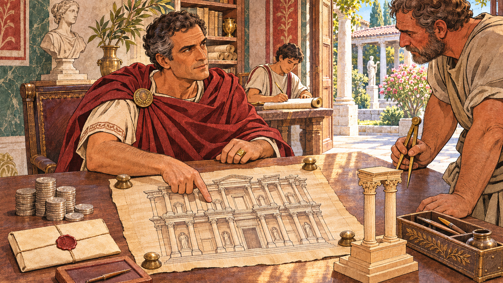 -->
<details><summary>Image Prompt</summary>
(This is Panel 03. Do not include the panel number in the image.)
Style: a hand-drawn travel-sketchbook graphic-novel illustration, with clean dark ink outlines, flat softly shaded color fills and a faint watercolor paper texture, like a page from a traveler's journal; warm, sunlit, painterly lighting; no text, captions, signs, letters or speech bubbles anywhere in the image.
Please generate a 16:9 image depicting panel 3 of 12. Setting: a bright office in Ephesus, about 110 CE, morning light from a courtyard door. Palette: warm limestone, sea-green, deep red, bronze and evening gold. Over-the-shoulder shot across a worktable. Tiberius Julius Aquila, Celsus's son: a man of about forty-five with short dark curly hair graying at the temples, a clean-shaven, thoughtful face with deep-set brown eyes, wearing a cream wool tunic under a deep-red mantle pinned at the shoulder with a bronze brooch, and a heavy gold ring on his left hand; a quiet, determined bearing. He points at an ink plan of a two-story columned façade drawn on papyrus and held flat by four bronze weights. Opposite him stands a stocky, sunburnt architect in a plain tunic holding bronze dividers. On the table: a sealed will with a red wax seal, neat stacks of silver coins, a wax tablet, a small wooden model of paired columns and a scribe's pen box. A young scribe in the background writes on a scroll. Tone: purposeful, hopeful, a decision being made.
Keep every character and place consistent with the other images in this story. Generate the image immediately without asking clarifying questions.
</details>

Aquila begins the building around 110 CE and, the chapter tells us, leaves money in his will to finish it and to buy books. The inscription on the building records the sum: 25,000 denarii, enough to pay a Roman soldier for many decades. The architect here is imagined, since the chapter gives no name, but the plans, the pen and the silver are what such a project needed. A private grief is about to become public property.

## Panel 4: The Façade Rises

<!-- 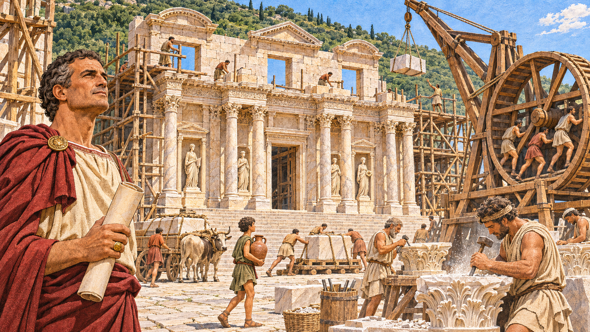 -->
<details><summary>Image Prompt</summary>
(This is Panel 04. Do not include the panel number in the image.)
Style: a hand-drawn travel-sketchbook graphic-novel illustration, with clean dark ink outlines, flat softly shaded color fills and a faint watercolor paper texture, like a page from a traveler's journal; warm, sunlit, painterly lighting; no text, captions, signs, letters or speech bubbles anywhere in the image.
Please generate a 16:9 image depicting panel 4 of 12. Setting: the building site at the foot of Curetes Street, Ephesus, about 112 CE, hard midday sun. Palette: warm limestone, sea-green, deep red, bronze and evening gold. Low-angle three-quarter view of the building site. The Library of Celsus at Ephesus: a two-story façade of warm cream limestone and marble, with paired Corinthian columns on both levels, a broad flight of steps leading up to three tall doorways, four niches between the lower columns holding draped female statues, three windows on the upper story, and gently curved and triangular pediments crowning the front; the building stands hard against a green hillside. It is shown half-built under timber scaffolding: the lower story of columns stands, the upper story is still bare blocks. A great wooden treadwheel crane with men walking inside the wheel lifts a marble block on ropes. On the ground masons chisel acanthus leaves into Corinthian capitals, white dust drifting. In the foreground, Tiberius Julius Aquila, Celsus's son: a man of about forty-five with short dark curly hair graying at the temples, a clean-shaven, thoughtful face with deep-set brown eyes, wearing a cream wool tunic under a deep-red mantle pinned at the shoulder with a bronze brooch, and a heavy gold ring on his left hand; a quiet, determined bearing. He stands on the paving with a rolled plan, watching. Other details: ox carts, sledges with blocks, a water-boy with a jug. Tone: energy and craftsmanship, a gift taking shape.
Keep every character and place consistent with the other images in this story. Generate the image immediately without asking clarifying questions.
</details>

The library goes up in marble: two stories of paired columns topped with richly carved Corinthian capitals, the leafy style Romans loved. The builders play a clever trick. The restorers later found that the columns and spaces near the center are slightly larger than those at the ends, and the lower columns stand on a podium, so the front looks taller and grander than its modest width. Aquila's heirs finish the job, because he does not live to see it complete.

## Panel 5: Wisdom, Excellence, Thought, Knowledge

<!-- 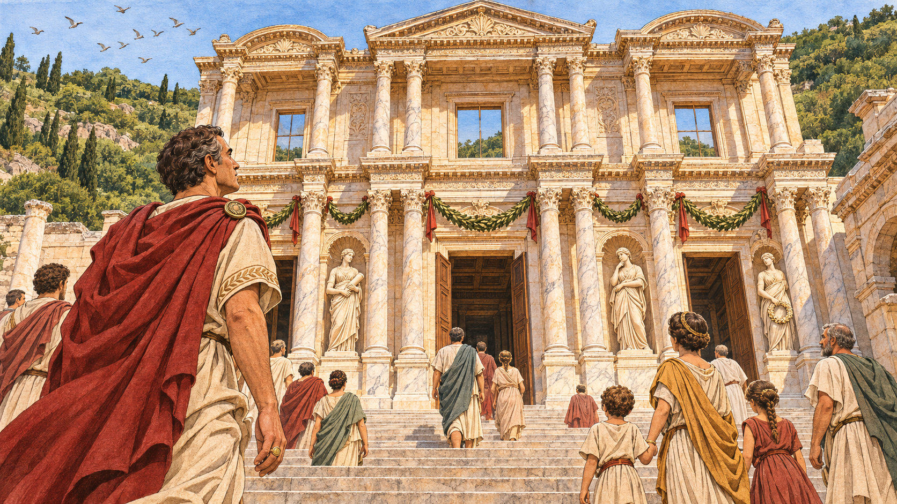 -->
<details><summary>Image Prompt</summary>
(This is Panel 05. Do not include the panel number in the image.)
Style: a hand-drawn travel-sketchbook graphic-novel illustration, with clean dark ink outlines, flat softly shaded color fills and a faint watercolor paper texture, like a page from a traveler's journal; warm, sunlit, painterly lighting; no text, captions, signs, letters or speech bubbles anywhere in the image.
Please generate a 16:9 image depicting panel 5 of 12. Setting: the square before the finished library, Ephesus, about 120 CE, clear morning. Palette: warm limestone, sea-green, deep red, bronze and evening gold. Low-angle shot of the library newly finished and gleaming. The Library of Celsus at Ephesus: a two-story façade of warm cream limestone and marble, with paired Corinthian columns on both levels, a broad flight of steps leading up to three tall doorways, four niches between the lower columns holding draped female statues, three windows on the upper story, and gently curved and triangular pediments crowning the front; the building stands hard against a green hillside. A draped marble woman stands in each of the four lower niches, each in a different calm pose: one holding a scroll, one with an open hand raised, one with a hand at her chin, one holding a wreath. Laurel garlands hang between the columns. In the foreground, Tiberius Julius Aquila, Celsus's son: a man of about forty-five with short dark curly hair graying at the temples, a clean-shaven, thoughtful face with deep-set brown eyes, wearing a cream wool tunic under a deep-red mantle pinned at the shoulder with a bronze brooch, and a heavy gold ring on his left hand; a quiet, determined bearing. Seen from behind, he climbs the broad steps among a small crowd of citizens in tunics and mantles, children by the hand. Other details: open dark wooden doors, a flock of birds overhead. Tone: pride and quiet awe.
Keep every character and place consistent with the other images in this story. Generate the image immediately without asking clarifying questions.
</details>

Four statues stand in the niches of the lower story, each labeled in Greek with a virtue: Sophia (Wisdom), Aretē (Excellence), Ennoia (Thought) and Epistēmē (Knowledge). Statue bases on the steps carry texts in both Greek and Latin naming Celsus and his career, the bilingual voice of a Roman official in a Greek city. The statues a visitor sees today are copies, and the originals are in Vienna. The poses in the picture are imagined.

## Panel 6: Twelve Thousand Scrolls

<!-- 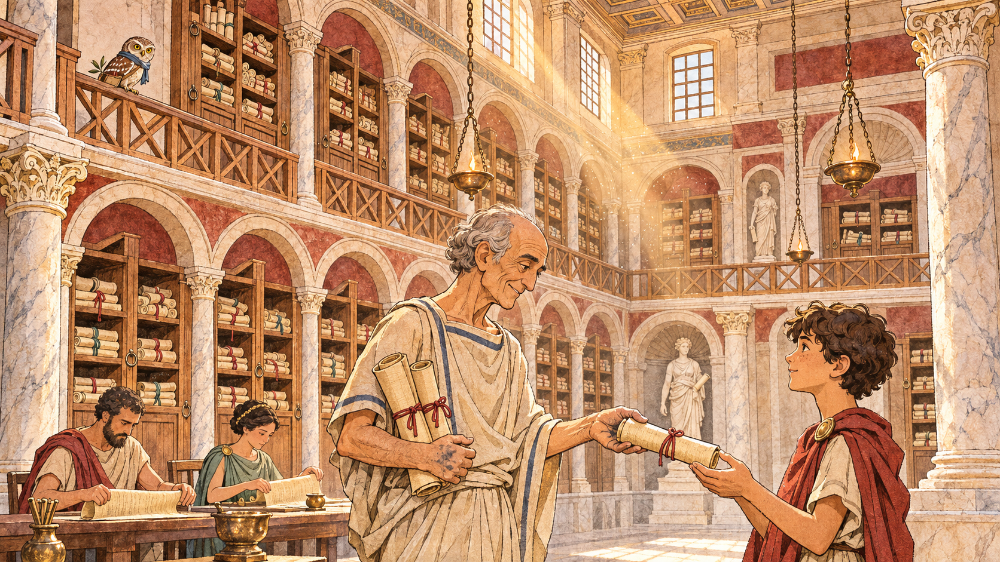 -->
<details><summary>Image Prompt</summary>
(This is Panel 06. Do not include the panel number in the image.)
Style: a hand-drawn travel-sketchbook graphic-novel illustration, with clean dark ink outlines, flat softly shaded color fills and a faint watercolor paper texture, like a page from a traveler's journal; warm, sunlit, painterly lighting; no text, captions, signs, letters or speech bubbles anywhere in the image.
Please generate a 16:9 image depicting panel 6 of 12. Setting: the interior reading room of the Library of Celsus, about 120 CE, soft light from high windows, dust motes. Palette: warm limestone, sea-green, deep red, bronze and evening gold. Wide interior view of one tall hall: the walls are lined with rows of arched niches, each holding a wooden cupboard of rolled scrolls tied with colored cords, on three levels reached by narrow galleries with wooden railings. At a long table two readers unroll papyrus. In the foreground, The librarian of Ephesus: a slim, elderly, clean-shaven Greek man with thin gray hair and ink-stained fingers, wearing a pale linen tunic with a narrow blue border, carrying a few rolled scrolls tied with red cord in the crook of one arm. He hands a scroll to a boy of about twelve. Other details: bronze lamps on chains, a shaft of golden light. Glaux the Little Owl: a true little owl (Athene noctua), small, round and compact, with a flat rounded head and no ear tufts, warm earth-brown plumage with cream spots, bright lemon-yellow eyes under pale cream eyebrows, a cream-white throat patch and a short pale greenish-yellow beak. Glaux wears a small Aegean-blue scarf and a tan canvas satchel across the body with a small leather-bound travel notebook peeking out, and a sprig of three olive leaves tucked into the satchel strap. Alert, curious and warm expression. Glaux is perched on the gallery railing high in the upper left. Glaux is drawn small, perched at the edge of the scene, noticeable on a second look. Tone: hush and curiosity.
Keep every character and place consistent with the other images in this story. Generate the image immediately without asking clarifying questions.
</details>

Inside, the reading room is a single hall with niches in its walls for wooden cupboards that hold the scrolls. A reader asks the librarian for one, reads it on the spot and gives it back. In the ancient world a book is a hand-copied scroll, so a private library of thousands is a mark of great wealth, and here any Ephesian who can read can walk in.

> **Myth or Evidence?** The usual figure of about 12,000 scrolls is a modern estimate from the size and number of the wall niches, not a number from an ancient source. It gives a fair sense of scale, nothing more.

## Panel 7: The Chamber Below

<!-- 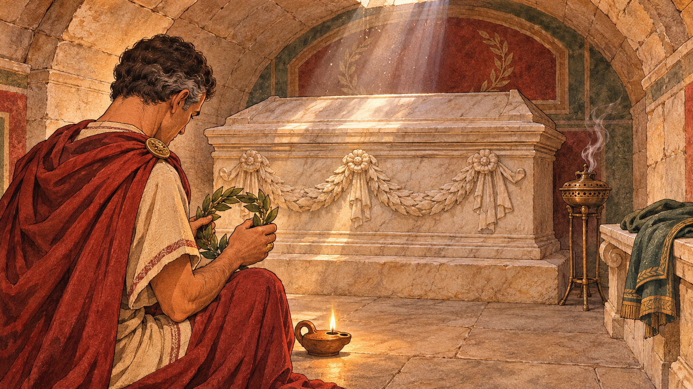 -->
<details><summary>Image Prompt</summary>
(This is Panel 07. Do not include the panel number in the image.)
Style: a hand-drawn travel-sketchbook graphic-novel illustration, with clean dark ink outlines, flat softly shaded color fills and a faint watercolor paper texture, like a page from a traveler's journal; warm, sunlit, painterly lighting; no text, captions, signs, letters or speech bubbles anywhere in the image.
Please generate a 16:9 image depicting panel 7 of 12. Setting: a vaulted burial chamber beneath the reading room, Ephesus, about 120 CE, lit by a single bronze oil lamp. Palette: warm limestone, sea-green, deep red, bronze and evening gold. Medium-wide shot of a white marble sarcophagus carved with garlands and a heavy lid in the center of a small stone-vaulted room, a faint ray of daylight falling across it from above. Foreground: Tiberius Julius Aquila, Celsus's son: a man of about forty-five with short dark curly hair graying at the temples, a clean-shaven, thoughtful face with deep-set brown eyes, wearing a cream wool tunic under a deep-red mantle pinned at the shoulder with a bronze brooch, and a heavy gold ring on his left hand; a quiet, determined bearing. Seen from behind, head bowed, he holds a laurel wreath, a clay lamp at his feet. Other details: smooth cut-stone walls, a swept stone floor, a bronze incense burner, a folded cloak on a stone bench, a little dust sifting down from the ceiling. Tone: reverent, tender, still.
Keep every character and place consistent with the other images in this story. Generate the image immediately without asking clarifying questions.
</details>

Below the reading room, in a chamber of its own, lies the reason for the whole building. Celsus is buried in a marble sarcophagus there, a rare honor, since Romans did not normally bury the dead inside a city. The library is both a public library and a tomb, so every reader who comes to study walks over the governor's resting place. We can imagine Aquila standing here in the quiet, but the scene is a reconstruction, not a record.

## Panel 8: Shoulder to Shoulder

<!-- 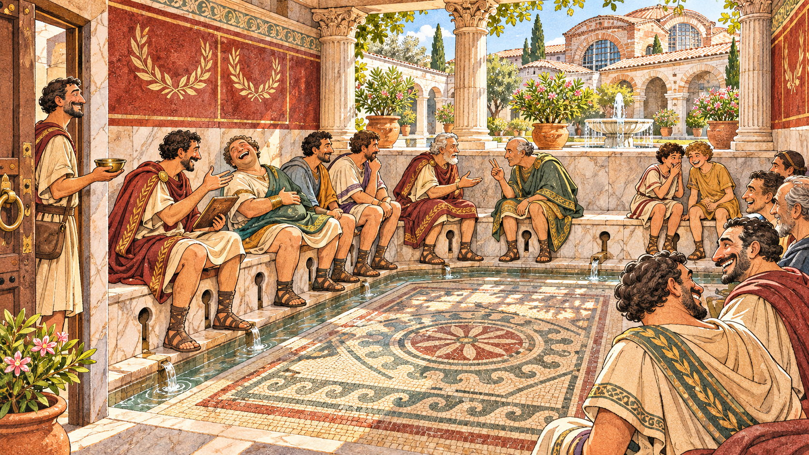 -->
<details><summary>Image Prompt</summary>
(This is Panel 08. Do not include the panel number in the image.)
Style: a hand-drawn travel-sketchbook graphic-novel illustration, with clean dark ink outlines, flat softly shaded color fills and a faint watercolor paper texture, like a page from a traveler's journal; warm, sunlit, painterly lighting; no text, captions, signs, letters or speech bubbles anywhere in the image.
Please generate a 16:9 image depicting panel 8 of 12. Setting: the public latrines beside the Baths of Scholastikia, Ephesus, about 150 CE, bright midday light. Palette: warm limestone, sea-green, deep red, bronze and evening gold. Wide view of a large marble room with long benches along three sides, each bench with a row of keyhole-shaped openings, and a sunny open courtyard in the center with potted shrubs and a small fountain; a shallow channel of clean running water along the floor in front of the benches. About a dozen clothed men in long tunics and draped mantles sit shoulder to shoulder, chatting: one gestures with a wax tablet over a business deal, another laughs, two older men argue calmly, two boys giggle in a corner. Other details: a patterned mosaic floor, a fee collector with a small bowl at the door. Tone: humorous, warm, gently cheeky.
Keep every character and place consistent with the other images in this story. Generate the image immediately without asking clarifying questions.
</details>

A few steps from the library, the city's other kind of public space does a different job. In the public latrines beside the Baths of Scholastikia, built about the end of the 1st century CE, users pay a fee and sit side by side on marble benches, with water running continuously in a channel beneath. There are no partitions, and a visit is as social as a trip to the baths, so business deals and gossip pass from bench to bench.

> **Myth or Evidence?** Guides often say wealthy citizens sent slaves ahead to warm the cold marble seats. We know of no ancient source for this: it looks like a modern joke that hardened into fact. The sponge-on-a-stick story has a few ancient references behind it, but how widely it was used is debated.

## Panel 9: Socrates on the Wall

<!-- 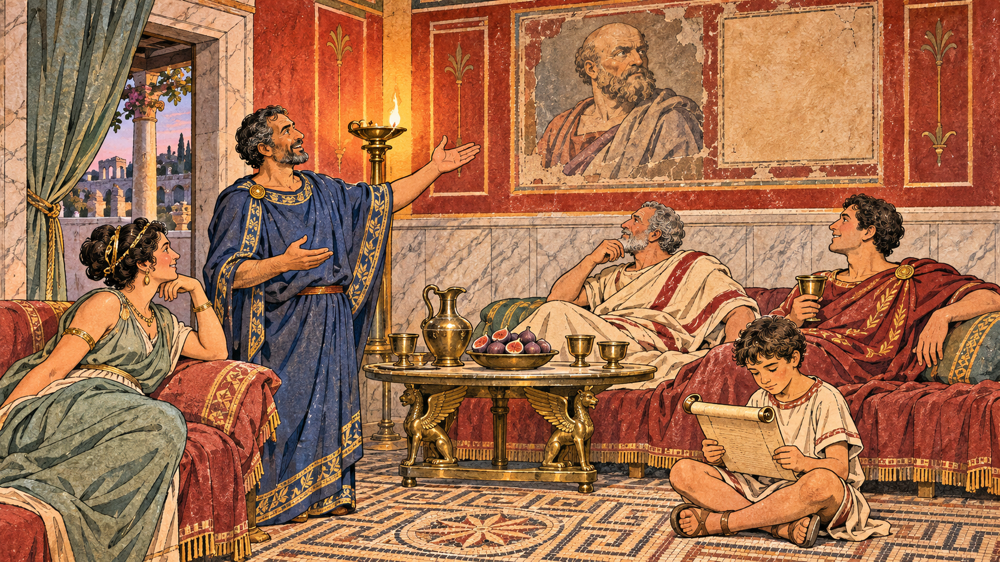 -->
<details><summary>Image Prompt</summary>
(This is Panel 09. Do not include the panel number in the image.)
Style: a hand-drawn travel-sketchbook graphic-novel illustration, with clean dark ink outlines, flat softly shaded color fills and a faint watercolor paper texture, like a page from a traveler's journal; warm, sunlit, painterly lighting; no text, captions, signs, letters or speech bubbles anywhere in the image.
Please generate a 16:9 image depicting panel 9 of 12. Setting: a dining room in a terrace house above Curetes Street, Ephesus, about 150 CE, lamplit evening. Palette: warm limestone, sea-green, deep red, bronze and evening gold. Medium-wide shot of a painted wall in red and ochre panels, and framed on it a fresco portrait of a bald, bearded, snub-nosed philosopher in a worn cloak, with a plain blank strip beside him. Below, three guests recline on couches while the host, a middle-aged man in a rich blue tunic, gestures up at the portrait. A boy of about ten sits on the mosaic floor reading a scroll. Other details: marble wall paneling, an oil lamp on a bronze stand, wine cups and a bowl of figs, a geometric mosaic, a curtain at the doorway. Tone: cultured, convivial, curious.
Keep every character and place consistent with the other images in this story. Generate the image immediately without asking clarifying questions.
</details>

Up the street, wealthy families live in the terrace houses, and their walls tell us what they valued. In one house, excavators found a painted portrait of a bald, bearded man with his name written beside him in Greek: Sokrates. More than four centuries after Socrates died in Athens, the owner wanted the philosopher on the wall where guests would see him. The label also suggests that the owner and his guests could read it, or wanted to be seen as people who could.

## Panel 10: The Sea Walks Away

<!-- 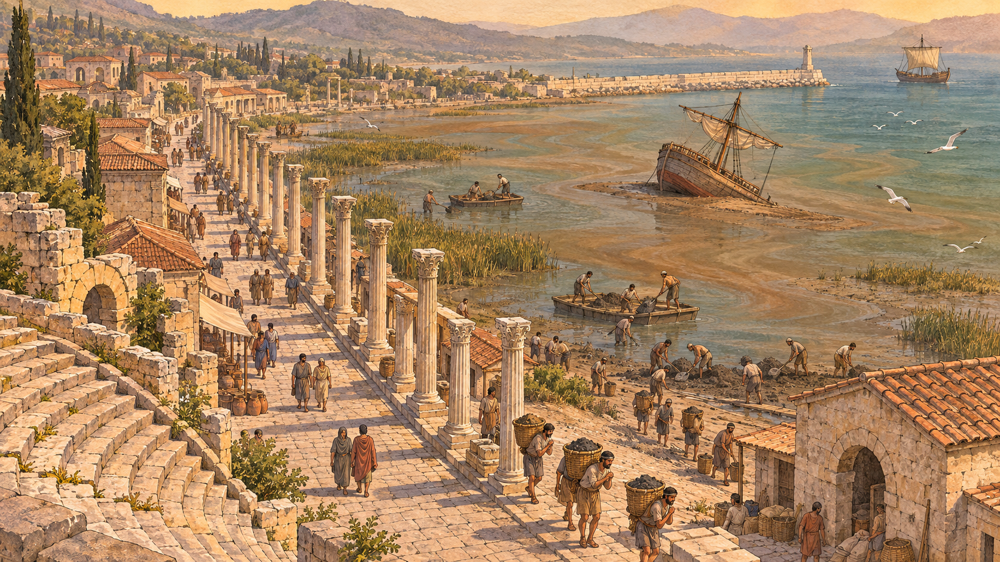 -->
<details><summary>Image Prompt</summary>
(This is Panel 10. Do not include the panel number in the image.)
Style: a hand-drawn travel-sketchbook graphic-novel illustration, with clean dark ink outlines, flat softly shaded color fills and a faint watercolor paper texture, like a page from a traveler's journal; warm, sunlit, painterly lighting; no text, captions, signs, letters or speech bubbles anywhere in the image.
Please generate a 16:9 image depicting panel 10 of 12. Setting: the harbor plain below the Great Theater at Ephesus, centuries after the library was built, about 400 CE, hazy late-afternoon light. Palette: sea-green turning to mud brown, warm limestone, bronze and evening gold. High bird's-eye shot over the colonnaded Harbor Street running toward the water: the harbor basin is shrinking, with brown silt plumes from a river clouding the blue-green water, mudbanks and reeds along the edges, and a merchant ship stuck at an angle on a sandbar. Dredging crews in shallow flat boats and on the shore pile mud into baskets and carry it away in lines. Other details: a long row of columns lining the street, a pale stone breakwater at the harbor mouth, gulls over the mudflats, a small ship waiting for deeper water. Tone: slow, inevitable loss.
Keep every character and place consistent with the other images in this story. Generate the image immediately without asking clarifying questions.
</details>

The trouble with the harbor is already old when Aquila builds. The river we now call the Küçük Menderes carries mud down from the hills every winter and drops it where the current slows, so the coastline creeps west while the city chases it. The geographer Strabo, writing around the time of Jesus, says engineers narrowed the harbor mouth with a breakwater, hoping to deepen it, and trapped the silt inside instead. The Romans dredge again and again, but the silt wins.

## Panel 11: Fire, Earthquake, Grass

<!-- 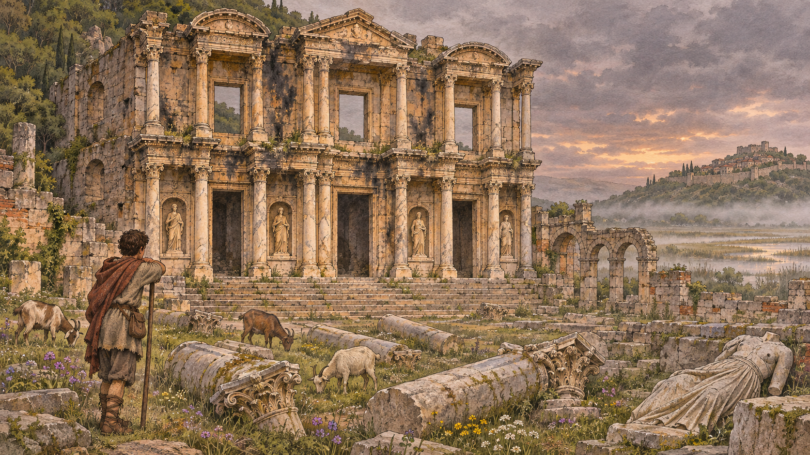 -->
<details><summary>Image Prompt</summary>
(This is Panel 11. Do not include the panel number in the image.)
Style: a hand-drawn travel-sketchbook graphic-novel illustration, with clean dark ink outlines, flat softly shaded color fills and a faint watercolor paper texture, like a page from a traveler's journal; warm, sunlit, painterly lighting; no text, captions, signs, letters or speech bubbles anywhere in the image.
Please generate a 16:9 image depicting panel 11 of 12. Setting: the ruined square at the foot of Curetes Street, many centuries later, about 1000 CE, dim overcast dusk. Palette: faded limestone, sea-green moss, rust, bronze and pale evening gold. Wide shot of the ruins. The Library of Celsus at Ephesus: a two-story façade of warm cream limestone and marble, with paired Corinthian columns on both levels, a broad flight of steps leading up to three tall doorways, four niches between the lower columns holding draped female statues, three windows on the upper story, and gently curved and triangular pediments crowning the front; the building stands hard against a green hillside. It is shown ruined: the tall back wall still stands with empty niches, the front columns lie toppled with their carved capitals half buried in grass, and the stone is blackened by old fire. In the foreground a young shepherd seen from behind leans on a staff while a few goats graze among the fallen column drums. Other details: wildflowers among the blocks, a headless statue lying on its side, a cloud of mist over a marsh beyond where the sea once was, a small walled hill town on a far hill. Tone: elegy, quiet and wide.
Keep every character and place consistent with the other images in this story. Generate the image immediately without asking clarifying questions.
</details>

The library burns in the 3rd century CE, and an earthquake later brings down the façade. The city shrinks, the sea draws away, and by the late Byzantine period the old harbor is a marsh and the people of Ephesus have moved up to the hill of Ayasuluk, where Selçuk stands today. The great marble front lies in pieces among the grass, with goats grazing where readers once climbed the steps. A library that outlived its owner has outlived its city as well.

## Panel 12: Put Back Together

<!-- 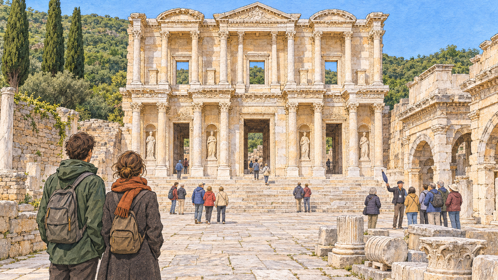 -->
<details><summary>Image Prompt</summary>
(This is Panel 12. Do not include the panel number in the image.)
Style: a hand-drawn travel-sketchbook graphic-novel illustration, with clean dark ink outlines, flat softly shaded color fills and a faint watercolor paper texture, like a page from a traveler's journal; warm, sunlit, painterly lighting; no text, captions, signs, letters or speech bubbles anywhere in the image.
Please generate a 16:9 image depicting panel 12 of 12. Setting: the marble-paved square at the foot of Curetes Street in Ephesus today, a bright November morning, matching the viewpoint of panel 1. Palette: natural daylight, with warm limestone, sea-green and sky blue. Wide shot from the square toward the library. The Library of Celsus at Ephesus: a two-story façade of warm cream limestone and marble, with paired Corinthian columns on both levels, a broad flight of steps leading up to three tall doorways, four niches between the lower columns holding draped female statues, three windows on the upper story, and gently curved and triangular pediments crowning the front; the building stands hard against a green hillside. It is shown rebuilt and complete, with slightly paler new stone patched among the older weathered blocks, and the green hillside behind it. In the middle distance: Two adult travelers seen from behind or in distant three-quarter view, dressed for cool November weather: one in a dark green rain jacket, the other in a charcoal wool coat with a rust-colored scarf, both with small daypacks, standing close together and looking at the view. Faces are never shown in detail. Other details: small groups of tourists in jackets, a guide holding up a closed umbrella, scattered column drums waiting by the paving, a low stone wall, clear blue sky. Tone: wonder and quiet reflection.
Keep every character and place consistent with the other images in this story. Generate the image immediately without asking clarifying questions.
</details>

Between 1970 and 1978, Austrian archaeologists re-erect the façade from its fallen pieces, one of the great reconstructions of the 20th century. Today we stand where Aquila stood and look up at the same four niches, though the statues in them are copies and the originals sit in Vienna. The sea is still out of sight. The library has returned, and so has a question the building asks of every visitor: how much of what we see is old, and how much is put back?

### Epilogue - What the Library Shows

A son's grief became a gift to a whole city, and the gift outlived the donor, the harbor and nearly the building. The library worked as a reading room for readers who could never have afforded the scrolls, and its endowment of 25,000 denarii shows how seriously Aquila took the job of keeping it going. Yet the story is also honest about limits: a library only helps those who can read and can reach the door, and in Roman Ephesus most people probably could not read at all.

| Challenge | How They Responded | Lesson for Today |
|---|---|---|
| A father's death | His son built a public library as the monument, with the tomb below the reading room | The best memorials keep serving the living |
| Books were rare and costly | Aquila's will paid for a building, books and upkeep, about 25,000 denarii | Making knowledge shared takes money, not just buildings |
| A harbor filling with silt | The Romans dredged again and again; in the end the city moved uphill | Repairs alone cannot beat a slow force that keeps arriving |
| A façade lying in pieces | Archaeologists re-erected it from the fallen blocks, 1970-1978 | Ask what is original and what is rebuilt |

### Call to Action

Standing in the square below the library, count the niches, find the copies of the four virtues, and then turn around and try to picture the sea. A gift of knowledge reaches only as far as the means to use it: literacy and the walk to the reading room then, a device, a connection and a reading level now, which is the question the companion textbook AI-Native Schools asks. Ask who is still outside the door.

---

## Voices from the Sources

- *Sophia, Aretē, Ennoia, Epistēmē.* The four Greek labels (Wisdom, Excellence, Thought, Knowledge) that identified the statues in the façade niches. This is documented: they are the actual words attached to the statues.
- *"The things to be seen."* The Greek word *theamata* gave us the list we call the Seven Wonders, which began as a sightseer's list. In the 2nd century BCE the poet Antipater of Sidon wrote that after seeing the other wonders, he found the Temple of Artemis at Ephesus put them in the shade (paraphrased; this is the poet's judgment, as the chapter reports it).
- *Strabo on the harbor.* The geographer reports that engineers narrowed the harbor mouth to deepen it and instead trapped silt inside. This is a paraphrase of the chapter's account, not a direct quotation. No words of Celsus or Aquila survive in our sources, so none are invented here.

## On the Trip

- **Chapter:** [10. Day 7: Ephesus, a Greco-Roman City](../../chapters/10-ephesus-greco-roman-city/index.md)
- **Where to look:** the library façade and its four niches (copies of the virtue statues); the public latrines beside the Baths of Scholastikia; Curetes Street running down to the library square; and the Harbor Street that now ends in fields. The terrace houses need a separate ticket and hold the frescoes and mosaics.
- **Explore further:** [One Walk, Seven Centuries](../../sims/ephesus-walk-timeline/index.md) and [Documented, Debated, or Tradition?](../../sims/ephesus-sites-evidence-judge/index.md).
- **Look Closer:** "Look closer at the library's four niches, and at the stone around them: some blocks are paler because they are new." Glaux hid in panel 6, perched on the gallery railing high in the upper left of the reading room.

## Characters and Style

This story follows the shared series bible: [Story Characters, Places and House Style](../characters.md). Glaux's identity comes from the mascot's [character sheet](../../img/mascot/character-sheet.md).

## References

1. [Library of Celsus - Wikipedia](https://en.wikipedia.org/wiki/Library_of_Celsus): the building, its façade, its burial chamber and its reconstruction.
2. [Ephesus - Wikipedia](https://en.wikipedia.org/wiki/Ephesus): history of the city and its moves as the harbor silted up.
3. [Tiberius Julius Celsus Polemaeanus - Wikipedia](https://en.wikipedia.org/wiki/Tiberius_Julius_Celsus_Polemaeanus): the consul and governor whom the library commemorates.
4. [Ephesus - UNESCO World Heritage Centre](https://whc.unesco.org/en/list/1018): the official description of the World Heritage site.
5. [Ephesus - Encyclopaedia Britannica](https://www.britannica.com/place/Ephesus): an overview of the ancient city.
