# The Man Who Asked Too Many Questions

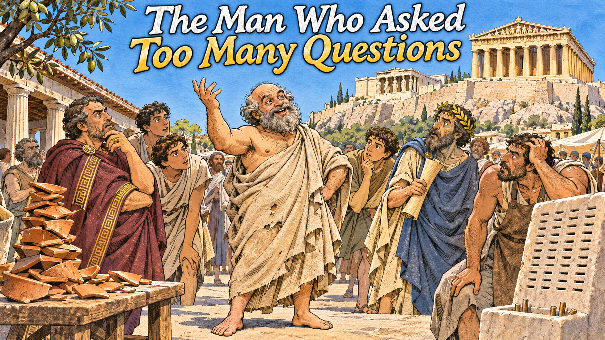
<details>
<summary>Cover Image Prompt</summary>
(This is the Cover Image. Do not include this label in the image.)
Style: a hand-drawn travel-sketchbook graphic-novel illustration, with clean dark ink outlines, flat softly shaded color fills and a faint watercolor paper texture, like a page from a traveler's journal; warm, sunlit, painterly lighting; no text, captions, signs, letters or speech bubbles anywhere in the image.
Please generate a wide-landscape 16:9 cover image for a graphic-novel story. The one exception to the no-text rule is the title: render the words "The Man Who Asked Too Many Questions" as bold, hand-lettered title text across the upper third, in marble white and honey gold with a thin dark outline, spelled exactly as written and broken over two lines. Place: the Agora of Athens, about 400 BCE, a bright late-morning light. In the center foreground, one arm raised and a teasing smile on his face, stands: Socrates, Athenian philosopher: a short, stocky man of about sixty with a bald, broad forehead, a wide flat nose, a thick gray beard and bright, amused eyes, barefoot, wearing a plain, worn, undyed wool himation and no jewelry; a curious, teasing expression. Around him, a half circle of startled citizens: a stiff politician with a gold ring, a poet with a scroll, a sweating craftsman, and a few young men leaning in. Behind them, filling the sky: The Acropolis of Athens: a steep, flat-topped, pale limestone rock rising above the city, crowned by the Parthenon, a long Doric temple of honey-colored marble with eight columns across the front, a low triangular pediment and a long carved frieze under the roof; to its left stands the smaller Erechtheion with its porch of six marble maidens. The sky behind is clear blue. A tall stack of broken pottery shards stands on a table at left and a stone slab with slots (a kleroterion) stands at right. Palette: marble white, Aegean blue, olive green, honey gold, bronze. Tone: bright, mischievous, with a hint of unease.
Keep every character and place consistent with the other images in this story. Generate the image immediately without asking clarifying questions.
</details>

<details>
<summary>Narrative Prompt</summary>
**Era and place.** The Agora and Pnyx of Athens, and the sanctuary at Delphi in one flashback, spanning the 470s BCE to 399 BCE. The last panel is modern.

**Theme.** A democracy that governed itself in person, picking officials by lot and voting exile on pieces of broken pottery, and the philosopher who treated every answer as the beginning of a question. The story shows how Athenian democracy worked, what the evidence of ready-made ostraka suggests about who could write, why an oracle's answer sent Socrates into the marketplace, and how a frightened city, just out of war and tyranny, put him on trial.

**Series house style.** Hand-drawn travel-sketchbook graphic-novel illustration with clean dark ink outlines, flat softly shaded fills and faint watercolor paper texture. No lettering inside any panel; only the cover carries the title. All images are 16:9.

**Story palette.** Classical Greece: marble white, Aegean blue, olive green, honey gold, bronze. The modern final panel uses natural daylight, whitewashed walls, sea blue, terracotta and olive.

**Restraint rule.** The trial and the hemlock are shown by symbols and aftermath only: a crowded court seen from a distance, bronze ballots, a cup on a table, an empty chair, friends seen from behind, lamplight. No death, body, struggle or poison scene is ever drawn.

**Creative liberties and uncertainties.**

- The chapter says the jury was about 500 citizens; the story follows the chapter. The count of 280 to 220 is an inference from Plato's report that a swing of 30 votes would have acquitted him.
- The three examples (a politician, poets and craftsmen) come from Socrates' own account in Plato's *Apology*. The politician, the poet and the craftsman are unnamed composites and look the way the illustrator imagines them.
- Chaerephon is a historical person, but nobody recorded how he looked. His drawn appearance is invented. Plato's Socrates calls him impulsive and says he had died before the trial.
- What the Pythia said to Chaerephon differs in each ancient source (Plato, Xenophon, and a late verse quoted by Diogenes Laertius); the story follows Plato.
- The "Prison of Socrates" shown to visitors on Philopappos Hill is a modern tradition with no ancient evidence, so the final scenes show an unspecified room; the chapter notes that a building at the Agora's southwest corner is a possible candidate.
- Panels span different years: Pericles appears in the 440s BCE, Themistocles in the 470s BCE, and Socrates in the 410s to 399 BCE. His age varies slightly from panel to panel.

**Cast.** Recurring characters, places and objects follow the shared series bible at `docs/stories/characters.md`; Glaux follows `docs/img/mascot/character-sheet.md`.

- Glaux the Little Owl: see docs/stories/characters.md and docs/img/mascot/character-sheet.md (Glaux). Glaux hides in one panel (Panel 3).
- Socrates: see docs/stories/characters.md.
- Themistocles: see docs/stories/characters.md.
- Pericles (cameo): see docs/stories/characters.md.
- The Pythia: see docs/stories/characters.md.
- The Acropolis of Athens and the Parthenon, Delphi, the Owl Coin and the Travelers: see docs/stories/characters.md.

Characters who appear only in this story:

Chaerephon:

```text
Chaerephon, Socrates' devoted friend: a lean, restless man of about forty with untidy dark curly hair, a short scruffy beard and quick, eager eyes, wearing a plain cream chiton and a faded blue-gray traveling cloak, dusty sandals and a straw hat hanging by its cord down his back; impatient and impulsive, always half-leaning forward.
```

The politician:

```text
A prominent Athenian politician (an unnamed composite): a handsome, self-assured man of about fifty with a carefully curled gray beard, wearing an expensive white himation with a purple border and a gold ring, carrying a polished walking stick, chest out and chin raised, flanked by two admiring young followers.
```

The poet:

```text
An Athenian poet (an unnamed composite): a dreamy man of about forty with long curly hair bound by a thin ribbon and a short beard, wearing a saffron-yellow chiton and a light-blue himation, holding a papyrus scroll in one hand and gesturing grandly with the other, eyes half closed.
```

The craftsman:

```text
An Athenian coin-maker (an unnamed composite): a sturdy, soot-smudged man of about fifty with short gray hair and thick forearms, wearing a leather apron over a short rust-brown tunic, holding small iron tongs in one hand and a freshly struck silver coin in the other; proud, steady and open-faced.
```
</details>

### Prologue - The Marketplace That Ran a Government

In Athens the marketplace was also the government's office block, the courthouse and the town newspaper. Citizens picked officials by raffle, voted exile on broken pottery, and listened to speakers timed by dripping water. In this crowded square a short, barefoot man with a flat nose stopped anyone who looked wise and asked them what they meant. An oracle had told his friend that no one was wiser than he, and he set out to prove the god wrong, a project that took the rest of his life.

**Find Glaux:** Glaux hides in one panel of this story. Can you spot the little owl?

## Panel 1: The Square Wakes Up
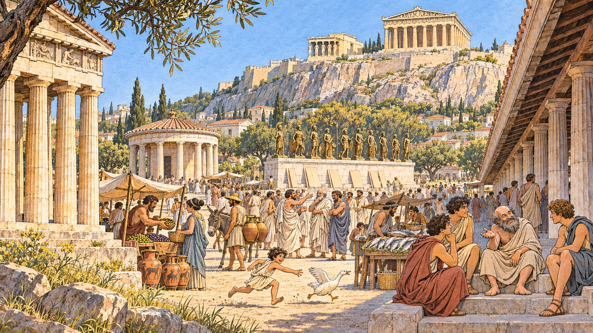
<details><summary>Image Prompt</summary>
(This is Panel 01. Do not include the panel number in the image.)
I am about to ask you to generate a series of images for a graphic novel. Please make the images have a consistent style and consistent characters. Do not ask any clarifying questions. Just generate the image immediately when asked.
Style: a hand-drawn travel-sketchbook graphic-novel illustration, with clean dark ink outlines, flat softly shaded color fills and a faint watercolor paper texture, like a page from a traveler's journal; warm, sunlit, painterly lighting; no text, captions, signs, letters or speech bubbles anywhere in the image.
Please generate a 16:9 image depicting panel 1 of 14. Wide establishing shot from the slope of Agoraios Kolonos hill, in front of the Temple of Hephaestus at the left edge, looking east across the open square of the Agora of Athens to the Acropolis, about 430 BCE, a clear early morning with long golden light. Palette: marble white, Aegean blue, olive green, honey gold, bronze. Behind the square rises The Acropolis of Athens: a steep, flat-topped, pale limestone rock rising above the city, crowned by the Parthenon, a long Doric temple of honey-colored marble with eight columns across the front, a low triangular pediment and a long carved frieze under the roof; to its left stands the smaller Erechtheion with its porch of six marble maidens. The sky behind is clear blue. In the shade of the long stoa at the right, small but identifiable, a short man sits on the step among three young men: Socrates, Athenian philosopher: a short, stocky man of about sixty with a bald, broad forehead, a wide flat nose, a thick gray beard and bright, amused eyes, barefoot, wearing a plain, worn, undyed wool himation and no jewelry; a curious, teasing expression. Visible details: market stalls heaped with olives, pottery and fish; a donkey with water jars; a long base carrying ten bronze statues in a row, with pale unmarked wooden boards propped against it; the round Tholos roof at the south; a boy chasing a goose; clusters of men in white himations arguing in the sun. Tone: lively, busy and a little noisy, with a promise of something stirring.
Keep every character and place consistent with the other images in this story. Generate the image immediately without asking clarifying questions.
</details>

On a morning in the 430s BCE the Athenian Agora wakes up as shop, courthouse and government office at once. Along the west side stand the offices of the democracy: the archive, the council hall, the round dining hall of the councillors on duty. The public notices go up on the long monument of the ten tribal heroes, so this is where an Athenian reads the news. In the shade of a stoa, a short man in a worn cloak is already talking to anyone who sits down.

## Panel 2: The Raffle Machine
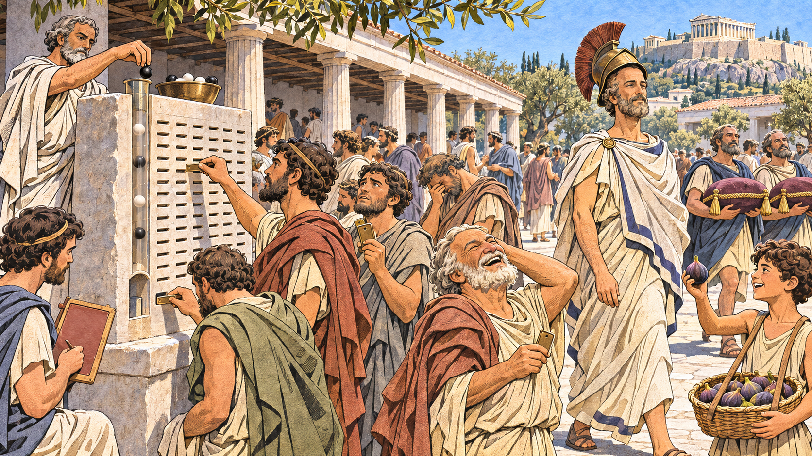
<details><summary>Image Prompt</summary>
(This is Panel 02. Do not include the panel number in the image.)
Style: a hand-drawn travel-sketchbook graphic-novel illustration, with clean dark ink outlines, flat softly shaded color fills and a faint watercolor paper texture, like a page from a traveler's journal; warm, sunlit, painterly lighting; no text, captions, signs, letters or speech bubbles anywhere in the image.
Please generate a 16:9 image depicting panel 2 of 14. Medium-wide shot in the Agora of Athens, about 440 BCE, mid-morning with bright sunlight. Palette: marble white, Aegean blue, olive green, honey gold, bronze. At left stands a tall rectangular stone slab pierced by rows of narrow slots (an allotment machine, the kleroterion) with a tube running down one side; a magistrate in a white himation drops black and white balls down the tube, and each ball decides whether a whole row of men will serve today. In front of it, a crowd of citizens in cloaks hold small bronze identity tickets, some pushing them into the slots, some waiting anxiously, a few looking disappointed as they are sent home. In the right background, striding past without waiting because he is an elected general rather than chosen by lot, is this man: Pericles, Athenian leader: a dignified man of about fifty-five with an unusually tall, long head, usually shown wearing a crested bronze helmet pushed back on his head, a trimmed gray-brown beard and a calm, commanding expression, dressed in a white himation with a dark-blue border draped over a cream chiton. Visible details: a bronze ticket flashing in the sun; a clerk holding a wax tablet with no writing; a boy selling figs; an old man laughing at his own bad luck; two councilmen carrying cushions; the Stoa's shaded colonnade behind. Tone: tense, comic, and fair.
Keep every character and place consistent with the other images in this story. Generate the image immediately without asking clarifying questions.
</details>

The Athenians did not trust elections. A stone slab with rows of slots, the *kleroterion*, picked jurors and council members at random: each man pushed his bronze identity ticket into a slot, and black and white balls dropped down a tube settled whole rows of men at a time. Voting favored the rich, the famous and the good speakers, so the lot gave every citizen the same chance. The main exception was the ten generals, who were elected because war needed skill, and that is how Pericles could be chosen year after year.

## Panel 3: Six Minutes by the Water Clock
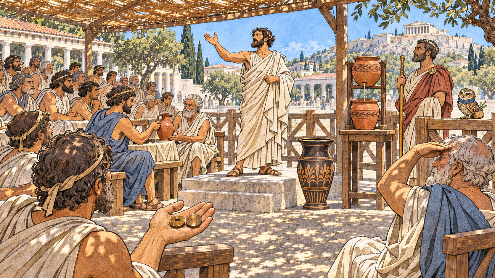
<details><summary>Image Prompt</summary>
(This is Panel 03. Do not include the panel number in the image.)
Style: a hand-drawn travel-sketchbook graphic-novel illustration, with clean dark ink outlines, flat softly shaded color fills and a faint watercolor paper texture, like a page from a traveler's journal; warm, sunlit, painterly lighting; no text, captions, signs, letters or speech bubbles anywhere in the image.
Please generate a 16:9 image depicting panel 3 of 14. Medium-wide shot at the edge of a fenced open-air court in the Athenian Agora, about 410 BCE, hot mid-day light dappled by a brushwood awning. Palette: marble white, Aegean blue, olive green, honey gold, bronze. In the center a citizen speaker in a white himation stands on a low stone platform, one hand raised, addressing rows of seated jurors on wooden benches. On a stand beside him sits a water clock: two clay pots, the upper one trickling a thin thread of water into the lower, watched by a court official with a staff. Visible details: two bronze ballot discs, one hollow-axled and one solid, in the palm of a juror; a tall urn waiting for ballots; an official with a wooden staff; a juror shading his eyes with his hand; a water jug passed along a bench; sunlight through the awning. Glaux the Little Owl: a true little owl (Athene noctua), small, round and compact, with a flat rounded head and no ear tufts, warm earth-brown plumage with cream spots, bright lemon-yellow eyes under pale cream eyebrows, a cream-white throat patch and a short pale greenish-yellow beak. Glaux wears a small Aegean-blue scarf and a tan canvas satchel across the body with a small leather-bound travel notebook peeking out, and a sprig of three olive leaves tucked into the satchel strap. Alert, curious and warm expression. Glaux is drawn small, perched at the edge of the scene, noticeable on a second look: perched on the wooden fence rail near the water clock. Only one owl appears in this image. Tone: orderly, tense, fair.
Keep every character and place consistent with the other images in this story. Generate the image immediately without asking clarifying questions.
</details>

Courts needed discipline, and the Athenians solved it with water. A water clock, two clay pots where water ran from one to the other, timed each speaker, about six minutes per filling. Juries of hundreds were chosen by lot on the morning of the trial and decided cases by secret ballot, using small bronze discs: a hollow-axled one for guilty, a solid one for not guilty. These are the things in the museum in the rebuilt Stoa of Attalos that turn the bare foundations of the Agora back into a working government.

## Panel 4: A Name on a Broken Pot
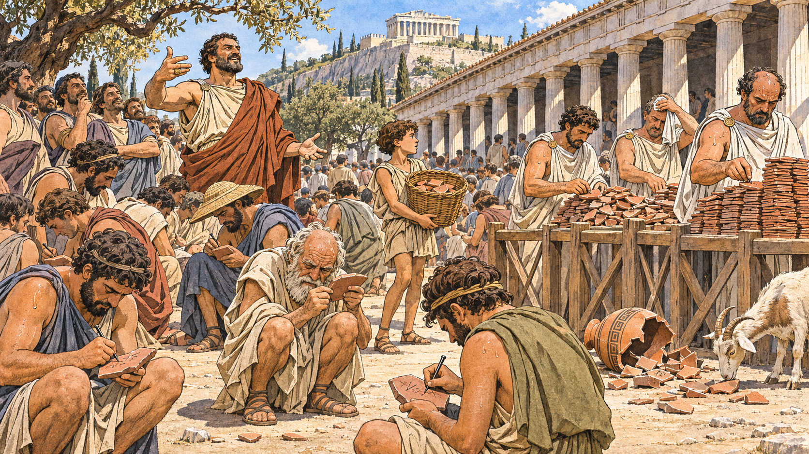
<details><summary>Image Prompt</summary>
(This is Panel 04. Do not include the panel number in the image.)
Style: a hand-drawn travel-sketchbook graphic-novel illustration, with clean dark ink outlines, flat softly shaded color fills and a faint watercolor paper texture, like a page from a traveler's journal; warm, sunlit, painterly lighting; no text, captions, signs, letters or speech bubbles anywhere in the image.
Please generate a 16:9 image depicting panel 4 of 14. Medium-wide shot in the open square of the Agora of Athens, about 472 BCE, a bright, dusty afternoon. Palette: marble white, Aegean blue, olive green, honey gold, bronze. A crowd of citizens crouches and squats on the ground in small groups, each man scratching a few marks (unreadable scribbles) with a nail or stylus onto a broken piece of pottery, an ostrakon. At right, officials in white himations stand at wooden barriers beside tall heaps of sherds, sorting them into piles by hand. A broken amphora lies shattered at the edge as the source of more ballots. In the background stands a man at the edge of the crowd, mid-gesture, confident and unaware: Themistocles, Athenian statesman and admiral: a stocky, energetic man of about forty-five with a short dark curly beard, sharp dark eyes and a weathered, tanned face, wearing a plain cream chiton and a rust-brown himation draped over one shoulder, a bronze signet ring on his right hand; confident, restless, always mid-gesture. Visible details: potsherds stacked into a tall neat pile; a boy carrying a basket of shards; an old man peering at his shard with a squint; a stoa with long shadows; a goat nosing at a sherd; sweating officials. Tone: expectant, a little ominous, with the casual cruelty of a crowd.
Keep every character and place consistent with the other images in this story. Generate the image immediately without asking clarifying questions.
</details>

Once a year the Assembly could vote on whether to hold an ostracism, a way of sending a leading politician into exile for ten years without a trial or any crime being charged. If it said yes, citizens gathered in the Agora weeks later and each scratched a name on an *ostrakon*, a broken piece of pottery, the scrap paper of the ancient world. If at least 6,000 votes were cast, the man with the most had ten days to leave Athens; he kept his property and his citizenship and could return after ten years. Themistocles, the victor of Salamis, was ostracized in the 470s BCE.

> **Myth or Evidence?** Plutarch, writing about 600 years later, tells a story about the exile of Aristides, nicknamed "the Just": an illiterate countryman who did not recognize him asked him to write "Aristides" on a potsherd, because he was tired of hearing him called "the Just." Aristides wrote his own name. A story that late is a story. The ostraka themselves, however, are real evidence.

## Panel 5: Ballots Ready-Made
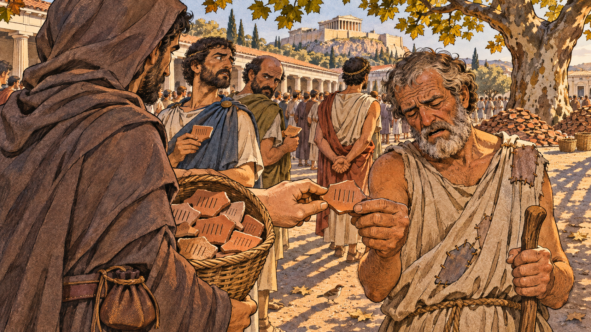
<details><summary>Image Prompt</summary>
(This is Panel 05. Do not include the panel number in the image.)
Style: a hand-drawn travel-sketchbook graphic-novel illustration, with clean dark ink outlines, flat softly shaded color fills and a faint watercolor paper texture, like a page from a traveler's journal; warm, sunlit, painterly lighting; no text, captions, signs, letters or speech bubbles anywhere in the image.
Please generate a 16:9 image depicting panel 5 of 14. Close over-the-shoulder shot at the edge of the voting crowd in the Agora of Athens, about 472 BCE, late afternoon with long amber shadows. Palette: marble white, olive green, honey gold, bronze, dusk blue. In the foreground, seen from behind, a shrewd man in a plain hooded cloak holds a basket of broken-pottery shards, each marked with the same neat row of scratched lines (a pattern of strokes, not readable letters), and hands one to an older farmer in a patched tunic who stands blinking at it, unable to read. Behind them two more men hold identical shards and look around uneasily. Visible details: a farmer's calloused thumb and forefinger holding the sherd; a leather pouch on the hooded man's belt; another man waiting in line with his hands behind his back; broken pottery heaps in the distance; the long shadow of a plane tree; a sparrow on the ground. Tone: furtive, quietly troubling, a little sad.
Keep every character and place consistent with the other images in this story. Generate the image immediately without asking clarifying questions.
</details>

In a well on the north slope of the Acropolis, archaeologists found about 190 ostraka with the name of Themistocles, written by only a few different hands: ready-made ballots, apparently prepared for voters and never used. Two things follow. Someone was organizing a campaign against him, and some voters needed a ballot already written, because they could not write the name themselves. A democracy that voted in writing quietly assumed a literacy that not every citizen had.

## Panel 6: A Friend Climbs to Delphi
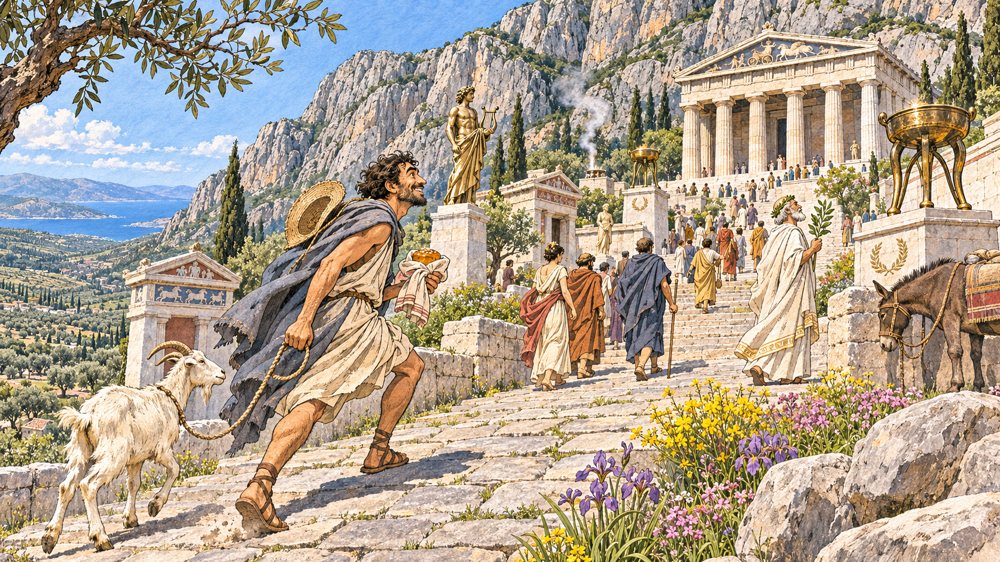
<details><summary>Image Prompt</summary>
(This is Panel 06. Do not include the panel number in the image.)
Style: a hand-drawn travel-sketchbook graphic-novel illustration, with clean dark ink outlines, flat softly shaded color fills and a faint watercolor paper texture, like a page from a traveler's journal; warm, sunlit, painterly lighting; no text, captions, signs, letters or speech bubbles anywhere in the image.
Please generate a 16:9 image depicting panel 6 of 14. Wide shot from below, at Delphi, about 430 BCE, bright spring midday with strong light on the cliffs. Palette: marble white, Aegean blue, olive green, honey gold, bronze. In the middle distance, climbing the paved path with a white goat on a rope and a small honey cake in a cloth, an eager traveler: Chaerephon, Socrates' devoted friend: a lean, restless man of about forty with untidy dark curly hair, a short scruffy beard and quick, eager eyes, wearing a plain cream chiton and a faded blue-gray traveling cloak, dusty sandals and a straw hat hanging by its cord down his back; impatient and impulsive, always half-leaning forward. Behind him spreads the setting: Delphi, the sanctuary of Apollo: a steep rocky terrace on the slope of Mount Parnassus with a paved winding Sacred Way lined with small treasuries and statues, leading up to the large Doric Temple of Apollo with six columns across the front; behind it steep gray limestone cliffs, below it a deep valley of silver-green olive trees stretching to a distant sea. Visible details: a procession of other pilgrims in cloaks; bronze tripods gleaming on tall bases; a priest in a white robe carrying a laurel branch; a mule resting by the wall; a thin curl of altar smoke; bright spring wildflowers at the roadside. Tone: eager, exuberant, a little reckless.
Keep every character and place consistent with the other images in this story. Generate the image immediately without asking clarifying questions.
</details>

Socrates' friend Chaerephon, a man Plato's Socrates calls impulsive in everything he did, makes the long journey to Delphi. His question is simple and brash: is anyone wiser than Socrates? We know of this only because Socrates himself told it, years later, in his defense speech at his trial, as his student Plato wrote it down in the *Apology*. By then, Socrates says, Chaerephon was dead.

## Panel 7: The Answer
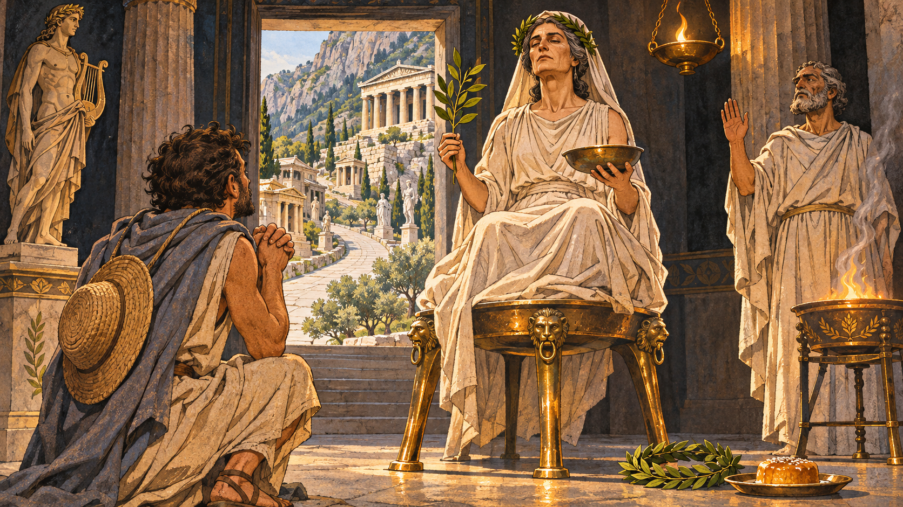
<details><summary>Image Prompt</summary>
(This is Panel 07. Do not include the panel number in the image.)
Style: a hand-drawn travel-sketchbook graphic-novel illustration, with clean dark ink outlines, flat softly shaded color fills and a faint watercolor paper texture, like a page from a traveler's journal; warm, sunlit, painterly lighting; no text, captions, signs, letters or speech bubbles anywhere in the image.
Please generate a 16:9 image depicting panel 7 of 14. Interior medium shot, slightly low angle, the lamp-lit inner chamber of the Temple of Apollo at Delphi, about 430 BCE, golden lamplight and deep shadow. Palette: marble white, bronze, honey gold, olive green, shadow blue. In the center, calm and still, seated on a tall bronze three-legged tripod, speaking: The Pythia, Apollo's priestess at Delphi: a dignified woman of about fifty with gray-streaked dark hair under a simple white veil, wearing a plain long white linen gown with a wreath of laurel leaves in her hair, holding a laurel branch in one hand and a shallow bronze offering bowl in the other. Her expression is calm, inward and serious. In the foreground, seen from behind, kneels this man: Chaerephon, Socrates' devoted friend: a lean, restless man of about forty with untidy dark curly hair, a short scruffy beard and quick, eager eyes, wearing a plain cream chiton and a faded blue-gray traveling cloak, dusty sandals and a straw hat hanging by its cord down his back; impatient and impulsive, always half-leaning forward. The setting is Delphi: Delphi, the sanctuary of Apollo: a steep rocky terrace on the slope of Mount Parnassus with a paved winding Sacred Way lined with small treasuries and statues, leading up to the large Doric Temple of Apollo with six columns across the front; behind it steep gray limestone cliffs, below it a deep valley of silver-green olive trees stretching to a distant sea. (Show it only as a pale bright doorway at the far end.) Visible details: a white-robed prophet standing at the tripod's side with his palm raised; a lit bronze hearth with a thread of smoke; a laurel wreath on the floor; a small honey cake on a bronze plate; Chaerephon's clasped hands; lamplight glinting on the tripod legs. Tone: hushed, solemn, expectant.
Keep every character and place consistent with the other images in this story. Generate the image immediately without asking clarifying questions.
</details>

The Pythia answers that no one is wiser. In Plato's account, that is the whole of it. Notice what kind of answer it is: not a prediction, but a claim that could be tested.

> **Myth or Evidence?** The three ancient sources disagree. Plato says the god said no one was wiser; Xenophon says no one was more free, more just or more sensible; a late verse quoted by Diogenes Laertius, about 600 years later and widely thought to be an invention, says Sophocles is wise, Euripides wiser, and Socrates wisest of all. Some scholars have wondered whether the whole episode is Plato's literary device. Most accept that Chaerephon asked something and got a flattering answer.

## Panel 8: Baffled
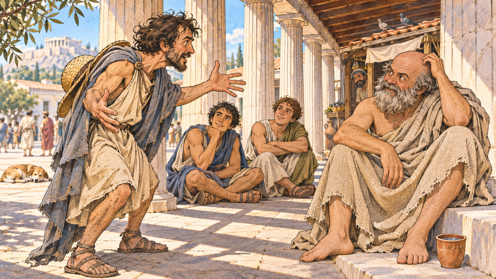
<details><summary>Image Prompt</summary>
(This is Panel 08. Do not include the panel number in the image.)
Style: a hand-drawn travel-sketchbook graphic-novel illustration, with clean dark ink outlines, flat softly shaded color fills and a faint watercolor paper texture, like a page from a traveler's journal; warm, sunlit, painterly lighting; no text, captions, signs, letters or speech bubbles anywhere in the image.
Please generate a 16:9 image depicting panel 8 of 14. Medium shot in the shaded colonnade of the Stoa of Zeus Eleutherios in the Agora of Athens, about 428 BCE, mid-afternoon, with warm light slanting between the columns. Palette: marble white, Aegean blue, olive green, honey gold, bronze. At left, caught mid-sentence with arms spread wide, still dusty from the road: Chaerephon, Socrates' devoted friend: a lean, restless man of about forty with untidy dark curly hair, a short scruffy beard and quick, eager eyes, wearing a plain cream chiton and a faded blue-gray traveling cloak, dusty sandals and a straw hat hanging by its cord down his back; impatient and impulsive, always half-leaning forward. At right, sitting on the stone step with a hand scratching his bald head and a puzzled, amused frown, listening: Socrates, Athenian philosopher: a short, stocky man of about sixty with a bald, broad forehead, a wide flat nose, a thick gray beard and bright, amused eyes, barefoot, wearing a plain, worn, undyed wool himation and no jewelry; a curious, teasing expression. Visible details: two young men sitting cross-legged, leaning in; a shopkeeper peeking out between columns; a stray dog asleep in the sun; a clay cup of water at Socrates' feet; the colonnade's long shadows; pigeons on the roof tiles; the Acropolis blurred in the distance. Tone: amused, puzzled, the moment a mission begins.
Keep every character and place consistent with the other images in this story. Generate the image immediately without asking clarifying questions.
</details>

The answer puzzles Socrates, he says, because he knows that he is not wise. So he does what he does best: he sets out to prove the god wrong. He will find someone who is wiser, and the quickest way to find one is to ask the people with the best reputations for knowing things. The stoa of Zeus the Freedom-Giver, which ancient writers name as a favorite spot for his conversations, becomes the headquarters of an investigation that will last the rest of his life.

## Panel 9: The Politician
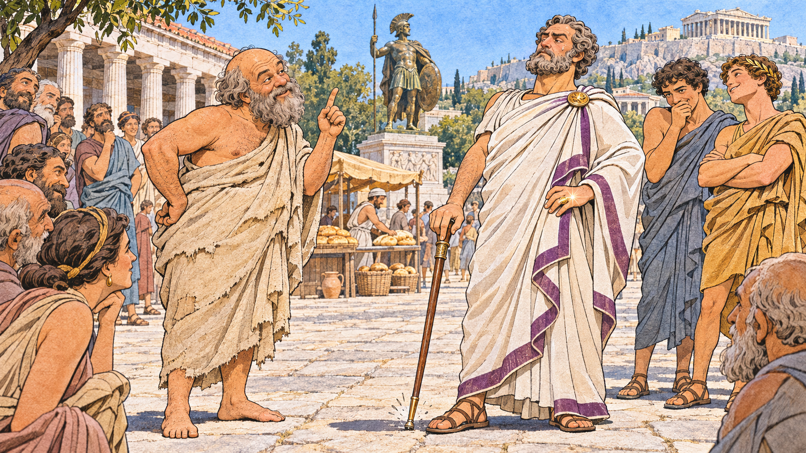
<details><summary>Image Prompt</summary>
(This is Panel 09. Do not include the panel number in the image.)
Style: a hand-drawn travel-sketchbook graphic-novel illustration, with clean dark ink outlines, flat softly shaded color fills and a faint watercolor paper texture, like a page from a traveler's journal; warm, sunlit, painterly lighting; no text, captions, signs, letters or speech bubbles anywhere in the image.
Please generate a 16:9 image depicting panel 9 of 14. Medium two-shot facing both men on the open square of the Agora of Athens, about 425 BCE, bright mid-morning sun. Palette: marble white, Aegean blue, olive green, honey gold, bronze, with a purple border on a white cloak. At left, offering a patient, teasing look with one finger raised in a question, stands: Socrates, Athenian philosopher: a short, stocky man of about sixty with a bald, broad forehead, a wide flat nose, a thick gray beard and bright, amused eyes, barefoot, wearing a plain, worn, undyed wool himation and no jewelry; a curious, teasing expression. At right, stiff and increasingly uncomfortable, stands: A prominent Athenian politician (an unnamed composite): a handsome, self-assured man of about fifty with a carefully curled gray beard, wearing an expensive white himation with a purple border and a gold ring, carrying a polished walking stick, chest out and chin raised, flanked by two admiring young followers. Visible details: the politician's chin lowering by a fraction; his walking stick tapping the ground; a ring flashing in the sun; one follower smothering a smile behind his hand; a baker's stall in the background; a crowd of curious onlookers gathering at the margins; a bronze statue of a hero on its base in the middle distance. Tone: gently comic, a polite collision of confidence and doubt.
Keep every character and place consistent with the other images in this story. Generate the image immediately without asking clarifying questions.
</details>

First comes a politician with a great reputation for wisdom. Socrates questions him, and in Plato's account the great man's answers fall apart under the next question. Socrates concludes that the man thinks he knows things that he does not, and is not even aware of it. The politician walks away offended, and the onlookers are delighted.

## Panel 10: The Poets
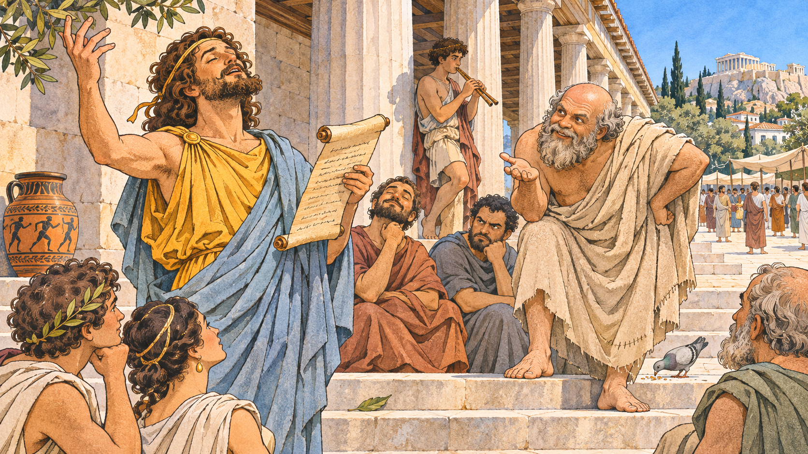
<details><summary>Image Prompt</summary>
(This is Panel 10. Do not include the panel number in the image.)
Style: a hand-drawn travel-sketchbook graphic-novel illustration, with clean dark ink outlines, flat softly shaded color fills and a faint watercolor paper texture, like a page from a traveler's journal; warm, sunlit, painterly lighting; no text, captions, signs, letters or speech bubbles anywhere in the image.
Please generate a 16:9 image depicting panel 10 of 14. Medium shot at the porch steps of a stoa at the edge of the Agora of Athens, about 423 BCE, warm afternoon light under a cloudless blue sky. Palette: marble white, Aegean blue, olive green, honey gold, bronze, saffron-yellow. At left, mid-recitation, eyes half closed, one hand dramatically raised, stands: An Athenian poet (an unnamed composite): a dreamy man of about forty with long curly hair bound by a thin ribbon and a short beard, wearing a saffron-yellow chiton and a light-blue himation, holding a papyrus scroll in one hand and gesturing grandly with the other, eyes half closed. At right, head tilted and a faint smile on his face, leaning in with a curious question, is: Socrates, Athenian philosopher: a short, stocky man of about sixty with a bald, broad forehead, a wide flat nose, a thick gray beard and bright, amused eyes, barefoot, wearing a plain, worn, undyed wool himation and no jewelry; a curious, teasing expression. Visible details: a small crowd of listeners on the steps, one nodding along, one frowning; the unrolled scroll with unreadable marks; a stray laurel leaf on the step; a piper leaning on a column; a pigeon pecking at crumbs; a painted pottery jar by the wall. Tone: lofty and slightly absurd, with Socrates' curiosity cutting through it.
Keep every character and place consistent with the other images in this story. Generate the image immediately without asking clarifying questions.
</details>

Next come the poets. Socrates reads their finest lines and asks them to explain what they mean, and finds that they cannot. They have written beautiful things, but they speak, Plato's Socrates says, rather like prophets who say fine words without understanding them. As in the first case, they think their talent in verse makes them wise about everything else.

## Panel 11: The Craftsman
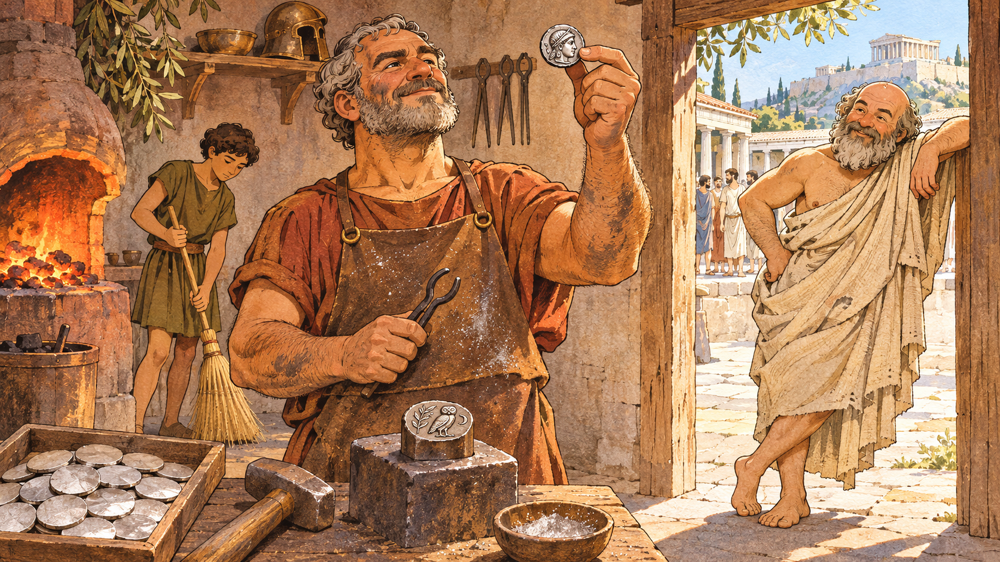
<details><summary>Image Prompt</summary>
(This is Panel 11. Do not include the panel number in the image.)
Style: a hand-drawn travel-sketchbook graphic-novel illustration, with clean dark ink outlines, flat softly shaded color fills and a faint watercolor paper texture, like a page from a traveler's journal; warm, sunlit, painterly lighting; no text, captions, signs, letters or speech bubbles anywhere in the image.
Please generate a 16:9 image depicting panel 11 of 14. Medium-wide shot into a small workshop at the edge of the Agora of Athens, about 420 BCE, warm furnace glow against daylight at the doorway. Palette: marble white, bronze, honey gold, olive green, ember orange. Standing at center, proud, holding up a coin in the light: An Athenian coin-maker (an unnamed composite): a sturdy, soot-smudged man of about fifty with short gray hair and thick forearms, wearing a leather apron over a short rust-brown tunic, holding small iron tongs in one hand and a freshly struck silver coin in the other; proud, steady and open-faced. The coin he holds up is this object: An ancient Athenian silver tetradrachm coin: a thick round silver coin showing the head of Athena in a crested helmet on one side and, on the other, a standing little owl beside an olive sprig and a crescent moon, with a rough, hand-struck edge. In the doorway, leaning on the frame with his head cocked, listening: Socrates, Athenian philosopher: a short, stocky man of about sixty with a bald, broad forehead, a wide flat nose, a thick gray beard and bright, amused eyes, barefoot, wearing a plain, worn, undyed wool himation and no jewelry; a curious, teasing expression. Visible details: a small anvil and stamping die on a workbench; a tray of blank silver discs; glowing coals in a clay furnace; tongs hanging on the wall; shining coin dust on the apron; a young apprentice sweeping. Tone: warm, respectful, a different kind of knowing.
Keep every character and place consistent with the other images in this story. Generate the image immediately without asking clarifying questions.
</details>

The craftsmen are different. They really do know their crafts, and Socrates says so. But he finds that, because they do their own work well, they believe they are wise about everything else too. He concludes that the god meant something modest: Socrates is wiser only in that he does not think he knows what he does not know. And he takes the answer as a mission, to go on questioning people as the god's servant, even at the cost of making enemies.

## Panel 12: The Trial
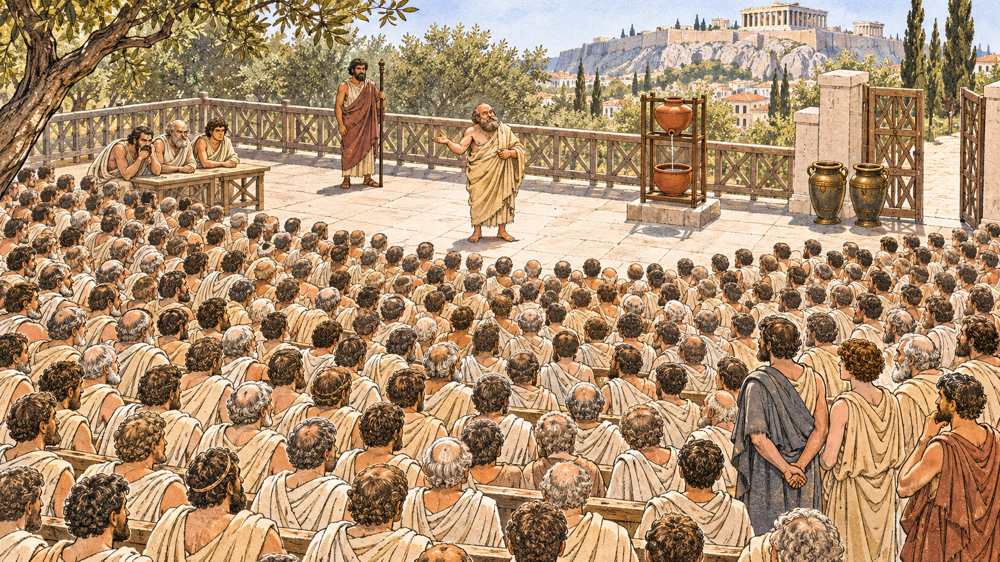
<details><summary>Image Prompt</summary>
(This is Panel 12. Do not include the panel number in the image.)
Style: a hand-drawn travel-sketchbook graphic-novel illustration, with clean dark ink outlines, flat softly shaded color fills and a faint watercolor paper texture, like a page from a traveler's journal; warm, sunlit, painterly lighting; no text, captions, signs, letters or speech bubbles anywhere in the image.
Please generate a 16:9 image depicting panel 12 of 14. Bird's-eye shot from a high angle over a large fenced open-air court of Athens, 399 BCE, a hot white morning, the light flat and unforgiving. Palette: marble white, bronze, honey gold, olive green, dust ochre. Hundreds of citizens in cream himations sit shoulder to shoulder on wooden benches in tight rows, almost five hundred of them, a sea of faces and robes. At the front, small in the frame and facing them, stands one barefoot man speaking: Socrates, Athenian philosopher: a short, stocky man of about sixty with a bald, broad forehead, a wide flat nose, a thick gray beard and bright, amused eyes, barefoot, wearing a plain, worn, undyed wool himation and no jewelry; a curious, teasing expression. (Here his expression is steady and unbowed.) Visible details: a water clock with two clay pots at the side, a thin thread of water between them; two tall bronze-banded urns for ballots waiting at the exit gate; a handful of accusers sitting together on the left; a small knot of his friends standing at the right edge of the crowd, seen from behind; a court officer holding a staff; dust motes in the light; the distant rock of the Acropolis visible above the rail. Tone: heavy, tense and quiet; no violence.
Keep every character and place consistent with the other images in this story. Generate the image immediately without asking clarifying questions.
</details>

In 399 BCE Athens had just lost the Peloponnesian War and survived the rule of a Spartan-backed junta called the Thirty Tyrants. Socrates is charged with not recognizing the city's gods, introducing new divine beings and corrupting the young, before a jury of about 500 citizens. In Plato's *Apology*, Socrates says that if only 30 votes had gone the other way he would have been acquitted, which suggests a vote of about 280 to 220. Asked to name his own penalty, he first proposes free meals at public expense, the honor given to Olympic victors; a later writer says even more jurors then voted for death.

> **Myth or Evidence?** The trial is documented by two students, Plato and Xenophon, whose accounts differ. The count of 280 to 220 is an inference from one sentence in Plato. A common trap is to read the case as democracy versus philosophy. Socrates had questioned Athenians in public for decades, his students went on teaching in Athens, and the city remained the philosophy capital of the Mediterranean for nine centuries. A frightened city, just out of war and tyranny, looking for someone to blame, makes more sense of it.

## Panel 13: An Empty Chair
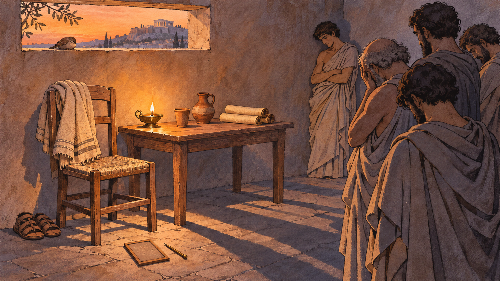
<details><summary>Image Prompt</summary>
(This is Panel 13. Do not include the panel number in the image.)
Style: a hand-drawn travel-sketchbook graphic-novel illustration, with clean dark ink outlines, flat softly shaded color fills and a faint watercolor paper texture, like a page from a traveler's journal; warm, sunlit, painterly lighting; no text, captions, signs, letters or speech bubbles anywhere in the image.
Please generate a 16:9 image depicting panel 13 of 14. Interior close-medium shot in a small plain stone room, Athens, 399 BCE, at dusk, lit only by a single oil lamp and a last band of orange sky through a high narrow window. Palette: marble white, bronze, honey gold, shadow blue, amber lamplight. In the center a plain wooden table holds a simple clay cup and a small jug, and beside it, pushed slightly back, stands an empty wooden chair with a worn undyed wool himation folded over its back. At the right edge, seen from behind in deep shadow, stand four or five friends in plain himations, heads bowed, one with a hand covering his face, a younger man leaning on the wall. The room is quiet and nobody is on the chair. Visible details: a wax tablet and a stylus on the floor; a small bronze lamp with a steady flame; sandals neatly set beside the chair; a stack of three unrolled scrolls; the long shadows of the standing men on the stone floor; bare plastered walls; a sleeping sparrow on the window ledge. Tone: grave, tender and still. Nothing is shown of the death itself.
Keep every character and place consistent with the other images in this story. Generate the image immediately without asking clarifying questions.
</details>

About a month after the verdict, Socrates drinks hemlock in the state prison. The delay came because no execution could take place while the sacred ship sent to the island of Delos was away; it had to return first. The final scene is told by his students, and this panel stays outside the room. A cup on a table, an empty chair and friends standing in the shadow are all the picture shows, and all it needs to.

> **Myth or Evidence?** Visitors on Philopappos Hill are shown a "Prison of Socrates" cut into the rock; that is a modern tradition with no ancient evidence. The prison may have been a building at the southwest corner of the Agora, where excavators found small clay bottles of a size that would suit a dose of poison, but that too is a suggestion, not a certainty.

## Panel 14: Then and Now: The Agora Today
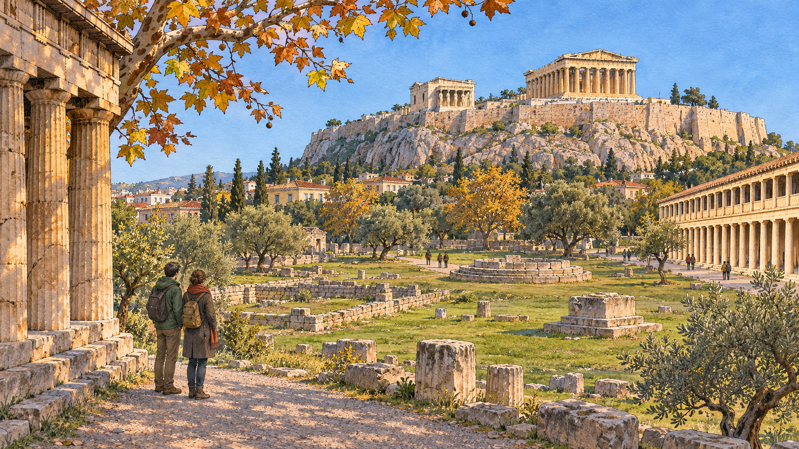
<details><summary>Image Prompt</summary>
(This is Panel 14. Do not include the panel number in the image.)
Style: a hand-drawn travel-sketchbook graphic-novel illustration, with clean dark ink outlines, flat softly shaded color fills and a faint watercolor paper texture, like a page from a traveler's journal; warm, sunlit, painterly lighting; no text, captions, signs, letters or speech bubbles anywhere in the image.
Please generate a 16:9 image depicting panel 14 of 14: the same view as panel 1, a wide establishing shot from the slope in front of the Temple of Hephaestus at the left edge, looking east across the open ruins of the Agora of Athens to the Acropolis, but today, a clear November afternoon with soft low sunlight. Palette: natural daylight, weathered limestone, olive green, sea blue, terracotta. Small in the frame, standing together on a gravel path: Two adult travelers seen from behind or in distant three-quarter view, dressed for cool November weather: one in a dark green rain jacket, the other in a charcoal wool coat with a rust-colored scarf, both with small daypacks, standing close together and looking at the view. Faces are never shown in detail. Ahead of them rises The Acropolis of Athens: a steep, flat-topped, pale limestone rock rising above the city, crowned by the Parthenon, a long Doric temple of honey-colored marble with eight columns across the front, a low triangular pediment and a long carved frieze under the roof; to its left stands the smaller Erechtheion with its porch of six marble maidens. The sky behind is clear blue. Visible details: the long, rebuilt Stoa of Attalos at the right edge, its colonnade gold in the sun; low foundations of the old council buildings in the grass; the round foundation of the Tholos; a stone base where the monument of the ten heroes once stood; scattered marble blocks; olive and plane trees; a few other visitors far away. Tone: quiet, reflective, with the old square still asking questions.
Keep every character and place consistent with the other images in this story. Generate the image immediately without asking clarifying questions.
</details>

Today the Agora is a quiet field of foundations, olive trees and fallen marble, and the whole square becomes a working government again once you have seen the machine in the museum. Inside the reconstructed Stoa of Attalos, the allotment machine, the water clock and the potsherds are a few steps apart. Stand where the square once buzzed and you can still ask what Socrates asked: what do you mean, and how do you know?

### Epilogue - What the Man With Too Many Questions Shows

Athens built a government without kings: citizens ruled in person, drew lots for most offices and exiled leaders by scribbling on pots. Its great strength was that everyone had a chance to take part; its great flaw was how many people were left out. The city also showed how a democracy can be afraid. Socrates' habit of questioning the confident, taken as a mission from the god, is the other half of the story: the oldest answer in the Delphic tradition that is still worth having is the one he refused to take on trust.

| Challenge | How They Responded | Lesson for Today |
|---|---|---|
| Ruling without kings | Chose officials by lot and paid jurors, so the poor could serve | Think about which of our own offices we would fill by drawing names |
| A powerful rival | Exiled by a vote on broken pots, with ready-made ballots handed out | A written vote assumes everyone can write, and someone may be organizing the result |
| An answer from an oracle | Socrates tested it by questioning politicians, poets and craftsmen | An answer is a claim to test, not an end to thinking |
| A frightened city | Convicted its most persistent questioner after war and tyranny | Fear makes any society want to silence the person who keeps asking |

### Call to Action

Think about who in your own community can speak, who can write and who can read, and whose name never ends up on a ballot. Open [Who Could Vote in Athens?](../../sims/athens-who-could-vote/index.md) to estimate how few of Athens's people the democracy actually included. The book's Learning for All thread asks the same question of every school and every tool: count the students it is not reaching, and be honest about that number too.

---

## Voices from the Sources

- *"The unexamined life is not worth living for a human being."* Attributed to Socrates in Plato's *Apology* (38a); the wording varies by translation, and the words are Plato's account of a speech given at the trial.
- *"I do not think I know what I do not know."* Socrates' conclusion about his own wisdom in Plato's *Apology*, given here as the chapter's paraphrase of the Greek rather than a verbatim translation.
- *"Know thyself."* The saying carved in the porch of the Temple of Apollo at Delphi, which the travel writer Pausanias says was attributed to the Seven Sages; no ancient source names who wrote it.

## On the Trip

- **Chapter:** [16. The Agora, Democracy, and Paul on the Areopagus](../../chapters/16-athens-agora-democracy/index.md)
- **Where to look:** the kleroterion (allotment machine), the water clock and the ostraka in the Agora Museum inside the rebuilt Stoa of Attalos; the foundation of the Royal Stoa at the northwest corner of the Agora; the ruins of the Tholos and the Bouleuterion; the bema (speaker's platform) cut into the living rock of the Pnyx.
- **Explore further:** [Who Could Vote in Athens?](../../sims/athens-who-could-vote/index.md)
- **Look Closer:** Glaux says: "Look closer." Glaux was perched on the wooden fence rail beside the water clock in Panel 3. In the museum, find the two clay pots of the water clock and try to guess which one drips into the other.

## Characters and Style

This story follows the shared series bible: [Story Characters, Places and House Style](../characters.md). Glaux's identity comes from the mascot's [character sheet](../../img/mascot/character-sheet.md).

## References

1. [Wikipedia: Socrates](https://en.wikipedia.org/wiki/Socrates) - Biography of the philosopher
2. [Wikipedia: Trial of Socrates](https://en.wikipedia.org/wiki/Trial_of_Socrates) - The charges, the jury and the verdict
3. [Wikipedia: Ostracism](https://en.wikipedia.org/wiki/Ostracism) - The Athenian practice of exile by potsherd vote
4. [Encyclopaedia Britannica: Socrates](https://www.britannica.com/biography/Socrates) - Overview of his life and method
5. [Stanford Encyclopedia of Philosophy: Socrates](https://plato.stanford.edu/entries/socrates/) - Scholarly account of the sources and the trial
