# Pericles' Building Site

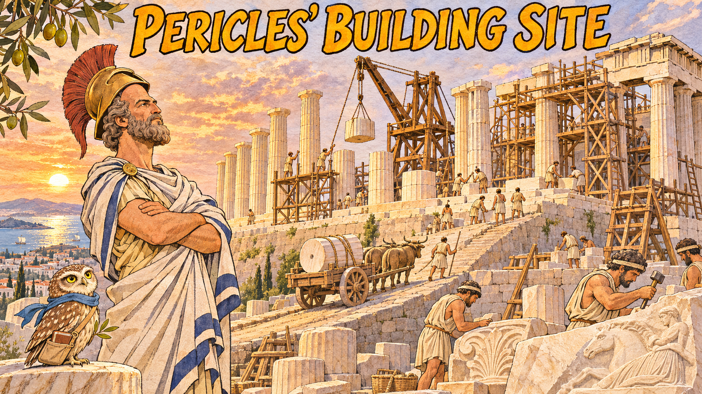
<details>
<summary>Cover Image Prompt</summary>
(This is the Cover Image. Do not include this label in the image.)
Style: a hand-drawn travel-sketchbook graphic-novel illustration, with clean dark ink outlines, flat softly shaded color fills and a faint watercolor paper texture, like a page from a traveler's journal; warm, sunlit, painterly lighting; no text, captions, signs, letters or speech bubbles anywhere in the image.

Please generate a wide-landscape 16:9 cover image for a graphic novel. Exception to the no-text rule, for this cover only: render the title as bold, hand-lettered capital letters in honey-gold with a dark outline reading exactly "Pericles' Building Site" across the top, the only text in the image. Composition: a dramatic golden-hour view of the Acropolis of Athens in about 440 BCE as a vast building site. The Parthenon building site, about 440 BCE: the great temple platform on the Acropolis with half-raised honey-colored marble columns, some still stacked as separate drums, wooden scaffolds, timber cranes with ropes and pulleys, scattered blocks and carved fragments, and stonemasons at work. In the foreground, standing on a pile of marble blocks and gazing up at it with his arms folded, is Pericles. Pericles, Athenian leader: a dignified man of about fifty-five with an unusually tall, long head, usually shown wearing a crested bronze helmet pushed back on his head, a trimmed gray-brown beard and a calm, commanding expression, dressed in a white himation with a dark-blue border draped over a cream chiton. An ox cart carrying a pale marble column drum creaks up the ramp behind him, and the sea glints far below. Glaux the Little Owl: a true little owl (Athene noctua), small, round and compact, with a flat rounded head and no ear tufts, warm earth-brown plumage with cream spots, bright lemon-yellow eyes under pale cream eyebrows, a cream-white throat patch and a short pale greenish-yellow beak. Glaux wears a small Aegean-blue scarf and a tan canvas satchel across the body with a small leather-bound travel notebook peeking out, and a sprig of three olive leaves tucked into the satchel strap. Alert, curious and warm expression. Glaux is drawn small, perched at the edge of the scene, noticeable on a second look. Glaux perches on a column drum in the lower corner. Palette: marble white, Aegean blue, olive green, honey gold, bronze, with a warm gold sky. Tone: ambitious, awe-struck. Keep every character and place consistent with the other images in this story. Generate the image immediately without asking clarifying questions.
</details>

<details markdown="1">
<summary>Narrative Prompt</summary>
**Era and places.** Athens, 454 to 432 BCE, and the later lives of the Parthenon: the island of Delos (454), the burned Acropolis (about 447), the quarries of Mount Pentelikon and the road to Athens, the Acropolis building site (447 to 432), the Parthenon as church (probably from the late 6th century CE) and mosque (from soon after 1458), the Venetian siege of 1687, and today.

**Themes.** Who paid for a masterpiece, and who got to argue about it. The Parthenon was a public works program, voted by citizens, accounted for in public, and paid for in part with allies' money, a monument both to Athenian genius and to Athenian empire. Also: a building made of curves that look straight, a statue of gold and ivory, and a temple that spent about 900 years as a church and more than two centuries as a mosque and powder store before shell fire in 1687 blew out its middle. The Learning for All thread: the accounts were carved in stone for anyone to read, and the sculptures were designed to be read by any Athenian.

**Series house style.** Hand-drawn travel-sketchbook graphic-novel illustration, clean dark ink outlines, flat softly shaded color fills, faint watercolor paper texture. No lettering in any panel; only the cover carries the title. All images are 16:9. The full style line is pasted at the top of every prompt (see [Story Characters, Places and House Style](../characters.md)).

**Palette by era.** Panels 1 to 12: Classical Greece (marble white, Aegean blue, olive green, honey gold, bronze). Panel 13: Byzantine (gold leaf, deep blue, imperial purple, candle amber, cream marble). Panel 14: Ottoman (Iznik turquoise, cobalt, tomato red, brass, saffron, white plaster). Panel 15: Venetian (sandstone, steel gray, Mediterranean blue, banner crimson). Panel 16: modern Greece (natural daylight, whitewashed walls, sea blue, terracotta, olive).

**Safe-image handling.** The 1687 explosion is shown from a distance as a plume of smoke and flying dust, with no bodies and no people harmed on screen. The Athena Parthenos is shown draped, in gold and ivory, from a respectful distance.

**Creative liberties and uncertainties.**

- Architect and sculptor names follow Chapter 15 (Ictinus, Callicrates, Phidias). Their faces and ages are invented. The architects' plans and the "curves" demonstrations are illustrative; only the measurements (platform rises about 6 cm at the ends and 11 cm along the sides) come from the chapter.
- Plutarch's story that Pericles offered to pay for the buildings himself if the inscriptions named him may be polished; the stone accounts survive. Panel 11 says so.
- Panel 12 shows the Athena Parthenos from descriptions and small Roman copies; the real statue is lost.
- Our sources disagree about Phidias's end (Plutarch says he died in prison; another tradition says he went to work at Olympia), so the story leaves it open.
- The date of the Parthenon's conversion to a church is debated; the story says "probably by the late 6th century."
- In panels 13 to 16 the Parthenon block is pasted verbatim and followed by era-specific changes (cross and apse, minaret, smoke plume, scaffolding and missing roof). The block shows the building whole, which suits panels 13 to 15, as travelers saw it before 1687.
- The chapter's casualty figure for the explosion, about three hundred, is given in the text only, never drawn.
- A Chapter 14 note: the Francesco Morosini of the Heraklion fountain (1628) is a different man from the commander (1619 to 1694) who surrendered Candia in 1669 and led the 1687 army. This story shows only the commander.

**Cast.** Glaux the Little Owl hides in exactly one panel (panel 9): see docs/stories/characters.md and docs/img/mascot/character-sheet.md (Glaux). Pericles, Athena, Francesco Morosini, the Owl Coin, the Parthenon and Acropolis, and the Travelers are in docs/stories/characters.md. The following appear only in this story; their blocks are pasted verbatim wherever they appear.

Ictinus (panels 6 and 7):

```text
Ictinus, architect of the Parthenon: a lean man of about fifty with a short gray beard, a plain brown chiton, a rolled papyrus plan under one arm and a long wooden measuring rod in his hand; precise and quiet.
```

Callicrates (panels 6 and 8):

```text
Callicrates, architect of the Parthenon: a sturdy man of about forty-five with a trimmed black beard, a white mason's apron over a cream chiton, holding a plumb line with a small lead weight; practical and good-humored.
```

Phidias (panel 6):

```text
Phidias, sculptor: a vigorous man of about fifty with a long curly gray-brown beard, a marble-dusted tan work tunic with the sleeves pushed up, and a small iron chisel and a wooden mallet in his hands; absorbed and exacting.
```

The Venetian gunners of 1687 (panel 15):

```text
The Venetian gunners of 1687: five sunburned artillerymen in shirtsleeves, leather aprons and red knitted caps, standing around two bronze cannons on wheeled wooden carriages behind a low wall of earth-filled wicker baskets, smoke still drifting from the muzzles; one holds a long stick with a smoldering match.
```

The Parthenon building site (panels 6 to 8 and the cover):

```text
The Parthenon building site, about 440 BCE: the great temple platform on the Acropolis with half-raised honey-colored marble columns, some still stacked as separate drums, wooden scaffolds, timber cranes with ropes and pulleys, scattered blocks and carved fragments, and stonemasons at work.
```

The Acropolis in ruins, about 447 BCE (panel 2):

```text
The Acropolis of Athens in ruins around 447 BCE: the pale limestone rock crowned by charred, broken columns and toppled column drums left standing thirty years after the Persian fire, weeds growing between the blocks and the city's red-tiled roofs far below.
```
</details>

### Prologue - The Money Question

In 454 BCE the treasury of an alliance of Greek cities moves to Athens, and Athens soon decides to spend part of it on the most perfect temple in Greece. The result is a building with almost no straight lines, and a political fight about whose money built it. Over the next two thousand years it becomes a church, a mosque and a powder store, and then a Venetian shell blows out its middle. Every fight over the Parthenon, from Pericles' day to ours, begins with the same question: who does it belong to, and who paid?

**Find Glaux:** Glaux hides in one panel of this story. Can you spot the little owl?

## Panel 1: The Treasury Leaves Delos
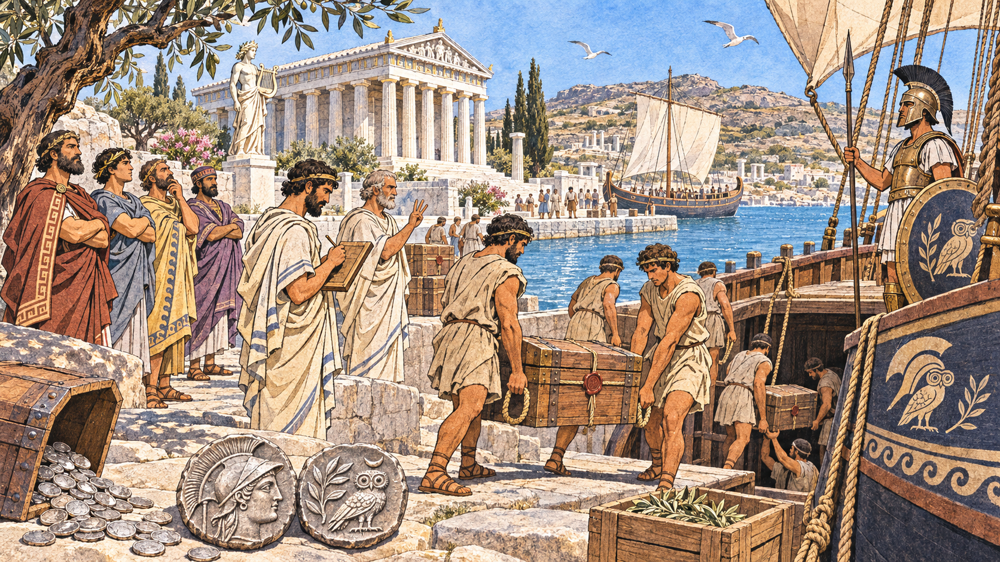
<details><summary>Image Prompt</summary>
(This is Panel 01. Do not include the panel number in the image.)
I am about to ask you to generate a series of images for a graphic novel. Please make the images have a consistent style and consistent characters. Do not ask any clarifying questions. Just generate the image immediately when asked.
Style: a hand-drawn travel-sketchbook graphic-novel illustration, with clean dark ink outlines, flat softly shaded color fills and a faint watercolor paper texture, like a page from a traveler's journal; warm, sunlit, painterly lighting; no text, captions, signs, letters or speech bubbles anywhere in the image.

Please generate a 16:9 image in the style above depicting panel 1 of 16. Setting: the small sacred island of Delos in the Cyclades, 454 BCE, bright mid-morning light. Camera: wide, slightly raised view of the little harbor, with a white marble temple of Apollo behind the quay and low rocky hills beyond. In the foreground, workers in plain tunics carry sealed wooden chests, each with rope handles, down a stone ramp into the hold of a broad Athenian ship; officials in cream himations with wax tablets count them off; a few delegates from allied cities stand to one side with folded arms. Close detail in the lower corner: a tipped chest spills silver coins onto the stones. An ancient Athenian silver tetradrachm coin: a thick round silver coin showing the head of Athena in a crested helmet on one side and, on the other, a standing little owl beside an olive sprig and a crescent moon, with a rough, hand-struck edge. Details: gulls, a white-sailed ship waiting at the quay, an olive-wood crate, the blue sea. Palette: marble white, Aegean blue, olive green, honey gold, bronze. Tone: orderly, quietly uneasy. Keep every character and place consistent with the other images in this story. Generate the image immediately without asking clarifying questions.
</details>

In 454 BCE Athens moves the treasury of the Delian League, the naval alliance of Greek cities it leads against Persia, from the island of Delos to Athens. The stated reason is that the money will be safer there. The allies' yearly payments, meant for defense, now sit in Athenian hands.

## Panel 2: Thirty Years of Ruins
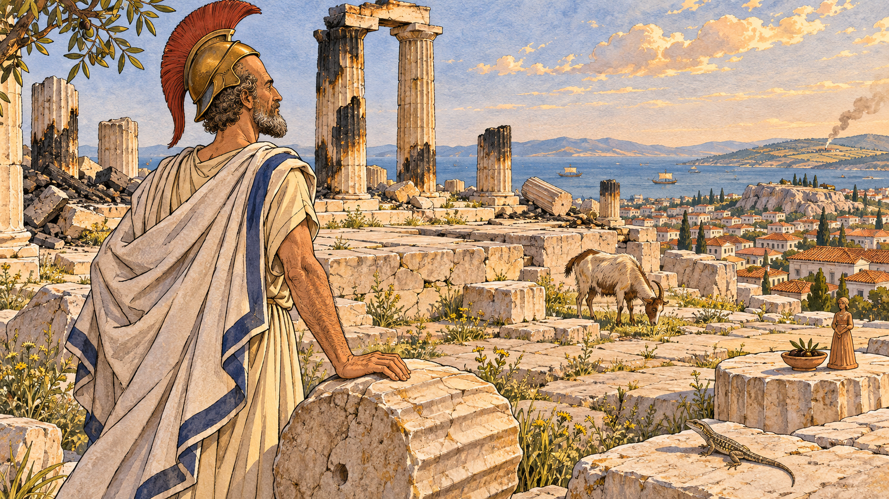
<details><summary>Image Prompt</summary>
(This is Panel 02. Do not include the panel number in the image.)
Style: a hand-drawn travel-sketchbook graphic-novel illustration, with clean dark ink outlines, flat softly shaded color fills and a faint watercolor paper texture, like a page from a traveler's journal; warm, sunlit, painterly lighting; no text, captions, signs, letters or speech bubbles anywhere in the image.

Please generate a 16:9 image in the style above depicting panel 2 of 16. Setting: the summit of the Acropolis, Athens, about 447 BCE, late afternoon with long gold light. The Acropolis of Athens in ruins around 447 BCE: the pale limestone rock crowned by charred, broken columns and toppled column drums left standing thirty years after the Persian fire, weeds growing between the blocks and the city's red-tiled roofs far below. Camera: medium-wide view from behind and slightly below a standing figure who looks across the ruin toward the distant sea. Cast: Pericles, Athenian leader: a dignified man of about fifty-five with an unusually tall, long head, usually shown wearing a crested bronze helmet pushed back on his head, a trimmed gray-brown beard and a calm, commanding expression, dressed in a white himation with a dark-blue border draped over a cream chiton. He rests one hand on a toppled column drum. Details: a goat nibbling weeds between the blocks, a small clay votive offering left on a drum, the cracked foundation of a vanished temple, a gray-brown lizard on warm marble, the smoke of a distant farm. Palette: marble white, Aegean blue, olive green, honey gold, bronze. Tone: reflective, ambitious. Keep every character and place consistent with the other images in this story. Generate the image immediately without asking clarifying questions.
</details>

When the Persians left, Athens left the Acropolis in ruins. Later writers say the Greek allies swore to leave the burned temples as memorials, though that oath survives only in 4th-century versions and its authenticity is debated. Either way, the rock stands scorched for about thirty years. Pericles, an elected general who governs by persuading the Assembly, looks at the wreckage and sees a building site.

## Panel 3: The Vote
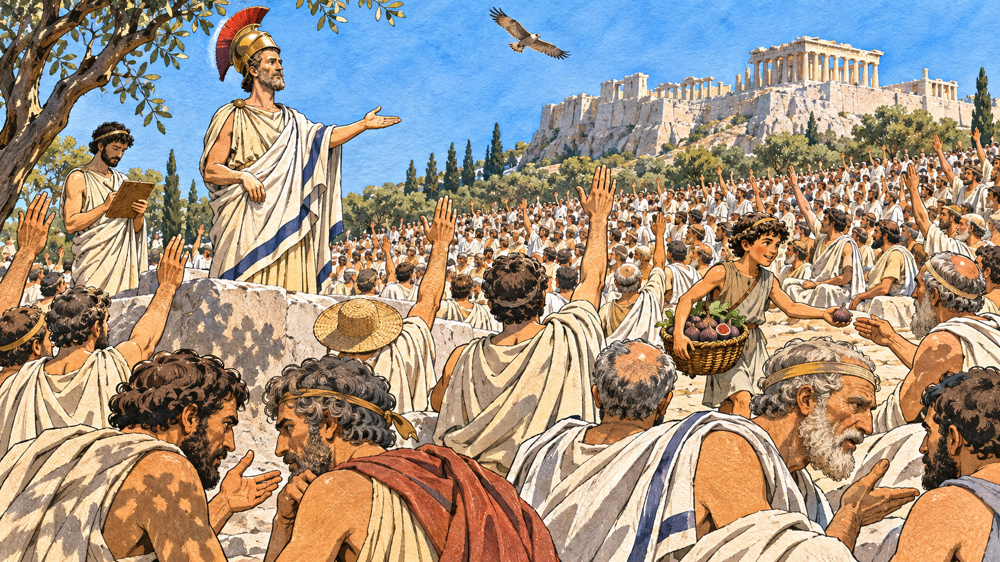
<details><summary>Image Prompt</summary>
(This is Panel 03. Do not include the panel number in the image.)
Style: a hand-drawn travel-sketchbook graphic-novel illustration, with clean dark ink outlines, flat softly shaded color fills and a faint watercolor paper texture, like a page from a traveler's journal; warm, sunlit, painterly lighting; no text, captions, signs, letters or speech bubbles anywhere in the image.

Please generate a 16:9 image in the style above depicting panel 3 of 16. Setting: the Pnyx hill, the open-air meeting place of the Athenian Assembly, Athens, 447 BCE, clear bright midday. Camera: wide, low view from behind the front row of the crowd toward the speaker's rock, where the speaker stands. Cast: Pericles, Athenian leader: a dignified man of about fifty-five with an unusually tall, long head, usually shown wearing a crested bronze helmet pushed back on his head, a trimmed gray-brown beard and a calm, commanding expression, dressed in a white himation with a dark-blue border draped over a cream chiton. He speaks with one hand open and level, calm and unhurried. Hundreds of citizens in cream and white himations sit on the sloping ground, many with hands raised in a vote; a clerk beside the rock holds a wax tablet; behind them the ruined Acropolis shows as a pale bluff against the sky. Details: a boy selling figs, a hawk circling, a few men arguing in low voices, sharp shadows. Palette: marble white, Aegean blue, olive green, honey gold, bronze. Tone: persuasive, buzzing with debate. Keep every character and place consistent with the other images in this story. Generate the image immediately without asking clarifying questions.
</details>

In 447 BCE the Assembly votes to rebuild. It is a public decision, made by citizens in the open air, and the work will be paid for out of public funds. Pericles has no throne and no permanent office; he has a gift for persuasion, and enough votes.

## Panel 4: The Quarry
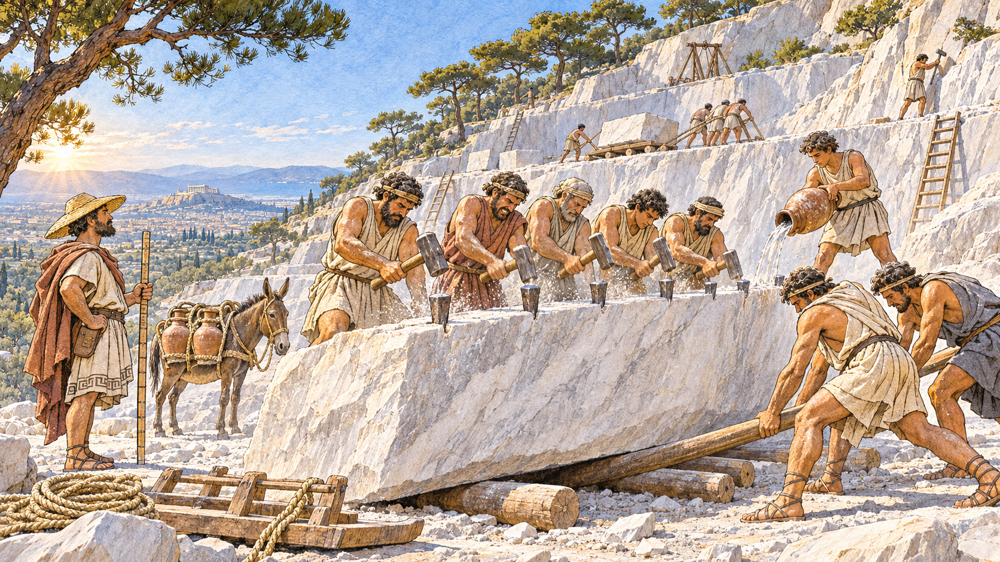
<details><summary>Image Prompt</summary>
(This is Panel 04. Do not include the panel number in the image.)
Style: a hand-drawn travel-sketchbook graphic-novel illustration, with clean dark ink outlines, flat softly shaded color fills and a faint watercolor paper texture, like a page from a traveler's journal; warm, sunlit, painterly lighting; no text, captions, signs, letters or speech bubbles anywhere in the image.

Please generate a 16:9 image in the style above depicting panel 4 of 16. Setting: a marble quarry on the slope of Mount Pentelikon near Athens, 447 BCE, early morning with long shadows and white dust. Camera: wide, low angle looking up the terraced white face of the quarry. On the foreground ledge, a crew of eight quarrymen in short tunics drive iron wedges into a row of slots along a huge, newly cut block, while a ninth pours water over the wedges; others tilt the block's edge on a log lever. Details: wooden sledges and rollers, coils of rope, pale dust on their hair and arms, a mule carrying water jars, a foreman in a straw hat watching with a measuring rod, terraced pine slopes, the plain of Athens glinting far below. Palette: marble white, Aegean blue, olive green, honey gold. Tone: effortful, rhythmic. Keep every character and place consistent with the other images in this story. Generate the image immediately without asking clarifying questions.
</details>

The marble comes from Mount Pentelikon, about 16 km from the Acropolis. Quarrymen cut it free in huge blocks with wedges, levers and patience; the white stone will turn honey-gold as it weathers. Every column drum on the Parthenon begins here as a lump of mountain.

## Panel 5: Ox Carts
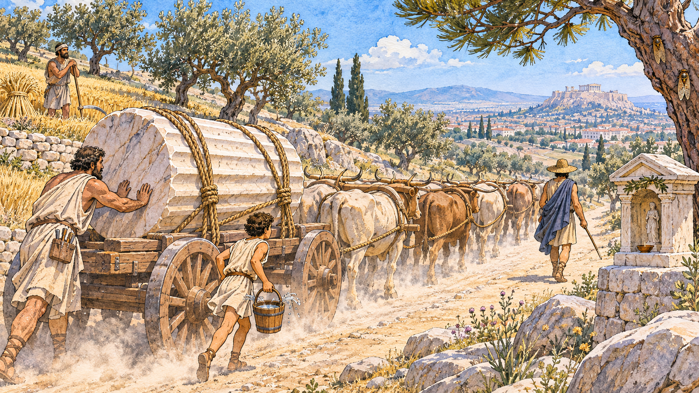
<details><summary>Image Prompt</summary>
(This is Panel 05. Do not include the panel number in the image.)
Style: a hand-drawn travel-sketchbook graphic-novel illustration, with clean dark ink outlines, flat softly shaded color fills and a faint watercolor paper texture, like a page from a traveler's journal; warm, sunlit, painterly lighting; no text, captions, signs, letters or speech bubbles anywhere in the image.

Please generate a 16:9 image in the style above depicting panel 5 of 16. Setting: the dusty road from Mount Pentelikon down to Athens, 446 BCE, a hot bright afternoon. Camera: wide view along the road. A heavy four-wheeled wooden wagon pulled by four pairs of patient oxen carries a single pale marble column drum lashed with thick ropes; a driver in a wide straw hat walks at the lead ox with a goad held low, a boy runs beside the wheel with a bucket of water, and a mason walks behind steadying the load. Far ahead, small and hazy on the plain, the ruined Acropolis rock and the roofs of Athens. Details: a roadside shrine, olive trees, white dust rising from the wheels, cicadas on a pine, a farmer pausing in his field to watch. Palette: marble white, Aegean blue, olive green, honey gold. Tone: slow, powerful, determined. Keep every character and place consistent with the other images in this story. Generate the image immediately without asking clarifying questions.
</details>

Ox carts haul the blocks down the mountain to the city. Plutarch says Pericles defended the program by pointing to how many people it employed: carpenters, stonecutters, dyers, painters, merchants, sailors, teamsters, rope makers, road builders. It is a jobs program as much as a monument.

## Panel 6: Plans and Chisels
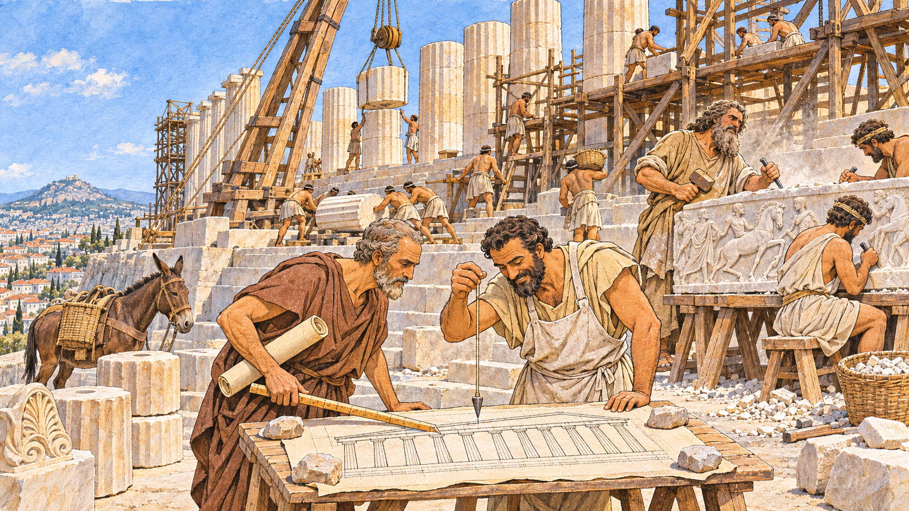
<details><summary>Image Prompt</summary>
(This is Panel 06. Do not include the panel number in the image.)
Style: a hand-drawn travel-sketchbook graphic-novel illustration, with clean dark ink outlines, flat softly shaded color fills and a faint watercolor paper texture, like a page from a traveler's journal; warm, sunlit, painterly lighting; no text, captions, signs, letters or speech bubbles anywhere in the image.

Please generate a 16:9 image in the style above depicting panel 6 of 16. Setting: the Acropolis building site, Athens, about 445 BCE, late morning. Camera: a wide view standing at the temple platform's northwest corner and looking along its north side, matching the final panel's viewpoint. The Parthenon building site, about 440 BCE: the great temple platform on the Acropolis with half-raised honey-colored marble columns, some still stacked as separate drums, wooden scaffolds, timber cranes with ropes and pulleys, scattered blocks and carved fragments, and stonemasons at work. In the foreground, two architects bend over a plan unrolled on a trestle table, weighted at its corners with stones, one measuring with a rod and the other checking with a plumb line. Cast: Ictinus, architect of the Parthenon: a lean man of about fifty with a short gray beard, a plain brown chiton, a rolled papyrus plan under one arm and a long wooden measuring rod in his hand; precise and quiet. Callicrates, architect of the Parthenon: a sturdy man of about forty-five with a trimmed black beard, a white mason's apron over a cream chiton, holding a plumb line with a small lead weight; practical and good-humored. In the background, on the rising platform, a sculptor directs masons carving a long frieze slab laid on trestles. Phidias, sculptor: a vigorous man of about fifty with a long curly gray-brown beard, a marble-dusted tan work tunic with the sleeves pushed up, and a small iron chisel and a wooden mallet in his hands; absorbed and exacting. Details: a mule, a pile of chips, marble dust drifting in sun. Palette: marble white, Aegean blue, olive green, honey gold, bronze. Tone: busy, exacting, proud. Keep every character and place consistent with the other images in this story. Generate the image immediately without asking clarifying questions.
</details>

The architects Ictinus and Callicrates check their plans against the stone, and Phidias directs the sculpture. The temple will have 8 columns across each end and 17 down each side, and the stone arrives cut for its own place, so no two blocks are quite alike. Plutarch says Phidias oversaw the whole building program.

## Panel 7: The Floor That Rises
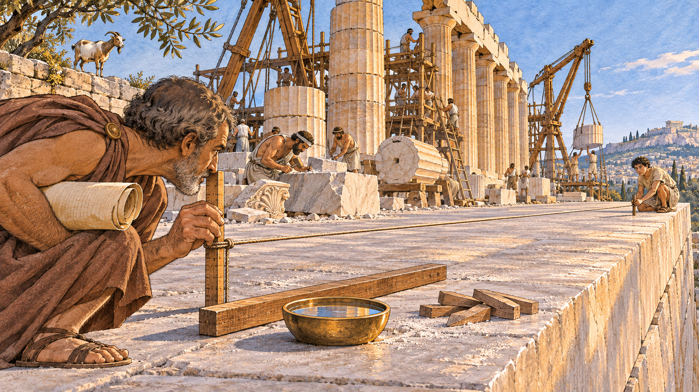
<details><summary>Image Prompt</summary>
(This is Panel 07. Do not include the panel number in the image.)
Style: a hand-drawn travel-sketchbook graphic-novel illustration, with clean dark ink outlines, flat softly shaded color fills and a faint watercolor paper texture, like a page from a traveler's journal; warm, sunlit, painterly lighting; no text, captions, signs, letters or speech bubbles anywhere in the image.

Please generate a 16:9 image in the style above depicting panel 7 of 16. Setting: the temple platform at the Acropolis building site, about 442 BCE, early morning with low raking light that exaggerates every surface. The Parthenon building site, about 440 BCE: the great temple platform on the Acropolis with half-raised honey-colored marble columns, some still stacked as separate drums, wooden scaffolds, timber cranes with ropes and pulleys, scattered blocks and carved fragments, and stonemasons at work. Camera: very low angle along the surface of the platform, as if lying on the stone, looking along its long edge. A taut cord stretches along the edge between two stakes; the architect crouches at one end sighting along it and a young apprentice holds the other end. Cast: Ictinus, architect of the Parthenon: a lean man of about fifty with a short gray beard, a plain brown chiton, a rolled papyrus plan under one arm and a long wooden measuring rod in his hand; precise and quiet. The platform's surface, drawn with a gentle, deliberate swell toward the middle, so the cord sags just above it at the ends. Details: a wooden straightedge and a bubble-free water-level bowl on the stone, a pile of wedges, a thin film of marble dust, a goat watching from the old wall. Palette: marble white, Aegean blue, olive green, honey gold, bronze. Tone: patient, secretive, exact. Keep every character and place consistent with the other images in this story. Generate the image immediately without asking clarifying questions.
</details>

Almost nothing in the Parthenon is straight. The platform rises gently toward the middle of each side, by about 6 cm along the ends and about 11 cm along the long sides, so that it does not look as if it sags. A level floor would look as if it were sinking; a curved floor looks level.

## Panel 8: Columns That Swell and Lean
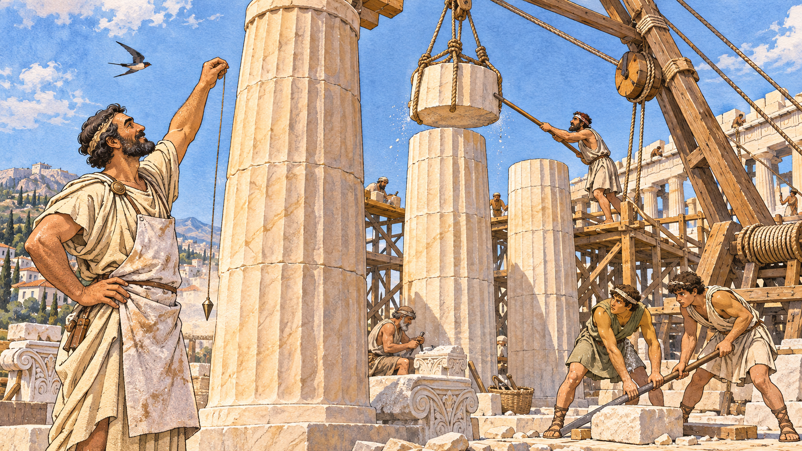
<details><summary>Image Prompt</summary>
(This is Panel 08. Do not include the panel number in the image.)
Style: a hand-drawn travel-sketchbook graphic-novel illustration, with clean dark ink outlines, flat softly shaded color fills and a faint watercolor paper texture, like a page from a traveler's journal; warm, sunlit, painterly lighting; no text, captions, signs, letters or speech bubbles anywhere in the image.

Please generate a 16:9 image in the style above depicting panel 8 of 16. Setting: the Acropolis building site, about 440 BCE, bright afternoon. Camera: medium low-angle view looking up at a row of three tall half-finished columns whose profile swells very slightly at the middle and tilts inward toward the top, as a timber crane lowers another drum onto the stack. The Parthenon building site, about 440 BCE: the great temple platform on the Acropolis with half-raised honey-colored marble columns, some still stacked as separate drums, wooden scaffolds, timber cranes with ropes and pulleys, scattered blocks and carved fragments, and stonemasons at work. Cast: Callicrates, architect of the Parthenon: a sturdy man of about forty-five with a trimmed black beard, a white mason's apron over a cream chiton, holding a plumb line with a small lead weight; practical and good-humored. He stands at the foot of the nearest column holding up a plumb line, which hangs a little away from the column's top, showing the inward lean; the corner column beside him is visibly thicker than the others, with a bright sky behind it. Details: rope tackle, a mason guiding the drum with a pole, two apprentices with pry bars, flecks of white dust, a swallow darting past. Palette: marble white, Aegean blue, olive green, honey gold, bronze. Tone: skilled, tense, quietly marveling. Keep every character and place consistent with the other images in this story. Generate the image immediately without asking clarifying questions.
</details>

The columns lean slightly inward, swell a little in the middle, a curve called entasis, and the corner columns are a bit thicker than the others, perhaps because a column seen against the bright sky looks thinner. Every block is cut for its own place in this curved geometry. That is one reason restoration takes decades, and why the building looks alive.

## Panel 9: The Owl Hunts for a Straight Line
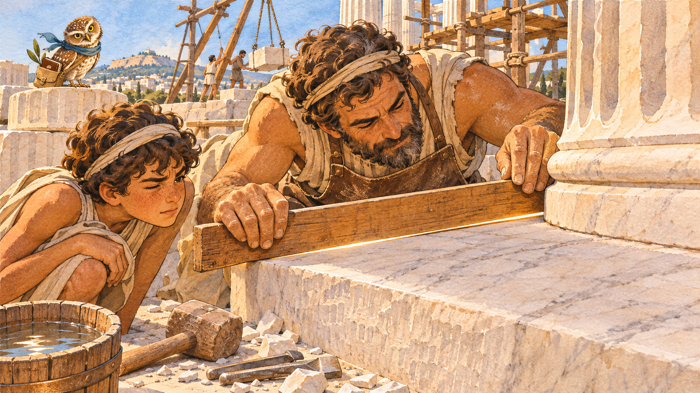
<details><summary>Image Prompt</summary>
(This is Panel 09. Do not include the panel number in the image.)
Style: a hand-drawn travel-sketchbook graphic-novel illustration, with clean dark ink outlines, flat softly shaded color fills and a faint watercolor paper texture, like a page from a traveler's journal; warm, sunlit, painterly lighting; no text, captions, signs, letters or speech bubbles anywhere in the image.

Please generate a 16:9 image in the style above depicting panel 9 of 16. Setting: the temple platform at the Acropolis building site, about 440 BCE, mid-afternoon in warm gold light. Camera: tight close-up on the corner of the platform's top step and the base of a corner column. A mason in a leather apron presses a long, perfectly straight wooden straightedge against the stone edge, and a thin crescent of bright daylight shows between the board and the gently curved marble. His apprentice crouches beside him, squinting at the gap. On a nearby stack of column drums, small and noticeable on a second look, a tiny owl peers at the straightedge with its head tilted. Glaux the Little Owl: a true little owl (Athene noctua), small, round and compact, with a flat rounded head and no ear tufts, warm earth-brown plumage with cream spots, bright lemon-yellow eyes under pale cream eyebrows, a cream-white throat patch and a short pale greenish-yellow beak. Glaux wears a small Aegean-blue scarf and a tan canvas satchel across the body with a small leather-bound travel notebook peeking out, and a sprig of three olive leaves tucked into the satchel strap. Alert, curious and warm expression. Glaux is drawn small, perched at the edge of the scene, noticeable on a second look. Details: chisel marks, marble chips, a mallet, a bucket of water, sunlight on the edge of the board. Palette: marble white, Aegean blue, olive green, honey gold, bronze. Tone: amused, curious. Keep every character and place consistent with the other images in this story. Generate the image immediately without asking clarifying questions.
</details>

Glaux hunts for a straight line in the building and does not find one. Press a straightedge to the platform's edge and daylight shows between the board and the stone. The curves are too small to notice at a glance, which is exactly the point.

> **Myth or Evidence?** Many books say the Parthenon was designed on the "golden ratio." No ancient source says so; the idea became popular in the 19th and 20th centuries. The platform measures about 30.9 by 69.5 m, a ratio of almost exactly 4 to 9, not the golden ratio. The curves, by contrast, are documented in the stone itself.

## Panel 10: The Accusation
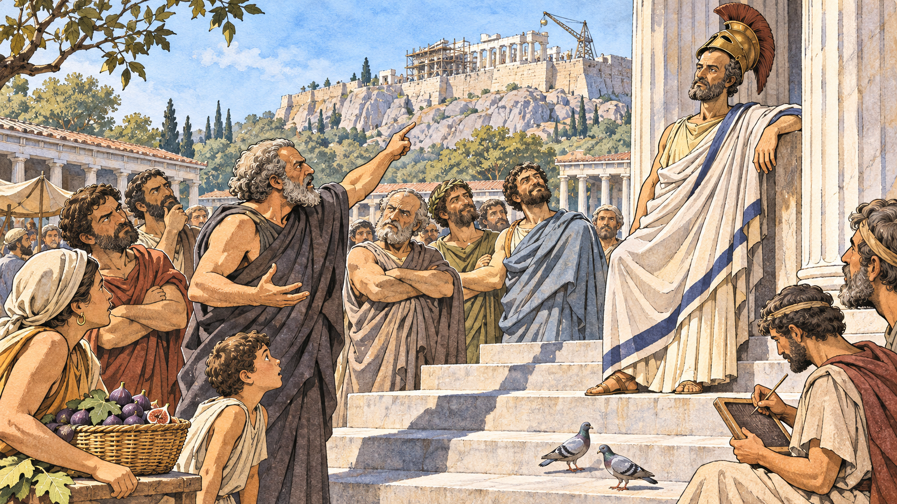
<details><summary>Image Prompt</summary>
(This is Panel 10. Do not include the panel number in the image.)
Style: a hand-drawn travel-sketchbook graphic-novel illustration, with clean dark ink outlines, flat softly shaded color fills and a faint watercolor paper texture, like a page from a traveler's journal; warm, sunlit, painterly lighting; no text, captions, signs, letters or speech bubbles anywhere in the image.

Please generate a 16:9 image in the style above depicting panel 10 of 16. Setting: the steps of a public building at the edge of the Athenian Agora, 440 BCE, bright cool morning, with the half-built temple visible high on the Acropolis behind. Camera: medium-wide view from slightly below. In the foreground, a gray-bearded rival politician in a dark himation points up at the Acropolis, one hand raised, while a small crowd of citizens mutter and cross their arms; a few look doubtful, others nod. Cast: Pericles, Athenian leader: a dignified man of about fifty-five with an unusually tall, long head, usually shown wearing a crested bronze helmet pushed back on his head, a trimmed gray-brown beard and a calm, commanding expression, dressed in a white himation with a dark-blue border draped over a cream chiton. He stands calmly on the step above them, a hand resting on a column, listening. Details: a vendor with a basket of figs, a boy listening wide-eyed, a scribe with a wax tablet, two pigeons, a long shadow. Palette: marble white, Aegean blue, olive green, honey gold, bronze. Tone: tense, suspicious. Keep every character and place consistent with the other images in this story. Generate the image immediately without asking clarifying questions.
</details>

Pericles' rivals attack. Plutarch reports that they accuse him of decking out Athens with money that belongs to its allies. The building is both a monument to Athenian genius and to Athenian empire: the democracy at home is paid for, in part, by power over others abroad. Both things are true.

## Panel 11: The Accounts in Stone
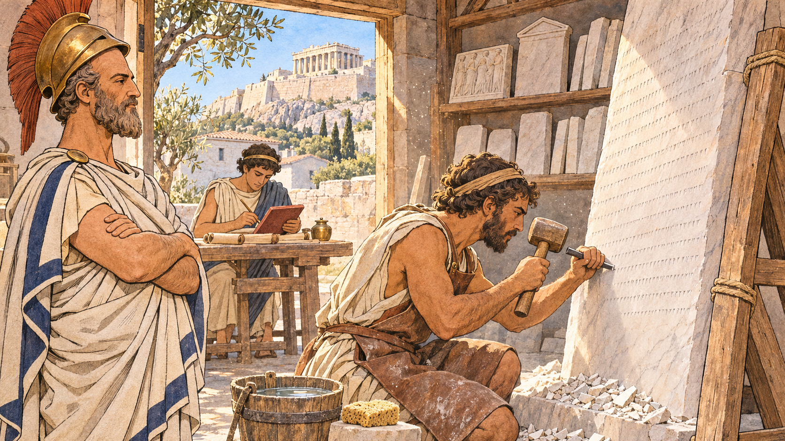
<details><summary>Image Prompt</summary>
(This is Panel 11. Do not include the panel number in the image.)
Style: a hand-drawn travel-sketchbook graphic-novel illustration, with clean dark ink outlines, flat softly shaded color fills and a faint watercolor paper texture, like a page from a traveler's journal; warm, sunlit, painterly lighting; no text, captions, signs, letters or speech bubbles anywhere in the image.

Please generate a 16:9 image in the style above depicting panel 11 of 16. Setting: a stonemason's workshop below the Acropolis, Athens, about 438 BCE, warm afternoon light through an open doorway. Camera: medium close-up from the side of a tall marble slab standing upright on a wooden frame; a mason in a leather apron kneels at its foot with a chisel and mallet, carving neat horizontal rows of tiny incised marks, illegible and suggestive of writing only as texture. Cast: Pericles, Athenian leader: a dignified man of about fifty-five with an unusually tall, long head, usually shown wearing a crested bronze helmet pushed back on his head, a trimmed gray-brown beard and a calm, commanding expression, dressed in a white himation with a dark-blue border draped over a cream chiton. He stands at the edge of the frame watching the mason work, arms folded. Details: a heap of marble chips, a bucket of water, a sponge, a clerk with a wax tablet and a reed pen at a table, a shelf of other finished slabs, pale dust motes. Palette: marble white, Aegean blue, olive green, honey gold, bronze. Tone: orderly, quietly defiant. Keep every character and place consistent with the other images in this story. Generate the image immediately without asking clarifying questions.
</details>

> **Myth or Evidence?** Plutarch says Pericles offered to pay for the buildings himself if the inscriptions would name him instead of the people, and the Assembly told him to spend what he needed from public funds. That story may be polished. What is not in doubt: fragments of the yearly building accounts, carved in stone on the Acropolis, survive, listing what the commissioners received and spent on the Parthenon and its statue.

The most famous building in Greece is also a public works program, voted on by citizens and accounted for in public. Anyone who walks up to the rock can read, in principle, where the money went.

## Panel 12: Athena, in Gold and Ivory
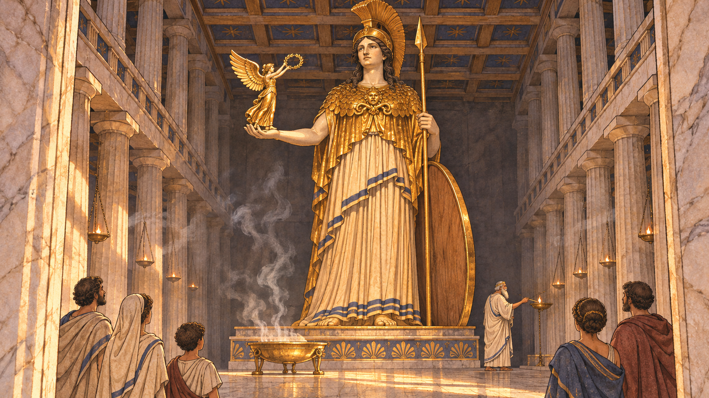
<details><summary>Image Prompt</summary>
(This is Panel 12. Do not include the panel number in the image.)
Style: a hand-drawn travel-sketchbook graphic-novel illustration, with clean dark ink outlines, flat softly shaded color fills and a faint watercolor paper texture, like a page from a traveler's journal; warm, sunlit, painterly lighting; no text, captions, signs, letters or speech bubbles anywhere in the image.

Please generate a 16:9 image in the style above depicting panel 12 of 16. Setting: the dim inner room of the Parthenon, Athens, 438 BCE, with a shaft of low golden light from the east door. Camera: from a respectful distance at the doorway, looking down the length of the room, with small cloaked worshippers in the foreground. In the center stands a colossal statue, about 12 m tall, never a living person: a gold-and-ivory figure in the likeness of this goddess: Athena, goddess of wisdom: a tall, composed woman with dark wavy hair and calm gray eyes, wearing a bronze Corinthian-style helmet pushed up on her forehead with a tall crest, a long white wool peplos with a deep Aegean-blue border, and a scaled bronze-gold aegis cloak over the shoulders. She carries a tall spear held upright at rest and a round shield with a plain olive-wood face. Her expression is thoughtful and steady. Rendered as a statue, her face, neck and arms are smooth warm ivory, and her long gown, helmet crest and aegis cloak are hammered gold; in her outstretched right hand she holds a life-size winged Victory figure, a round shield stands at her left side, and the spear rests against her shoulder. Details: a double row of two-level Doric columns, incense smoke, a shallow gold-gleaming offering bowl, a priest in white lighting a lamp. Palette: marble white, Aegean blue, honey gold, ivory, bronze. Tone: awed, hushed. Keep every character and place consistent with the other images in this story. Generate the image immediately without asking clarifying questions.
</details>

In 438 BCE Phidias dedicates the statue of Athena Parthenos, about 12 m tall, built over a wooden core, with skin of ivory and armor and robes of gold. Thucydides reports that Pericles told the Athenians it carried 40 talents of refined gold, about a tonne, all of it removable and counted among the city's emergency reserves. Plutarch says Phidias' enemies later accused him of stealing gold; the plates were taken off and weighed, and the charge failed.

## Panel 13: A Church and a Cathedral
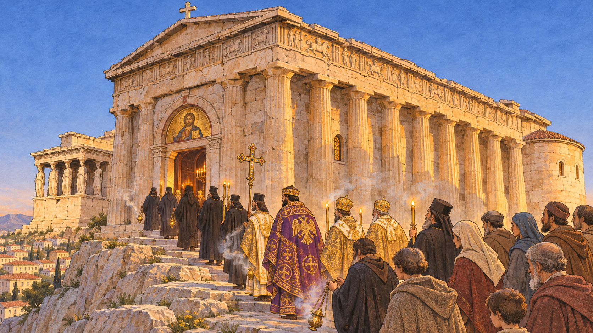
<details><summary>Image Prompt</summary>
(This is Panel 13. Do not include the panel number in the image.)
Style: a hand-drawn travel-sketchbook graphic-novel illustration, with clean dark ink outlines, flat softly shaded color fills and a faint watercolor paper texture, like a page from a traveler's journal; warm, sunlit, painterly lighting; no text, captions, signs, letters or speech bubbles anywhere in the image.

Please generate a 16:9 image in the style above depicting panel 13 of 16. Setting: the Acropolis, Athens, probably the 11th century CE (in 1018, the emperor Basil II gives thanks here), a golden evening. Palette: gold leaf, deep blue, imperial purple, candle amber, cream marble. The Acropolis of Athens: a steep, flat-topped, pale limestone rock rising above the city, crowned by the Parthenon, a long Doric temple of honey-colored marble with eight columns across the front, a low triangular pediment and a long carved frieze under the roof; to its left stands the smaller Erechtheion with its porch of six marble maidens. The sky behind is clear blue. Changes in this era: a small stone cross stands at the roofline, the main entrance has been moved to the west end, with an arched doorway and a small window cut in the wall, and a rounded half-circular apse bulges from the far east end. Camera: low three-quarter view from the southwest along the long side. In the foreground, a procession of black-robed priests and gold-vested bishops with candles, a processional cross and censers approaches the west door, followed by townspeople in plain wool, and bells and incense drift on the evening air. Tone: solemn, luminous, long-lived. Keep every character and place consistent with the other images in this story. Generate the image immediately without asking clarifying questions.
</details>

After the Christian Roman emperors ban the old sacrifices in the late 4th century CE, the temple's worship ends, and probably by the late 6th century it has become a church of the Virgin Mary, Our Lady of Athens. The builders move the entrance to the west, build an apse at the east, and cut windows; Christian inscriptions are still scratched into its columns. In 1018 the emperor Basil II gives thanks there for his victories, and after 1204 it becomes a Catholic cathedral.

## Panel 14: A Mosque, and an Artist at Work
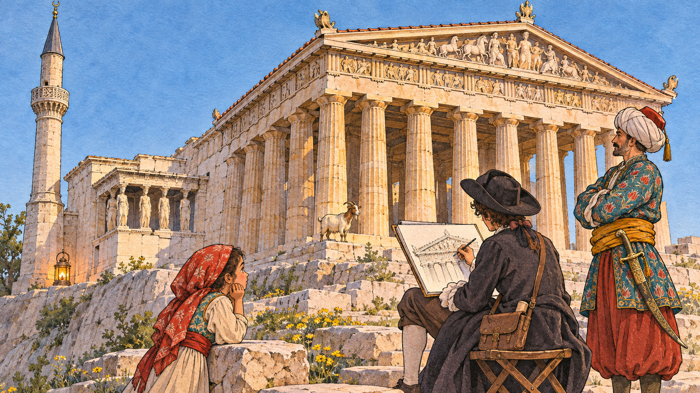
<details><summary>Image Prompt</summary>
(This is Panel 14. Do not include the panel number in the image.)
Style: a hand-drawn travel-sketchbook graphic-novel illustration, with clean dark ink outlines, flat softly shaded color fills and a faint watercolor paper texture, like a page from a traveler's journal; warm, sunlit, painterly lighting; no text, captions, signs, letters or speech bubbles anywhere in the image.

Please generate a 16:9 image in the style above depicting panel 14 of 16. Setting: the Acropolis, Athens, 1674 CE, early morning, crisp light; palette of Iznik turquoise, cobalt, tomato red, brass, saffron and white plaster. The Acropolis of Athens: a steep, flat-topped, pale limestone rock rising above the city, crowned by the Parthenon, a long Doric temple of honey-colored marble with eight columns across the front, a low triangular pediment and a long carved frieze under the roof; to its left stands the smaller Erechtheion with its porch of six marble maidens. The sky behind is clear blue. Changes in this era: a tall slender stone minaret with a pointed cap rises at the southwest corner, and the building is nearly complete, roof and all. Camera: low view from the west, looking up at the west pediment. In the foreground, a young European artist in a dark coat and broad hat sits on a folding stool, sketching the sculptures on a large pad; beside him an Ottoman guard in a turban stands with arms folded, watching patiently. Details: a goat at the corner of the temple, a small girl in a red scarf watching the artist, a lantern left burning at the base of the minaret. Tone: calm, curious, fragile. Keep every character and place consistent with the other images in this story. Generate the image immediately without asking clarifying questions.
</details>

In 1458 the Ottomans take the Acropolis, and soon afterward the cathedral becomes the city's main mosque, with a minaret at its southwest corner. Travelers in the 17th century describe the building as nearly complete, roof and all. In 1674 an artist with the French ambassador draws its sculptures, drawings that now give us our best record of what came next.

## Panel 15: September 26, 1687
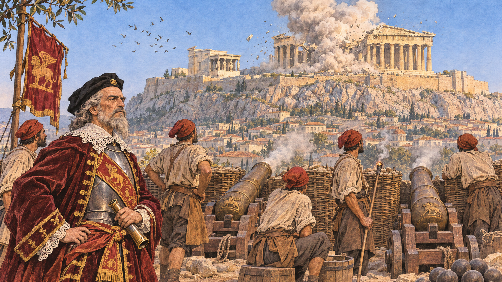
<details><summary>Image Prompt</summary>
(This is Panel 15. Do not include the panel number in the image.)
Style: a hand-drawn travel-sketchbook graphic-novel illustration, with clean dark ink outlines, flat softly shaded color fills and a faint watercolor paper texture, like a page from a traveler's journal; warm, sunlit, painterly lighting; no text, captions, signs, letters or speech bubbles anywhere in the image.

Please generate a 16:9 image in the style above depicting panel 15 of 16. Setting: a hilltop battery of the Venetian army west of the Acropolis, Athens, September 26, 1687, evening, in a hazy golden light; palette of sandstone, steel gray, Mediterranean blue and banner crimson. Camera: wide, from behind the battery looking east across the city to the distant Acropolis, which fills the upper third of the frame. In the foreground, Morosini stands with a spyglass lowered, his face stern and tired. Francesco Morosini, Venetian commander: a lean man of about sixty with a long gray beard, a high forehead and a stern, tired expression, wearing a dark crimson velvet coat with gold braid over a steel breastplate, a wide white lace collar, a black cap with a small gold badge, and the red-and-gold sash of a Venetian captain-general. Around him: The Venetian gunners of 1687: five sunburned artillerymen in shirtsleeves, leather aprons and red knitted caps, standing around two bronze cannons on wheeled wooden carriages behind a low wall of earth-filled wicker baskets, smoke still drifting from the muzzles; one holds a long stick with a smoldering match. In the far distance, atop the rock, the Parthenon is still mostly standing but a huge white-gray plume of smoke and dust balloons from its middle, scattering fragments of marble against the sky. The Acropolis of Athens: a steep, flat-topped, pale limestone rock rising above the city, crowned by the Parthenon, a long Doric temple of honey-colored marble with eight columns across the front, a low triangular pediment and a long carved frieze under the roof; to its left stands the smaller Erechtheion with its porch of six marble maidens. The sky behind is clear blue. Details: a crimson banner with a winged lion hanging limp, a flock of startled birds. Tone: stunned, irreversible. No bodies or people harmed are shown. Keep every character and place consistent with the other images in this story. Generate the image immediately without asking clarifying questions.
</details>

On September 26, 1687, during the Venetian siege of Athens led by Francesco Morosini, a shell strikes the Parthenon. The Ottoman garrison has stored its gunpowder inside; it ignites, blowing out the middle of the building, and about three hundred people are said to have died. Morosini is the same commander who surrendered Candia in 1669. He then tries to lower the horses of Athena's chariot from the west pediment as trophies; the ropes fail and the sculptures shatter.

## Panel 16: Then and Now
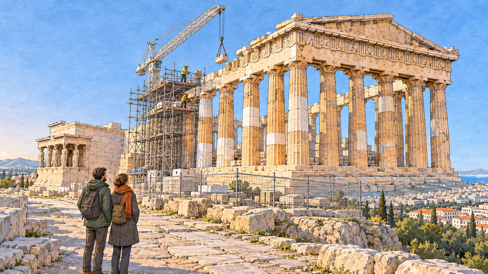
<details><summary>Image Prompt</summary>
(This is Panel 16. Do not include the panel number in the image.)
Style: a hand-drawn travel-sketchbook graphic-novel illustration, with clean dark ink outlines, flat softly shaded color fills and a faint watercolor paper texture, like a page from a traveler's journal; warm, sunlit, painterly lighting; no text, captions, signs, letters or speech bubbles anywhere in the image.

Please generate a 16:9 image in the style above depicting panel 16 of 16, the "Then and Now" panel. Setting: the Acropolis, Athens, today, a cool, clear mid-afternoon in late November, with warm low sun from the left. Camera: a wide view standing at the temple platform's northwest corner and looking along its north side, the same viewpoint as panel 6. The Acropolis of Athens: a steep, flat-topped, pale limestone rock rising above the city, crowned by the Parthenon, a long Doric temple of honey-colored marble with eight columns across the front, a low triangular pediment and a long carved frieze under the roof; to its left stands the smaller Erechtheion with its porch of six marble maidens. The sky behind is clear blue. Changes today: the roof and the middle of the long sides are gone; a steel crane and metal scaffolding rise at one corner, and bright new white marble patches are set among the honey-colored columns. Two adult travelers seen from behind or in distant three-quarter view, dressed for cool November weather: one in a dark green rain jacket, the other in a charcoal wool coat with a rust-colored scarf, both with small daypacks, standing close together and looking at the view. Faces are never shown in detail. They stand on a worn marble path in the foreground, small in the frame, looking up at the temple. Details: workers on the scaffold, a wire fence, the sea glinting at the horizon. Palette: natural daylight, whitewashed walls, sea blue, terracotta, olive. Tone: reflective, hopeful. Keep every character and place consistent with the other images in this story. Generate the image immediately without asking clarifying questions.
</details>

Today the Parthenon is a national symbol and a world monument, still on a building site. Since 1975 the Acropolis restoration service has been undoing earlier repairs and returning each original block to its true place, joining pieces with titanium and filling gaps with new Pentelic marble, left plain so it can be told from the old. Early in the 20th century the engineer Nikolaos Balanos rebuilt parts with iron clamps that rusted, swelled and cracked the marble. The work continues.

### Epilogue - A Public Building, a Public Argument

The Parthenon is not just a temple. It is a public works program voted on by citizens, a statement of empire paid for with allies' silver, a building so refined that its surfaces curve, and a temple that spent about nine hundred years as a church and more than two centuries as a mosque before a shell turned it into a ruin. Everyone who has ever owned it has had to answer the same questions: who paid, who decided, who gets to see it.

| Challenge | How They Responded | Lesson for Today |
|---|---|---|
| Funding a vast temple with allies' contributions | Athens spent part of the League treasury; critics accused Pericles of dressing the city in others' money | Public money brings public argument; power over others is part of the cost |
| Making a building look perfectly straight to the human eye | Ictinus and Callicrates built in curves: a rising floor, swelling and leaning columns | Design for how people see, not only how rulers measure |
| Defending the cost to citizens | Pericles pointed to the jobs it created; the accounts were carved in stone | Public spending should be public record |
| A building damaged over centuries and by war | Restorers replace rusted clamps and fill gaps with plain new marble | Honest restoration shows what is new |

### Call to Action

When you stand on the Acropolis, find the new white marble set into the old golden columns, and ask what the restorers chose to show and to leave plain. Then go to the Acropolis Museum and ask someone who lives here, and someone in London, who should hold the sculptures that are not in Athens. The Learning for All thread of this book asks the same of every public thing: who gets to read it, who gets to argue about it, and who gets to say what it means?

---

## Voices from the Sources

These are paraphrases as reported in Chapter 15, not verbatim quotations.

- Plutarch, *Life of Pericles* (about five centuries later), reports that when his opponents complained of the cost, Pericles offered to pay for the buildings himself if the inscriptions would name him instead of the people; the Assembly told him to spend what he needed from public funds. (Plutarch's account; the story may be polished.)
- Thucydides, a younger contemporary, reports that Pericles told the Athenians the statue of Athena carried 40 talents of refined gold, all of it removable. (As Thucydides reports it.)
- Thucydides, in the Funeral Oration he gives to Pericles in 431 BCE, has him praise Athens as an education to all Greece. (As Thucydides reports it; the speech is Thucydides' version.)

## On the Trip

- **Chapter:** [15. Athens, the Acropolis, and the Persian Wars](../../chapters/15-athens-acropolis/index.md)
- **Where to look:** the rising line of the Parthenon's platform (look along the long edge of the steps), the swelling of its columns and the thicker corner columns against the sky, the bright new white marble set among the old, and the frieze gallery in the Acropolis Museum, where gaps are filled with white plaster casts of the pieces held in London.
- **Explore further:** [The Parthenon's Five Lives](../../sims/parthenon-five-lives-timeline/index.md) and [Agreed Fact or Position?](../../sims/parthenon-marbles-fact-or-position/index.md)
- **Look Closer:** Glaux says: "Look closer at the long step along the temple's side and sight along it: the line rises gently toward the middle." Glaux was perched on a stack of column drums in Panel 9 (The Owl Hunts for a Straight Line), watching a mason test the platform edge.

## Characters and Style

This story follows the shared series bible: [Story Characters, Places and House Style](../characters.md). Glaux's identity comes from the mascot's [character sheet](../../img/mascot/character-sheet.md).

## References

1. [Wikipedia: Parthenon](https://en.wikipedia.org/wiki/Parthenon) - The temple, its construction and its later history
2. [Wikipedia: Pericles](https://en.wikipedia.org/wiki/Pericles) - The Athenian statesman behind the building program
3. [Wikipedia: Phidias](https://en.wikipedia.org/wiki/Phidias) - The sculptor of the Athena Parthenos
4. [Encyclopaedia Britannica: Pericles](https://www.britannica.com/biography/Pericles) - Overview of his life and the age of Athens
5. [UNESCO World Heritage: Acropolis, Athens](https://whc.unesco.org/en/list/404) - The Acropolis monuments and their conservation
