# The Pythia's Busy Day

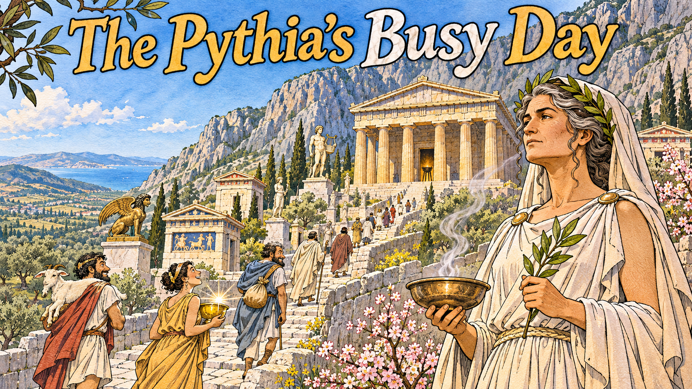
<details>
<summary>Cover Image Prompt</summary>
(This is the Cover Image. Do not include this label in the image.)
Style: a hand-drawn travel-sketchbook graphic-novel illustration, with clean dark ink outlines, flat softly shaded color fills and a faint watercolor paper texture, like a page from a traveler's journal; warm, sunlit, painterly lighting; no text, captions, signs, letters or speech bubbles anywhere in the image.
Please generate a wide-landscape 16:9 cover image for a graphic-novel story. The one exception to the no-text rule is the title: render the words "The Pythia's Busy Day" as bold, hand-lettered title text across the upper third, in honey gold and marble white with a thin dark outline, spelled exactly as written. Place: Delphi, about 550 BCE, a bright early-spring morning. Foreground right, in calm three-quarter profile, stands this figure: The Pythia, Apollo's priestess at Delphi: a dignified woman of about fifty with gray-streaked dark hair under a simple white veil, wearing a plain long white linen gown with a wreath of laurel leaves in her hair, holding a laurel branch in one hand and a shallow bronze offering bowl in the other. Her expression is calm, inward and serious. Behind her, across the whole background: Delphi, the sanctuary of Apollo: a steep rocky terrace on the slope of Mount Parnassus with a paved winding Sacred Way lined with small treasuries and statues, leading up to the large Doric Temple of Apollo with six columns across the front; behind it steep gray limestone cliffs, below it a deep valley of silver-green olive trees stretching to a distant sea. Tiny pilgrims climb the Sacred Way: one carries a white goat, one a gold bowl that flashes in the sun, one a small bundle. Thin laurel smoke curls from a bronze bowl; a tripod silhouette stands in the temple doorway. Palette: marble white, Aegean blue, olive green, honey gold, bronze. Tone: expectant, a little awed, with a hint of humor.
Keep every character and place consistent with the other images in this story. Generate the image immediately without asking clarifying questions.
</details>

<details>
<summary>Narrative Prompt</summary>
**Era and place.** Delphi on the slope of Mount Parnassus, central Greece, about 550 to 546 BCE, in the years when Croesus of Lydia ruled from Sardis (about 560 to about 546 BCE). The final three panels are modern.

**Theme.** One consultation day, followed from two sides: an ordinary farmer who asks a small practical question, and the envoys of a very rich king who ask a world-changing one. The story shows how the oracle worked step by step, how access was not equal, how an answer can be true and still ruin the person who misreads it, and why modern readers who ask a chatbot a question are doing something very old.

**Series house style.** Hand-drawn travel-sketchbook graphic-novel illustration with clean dark ink outlines, flat softly shaded fills and faint watercolor paper texture. No lettering inside any panel; only the cover carries the title. All images are 16:9.

**Story palette.** Classical Greece: marble white, Aegean blue, olive green, honey gold, bronze. Add Lydian royal purple and gold for scenes at Sardis. Modern panels (14 to 16) use natural daylight, whitewashed walls, sea blue, terracotta and olive.

**Creative liberties and uncertainties.**

- The farmer is an illustrative composite; no ancient source names him. The chapter notes that we have no archive of Delphi's private questions, and the best evidence for what ordinary people asked comes from the oracle of Zeus at Dodona.
- The steps of a consultation are pieced together from Plutarch, Herodotus, Euripides, inscriptions and the temple's layout; no ancient writer sets them out in one place. Order and details are reconstructed.
- Herodotus says Croesus sent envoys; he did not travel to Delphi himself. The story follows Herodotus, and the farmer and the envoys share the day only as an illustration. Croesus's gift of the right to consult first is told by Herodotus.
- Herodotus wrote about a century later. All the famous answers were written down after the events they seem to predict.
- The Temple of Apollo burned in 548 BCE and was rebuilt afterward. The images show a six-column Doric temple, as in the series' Delphi block, and avoid the later monuments (the polygonal wall, the Athenian Treasury and the Serpent Column), which did not yet exist or were not yet in place.
- Plutarch says the earliest Pythia was a young woman, and that later the Delphians chose a woman over fifty. The series' Pythia block shows the older woman. The Pythia is always drawn calm, as Plutarch and the painted Berlin cup show her, never raving.
- Apollo appears only as a gilded statue.

**Cast.** Recurring characters, places and objects follow the shared series bible at `docs/stories/characters.md`; Glaux follows `docs/img/mascot/character-sheet.md`.

- Glaux the Little Owl: see docs/stories/characters.md and docs/img/mascot/character-sheet.md (Glaux). Glaux hides in one panel (Panel 6).
- The Pythia, Apollo's priestess at Delphi: see docs/stories/characters.md.
- Delphi, the sanctuary of Apollo: see docs/stories/characters.md.
- Apollo (statue only), from the Olympians block: see docs/stories/characters.md.
- The Travelers (Then and Now panel): see docs/stories/characters.md.

Characters who appear only in this story:

The farmer:

```text
An Attic farmer (an invented, unnamed everyman): a lean, sun-browned man of about forty with a short graying beard and worried deep-set eyes, wearing a patched undyed wool tunic belted with rope, a battered straw petasos hat hanging down his back, rope-soled sandals gray with dust from a week's walk, carrying a walking staff, a small cloth bundle and a leather pouch of small silver coins; hopeful but anxious, often wringing his hat in his hands.
```

King Croesus of Lydia:

```text
Croesus, king of Lydia: a heavyset, richly dressed man of about fifty-five with an oiled dark beard shot with gray, kohl-lined dark eyes, a heavy gold torque necklace, gold armbands and a thin gold fillet on his head, wearing a long purple robe embroidered with gold rosettes over a white linen tunic; proud, self-assured and a little too pleased with himself.
```

The Lydian envoys:

```text
Two Lydian envoys sent by King Croesus: dignified middle-aged men with oiled dark beards, long belted tunics of deep purple with gold-thread borders and soft pointed felt caps, one carrying a large gold mixing bowl in both hands and the other a bundle of rolled purple cloths; polished, unhurried, used to being let through.
```
</details>

### Prologue - A Day When the God Is Home

On a handful of days each year, a god is said to answer questions at Delphi. The woman who speaks for him is called the Pythia, and she gets very little rest on those days. This story follows two petitioners: an Attic farmer with a purse of small silver coins and one practical worry, and the envoys of a king whose treasure is the stuff of proverbs. Each asks a question. One answer is plain; the other has gone down in history as the most famous trap in Greek storytelling.

**Find Glaux:** Glaux hides in one panel of this story. Can you spot the little owl?

## Panel 1: The Road Up Parnassus
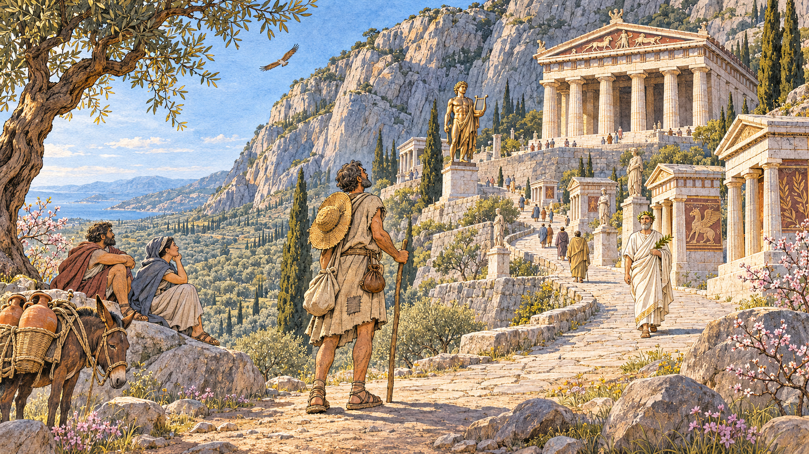
<details><summary>Image Prompt</summary>
(This is Panel 01. Do not include the panel number in the image.)
I am about to ask you to generate a series of images for a graphic novel. Please make the images have a consistent style and consistent characters. Do not ask any clarifying questions. Just generate the image immediately when asked.
Style: a hand-drawn travel-sketchbook graphic-novel illustration, with clean dark ink outlines, flat softly shaded color fills and a faint watercolor paper texture, like a page from a traveler's journal; warm, sunlit, painterly lighting; no text, captions, signs, letters or speech bubbles anywhere in the image.
Please generate a 16:9 image depicting panel 1 of 16. Wide establishing shot, low angle from the lower slope looking up toward the temple, in Delphi, about 550 BCE, a clear early-spring morning with long golden light. Palette: marble white, Aegean blue, olive green, honey gold, bronze. In the foreground, small and centered on the dusty path, the farmer pauses to look up: An Attic farmer (an invented, unnamed everyman): a lean, sun-browned man of about forty with a short graying beard and worried deep-set eyes, wearing a patched undyed wool tunic belted with rope, a battered straw petasos hat hanging down his back, rope-soled sandals gray with dust from a week's walk, carrying a walking staff, a small cloth bundle and a leather pouch of small silver coins; hopeful but anxious, often wringing his hat in his hands. Behind him fills the view: Delphi, the sanctuary of Apollo: a steep rocky terrace on the slope of Mount Parnassus with a paved winding Sacred Way lined with small treasuries and statues, leading up to the large Doric Temple of Apollo with six columns across the front; behind it steep gray limestone cliffs, below it a deep valley of silver-green olive trees stretching to a distant sea. Add a mule laden with water jars, two other pilgrims in traveling cloaks resting on a boulder, a priest in a white robe walking down with a laurel sprig, and a hawk circling the cliffs. Tone: hopeful and anxious, the first step of a long day.
Keep every character and place consistent with the other images in this story. Generate the image immediately without asking clarifying questions.
</details>

A farmer from Attica has walked for a week to reach this slope, and now he stands looking up at the temple he has heard about all his life. He carries a purse of small silver coins and exactly one question. The Greeks believed that on the right day, in the right place, a god might answer a human being, and this is that place. Nothing about the climb is certain except the weather.

## Panel 2: The God's Calendar
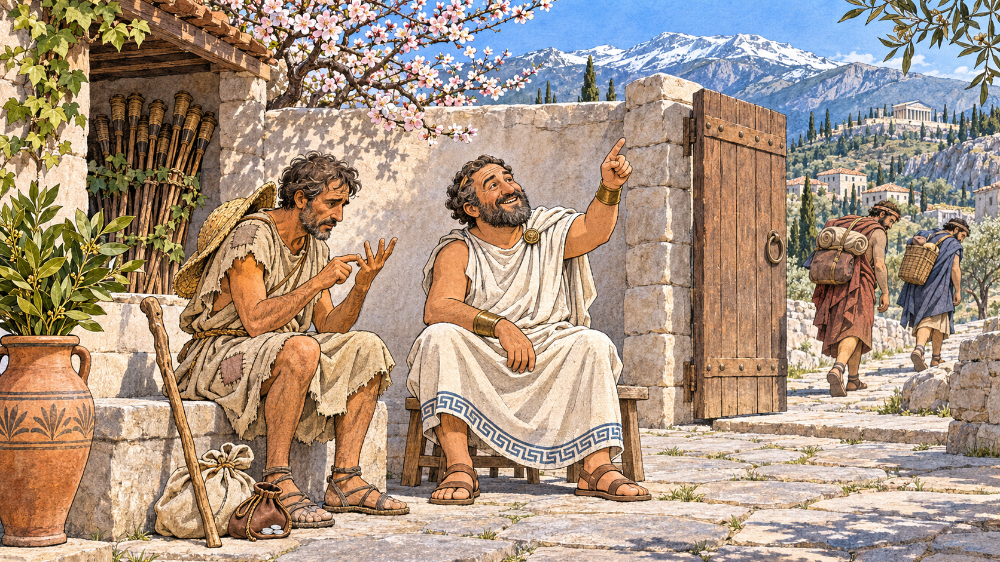
<details><summary>Image Prompt</summary>
(This is Panel 02. Do not include the panel number in the image.)
Style: a hand-drawn travel-sketchbook graphic-novel illustration, with clean dark ink outlines, flat softly shaded color fills and a faint watercolor paper texture, like a page from a traveler's journal; warm, sunlit, painterly lighting; no text, captions, signs, letters or speech bubbles anywhere in the image.
Please generate a 16:9 image depicting panel 2 of 16. Medium-wide shot in the sunny stone courtyard of a Delphic lodging house in the village below the sanctuary, about 550 BCE, a bright, cool early-spring afternoon, with snow still lying on the high peaks of Parnassus in the background. Palette: marble white, Aegean blue, olive green, honey gold, bronze. In the center the farmer sits on a low stone bench counting days on his fingers: An Attic farmer (an invented, unnamed everyman): a lean, sun-browned man of about forty with a short graying beard and worried deep-set eyes, wearing a patched undyed wool tunic belted with rope, a battered straw petasos hat hanging down his back, rope-soled sandals gray with dust from a week's walk, carrying a walking staff, a small cloth bundle and a leather pouch of small silver coins; hopeful but anxious, often wringing his hat in his hands. Across from him a broad-faced Delphian host in a white wool tunic points toward the calm blue sky and smiles reassuringly. Visible details: a stack of ivy-wreathed torches in a shadowed corner, put away for the winter; fresh laurel branches in a clay jar; almond blossom on a branch over the wall; a heavy empty wooden door at the rear, newly unbarred; two disappointed traveling merchants shouldering packs and heading back down the road. Tone: patient, hopeful, quietly humorous.
Keep every character and place consistent with the other images in this story. Generate the image immediately without asking clarifying questions.
</details>

Apollo does not answer every day. In the early centuries the god spoke only once a year, on his birthday in early spring; later, consultations are usually said to have taken place on the seventh day of each month, for the nine months of the year when the god was thought to be at home. The farmer has timed his journey to arrive just after the god's spring return. Anyone who arrives in the winter finds a shuttered sanctuary.

> **Myth or Evidence?** The belief that Apollo spent the winter with the Hyperboreans, a happy people "beyond the north wind," while Dionysus held the sanctuary, is reported by Plutarch, who served as a priest at Delphi. Ancient writers did say the oracle gave no answers in the winter months, but Greek months were lunar and varied from city to city, so no one can convert a modern date exactly. A visitor on a November day would very probably have found the god away and the Pythia silent.

## Panel 3: Cold Water at the Castalian Spring
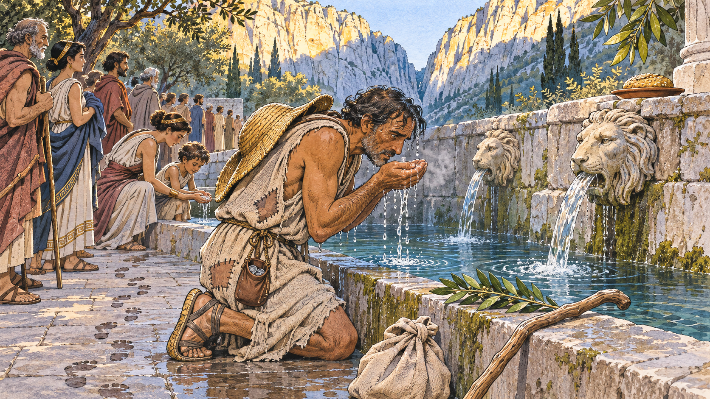
<details><summary>Image Prompt</summary>
(This is Panel 03. Do not include the panel number in the image.)
Style: a hand-drawn travel-sketchbook graphic-novel illustration, with clean dark ink outlines, flat softly shaded color fills and a faint watercolor paper texture, like a page from a traveler's journal; warm, sunlit, painterly lighting; no text, captions, signs, letters or speech bubbles anywhere in the image.
Please generate a 16:9 image depicting panel 3 of 16. Medium shot at the Castalian Spring, Delphi, about 550 BCE, early morning with cool blue shadow and bright cliff-tops. Palette: marble white, Aegean blue, olive green, honey gold, bronze. Foreground: the farmer kneels at a paved stone court where spring water pours from spouts into a long basin, cupping icy water to his hands and hair, his breath faintly misting: An Attic farmer (an invented, unnamed everyman): a lean, sun-browned man of about forty with a short graying beard and worried deep-set eyes, wearing a patched undyed wool tunic belted with rope, a battered straw petasos hat hanging down his back, rope-soled sandals gray with dust from a week's walk, carrying a walking staff, a small cloth bundle and a leather pouch of small silver coins; hopeful but anxious, often wringing his hat in his hands. Behind him two enormous pale cliffs (the Phaedriades, "the shining ones") gleam in the sun on either side of a narrow gorge. Visible details: a line of other pilgrims waiting, one rinsing a child's hands; a laurel branch and a wooden staff laid on the basin's rim; moss on the wet stone; carved lion-head spouts; a small offering cake left on a ledge; a trail of wet footprints on the paving. Tone: bracing, reverent, a little shiver of nerves.
Keep every character and place consistent with the other images in this story. Generate the image immediately without asking clarifying questions.
</details>

Nobody approaches Apollo unwashed. The farmer's first stop is the Castalian Spring, where cold water pours from the gorge between two great cliffs. A splash on the hands and hair is the first step of every visit, whether the visitor is a farmer or a king's envoy. Today the water is cold enough to make him gasp, and the line behind him does not mind.

## Panel 4: The Pythia's Morning
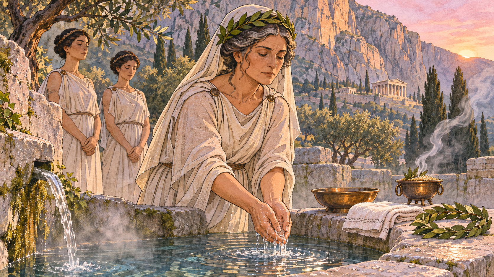
<details><summary>Image Prompt</summary>
(This is Panel 04. Do not include the panel number in the image.)
Style: a hand-drawn travel-sketchbook graphic-novel illustration, with clean dark ink outlines, flat softly shaded color fills and a faint watercolor paper texture, like a page from a traveler's journal; warm, sunlit, painterly lighting; no text, captions, signs, letters or speech bubbles anywhere in the image.
Please generate a 16:9 image depicting panel 4 of 16. Close-to-medium shot, slightly low angle, at a quiet corner of the Castalian Spring at first light, Delphi, about 550 BCE, soft rose and gold dawn with cool shadow. Palette: marble white, Aegean blue, olive green, honey gold, bronze. At center, calm and unhurried, stands this figure rinsing her hands in the basin: The Pythia, Apollo's priestess at Delphi: a dignified woman of about fifty with gray-streaked dark hair under a simple white veil, wearing a plain long white linen gown with a wreath of laurel leaves in her hair, holding a laurel branch in one hand and a shallow bronze offering bowl in the other. Her expression is calm, inward and serious. (In this image she has set the laurel branch and bowl on the stone rim while she rinses her hands.) Beside her a small bronze bowl sends up a thin ribbon of smoke from burning laurel leaves and barley meal. Visible details: two white-robed temple attendants standing back with folded hands; a folded white towel of linen; a laurel wreath resting on the rim; steam of cool mist rising off the water; dew on the stones; tall cliffs behind. Tone: solemn, calm, private; no drama.
Keep every character and place consistent with the other images in this story. Generate the image immediately without asking clarifying questions.
</details>

The Pythia has been up before the pilgrims. She bathes in the spring, and tradition says she then purifies herself with smoke from burning laurel leaves and barley meal. Plutarch, who worked beside the Pythia of his own day, says she came from a poor farming family and had no special education. Today she will answer the questions of strangers, one after another, until the day is over.

> **Myth or Evidence?** Picture a calm woman, not a raving one. The image of a foaming, writhing Pythia comes mostly from the Roman poet Lucan and from later painters. Plutarch, who knew the Pythias personally, and a cup painted in Athens about 440 BCE both show a calm woman speaking from her tripod.

## Panel 5: The Fee and the Sponsor
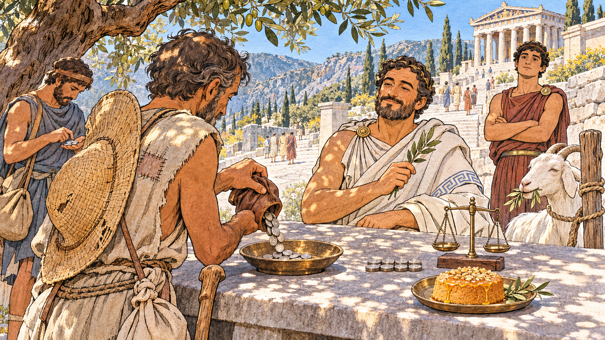
<details><summary>Image Prompt</summary>
(This is Panel 05. Do not include the panel number in the image.)
Style: a hand-drawn travel-sketchbook graphic-novel illustration, with clean dark ink outlines, flat softly shaded color fills and a faint watercolor paper texture, like a page from a traveler's journal; warm, sunlit, painterly lighting; no text, captions, signs, letters or speech bubbles anywhere in the image.
Please generate a 16:9 image depicting panel 5 of 16. Over-the-shoulder medium shot looking across a shaded stone table at the foot of the Sacred Way, Delphi, about 550 BCE, mid-morning, with dappled light under an olive tree. Palette: marble white, Aegean blue, olive green, honey gold, bronze. In the foreground, seen from behind and slightly to the side, the farmer pours small silver coins from his pouch into a bronze dish: An Attic farmer (an invented, unnamed everyman): a lean, sun-browned man of about forty with a short graying beard and worried deep-set eyes, wearing a patched undyed wool tunic belted with rope, a battered straw petasos hat hanging down his back, rope-soled sandals gray with dust from a week's walk, carrying a walking staff, a small cloth bundle and a leather pouch of small silver coins; hopeful but anxious, often wringing his hat in his hands. Across the table, a calm Delphian citizen in a white himation with a laurel sprig in his hand (the farmer's sponsor, a foreigner needs one) nods approvingly. Visible details: a sacred honey cake on a bronze plate; a white goat tied to a post chewing placidly; a stack of ten small silver coins beside a little scale; a temple assistant watching with folded arms; distant temple columns catching the sun; a second pilgrim behind the farmer counting coins in his palm. Tone: businesslike, nervous, faintly comic.
Keep every character and place consistent with the other images in this story. Generate the image immediately without asking clarifying questions.
</details>

Access to the god has a price. The farmer must pay a fee, the *pelanos*, a word that first meant a sacred cake and later the money paid in its place. A foreigner also needs a sponsor, a Delphic citizen called a *proxenos*, to present him. On top of the fee come the goat and the other offerings, but for most pilgrims the biggest expense was the journey itself.

## Panel 6: Will the Goat Shiver?
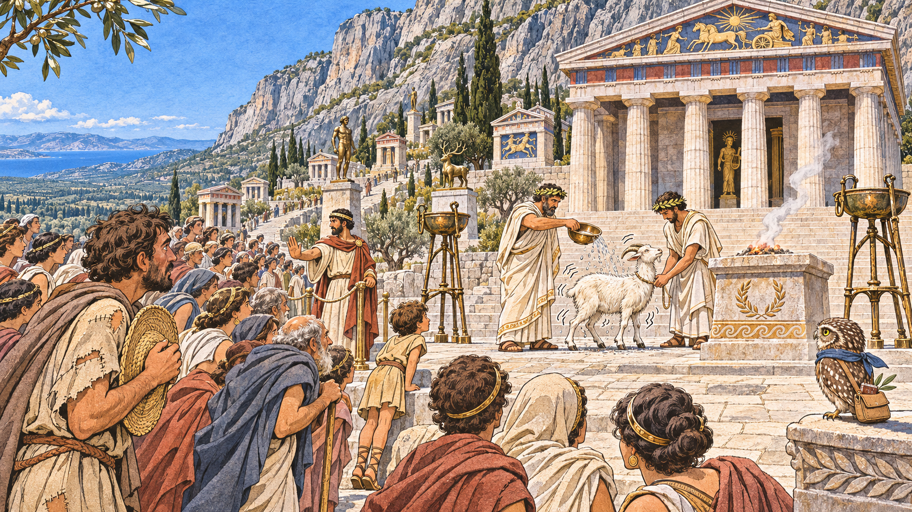
<details><summary>Image Prompt</summary>
(This is Panel 06. Do not include the panel number in the image.)
Style: a hand-drawn travel-sketchbook graphic-novel illustration, with clean dark ink outlines, flat softly shaded color fills and a faint watercolor paper texture, like a page from a traveler's journal; warm, sunlit, painterly lighting; no text, captions, signs, letters or speech bubbles anywhere in the image.
Please generate a 16:9 image depicting panel 6 of 16. Wide shot from a crowd's-eye angle toward the east front of the temple, with the great altar, Delphi, about 550 BCE, midday, bright overhead sun and sharp shadows. Palette: marble white, Aegean blue, olive green, honey gold, bronze. In the center, two priests in white robes and laurel wreaths hold a white goat steady beside the altar and sprinkle cold water on it from a bronze bowl; the goat's whole body is caught in a shiver, with tiny motion lines and flying droplets. In front of the temple stands the setting: Delphi, the sanctuary of Apollo: a steep rocky terrace on the slope of Mount Parnassus with a paved winding Sacred Way lined with small treasuries and statues, leading up to the large Doric Temple of Apollo with six columns across the front; behind it steep gray limestone cliffs, below it a deep valley of silver-green olive trees stretching to a distant sea. In the crowd at left, the farmer in his worn tunic, his straw hat clutched to his chest, watches with held breath. Visible details: a crowd of about thirty pilgrims in cloaks, leaning forward; a boy standing on tiptoe; bronze tripods on tall bases; a thin curl of altar smoke; a temple attendant holding back the line with an open palm. Glaux the Little Owl: a true little owl (Athene noctua), small, round and compact, with a flat rounded head and no ear tufts, warm earth-brown plumage with cream spots, bright lemon-yellow eyes under pale cream eyebrows, a cream-white throat patch and a short pale greenish-yellow beak. Glaux wears a small Aegean-blue scarf and a tan canvas satchel across the body with a small leather-bound travel notebook peeking out, and a sprig of three olive leaves tucked into the satchel strap. Alert, curious and warm expression. Glaux is drawn small, perched at the edge of the scene, noticeable on a second look: perched on a statue base at the lower right. Only one owl appears in this image. Tone: tense, suspenseful, quietly funny.
Keep every character and place consistent with the other images in this story. Generate the image immediately without asking clarifying questions.
</details>

Before the oracle can speak, the god must be shown to be present. Priests sprinkle cold water on a goat, and if the animal trembles from head to hoof, Apollo is at home and the day's consultations can go ahead; if not, there will be none. When the goat trembles, the crowd lets out its breath. The goat is then sacrificed at the great altar, and the line begins to move.

> **Myth or Evidence?** The goat test and the other steps come from Plutarch, Herodotus, Euripides and inscriptions, pieced together by modern scholars. No ancient writer sets out the whole procedure in one place, so the order of events here is a reconstruction.

## Panel 7: Walking Past the Line
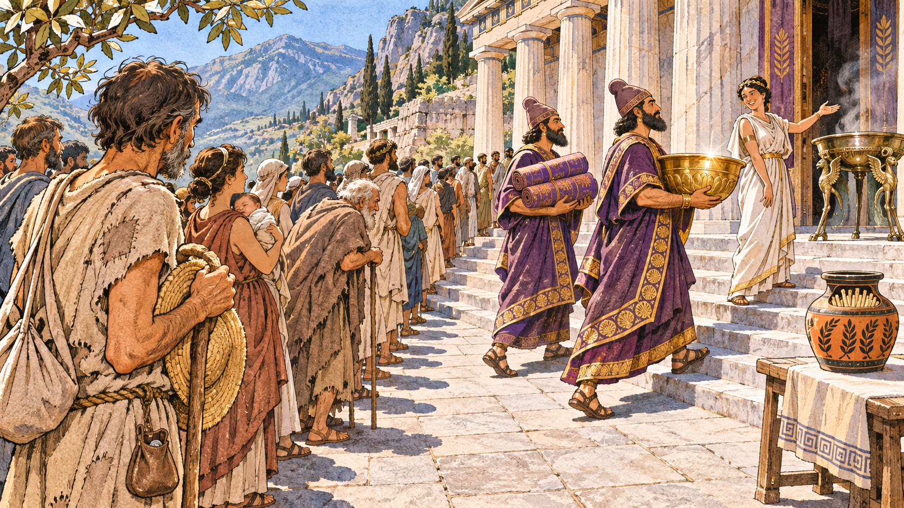
<details><summary>Image Prompt</summary>
(This is Panel 07. Do not include the panel number in the image.)
Style: a hand-drawn travel-sketchbook graphic-novel illustration, with clean dark ink outlines, flat softly shaded color fills and a faint watercolor paper texture, like a page from a traveler's journal; warm, sunlit, painterly lighting; no text, captions, signs, letters or speech bubbles anywhere in the image.
Please generate a 16:9 image depicting panel 7 of 16. Medium-wide shot from behind the farmer's shoulder, on the paved terrace in front of the temple steps, Delphi, about 550 BCE, early afternoon, strong sun. Palette: marble white, Aegean blue, olive green, honey gold, bronze, with Lydian royal purple and gold. In the foreground left, the farmer stands in a long line, shoulders slumped, watching: An Attic farmer (an invented, unnamed everyman): a lean, sun-browned man of about forty with a short graying beard and worried deep-set eyes, wearing a patched undyed wool tunic belted with rope, a battered straw petasos hat hanging down his back, rope-soled sandals gray with dust from a week's walk, carrying a walking staff, a small cloth bundle and a leather pouch of small silver coins; hopeful but anxious, often wringing his hat in his hands. Striding past the line toward the temple door, waved forward by a smiling temple attendant: Two Lydian envoys sent by King Croesus: dignified middle-aged men with oiled dark beards, long belted tunics of deep purple with gold-thread borders and soft pointed felt caps, one carrying a large gold mixing bowl in both hands and the other a bundle of rolled purple cloths; polished, unhurried, used to being let through. Visible details: the gold bowl flashing sunlight; a line of about twenty waiting pilgrims, among them a mother with a baby and an old man leaning on a stick; a lot-jar on a table at the side; carved temple steps; a bronze tripod gleaming; the farmer's hand tightening on his hat. Tone: wry, unfair, resigned.
Keep every character and place consistent with the other images in this story. Generate the image immediately without asking clarifying questions.
</details>

Some visitors never wait. Herodotus says that after Croesus sent his lavish gifts, the Delphians granted him and every Lydian forever the right to consult first, freedom from fees, front seats at festivals and even citizenship. The envoys of King Croesus walk past the farmer without a glance. The oracle is open to everyone, but not to everyone equally, and the difference is bought with gold.

## Panel 8: The King's Question
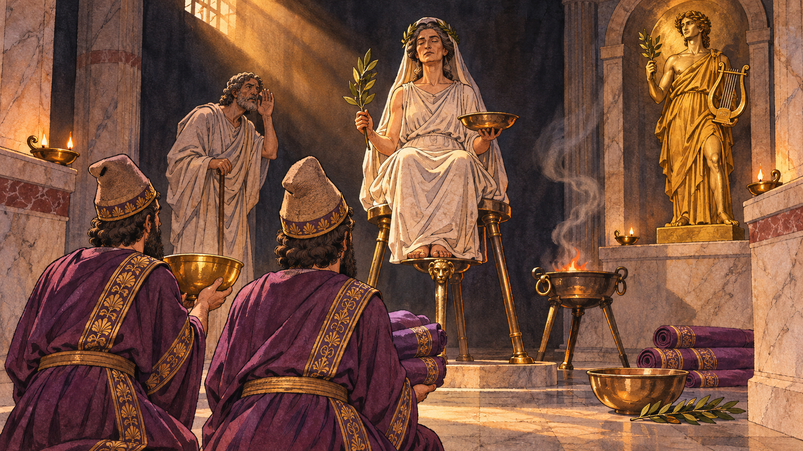
<details><summary>Image Prompt</summary>
(This is Panel 08. Do not include the panel number in the image.)
Style: a hand-drawn travel-sketchbook graphic-novel illustration, with clean dark ink outlines, flat softly shaded color fills and a faint watercolor paper texture, like a page from a traveler's journal; warm, sunlit, painterly lighting; no text, captions, signs, letters or speech bubbles anywhere in the image.
Please generate a 16:9 image depicting panel 8 of 16. Interior medium-wide shot from behind the kneeling envoys, down the length of the temple's inner chamber (the adyton), about 550 BCE, lit only by oil lamps and a shaft of gold light from a high window, with deep shadows. Palette: marble white, bronze, honey gold, deep shadow blue and Lydian royal purple. At the far end, calm and still, the Pythia sits on a tall bronze three-legged tripod: The Pythia, Apollo's priestess at Delphi: a dignified woman of about fifty with gray-streaked dark hair under a simple white veil, wearing a plain long white linen gown with a wreath of laurel leaves in her hair, holding a laurel branch in one hand and a shallow bronze offering bowl in the other. Her expression is calm, inward and serious. Kneeling in the foreground with their backs to us: Two Lydian envoys sent by King Croesus: dignified middle-aged men with oiled dark beards, long belted tunics of deep purple with gold-thread borders and soft pointed felt caps, one carrying a large gold mixing bowl in both hands and the other a bundle of rolled purple cloths; polished, unhurried, used to being let through. In a niche beside the tripod stands a small gilded statue of Apollo, only a statue and not a living god, drawn from this reference: Zeus, king of the gods: a broad, powerfully built older man with a full curled silver-white beard and thick white hair, wearing a gold-edged crimson himation draped over one shoulder, holding a short gilded scepter topped with an eagle; a faint storm-cloud glow behind him. Poseidon, god of the sea: a muscular man with a windswept sea-green beard and hair, a deep teal himation, holding a three-pronged bronze trident. Apollo, god of light and prophecy: a graceful, beardless young man with shoulder-length golden-brown hair crowned with a laurel wreath, a saffron-yellow chiton, holding a small laurel branch and a gold lyre. Only the Apollo statue appears in this image; Zeus and Poseidon do not appear. Visible details: a standing prophet in a white robe with a hand raised to listen; a lit bronze hearth with a thread of smoke; rolled purple cloths on the floor; bronze bowl; laurel sprigs. Tone: hushed, solemn, ominous.
Keep every character and place consistent with the other images in this story. Generate the image immediately without asking clarifying questions.
</details>

Croesus has already tested the oracles. Herodotus says he sent envoys to seven, with orders to ask on the hundredth day what the king was doing at that moment, and only Delphi named the strange meal he had chosen: a tortoise boiled with lamb in a bronze pot. Satisfied, Croesus sent gifts and then the real question: should he make war on the Persians? In the inner chamber the Pythia answers, as Herodotus tells it, that if Croesus attacks Persia he will destroy a great empire, and that he should find the most powerful Greeks as allies.

## Panel 9: The Lot Jar
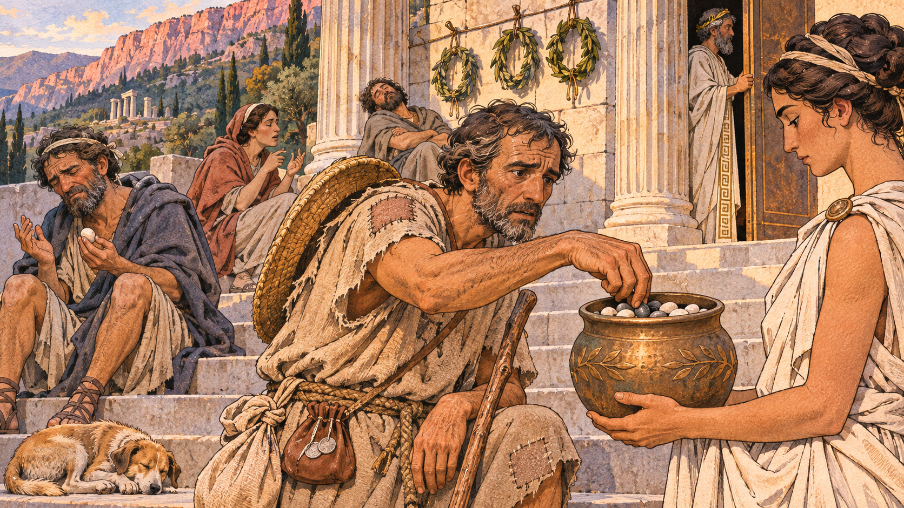
<details><summary>Image Prompt</summary>
(This is Panel 09. Do not include the panel number in the image.)
Style: a hand-drawn travel-sketchbook graphic-novel illustration, with clean dark ink outlines, flat softly shaded color fills and a faint watercolor paper texture, like a page from a traveler's journal; warm, sunlit, painterly lighting; no text, captions, signs, letters or speech bubbles anywhere in the image.
Please generate a 16:9 image depicting panel 9 of 16. Close medium shot on the temple steps, Delphi, about 550 BCE, late afternoon with long amber light and the cliffs turning rose. Palette: marble white, Aegean blue, olive green, honey gold, bronze. At center the farmer reaches into a bronze jar held by a white-robed temple attendant, his fingers closing on a small pebble: An Attic farmer (an invented, unnamed everyman): a lean, sun-browned man of about forty with a short graying beard and worried deep-set eyes, wearing a patched undyed wool tunic belted with rope, a battered straw petasos hat hanging down his back, rope-soled sandals gray with dust from a week's walk, carrying a walking staff, a small cloth bundle and a leather pouch of small silver coins; hopeful but anxious, often wringing his hat in his hands. Visible details: the jar full of white and dark pebbles; a handful of tired pilgrims sitting on the steps, one asleep against a column, another practicing a question with moving lips; a priest holding the temple door open a hand's width; a stray dog; laurel wreaths drying on a nearby wall; the farmer's staff leaning against his knee; a second pilgrim shaking his head after a pale pebble. Tone: tense, tired, hopeful.
Keep every character and place consistent with the other images in this story. Generate the image immediately without asking clarifying questions.
</details>

Those without a special privilege take their turn by lot. The farmer draws a pebble from the jar, and the sun slides toward the cliffs while he waits. If the line is long, a visitor might not be heard that month at all. He rehearses his question under his breath, because a god, the Greeks said, can only answer the question we actually ask.

## Panel 10: A Plain Answer for a Plain Question
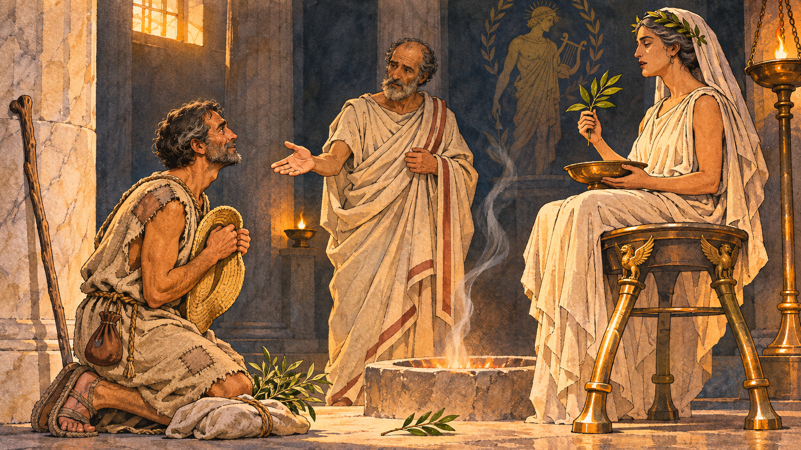
<details><summary>Image Prompt</summary>
(This is Panel 10. Do not include the panel number in the image.)
Style: a hand-drawn travel-sketchbook graphic-novel illustration, with clean dark ink outlines, flat softly shaded color fills and a faint watercolor paper texture, like a page from a traveler's journal; warm, sunlit, painterly lighting; no text, captions, signs, letters or speech bubbles anywhere in the image.
Please generate a 16:9 image depicting panel 10 of 16. Interior medium shot from the side, the lamp-lit inner chamber of the Temple of Apollo at Delphi, about 550 BCE, golden lamplight against deep shadow. Palette: marble white, bronze, honey gold, olive green, shadow blue. At left the farmer kneels at the inner hearth, hat in his hands, head bowed, a single sprig of laurel before him: An Attic farmer (an invented, unnamed everyman): a lean, sun-browned man of about forty with a short graying beard and worried deep-set eyes, wearing a patched undyed wool tunic belted with rope, a battered straw petasos hat hanging down his back, rope-soled sandals gray with dust from a week's walk, carrying a walking staff, a small cloth bundle and a leather pouch of small silver coins; hopeful but anxious, often wringing his hat in his hands. At right, calm on the tall bronze tripod, speaking quietly: The Pythia, Apollo's priestess at Delphi: a dignified woman of about fifty with gray-streaked dark hair under a simple white veil, wearing a plain long white linen gown with a wreath of laurel leaves in her hair, holding a laurel branch in one hand and a shallow bronze offering bowl in the other. Her expression is calm, inward and serious. Visible details: a white-robed prophet standing between them, relaying the answer with an open palm; a thin ribbon of smoke from the hearth; a bundle of young olive cuttings wrapped in damp cloth lying at the farmer's side; lamplight on the bronze tripod legs; the farmer's face lifting in slow relief; a faint warm glow from a high window. Tone: tender, quiet, relieved.
Keep every character and place consistent with the other images in this story. Generate the image immediately without asking clarifying questions.
</details>

When his turn comes, the farmer asks the sort of question ordinary people asked of oracles: is it better and more good for me to plant olives? At Dodona, the oracle of Zeus, more than 4,000 lead tablets survive with questions like this one. The answer, as the Delphic answers recorded closest to their time tend to be, is short and practical: an approval or a command, with no riddle. He steps back into the daylight with nothing to decode and a road to walk home.

## Panel 11: News Reaches Sardis
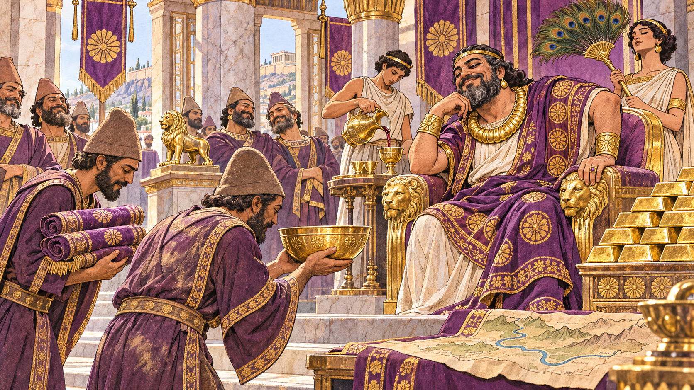
<details><summary>Image Prompt</summary>
(This is Panel 11. Do not include the panel number in the image.)
Style: a hand-drawn travel-sketchbook graphic-novel illustration, with clean dark ink outlines, flat softly shaded color fills and a faint watercolor paper texture, like a page from a traveler's journal; warm, sunlit, painterly lighting; no text, captions, signs, letters or speech bubbles anywhere in the image.
Please generate a 16:9 image depicting panel 11 of 16. Medium-wide shot, slightly low angle, inside the throne hall of the royal palace at Sardis, capital of Lydia, about 547 BCE, bright morning light through tall doorways. Palette: Lydian royal purple, gold, marble white, warm limestone, bronze. On a cushioned gold-trimmed throne, leaning forward with a pleased smile, sits this man: Croesus, king of Lydia: a heavyset, richly dressed man of about fifty-five with an oiled dark beard shot with gray, kohl-lined dark eyes, a heavy gold torque necklace, gold armbands and a thin gold fillet on his head, wearing a long purple robe embroidered with gold rosettes over a white linen tunic; proud, self-assured and a little too pleased with himself. Before him, bowing and dusty from the road, are: Two Lydian envoys sent by King Croesus: dignified middle-aged men with oiled dark beards, long belted tunics of deep purple with gold-thread borders and soft pointed felt caps, one carrying a large gold mixing bowl in both hands and the other a bundle of rolled purple cloths; polished, unhurried, used to being let through. Visible details: gold ingots stacked at the throne's side; tall purple banners; a servant pouring wine from a gold pitcher; courtiers in pointed caps exchanging satisfied glances; a map-like cloth spread on a table with a river drawn across it (no letters); a small gold lion statue on a stand; an attendant fanning with a peacock feather. Tone: triumphant, gleaming, a little too confident.
Keep every character and place consistent with the other images in this story. Generate the image immediately without asking clarifying questions.
</details>

Croesus takes the answer as a promise of victory. He gathers an army, crosses the Halys River into Persian territory, and fights an indecisive battle. Then he goes home, and the Persian king Cyrus follows him. The god's words said that he would destroy a great empire. They did not say which one.

## Panel 12: The Empire That Fell
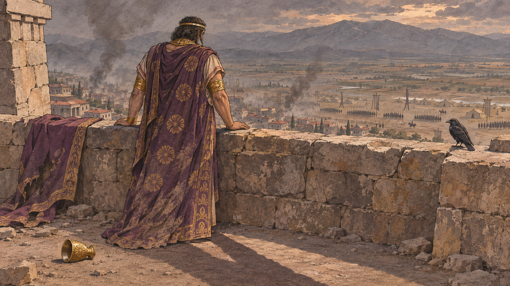
<details><summary>Image Prompt</summary>
(This is Panel 12. Do not include the panel number in the image.)
Style: a hand-drawn travel-sketchbook graphic-novel illustration, with clean dark ink outlines, flat softly shaded color fills and a faint watercolor paper texture, like a page from a traveler's journal; warm, sunlit, painterly lighting; no text, captions, signs, letters or speech bubbles anywhere in the image.
Please generate a 16:9 image depicting panel 12 of 16. Wide, high-angle shot from behind a lone figure on a stone rampart overlooking the plain below the citadel of Sardis, Lydia, about 546 BCE, gray late-afternoon light with smoke haze. Palette: ash gray, faded Lydian purple, dull gold, ochre, dark bronze. Standing alone with his back to us, hands resting on the wall, head slightly bowed: Croesus, king of Lydia: a heavyset, richly dressed man of about fifty-five with an oiled dark beard shot with gray, kohl-lined dark eyes, a heavy gold torque necklace, gold armbands and a thin gold fillet on his head, wearing a long purple robe embroidered with gold rosettes over a white linen tunic; proud, self-assured and a little too pleased with himself. (Here he is seen only from behind, subdued, his robe dusty.) Below him, far off, are distant silhouettes of Persian soldiers with plain unmarked banners and tall cloth standards, tents across the plain, thin columns of smoke rising from the lower town. Visible details: a fallen gold cup in the dust at his feet; a broken purple banner draped over a block; a single crow on the wall; distant mountains at the horizon; a long shadow stretching behind him. No weapons mid-strike; no bodies. Tone: still, ruined, grave; the moment of understanding.
Keep every character and place consistent with the other images in this story. Generate the image immediately without asking clarifying questions.
</details>

Cyrus takes Sardis and captures the king. The great empire Croesus destroyed was his own. In Herodotus's account, Croesus later sent his chains to Delphi and asked whether the god was not ashamed; the Pythia replied that he should have asked *which* empire, and had only himself to blame for not asking.

> **Myth or Evidence?** The fall of Sardis in about 546 BCE is history. The story of the answer is a tale told by Herodotus about a century later, and every famous prophecy was written down only after the event it seemed to predict. Even Croesus's end has three versions in a hundred years: a painted vase, a poem from 468 BCE and Herodotus. Treat the oracle's answer as a story that grew in the telling.

## Panel 13: Something in the Air
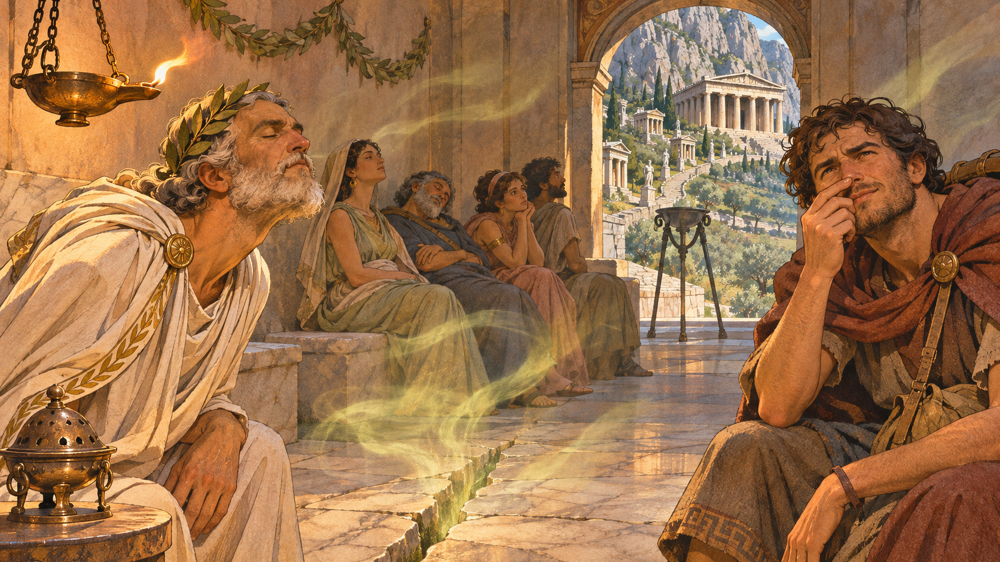
<details><summary>Image Prompt</summary>
(This is Panel 13. Do not include the panel number in the image.)
Style: a hand-drawn travel-sketchbook graphic-novel illustration, with clean dark ink outlines, flat softly shaded color fills and a faint watercolor paper texture, like a page from a traveler's journal; warm, sunlit, painterly lighting; no text, captions, signs, letters or speech bubbles anywhere in the image.
Please generate a 16:9 image depicting panel 13 of 16. Medium shot inside a small lamp-lit waiting room beside the temple's inner chamber at Delphi, as an ancient writer might have imagined it, about 100 CE (Plutarch's time), with dim amber lamplight. Palette: marble white, bronze, honey gold, pale green-gold haze, shadow blue. At center a narrow cleft in the stone floor sends up a soft, pale green-gold haze that drifts in slow ribbons through the room. At left an older priest in a white robe and laurel wreath leans in, nostrils flared, eyes closed in thought. At right, a pilgrim in a traveler's cloak frowns, one hand to his nose, puzzled and slightly charmed. The setting is Delphi: Delphi, the sanctuary of Apollo: a steep rocky terrace on the slope of Mount Parnassus with a paved winding Sacred Way lined with small treasuries and statues, leading up to the large Doric Temple of Apollo with six columns across the front; behind it steep gray limestone cliffs, below it a deep valley of silver-green olive trees stretching to a distant sea. (Show the temple's gray cliffs through a doorway at the back.) Visible details: a lit oil lamp flickering sideways; a tripod's silhouette through the arched doorway; a small bronze incense burner; the haze catching the lamplight; a bench with waiting pilgrims, one dozing; a faint laurel garland on the wall. Tone: curious, dreamy, ambiguous; this is a scene from ancient writers' descriptions, not proven fact.
Keep every character and place consistent with the other images in this story. Generate the image immediately without asking clarifying questions.
</details>

Ancient writers say something rose from the ground at Delphi. The geographer Strabo describes a cave under the temple, from which a breath rose that filled the Pythia with the god. Plutarch, who served there, mentions a sweet smell like perfume that sometimes filled the room where consultants waited, and wondered whether the oracle's decline came from the vapor growing weaker. French archaeologists who cleared the temple in the 1890s found no chasm beneath the inner chamber, and for most of the twentieth century scholars treated the vapor as a myth.

## Panel 14: Two Faults Under the Temple
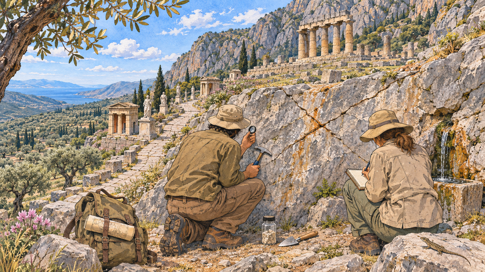
<details><summary>Image Prompt</summary>
(This is Panel 14. Do not include the panel number in the image.)
Style: a hand-drawn travel-sketchbook graphic-novel illustration, with clean dark ink outlines, flat softly shaded color fills and a faint watercolor paper texture, like a page from a traveler's journal; warm, sunlit, painterly lighting; no text, captions, signs, letters or speech bubbles anywhere in the image.
Please generate a 16:9 image depicting panel 14 of 16. Medium-wide shot from behind two scientists kneeling at a rock face on the slope below the ruins of the Temple of Apollo at Delphi, the early 2000s, bright natural daylight, scattered white clouds. Palette: natural daylight, gray limestone, terracotta, olive green, sea blue. Two anonymous field geologists seen from behind, in sun hats, canvas work jackets and sturdy boots, one holding a geologist's hammer and a hand lens, the other writing in a field notebook; their faces are never shown. In front of them a gray limestone cliff face is cut by two clearly visible diagonal cracks that cross each other; a sample bottle and a small trowel lie on the ground. Behind and above them the setting: Delphi, the sanctuary of Apollo: a steep rocky terrace on the slope of Mount Parnassus with a paved winding Sacred Way lined with small treasuries and statues, leading up to the large Doric Temple of Apollo with six columns across the front; behind it steep gray limestone cliffs, below it a deep valley of silver-green olive trees stretching to a distant sea. (Here the temple is a ruin: broken columns and foundations, as it is today.) Visible details: a small spring trickling from a crack in the rock into a stone basin; mineral crust stains on the stone; a backpack with a rolled map; olive trees in the valley; a lizard on a stone. Tone: patient, curious, undecided.
Keep every character and place consistent with the other images in this story. Generate the image immediately without asking clarifying questions.
</details>

Then, in the 1990s, a geologist and an archaeologist went back and looked at the rocks. Around 2001 they reported with colleagues that two faults cross beneath the temple, that springs once flowed through the limestone, and that water from a nearby spring contained traces of light gases, including ethylene, a sweet-smelling gas once used as an anesthetic. Later measurements around Delphi found little or no ethylene in the gases escaping from the ground.

> **Myth or Evidence?** Three things are sorted by how firm they are. Ancient writers did report a vapor: certain, because they reported it. The faults are real: widely accepted. Whether a trance-causing gas escaped there: debated. The theory has been widely reported and seriously criticized, and the oracle's practical answers, recorded in inscriptions, do not need a drug to explain them. This one is still open.

## Panel 15: The Question on the Table
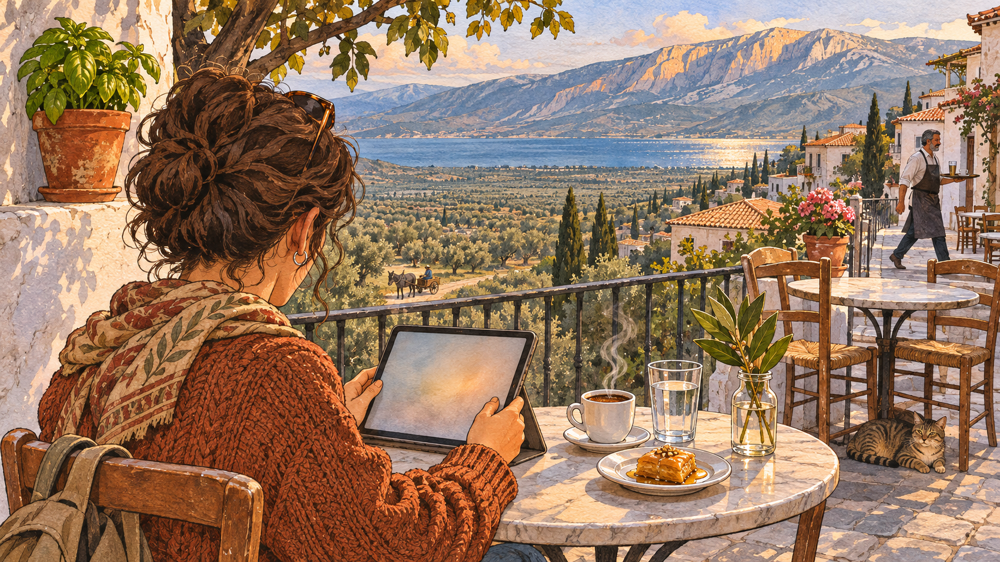
<details><summary>Image Prompt</summary>
(This is Panel 15. Do not include the panel number in the image.)
Style: a hand-drawn travel-sketchbook graphic-novel illustration, with clean dark ink outlines, flat softly shaded color fills and a faint watercolor paper texture, like a page from a traveler's journal; warm, sunlit, painterly lighting; no text, captions, signs, letters or speech bubbles anywhere in the image.
Please generate a 16:9 image depicting panel 15 of 16. Over-the-shoulder medium shot on a cafe terrace in modern Delphi village, present day, late afternoon, golden light. Palette: natural daylight, whitewashed walls, sea blue, terracotta, olive green. In the foreground a person in a warm sweater, seen from behind, sits at a small round table with a thick white cup of Greek coffee and a glass of water, resting both hands on a tablet in a plain case; the tablet screen is an unreadable soft glow with no legible content, no logo, no brand. Beyond the terrace railing the great plain of silver-green olive trees falls away toward the glittering Gulf of Corinth, and above it the pale cliffs of Mount Parnassus catch the last sun. Visible details: a whitewashed wall with a terracotta flowerpot of basil; a plate with a small honey pastry; a stray tabby cat under the next table; a waiter in a dark apron crossing in the distance; a donkey cart far below on a track; a thin curl of coffee steam; a single laurel sprig in a glass on the table. Tone: reflective, warm, gently ironic; a modern consultation.
Keep every character and place consistent with the other images in this story. Generate the image immediately without asking clarifying questions.
</details>

Today the people who climb to Delphi carry their questions in their pockets. A traveler on a cafe terrace asks a chatbot whether to go on to the next town or turn back before dark, and receives a fluent, confident answer. Like the Pythia's answers, it may be hedged, built from many voices, and silent about how it could be wrong. The old habits still apply: ask the question you really mean, ask how the answer could fail, bring in other evidence, and own the decision yourself.

## Panel 16: Then and Now: The Sacred Way Today
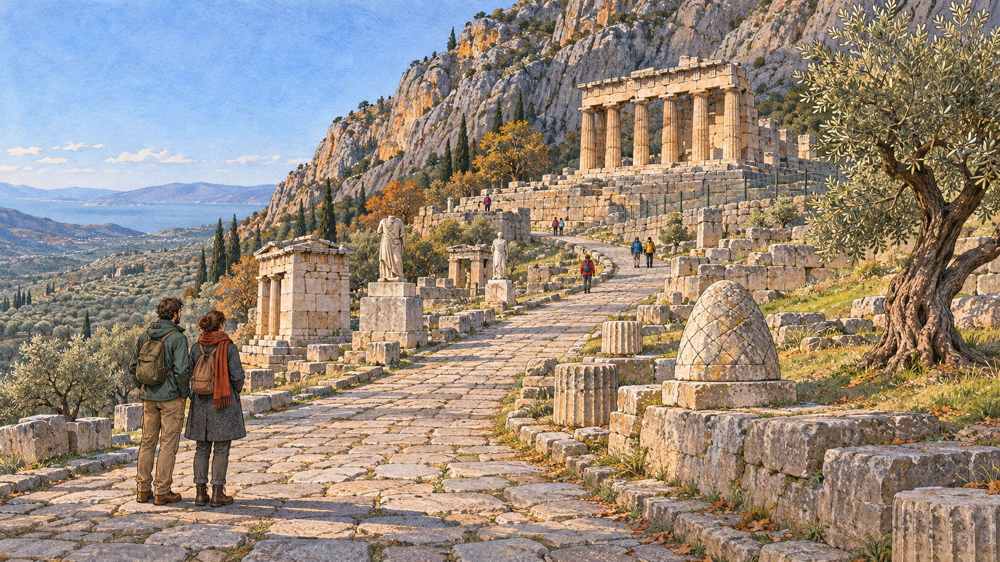
<details><summary>Image Prompt</summary>
(This is Panel 16. Do not include the panel number in the image.)
Style: a hand-drawn travel-sketchbook graphic-novel illustration, with clean dark ink outlines, flat softly shaded color fills and a faint watercolor paper texture, like a page from a traveler's journal; warm, sunlit, painterly lighting; no text, captions, signs, letters or speech bubbles anywhere in the image.
Please generate a 16:9 image depicting panel 16 of 16: the same view as panel 1, a wide establishing shot from low on the Sacred Way looking up toward the temple, but today (a clear November afternoon, soft low sunlight). Palette: natural daylight, weathered limestone, olive green, sea blue, terracotta. Small in the frame, standing together on the old paving stones: Two adult travelers seen from behind or in distant three-quarter view, dressed for cool November weather: one in a dark green rain jacket, the other in a charcoal wool coat with a rust-colored scarf, both with small daypacks, standing close together and looking at the view. Faces are never shown in detail. Ahead of them: Delphi, the sanctuary of Apollo: a steep rocky terrace on the slope of Mount Parnassus with a paved winding Sacred Way lined with small treasuries and statues, leading up to the large Doric Temple of Apollo with six columns across the front; behind it steep gray limestone cliffs, below it a deep valley of silver-green olive trees stretching to a distant sea. (Here the sanctuary is the real ruin: broken column drums, restored foundations, bare stones.) Visible details: a plain stone beehive-shaped omphalos copy beside the path; worn paving; a few other visitors in colorful jackets far away; autumn light on the cliffs; a bronze-green olive tree; a wire fence near the temple. Tone: quiet, thoughtful, a place still asking its question.
Keep every character and place consistent with the other images in this story. Generate the image immediately without asking clarifying questions.
</details>

The Sacred Way is empty enough now to hear your own footsteps. Beside the path stands a plain stone cone, a copy of the omphalos, the navel stone that marked Delphi as the center of the world, and above it the porch of the temple once carried the saying "Know thyself," free advice that cost nothing before anyone paid for an answer. On a November day like this one, the ancient calendar would have put the god away and the Pythia silent. In the museum a visitor can see the carved marble cone, a Hellenistic or Roman piece that may copy the stone that stood in the temple.

### Epilogue - What One Day at the Oracle Shows

A consultation at Delphi was part religion, part ritual, part theater, and part a kind of information market. The farmer's story and the king's story, set side by side, show what the oracle was good at and where it failed. The common questions got common, usable answers; the questions that carried the fate of empires got answers that could be read two ways. The oracle was open to anyone who came, but not equally, and the people best placed to misread an answer were the ones most sure they already knew what it meant.

| Challenge | How They Responded | Lesson for Today |
|---|---|---|
| Getting an answer | The farmer waited, paid and drew a lot; the king's envoys went first | Access to sources of knowledge is never perfectly equal, and who gets the front seat matters |
| An ambiguous answer | Croesus read it as a promise of victory and did not ask which empire | Ask how an answer could be wrong before acting on it |
| A question that already contains the decision | Croesus asked whether to fight, and only heard "yes" | The question shapes the answer, whether a god, a friend or a chatbot gives it |
| Whether the vapor was real | Scientists sorted what is certain, accepted and disputed | Separate what was reported, what was measured and what is still argued |

### Call to Action

Next time you ask a person, a book or a screen for an answer, pause the way the farmer's goat paused the crowd: before you trust it, check that the source is present and that you have asked the question you really mean. Open [A Day at the Oracle](../../sims/delphi-consultation-steps/index.md) and walk through the steps yourself, then try [Can This Answer Lose?](../../sims/oracle-answer-hedging-test/index.md). The book's Learning for All thread asks who got to ask, and who could not, and it still applies to every source we consult today.

---

## Voices from the Sources

- *"If Croesus made war on the Persians, he would destroy a great empire."* The answer as Herodotus reports it in his *Histories* (the wording here is the chapter's paraphrase of the Greek, not a verbatim quotation).
- *"Divine Salamis, you will destroy the children of women."* From Herodotus's account of the oracle's second answer to the Athenians before the battle of Salamis, as quoted in Chapter 17.
- *"Know thyself"* and *"Nothing in excess"*: the two best-known sayings carved at the Temple of Apollo, which the travel writer Pausanias says were attributed to the Seven Sages. No ancient source names who wrote them.

## On the Trip

- **Chapter:** [17. The Oracle and the Algorithm, Part 1: The Oracle](../../chapters/17-oracle/index.md), [18. Delphi](../../chapters/18-delphi/index.md) and [19. The Oracle and the Algorithm, Part 2: The Algorithm](../../chapters/19-algorithm/index.md)
- **Where to look:** the Castalian Spring between the two cliffs; the Sacred Way and the Temple of Apollo at the top; the plain omphalos copy beside the path and the carved omphalos in the Delphi Museum; the great altar in front of the temple.
- **Explore further:** [A Day at the Oracle](../../sims/delphi-consultation-steps/index.md) and [Can This Answer Lose?](../../sims/oracle-answer-hedging-test/index.md)
- **Look Closer:** Glaux says: "Look closer." Glaux was perched on a statue base at the lower right of Panel 6, beside the great altar. On site, scan the ledges and statue bases the way Glaux does; little owls really do live among Greek ruins.

## Characters and Style

This story follows the shared series bible: [Story Characters, Places and House Style](../characters.md). Glaux's identity comes from the mascot's [character sheet](../../img/mascot/character-sheet.md).

## References

1. [Wikipedia: Delphi](https://en.wikipedia.org/wiki/Delphi) - The ancient sanctuary of Apollo and its oracle
2. [Wikipedia: Pythia](https://en.wikipedia.org/wiki/Pythia) - The priestess of the Delphic oracle
3. [Wikipedia: Croesus](https://en.wikipedia.org/wiki/Croesus) - The last king of Lydia and his consultation of the oracle
4. [Encyclopaedia Britannica: Delphic oracle](https://www.britannica.com/topic/Delphic-oracle) - Overview of the oracle and how consultations worked
5. [UNESCO World Heritage Centre: Archaeological Site of Delphi](https://whc.unesco.org/en/list/393) - The site as it can be visited today
