# Ships Over the Hill

<!-- 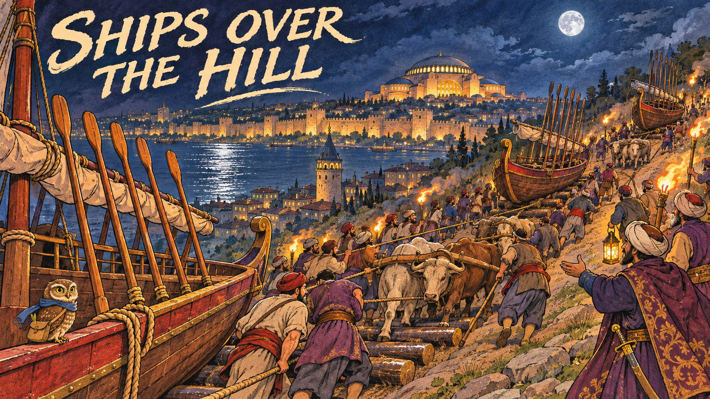 -->
<details>
<summary>Cover Image Prompt</summary>
(This is the Cover Image. Do not include this label in the image.)
Style: a hand-drawn travel-sketchbook graphic-novel illustration, with clean dark ink outlines, flat softly shaded color fills and a faint watercolor paper texture, like a page from a traveler's journal; warm, sunlit, painterly lighting; no text, captions, signs, letters or speech bubbles anywhere in the image.
Please generate a wide-landscape 16:9 cover image for a graphic novel. A night scene in April 1453: on a steep hillside behind Galata, a line of small wooden galleys with furled sails and raised oars rides on greased log rollers, hauled by ox teams and crowds of men with ropes, torches and lanterns casting amber pools of light. At the bottom of the slope the dark water of the Golden Horn shines with moonlight and, across it, the huge shallow dome of Hagia Sophia and the great land walls glow gold. In the lower left corner a small Glaux sits on one galley's rail, tiny and noticeable on a second look. Palette: stone gray, deep blue, imperial purple, tomato red, brass and saffron, with smoky amber light. Emotional tone: audacity and wonder. Render the story title as bold, hand-lettered title text across the upper left, exactly: "SHIPS OVER THE HILL". No other text anywhere.
Hagia Sophia in Constantinople: a vast cream-and-ochre brick church crowned by one enormous shallow central dome ringed with a band of forty small arched windows, with a half-dome on either side and four tall minarets (add the minarets only in scenes after 1453); gold mosaics glowing inside.
This scene is in April 1453, so draw no minarets on Hagia Sophia, only the dome. Glaux the Little Owl: a true little owl (Athene noctua), small, round and compact, with a flat rounded head and no ear tufts, warm earth-brown plumage with cream spots, bright lemon-yellow eyes under pale cream eyebrows, a cream-white throat patch and a short pale greenish-yellow beak. Glaux wears a small Aegean-blue scarf and a tan canvas satchel across the body with a small leather-bound travel notebook peeking out, and a sprig of three olive leaves tucked into the satchel strap. Alert, curious and warm expression. Glaux is drawn small, perched at the edge of the scene, noticeable on a second look.
Keep every character and place consistent with the other images in this story. Generate the image immediately without asking clarifying questions.
</details>

<details>
<summary>Narrative Prompt</summary>
**Era and places.** Constantinople, April and May 1453 CE, with a prologue-like opening on the land walls and the Golden Horn, and a final "Then and Now" view from the hill of Galata today. **Themes.** How a city with great defenses can still lose, how new technology (a huge cannon) and a clever idea (ships over a hill) work together, and how the same city, buildings and walls become a different city. **Palette.** The city and its defenders: gold leaf, deep blue, imperial purple, cream marble and stone gray; the Ottoman besiegers add Iznik turquoise, cobalt, tomato red, brass and saffron. Nights use deep blue with amber lantern light. The final panel uses natural daylight, whitewashed walls, sea blue, terracotta and olive. **House style.** Every prompt begins with the series house-style line from [Story Characters, Places and House Style](../characters.md). Panels contain no lettering; only the cover carries the title.

**Creative liberties and cautions.** This is a siege story, so it follows the Safe-Image Rules throughout: ships, walls, smoke, banners, dust and distant silhouettes only; no weapons mid-strike, no bodies, no wounds. Constantine XI's end is shown only by an empty field and a dropped banner. Details disputed by historians are hedged in the panel notes: the exact route and number of ships hauled over the hill on April 22, how many men defended the walls (the book's MicroSim says about 7,000), and what Orban offered the Byzantines before he cast for Mehmed. Hagia Sophia has no minarets before 1453, and the book's chapter says the earliest was added soon after, so panels 1, 11 and 15 draw the dome alone, and only panel 16 (today) adds the four minarets. The Serpent Column is not used in this story.

**Cast.**

- Glaux: see [docs/stories/characters.md](../characters.md) and [docs/img/mascot/character-sheet.md](../../img/mascot/character-sheet.md). Glaux is a silent observer and appears in one panel (panel 9).
- Hagia Sophia and the Travelers: see [docs/stories/characters.md](../characters.md).
- Mehmed II, Constantine XI and Orban appear only in this story; paste their blocks verbatim:

```text
Sultan Mehmed II at twenty-one: a slim young man with a pale oval face, large dark intense eyes, a long slightly hooked nose and a sparse dark mustache, wearing a tall white turban with a rolled brim, a deep crimson kaftan with gold-thread embroidery and a cobalt-blue outer robe; a quiet, calculating gaze.
```

```text
Emperor Constantine XI Palaiologos, about forty-eight: a tall, weary man with a short graying brown beard and deep-set, tired but resolute eyes, wearing a dark-purple cloak with a gold border, purple boots with small gold double-headed-eagle embroidery and a plain gold circlet.
```

```text
Orban, a Hungarian cannon-founder: a heavyset man of about forty with a thick dark mustache and strong, soot-smudged forearms, wearing a rough brown tunic with the sleeves rolled up and a scorched leather apron, with a roll of drawings under one arm.
```

The ordinary defenders and soldiers are generic figures described in each prompt: Byzantine defenders in plain tunics, felt caps, mail and steel helmets with deep-blue and purple sashes; Ottoman soldiers in white turbans and red or saffron coats; none needs a block.
</details>

### Prologue - A Wall That Held for a Thousand Years

In the spring of 1453 Constantinople is still the capital of an empire, though a very small one, with walls that have turned back enemies for centuries. Against them comes a twenty-one-year-old sultan, Mehmed II, with a huge army, a fleet, the biggest cannon ever built, and a plan no one expects. This story follows the siege from the first morning to the last, as a city that has stood since the 300s becomes the city we now call Istanbul.

**Find Glaux:** Glaux hides in one panel of this story. Can you spot the little owl?

## Panel 1: The City on Its Hill
<!-- 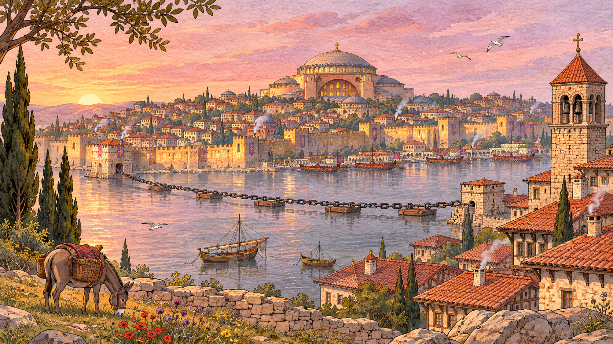 -->
<details><summary>Image Prompt</summary>
(This is Panel 01. Do not include the panel number in the image.)
I am about to ask you to generate a series of images for a graphic novel. Please make the images have a consistent style and consistent characters. Do not ask any clarifying questions. Just generate the image immediately when asked.
Style: a hand-drawn travel-sketchbook graphic-novel illustration, with clean dark ink outlines, flat softly shaded color fills and a faint watercolor paper texture, like a page from a traveler's journal; warm, sunlit, painterly lighting; no text, captions, signs, letters or speech bubbles anywhere in the image.
Please generate a 16:9 image depicting panel 1 of 16. Constantinople seen across the Golden Horn from the hill of Galata, April 1453, a calm dawn with low pink-gold light and a pale mist on the water. Palette: gold leaf, deep blue and imperial purple for the city, with Iznik turquoise, cobalt, tomato red, brass and saffron for the besiegers. Wide establishing shot from a hilltop viewpoint, slightly raised, looking southwest across the harbor: in the middle distance a heavy chain of iron links and wooden floats stretches across the mouth of the Golden Horn from a stone tower on the city shore to the Galata side. Beyond it, a city of red-tiled roofs, towers and sea walls, with the enormous shallow dome of Hagia Sophia rising on the skyline. Foreground: a stony hillside with a few cypress trees, a dry stone wall, wildflowers and one lone donkey. Details: a few small fishing boats at anchor, smoke from morning cooking fires, gulls over the water, the long city sea wall glowing gold, a scatter of galleys moored inside the harbor, a bell tower on the Galata side. Tone: calm before a storm.
Hagia Sophia in Constantinople: a vast cream-and-ochre brick church crowned by one enormous shallow central dome ringed with a band of forty small arched windows, with a half-dome on either side and four tall minarets (add the minarets only in scenes after 1453); gold mosaics glowing inside.
This is April 1453, before the siege has changed anything, so draw the dome and the skyline with no minarets.
Keep every character and place consistent with the other images in this story. Generate the image immediately without asking clarifying questions.
</details>

April 1453, dawn. Looking across the Golden Horn from the hill of Galata, we see a city that seems to float: golden-stone walls, roofs of red tile, and above them the vast shallow dome of Hagia Sophia. Across the mouth of the harbor, a heavy chain of iron links and wooden floats bars the entrance to enemy ships. It is the best-protected harbor in the Mediterranean, and everyone in the city knows it.

## Panel 2: The Walls of Theodosius
<!-- 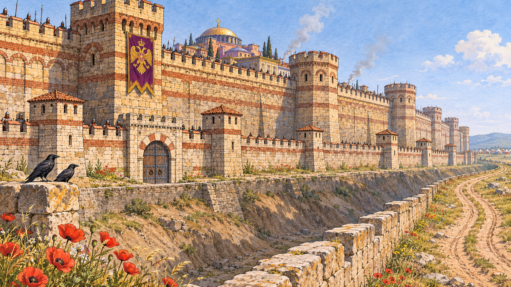 -->
<details><summary>Image Prompt</summary>
(This is Panel 02. Do not include the panel number in the image.)
Style: a hand-drawn travel-sketchbook graphic-novel illustration, with clean dark ink outlines, flat softly shaded color fills and a faint watercolor paper texture, like a page from a traveler's journal; warm, sunlit, painterly lighting; no text, captions, signs, letters or speech bubbles anywhere in the image.
Please generate a 16:9 image depicting panel 2 of 16. The Theodosian land walls of Constantinople, April 1453, clear morning sun. Palette: gold leaf, deep blue and imperial purple for the city, with Iznik turquoise, cobalt, tomato red, brass and saffron for the besiegers. Wide shot from outside the walls looking at the defenses at a slight angle: a deep dry moat with a low wall on its edge in the foreground, an outer terrace with a lower outer wall and small towers, and behind it the immense inner wall of golden-gray stone and brick banded in red, studded with square and octagonal towers about every fifty paces. A flag with a double-headed eagle hangs motionless from one tower. Details: a stone gate with iron-bound doors, a thin line of defenders on the battlements in steel helmets, wild poppies growing along the moat edge, a cart track curving into the distance, a pair of ravens on a merlon, a faint haze of cooking smoke behind. No enemy yet; only a glimpse of far-off tents on the horizon. Tone: grandeur and strain.
Keep every character and place consistent with the other images in this story. Generate the image immediately without asking clarifying questions.
</details>

On the landward side, the Theodosian Walls stretch about 5.7 kilometers from the Sea of Marmara to the Golden Horn. They were finished in 413 under Theodosius II, and they are not one wall but five layers in about 60 meters: moat, outer terrace, outer wall, inner terrace and a towering inner wall with 96 towers. They have turned back Avars, Arabs and Bulgars for a thousand years. The defenders know the numbers.

## Panel 3: Too Few Men
<!-- 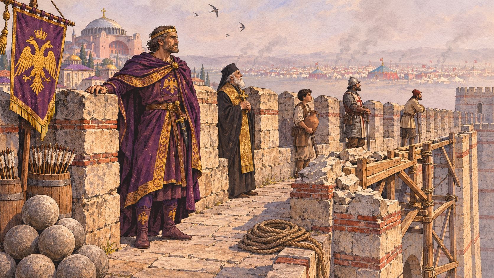 -->
<details><summary>Image Prompt</summary>
(This is Panel 03. Do not include the panel number in the image.)
Style: a hand-drawn travel-sketchbook graphic-novel illustration, with clean dark ink outlines, flat softly shaded color fills and a faint watercolor paper texture, like a page from a traveler's journal; warm, sunlit, painterly lighting; no text, captions, signs, letters or speech bubbles anywhere in the image.
Please generate a 16:9 image depicting panel 3 of 16. The inner wall of the Theodosian walls at Constantinople, April 1453, a hazy morning. Palette: gold leaf, deep blue and imperial purple for the city, with Iznik turquoise, cobalt, tomato red, brass and saffron for the besiegers. Medium-wide shot along the wall-walk: Constantine XI stands at center-left in his dark-purple cloak, one hand on a stone merlon, looking along a long battlement where the defenders stand far apart, each a few paces from the next: an old priest, a boy carrying a water jug, a Genoese in steel helmet and mail, a Greek in a plain tunic and felt cap. Beyond the wall, a distant glimmer of Ottoman tents on the plain. Details: stacked round stone cannonballs, barrels of arrows, a coil of rope, a banner with a double-headed eagle, a broken stretch of battlement being patched with timber, swifts overhead. Tone: determined, heavy with unease.
Emperor Constantine XI Palaiologos, about forty-eight: a tall, weary man with a short graying brown beard and deep-set, tired but resolute eyes, wearing a dark-purple cloak with a gold border, purple boots with small gold double-headed-eagle embroidery and a plain gold circlet.
Keep every character and place consistent with the other images in this story. Generate the image immediately without asking clarifying questions.
</details>

Emperor Constantine XI walks the walls. He has about 7,000 men to hold 5.7 kilometers of wall, including Greeks, Genoese, Venetians and volunteers. Against them Mehmed brings tens of thousands, though the numbers are uncertain and probably exaggerated by the chroniclers. The emperor stops at a tower, looks along the thin line, and understands the arithmetic.

## Panel 4: The Founder Who Was Turned Away
<!-- 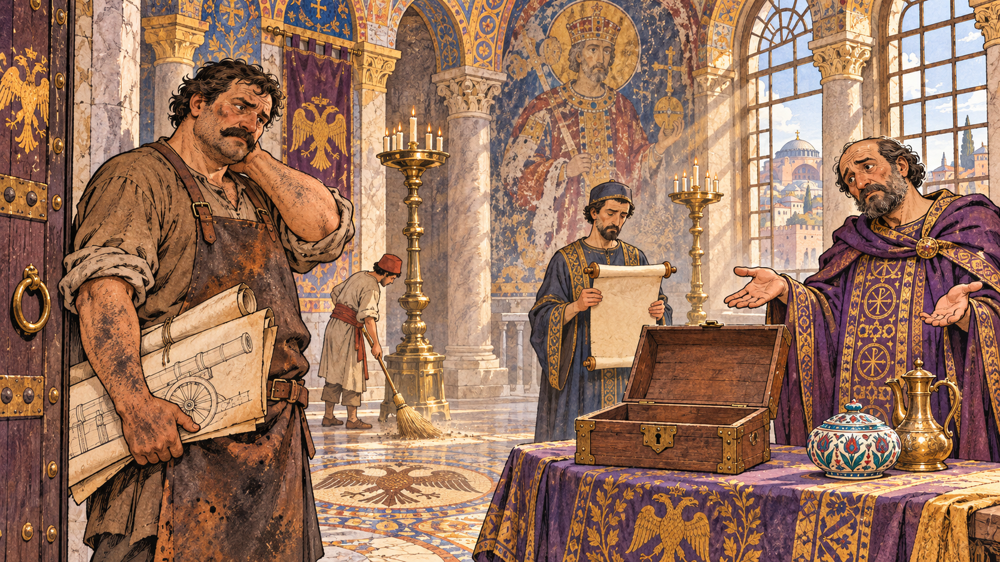 -->
<details><summary>Image Prompt</summary>
(This is Panel 04. Do not include the panel number in the image.)
Style: a hand-drawn travel-sketchbook graphic-novel illustration, with clean dark ink outlines, flat softly shaded color fills and a faint watercolor paper texture, like a page from a traveler's journal; warm, sunlit, painterly lighting; no text, captions, signs, letters or speech bubbles anywhere in the image.
Please generate a 16:9 image depicting panel 4 of 16. A palace audience hall in Constantinople, 1452, afternoon light, slightly dusty. Palette: gold leaf, deep blue and imperial purple for the city, with Iznik turquoise, cobalt, tomato red, brass and saffron for the besiegers. Medium shot at slightly low angle: Orban stands at the left in the doorway with his rolled drawings clutched under one arm, a reluctant, thoughtful expression; at the far right an official in a purple robe shrugs apologetically, with an open empty wooden coin chest on a table between them. Details: faded fresco of an emperor on the wall, tall bronze candle stands, a servant sweeping, tall arched windows with cream marble sills, mosaic floor, a scribe holding a blank scroll. Tone: quiet regret.
Orban, a Hungarian cannon-founder: a heavyset man of about forty with a thick dark mustache and strong, soot-smudged forearms, wearing a rough brown tunic with the sleeves rolled up and a scorched leather apron, with a roll of drawings under one arm.
Keep every character and place consistent with the other images in this story. Generate the image immediately without asking clarifying questions.
</details>

A Hungarian cannon-founder named Orban arrives in Constantinople with a bold offer: he can cast a gun to break any wall. The treasury cannot afford his fee, and he is turned away. He walks out of the hall with his drawings under his arm and a long road ahead. The sultan he meets next will pay.

> **Myth or Evidence?** Part chronicle, part tradition. Later writers report that Orban first offered his guns to Constantine and was turned away because the empire had no money. The details are told with some embroidery, and we should read the tale as plausible but not guaranteed. What is documented is that Mehmed's army used very large bronze guns in 1453.

## Panel 5: Casting the Great Gun
<!-- 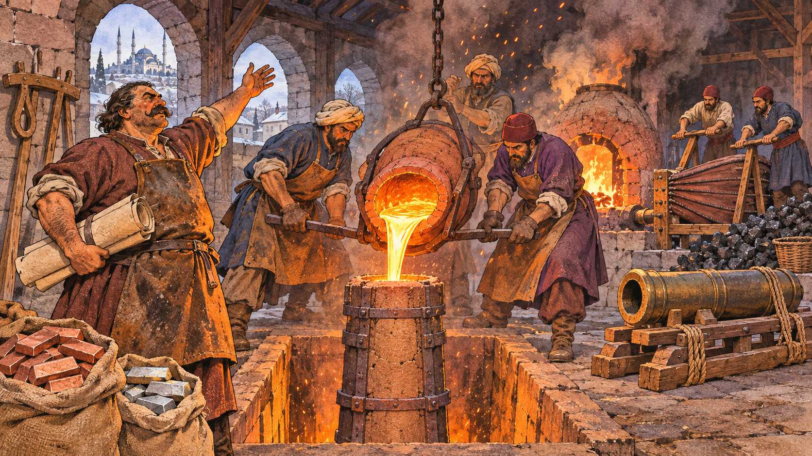 -->
<details><summary>Image Prompt</summary>
(This is Panel 05. Do not include the panel number in the image.)
Style: a hand-drawn travel-sketchbook graphic-novel illustration, with clean dark ink outlines, flat softly shaded color fills and a faint watercolor paper texture, like a page from a traveler's journal; warm, sunlit, painterly lighting; no text, captions, signs, letters or speech bubbles anywhere in the image.
Please generate a 16:9 image depicting panel 5 of 16. A cannon foundry in Edirne (Adrianople), winter 1452 to 1453, a smoky interior lit by furnace glow. Palette: stone gray, deep blue, imperial purple, tomato red, brass and saffron, with smoky amber light, with intense orange-gold molten bronze. Wide shot, low angle: a long mold sunk upright in a pit, and at its mouth a stream of glowing molten bronze pouring from a clay crucible held by a crew of workers in leather aprons. Orban stands to one side directing, arm raised, face lit orange. Details: iron tongs, a clay-lined furnace with bellows pumped by two men, stacked charcoal, a half-finished smaller gun on a timber sled, sparks spiraling up to the smoke-blackened rafters, an ox-yoke leaning on a wall, bags of copper and tin ingots. Tone: awe and heat.
Orban, a Hungarian cannon-founder: a heavyset man of about forty with a thick dark mustache and strong, soot-smudged forearms, wearing a rough brown tunic with the sleeves rolled up and a scorched leather apron, with a roll of drawings under one arm.
Keep every character and place consistent with the other images in this story. Generate the image immediately without asking clarifying questions.
</details>

In Edirne, Mehmed's capital, Orban finds his patron. In a foundry pit the bronze glows like a sunrise as workers pour it into a mold taller than a man. The gun that comes out is among the largest ever cast, and later accounts say it takes dozens of oxen and hundreds of men to drag it to the walls of Constantinople. Orban's drawings have become something very large.

## Panel 6: Smoke on the Walls
<!-- 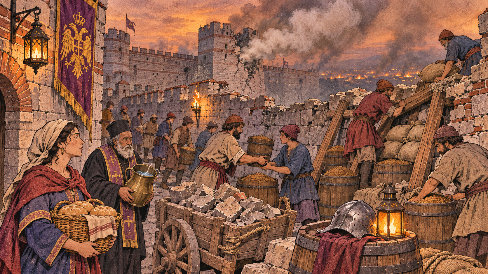 -->
<details><summary>Image Prompt</summary>
(This is Panel 06. Do not include the panel number in the image.)
Style: a hand-drawn travel-sketchbook graphic-novel illustration, with clean dark ink outlines, flat softly shaded color fills and a faint watercolor paper texture, like a page from a traveler's journal; warm, sunlit, painterly lighting; no text, captions, signs, letters or speech bubbles anywhere in the image.
Please generate a 16:9 image depicting panel 6 of 16. The Theodosian walls at Constantinople at dusk, late April 1453, thick smoke and amber haze. Palette: stone gray, deep blue, imperial purple, tomato red, brass and saffron, with smoky amber light. Wide shot from inside the walls: a white-gray plume of smoke and dust drifting from a cracked tower at center, the outer wall visibly battered but standing, in the foreground a bucket line of defenders in plain tunics and felt caps stacking barrels filled with earth, timber beams and sacks of sand into a broken section by torchlight. Details: a priest carrying water, a woman with a basket of bread, a cart of broken stones, a dented steel helmet on a barrel, lanterns glowing amber, distant campfire pinpricks beyond the wall. No bodies, no weapon mid-strike. Tone: tired, relentless.
Keep every character and place consistent with the other images in this story. Generate the image immediately without asking clarifying questions.
</details>

The great gun fires only a few times a day, but each shot is felt across the city. When the dust clears, a tower is cracked and a section of wall is battered. Each night the defenders pile barrels, timber and earth into the gap, and each morning the Ottomans are surprised to find it patched. The siege is not a single dramatic blow but a month of dust, repair and exhaustion.

## Panel 7: The Chain Holds
<!-- 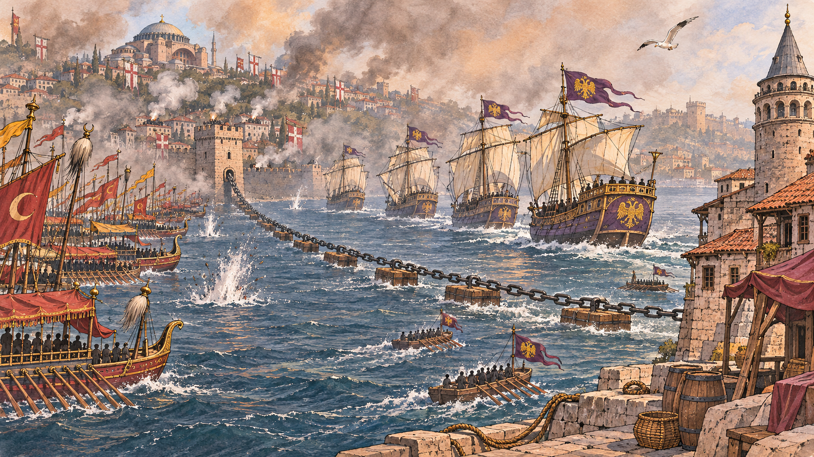 -->
<details><summary>Image Prompt</summary>
(This is Panel 07. Do not include the panel number in the image.)
Style: a hand-drawn travel-sketchbook graphic-novel illustration, with clean dark ink outlines, flat softly shaded color fills and a faint watercolor paper texture, like a page from a traveler's journal; warm, sunlit, painterly lighting; no text, captions, signs, letters or speech bubbles anywhere in the image.
Please generate a 16:9 image depicting panel 7 of 16. The Golden Horn near its mouth, April 20, 1453, bright morning with sea haze. Palette: stone gray, deep blue, imperial purple, tomato red, brass and saffron, with smoky amber light. Wide shot from the Galata shore looking across the water at the chain, a taut line of iron links and wooden floats stretching to a tower in the city wall. Left outside the chain: a crowd of Ottoman galleys with banners in crimson and saffron and horsetail standards, milling in the water, oars raised. Right inside the chain: four tall sailing ships of the relief convoy, sails full, flags flying with a double-headed eagle, just passing the line. Over everything hangs a low cloud of gunsmoke. Details: foam and wake, a cluster of rowing boats, a gull, splash marks from stone shot, red-and-white banners on a hill beyond. No people in the water; silhouettes at distance only. Tone: relief, tension.
Keep every character and place consistent with the other images in this story. Generate the image immediately without asking clarifying questions.
</details>

At the Golden Horn the Ottoman fleet cannot break through the chain. On April 20 four ships carrying relief for the city fight their way past the blockade and slip inside, a rare moment of hope. Mehmed, watching from the shore, sees that the chain cannot be broken from the sea. He needs another way into the harbor.

## Panel 8: A Plan Over the Hill
<!-- 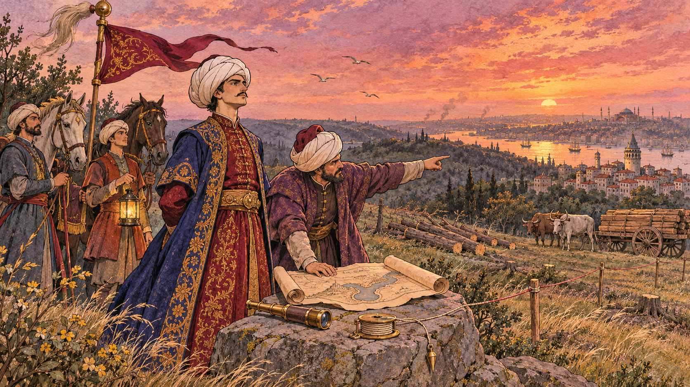 -->
<details><summary>Image Prompt</summary>
(This is Panel 08. Do not include the panel number in the image.)
Style: a hand-drawn travel-sketchbook graphic-novel illustration, with clean dark ink outlines, flat softly shaded color fills and a faint watercolor paper texture, like a page from a traveler's journal; warm, sunlit, painterly lighting; no text, captions, signs, letters or speech bubbles anywhere in the image.
Please generate a 16:9 image depicting panel 8 of 16. A ridge behind Galata at dusk, April 21, 1453, golden-pink sky, wind in the grass. Palette: stone gray, deep blue, imperial purple, tomato red, brass and saffron, with smoky amber light. Medium-wide shot: Mehmed II stands at center on the crest of the hill with an officer unrolling a map on a flat stone, pointing with an outstretched hand across the dark ridge toward the distant gleam of the Golden Horn. Two aides hold horses behind him; one holds a lantern; a standard with a horsetail and a crimson banner flutters. Details: scrubby bushes, a line of felled trees on the slope, an ox-team unyoked beside a wagon of timber planks, a surveyor's cord with stakes, a brass spyglass, birds flying low. Tone: resolve and quiet audacity.
Sultan Mehmed II at twenty-one: a slim young man with a pale oval face, large dark intense eyes, a long slightly hooked nose and a sparse dark mustache, wearing a tall white turban with a rolled brim, a deep crimson kaftan with gold-thread embroidery and a cobalt-blue outer robe; a quiet, calculating gaze.
Keep every character and place consistent with the other images in this story. Generate the image immediately without asking clarifying questions.
</details>

Mehmed has an idea that sounds like madness. If ships cannot go through the chain, they can go over the land. On a ridge behind Galata he studies the slope, the woods, the long drop to the water on the other side. Historians reconstruct the route in different ways, but all agree on the plan: build a road of timber, grease it, and haul the ships over the hill.

## Panel 9: The Night Road
<!-- 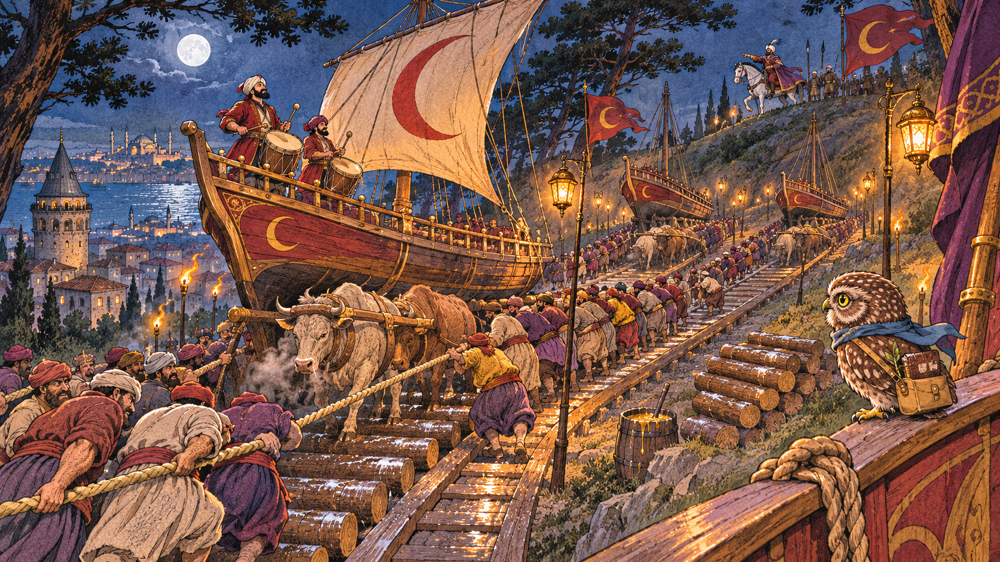 -->
<details><summary>Image Prompt</summary>
(This is Panel 09. Do not include the panel number in the image.)
Style: a hand-drawn travel-sketchbook graphic-novel illustration, with clean dark ink outlines, flat softly shaded color fills and a faint watercolor paper texture, like a page from a traveler's journal; warm, sunlit, painterly lighting; no text, captions, signs, letters or speech bubbles anywhere in the image.
Please generate a 16:9 image depicting panel 9 of 16. A hillside behind Galata at night, April 21 to 22, 1453, moonlight and amber lantern glow. Palette: stone gray, deep blue, imperial purple, tomato red, brass and saffron, with smoky amber light. Wide shot, slightly low angle, along a steep slope: three small wooden galleys on parallel tracks of greased log rollers, each hauled uphill by a team of oxen and a crowd of men on thick ropes, with lanterns on poles lighting the scene. One galley's sail is unfurled, and its drummers stand on the prow. On the rail of the nearest galley, tiny Glaux sits in the corner of the frame, watching the whole parade; Glaux is drawn small, perched at the edge of the scene, noticeable on a second look. Details: wooden planks and rollers glistening with grease, torches, dark pines along the track, steam from the oxen's breath, a pile of spare logs, a horseman directing from the ridge, crescent-shaped banners moving in the wind. Tone: audacious, dreamlike.
Glaux the Little Owl: a true little owl (Athene noctua), small, round and compact, with a flat rounded head and no ear tufts, warm earth-brown plumage with cream spots, bright lemon-yellow eyes under pale cream eyebrows, a cream-white throat patch and a short pale greenish-yellow beak. Glaux wears a small Aegean-blue scarf and a tan canvas satchel across the body with a small leather-bound travel notebook peeking out, and a sprig of three olive leaves tucked into the satchel strap. Alert, curious and warm expression.
Keep every character and place consistent with the other images in this story. Generate the image immediately without asking clarifying questions.
</details>

That night the impossible begins. Teams of oxen and crowds of men haul a line of small warships on a greased track of logs up the slope, over the ridge and down toward the Golden Horn. Tradition says the crews raise sails and beat drums to make it look as if the ships are flying through the dark. Dozens of ships make the passage, though the exact number varies in the sources.

> **Myth or Evidence?** Documented, with details in doubt. Ottoman ships really did appear in the Golden Horn on April 22, 1453, and the sources agree they were moved overland. The number of ships, the exact route, and the story that sails were raised and drums beaten on the way are reported in different ways, so treat those details as tradition.

## Panel 10: Dawn in the Harbor
<!-- 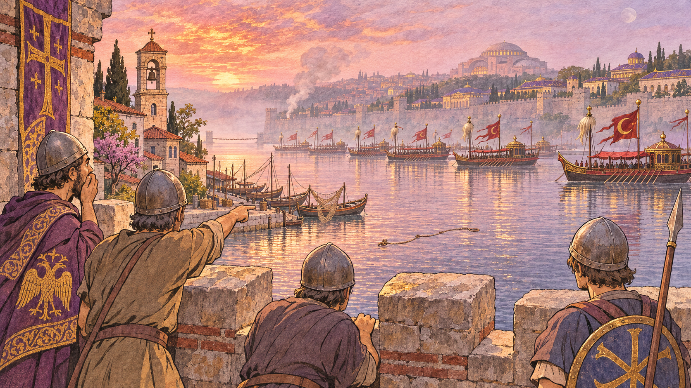 -->
<details><summary>Image Prompt</summary>
(This is Panel 10. Do not include the panel number in the image.)
Style: a hand-drawn travel-sketchbook graphic-novel illustration, with clean dark ink outlines, flat softly shaded color fills and a faint watercolor paper texture, like a page from a traveler's journal; warm, sunlit, painterly lighting; no text, captions, signs, letters or speech bubbles anywhere in the image.
Please generate a 16:9 image depicting panel 10 of 16. The Golden Horn at dawn, April 22, 1453, rose-gold light and soft mist. Palette: gold leaf, deep blue and imperial purple for the city, with Iznik turquoise, cobalt, tomato red, brass and saffron for the besiegers. Medium-wide shot from the city's sea wall looking across the water: in the foreground a few defenders in steel helmets and plain tunics stand on the battlements, seen from behind or in profile, one pointing, one with a hand over his mouth. In the harbor beyond, a line of Ottoman galleys sits quietly inside the Golden Horn, crimson banners and horsetail standards flying, with the dark chain a thin line far away at the mouth. Details: a church bell tower on the shore, a chain of fishing boats, a drifting rope, a plume of cooking smoke, a pale moon fading. Tone: stunned silence.
Hagia Sophia in Constantinople: a vast cream-and-ochre brick church crowned by one enormous shallow central dome ringed with a band of forty small arched windows, with a half-dome on either side and four tall minarets (add the minarets only in scenes after 1453); gold mosaics glowing inside.
Hagia Sophia is faintly visible on the skyline; this is 1453, so draw no minarets.
Keep every character and place consistent with the other images in this story. Generate the image immediately without asking clarifying questions.
</details>

At dawn the defenders look from the sea wall and cannot believe their eyes. Ottoman ships are floating inside the harbor, behind the chain, as if they had sailed over the sky. The ships never attack the sea walls in force, but they force the city to move men from the land walls to guard the harbor front. A garrison of about 7,000 cannot afford that.

## Panel 11: The Last Night
<!-- 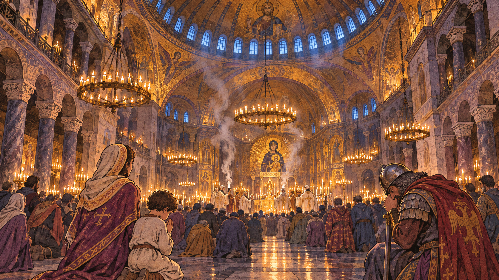 -->
<details><summary>Image Prompt</summary>
(This is Panel 11. Do not include the panel number in the image.)
Style: a hand-drawn travel-sketchbook graphic-novel illustration, with clean dark ink outlines, flat softly shaded color fills and a faint watercolor paper texture, like a page from a traveler's journal; warm, sunlit, painterly lighting; no text, captions, signs, letters or speech bubbles anywhere in the image.
Please generate a 16:9 image depicting panel 11 of 16. The interior of Hagia Sophia at night, May 28, 1453, glowing with candlelight. Palette: gold leaf, deep blue and imperial purple for the city, with Iznik turquoise, cobalt, tomato red, brass and saffron for the besiegers, with deep blue shadows and candle amber. Wide shot from the floor, slightly low angle, looking up the nave toward the dome: hundreds of small figures kneeling and standing in the dim nave, silhouetted by thousands of candles, priests in white and gold chanting near the altar, the golden mosaics glowing at the edges of the light. In the foreground a mother and child kneel in prayer, seen from behind, and a soldier in a steel helmet bows his head. Details: columns of incense smoke rising to the dome, ring-shaped bronze lamps, a distant icon of the Virgin glittering, long shadows on the polished floor, faint blue light from the high windows. Tone: reverent and heavy.
Hagia Sophia in Constantinople: a vast cream-and-ochre brick church crowned by one enormous shallow central dome ringed with a band of forty small arched windows, with a half-dome on either side and four tall minarets (add the minarets only in scenes after 1453); gold mosaics glowing inside.
This scene is inside the church in 1453 (no minarets exist).
Keep every character and place consistent with the other images in this story. Generate the image immediately without asking clarifying questions.
</details>

On the night of May 28, the people of Constantinople gather in Hagia Sophia, the great church beneath the dome. Later accounts say they pray together, Greeks and Italians, priests and soldiers, under the lights of countless candles. Outside, the Ottoman camp blazes with torches. By morning everything will be different.

## Panel 12: Before Dawn, May 29
<!-- 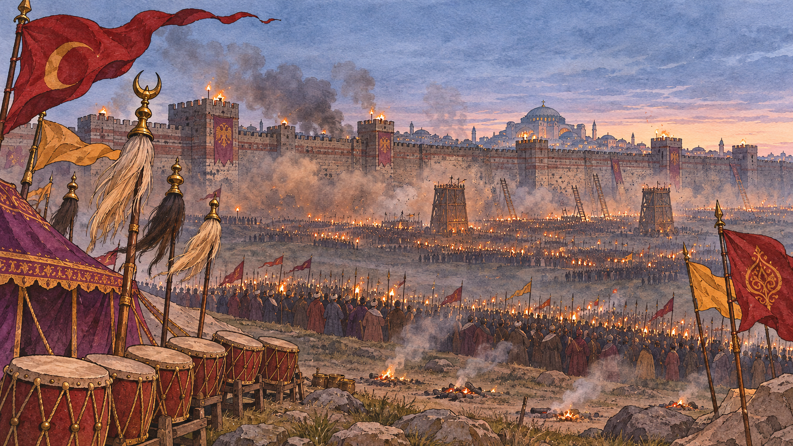 -->
<details><summary>Image Prompt</summary>
(This is Panel 12. Do not include the panel number in the image.)
Style: a hand-drawn travel-sketchbook graphic-novel illustration, with clean dark ink outlines, flat softly shaded color fills and a faint watercolor paper texture, like a page from a traveler's journal; warm, sunlit, painterly lighting; no text, captions, signs, letters or speech bubbles anywhere in the image.
Please generate a 16:9 image depicting panel 12 of 16. The Theodosian walls at Constantinople seen from a distance outside, before dawn on May 29, 1453, with a pale blue-gray sky just starting to lighten. Palette: stone gray, deep blue, imperial purple, tomato red, brass and saffron, with smoky amber light. Wide establishing shot from far back, slightly raised: the dark mass of the land walls with towers crowned by torches, a drifting wall of smoke and dust from cannon fire, thousands of tiny torch-lit silhouettes moving in dark masses across the plain, and the tips of long scaling ladders and a few siege towers visible at a distance. Banners in crimson and saffron flutter in the foreground. Details: a line of drums, horsetail standards on poles, a scatter of campfires going out, floating sparks, a first line of light on the horizon. No fighting up close, no bodies. Tone: awe and dread.
Keep every character and place consistent with the other images in this story. Generate the image immediately without asking clarifying questions.
</details>

Before dawn on May 29 the cannon thunder again and the Ottoman lines move forward. The attack comes in waves along the land walls, and the defenders hold the first two. At a distance it looks like a field of torches and dark moving shapes, and then the walls disappear in smoke. The garrison is stretched too thin, and it has no more to give.

## Panel 13: Banners on the Tower
<!-- 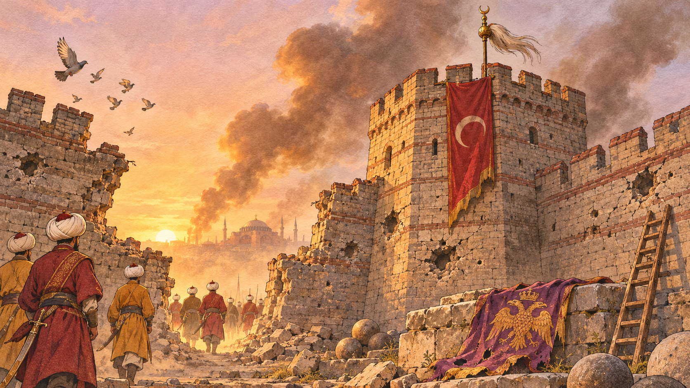 -->
<details><summary>Image Prompt</summary>
(This is Panel 13. Do not include the panel number in the image.)
Style: a hand-drawn travel-sketchbook graphic-novel illustration, with clean dark ink outlines, flat softly shaded color fills and a faint watercolor paper texture, like a page from a traveler's journal; warm, sunlit, painterly lighting; no text, captions, signs, letters or speech bubbles anywhere in the image.
Please generate a 16:9 image depicting panel 13 of 16. A tower on the Theodosian walls at first light on May 29, 1453, with smoke and golden dawn haze. Palette: stone gray, deep blue, imperial purple, tomato red, brass and saffron, with smoky amber light. Medium-wide shot, low angle: a tower of golden-gray stone with a crimson banner and a horsetail standard newly raised on its top, rolling smoke behind, the walls scarred by cannon fire. In front of the tower, small groups of Ottoman soldiers in white turbans and red or saffron coats, seen from behind and at a distance, walking in through a gap in the wall, their silhouettes small against the glow. A torn purple double-headed-eagle flag lies folded on the ledge beneath. Details: broken battlements, scattered stone balls, a ladder lying against the wall, dust in the golden light, a flock of startled pigeons. No violence shown. Tone: finality, aftermath.
Keep every character and place consistent with the other images in this story. Generate the image immediately without asking clarifying questions.
</details>

As the sun rises, the situation turns. Giovanni Giustiniani, the Genoese commander of the land walls, is wounded and leaves his post, and within hours Ottoman soldiers are inside the walls. A crimson banner now flies from a tower where the imperial eagle once did. The city that held for a thousand years has held for the last time.

## Panel 14: The Empty Field
<!-- 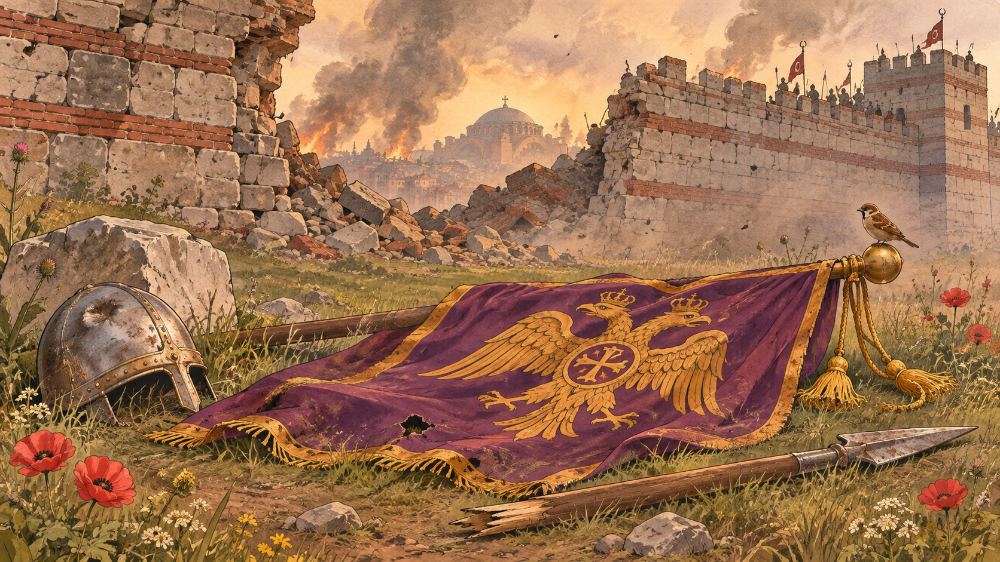 -->
<details><summary>Image Prompt</summary>
(This is Panel 14. Do not include the panel number in the image.)
Style: a hand-drawn travel-sketchbook graphic-novel illustration, with clean dark ink outlines, flat softly shaded color fills and a faint watercolor paper texture, like a page from a traveler's journal; warm, sunlit, painterly lighting; no text, captions, signs, letters or speech bubbles anywhere in the image.
Please generate a 16:9 image depicting panel 14 of 16. A quiet grassy strip below the broken section of the Theodosian wall at Constantinople, late morning on May 29, 1453, with smoke drifting and low gold-gray light. Palette: stone gray, deep blue, imperial purple, tomato red, brass and saffron, with smoky amber light. Medium shot, slightly low angle on an empty patch of trampled grass and wildflowers at the wall's foot: in the center lies a single imperial banner, a dark-purple cloth with a gold double-headed eagle, dropped on the ground and half unfurled. Behind it rise the breach in the wall and the haze of the burning city; far off, the tiny figures of Ottoman soldiers on the battlements. Details: a dented steel helmet beside a stone, a broken spear shaft, scattered pebbles, red poppies, a swirl of ash, a lone sparrow on the banner's pole. No people, no bodies. Tone: stillness and loss.
Keep every character and place consistent with the other images in this story. Generate the image immediately without asking clarifying questions.
</details>

Where is the emperor? Constantine XI stayed on the walls rather than flee, and in the confusion his end is never recorded with certainty. All that remains in the grass below the breach is an imperial banner, dropped and left. Tradition says a marble king sleeps beneath the city, waiting to return.

> **Myth or Evidence?** Legend over evidence. It is documented that Constantine XI died in the fighting on May 29, 1453, but chroniclers disagree about where and how, and his body was never certainly identified. The popular tale that the emperor was turned to marble by an angel and waits in a cave to return is a later legend.

## Panel 15: The Sultan Rides to the Church
<!-- 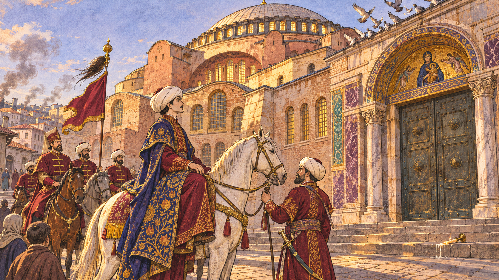 -->
<details><summary>Image Prompt</summary>
(This is Panel 15. Do not include the panel number in the image.)
Style: a hand-drawn travel-sketchbook graphic-novel illustration, with clean dark ink outlines, flat softly shaded color fills and a faint watercolor paper texture, like a page from a traveler's journal; warm, sunlit, painterly lighting; no text, captions, signs, letters or speech bubbles anywhere in the image.
Please generate a 16:9 image depicting panel 15 of 16. The square before Hagia Sophia, Constantinople, afternoon of May 29, 1453, warm slanting sunlight. Palette: gold leaf, deep blue and imperial purple for the city, with Iznik turquoise, cobalt, tomato red, brass and saffron for the besiegers. Wide shot, slightly low angle: Mehmed II on a white horse at center, arriving before the great bronze doors with a small escort of mounted officers in white turbans and crimson coats, a standard with a horsetail and a crimson banner held aloft. The great dome rises above them. In the background, a few citizens watch from side streets, seen from behind and at a distance. Details: smoke drifting over rooftops, a flock of pigeons rising from the cornice, a dropped candle on the steps, long afternoon shadows, an escort captain holding the horse's bridle. The mood is subdued, not triumphant. Tone: solemn, momentous.
Sultan Mehmed II at twenty-one: a slim young man with a pale oval face, large dark intense eyes, a long slightly hooked nose and a sparse dark mustache, wearing a tall white turban with a rolled brim, a deep crimson kaftan with gold-thread embroidery and a cobalt-blue outer robe; a quiet, calculating gaze.
Hagia Sophia in Constantinople: a vast cream-and-ochre brick church crowned by one enormous shallow central dome ringed with a band of forty small arched windows, with a half-dome on either side and four tall minarets (add the minarets only in scenes after 1453); gold mosaics glowing inside.
This is May 29, 1453, so draw no minarets yet.
Keep every character and place consistent with the other images in this story. Generate the image immediately without asking clarifying questions.
</details>

In the afternoon Mehmed rides into the city and straight to Hagia Sophia, the great symbol of Constantinople. He dismounts at the doors. According to the book's chapter, he makes it a mosque in 1453, and in time the city becomes the capital of an empire that lasts nearly five centuries. The old city and the new one share the same dome.

## Panel 16: From Galata Today
<!-- 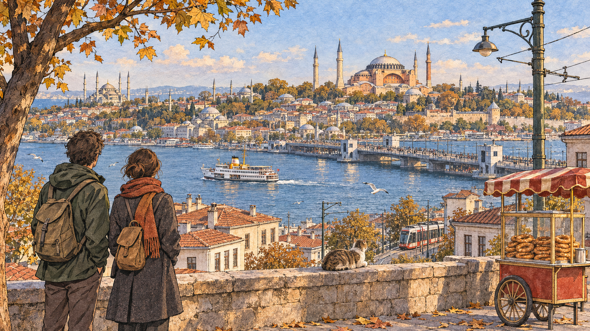 -->
<details><summary>Image Prompt</summary>
(This is Panel 16. Do not include the panel number in the image.)
Style: a hand-drawn travel-sketchbook graphic-novel illustration, with clean dark ink outlines, flat softly shaded color fills and a faint watercolor paper texture, like a page from a traveler's journal; warm, sunlit, painterly lighting; no text, captions, signs, letters or speech bubbles anywhere in the image.
Please generate a 16:9 image depicting panel 16 of 16. Istanbul's historic peninsula seen across the Golden Horn from the hill of Galata today, late afternoon in November, soft blue-gold light, matching the panel 1 viewpoint. Palette: natural daylight, whitewashed walls, sea blue, terracotta and olive. Wide shot from a raised viewpoint: in the foreground, two travelers stand on a terrace at the hillside, seen from behind, looking out at the water and the skyline. Across the water, a ferry boat, a long bridge in the middle distance, and on the far shore the historic peninsula with the great dome of Hagia Sophia and its four slender minarets rising above red-tiled rooftops and the many smaller domes and minarets of other mosques. Details: seagulls over the water, a tram-line pole, a low stone wall in the foreground, a cat on the wall, a simit seller's cart, scattered autumn leaves. Tone: quiet reflection.
Hagia Sophia in Constantinople: a vast cream-and-ochre brick church crowned by one enormous shallow central dome ringed with a band of forty small arched windows, with a half-dome on either side and four tall minarets (add the minarets only in scenes after 1453); gold mosaics glowing inside.
This scene is today, so include all four minarets.
Two adult travelers seen from behind or in distant three-quarter view, dressed for cool November weather: one in a dark green rain jacket, the other in a charcoal wool coat with a rust-colored scarf, both with small daypacks, standing close together and looking at the view. Faces are never shown in detail.
Keep every character and place consistent with the other images in this story. Generate the image immediately without asking clarifying questions.
</details>

Today the Golden Horn is a city waterway lined with bridges and ferries, and the hill of Galata is crowded with cafes and visitors. From the same viewpoint, the old city still rises across the water: the land walls beyond the skyline, and the great dome of Hagia Sophia now flanked by four minarets, with the domes of newer mosques around it. The city became Istanbul, and somewhere in that skyline the ships once came over the hill.

### Epilogue - How a City Changes Hands

The fall of Constantinople was not one blow but a campaign: a huge gun, a chain bypassed, a thin garrison, a last assault before dawn. It was also a hinge in history. The Byzantine Empire ends, the Ottoman capital begins, and a city that had been Roman, Greek and Christian for more than a thousand years becomes a Muslim imperial capital while keeping its walls, its harbor and its great church. Some historians also connect the arrival of Greek scholars and manuscripts in western Europe in the 1400s with this event, though how much of the exodus the siege itself caused is debated.

| Challenge | How They Responded | Lesson for Today |
|---|---|---|
| Walls that had held for a thousand years | Mehmed brings very large cannon cast by a founder the Byzantines could not afford. | A great defense can fail when the means to overcome it are new. |
| A chain across the Golden Horn | Instead of attacking it, the Ottomans haul ships over the land behind Galata. | When a problem has no direct solution, go around it. |
| Too few defenders | About 7,000 men try to hold 5.7 kilometers of wall and also guard the harbor. | A defense is only as strong as its thinnest stretch. |
| What happens to the city and its knowledge | Hagia Sophia becomes a mosque, and the Orthodox patriarchate keeps a place in the new empire. | Cities, books and people carry knowledge from one era to the next; the choice of who gets to read and learn it matters. |

### Call to Action

On the trip, walk a stretch of the Theodosian Walls and look up at how tall they are, then look across the Golden Horn from Galata and picture a ship on rollers on the slope. This story belongs to the book's Learning-for-All thread, too: the scribes who copied Plato and Homer through the Byzantine centuries, and the scholars who carried books west afterward, kept knowledge in motion. Look closer at what a city keeps.

---

## Voices from the Sources

There is no well-attested one-line quotation from the siege that we can safely put in a named person's mouth, so this section points to the sources instead.

- ***Diary of the Siege of Constantinople*, by Nicolo Barbaro.** A Venetian ship's surgeon who was inside the city kept a day-by-day diary of the siege. It is one of the main eyewitness accounts, though it reflects his Venetian point of view.
- ***Chronicle*, by George Sphrantzes.** A close official of Constantine XI, who wrote his memoir later. It is the source for the often-cited count of the defenders: just under 5,000 Greeks and about 2,000 foreigners.
- ***History*, by Doukas.** A Byzantine historian who describes the chain, the ships hauled overland and the final assault from the Greek side, though he was not an eyewitness inside the city.

## On the Trip

- **Chapters:** [4. Byzantine Constantinople and Hagia Sophia](../../chapters/04-byzantine-constantinople/index.md) and [5. Ottoman Istanbul](../../chapters/05-ottoman-istanbul/index.md)
- **Where to look:** the surviving stretches of the Theodosian land walls running from the Sea of Marmara to the Golden Horn; links said to come from the chain, displayed in Istanbul museums; the Golden Horn from Galata; Rumeli Hisarı, the fortress Mehmed built on the Bosphorus in 1452; and Hagia Sophia, now with its four minarets.
- **Explore further:** [The Siege of 1453, Step by Step](../../sims/siege-of-1453-step-through/index.md) and [Layers of the Theodosian Walls](../../sims/theodosian-walls-layers/index.md).
- **Look Closer:** Glaux's pointer: *"Find the Golden Horn and try to see where the ships came down the hill. Look closer at the water's edge on the Galata side."* Glaux was hiding in panel 9, on the rail of a galley, in the lower left of the frame, during the night haul.

## Characters and Style

This story follows the shared series bible: [Story Characters, Places and House Style](../characters.md). Glaux's identity comes from the mascot's [character sheet](../../img/mascot/character-sheet.md).

## References

1. [Wikipedia: Fall of Constantinople](https://en.wikipedia.org/wiki/Fall_of_Constantinople) - The siege of 1453 from April 6 to May 29
2. [Wikipedia: Walls of Constantinople](https://en.wikipedia.org/wiki/Walls_of_Constantinople) - The Theodosian land walls and the sea walls
3. [Wikipedia: Mehmed the Conqueror](https://en.wikipedia.org/wiki/Mehmed_the_Conqueror) - The sultan who led the siege
4. [Britannica: Fall of Constantinople](https://www.britannica.com/event/Fall-of-Constantinople-1453) - Overview of the siege and its consequences
5. [UNESCO World Heritage: Historic Areas of Istanbul](https://whc.unesco.org/en/list/356) - The official listing that includes the land walls and Hagia Sophia
