# The Soldier Who Carried His Enemy

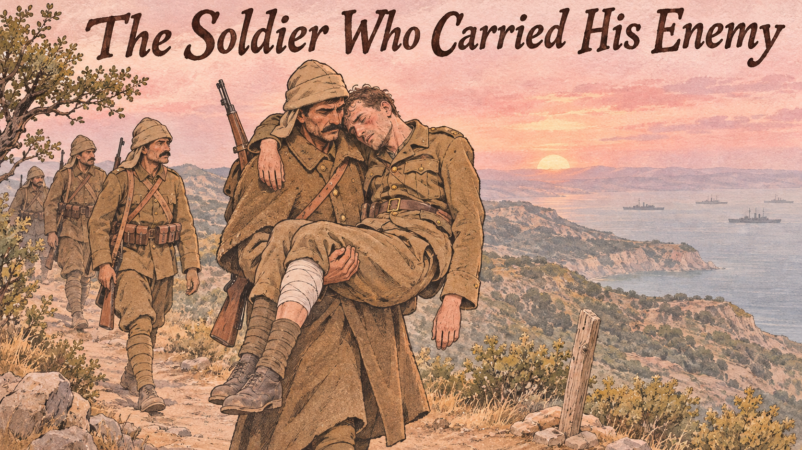
<details>
<summary>Cover Image Prompt</summary>
(This is the Cover Image. Do not include this label in the image.)
Style: a hand-drawn travel-sketchbook graphic-novel illustration, with clean dark ink outlines, flat softly shaded color fills and a faint watercolor paper texture, like a page from a traveler's journal; warm, sunlit, painterly lighting; no text, captions, signs, letters or speech bubbles anywhere in the image. Please generate a wide-landscape 16:9 cover image for this story. At dawn on a dusty ridge above the Gallipoli coast, a Turkish soldier in a long greatcoat and soft cap walks along a narrow path carrying a wounded officer in khaki, who has a clean white bandage on his leg and no hat. Ottoman soldiers of 1915: lean, weathered men in khaki-brown wool uniforms with wrapped leg bands, soft khaki caps with a neck cloth, leather ammunition pouches and plain wooden-stocked rifles, carried slung and at rest. Behind them the steep scrub-covered ridges drop to a calm blue-gray bay with the pale shapes of ships on the horizon, a pale rose sky, a few scrub oak bushes and a wooden stake on the path. The scene is soft and a little faded, as if remembered. Across the top, render the title in bold, hand-lettered title text: "The Soldier Who Carried His Enemy". Palette: dusty khaki, sun-bleached ochre, scrub olive, steel-gray sea, dawn rose. Emotional tone: quiet, solemn and humane. Keep every character and place consistent with the other images in this story. Generate the image immediately without asking clarifying questions.
</details>

<details markdown="1">
<summary>Narrative Prompt</summary>

This story is set on the Gallipoli Peninsula in 1915, the Ottoman Empire's Çanakkale campaign, told through the places a traveler can still see (the Dardanelles Narrows, Anzac Cove, Chunuk Bair, a trench line, and the Mehmetçik monument). It uses the book's idea of **cultural memory**: the facts of an event may be agreed, but each community chooses what to stress and how to pass it on.

**Look and palette.** House style per the series bible. The 1915 panels use a muted, dusty palette: dusty khaki, sun-bleached ochre, scrub olive, steel-gray sea, dawn rose and smoke gray. The modern panels (11 and 12) use the series' modern palette (natural daylight, whitewashed pale sky, sea blue, terracotta, olive). Mustafa Kemal appears only as the young officer of 1915, using the shared block in characters.md.

**Strict safety rule: zero gore.** Landings are shown by boats, cliffs, dust and silhouettes; ships are shown at a distance; the truce panels show soldiers sharing food and cigarettes at a distance; the statue legend shows a wounded officer with a clean white bandage and nothing more. No bodies, no blood, no weapons raised, no flags except a plain white cloth. No lettering on any flag or monument.

**Documented versus legend.** Documented (chapter and sources): the minelayer and the mines; the failed naval attack on March 18; the landing on April 25 about two kilometers north of the intended beach; Kemal's command of the 19th Division and his role holding the ridge; the truce of May 24 with food and cigarettes exchanged; the August fighting at Chunuk Bair and Kemal's counterattack. **Tradition or disputed:** the story of the soldier who carried an enemy officer (a retold story, attributed to a speech by Lord Casey, with no official record of a Casey visit) and the "Johnnies and Mehmets" words attributed to Atatürk (earliest source 1953; the best-known line may be a later English addition). The statue's exact design and year of unveiling are described loosely because sources differ.

**Creative liberties.** Uniforms and landscape are generic types; the Narrows panel shows an unlabeled fort and flag. In panel 10 the soldier and officer are imagined types, not named individuals, and the scene is marked as legend. The viewpoint of panel 12 matches panel 3 rather than panel 1, because the Then and Now should show the beach.

**Cast.** Paste each block below verbatim into every prompt where that character, place or object appears.

- **Glaux the Little Owl:** see docs/stories/characters.md and docs/img/mascot/character-sheet.md (Glaux). Glaux appears in exactly one panel, Panel 8, as a small hidden observer on a trench stake.
- **Mustafa Kemal as a young Ottoman officer in 1915:** see docs/stories/characters.md (used in Panels 5, 6 and 9).
- **The Travelers (final panel):** see docs/stories/characters.md; seen from behind in Panel 12 only.

**The Nusret (object, this story only)**

```text
The Nusret, an Ottoman minelayer, 1915: a small, dark, broad-beamed steamship with one thin funnel and a low black hull, a row of round dark mines lined up on its rear deck, shaded lamps, and a crew of about a dozen men in dark wool jackets and soft caps working quietly.
```

**Anzac Cove (place, this story only)**

```text
Anzac Cove on the Gallipoli Peninsula: a small, narrow, stony beach curving around a bay of calm blue-gray water, with steep, dry, scrub-covered clay-and-gravel ridges rising almost straight up behind the beach, golden-brown grass, dark green scrub oak and a headland at the northern end.
```

**Ottoman soldiers of 1915 (this story only)**

```text
Ottoman soldiers of 1915: lean, weathered men in khaki-brown wool uniforms with wrapped leg bands, soft khaki caps with a neck cloth, leather ammunition pouches and plain wooden-stocked rifles, carried slung and at rest.
```

**Anzac soldiers of 1915 (this story only)**

```text
Anzac soldiers of 1915: young men in khaki wool uniforms with wrapped leg bands and wide-brimmed slouch hats with one side pinned up, canvas packs and rifles slung and at rest, sunburned and tired.
```

**The trenches (place, this story only)**

```text
Two opposing front-line trenches at Gallipoli, only a few meters apart: deep, zigzag trenches of dry earth reinforced with wooden planks and sandbags, with a narrow strip of bare, dusty ground between them, scattered dry scrub and wooden stakes.
```

**The Mehmetçik monument (object, this story only)**

```text
The Mehmetçik monument: a large bronze statue on a gray stone plinth of a Turkish soldier in a long greatcoat and soft cap, striding forward and carrying a wounded officer, beside a quiet road lined with pine trees above a green valley.
```

</details>

### Prologue - A Statue and a Question

On a road across the Gallipoli Peninsula stands a bronze statue of a Turkish soldier carrying a wounded enemy officer to safety. Visitors photograph it, and sooner or later someone asks: did that really happen? The honest answer is more interesting than yes or no. This story follows the battle that surrounds the statue, from a small ship laying mines to a truce between the trenches, and shows how a nation, and two young nations far away, decide what to remember.

**Find Glaux:** Glaux hides in one panel of this story. Can you spot the little owl?

## Panel 1: A Little Ship at Night

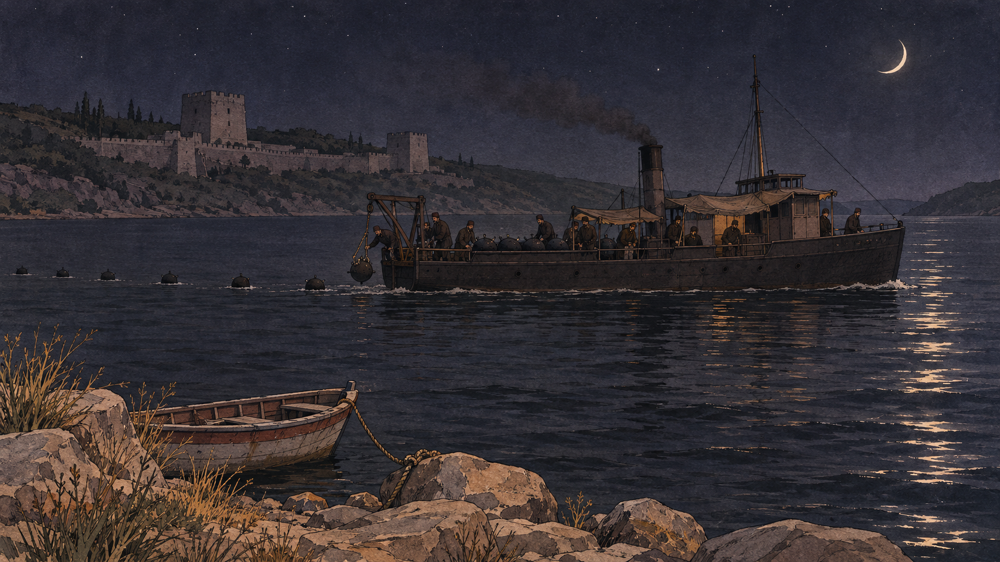
<details><summary>Image Prompt</summary>
(This is Panel 01. Do not include the panel number in the image.)
I am about to ask you to generate a series of images for a graphic novel. Please make the images have a consistent style and consistent characters. Do not ask any clarifying questions. Just generate the image immediately when asked.

Style: a hand-drawn travel-sketchbook graphic-novel illustration, with clean dark ink outlines, flat softly shaded color fills and a faint watercolor paper texture, like a page from a traveler's journal; warm, sunlit, painterly lighting; no text, captions, signs, letters or speech bubbles anywhere in the image. Please generate a 16:9 image depicting panel 1 of 12. The Dardanelles strait at the Narrows, a few nights before March 18, 1915, pitch dark with a thin moon. Palette: Gallipoli 1915 palette: dusty khaki, sun-bleached ochre, scrub olive, steel-gray sea, dawn rose and smoke gray, deepened to indigo and lamplight amber. Wide, low view across black water from a rocky shore. The Nusret, an Ottoman minelayer, 1915: a small, dark, broad-beamed steamship with one thin funnel and a low black hull, a row of round dark mines lined up on its rear deck, shaded lamps, and a crew of about a dozen men in dark wool jackets and soft caps working quietly. It slides along quietly with every light shaded, laying a line of round dark mines in the water behind it. On the far shore the silhouette of a stone fortress with square towers (Kilitbahir) rises against the stars; in the foreground a few stones, tufts of dry grass and a lone fisherman's boat; a faint ripple spreads behind the ship. Mood: hushed, secret, patient. Keep every character and place consistent with the other images in this story. Generate the image immediately without asking clarifying questions.
</details>

Before the great attack, a small Ottoman minelayer called the *Nusret* slips along the strait in the dark. Its crew lays a line of mines across the water, secretly, in the days before the great attack. A replica of the ship now stands beside the castle in Çanakkale, and it is worth a look: this is the small boat on which a great deal turned.

## Panel 2: The Narrows, March 18

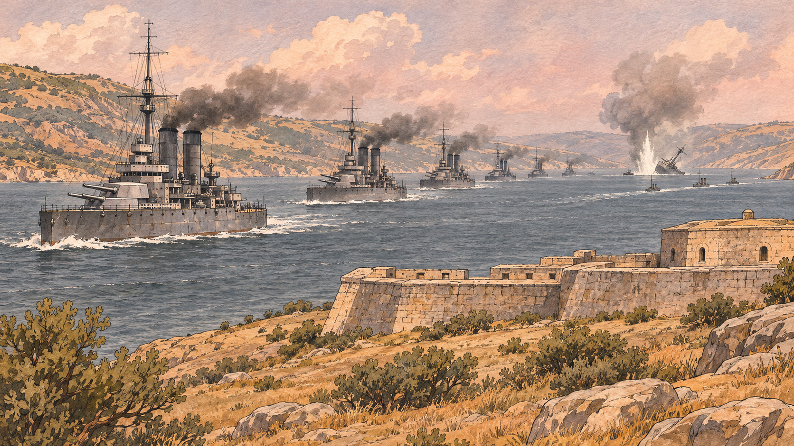
<details><summary>Image Prompt</summary>
(This is Panel 02. Do not include the panel number in the image.)
Style: a hand-drawn travel-sketchbook graphic-novel illustration, with clean dark ink outlines, flat softly shaded color fills and a faint watercolor paper texture, like a page from a traveler's journal; warm, sunlit, painterly lighting; no text, captions, signs, letters or speech bubbles anywhere in the image. Please generate a 16:9 image depicting panel 2 of 12. The Narrows of the Dardanelles, March 18, 1915, midday. Palette: Gallipoli 1915 palette: dusty khaki, sun-bleached ochre, scrub olive, steel-gray sea, dawn rose and smoke gray. Wide establishing view from the Asian shore at Çanakkale across the strait. A line of huge gray Allied battleships with two thick funnels, tall masts and big gun turrets steams up the strait in a column, trailing smoke; far down the line one battleship is listing to the side in the distance, with a column of white spray and a gray cloud above it, while smaller ships hurry toward it; on the shore in the foreground a low stone fort and a few small round hills dotted with scrub. No people or damage are shown up close. Mood: tension that breaks, the strait holding. Keep every character and place consistent with the other images in this story. Generate the image immediately without asking clarifying questions.
</details>

On March 18, 1915, a great Allied fleet tries to force its way through the Narrows. It loses three battleships to the secret line of mines, and turns back. Turks commemorate that day as the Çanakkale Victory, and Çanakkale's university is named for it: *Onsekiz Mart* means "March 18."

## Panel 3: Boats Before Dawn

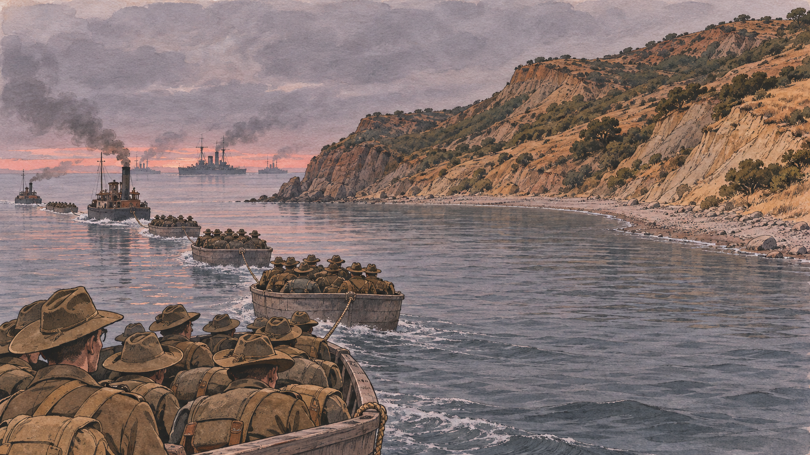
<details><summary>Image Prompt</summary>
(This is Panel 03. Do not include the panel number in the image.)
Style: a hand-drawn travel-sketchbook graphic-novel illustration, with clean dark ink outlines, flat softly shaded color fills and a faint watercolor paper texture, like a page from a traveler's journal; warm, sunlit, painterly lighting; no text, captions, signs, letters or speech bubbles anywhere in the image. Please generate a 16:9 image depicting panel 3 of 12. Off the Gallipoli Peninsula, April 25, 1915, gray predawn light. Palette: Gallipoli 1915 palette: dusty khaki, sun-bleached ochre, scrub olive, steel-gray sea, dawn rose and smoke gray, with a pale rose line at the horizon. Wide view from the sea looking toward the coast, Anzac Cove on the Gallipoli Peninsula: a small, narrow, stony beach curving around a bay of calm blue-gray water, with steep, dry, scrub-covered clay-and-gravel ridges rising almost straight up behind the beach, golden-brown grass, dark green scrub oak and a headland at the northern end. Rows of small wooden boats towed in lines by steam launches cross the calm water, each boat packed with the silhouettes of men in slouch hats and packs, sitting very still; a few large gray warships wait in the background with banks of smoke. The cliffs are dark and quiet, with no sign of anyone. Mood: held breath, a long minute before a day nobody will forget. Keep every character and place consistent with the other images in this story. Generate the image immediately without asking clarifying questions.
</details>

On April 25, 1915, the Allies land troops on the Gallipoli Peninsula. Before dawn, boats full of Australian and New Zealand soldiers, the Anzacs, head for the shore. Most are volunteers who have never seen a war. The coast ahead is quiet.

## Panel 4: The Wrong Beach

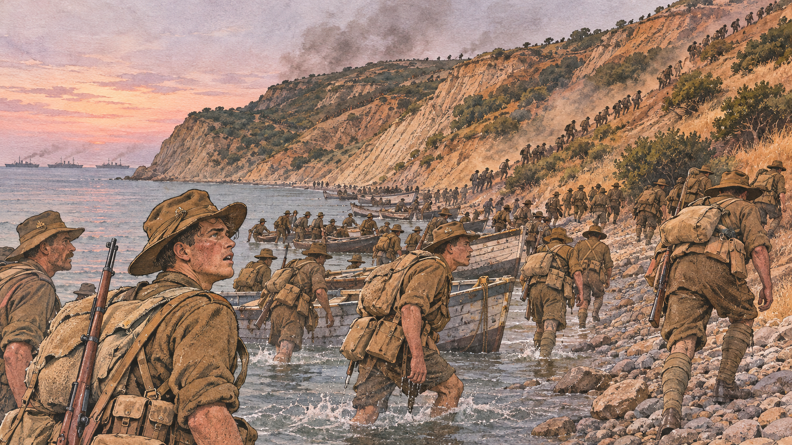
<details><summary>Image Prompt</summary>
(This is Panel 04. Do not include the panel number in the image.)
Style: a hand-drawn travel-sketchbook graphic-novel illustration, with clean dark ink outlines, flat softly shaded color fills and a faint watercolor paper texture, like a page from a traveler's journal; warm, sunlit, painterly lighting; no text, captions, signs, letters or speech bubbles anywhere in the image. Please generate a 16:9 image depicting panel 4 of 12. Anzac Cove, Gallipoli, April 25, 1915, early dawn. Palette: Gallipoli 1915 palette: dusty khaki, sun-bleached ochre, scrub olive, steel-gray sea, dawn rose and smoke gray. Medium-wide view from the beach, looking up the steep slope. Anzac Cove on the Gallipoli Peninsula: a small, narrow, stony beach curving around a bay of calm blue-gray water, with steep, dry, scrub-covered clay-and-gravel ridges rising almost straight up behind the beach, golden-brown grass, dark green scrub oak and a headland at the northern end. Dozens of small boats have grounded on the stones; men in slouch hats jump into knee-deep shallows and wade ashore carrying packs, and long dark lines of silhouettes climb the steep, scrub-covered slope in single file under a pale sky. Anzac soldiers of 1915: young men in khaki wool uniforms with wrapped leg bands and wide-brimmed slouch hats with one side pinned up, canvas packs and rifles slung and at rest, sunburned and tired. Dust and a faint smoke haze hang above the ridge. A line of ships stands far out on the sea. No wounds, no weapons raised. Mood: confusion, determination, a plan already gone wrong. Keep every character and place consistent with the other images in this story. Generate the image immediately without asking clarifying questions.
</details>

The boats come ashore about two kilometers north of the intended beach, probably because of the current or a navigation error. Instead of a gentle slope the soldiers face steep, scrub-covered ridges. Within hours they are pinned in a strip of ground only a few hundred meters deep, and there they will stay for eight months.

## Panel 5: The Officer on the Ridge

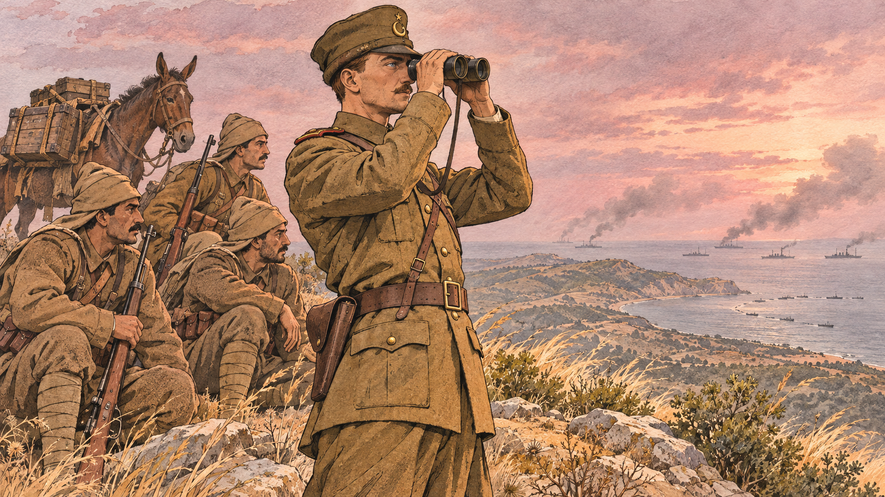
<details><summary>Image Prompt</summary>
(This is Panel 05. Do not include the panel number in the image.)
Style: a hand-drawn travel-sketchbook graphic-novel illustration, with clean dark ink outlines, flat softly shaded color fills and a faint watercolor paper texture, like a page from a traveler's journal; warm, sunlit, painterly lighting; no text, captions, signs, letters or speech bubbles anywhere in the image. Please generate a 16:9 image depicting panel 5 of 12. A high ridge above the Gallipoli coast, April 25, 1915, early morning. Palette: Gallipoli 1915 palette: dusty khaki, sun-bleached ochre, scrub olive, steel-gray sea, dawn rose and smoke gray. Medium shot from slightly below, a lone officer standing on the ridge crest against a rose-gray sky. Mustafa Kemal as a young Ottoman officer in 1915: a lean man of about thirty-four with light blue-gray eyes, light brown hair and a thin mustache, wearing a khaki Ottoman army field uniform with a peaked cap, binoculars at his chest and a calm, watchful expression. He holds binoculars to his eyes, looking down toward the distant sea, where small boats and warships appear as dots; behind him a few soldiers in khaki-brown uniforms crouch in the dust, waiting for orders; dry grass and scrub blow in the wind. Ottoman soldiers of 1915: lean, weathered men in khaki-brown wool uniforms with wrapped leg bands, soft khaki caps with a neck cloth, leather ammunition pouches and plain wooden-stocked rifles, carried slung and at rest. A mule with ammunition boxes stands behind. Mood: calm decision, the stillness before a hard march. Keep every character and place consistent with the other images in this story. Generate the image immediately without asking clarifying questions.
</details>

Mustafa Kemal, then a thirty-four-year-old Ottoman officer, commands the 19th Division. From the high ground he watches the landing and judges it fast. In the next hours he will be one of the people who decide where the line holds.

## Panel 6: Up to the Ridge

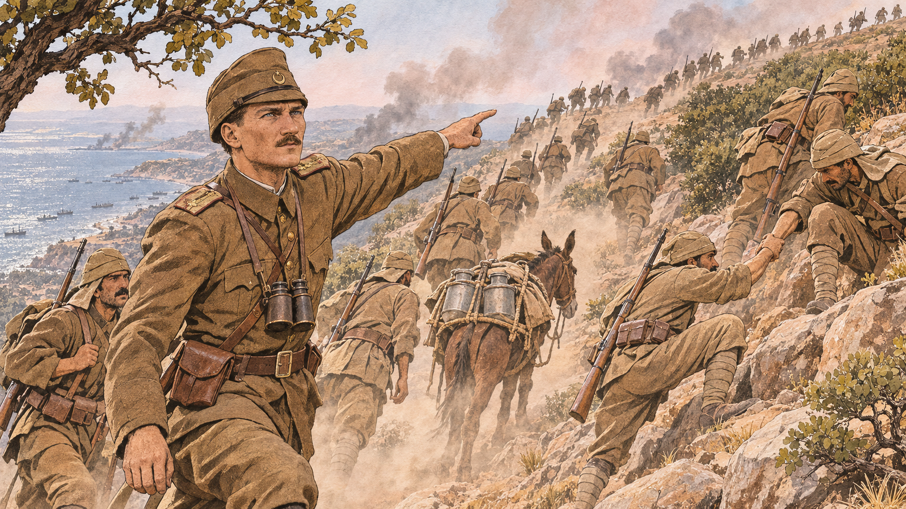
<details><summary>Image Prompt</summary>
(This is Panel 06. Do not include the panel number in the image.)
Style: a hand-drawn travel-sketchbook graphic-novel illustration, with clean dark ink outlines, flat softly shaded color fills and a faint watercolor paper texture, like a page from a traveler's journal; warm, sunlit, painterly lighting; no text, captions, signs, letters or speech bubbles anywhere in the image. Please generate a 16:9 image depicting panel 6 of 12. The slopes above Anzac Cove, Gallipoli, April 25, 1915, mid-morning. Palette: Gallipoli 1915 palette: dusty khaki, sun-bleached ochre, scrub olive, steel-gray sea, dawn rose and smoke gray. Wide, dynamic view looking up a steep dusty slope: a long file of soldiers in khaki-brown uniforms climbs toward the ridge in silhouette, rifles slung, hurrying, under a haze of dust and pale smoke. Ottoman soldiers of 1915: lean, weathered men in khaki-brown wool uniforms with wrapped leg bands, soft khaki caps with a neck cloth, leather ammunition pouches and plain wooden-stocked rifles, carried slung and at rest. In the foreground, slightly to the left, Mustafa Kemal as a young Ottoman officer in 1915: a lean man of about thirty-four with light blue-gray eyes, light brown hair and a thin mustache, wearing a khaki Ottoman army field uniform with a peaked cap, binoculars at his chest and a calm, watchful expression. he points up the hill with one arm, striding ahead. Scrub oak and boulders line the path; a mule carries water cans; a few men help each other up a steep step. The sea glitters far behind. Mood: urgency, effort, a race against time. Keep every character and place consistent with the other images in this story. Generate the image immediately without asking clarifying questions.
</details>

Mustafa Kemal leads his men onto the ridge in time to stop the Anzac advance, at enormous cost to his own troops. The ridges are so steep that every meter matters. This is the day that makes his name.

## Panel 7: A Truce to Bury the Dead

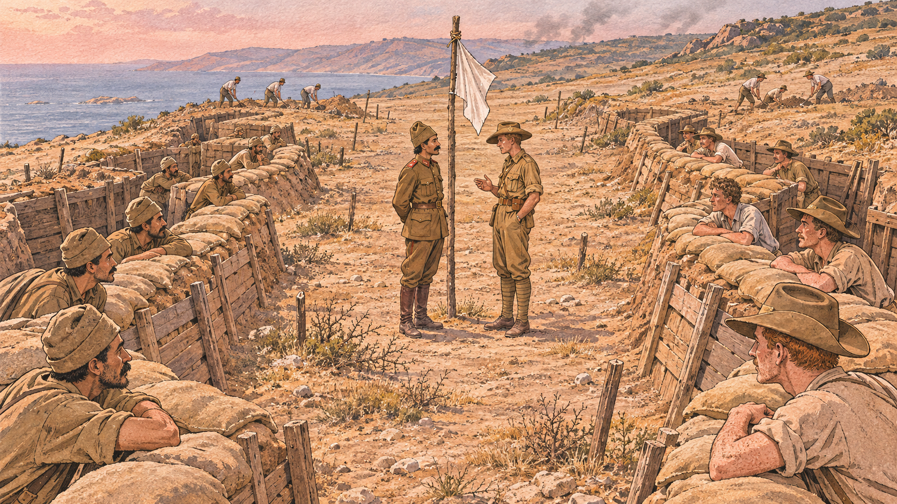
<details><summary>Image Prompt</summary>
(This is Panel 07. Do not include the panel number in the image.)
Style: a hand-drawn travel-sketchbook graphic-novel illustration, with clean dark ink outlines, flat softly shaded color fills and a faint watercolor paper texture, like a page from a traveler's journal; warm, sunlit, painterly lighting; no text, captions, signs, letters or speech bubbles anywhere in the image. Please generate a 16:9 image depicting panel 7 of 12. The front line at Gallipoli, May 24, 1915, a calm, hot morning. Palette: Gallipoli 1915 palette: dusty khaki, sun-bleached ochre, scrub olive, steel-gray sea, dawn rose and smoke gray. High, wide view down a narrow strip of bare ground between two sets of trenches. Two opposing front-line trenches at Gallipoli, only a few meters apart: deep, zigzag trenches of dry earth reinforced with wooden planks and sandbags, with a narrow strip of bare, dusty ground between them, scattered dry scrub and wooden stakes. A white cloth hangs from a pole in the middle of the strip. Two officers, one in khaki-brown Ottoman uniform and one in an Anzac slouch hat, stand talking quietly beside the pole; at the far ends of the strip small work parties in shirtsleeves with long-handled shovels dig in the distance, seen very small. Soldiers from both sides peer over the edges of their trenches without weapons. Mood: strange stillness, a gap in the war. Keep every character and place consistent with the other images in this story. Generate the image immediately without asking clarifying questions.
</details>

On May 24, 1915, both sides agree to a truce so the dead can be buried; thousands lie between the lines after a failed attack on May 19. White cloth goes up, the guns fall silent, and for the hours of the truce men work in the open. It is one of the most unusual days of the campaign.

## Panel 8: Cigarettes Across the Line

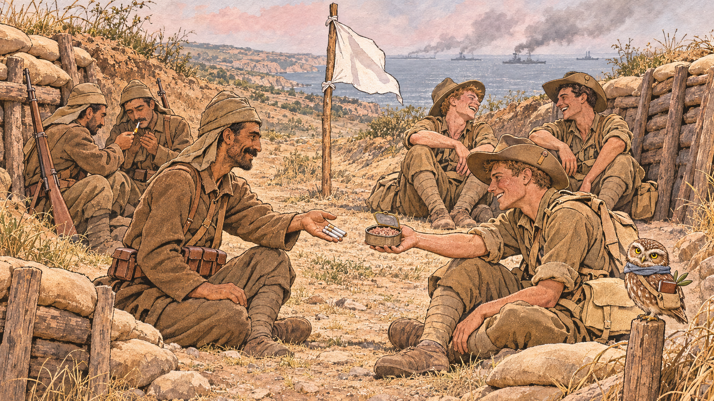
<details><summary>Image Prompt</summary>
(This is Panel 08. Do not include the panel number in the image.)
Style: a hand-drawn travel-sketchbook graphic-novel illustration, with clean dark ink outlines, flat softly shaded color fills and a faint watercolor paper texture, like a page from a traveler's journal; warm, sunlit, painterly lighting; no text, captions, signs, letters or speech bubbles anywhere in the image. Please generate a 16:9 image depicting panel 8 of 12. The strip between two trenches at Gallipoli, May 24, 1915, noon. Palette: Gallipoli 1915 palette: dusty khaki, sun-bleached ochre, scrub olive, steel-gray sea, dawn rose and smoke gray. Medium-wide view of a few small groups of men sitting on the ground at a respectful distance from each other on either side of a white flag. Ottoman soldiers of 1915: lean, weathered men in khaki-brown wool uniforms with wrapped leg bands, soft khaki caps with a neck cloth, leather ammunition pouches and plain wooden-stocked rifles, carried slung and at rest. Anzac soldiers of 1915: young men in khaki wool uniforms with wrapped leg bands and wide-brimmed slouch hats with one side pinned up, canvas packs and rifles slung and at rest, sunburned and tired. A tall Ottoman soldier holds out a handful of cigarettes; an Anzac soldier with a tin of bully beef reaches out to offer it; a third pair laugh together; a fourth soldier lights a match for another. Glaux is perched on a wooden stake at the edge of the trench: Glaux the Little Owl: a true little owl (Athene noctua), small, round and compact, with a flat rounded head and no ear tufts, warm earth-brown plumage with cream spots, bright lemon-yellow eyes under pale cream eyebrows, a cream-white throat patch and a short pale greenish-yellow beak. Glaux wears a small Aegean-blue scarf and a tan canvas satchel across the body with a small leather-bound travel notebook peeking out, and a sprig of three olive leaves tucked into the satchel strap. Alert, curious and warm expression. Glaux is drawn small, perched at the edge of the scene, noticeable on a second look. Dry grass, stakes and sandbags. No weapons are held. Mood: warm, awkward, human. Keep every character and place consistent with the other images in this story. Generate the image immediately without asking clarifying questions.
</details>

Between the burial parties the soldiers do something nobody planned. They sit down. The sources describe men from both sides exchanging cigarettes and food, such as tinned beef, at a careful distance. The truce ends, and the war starts again.

## Panel 9: Chunuk Bair

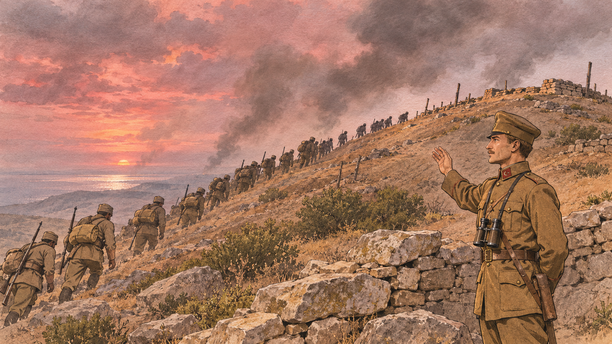
<details><summary>Image Prompt</summary>
(This is Panel 09. Do not include the panel number in the image.)
Style: a hand-drawn travel-sketchbook graphic-novel illustration, with clean dark ink outlines, flat softly shaded color fills and a faint watercolor paper texture, like a page from a traveler's journal; warm, sunlit, painterly lighting; no text, captions, signs, letters or speech bubbles anywhere in the image. Please generate a 16:9 image depicting panel 9 of 12. Chunuk Bair (Conkbayırı), Gallipoli, August 10, 1915, first light. Palette: Gallipoli 1915 palette: dusty khaki, sun-bleached ochre, scrub olive, steel-gray sea, dawn rose and smoke gray. Wide establishing view of a bare, high ridge crest under a heavy rose-and-gray sky filled with drifting dust and smoke. In the middle ground a long line of Ottoman soldiers in silhouette moves up the slope toward the crest. Mustafa Kemal as a young Ottoman officer in 1915: a lean man of about thirty-four with light blue-gray eyes, light brown hair and a thin mustache, wearing a khaki Ottoman army field uniform with a peaked cap, binoculars at his chest and a calm, watchful expression. stands small in the foreground right with his peaked cap and binoculars, watching, one hand raised in a simple gesture. Scrubby slopes, broken stone walls, boulders and wooden stakes mark the ridge. Far below, the sea is a thin silver band. No fighting is shown. Mood: heavy, exhausted, decisive. Keep every character and place consistent with the other images in this story. Generate the image immediately without asking clarifying questions.
</details>

In August the New Zealanders of the Wellington Battalion take the summit of Chunuk Bair on August 8. Two days later they lose it to a counterattack led by Mustafa Kemal. Today the New Zealand memorial and a statue of Atatürk stand there a short walk apart.

## Panel 10: The Story Behind the Statue

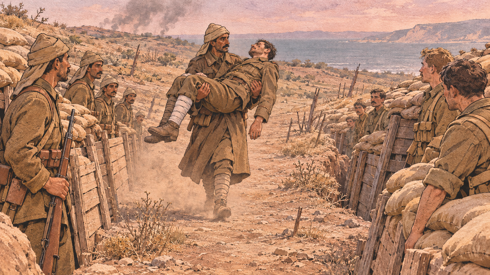
<details><summary>Image Prompt</summary>
(This is Panel 10. Do not include the panel number in the image.)
Style: a hand-drawn travel-sketchbook graphic-novel illustration, with clean dark ink outlines, flat softly shaded color fills and a faint watercolor paper texture, like a page from a traveler's journal; warm, sunlit, painterly lighting; no text, captions, signs, letters or speech bubbles anywhere in the image. Please generate a 16:9 image depicting panel 10 of 12. The strip between two trenches at Gallipoli, the legend of an unspecified day in 1915, quiet afternoon. Palette: Gallipoli 1915 palette: dusty khaki, sun-bleached ochre, scrub olive, steel-gray sea, dawn rose and smoke gray, softened as if remembered. Wide, slightly low view across a bare strip of ground. Two opposing front-line trenches at Gallipoli, only a few meters apart: deep, zigzag trenches of dry earth reinforced with wooden planks and sandbags, with a narrow strip of bare, dusty ground between them, scattered dry scrub and wooden stakes. In the middle of the strip a Turkish soldier in a long greatcoat and soft cap walks calmly toward the other trench carrying a wounded officer in his arms. The officer wears khaki, has a clean white bandage on his leg and no hat. Soldiers on both sides stand up out of their trenches in silence, rifles lowered, watching: Ottoman soldiers of 1915: lean, weathered men in khaki-brown wool uniforms with wrapped leg bands, soft khaki caps with a neck cloth, leather ammunition pouches and plain wooden-stocked rifles, carried slung and at rest. Dust hangs in the air. Mood: stillness, mercy, a held breath. Keep every character and place consistent with the other images in this story. Generate the image immediately without asking clarifying questions.
</details>

Here is the story behind the famous statue, as it is told. During heavy fighting, a wounded officer lies in the open in front of the Anzac trenches. A Turkish soldier climbs out of his own trench, the firing stops, and he carries the officer to the Anzac lines, then walks back to his own. It is a deeply moving scene, and it is a story first and a monument second.

> **Myth or Evidence?** The version most often retold traces to a speech attributed to the Australian statesman Lord Casey, but no official record of a Casey visit to Gallipoli has been found, and historians treat the carrying story as a legend rather than a documented event. We label it tradition.

## Panel 11: The Monument by the Road

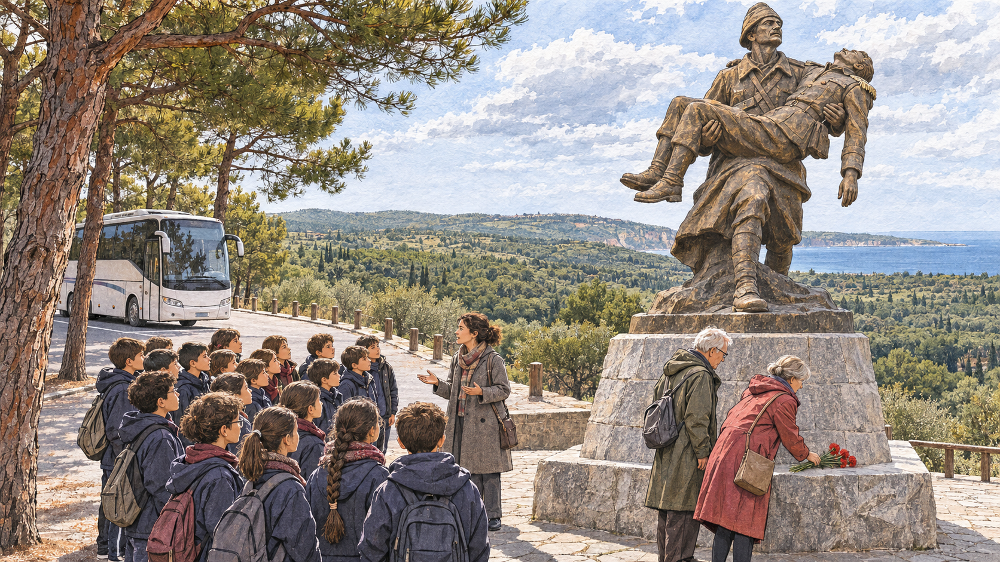
<details><summary>Image Prompt</summary>
(This is Panel 11. Do not include the panel number in the image.)
Style: a hand-drawn travel-sketchbook graphic-novel illustration, with clean dark ink outlines, flat softly shaded color fills and a faint watercolor paper texture, like a page from a traveler's journal; warm, sunlit, painterly lighting; no text, captions, signs, letters or speech bubbles anywhere in the image. Please generate a 16:9 image depicting panel 11 of 12. The Mehmetçik monument on the Gallipoli Peninsula, today, a bright, cool November morning. Palette: natural daylight, whitewashed pale sky, sea blue, terracotta, olive. Medium-wide view from the road. The Mehmetçik monument: a large bronze statue on a gray stone plinth of a Turkish soldier in a long greatcoat and soft cap, striding forward and carrying a wounded officer, beside a quiet road lined with pine trees above a green valley. Around its plinth a school group of about twenty children in navy jackets and scarves stands in a half circle listening to a teacher in a gray coat; two older visitors in raincoats lay a small bunch of red carnations on the base; a coach is parked in a layby; pine trees and a green valley fill the background under scudding clouds. Mood: respectful, ordinary, the legend worn into a place. Keep every character and place consistent with the other images in this story. Generate the image immediately without asking clarifying questions.
</details>

Today a bronze statue of a Turkish soldier carrying a wounded officer stands on the road between Kabatepe and Conkbayırı. It was put up in the late twentieth century, though sources differ on the year, and it is called the Mehmetçik monument, after the affectionate name Turkish people give their ordinary soldiers: "little Mehmet." Visitors from many countries stop to read it and to ask whether it happened.

> **Myth or Evidence?** The statue is real, and the legend it commemorates is attested only as a retold story. What is documented is the truce of May 24, 1915, when soldiers from both sides sat down together. Both can be honored if each is labeled honestly.

## Panel 12: The Words on the Stone

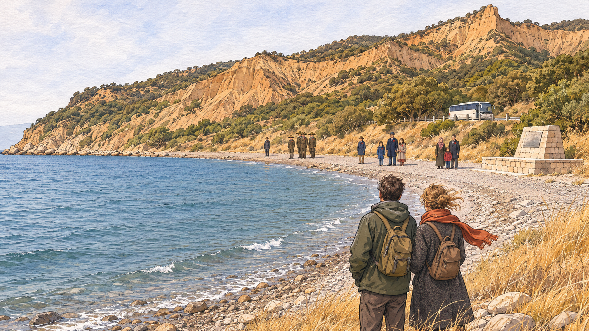
<details><summary>Image Prompt</summary>
(This is Panel 12. Do not include the panel number in the image.)
Style: a hand-drawn travel-sketchbook graphic-novel illustration, with clean dark ink outlines, flat softly shaded color fills and a faint watercolor paper texture, like a page from a traveler's journal; warm, sunlit, painterly lighting; no text, captions, signs, letters or speech bubbles anywhere in the image. Please generate a 16:9 image depicting panel 12 of 12. Anzac Cove, Gallipoli, today, a bright, windy November morning. Palette: natural daylight, whitewashed pale sky, sea blue, terracotta, olive. Wide establishing view from near the water's edge looking toward the steep ridges, matching the viewpoint of panel 3 as closely as possible. Anzac Cove on the Gallipoli Peninsula: a small, narrow, stony beach curving around a bay of calm blue-gray water, with steep, dry, scrub-covered clay-and-gravel ridges rising almost straight up behind the beach, golden-brown grass, dark green scrub oak and a headland at the northern end. A low stone memorial stands at the right of the beach; a few distant visitors in coats and hats, including a small group with an Australian-style slouch hat, a family in coats with red poppies pinned on their lapels, and a Turkish family, stand in a loose group along the shore, quiet; a coach waits on the road behind. In the foreground, seen small: Two adult travelers seen from behind or in distant three-quarter view, dressed for cool November weather: one in a dark green rain jacket, the other in a charcoal wool coat with a rust-colored scarf, both with small daypacks, standing close together and looking at the view. Faces are never shown in detail. Mood: quiet, reflective, shared. Keep every character and place consistent with the other images in this story. Generate the image immediately without asking clarifying questions.
</details>

Today, on the same beach, Australian, New Zealand and Turkish visitors stand together in the early morning wind. Words of reconciliation are carved on a memorial here: that the soldiers on both sides now lie together in the soil of a friendly country, and that there is "no difference between the Johnnies and the Mehmets." They are attributed to Mustafa Kemal Atatürk in 1934, but whether he wrote them is debated.

> **Myth or Evidence?** The earliest source is a 1953 newspaper interview with Atatürk's former interior minister, nineteen years after the supposed 1934 message; researchers argue the most famous line was added in English in the late 1970s. As a claim about what he wrote, it is late and unsupported. As cultural memory it is real and powerful, and the honest way to read it is to hold both.

### Epilogue - How a Battlefield Becomes a Memory

Gallipoli is one place with several memories. For Turks it is *Çanakkale geçilmez*, the defense of the homeland at the gate of the capital, and the ordinary soldier is *Mehmetçik*. For Australians and New Zealanders it is a coming of age for two young nations, and Anzac Day is a sacred date. The documented events, the mines, the landing, the truce, are firm; the stories we tell about them, the carried officer and the carved words, are warmer and less certain. Telling them side by side, with honest labels, is what the book's tests for evidence are for, and it is a Learning for All habit: the more people can read the sources for themselves, the less any one story can claim to be the whole truth.

| Challenge | How They Responded | Lesson for Today |
|---|---|---|
| A naval attack in a narrow strait | A small minelayer laid a secret line of mines, and three battleships were lost | A chokepoint rewards the defender who prepares quietly. |
| A landing on the wrong beach | Soldiers climbed steep ridges, and Mustafa Kemal's division reached the crest in time | Plans fail on the ground; the people there decide. |
| Two armies a few meters apart | On May 24 they paused to bury the dead, and shared food and cigarettes | Enemies are people, and sometimes they behave like it. |
| A moving story with an uncertain source | A statue and a carved message keep it alive, while historians label what is tradition | Honor the memory, and label it honestly. |

### Call to Action

If you walk the Gallipoli ridges, read at least one Turkish memorial as well as Anzac Cove, and ask each guide the two questions from the book: where does this come from, and how old is the earliest source? Then stand quietly at the statue, and decide for yourself how to hold both the legend and the truce.

---

## Voices from the Sources

- *Çanakkale geçilmez*, "Çanakkale cannot be passed": a phrase every Turkish child learns, according to the chapter; a slogan of national memory, not a quotation from one person.
- "No difference between the Johnnies and the Mehmets": carved on a memorial at Anzac Cove and on Atatürk memorials in Canberra and Wellington, and traditionally attributed to Atatürk in 1934. **Attribution is disputed:** no 1934 source has been found, the earliest source is a 1953 interview, and researchers say the best-known line may be a later addition in English.
- *Mehmetçik*, "little Mehmet": the affectionate Turkish name for the ordinary soldier, and the name of the monument whose statue is the subject of this story. We quote a word and a title, not a person, because no documented words of the soldier in the legend exist.

## On the Trip

- **Chapter:** [8. Troy and Gallipoli](../../chapters/08-troy-and-gallipoli/index.md)
- **Where to look:** the Mehmetçik monument on the road between Kabatepe and Conkbayırı; the trench lines, some of them only meters apart; Anzac Cove and its memorial; the Çanakkale Martyrs' Memorial near the southern tip, and the *Nusret* replica beside Çimenlik Castle in Çanakkale.
- **Explore further:** [Source, Myth, or Contested?](../../sims/source-myth-or-contested/index.md), where readers sort which parts of a story are documented and which are remembered, and [Mind the Gap: How Old Is the Evidence?](../../sims/troy-gallipoli-evidence-gap/index.md).
- **Look Closer:** Glaux says: "Look closer. Find a trench wall and a wooden stake." Glaux hid in Panel 8 (Cigarettes Across the Line), on a wooden stake at the edge of the trench. On site, look for how close the old trench lines really are.

## Characters and Style

This story follows the shared series bible: [Story Characters, Places and House Style](../characters.md). Glaux's identity comes from the mascot's [character sheet](../../img/mascot/character-sheet.md).

## References

1. [Wikipedia: Gallipoli campaign](https://en.wikipedia.org/wiki/Gallipoli_campaign) - Overview of the naval attack, the landings and the eight-month campaign
2. [Wikipedia: Respect to Mehmetçik Monument](https://en.wikipedia.org/wiki/Respect_to_Mehmet%C3%A7ik_Monument) - The statue, its location and the story behind it
3. [Wikipedia: Mustafa Kemal Atatürk](https://en.wikipedia.org/wiki/Mustafa_Kemal_Atat%C3%BCrk) - Biography, including his role at Gallipoli
4. [Anzac Memorial: The 24 May Truce on Gallipoli](https://www.anzacmemorial.nsw.gov.au/our-stories/our-stories/24-may-truce-gallipoli) - The burial truce, from the Anzac Memorial in Sydney
5. [Encyclopaedia Britannica: Gallipoli Campaign](https://www.britannica.com/event/Gallipoli-Campaign) - A concise overview of the campaign
