# The Sultan's Sweet Tooth

<!-- 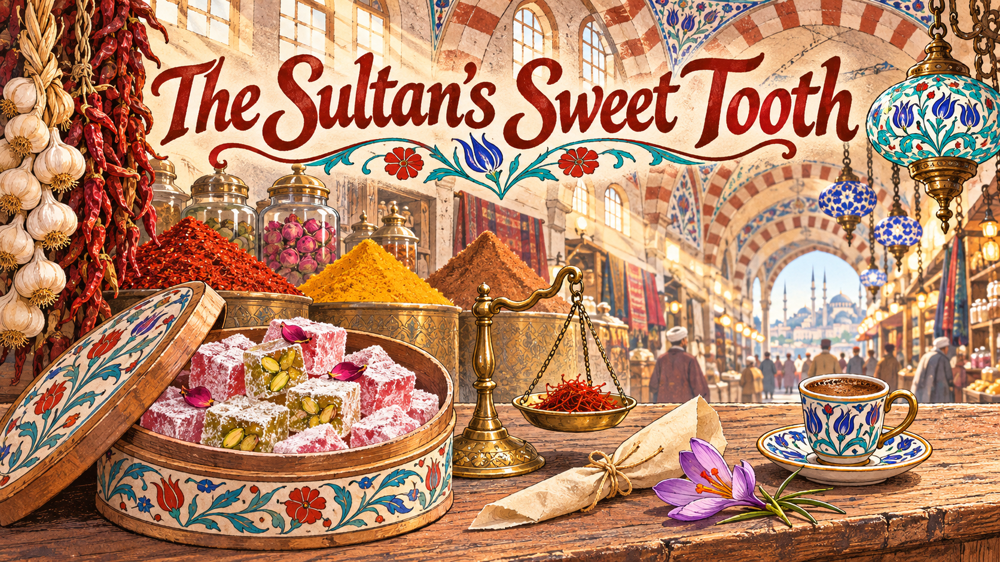 -->
<details>
<summary>Cover Image Prompt</summary>
(This is the Cover Image. Do not include this label in the image.)
Style: a hand-drawn travel-sketchbook graphic-novel illustration, with clean dark ink outlines, flat softly shaded color fills and a faint watercolor paper texture, like a page from a traveler's journal; warm, sunlit, painterly lighting; no text, captions, signs, letters or speech bubbles anywhere in the image.

Please generate a wide-landscape 16:9 cover image for a graphic novel called "The Sultan's Sweet Tooth". Render the title as bold, hand-lettered title text across the upper third, spelled exactly: "The Sultan's Sweet Tooth". Beneath it, in the Spice Bazaar of Istanbul, a wide vaulted stone hall glows with morning light from high windows. In the foreground on a worn wooden counter sit a round wooden box of pistachio and rose Turkish delight cubes dusted with powdered sugar, a small brass hand scale holding a few deep-red saffron threads, a twist of paper, a tiny cup of Turkish coffee and a sprig of purple crocus. Behind them rise cone-shaped piles of spices in tomato red, saffron yellow and cinnamon brown, braided garlic, hanging dried peppers, and glass lamps of Iznik turquoise and cobalt. Palette: Iznik turquoise, cobalt, tomato red, brass, saffron yellow and white plaster. Mood: warm, appetizing and inviting. No other text.

Keep every character and place consistent with the other images in this story. Generate the image immediately without asking clarifying questions.
</details>

<details>
<summary>Narrative Prompt</summary>
**Era and place.** Istanbul, from the 1550s to the 1770s, with a closing visit today. The central place is the Spice Bazaar (Mısır Çarşısı, "Egyptian Bazaar"), the L-shaped covered market beside the New Mosque at Eminönü on the Golden Horn, built in the 1660s as part of the mosque's complex. Two short scenes step outside the city: a coffeehouse in Istanbul (panels 4 to 6) and the saffron fields around Safranbolu (panel 10).

**Themes.** Trade and taste: how a market was built to pay for a mosque, how a drink a sultan tried to ban won in the end, how a confectioner became famous, and why saffron is the most expensive spice by weight. The thread connecting every panel is *who gets to enjoy a thing, and who decides.*

**House style and palette.** Follow the series house style in [Story Characters, Places and House Style](../characters.md). Palette for this story (the Ottoman era): Iznik turquoise, cobalt, tomato red, brass, saffron yellow and white plaster. The final panel returns to the same viewpoint as panel 1 in natural modern daylight. Panels contain no lettering of any kind; only the cover carries the title.

**Creative liberties and uncertainties.** The faces and clothing of the merchant, the confectioner, the apprentice and the saffron picker are imagined; no portraits survive. Hacı Bekir's exact appearance, the layout of his first shop and the coffeehouse interiors are reconstructions. The exact date coffee first reached Istanbul (the 1550s is the traditional date) and the length and enforcement of Sultan Murad IV's coffeehouse closures are described in general terms. Safranbolu appears as a place name tied to saffron; the scene of the saffron harvest is a typical autumn field, not a documented one.

Cast and consistency notes:

- **Glaux the Little Owl:** see [docs/stories/characters.md](../characters.md) and [docs/img/mascot/character-sheet.md](../../img/mascot/character-sheet.md) (Glaux). Glaux appears in exactly one panel (Panel 2) as a small hidden observer.
- **The Travelers:** see [docs/stories/characters.md](../characters.md); they appear only in the final Then-and-Now panel.

**The Spice Merchant** (appears only in this story; paste this block verbatim wherever the character appears):

```text
The Spice Merchant of the Spice Bazaar: a broad-shouldered man of about fifty with a neatly trimmed gray beard and warm brown eyes, wearing a large cream turban, a tomato-red robe with wide sleeves and a brass-buckled leather belt, a small brass hand scale hanging at his waist; calm, proud and observant.
```

**Hacı Bekir** (appears only in this story; paste this block verbatim wherever the character appears):

```text
Hacı Bekir, confectioner of 1777, as imagined here: a stout, cheerful man of about forty-five with a rounded black beard, a white wound turban, a cobalt-blue robe under a cream cotton apron dusted white with powdered sugar, sugar on his sleeves; patient and proud of his craft.
```

**The Apprentice** (appears only in this story; paste this block verbatim wherever the character appears):

```text
The confectioner's apprentice: a lanky boy of about fourteen with a shaved head under a small white cap, a plain cream shirt with rolled sleeves and a white apron, always carrying a tray or a ladle.
```

**The Saffron Picker** (appears only in this story; paste this block verbatim wherever the character appears):

```text
The saffron picker: a woman of about thirty-five in a patterned plum headscarf, a long indigo cotton dress with a brown apron and rolled sleeves, carrying a shallow woven basket on one arm; quiet, careful hands.
```

</details>

### Prologue - A Box, a Twist and a Few Threads

Every traveler who walks the Spice Bazaar leaves with something small in a paper bag. This story follows two of those small things, a box of Turkish delight and a pinch of saffron, back through three centuries of Ottoman taste. Along the way a market is built to pay for a mosque, a sultan tries to close the coffeehouses, a confectioner opens a shop that is still open today, and a purple crocus turns out to be worth more by weight than almost anything on the stall.

**Find Glaux:** Glaux hides in one panel of this story. Can you spot the little owl?

## Panel 1: A Market Built for a Mosque
<!-- 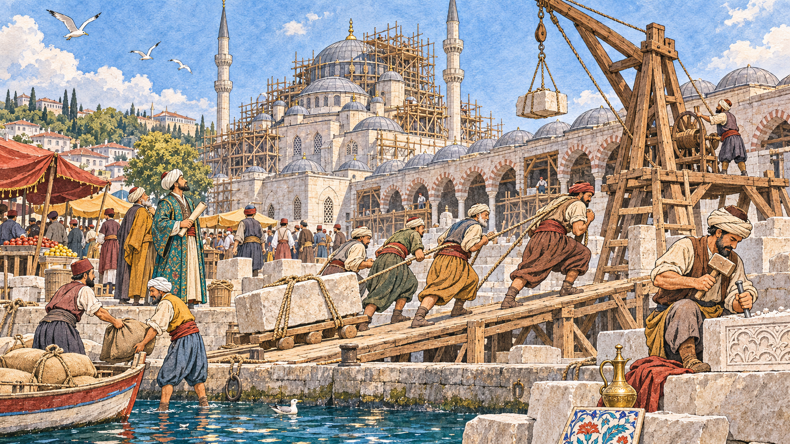 -->
<details><summary>Image Prompt</summary>
(This is Panel 01. Do not include the panel number in the image.)
I am about to ask you to generate a series of images for a graphic novel. Please make the images have a consistent style and consistent characters. Do not ask any clarifying questions. Just generate the image immediately when asked.
Style: a hand-drawn travel-sketchbook graphic-novel illustration, with clean dark ink outlines, flat softly shaded color fills and a faint watercolor paper texture, like a page from a traveler's journal; warm, sunlit, painterly lighting; no text, captions, signs, letters or speech bubbles anywhere in the image.

Please generate a 16:9 image depicting panel 1 of 12. Place and time: the Eminönü waterfront on the Golden Horn, Istanbul, about 1663 CE, late morning. Palette: Iznik turquoise, cobalt, tomato red, brass, saffron yellow and white plaster. Wide establishing shot from the water's edge, looking inland. In the background the New Mosque rises as a tall cascade of gray lead domes with two slender pencil minarets, its upper walls still wrapped in timber scaffolding. Beside it an L-shaped stone market hall with rows of small domes is half finished. In the foreground porters in baggy trousers and sashes drag a stone block up a plank ramp, a mason with a mallet kneels on a wall, a rope-and-pulley crane swings a block, and a small caique boat unloads sacks at the quay. Gulls wheel above the blue water. Mood: busy, ambitious, hopeful.

Keep every character and place consistent with the other images in this story. Generate the image immediately without asking clarifying questions.
</details>

In the 1660s Eminönü is a building site. A new mosque is rising by the Golden Horn, and beside it workers raise a long L-shaped market hall. The market is no accident: the rent from its shops will help pay for the mosque's upkeep and charities, a common Ottoman way of funding a public building. Today the market is the Spice Bazaar.

## Panel 2: The Vaulted Hall Opens
<!-- 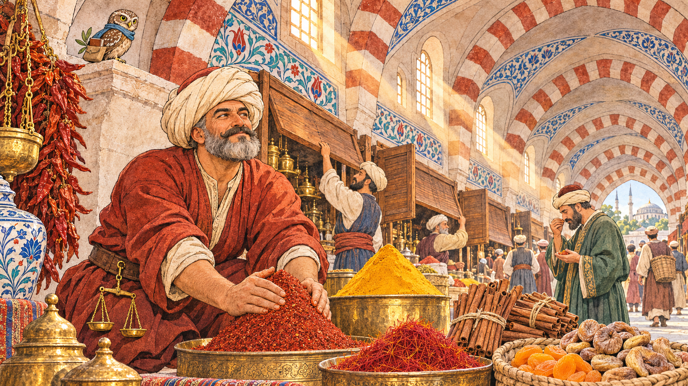 -->
<details><summary>Image Prompt</summary>
(This is Panel 02. Do not include the panel number in the image.)
Style: a hand-drawn travel-sketchbook graphic-novel illustration, with clean dark ink outlines, flat softly shaded color fills and a faint watercolor paper texture, like a page from a traveler's journal; warm, sunlit, painterly lighting; no text, captions, signs, letters or speech bubbles anywhere in the image.

Please generate a 16:9 image depicting panel 2 of 12. Place and time: inside the new L-shaped hall of the Spice Bazaar, Istanbul, about 1664 CE, mid-morning. Palette: Iznik turquoise, cobalt, tomato red, brass, saffron yellow and white plaster. Interior, slightly low angle looking down the length of the vaulted stone hall, with shafts of golden light from small high windows. In the foreground The Spice Merchant of the Spice Bazaar: a broad-shouldered man of about fifty with a neatly trimmed gray beard and warm brown eyes, wearing a large cream turban, a tomato-red robe with wide sleeves and a brass-buckled leather belt, a small brass hand scale hanging at his waist; calm, proud and observant. kneels at his stall shaping a cone of red pepper with both hands. Around him stand cone-shaped piles of cumin, saffron-yellow turmeric, cinnamon sticks tied in bundles, dried figs and apricots in baskets, hanging strings of dried peppers, and brass trays. Beyond him other merchants open wooden shutters, and a customer in a green robe sniffs a pinch of spice. High on a stone ledge in the curve of the vault sits a tiny owl. Glaux the Little Owl: a true little owl (Athene noctua), small, round and compact, with a flat rounded head and no ear tufts, warm earth-brown plumage with cream spots, bright lemon-yellow eyes under pale cream eyebrows, a cream-white throat patch and a short pale greenish-yellow beak. Glaux wears a small Aegean-blue scarf and a tan canvas satchel across the body with a small leather-bound travel notebook peeking out, and a sprig of three olive leaves tucked into the satchel strap. Alert, curious and warm expression. Glaux is drawn small, perched at the edge of the scene, noticeable on a second look. Mood: fragrant, fresh, a market opening for the first time.

Keep every character and place consistent with the other images in this story. Generate the image immediately without asking clarifying questions.
</details>

The new hall smells of cumin, mint and cinnamon. Merchants arrange spices in cones, dried fruit in baskets and brass scales on boards, and the first customers wander in. The Turks call this market *Mısır Çarşısı*, "Egyptian Bazaar." The usual explanation links the name to Egypt, either through goods arriving by ship from Cairo or through Egyptian taxes that helped pay for the building, and nobody can say for certain which.

## Panel 3: Sacks from the Nile
<!-- 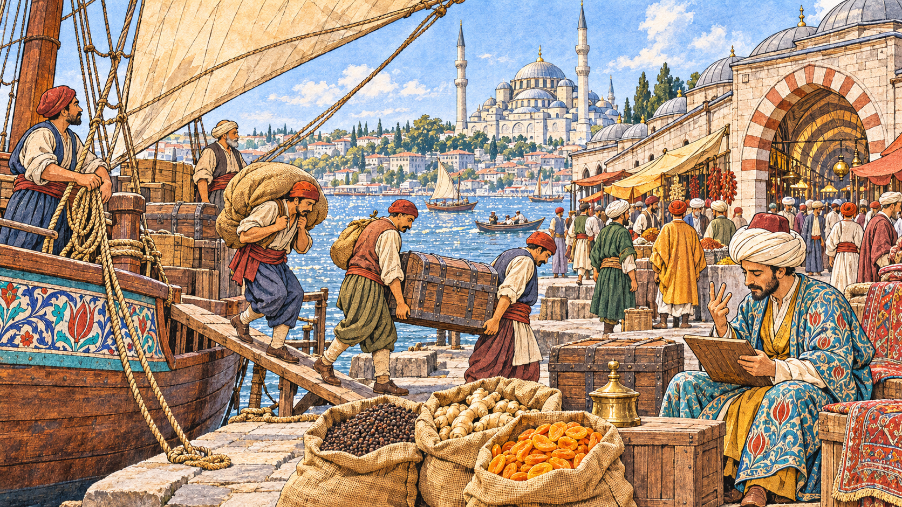 -->
<details><summary>Image Prompt</summary>
(This is Panel 03. Do not include the panel number in the image.)
Style: a hand-drawn travel-sketchbook graphic-novel illustration, with clean dark ink outlines, flat softly shaded color fills and a faint watercolor paper texture, like a page from a traveler's journal; warm, sunlit, painterly lighting; no text, captions, signs, letters or speech bubbles anywhere in the image.

Please generate a 16:9 image depicting panel 3 of 12. Place and time: the quay below the Spice Bazaar on the Golden Horn, Istanbul, about 1665 CE, early afternoon. Palette: Iznik turquoise, cobalt, tomato red, brass, saffron yellow and white plaster. Medium-wide view from the quay. In the foreground a wooden merchant ship with a single triangular lateen sail lies against the stone quay while porters in sashes and red caps carry heavy jute sacks and iron-banded chests down a plank. A clerk in a cream turban sits on a crate with a wooden ledger board, counting with his fingers. Open sacks spill pepper, ginger roots and dried apricots onto the stone. In the background the arched doorway of the new bazaar and the domes of the New Mosque glow in the afternoon sun, and smaller boats cross the glittering water. Mood: lively, abundant, a harbor doing business.

Keep every character and place consistent with the other images in this story. Generate the image immediately without asking clarifying questions.
</details>

Ships tie up at the quay below the bazaar and porters carry sacks up the slope to its doors. The Ottoman capital sits where spice routes from Egypt, Arabia and farther east meet the markets of Europe, and a hall like this one gathers the goods in one place. Pepper, ginger, cinnamon and dried fruit change hands all day. The bazaar earns its living from keeping goods moving.

## Panel 4: Green Beans in the Pan
<!-- 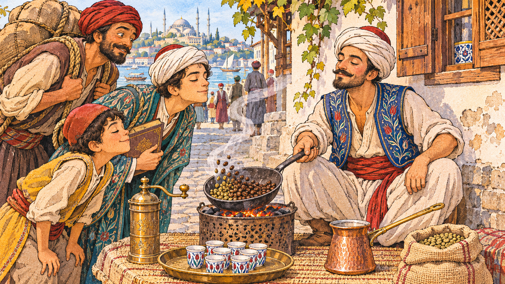 -->
<details><summary>Image Prompt</summary>
(This is Panel 04. Do not include the panel number in the image.)
Style: a hand-drawn travel-sketchbook graphic-novel illustration, with clean dark ink outlines, flat softly shaded color fills and a faint watercolor paper texture, like a page from a traveler's journal; warm, sunlit, painterly lighting; no text, captions, signs, letters or speech bubbles anywhere in the image.

Please generate a 16:9 image depicting panel 4 of 12. Place and time: a stone lane near the Golden Horn, Istanbul, about 1555 CE, morning. Palette: Iznik turquoise, cobalt, tomato red, brass, saffron yellow and white plaster. Medium close shot at street level. In the foreground a coffee seller of about thirty in a white turban and a sleeveless blue vest squats beside a small charcoal brazier, shaking a long-handled iron pan of beans from green to dark brown. Beside him a brass hand grinder, a long-handled copper pot, a tray of tiny handleless cups and a small sack of beans rest on a woven mat. A curious porter, a young scholar with a book under his arm and a child lean in to smell the smoke. In the background a plastered house with wooden shutters and a vine, and a thin curl of aromatic smoke rising. Mood: curious, new, intriguing.

Keep every character and place consistent with the other images in this story. Generate the image immediately without asking clarifying questions.
</details>

Coffee comes to Istanbul in the middle of the 1500s, carried from Arabia as green beans. The traditional account dates the first coffeehouses in the city to the 1550s. A seller roasts the beans in a pan, grinds them in a brass mill and boils the powder in a long-handled copper pot. The smell alone pulls a crowd.

## Panel 5: The Coffeehouse Talks
<!-- 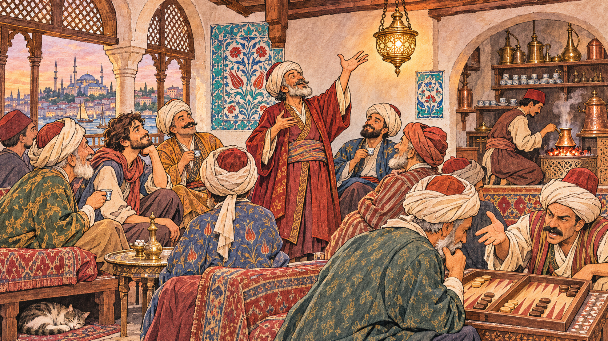 -->
<details><summary>Image Prompt</summary>
(This is Panel 05. Do not include the panel number in the image.)
Style: a hand-drawn travel-sketchbook graphic-novel illustration, with clean dark ink outlines, flat softly shaded color fills and a faint watercolor paper texture, like a page from a traveler's journal; warm, sunlit, painterly lighting; no text, captions, signs, letters or speech bubbles anywhere in the image.

Please generate a 16:9 image depicting panel 5 of 12. Place and time: inside a coffeehouse in Istanbul, about 1600 CE, late afternoon. Palette: Iznik turquoise, cobalt, tomato red, brass, saffron yellow and white plaster. Wide interior shot with warm lamplight. Along whitewashed walls hung with a few turquoise tiles, men in turbans and robes sit on low cushioned benches. In the foreground two men bend over a backgammon board with wooden pieces, one gesturing as he argues. In the center a storyteller stands in a deep red robe with one arm raised, and a circle of listeners leans toward him with tiny cups in hand. At the back the coffee maker kneels at a copper pot set in glowing coals beside shelves of cups. A brass lamp hangs from a beam and a cat sleeps under a bench. Mood: lively, intimate, full of gossip.

Keep every character and place consistent with the other images in this story. Generate the image immediately without asking clarifying questions.
</details>

Within a generation the coffeehouse is the city's favorite place to talk. Men play backgammon, hear a storyteller, swap news and argue about the government over cups the size of an egg. Because most people cannot read, a room where news and stories pass by word of mouth is, in effect, a public classroom. Rulers notice that people who talk freely about the day's news may also criticize those in power.

## Panel 6: The Shutters Come Down
<!-- 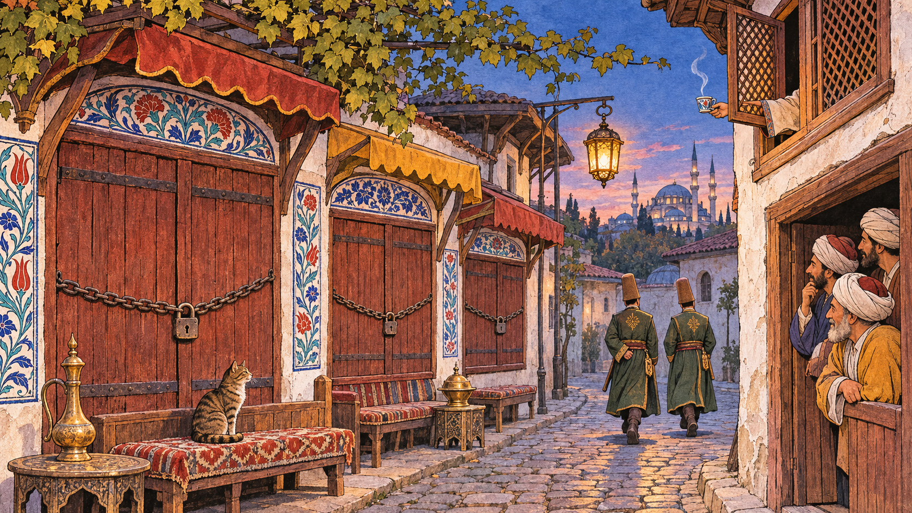 -->
<details><summary>Image Prompt</summary>
(This is Panel 06. Do not include the panel number in the image.)
Style: a hand-drawn travel-sketchbook graphic-novel illustration, with clean dark ink outlines, flat softly shaded color fills and a faint watercolor paper texture, like a page from a traveler's journal; warm, sunlit, painterly lighting; no text, captions, signs, letters or speech bubbles anywhere in the image.

Please generate a 16:9 image depicting panel 6 of 12. Place and time: a quiet lane of closed coffeehouses in Istanbul, about 1633 CE, dusk. Palette: Iznik turquoise, cobalt, tomato red, brass, saffron yellow and white plaster. Medium-wide view along a narrow cobbled lane. Heavy wooden shutters on three coffeehouses are padlocked with iron chains. Two court officers in tall felt hats and long green coats walk away from the camera along the lane. A tabby cat sits on a closed bench and a few men in turbans stand in a doorway looking at the shut doors. High on the right a small second-floor window with latticework is open, and a hand holds out a tiny cup from which a thread of steam rises into the blue dusk. A single hanging lantern glows amber. No violence is shown. Mood: hushed, wry, hopeful at the edges.

Keep every character and place consistent with the other images in this story. Generate the image immediately without asking clarifying questions.
</details>

Sultan Murad IV, who rules from 1623 to 1640, sees coffeehouses as places where people plot, and he orders them closed. The shutters go down, but the habit does not: people brew coffee at home, and after his reign the coffeehouses reopen. Coffee wins. A Turkish proverb says that a single cup of coffee commits you to forty years of friendship, and the story of the bans suggests why the cup was so hard to ban.

## Panel 7: A Shop by the Waterfront
<!-- 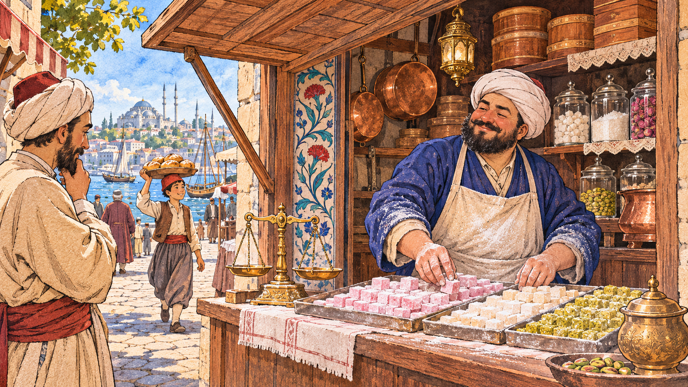 -->
<details><summary>Image Prompt</summary>
(This is Panel 07. Do not include the panel number in the image.)
Style: a hand-drawn travel-sketchbook graphic-novel illustration, with clean dark ink outlines, flat softly shaded color fills and a faint watercolor paper texture, like a page from a traveler's journal; warm, sunlit, painterly lighting; no text, captions, signs, letters or speech bubbles anywhere in the image.

Please generate a 16:9 image depicting panel 7 of 12. Place and time: a small shop near the Eminönü waterfront, Istanbul, 1777 CE, morning. Palette: Iznik turquoise, cobalt, tomato red, brass, saffron yellow and white plaster. Medium shot from the lane looking into the open front of a narrow shop, its wooden shutter propped up as an awning. In the foreground Hacı Bekir, confectioner of 1777, as imagined here: a stout, cheerful man of about forty-five with a rounded black beard, a white wound turban, a cobalt-blue robe under a cream cotton apron dusted white with powdered sugar, sugar on his sleeves; patient and proud of his craft. stands behind a long counter with a brass scale, arranging flat trays of soft sweets in pale pink, white and pistachio green. Behind him shelves hold round wooden boxes, glass jars of sugar and copper pans. Outside, a customer in a cream robe pauses with a hand to his chin, a boy carries a tray of bread on his head, and the blue water and masts of the Golden Horn glitter at the end of the lane. Mood: proud, fresh, a new business opening.

Keep every character and place consistent with the other images in this story. Generate the image immediately without asking clarifying questions.
</details>

In 1777 a confectioner remembered as Hacı Bekir opens a shop in Eminönü, near the waterfront and the Spice Bazaar. He is closely linked with Turkish delight, *lokum*, and is often said to have invented it. Sweets of this kind are older, so it is safer to say he made lokum famous. His family's shop still trades near the bazaar.

## Panel 8: The Copper Cauldron
<!-- 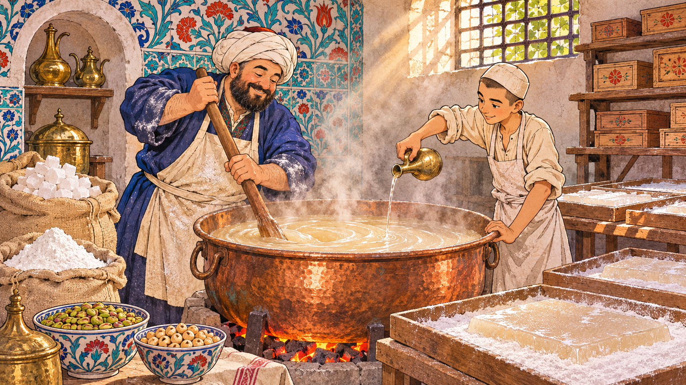 -->
<details><summary>Image Prompt</summary>
(This is Panel 08. Do not include the panel number in the image.)
Style: a hand-drawn travel-sketchbook graphic-novel illustration, with clean dark ink outlines, flat softly shaded color fills and a faint watercolor paper texture, like a page from a traveler's journal; warm, sunlit, painterly lighting; no text, captions, signs, letters or speech bubbles anywhere in the image.

Please generate a 16:9 image depicting panel 8 of 12. Place and time: the back workshop of a confectioner's shop, Istanbul, 1777 CE, early morning. Palette: Iznik turquoise, cobalt, tomato red, brass, saffron yellow and white plaster. Medium-wide view of a hot, steamy workshop. In the center a huge round copper cauldron sits over a glowing charcoal fire, and Hacı Bekir, confectioner of 1777, as imagined here: a stout, cheerful man of about forty-five with a rounded black beard, a white wound turban, a cobalt-blue robe under a cream cotton apron dusted white with powdered sugar, sugar on his sleeves; patient and proud of his craft. leans into it with a long wooden paddle, stirring a pale, thick, glossy mixture. Beside him The confectioner's apprentice: a lanky boy of about fourteen with a shaved head under a small white cap, a plain cream shirt with rolled sleeves and a white apron, always carrying a tray or a ladle. pours liquid from a small brass flask, adding rosewater. Around them stand sacks of sugar and starch, bowls of shelled pistachios and hazelnuts, long trays lined with white powder where slabs are setting to cool, and a wooden rack of wooden boxes. Steam rises into a sunbeam from a high window. Mood: warm, patient, sweet-smelling.

Keep every character and place consistent with the other images in this story. Generate the image immediately without asking clarifying questions.
</details>

The workshop behind the shop is hot and sweet. In a great copper cauldron Hacı Bekir stirs sugar and starch for a long time over a low fire, while his apprentice adds rosewater and nuts go in. The thick mixture is poured out to set. The Turkish word *lokum* comes from the Arabic for "morsels," and the name describes the result: a soft, chewy bite.

## Panel 9: Cubes in Powdered Sugar
<!-- 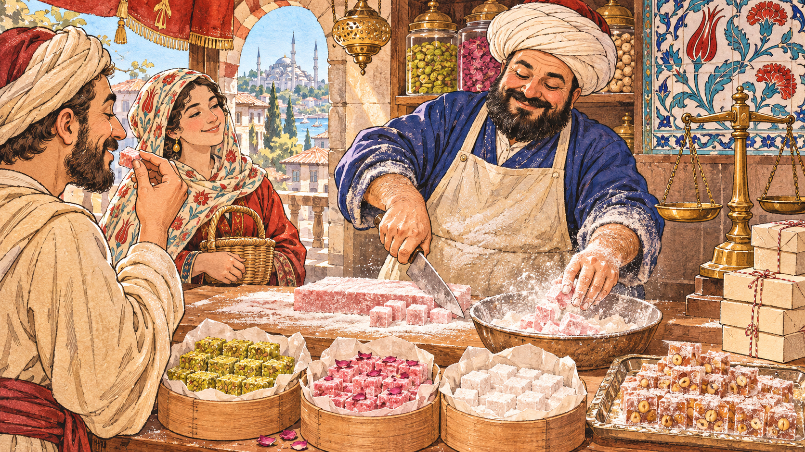 -->
<details><summary>Image Prompt</summary>
(This is Panel 09. Do not include the panel number in the image.)
Style: a hand-drawn travel-sketchbook graphic-novel illustration, with clean dark ink outlines, flat softly shaded color fills and a faint watercolor paper texture, like a page from a traveler's journal; warm, sunlit, painterly lighting; no text, captions, signs, letters or speech bubbles anywhere in the image.

Please generate a 16:9 image depicting panel 9 of 12. Place and time: the shop counter of a confectioner, Istanbul, 1777 CE, midday. Palette: Iznik turquoise, cobalt, tomato red, brass, saffron yellow and white plaster. Close, warm view across a wooden counter. In the foreground Hacı Bekir, confectioner of 1777, as imagined here: a stout, cheerful man of about forty-five with a rounded black beard, a white wound turban, a cobalt-blue robe under a cream cotton apron dusted white with powdered sugar, sugar on his sleeves; patient and proud of his craft. cuts a pale pink slab of Turkish delight into small cubes with a broad knife, then tosses them in a drift of powdered sugar. On the counter stand round wooden boxes lined with paper, filled with neat rows of pistachio-green, rose-pink and white cubes, and a tray of cubes studded with hazelnuts. A customer in a cream robe reaches for a sample, a woman in a patterned headscarf waits with a small basket, and a brass scale and a stack of boxes tied with string stand nearby. Sugar dust hangs in the sunbeam. Mood: indulgent, cheerful, fragrant.

Keep every character and place consistent with the other images in this story. Generate the image immediately without asking clarifying questions.
</details>

Once the slab has set, it is cut into cubes and rolled in powdered sugar so the pieces do not stick. Pistachio and rose, hazelnut and lemon go into round wooden boxes tied with string. Visitors taste before they buy, as they still do. A confectioner who can make a soft sweet that travels well has a product that does not need to be explained.

## Panel 10: Where Saffron Grows
<!-- 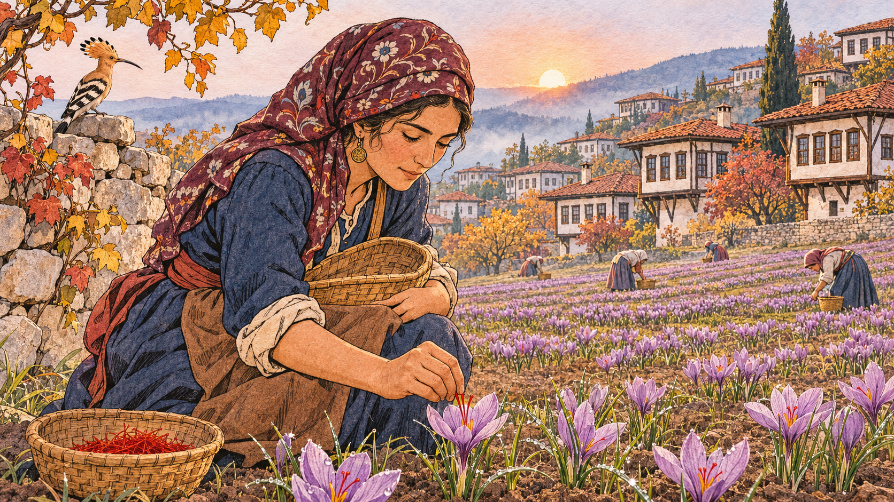 -->
<details><summary>Image Prompt</summary>
(This is Panel 10. Do not include the panel number in the image.)
Style: a hand-drawn travel-sketchbook graphic-novel illustration, with clean dark ink outlines, flat softly shaded color fills and a faint watercolor paper texture, like a page from a traveler's journal; warm, sunlit, painterly lighting; no text, captions, signs, letters or speech bubbles anywhere in the image.

Please generate a 16:9 image depicting panel 10 of 12. Place and time: a hillside field near Safranbolu in northwestern Turkey, autumn, dawn, about 1777 CE. Palette: Iznik turquoise, cobalt, tomato red, brass, saffron yellow and white plaster. Wide view with soft low sun. In the foreground The saffron picker: a woman of about thirty-five in a patterned plum headscarf, a long indigo cotton dress with a brown apron and rolled sleeves, carrying a shallow woven basket on one arm; quiet, careful hands. kneels among rows of purple crocus flowers with a shallow woven basket beside her, pinching three bright red threads from the heart of a bloom with her fingertips. Dew sparkles on the leaves. Behind her stretch more rows of lilac flowers and a few other pickers bending far off. In the middle distance old half-timbered houses with overhanging upper floors and red tile roofs climb a hillside, and a cypress tree and thin blue hills fade in the morning mist. A hoopoe bird perches on a stone wall. Mood: quiet, patient, delicate.

Keep every character and place consistent with the other images in this story. Generate the image immediately without asking clarifying questions.
</details>

Saffron begins as a purple crocus that flowers in autumn. Each flower has only three red threads, called stigmas, and every one is picked by hand, so a single kilogram takes about 150,000 flowers. The Turkish town of Safranbolu is named after the spice, and the name is said to join *safran* with a Greek word for city. A few villages near the town are said to still grow the crop.

## Panel 11: Worth Its Weight
<!-- 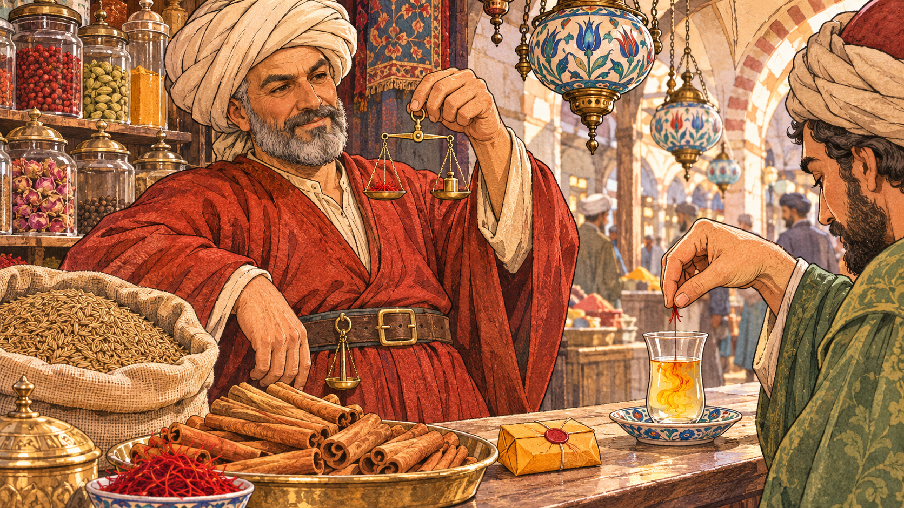 -->
<details><summary>Image Prompt</summary>
(This is Panel 11. Do not include the panel number in the image.)
Style: a hand-drawn travel-sketchbook graphic-novel illustration, with clean dark ink outlines, flat softly shaded color fills and a faint watercolor paper texture, like a page from a traveler's journal; warm, sunlit, painterly lighting; no text, captions, signs, letters or speech bubbles anywhere in the image.

Please generate a 16:9 image depicting panel 11 of 12. Place and time: a stall in the Spice Bazaar, Istanbul, late 1700s CE, late afternoon. Palette: Iznik turquoise, cobalt, tomato red, brass, saffron yellow and white plaster. Close medium view across the counter. In the foreground a merchant of a later generation of the same stall, The Spice Merchant of the Spice Bazaar: a broad-shouldered man of about fifty with a neatly trimmed gray beard and warm brown eyes, wearing a large cream turban, a tomato-red robe with wide sleeves and a brass-buckled leather belt, a small brass hand scale hanging at his waist; calm, proud and observant. holds a tiny brass scale between thumb and finger, a few deep-red saffron threads in one pan and a small brass weight in the other. Next to the scale a huge sack of cumin sits open beside a heaped tray of cinnamon, dwarfing the saffron. A customer in a green robe drops a thread into a glass of warm water, which turns slowly gold. Glass jars, a small sealed packet in saffron-colored paper, and lamps of Iznik turquoise hang above. Light slants through the vault. Mood: attentive, precious, unhurried.

Keep every character and place consistent with the other images in this story. Generate the image immediately without asking clarifying questions.
</details>

Back in the bazaar a merchant weighs a few threads on a brass scale no bigger than a hand. Per weight, saffron costs more than almost anything else on the stall, because of those 150,000 flowers per kilogram. A buyer tests the thread in warm water, where real saffron releases its color slowly. Real threads are deep red with lighter tips and shaped like tiny trumpets; big cheap bags are usually safflower petals instead.

## Panel 12: Then and Now: Leaving the Bazaar
<!-- 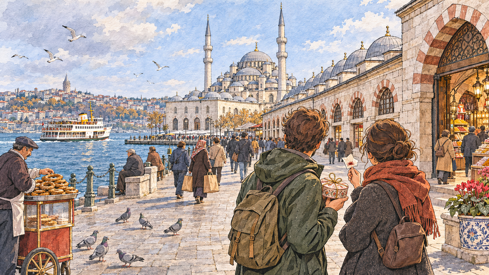 -->
<details><summary>Image Prompt</summary>
(This is Panel 12. Do not include the panel number in the image.)
Style: a hand-drawn travel-sketchbook graphic-novel illustration, with clean dark ink outlines, flat softly shaded color fills and a faint watercolor paper texture, like a page from a traveler's journal; warm, sunlit, painterly lighting; no text, captions, signs, letters or speech bubbles anywhere in the image.

Please generate a 16:9 image depicting panel 12 of 12. Place and time: the Eminönü waterfront, Istanbul, today, a cool November afternoon. Palette: natural daylight, whitewashed walls, sea blue, terracotta, with a few Ottoman accents. Wide establishing shot from the same waterfront viewpoint as panel 1, now showing the finished New Mosque with its cascade of gray domes and two slender minarets and the long domed Spice Bazaar beside it, the Golden Horn blue behind with a ferry and gulls. In the foreground by the bazaar's arched doorway stand Two adult travelers seen from behind or in distant three-quarter view, dressed for cool November weather: one in a dark green rain jacket, the other in a charcoal wool coat with a rust-colored scarf, both with small daypacks, standing close together and looking at the view. Faces are never shown in detail. One holds a small round box of Turkish delight tied with string, the other a tiny twist of paper with a few red saffron threads. Around them are people with paper bags, a street vendor with a tray of simit bread rings, and pigeons on the stones. Mood: satisfied, affectionate, an ending and a beginning.

Keep every character and place consistent with the other images in this story. Generate the image immediately without asking clarifying questions.
</details>

Two travelers leave the bazaar with a box of pistachio and rose lokum and a twist of saffron, which is exactly what we did. From the same waterfront the New Mosque and the long hall beside it look much as they did in the 1660s, and the merchants are still weighing, pouring and boxing. The things we buy here are the oldest things we carry home. Look closer next time you taste them.

### Epilogue - What a Box of Lokum Carries

A market, a drink and a sweet seem like small subjects, yet they answer large questions about how a city lives. The Spice Bazaar shows trade paying for charity, a sultan's ban shows the limits of control over habit, and Hacı Bekir shows how a good product becomes a name. For readers of the book's Learning for All thread, the coffeehouse adds a lesson: where reading is rare, places to listen and talk matter.

| Challenge | How They Responded | Lesson for Today |
|---|---|---|
| A mosque needs lasting income | Build a market beside it and use the shop rents to pay for the mosque | Public goods often rest on ordinary commerce |
| A sultan fears coffeehouse talk | Close the coffeehouses; people kept drinking coffee and the shops reopened | Habits and conversation are hard to ban |
| A sweet older than any single maker | Hacı Bekir made lokum famous from 1777; his family's shop is still open | Fame often comes from craft and consistency, not invention |
| Expensive saffron is easy to fake | Buyers check the thread: deep red with pale tips, color released slowly in warm water | Ask to see the evidence before you pay for a claim |

### Call to Action

Next time you taste lokum, ask the seller who made it and since when. Then look at a few saffron threads in warm water and notice how slowly the color arrives. Asking where a thing comes from, and how you can check, is the habit this whole book is trying to build.

---

## Voices from the Sources

No spoken line from the merchants, confectioners or sultans in this story is documented in the sources used for this book, so none is invented here. Instead, three attested words and sayings stand in for their voices.

- *"Bir fincan kahvenin kırk yıl hatırı vardır."* A well-known Turkish proverb, usually translated as "A cup of coffee has forty years of memory," meaning that a shared cup creates a lasting bond. Its author is unknown.
- *Mısır Çarşısı*, "Egyptian Bazaar": the Turkish name of the Spice Bazaar, explained either by goods arriving from Egypt or by Egyptian taxes that helped pay for the building.
- *Lokum*: the Turkish word for Turkish delight, said to come from an Arabic word for "morsels."

## On the Trip

- **Chapter:** [6. Bazaars, Scripts, and Presses](../../chapters/06-bazaars-scripts-presses/index.md)
- **Where to look:** the L-shaped vaulted hall of the Spice Bazaar beside the New Mosque; the Hacı Bekir shop near the bazaar; and the saffron stalls, where you can ask to see the threads.
- **Explore further:** [Reading Food in Layers](../../sims/food-history-layers-sorter/index.md) shows which dishes came from which era.
- **Look Closer:** Glaux's pointer: "Look up. Where the vault meets the wall, the stonework makes ledges just big enough for a small owl to sit." Glaux hid in Panel 2, on a stone ledge in the vault of the newly opened hall.

## Characters and Style

This story follows the shared series bible: [Story Characters, Places and House Style](../characters.md). Glaux's identity comes from the mascot's [character sheet](../../img/mascot/character-sheet.md).

## References

1. [Wikipedia: Spice Bazaar](https://en.wikipedia.org/wiki/Spice_Bazaar) - The L-shaped covered market beside the New Mosque in Istanbul
2. [Wikipedia: Turkish delight](https://en.wikipedia.org/wiki/Turkish_delight) - The confection known in Turkish as lokum, and its history
3. [Wikipedia: Saffron](https://en.wikipedia.org/wiki/Saffron) - The spice from the stigmas of Crocus sativus and why it is costly
4. [UNESCO: City of Safranbolu](https://whc.unesco.org/en/list/614) - The World Heritage town named after saffron, with its Ottoman timber houses
5. [Encyclopaedia Britannica: Turkish delight](https://www.britannica.com/topic/Turkish-delight) - Overview of how the sweet is made and where it comes from
