# The Press That Waited

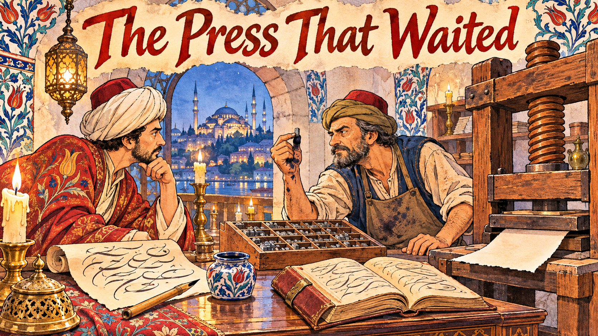
<details>
<summary>Cover Image Prompt</summary>
(This is the Cover Image. Do not include this label in the image.)
Style: a hand-drawn travel-sketchbook graphic-novel illustration, with clean dark ink outlines, flat softly shaded color fills and a faint watercolor paper texture, like a page from a traveler's journal; warm, sunlit, painterly lighting; no text, captions, signs, letters or speech bubbles anywhere in the image.

Please generate a wide-landscape 16:9 cover image for a graphic novel called "The Press That Waited". Render the title as bold, hand-lettered title text across the upper third, spelled exactly: "The Press That Waited". Beneath it, in a candlelit Istanbul workshop of the 1700s, a heavy wooden screw press stands on the right with its great wooden screw and flat platen, a sheet of paper half pulled from it, while on the left a polished writing desk holds a reed pen cut at an angle, a small ink pot, a rolled sheet of cream paper covered in flowing abstract calligraphic strokes with no readable letters, and an open leather-bound manuscript. In the middle, a wooden case of tiny metal type pieces and an ink-stained hand holding one piece up to the light. Through an arched window behind them the domes and minarets of Istanbul glow in blue evening light. Palette: Iznik turquoise, cobalt, tomato red, brass, saffron yellow and white plaster. Mood: quiet, tense and expectant, two ways of making a book face to face. No other text.

Keep every character and place consistent with the other images in this story. Generate the image immediately without asking clarifying questions.
</details>

<details>
<summary>Narrative Prompt</summary>
**Era and place.** Istanbul, from the 1490s to the 1740s, with a closing scene today in the Sahaflar book market beside the Grand Bazaar. Settings include the Golden Horn waterfront, a Sephardic print shop (1493), a calligrapher's workroom, the book market, a palace audience room (about 1727) and Müteferrika's print shop (1727 to 1745).

**Themes.** Who decides how knowledge travels, and what a long delay costs a society. This is the Learning for All thread of the book: gatekeepers, the cost of a missing technology, and the gap between making copies cheap and making readers. The story is a puzzle whose causes historians still debate; it never settles on one villain.

**House style and palette.** Follow the series house style in [Story Characters, Places and House Style](../characters.md). Palette for this story (the Ottoman era): Iznik turquoise, cobalt, tomato red, brass, saffron yellow and white plaster; the final panel uses natural modern daylight. Panels contain no lettering of any kind. Wherever a printed or written page is shown, draw it as a texture of abstract strokes with no readable letters; only the cover carries the title.

**Creative liberties and uncertainties.** All faces and clothing are imagined; no portraits are relied on. The year of the first Hebrew book is debated: it carries a date that corresponds to December 1493, though some scholars place it about ten years later. The popular legend that scribes blocked the press, and the story of an Arabic-script ban by Bayezid II in 1485, are treated as legend (panel 6 is drawn as a faded storybook page to signal this). The palace audience in panel 8 is a composite scene: the chapter records a treatise presented to the government in 1726, a decree by Sultan Ahmed III in 1727, and a supporting ruling from the chief religious scholar, but not who stood where.

Cast and consistency notes:

- **Glaux the Little Owl:** see [docs/stories/characters.md](../characters.md) and [docs/img/mascot/character-sheet.md](../../img/mascot/character-sheet.md) (Glaux). Glaux appears in exactly one panel (Panel 5) as a small hidden observer.
- **The Travelers:** see [docs/stories/characters.md](../characters.md); they appear only in the final Then-and-Now panel.

**The ibn Nahmias Brothers** (appears only in this story; paste this block verbatim wherever the character appears):

```text
David and Samuel ibn Nahmias, Sephardic printers: two brothers, the elder about forty-five with a trimmed gray-streaked beard and the younger about thirty-five with a short dark beard, both in dark blue wool robes with the wide sleeves rolled up, close-fitting dark cloth caps and ink-stained fingers; focused and quietly determined.
```

**The Master Calligrapher and Apprentice** (appears only in this story; paste this block verbatim wherever the character appears):

```text
The master calligrapher and his apprentice: an old man of about sixty-five with a long white beard, a large white turban and a dark green robe, holding a reed pen cut at an angle; beside him a boy of about twelve in a plain cream tunic grinding soot ink in a small bowl; serene, exacting and unhurried.
```

**İbrahim Müteferrika** (appears only in this story; paste this block verbatim wherever the character appears):

```text
İbrahim Müteferrika around 1727: a lean man of about fifty-three with a trimmed gray-brown beard, dark thoughtful eyes and a high forehead, wearing a cream turban and an olive-green kaftan with a narrow fur collar, ink on the fingers of his right hand; intense, patient and quietly stubborn.
```

**Said Efendi** (appears only in this story; paste this block verbatim wherever the character appears):

```text
Said Efendi: a man of about thirty with a short black beard and an alert, open face, wearing a tall wrapped white turban and a plum-colored kaftan with a gold-embroidered belt.
```

**Sultan Ahmed III** (appears only in this story; paste this block verbatim wherever the character appears):

```text
Sultan Ahmed III as imagined here: a stately man of about fifty-four with a full dark beard flecked with gray, wearing a tall white turban with a jeweled plume and a heavy crimson kaftan edged with sable fur, seated on a low cushioned throne; composed and unreadable.
```

**The Chief Religious Scholar** (appears only in this story; paste this block verbatim wherever the character appears):

```text
The chief religious scholar: an elderly man with a long white beard, a very large rounded white turban and a long gray-green robe, holding a rolled document; grave and measured.
```

</details>

### Prologue - The Puzzle of the Late Press

Gutenberg printed his Bible in Germany around 1455. Istanbul, one of the largest cities in the world, had a working press by the 1490s, set up by refugees from Spain, and Armenian and Greek presses followed. Yet the first book printed in Ottoman Turkish in the Arabic script appeared only in 1729, almost three centuries after Gutenberg. This story follows that gap, tests the best-known explanation against the evidence, and asks what a long delay costs and who pays.

**Find Glaux:** Glaux hides in one panel of this story. Can you spot the little owl?

## Panel 1: Refugees on the Golden Horn
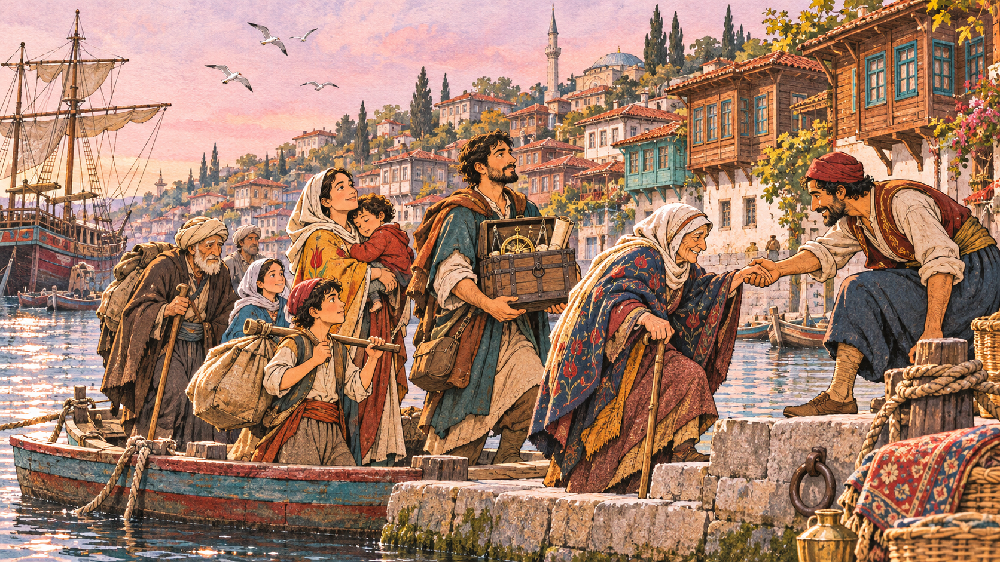
<details><summary>Image Prompt</summary>
(This is Panel 01. Do not include the panel number in the image.)
I am about to ask you to generate a series of images for a graphic novel. Please make the images have a consistent style and consistent characters. Do not ask any clarifying questions. Just generate the image immediately when asked.
Style: a hand-drawn travel-sketchbook graphic-novel illustration, with clean dark ink outlines, flat softly shaded color fills and a faint watercolor paper texture, like a page from a traveler's journal; warm, sunlit, painterly lighting; no text, captions, signs, letters or speech bubbles anywhere in the image.

Please generate a 16:9 image depicting panel 1 of 12. Place and time: the Balat shore of the Golden Horn, Istanbul, about 1492-1493 CE, early morning. Palette: Iznik turquoise, cobalt, tomato red, brass, saffron yellow and white plaster. Wide establishing shot from the water, low angle on the quay. Several small boats and a sailing ship are tied up. Families in travel-worn wool robes and head coverings step carefully ashore, an old man leaning on a stick, a mother carrying a child, a boy hauling a bundle on a pole. One young father carries a small iron-bound wooden crate with great care, a hint of precious tools inside. A local boatman in a red cap holds out a hand to steady a grandmother. Behind them on the hill rise terraced wooden houses and a distant minaret in pink dawn light. Gulls turn above the silver water. Mood: weary, hopeful, and welcomed.

Keep every character and place consistent with the other images in this story. Generate the image immediately without asking clarifying questions.
</details>

In 1492 the king and queen of Spain order every Jew to convert or leave. Tens of thousands go, and many find a welcome in the Ottoman Empire, where Sultan Bayezid II allows them to settle and practice their faith. They arrive on the Golden Horn with little more than what they can carry, but some bring skills in medicine, finance, textiles and printing. Those skills are about to change the city's skyline of ideas.

## Panel 2: The First Press in Istanbul
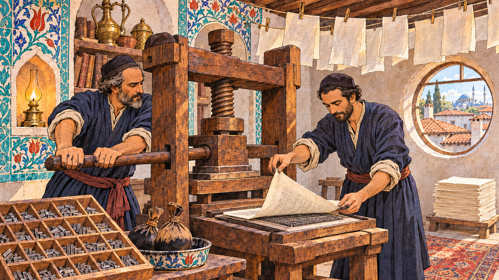
<details><summary>Image Prompt</summary>
(This is Panel 02. Do not include the panel number in the image.)
Style: a hand-drawn travel-sketchbook graphic-novel illustration, with clean dark ink outlines, flat softly shaded color fills and a faint watercolor paper texture, like a page from a traveler's journal; warm, sunlit, painterly lighting; no text, captions, signs, letters or speech bubbles anywhere in the image.

Please generate a 16:9 image depicting panel 2 of 12. Place and time: a small print shop in Istanbul, about 1493 CE, lamplit morning. Palette: Iznik turquoise, cobalt, tomato red, brass, saffron yellow and white plaster. Medium-wide interior shot. In the center a heavy wooden screw press stands with its long lever, and David and Samuel ibn Nahmias, Sephardic printers: two brothers, the elder about forty-five with a trimmed gray-streaked beard and the younger about thirty-five with a short dark beard, both in dark blue wool robes with the wide sleeves rolled up, close-fitting dark cloth caps and ink-stained fingers; focused and quietly determined. work it together: the elder leans on the lever while the younger lifts a damp sheet from the platen, a thin shadow of tiny black marks on the paper. In the foreground a wooden case of tiny metal type pieces sits on a sloping desk, with leather ink balls beside it. Dampened sheets hang on lines overhead, a stack of paper sits on the floor, and a small oil lamp glows from a wall niche. A round window shows rooftops. Mood: concentrated, proud and quietly historic.

Keep every character and place consistent with the other images in this story. Generate the image immediately without asking clarifying questions.
</details>

Within a year or two the brothers David and Samuel ibn Nahmias set up a press in Istanbul, the first in the Ottoman Empire. Their first known book, a code of Jewish law called the *Arba'ah Turim*, carries a date that corresponds to December 1493. Some scholars think it was printed about ten years later, so the exact year is debated. Either way, the capital had a working press within a few decades of Gutenberg.

## Panel 3: Presses Multiply
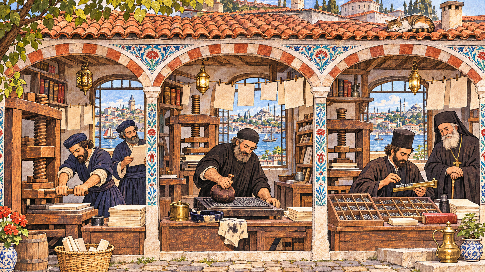
<details><summary>Image Prompt</summary>
(This is Panel 03. Do not include the panel number in the image.)
Style: a hand-drawn travel-sketchbook graphic-novel illustration, with clean dark ink outlines, flat softly shaded color fills and a faint watercolor paper texture, like a page from a traveler's journal; warm, sunlit, painterly lighting; no text, captions, signs, letters or speech bubbles anywhere in the image.

Please generate a 16:9 image depicting panel 3 of 12. Place and time: a cutaway view of three adjacent print shops along an Istanbul lane, shown across the decades 1493, 1567 and 1627 CE. Palette: Iznik turquoise, cobalt, tomato red, brass, saffron yellow and white plaster. Wide cross-section, three rooms side by side like a stage. In the left room the ibn Nahmias brothers in dark blue robes and caps work a wooden screw press. In the middle room an Armenian printer in a long black robe and rounded black cap inks type with a leather ball. In the right room a Greek printer in a dark robe and tall cylindrical black hat sets lines of type in a composing stick beside an Orthodox priest watching. Each room has its own press, hanging paper sheets and a window with a different slice of the Golden Horn skyline. A cat naps on the roofs above. Mood: busy, layered, cooperative.

Keep every character and place consistent with the other images in this story. Generate the image immediately without asking clarifying questions.
</details>

The Ottoman authorities allow the empire's non-Muslim communities to print in their own scripts, and they do. Armenians in Istanbul start printing in 1567, and Greeks in 1627. In 1706 an Arabic press opens in Ottoman Aleppo, for Christian books. Printing is not unknown or forbidden in the empire; for Muslim readers in their own script, it simply has not started.

## Panel 4: The Art of the Reed Pen
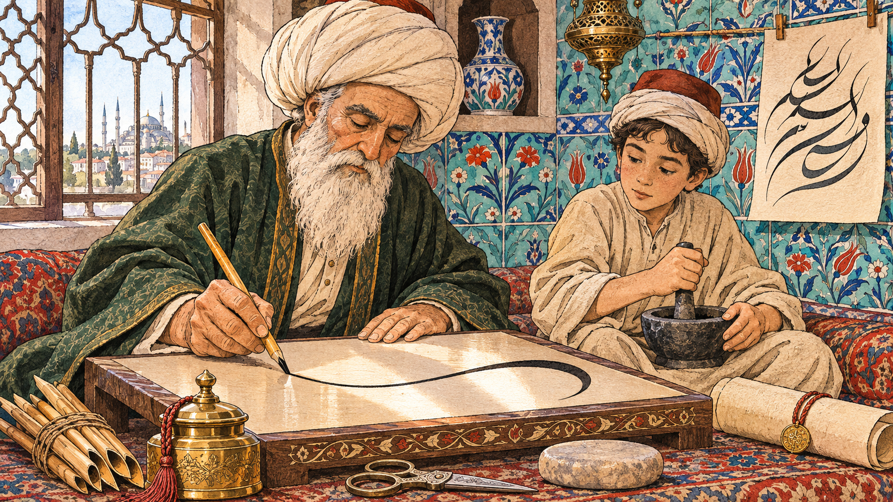
<details><summary>Image Prompt</summary>
(This is Panel 04. Do not include the panel number in the image.)
Style: a hand-drawn travel-sketchbook graphic-novel illustration, with clean dark ink outlines, flat softly shaded color fills and a faint watercolor paper texture, like a page from a traveler's journal; warm, sunlit, painterly lighting; no text, captions, signs, letters or speech bubbles anywhere in the image.

Please generate a 16:9 image depicting panel 4 of 12. Place and time: a calligrapher's workroom in Istanbul, about 1600 CE, soft north light. Palette: Iznik turquoise, cobalt, tomato red, brass, saffron yellow and white plaster. Medium close shot. In the foreground The master calligrapher and his apprentice: an old man of about sixty-five with a long white beard, a large white turban and a dark green robe, holding a reed pen cut at an angle; beside him a boy of about twelve in a plain cream tunic grinding soot ink in a small bowl; serene, exacting and unhurried. sit on the floor cushions at a low writing board. The master draws the angled tip of a reed pen across cream paper polished smooth and glossy, making one long, sweeping, rhythmic stroke; the boy grinds soot ink in a bowl and watches. Beside them lie a bundle of reed pens, a brass inkwell with a silk cord, a pair of scissors, a polishing stone, a rolled license scroll and a finished page of flowing abstract calligraphic strokes pinned to dry. Turquoise tiles line the wall. A single beam of light crosses the page. Mood: reverent, patient and beautiful.

Keep every character and place consistent with the other images in this story. Generate the image immediately without asking clarifying questions.
</details>

In Istanbul, handwriting is one of the highest arts. A calligrapher cuts a reed pen at an angle, mixes soot into ink and writes on paper polished with egg white and starch, and he signs his own work only after his master grants him a written license. An old saying holds that the Quran was revealed in Mecca, recited in Cairo and written in Istanbul. A craft this prestigious is not easily replaced.

## Panel 5: A Book at the Speed of a Hand
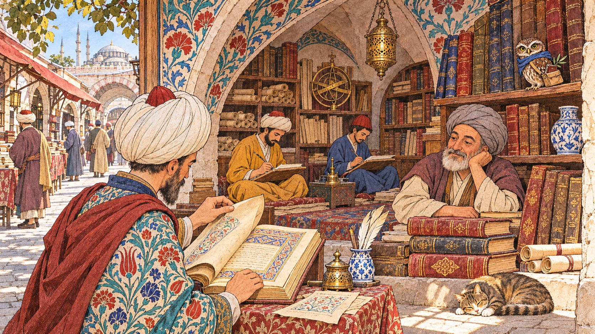
<details><summary>Image Prompt</summary>
(This is Panel 05. Do not include the panel number in the image.)
Style: a hand-drawn travel-sketchbook graphic-novel illustration, with clean dark ink outlines, flat softly shaded color fills and a faint watercolor paper texture, like a page from a traveler's journal; warm, sunlit, painterly lighting; no text, captions, signs, letters or speech bubbles anywhere in the image.

Please generate a 16:9 image depicting panel 5 of 12. Place and time: the book market (Sahaflar Çarşısı) beside the Grand Bazaar, Istanbul, about 1650 CE, mid-morning. Palette: Iznik turquoise, cobalt, tomato red, brass, saffron yellow and white plaster. Medium-wide shot from slightly above. A bookseller in a gray turban sits at the opening of a vaulted stall surrounded by stacks of handwritten leather-bound manuscripts, loose pages and rolled scrolls. In the foreground a scholar in a tall white turban turns the thick page of a large copy. At the back two copyists sit cross-legged with writing boards on their knees, each slowly copying a page. Sunlight falls through the arch onto a sleeping tabby cat. On the top shelf among bound volumes perches a tiny owl. Glaux the Little Owl: a true little owl (Athene noctua), small, round and compact, with a flat rounded head and no ear tufts, warm earth-brown plumage with cream spots, bright lemon-yellow eyes under pale cream eyebrows, a cream-white throat patch and a short pale greenish-yellow beak. Glaux wears a small Aegean-blue scarf and a tan canvas satchel across the body with a small leather-bound travel notebook peeking out, and a sprig of three olive leaves tucked into the satchel strap. Alert, curious and warm expression. Glaux is drawn small, perched at the edge of the scene, noticeable on a second look. Mood: quiet, scholarly, unhurried.

Keep every character and place consistent with the other images in this story. Generate the image immediately without asking clarifying questions.
</details>

The book market beside the Grand Bazaar stands on or near the old Byzantine market for paper and books, so the city has been selling books for more than a thousand years. Every volume here is a copy made by a trained hand. The master calligrapher Hafız Osman is said to have copied 25 complete Qurans in about forty years, or one every year and a half. The books are beautiful, and the number in circulation is limited by the number of trained hands.

## Panel 6: Did the Scribes Stop the Press?
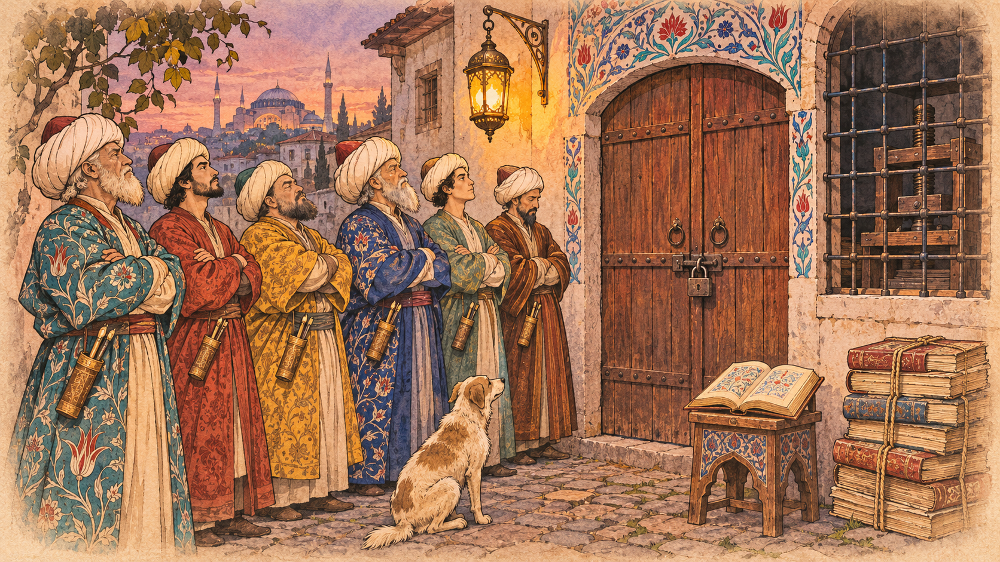
<details><summary>Image Prompt</summary>
(This is Panel 06. Do not include the panel number in the image.)
Style: a hand-drawn travel-sketchbook graphic-novel illustration, with clean dark ink outlines, flat softly shaded color fills and a faint watercolor paper texture, like a page from a traveler's journal; warm, sunlit, painterly lighting; no text, captions, signs, letters or speech bubbles anywhere in the image.

Please generate a 16:9 image depicting panel 6 of 12. Place and time: a lane outside a closed print shop in Istanbul, a legendary scene attributed to about 1500 CE, dusk. Palette: Iznik turquoise, cobalt, tomato red, brass, saffron yellow and white plaster, softened to a faded sepia storybook wash with a pale vignette edge, so that it looks like a legend told rather than a record. Medium-wide view. Six copyists in turbans and robes, each with a reed-pen case at the belt, stand in a loose row across the lane with their arms folded, facing a shut wooden door with an iron lock. A single open book lies on a stool. A lantern glows. A stray dog watches. On one side stands a stack of manuscripts tied with cord, on the other a small wooden press shown dark and still behind a barred window. No violence, no weapons. Mood: ambiguous, dramatic, legendary.

Keep every character and place consistent with the other images in this story. Generate the image immediately without asking clarifying questions.
</details>

A popular story says the scribes and calligraphers kept the press out, because printing threatened their livelihoods. It makes a good story, and it also has gaps. The scribes' jobs and craft were at stake, and handwriting a Quran was an act of devotion, but historians do not agree that organized scribes ever blocked a press.

> **Myth or Evidence?** Documented: Hebrew, Armenian and Greek presses ran in Istanbul long before 1729, and copyists and calligraphers lived by handwriting. Tradition: that scribes physically stopped a press, and that Sultan Bayezid II banned Arabic-script printing in 1485 on pain of death. No copy of such a decree survives, and many historians doubt it was ever issued. Most now think several causes worked together: the sacred status of the handwritten Quran, the hundreds of pieces of type that joined Arabic letters demand, the scribes' livelihoods, a manuscript system that served a small reading public, and the state's control over what was written and taught.

## Panel 7: A Convert from Transylvania
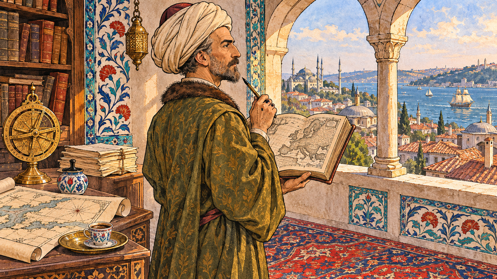
<details><summary>Image Prompt</summary>
(This is Panel 07. Do not include the panel number in the image.)
Style: a hand-drawn travel-sketchbook graphic-novel illustration, with clean dark ink outlines, flat softly shaded color fills and a faint watercolor paper texture, like a page from a traveler's journal; warm, sunlit, painterly lighting; no text, captions, signs, letters or speech bubbles anywhere in the image.

Please generate a 16:9 image depicting panel 7 of 12. Place and time: a study overlooking the Bosphorus, Istanbul, about 1725 CE, golden afternoon. Palette: Iznik turquoise, cobalt, tomato red, brass, saffron yellow and white plaster. Medium shot, three-quarter view from behind and to the side of İbrahim Müteferrika around 1727: a lean man of about fifty-three with a trimmed gray-brown beard, dark thoughtful eyes and a high forehead, wearing a cream turban and an olive-green kaftan with a narrow fur collar, ink on the fingers of his right hand; intense, patient and quietly stubborn. standing at an arched window with a printed European atlas bound in leather in one hand and a reed pen in the other, looking out across rooftops, domes and slender minarets toward the blue water and distant ships. On a low table behind him lie a map unrolled, a brass astrolabe, an inkpot, a pile of papers and a cup of coffee. A bright rug in tomato red and cobalt covers the floor. Mood: reflective, ambitious, between two worlds.

Keep every character and place consistent with the other images in this story. Generate the image immediately without asking clarifying questions.
</details>

İbrahim Müteferrika, born about 1674, comes from Kolozsvár in Transylvania, today Cluj in Romania, and probably grows up in a Unitarian Christian family. He comes to Istanbul as a young man, converts to Islam and serves the state as a diplomat and translator. His work takes him among books and maps from other countries, and he becomes convinced that the empire needs the press.

## Panel 8: The Petition and the Decree
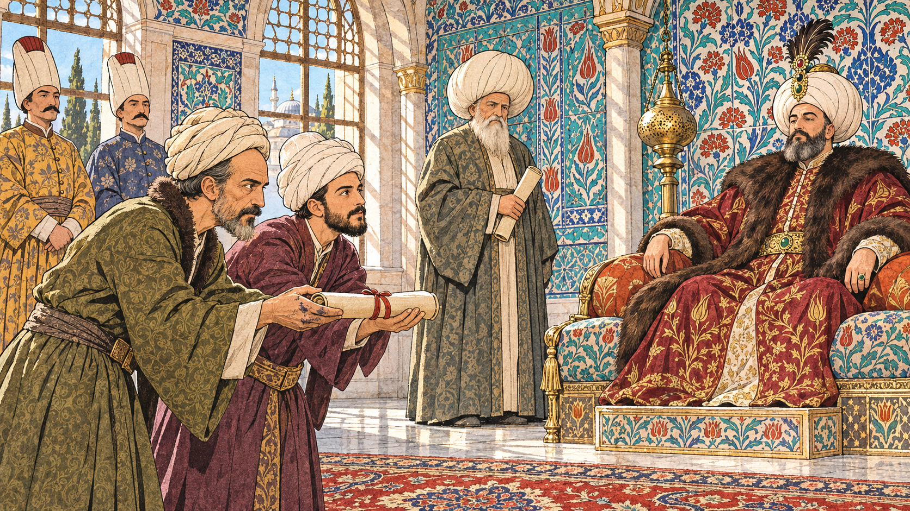
<details><summary>Image Prompt</summary>
(This is Panel 08. Do not include the panel number in the image.)
Style: a hand-drawn travel-sketchbook graphic-novel illustration, with clean dark ink outlines, flat softly shaded color fills and a faint watercolor paper texture, like a page from a traveler's journal; warm, sunlit, painterly lighting; no text, captions, signs, letters or speech bubbles anywhere in the image.

Please generate a 16:9 image depicting panel 8 of 12. Place and time: a palace audience room in Istanbul, about 1726-1727 CE, midday. Palette: Iznik turquoise, cobalt, tomato red, brass, saffron yellow and white plaster. Wide shot, slightly low angle across a tiled chamber with a patterned carpet. At the far end Sultan Ahmed III as imagined here: a stately man of about fifty-four with a full dark beard flecked with gray, wearing a tall white turban with a jeweled plume and a heavy crimson kaftan edged with sable fur, seated on a low cushioned throne; composed and unreadable. sits on a low cushioned throne. In the foreground İbrahim Müteferrika around 1727: a lean man of about fifty-three with a trimmed gray-brown beard, dark thoughtful eyes and a high forehead, wearing a cream turban and an olive-green kaftan with a narrow fur collar, ink on the fingers of his right hand; intense, patient and quietly stubborn. and Said Efendi: a man of about thirty with a short black beard and an alert, open face, wearing a tall wrapped white turban and a plum-colored kaftan with a gold-embroidered belt. bow slightly, together holding out a rolled treatise tied with a ribbon. To one side The chief religious scholar: an elderly man with a long white beard, a very large rounded white turban and a long gray-green robe, holding a rolled document; grave and measured. stands holding a ruling. Behind them stand two court officials in tall turbans, with arched windows letting in shafts of light, an Iznik-tile wall in turquoise and cobalt, and a brass lamp. Mood: formal, tense, a decision hanging in the air.

Keep every character and place consistent with the other images in this story. Generate the image immediately without asking clarifying questions.
</details>

In 1726 Müteferrika and Said Efendi, the son of an Ottoman ambassador who had seen printing in Paris, present the government with a treatise on the benefits of printing. In 1727 Sultan Ahmed III issues a decree allowing them to print, supported by a ruling from the chief religious scholar. We imagine the audience as a single scene; the sources record the documents, not who stood where. The gate opens, but with strings attached.

## Panel 9: Hundreds of Pieces of Type
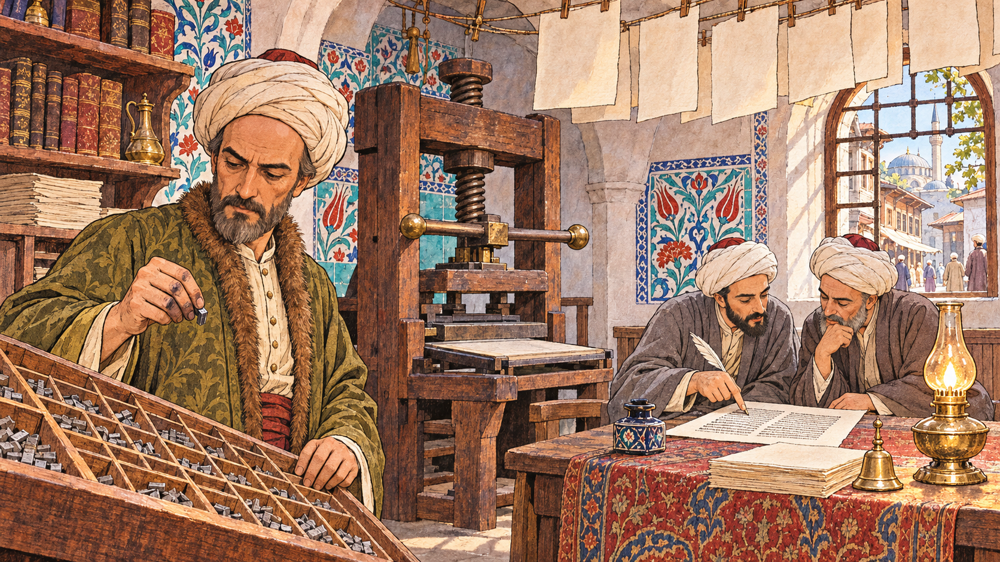
<details><summary>Image Prompt</summary>
(This is Panel 09. Do not include the panel number in the image.)
Style: a hand-drawn travel-sketchbook graphic-novel illustration, with clean dark ink outlines, flat softly shaded color fills and a faint watercolor paper texture, like a page from a traveler's journal; warm, sunlit, painterly lighting; no text, captions, signs, letters or speech bubbles anywhere in the image.

Please generate a 16:9 image depicting panel 9 of 12. Place and time: Müteferrika's print shop in Istanbul, about 1728 CE, lamplit morning. Palette: Iznik turquoise, cobalt, tomato red, brass, saffron yellow and white plaster. Medium-wide interior. In the foreground İbrahim Müteferrika around 1727: a lean man of about fifty-three with a trimmed gray-brown beard, dark thoughtful eyes and a high forehead, wearing a cream turban and an olive-green kaftan with a narrow fur collar, ink on the fingers of his right hand; intense, patient and quietly stubborn. stands at a sloping wooden case divided into many small compartments filled with tiny metal type pieces, picking out one piece by hand. Beside him a heavy screw press stands ready and a rack of paper hangs overhead. At a table to the right two scholars in white turbans and gray robes bend over a freshly printed proof sheet, one of them holding a quill and pointing at a line. On the table sit an inkpot, a lamp, a stack of blank paper and a small brass bell. A narrow window shows the street. Mood: meticulous, supervised, hopeful.

Keep every character and place consistent with the other images in this story. Generate the image immediately without asking clarifying questions.
</details>

The permission comes with conditions: no religious books, so no Qurans, and a panel of scholars to proofread every book. The technical task is huge. Arabic script joins its letters, and each letter changes shape depending on its neighbors, so the printer needs hundreds of different pieces of type, where a Latin printer needs a few hundred in all. Müteferrika builds a press for a script that few had printed in this city.

## Panel 10: A Thousand Copies
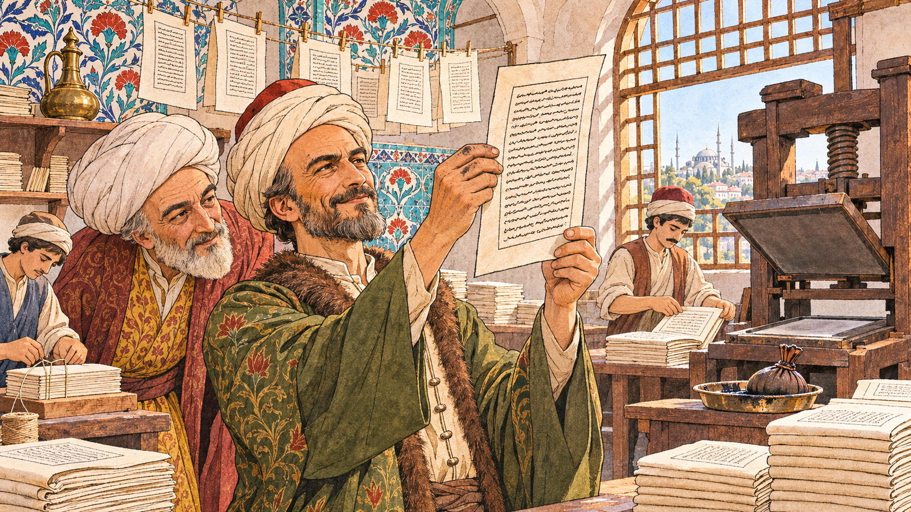
<details><summary>Image Prompt</summary>
(This is Panel 10. Do not include the panel number in the image.)
Style: a hand-drawn travel-sketchbook graphic-novel illustration, with clean dark ink outlines, flat softly shaded color fills and a faint watercolor paper texture, like a page from a traveler's journal; warm, sunlit, painterly lighting; no text, captions, signs, letters or speech bubbles anywhere in the image.

Please generate a 16:9 image depicting panel 10 of 12. Place and time: Müteferrika's print shop in Istanbul, 1729 CE, bright morning. Palette: Iznik turquoise, cobalt, tomato red, brass, saffron yellow and white plaster. Medium shot, warm light. In the foreground İbrahim Müteferrika around 1727: a lean man of about fifty-three with a trimmed gray-brown beard, dark thoughtful eyes and a high forehead, wearing a cream turban and an olive-green kaftan with a narrow fur collar, ink on the fingers of his right hand; intense, patient and quietly stubborn. holds a freshly printed sheet up toward a window, a page of neat black abstract text with a margin, examining it carefully, a rare smile on his face. Around him stacks of printed folded sheets rise on benches, pages hang on lines to dry, two helpers in plain tunics fold and bind pages, and a scholar in a white turban leans in to look over his shoulder. On the press behind them the platen is raised and a leather ink ball lies in a dish. Mood: triumphant, quiet, a first step.

Keep every character and place consistent with the other images in this story. Generate the image immediately without asking clarifying questions.
</details>

In 1729 the first book comes off the press: an Arabic-Turkish dictionary, printed in an edition of 1,000 copies. Where a scribe makes one copy at a time, a press can make a thousand. Ottoman Turkish in the Arabic script has its first printed book, almost 275 years after Gutenberg.

## Panel 11: The Books That Sat
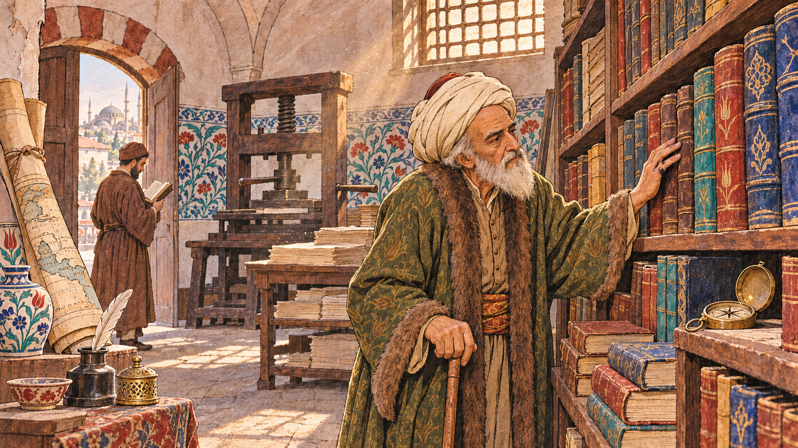
<details><summary>Image Prompt</summary>
(This is Panel 11. Do not include the panel number in the image.)
Style: a hand-drawn travel-sketchbook graphic-novel illustration, with clean dark ink outlines, flat softly shaded color fills and a faint watercolor paper texture, like a page from a traveler's journal; warm, sunlit, painterly lighting; no text, captions, signs, letters or speech bubbles anywhere in the image.

Please generate a 16:9 image depicting panel 11 of 12. Place and time: a storeroom of a print shop in Istanbul, about 1745 CE, dusty late afternoon light. Palette: Iznik turquoise, cobalt, tomato red, brass, saffron yellow and white plaster. Medium-wide shot. In the center İbrahim Müteferrika around 1727: a lean man of about fifty-three with a trimmed gray-brown beard, dark thoughtful eyes and a high forehead, wearing a cream turban and an olive-green kaftan with a narrow fur collar, ink on the fingers of his right hand; intense, patient and quietly stubborn., now aged about seventy with a white beard and a slightly stooped back, stands among tall stacks of bound printed books on wooden shelves, running a hand along one spine. Dust floats in a shaft of light from a high window. A single customer in a brown robe and cap examines a book near the doorway. A large map is rolled in a corner and a small brass compass lies open on a shelf. The press stands quiet in the background. Mood: tender, melancholy and dignified.

Keep every character and place consistent with the other images in this story. Generate the image immediately without asking clarifying questions.
</details>

By his death Müteferrika has printed 17 works: dictionaries, histories, a grammar and a geography with maps. Some of his editions are still being sold decades later. One reading is that his books sat unsold because too few people could read them: the press made copies cheap without making readers. A tool is only part of what it takes to widen the circle.

## Panel 12: Then and Now: The Book Market Today
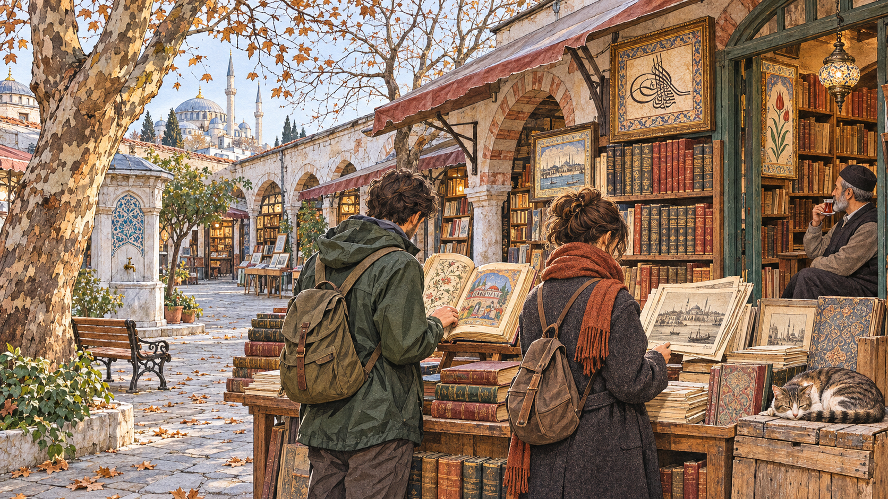
<details><summary>Image Prompt</summary>
(This is Panel 12. Do not include the panel number in the image.)
Style: a hand-drawn travel-sketchbook graphic-novel illustration, with clean dark ink outlines, flat softly shaded color fills and a faint watercolor paper texture, like a page from a traveler's journal; warm, sunlit, painterly lighting; no text, captions, signs, letters or speech bubbles anywhere in the image.

Please generate a 16:9 image depicting panel 12 of 12. Place and time: the Sahaflar Çarşısı book market beside the Grand Bazaar, Istanbul, today, a cool November afternoon. Palette: natural daylight, whitewashed walls, sea blue, terracotta, olive, with a few Ottoman accents. Wide shot of a quiet stone courtyard shaded by plane trees with bare autumn branches, lined with small bookshops under arcades. In the foreground by a book stall stand Two adult travelers seen from behind or in distant three-quarter view, dressed for cool November weather: one in a dark green rain jacket, the other in a charcoal wool coat with a rust-colored scarf, both with small daypacks, standing close together and looking at the view. Faces are never shown in detail. One of them turns the page of an old illustrated book on a wooden table; the other studies a stack of antique prints. Rows of old books, maps and framed calligraphy panels fill the shelves, a shopkeeper sips tea from a tulip-shaped glass in a doorway, and a cat naps on a crate. Mood: reflective, affectionate, a long story still unfolding.

Keep every character and place consistent with the other images in this story. Generate the image immediately without asking clarifying questions.
</details>

Today the Sahaflar courtyard still sells books, old and new. What did the long wait cost, and who paid? In our reading, the people outside the gates paid: the readers who never learned, the families without books and the scholars without cheap copies. Historians disagree about how much the delay mattered, but the pattern is clear: printing made copies cheap, and it took schools and a simpler alphabet to make readers. That second step comes in 1928.

### Epilogue - What the Wait Teaches

The press in Istanbul did not arrive late for lack of technology. By the 1490s the city had one; by 1706 Arabic script was being printed nearby. What delayed Ottoman Turkish printing was a mix of faith, craft, economics and control, and when it finally arrived it came with limits and met a public that mostly could not read. Seen through the Learning for All thread, the lesson is that tools, gatekeepers and readers all have to line up before the circle of learning widens.

| Challenge | How They Responded | Lesson for Today |
|---|---|---|
| Refugees arrive with printing skills | The ibn Nahmias brothers set up the empire's first press (dated 1493, perhaps about ten years later) | A welcome can carry a technology across a border |
| Joined Arabic letters need hundreds of pieces of type | Müteferrika built a press for the script and printed 17 works by his death | A hard technical problem is a gate, but not the only one |
| Scholars and the state controlled what was printed | Müteferrika won a 1727 decree on conditions: no religious books and a panel of proofreaders | Gatekeepers can open a gate and still set its size |
| Few people could read what was printed | Printed editions of 1,000 copies sat unsold for years | Cheap copies do not make readers; schools and a simpler script do |

### Call to Action

When you stand among old books in Istanbul, ask three questions of every new tool: who controls it, who does it leave out, and what else does the circle of learners need before it widens? Then try the two MicroSims to see the numbers behind the story for yourself.

---

## Voices from the Sources

No documented spoken line from any scribe or printer in this story exists in the sources used for this book, so none is invented.

- *"The Quran was revealed in Mecca, recited in Cairo and written in Istanbul."* An old saying about calligraphy, cited in the chapter; its author is unknown.
- *Attributed to Sultan Bayezid II:* that the king of Spain had impoverished his own country and enriched the sultan's by expelling the Jews. The saying is repeated in almost every account but first appears in later sources, so treat it as a story. The welcome itself is documented history.
- *Vesîletü't-tıbâa* ("The Means of Printing"): the title, as usually transliterated, of the treatise Müteferrika is recorded as writing in support of printing. The title survives; the story does not give us his spoken words.

## On the Trip

- **Chapter:** [6. Bazaars, Scripts, and Presses](../../chapters/06-bazaars-scripts-presses/index.md)
- **Where to look:** the calligraphy on mosque walls and domes; the collection at the Museum of Turkish and Islamic Arts; and the old books in the shops near the Grand Bazaar, including the Sahaflar courtyard.
- **Explore further:** [Scribe or Press?](../../sims/scribe-or-press/index.md) finds the number of copies at which printing beats hand-copying, and [When Printing Arrived](../../sims/when-printing-arrived/index.md) charts the long gap.
- **Look Closer:** Glaux's pointer: "Look at the top shelf." Glaux hid in Panel 5, perched among the bound volumes of the book market's stall; today, scan the highest shelves of any old bookshop.

## Characters and Style

This story follows the shared series bible: [Story Characters, Places and House Style](../characters.md). Glaux's identity comes from the mascot's [character sheet](../../img/mascot/character-sheet.md).

## References

1. [Wikipedia: İbrahim Müteferrika](https://en.wikipedia.org/wiki/%C4%B0brahim_M%C3%BCteferrika) - The founder of the first Ottoman press printing in the Arabic script
2. [Wikipedia: Hebrew incunabula](https://en.wikipedia.org/wiki/Hebrew_incunabula) - The earliest Hebrew printed books, the tradition behind the first presses in the Ottoman lands
3. [Wikipedia: Global spread of the printing press](https://en.wikipedia.org/wiki/Global_spread_of_the_printing_press) - How printing reached different regions and scripts
4. [Encyclopaedia Britannica: Ibrahim Muteferrika](https://www.britannica.com/biography/Ibrahim-Muteferrika) - Biography of the founder of the first Ottoman printing house
5. [The Metropolitan Museum of Art: Calligraphy in Islamic Art](https://www.metmuseum.org/toah/hd/clig/hd_clig.htm) - An overview of the scripts and the status of the calligrapher
