# Twenty-One Years of Candia

<!-- 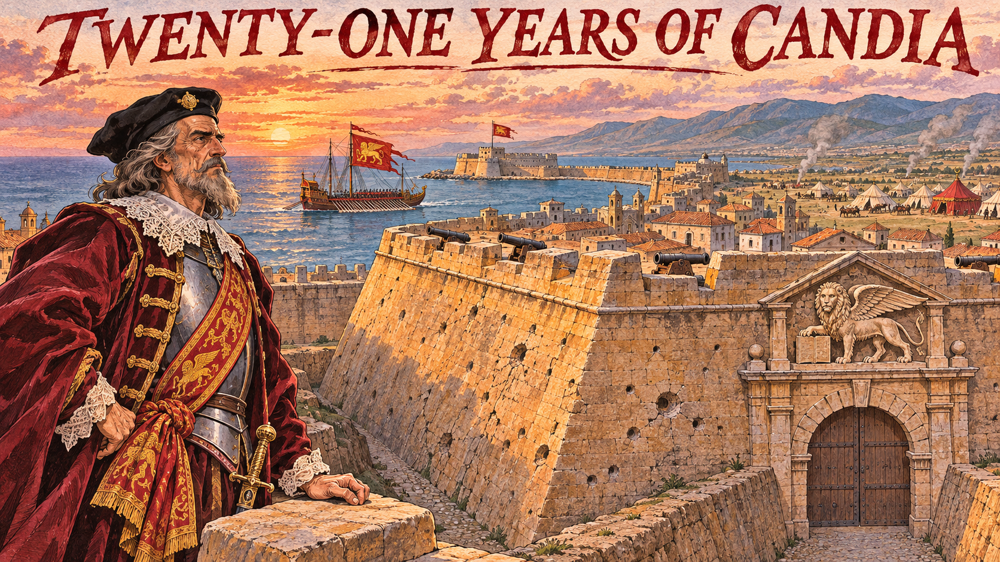 -->

<details>
<summary>Cover Image Prompt</summary>
(This is the Cover Image. Do not include this label in the image.)
Style: a hand-drawn travel-sketchbook graphic-novel illustration, with clean dark ink outlines, flat softly shaded color fills and a faint watercolor paper texture, like a page from a traveler's journal; warm, sunlit, painterly lighting; no text, captions, signs, letters or speech bubbles anywhere in the image. Please generate a wide-landscape 16:9 cover image. Scene: the bastioned walls of the Venetian city of Candia on Crete at golden hour. A great arrowhead-shaped sandstone bastion fills the foreground, its thick sloping face scarred by cannonballs, with a deep dry ditch below it and a carved winged lion of St. Mark (the lion holds a closed book) above a gate. Beyond the walls, a plain dotted with Ottoman tents and thin plumes of smoke; in the harbor behind, a Venetian galley slides toward a sea fortress at the end of a breakwater under a crimson banner. A small Venetian commander stands on the bastion looking out: Francesco Morosini, Venetian commander: a lean man of about sixty with a long gray beard, a high forehead and a stern, tired expression, wearing a dark crimson velvet coat with gold braid over a steel breastplate, a wide white lace collar, a black cap with a small gold badge, and the red-and-gold sash of a Venetian captain-general. Render the title as bold, hand-lettered text across the top: "TWENTY-ONE YEARS OF CANDIA" (exact spelling, no other text anywhere). Palette: sandstone, steel gray, Mediterranean blue and banner crimson. Mood: stubborn, weary, grand. Keep every character and place consistent with the other images in this story. Generate the image immediately without asking clarifying questions.
</details>

<details>
<summary>Narrative Prompt</summary>

**Story:** "Twenty-One Years of Candia" follows the siege of the Venetian capital of Crete, Candia (today Heraklion), by the Ottomans, from 1648 to 1669 and one of the longest sieges in history, and the commander, Francesco Morosini, who surrendered the city in September 1669. A teaser shows the same man in Athens in 1687, and the last panel is the grave of the novelist Nikos Kazantzakis on the Martinengo Bastion today.

**Places and eras:** Candia/Heraklion (the 1560s, the 1640s to 1669, today); Athens (1687, a teaser; the full story is told in another story of this series). All of the siege panels use the series palette for Medieval Rhodes and Venetian Crete: sandstone, steel gray, Mediterranean blue and banner crimson; the Ottoman camp adds tomato red, brass and saffron. The El Greco panel adds gold leaf. The last panel uses natural daylight, whitewashed walls, sea blue, terracotta and olive.

**House style:** hand-drawn travel-sketchbook graphic-novel illustration, as in docs/stories/characters.md. No lettering anywhere in panels. Only the cover carries the title. Safe-Image Rules apply: the siege is shown only by walls, bastions, ships, tunnels, smoke and tents, with no wounds, corpses or weapons mid-strike. Soldiers are always at rest, watching, working or leaving.

**Legend versus evidence:** All panels are documented history. Appearances and rooms are invented. Dates follow the book: the Ottoman landing in 1645, Chania in 1645, Rethymno in 1646, the siege before Candia from 1648, the vizier's personal command from 1667, the French expedition of 1669, the surrender in September 1669. The siege is called 21 years long (1648 to 1669). The Lions Square fountain was built in 1628 by an earlier Francesco Morosini, a Venetian governor, who is a different man from the commander of 1669; he is not drawn here, and the fountain is shown without him.

**Creative liberties:** The text of the book says the Morosini of the siege was born in 1619, so he is about fifty at the surrender; the series' paste-in block for him (about sixty, lean, gray-bearded, stern and tired) is used unchanged in panels 9, 10 and 11, as the series requires, so he may look a little older than his years. He was about sixty-eight in 1687. The prompts for the Kazantzakis grave keep the cross plain and unlettered because panels have no text; the epitaph is printed in the narrative.

**Cast:** Recurring characters (see docs/stories/characters.md and docs/img/mascot/character-sheet.md for Glaux): Francesco Morosini (panels 9, 10 and 11 and the cover), the Acropolis and Parthenon (panel 11) and the Travelers (panel 12). Glaux hides in panel 2. Characters who appear only in this story:

The young El Greco (panel 3):

```text
Domenikos Theotokopoulos, the young El Greco, in his early twenties: a slim young man with a long face, dark curling hair, a short dark beard and intense dark eyes, wearing a plain brown artisan's tunic with rolled sleeves and a paint-spattered linen apron, a fine brush in one hand.
```

Townsfolk of Candia (panel 2):

```text
Townsfolk of Candia: Greek women in long dark skirts and white headscarves carrying clay water jars, a Venetian merchant in a black cap and short cloak, and a boy leading a donkey, mixed together at the fountain.
```

Venetian soldiers (panels 4, 6 and 7):

```text
Venetian soldiers of Candia: sturdy men in short-brimmed steel helmets, buff leather jerkins over white shirts, crimson sashes and dark breeches, carrying long matchlock muskets at rest on their shoulders; tired and watchful, never shown fighting.
```

Venetian sappers (panel 5):

```text
Venetian sappers in a tunnel: stocky men in rolled sleeves, leather caps and dusty brown jerkins, one holding a small tin lantern, another a short pick, and one kneeling with an ear pressed to the earth wall.
```

Volunteers from across Europe (panel 7):

```text
Volunteers from across Europe: tall men in a mix of dress, with plumed broad-brimmed hats, buff coats, lace collars and bright sashes of different colors, carrying canvas packs and long muskets at rest, stepping off boats with curious, weary looks.
```

The Ottoman grand vizier (panel 8):

```text
Köprülü Fazıl Ahmed Pasha, the Ottoman grand vizier: a dignified man in his early thirties with a trim dark beard, a tall white turban, a tomato-red fur-trimmed caftan over a cobalt-blue robe and a brass-handled dagger at his sash, calm and commanding.
```

</details>

### Prologue - The Walls That Would Not Fall

For twenty-one years, from 1648 to 1669, the walled Venetian city of Candia held out against the Ottoman army, one of the longest sieges in history. The walls were designed so that no part of the ditch was out of the reach of a gun, and the Ottomans answered by digging under them. The man who finally negotiated the surrender, Francesco Morosini, would turn up eighteen years later in front of a very different wall. This story follows the city from its prosperous years to its end and then to a quiet grave on its southern bastion.

**Find Glaux:** Glaux hides in one panel of this story. Can you spot the little owl?

## Panel 1: Venice's Kingdom of Candia
<!-- 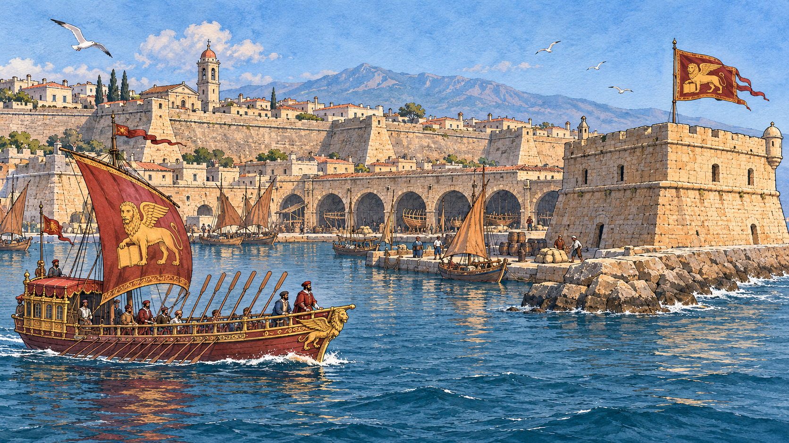 -->
<details><summary>Image Prompt</summary>
(This is Panel 01. Do not include the panel number in the image.)
I am about to ask you to generate a series of images for a graphic novel. Please make the images have a consistent style and consistent characters. Do not ask any clarifying questions. Just generate the image immediately when asked.
Style: a hand-drawn travel-sketchbook graphic-novel illustration, with clean dark ink outlines, flat softly shaded color fills and a faint watercolor paper texture, like a page from a traveler's journal; warm, sunlit, painterly lighting; no text, captions, signs, letters or speech bubbles anywhere in the image.
Please generate a 16:9 image depicting panel 1 of 12. Setting: the port and walls of Candia (modern Heraklion) on Crete, about 1645, before the siege, clear morning light. Palette: sandstone, steel gray, Mediterranean blue and banner crimson. Camera: a wide establishing view from the water at sea level, looking toward the harbor. Mood: confident, prosperous, a little proud. A Venetian galley with oars raised glides in the foreground. At the end of a long breakwater stands the Venetian sea fortress, a squat two-story sandstone tower with thick walls and a crimson banner showing the winged lion of St. Mark with a closed book. Behind it, the long vaulted arches of the arsenal line the harbor, and above them the low, thick, angled walls of the city rise with arrowhead-shaped bastions. Details: fishing boats with brown sails, stacked barrels and sacks on the quay, a bell tower and flat rooftops, a distant mountain in blue haze, and gulls.
Keep every character and place consistent with the other images in this story. Generate the image immediately without asking clarifying questions.
</details>

From 1211 to 1669 the Republic of Venice rules Crete as an overseas colony, the Kingdom of Candia, and the capital, Candia, gives its name to the whole island. Its harbor is guarded by a sea fortress, the Rocca a Mare, built between 1523 and 1540, and its landward side by a ring of low, thick walls with seven arrowhead bastions. Everything in the picture was designed so that no attacker could find a blind spot. In 1645 an Ottoman army lands in the west of the island, and the city's long test begins.

## Panel 2: The Lions of Lions Square
<!-- 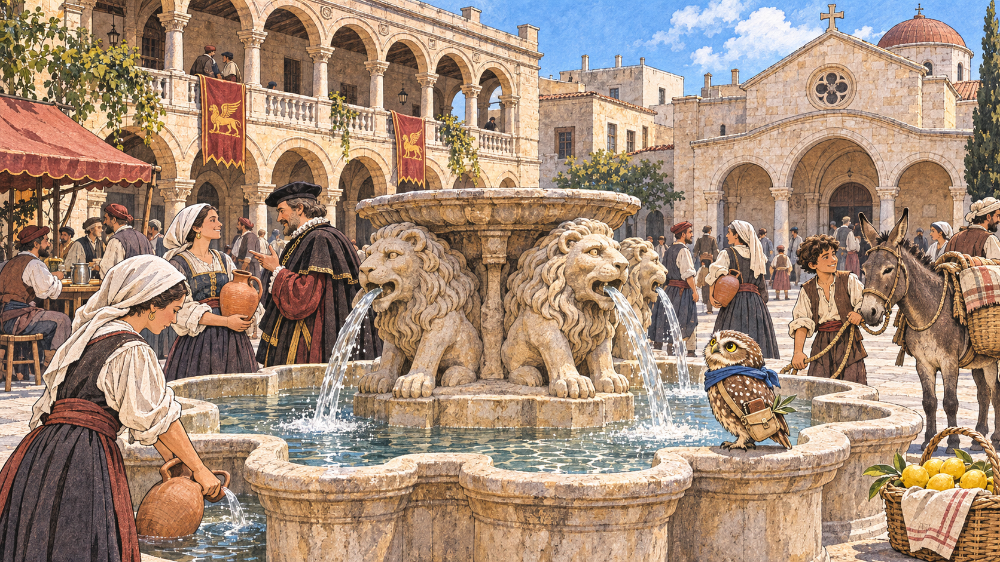 -->
<details><summary>Image Prompt</summary>
(This is Panel 02. Do not include the panel number in the image.)
Style: a hand-drawn travel-sketchbook graphic-novel illustration, with clean dark ink outlines, flat softly shaded color fills and a faint watercolor paper texture, like a page from a traveler's journal; warm, sunlit, painterly lighting; no text, captions, signs, letters or speech bubbles anywhere in the image.
Please generate a 16:9 image depicting panel 2 of 12. Setting: the central square of Candia (Lions Square, now in Heraklion), about 1645, bright midday sun. Palette: sandstone, steel gray, Mediterranean blue and banner crimson. Camera: a medium view slightly above eye level, across the fountain. Mood: busy, ordinary, the calm before the siege. At the center stands a wide stone basin with eight curved lobes, held up by four carved stone lions, water pouring from their open mouths. Gathered around it are Townsfolk of Candia: Greek women in long dark skirts and white headscarves carrying clay water jars, a Venetian merchant in a black cap and short cloak, and a boy leading a donkey, mixed together at the fountain. Details: the arcaded two-story Venetian loggia on one side, a round-arched church portico with a pale stone front, a woven basket of lemons, ripples and splashes in the basin, a shaded cafe awning, and flat Venetian-style roofs. Glaux is drawn small, perched at the edge of the scene, noticeable on a second look. Glaux the Little Owl: a true little owl (Athene noctua), small, round and compact, with a flat rounded head and no ear tufts, warm earth-brown plumage with cream spots, bright lemon-yellow eyes under pale cream eyebrows, a cream-white throat patch and a short pale greenish-yellow beak. Glaux wears a small Aegean-blue scarf and a tan canvas satchel across the body with a small leather-bound travel notebook peeking out, and a sprig of three olive leaves tucked into the satchel strap. Alert, curious and warm expression. Glaux perches on the rim of the fountain basin beside one lion's mane, looking at the lions.
Keep every character and place consistent with the other images in this story. Generate the image immediately without asking clarifying questions.
</details>

In Lions Square the city's water comes out of four stone lions. The fountain was built in 1628 by an earlier governor, also named Francesco Morosini, to bring fresh water from Mount Juktas to the city. He is a different man from the commander of 1669, but the two names will cause mix-ups for as long as anyone tells this story. Around the fountain, Greek townspeople and Venetian officials share the same square.

## Panel 3: A Boy From Candia
<!-- 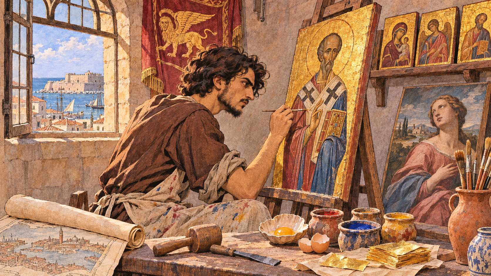 -->
<details><summary>Image Prompt</summary>
(This is Panel 03. Do not include the panel number in the image.)
Style: a hand-drawn travel-sketchbook graphic-novel illustration, with clean dark ink outlines, flat softly shaded color fills and a faint watercolor paper texture, like a page from a traveler's journal; warm, sunlit, painterly lighting; no text, captions, signs, letters or speech bubbles anywhere in the image.
Please generate a 16:9 image depicting panel 3 of 12. Setting: an icon painter's workshop in Candia, about 1563, golden afternoon light through a high arched window. Palette: sandstone, steel gray, Mediterranean blue and banner crimson, with warm gold leaf. Camera: an intimate medium view from the side, looking across the painter's shoulder at the work. Mood: absorbed, ambitious, restless. At an easel stands Domenikos Theotokopoulos, the young El Greco, in his early twenties: a slim young man with a long face, dark curling hair, a short dark beard and intense dark eyes, wearing a plain brown artisan's tunic with rolled sleeves and a paint-spattered linen apron, a fine brush in one hand. He is painting a tall saint in the Byzantine manner on a gold ground. Beside him, leaning against the wall, is a second panel in the Italian manner, with a soft landscape and modeled figure. Details: a row of finished gold-ground icons drying on a shelf, little jars of egg-yolk tempera paints in red, blue and ochre, a stack of gold-leaf squares, a rolled map of Venice, a half-open window with a view of the harbor and the sea fortress, brushes in a clay jar, and a wooden mallet and chisel.
Keep every character and place consistent with the other images in this story. Generate the image immediately without asking clarifying questions.
</details>

A century before the siege, a young painter grows up in this city. Domenikos Theotokopoulos, born in Candia in 1541, trains in the Cretan icon workshops, which paint in both a Byzantine and an Italian manner, and is already a master painter at home by 1563. About 1567 he leaves for Venice, and later Rome and Toledo in Spain, where the world will call him El Greco, 'the Greek'. Candia is a city of painters and scholars, and the siege will end that world.

## Panel 4: The Army Digs In
<!-- 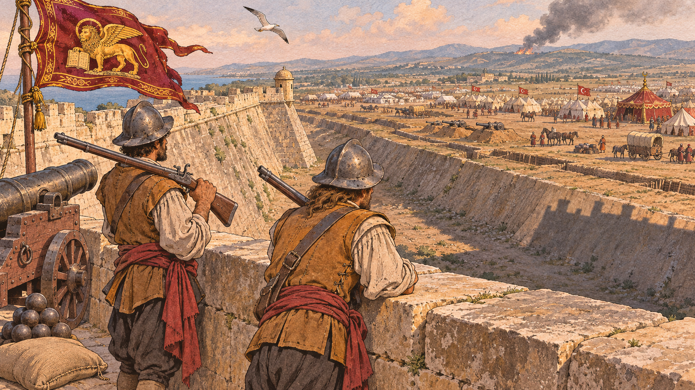 -->
<details><summary>Image Prompt</summary>
(This is Panel 04. Do not include the panel number in the image.)
Style: a hand-drawn travel-sketchbook graphic-novel illustration, with clean dark ink outlines, flat softly shaded color fills and a faint watercolor paper texture, like a page from a traveler's journal; warm, sunlit, painterly lighting; no text, captions, signs, letters or speech bubbles anywhere in the image.
Please generate a 16:9 image depicting panel 4 of 12. Setting: the top of a bastion on the walls of Candia, 1648, hazy late-afternoon light. Palette: sandstone, steel gray, Mediterranean blue, banner crimson, with Ottoman accents of tomato red, brass and saffron. Camera: over-the-shoulder, looking out from behind two sentries toward the plain. Mood: tense, watchful, long-haul. In the foreground, standing on the wall, seen mostly from behind: Venetian soldiers of Candia: sturdy men in short-brimmed steel helmets, buff leather jerkins over white shirts, crimson sashes and dark breeches, carrying long matchlock muskets at rest on their shoulders; tired and watchful, never shown fighting. Beyond the deep dry ditch and the sloping face of the wall, the plain stretches out, covered with rows of tents, long raw-earth trench lines, earthen mounds for guns, and horses and wagons. Plumes of smoke rise from a distant fire on the far hills. Details: a crimson banner with the winged lion on a pole, a stack of cannonballs at the foot of a gun carriage, a sandbag, a gull circling, and the long shadow of the bastion across the ditch.
Keep every character and place consistent with the other images in this story. Generate the image immediately without asking clarifying questions.
</details>

The war begins in 1645, when an Ottoman army lands in western Crete. Chania falls that year and Rethymno in 1646, and in 1648 the Ottomans dig in before Candia. Within days the plain below the walls is a city of tents and trenches, and it will stay that way for years. The defenders on the bastions look out at it and realize that this will not be a quick war.

## Panel 5: A War Underground
<!-- 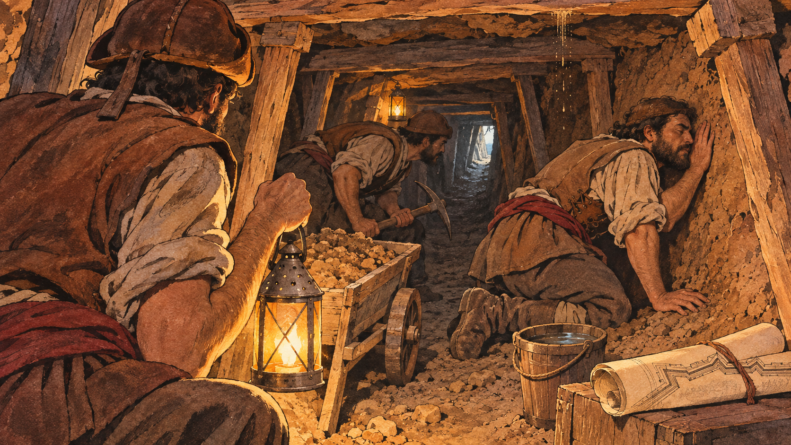 -->
<details><summary>Image Prompt</summary>
(This is Panel 05. Do not include the panel number in the image.)
Style: a hand-drawn travel-sketchbook graphic-novel illustration, with clean dark ink outlines, flat softly shaded color fills and a faint watercolor paper texture, like a page from a traveler's journal; warm, sunlit, painterly lighting; no text, captions, signs, letters or speech bubbles anywhere in the image.
Please generate a 16:9 image depicting panel 5 of 12. Setting: a narrow countermine tunnel under a bastion of Candia, about 1660, lit by tin lanterns. Palette: sandstone brown, steel gray, deep shadow with warm amber lantern light, and a hint of crimson. Camera: a low, tight view down the tunnel, from behind the first man. Mood: hushed, claustrophobic, listening. In the foreground: Venetian sappers in a tunnel: stocky men in rolled sleeves, leather caps and dusty brown jerkins, one holding a small tin lantern, another a short pick, and one kneeling with an ear pressed to the earth wall. They are working in silence, one with an ear pressed to the earth wall as if listening for digging on the other side. Details: timber props holding the roof, a wooden barrow of loose earth, a small bucket of water standing on the floor, little trickles of dust falling from the ceiling, a rolled plan of the bastion, a dim shaft of daylight at the far end, and the shadows of the men stretching long behind them. No enemy figures and no fighting.
Keep every character and place consistent with the other images in this story. Generate the image immediately without asking clarifying questions.
</details>

The fighting at the walls is mostly a war of tunnels. Ottoman miners dig under the bastions to blow them up, and Venetian counter-miners dig out to meet them underground, listening through the earth for the sound of a pick. This is why the arrowhead bastions were designed as they were: attackers could not simply walk up, so they spent twenty-one years digging.

## Panel 6: The Lifeline by Sea
<!-- 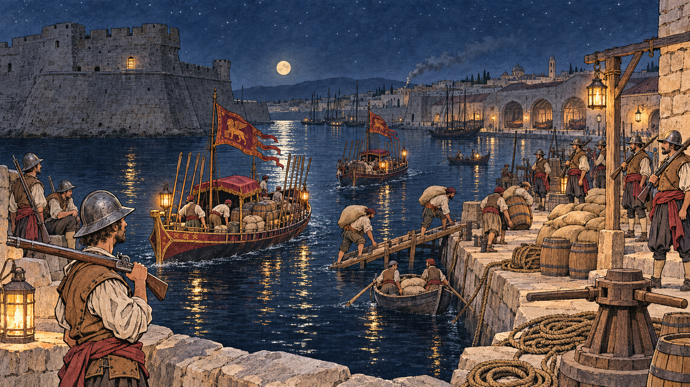 -->
<details><summary>Image Prompt</summary>
(This is Panel 06. Do not include the panel number in the image.)
Style: a hand-drawn travel-sketchbook graphic-novel illustration, with clean dark ink outlines, flat softly shaded color fills and a faint watercolor paper texture, like a page from a traveler's journal; warm, sunlit, painterly lighting; no text, captions, signs, letters or speech bubbles anywhere in the image.
Please generate a 16:9 image depicting panel 6 of 12. Setting: the harbor of Candia at night, about 1660, a clear sky of stars and a low moon. Palette: deep Mediterranean blue and steel gray with warm lantern amber and crimson banners. Camera: a wide, slightly high view across the water from the breakwater. Mood: quiet relief, secrecy. Two Venetian galleys with oars raised slip between the sea fortress and the breakwater toward the quay, loaded with barrels and sacks. On the quay wait Venetian soldiers of Candia: sturdy men in short-brimmed steel helmets, buff leather jerkins over white shirts, crimson sashes and dark breeches, carrying long matchlock muskets at rest on their shoulders; tired and watchful, never shown fighting. with lanterns, who are hauling sacks of grain and barrels from a gangplank. Details: the dark bulk of the sea fortress with a single light in a window, long reflections of lanterns in the black water, rope coils and a capstan on the quay, small boats with oarsmen, the dim shape of the vaulted arsenal, and a trail of smoke on the horizon.
Keep every character and place consistent with the other images in this story. Generate the image immediately without asking clarifying questions.
</details>

For more than twenty years the city holds out because it can be supplied from the sea. Venetian galleys slip in at night with grain, powder and men, while Venetian fleets fight the Ottomans as far away as the Dardanelles to keep the lifeline open. As long as the harbor stays open, the walls can stand.

## Panel 7: Volunteers From Across Europe
<!-- 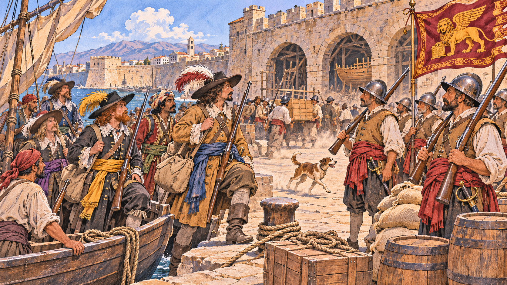 -->
<details><summary>Image Prompt</summary>
(This is Panel 07. Do not include the panel number in the image.)
Style: a hand-drawn travel-sketchbook graphic-novel illustration, with clean dark ink outlines, flat softly shaded color fills and a faint watercolor paper texture, like a page from a traveler's journal; warm, sunlit, painterly lighting; no text, captions, signs, letters or speech bubbles anywhere in the image.
Please generate a 16:9 image depicting panel 7 of 12. Setting: the quay of Candia, about 1660, bright morning light. Palette: sandstone, steel gray, Mediterranean blue and banner crimson, with the many bright colors of the volunteers' sashes. Camera: a medium-wide view across the quay at eye level. Mood: restless, expectant, international. In the foreground, stepping from small boats onto the stone quay: Volunteers from across Europe: tall men in a mix of dress, with plumed broad-brimmed hats, buff coats, lace collars and bright sashes of different colors, carrying canvas packs and long muskets at rest, stepping off boats with curious, weary looks. Venetian soldiers wait at the quay to greet them: Venetian soldiers of Candia: sturdy men in short-brimmed steel helmets, buff leather jerkins over white shirts, crimson sashes and dark breeches, carrying long matchlock muskets at rest on their shoulders; tired and watchful, never shown fighting. Details: a boat with a lowered sail, bundles of rope and long wooden crates, a dog running along the quay, sacks and barrels, a crimson banner with the winged lion on a pole, the walls of the arsenal behind, and a cloud of dust. Everyone has weapons at rest.
Keep every character and place consistent with the other images in this story. Generate the image immediately without asking clarifying questions.
</details>

Volunteers come from across Christian Europe to help Venice hold the walls, and some stay for months, some for a season, and some for a single bad week. In 1669 a French expedition arrives, and its commander is killed in a failed sortie. Candia becomes a cause as well as a city: a Christian fortress on an island that the Ottomans want.

## Panel 8: The Vizier Takes Command
<!-- 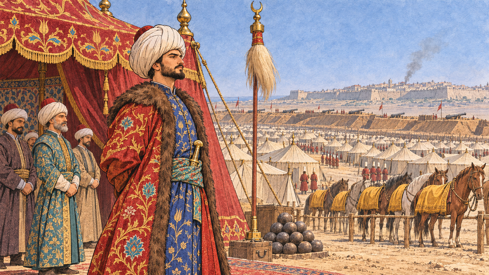 -->
<details><summary>Image Prompt</summary>
(This is Panel 08. Do not include the panel number in the image.)
Style: a hand-drawn travel-sketchbook graphic-novel illustration, with clean dark ink outlines, flat softly shaded color fills and a faint watercolor paper texture, like a page from a traveler's journal; warm, sunlit, painterly lighting; no text, captions, signs, letters or speech bubbles anywhere in the image.
Please generate a 16:9 image depicting panel 8 of 12. Setting: the Ottoman siege camp before Candia, 1667, hot dry light and dust. Palette: Iznik turquoise, cobalt, tomato red, brass and saffron against pale earth. Camera: a wide, slightly low view across the camp, with the distant city walls on the horizon. Mood: grim, formal, patient. In the foreground, in front of a vast crimson-and-gold command tent with brass finials, stands Köprülü Fazıl Ahmed Pasha, the Ottoman grand vizier: a dignified man in his early thirties with a trim dark beard, a tall white turban, a tomato-red fur-trimmed caftan over a cobalt-blue robe and a brass-handled dagger at his sash, calm and commanding. He looks toward the city with his hands behind his back, while attendants in turbans stand a respectful distance behind him. Details: rows of tents in a precise pattern, long earthworks, a line of horses with saffron blankets, a thin plume of smoke rising from the distant walls, a stack of cannonballs, a tall pole with a horsetail standard, and a hazy blue sky.
Keep every character and place consistent with the other images in this story. Generate the image immediately without asking clarifying questions.
</details>

In 1667 the grand vizier Köprülü Fazıl Ahmed Pasha takes personal command and presses the siege harder than ever. The years of trenches and tunnels turn into a final, relentless push. By the late summer of 1669 the city is in ruins, and everyone in the camp and in the city knows that the end is near.

## Panel 9: September 1669: The Commander Decides
<!-- 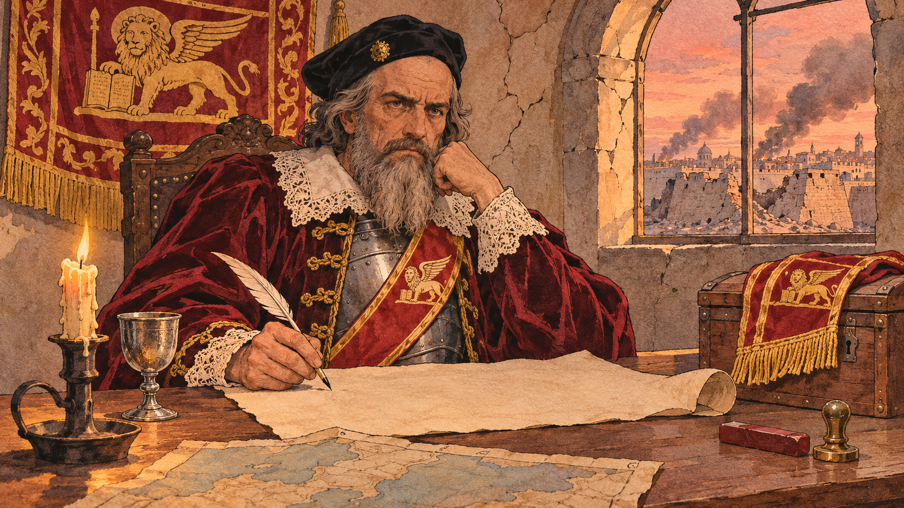 -->
<details><summary>Image Prompt</summary>
(This is Panel 09. Do not include the panel number in the image.)
Style: a hand-drawn travel-sketchbook graphic-novel illustration, with clean dark ink outlines, flat softly shaded color fills and a faint watercolor paper texture, like a page from a traveler's journal; warm, sunlit, painterly lighting; no text, captions, signs, letters or speech bubbles anywhere in the image.
Please generate a 16:9 image depicting panel 9 of 12. Setting: a room in the governor's palace in Candia, September 1669, evening, low golden light through a cracked arched window. Palette: sandstone, steel gray, Mediterranean blue and banner crimson. Camera: a medium close view from across the table. Mood: grave, tired, resolute; no violence. At a heavy wooden table sits Francesco Morosini, Venetian commander: a lean man of about sixty with a long gray beard, a high forehead and a stern, tired expression, wearing a dark crimson velvet coat with gold braid over a steel breastplate, a wide white lace collar, a black cap with a small gold badge, and the red-and-gold sash of a Venetian captain-general. He holds a quill over an unrolled sheet of parchment, with no writing visible, and looks past it with a weary frown. Through the window beyond him, the broken bastions and a pall of smoke over the city are visible against a salmon sky. Details: a single candle in an iron stick, a small wooden chest with the red-and-gold sash folded on top, a map with no markings clearly visible, a cracked plaster wall, a goblet, a sealing wax stick, and the crimson banner on the wall behind him.
Keep every character and place consistent with the other images in this story. Generate the image immediately without asking clarifying questions.
</details>

Francesco Morosini, the Venetian commander, has held the city for the last years of the siege. In September 1669 he negotiates a surrender. The terms are generous: the garrison and any inhabitants who wish to leave can do so with their property, and Venice keeps three small island fortresses off Crete at Souda, Gramvousa and Spinalonga, the last of them until 1715. Tens of thousands have died on each side.

## Panel 10: Leaving With Honor
<!-- 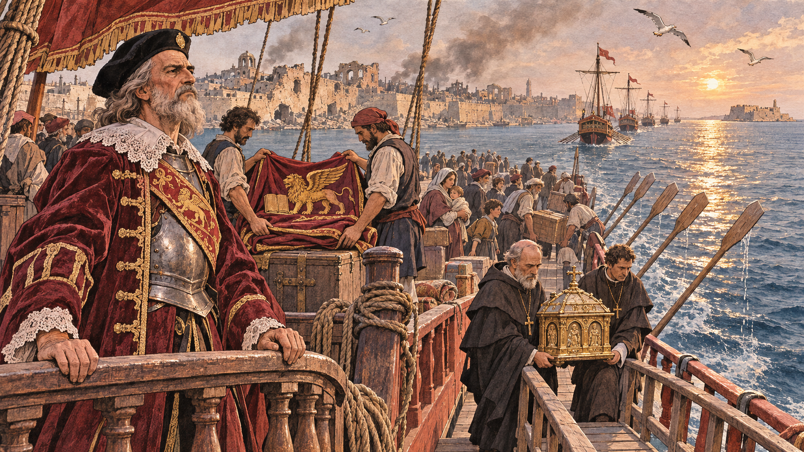 -->
<details><summary>Image Prompt</summary>
(This is Panel 10. Do not include the panel number in the image.)
Style: a hand-drawn travel-sketchbook graphic-novel illustration, with clean dark ink outlines, flat softly shaded color fills and a faint watercolor paper texture, like a page from a traveler's journal; warm, sunlit, painterly lighting; no text, captions, signs, letters or speech bubbles anywhere in the image.
Please generate a 16:9 image depicting panel 10 of 12. Setting: the harbor of Candia, September 1669, late afternoon, golden light and a thin haze of smoke over a ruined skyline. Palette: sandstone, steel gray, Mediterranean blue and banner crimson. Camera: a wide view from a ship's stern deck looking back toward the receding harbor. Mood: heavy, dignified, melancholy. At the stern rail of a Venetian galley stands Francesco Morosini, Venetian commander: a lean man of about sixty with a long gray beard, a high forehead and a stern, tired expression, wearing a dark crimson velvet coat with gold braid over a steel breastplate, a wide white lace collar, a black cap with a small gold badge, and the red-and-gold sash of a Venetian captain-general. Behind him, a crimson banner with the winged lion of St. Mark and a closed book is carefully folded in the hands of two sailors. In the foreground, two priests in dark robes carry a small gilded reliquary casket up the gangplank. Details: oars raised and dripping, the sea fortress at the end of the breakwater growing small, a line of ships with furled sails following, a thin trail of smoke from the city walls, crates and chests being loaded by townspeople leaving, gulls, and a long golden path on the water.
Keep every character and place consistent with the other images in this story. Generate the image immediately without asking clarifying questions.
</details>

The garrison and the people who choose to go sail out with their goods, and with them go the city's relics, among them the skull of Saint Titus, which will remain in Venice until it is returned to Heraklion in 1966. Candia becomes Kandiye, an Ottoman provincial capital, and Ottoman Crete begins, lasting until 1898. Morosini goes home to Venice, and his name will come back to the Aegean.

## Panel 11: Eighteen Years Later: A Teaser
<!-- 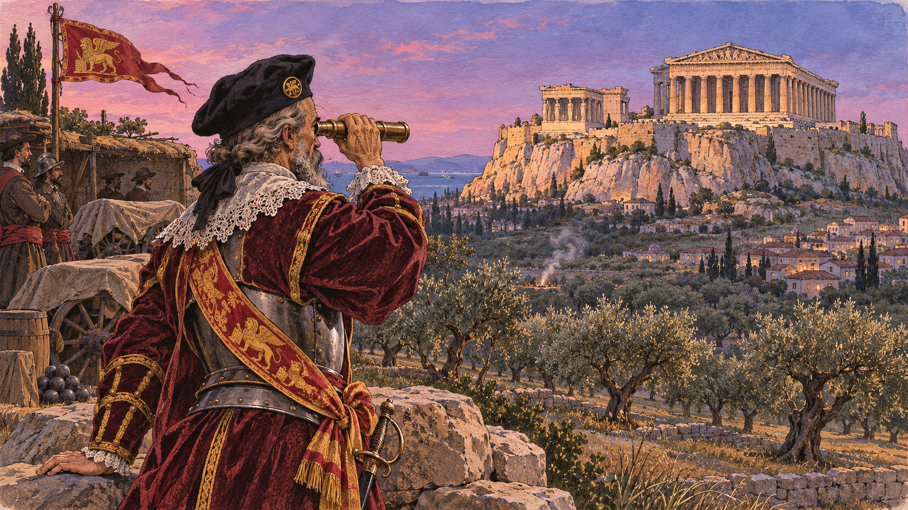 -->
<details><summary>Image Prompt</summary>
(This is Panel 11. Do not include the panel number in the image.)
Style: a hand-drawn travel-sketchbook graphic-novel illustration, with clean dark ink outlines, flat softly shaded color fills and a faint watercolor paper texture, like a page from a traveler's journal; warm, sunlit, painterly lighting; no text, captions, signs, letters or speech bubbles anywhere in the image.
Please generate a 16:9 image depicting panel 11 of 12. Setting: a hillside west of the Acropolis in Athens, September 1687, dusk with a rose-and-violet sky. Palette: sandstone, steel gray, Mediterranean blue and banner crimson, with the cool evening gold on the marble. Camera: a medium-wide view from slightly behind the figure, looking over his shoulder toward the rock. Mood: suspenseful, quiet, the calm before a catastrophe (nothing is shown happening). On a rise in the foreground stands Francesco Morosini, Venetian commander: a lean man of about sixty with a long gray beard, a high forehead and a stern, tired expression, wearing a dark crimson velvet coat with gold braid over a steel breastplate, a wide white lace collar, a black cap with a small gold badge, and the red-and-gold sash of a Venetian captain-general. holding a brass telescope to one eye and looking across the valley. Behind him are a few earthen gun emplacements with cannon at rest and covered, and men in crimson sashes standing back in the shadow. In the middle distance rises The Acropolis of Athens: a steep, flat-topped, pale limestone rock rising above the city, crowned by the Parthenon, a long Doric temple of honey-colored marble with eight columns across the front, a low triangular pediment and a long carved frieze under the roof; to its left stands the smaller Erechtheion with its porch of six marble maidens. The sky behind is clear blue. Details: a field of silvery olive trees, a thin ribbon of campfire smoke, the faint lights of the lower town, long shadows from the hill, a crimson pennant at the gun position, and a hint of the sea far off.
Keep every character and place consistent with the other images in this story. Generate the image immediately without asking clarifying questions.
</details>

Eighteen years later the same man is in Athens, in command of the Venetian army that in 1687 attacks the city. Here the picture stops: his guns are on the hill, the Parthenon is across the valley, and the next shot is another story, told in another story of this series and in the Athens chapters of this book. Nobody in 1669 could have guessed where this commander would turn up.

## Panel 12: Then and Now: The Bastion and the Grave
<!-- 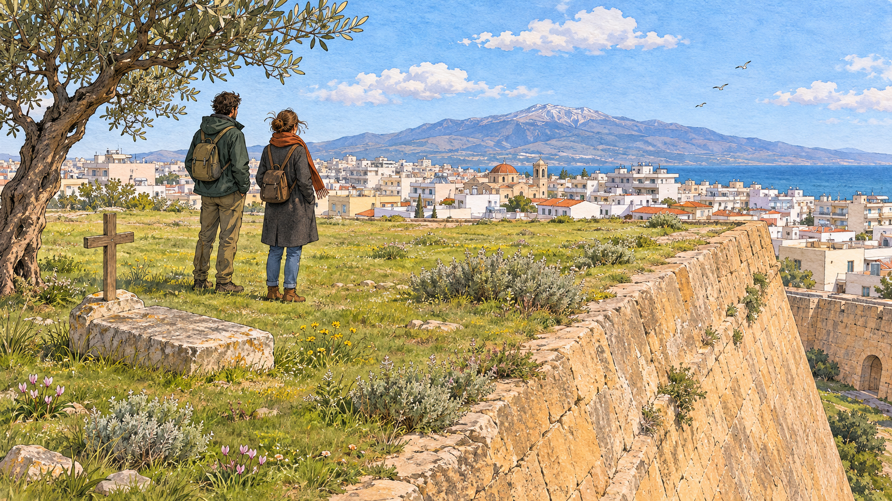 -->
<details><summary>Image Prompt</summary>
(This is Panel 12. Do not include the panel number in the image.)
Style: a hand-drawn travel-sketchbook graphic-novel illustration, with clean dark ink outlines, flat softly shaded color fills and a faint watercolor paper texture, like a page from a traveler's journal; warm, sunlit, painterly lighting; no text, captions, signs, letters or speech bubbles anywhere in the image.
Please generate a 16:9 image depicting panel 12 of 12. Setting: the top of the Martinengo Bastion, the southernmost of the Venetian walls of Heraklion, today, a bright, cool November morning. Palette: natural daylight, whitewashed walls, sea blue, terracotta and olive, with the sandstone of the old walls. Camera: a wide view across the bastion's flat grassy top, looking toward the city and a distant mountain, at the same angle as the angled wall in the first panel. Mood: peaceful, open, unburdened. Two adult travelers seen from behind or in distant three-quarter view, dressed for cool November weather: one in a dark green rain jacket, the other in a charcoal wool coat with a rust-colored scarf, both with small daypacks, standing close together and looking at the view. Faces are never shown in detail. They stand a little apart from a simple stone grave slab marked by a plain wooden cross, with no writing visible. Details: wild grass and low gray-green herbs, a few small wildflowers, the thick sloping sandstone face of the bastion edge, a modern city of flat rooftops beyond it, the blue line of the sea, a single olive tree, and a few tiny birds.
Keep every character and place consistent with the other images in this story. Generate the image immediately without asking clarifying questions.
</details>

Today the Martinengo Bastion, the southernmost of the seven, is a quiet, grassy platform, and on it, under a plain wooden cross, lies the novelist Nikos Kazantzakis (1883 to 1957), who was born in Ottoman Candia. His epitaph, in translation, reads: 'I hope for nothing. I fear nothing. I am free.' The walls that were built to stop an enemy are now the place where a free spirit is buried, and visitors climb them for the view.

### Epilogue - What a Long Siege Teaches

The siege of Candia ended in a negotiated surrender on generous terms, after tens of thousands had died on each side. Venice lost its Kingdom of Candia, and Crete gained an Ottoman provincial capital that lasted more than two centuries. The Cretan Renaissance that had produced El Greco and the scholar Marcus Musurus, who edited Greek texts for the Venetian printer Aldus Manutius, had already carried its learning out into Europe; the siege closed that chapter at home.

| Challenge | How They Responded | Lesson for Today |
|---|---|---|
| Cannon had made tall medieval walls obsolete | Low, thick arrowhead bastions leaving no dead ground | Design for the actual threat, not the old one |
| Attackers tunneling under the walls | Counter-miners dug out to meet them underground | A problem solved on paper still has to be solved underground |
| A city cut off but not blockaded at sea | Galleys brought supplies by night, and fleets fought far away to keep the sea lanes open | A long effort needs a lifeline |
| Whether to fight to the last or save the people | Morosini negotiated terms that let the garrison and willing inhabitants leave with their property | Knowing when to stop can be as hard as knowing how to hold on |

### Call to Action

If you are in Heraklion, walk the old walls and see for yourself why a bastion is shaped like an arrowhead, then climb the Martinengo Bastion to read the grave on the top. Cretan scholars such as Marcus Musurus helped put Greek texts into the small, portable books of Aldus Manutius in Venice, and knowledge that travels in a pocket outlasts the walls of any one city. Learning for All has always depended on who is allowed to carry knowledge out of a place, and who can read it when it arrives.

---

## Voices from the Sources

- **The epitaph of Nikos Kazantzakis, on his grave on the Martinengo Bastion.** In translation: "I hope for nothing. I fear nothing. I am free." The wording is the translation given in the chapter.
- **The winged lion of St. Mark (a traditional Venetian inscription).** The lion that watched over Venetian gates often holds an open book, traditionally inscribed with a Latin greeting to St. Mark, the city's patron saint. This is the symbol of Venice, not a record of any one lion in Candia.
- **El Greco's signature.** Domenikos Theotokopoulos signed his paintings in Greek letters, and on some he added *Kres*, "Cretan", a documented sign of how he thought of his origins.

## On the Trip

- **Chapter:** [14. Venetian Heraklion and Crete Today](../../chapters/14-venetian-heraklion/index.md)
- **Where to look:** the Venetian walls and their seven bastions; the harbor fortress (the Koules) and the vaulted arsenal arches; the Morosini Fountain in Lions Square, which carries the name of an *earlier* Francesco Morosini, a governor, not the commander of the siege; and the Martinengo Bastion and Kazantzakis's grave on the southern edge of the old town.
- **Explore further:** [Walking Venetian Candia](../../sims/walking-venetian-candia-map/index.md)
- **Look Closer:** Glaux was perched on the rim of the fountain basin in panel 2. At the real fountain, look at the lions' manes and mouths, and remember that the fountain's name belongs to a different Morosini.

## Characters and Style

This story follows the shared series bible: [Story Characters, Places and House Style](../characters.md). Glaux's identity comes from the mascot's [character sheet](../../img/mascot/character-sheet.md).

## References

1. [Wikipedia: Siege of Candia](https://en.wikipedia.org/wiki/Siege_of_Candia) - The Ottoman siege of 1648 to 1669
2. [Wikipedia: Francesco Morosini](https://en.wikipedia.org/wiki/Francesco_Morosini) - The Venetian commander and later doge
3. [Wikipedia: Nikos Kazantzakis](https://en.wikipedia.org/wiki/Nikos_Kazantzakis) - The Cretan novelist buried on the Martinengo Bastion
4. [Encyclopaedia Britannica: Nikos Kazantzakis](https://www.britannica.com/biography/Nikos-Kazantzakis) - Overview of the writer's life and works
5. [Encyclopaedia Britannica: Francesco Morosini](https://www.britannica.com/biography/Francesco-Morosini) - Overview of the commander's career
