# Wooden Walls

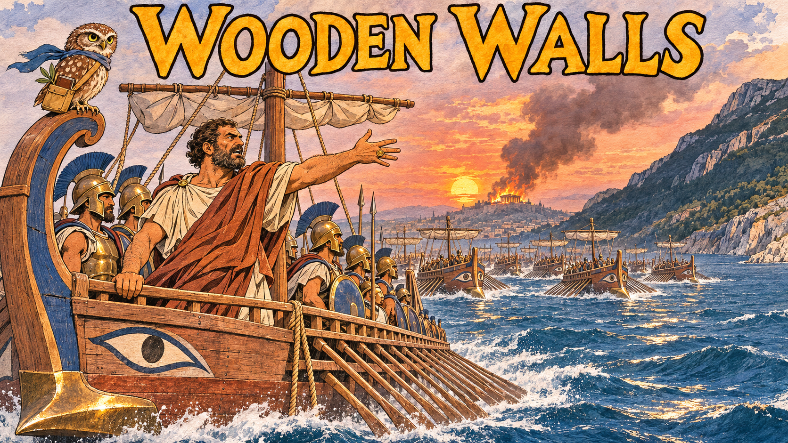
<details>
<summary>Cover Image Prompt</summary>
(This is the Cover Image. Do not include this label in the image.)
Style: a hand-drawn travel-sketchbook graphic-novel illustration, with clean dark ink outlines, flat softly shaded color fills and a faint watercolor paper texture, like a page from a traveler's journal; warm, sunlit, painterly lighting; no text, captions, signs, letters or speech bubbles anywhere in the image.

Please generate a wide-landscape 16:9 cover image for a graphic novel. Exception to the no-text rule, for this cover only: render the title as bold, hand-lettered capital letters in honey-gold with a dark outline reading exactly "Wooden Walls" across the top, the only text in the image. Composition: a dramatic wide view of the narrows of Salamis at sunset in September 480 BCE, a long line of Athenian triremes with raised oars surging toward us across Aegean-blue water, their bronze rams glinting, with a smoky column from the distant burning Acropolis on the horizon and the dark mass of Mount Aigaleo on the right. Cast: An Athenian trireme: a long, narrow wooden warship, low in the water, with three staggered banks of oars, a bronze ram at the waterline of the bow, a curved raised stern post, a large painted eye on each side of the bow, a square sail furled on a single mast, and bronze-helmeted marines on the deck. In the lead ship, standing on the deck with one arm outstretched toward the sea, is Themistocles. Themistocles, Athenian statesman and admiral: a stocky, energetic man of about forty-five with a short dark curly beard, sharp dark eyes and a weathered, tanned face, wearing a plain cream chiton and a rust-brown himation draped over one shoulder, a bronze signet ring on his right hand; confident, restless, always mid-gesture. Glaux the Little Owl: a true little owl (Athene noctua), small, round and compact, with a flat rounded head and no ear tufts, warm earth-brown plumage with cream spots, bright lemon-yellow eyes under pale cream eyebrows, a cream-white throat patch and a short pale greenish-yellow beak. Glaux wears a small Aegean-blue scarf and a tan canvas satchel across the body with a small leather-bound travel notebook peeking out, and a sprig of three olive leaves tucked into the satchel strap. Alert, curious and warm expression. Glaux is drawn small, perched at the edge of the scene, noticeable on a second look. Glaux perches on the curved stern post of the nearest ship. Palette: marble white, Aegean blue, olive green, honey gold, bronze, with a smoky sunset sky. Tone: heroic and tense. Keep every character and place consistent with the other images in this story. Generate the image immediately without asking clarifying questions.
</details>

<details markdown="1">
<summary>Narrative Prompt</summary>
**Era and places.** The Persian Wars, 490 to 479 BCE, as told by Herodotus: the plain of Marathon (490), the Hellespont near modern Çanakkale (spring 480), Delphi (481 or 480), Athens and the Pnyx hill, the port of Piraeus, the Acropolis, the strait of Salamis (September 480), and Delphi again after Plataea (479). The last panel is the Hippodrome in Istanbul today.

**Themes.** An ambiguous oracle read by a democracy: the god spoke in a riddle and an Assembly of citizens argued over two words. A forecaster's judgment (Themistocles) beats a fixed rule. The wars are told by Herodotus, a man born a subject of the Persian king, which is part of why we trust his inquiry; we keep his account of what happened and treat his numbers as reported, not believed. Citizens, including the poorest, rowed the fleet that saved Athens (about 30,000 oarsmen): a Learning for All thread, because the city's survival depended on people who had no standing in older systems of rank.

**Series house style.** Hand-drawn travel-sketchbook graphic-novel illustration, clean dark ink outlines, flat softly shaded color fills, faint watercolor paper texture. No lettering in any panel; only the cover carries the title. All images are 16:9. The full style line is pasted at the top of every prompt (see [Story Characters, Places and House Style](../characters.md)).

**Palette.** Classical Greece (marble white, Aegean blue, olive green, honey gold, bronze) for panels 1 to 3 and 5 to 15, with royal purple and saffron added wherever Xerxes or the Persian fleet appears (panels 4, 10 to 13). Panel 16 uses the modern Turkey palette: natural daylight, sea blue, terracotta, olive.

**Safe-image handling.** The battles are shown by dust, shields at rest, smoke, ships, oars, wreckage and mourners from behind. There is no combat, no wounds and no bodies. The Persian sack of the Acropolis is shown by smoke and ruined columns only.

**Creative liberties and uncertainties.**

- The two oracle answers, Themistocles' reading of "divine Salamis" and the Assembly vote all come from Herodotus alone, who wrote about fifty years later. Some historians suspect the second answer was polished afterward. The story presents them as Herodotus tells them.
- The legend of the runner who died after racing from Marathon to Athens appears centuries after the battle (Plutarch and Lucian) and is not in Herodotus. Panel 3 shows it as legend and says so.
- Herodotus gives huge numbers for Xerxes' army; modern historians usually estimate far fewer, often about 100,000 to 300,000 fighting men. The number is not shown.
- Where the Serpent Column was cast is not stated by Herodotus; we say "probably near Delphi." Its first appearance in panel 15 shows it new (bright bronze, three heads, golden bowl); the Serpent Column block describes its present weathered state.
- Athena herself is not shown; she appears only as the head on the owl coin.
- All Athenians and Delphians other than Themistocles and the Pythia are anonymous; the named Delphian Timon is not drawn.

**Cast.** Glaux the Little Owl hides in exactly one panel (panel 8): see docs/stories/characters.md and docs/img/mascot/character-sheet.md (Glaux). Themistocles, the Pythia, the Owl Coin, Delphi, the Serpent Column and the Travelers are in docs/stories/characters.md. The following appear only in this story; their blocks are pasted verbatim wherever they appear (in panel 8 the triremes are only half built, so they are described in the prompt rather than pasted).

Xerxes (panels 4 and 12):

```text
Xerxes, Great King of Persia: a tall, broad-shouldered man of about thirty-eight with a long, carefully curled black beard, a tall upright cream felt tiara, a long saffron-and-purple embroidered robe with wide sleeves, gold bracelets and a gold-chain collar; an aloof, regal, unreadable expression.
```

The Athenian envoys (panels 5 and 6):

```text
Two Athenian envoys: a gray-bearded man of about sixty in a travel-stained cream himation, and a younger man of about thirty with short dark hair in a faded rust himation, both with broad-brimmed traveler's hats hanging at their backs, dusty leather sandals and walking staffs; weary and anxious.
```

The Athenian trireme (panels 9, 11, 12, 13 and the cover):

```text
An Athenian trireme: a long, narrow wooden warship, low in the water, with three staggered banks of oars, a bronze ram at the waterline of the bow, a curved raised stern post, a large painted eye on each side of the bow, a square sail furled on a single mast, and bronze-helmeted marines on the deck.
```

The burned Acropolis, 480 BCE (panel 10):

```text
The Acropolis of Athens after the Persian sack of 480 BCE: the same steep, flat-topped, pale limestone rock above the city, but its old temples are smoking ruins, with blackened broken columns, toppled column drums, scorched marble, charred roof beams, tall columns of dark smoke drifting over the summit and a blackened stump where the sacred olive tree stood; the sky behind is hazy and brown-gray.
```
</details>

### Prologue - A Wall Made of Wood

In 480 BCE an enormous Persian army is marching on Athens, and the city has asked the god at Delphi what to do. The first answer tells them to run to the ends of the earth. The second is a riddle: Zeus will give Athena a wooden wall that will not fall. A city of stone temples has to decide what a wooden wall might be. The answer, and the man who argued for it, change the course of Greek history.

**Find Glaux:** Glaux hides in one panel of this story. Can you spot the little owl?

## Panel 1: Marathon, 490 BCE
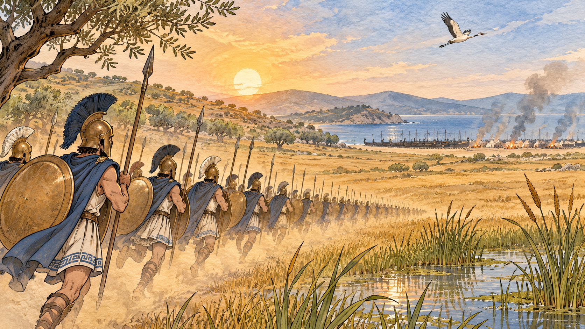
<details><summary>Image Prompt</summary>
(This is Panel 01. Do not include the panel number in the image.)
I am about to ask you to generate a series of images for a graphic novel. Please make the images have a consistent style and consistent characters. Do not ask any clarifying questions. Just generate the image immediately when asked.
Style: a hand-drawn travel-sketchbook graphic-novel illustration, with clean dark ink outlines, flat softly shaded color fills and a faint watercolor paper texture, like a page from a traveler's journal; warm, sunlit, painterly lighting; no text, captions, signs, letters or speech bubbles anywhere in the image.

Please generate a 16:9 image in the style above depicting panel 1 of 16. Setting: the coastal plain of Marathon, Greece, early morning in 490 BCE. Camera: wide, low view from behind a long line of Athenian hoplites, small silhouettes in bronze helmets with horsehair crests and round shields with plain faces, advancing at a steady run across the golden plain with spears held upright; a cloud of pale dust rises behind them. In the distance, a bay with rows of dark Persian ships drawn up on the beach and a haze of campfire smoke. Details: marsh reeds in the foreground, silver-green olive trees on the low hills, a low sun burning through the dust, a single crane flying overhead. Palette: marble white, Aegean blue, olive green, honey gold, bronze. Tone: tense, resolute. No fighting is shown, only the advance. Keep every character and place consistent with the other images in this story. Generate the image immediately without asking clarifying questions.
</details>

In 490 BCE a Persian fleet sent by King Darius lands on the plain of Marathon, about 40 km northeast of Athens. About 10,000 Athenian citizen soldiers march out to meet it, joined by about 1,000 men from the little town of Plataea; the Spartans cannot come in time. Herodotus says the Athenians attack at a run, and they win. Marathon is where the Persians first learn that Athens will fight.

## Panel 2: The Mound
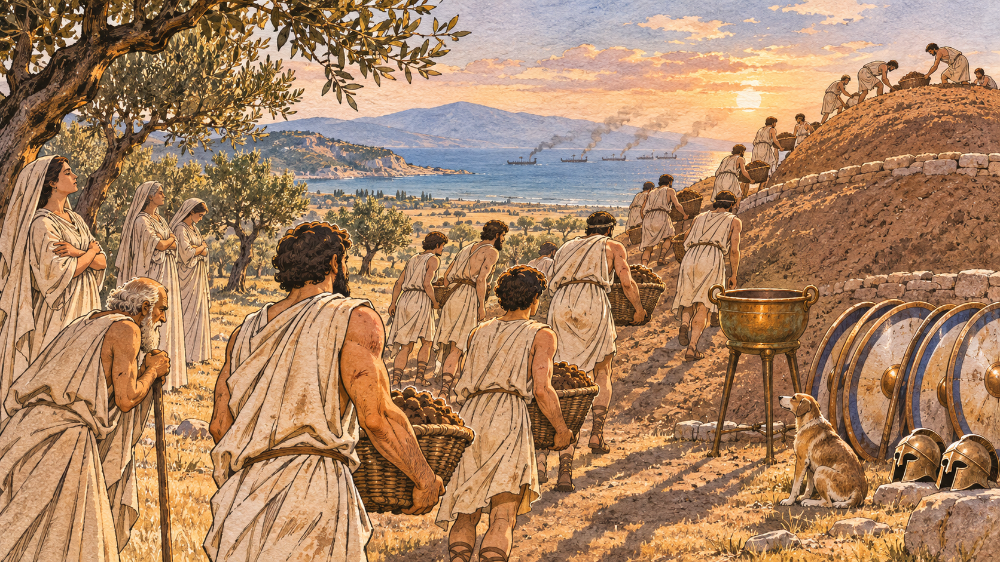
<details><summary>Image Prompt</summary>
(This is Panel 02. Do not include the panel number in the image.)
Style: a hand-drawn travel-sketchbook graphic-novel illustration, with clean dark ink outlines, flat softly shaded color fills and a faint watercolor paper texture, like a page from a traveler's journal; warm, sunlit, painterly lighting; no text, captions, signs, letters or speech bubbles anywhere in the image.

Please generate a 16:9 image in the style above depicting panel 2 of 16. Setting: the plain of Marathon at late afternoon, 490 BCE, the day after victory. Camera: wide view from behind a group of Athenian citizens and soldiers, in plain cream chitons with helmets set aside, who carry baskets of earth up the slope of a large, rounded, half-built burial mound; shields are stacked neatly beside it and a tall bronze cauldron stands at its base. On the far bay, the dark Persian ships, small with distance, row out to sea trailing thin smoke. Details: women in long veils standing apart with their arms folded, an old man leaning on a staff, olive trees, long shadows, a dog sitting by the shields. Palette: marble white, Aegean blue, olive green, honey gold, bronze, with a soft evening gold. Tone: solemn, grateful, exhausted. Keep every character and place consistent with the other images in this story. Generate the image immediately without asking clarifying questions.
</details>

By evening the Persian ships are rowing away. Herodotus counts 192 Athenian dead, and they are buried together under a mound that still stands on the plain, the Soros. Athens learns that it can win, and that the next invasion will be bigger.

## Panel 3: The Runner
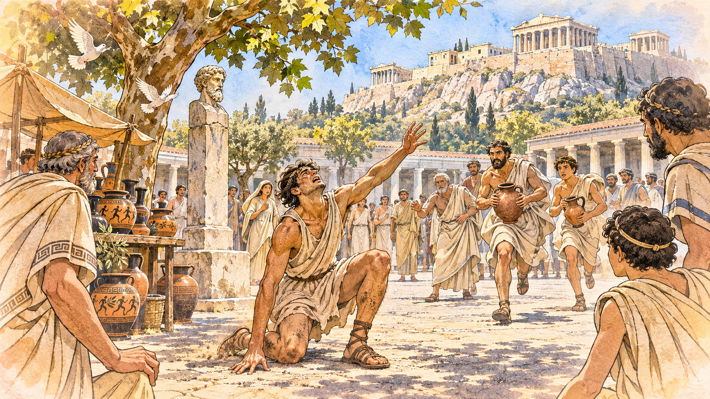
<details><summary>Image Prompt</summary>
(This is Panel 03. Do not include the panel number in the image.)
Style: a hand-drawn travel-sketchbook graphic-novel illustration, with clean dark ink outlines, flat softly shaded color fills and a faint watercolor paper texture, like a page from a traveler's journal; warm, sunlit, painterly lighting; no text, captions, signs, letters or speech bubbles anywhere in the image.

Please generate a 16:9 image in the style above depicting panel 3 of 16. Setting: the Athenian Agora at the foot of the Acropolis, 490 BCE, a bright hazy morning with a faint dreamlike glow around the edges to suggest a legend. Camera: medium-wide view as a lean, exhausted runner in a plain short tunic reaches the Agora, stumbling on to one knee with one arm raised, his sandals dusty, while a small crowd of citizens in cream and white himations looks on from the edges, some running toward him with water jars. Behind them rise the old temples on the rocky Acropolis. Details: a market stall of pottery, a plane tree, a herm statue on a pillar, startled doves. Palette: marble white, Aegean blue, olive green, honey gold, bronze. Tone: breathless, mythic. No one is shown dying. Keep every character and place consistent with the other images in this story. Generate the image immediately without asking clarifying questions.
</details>

> **Myth or Evidence?** The documented feat is the one few people know: Herodotus says a runner named Pheidippides ran from Athens to Sparta to ask for help, about 240 km in two days. The runner who raced from Marathon to Athens with news of victory and then died appears centuries later, in Plutarch and Lucian, and Herodotus never mentions it. It is a legend. The modern marathon race honors it.

## Panel 4: The Bridge of Boats
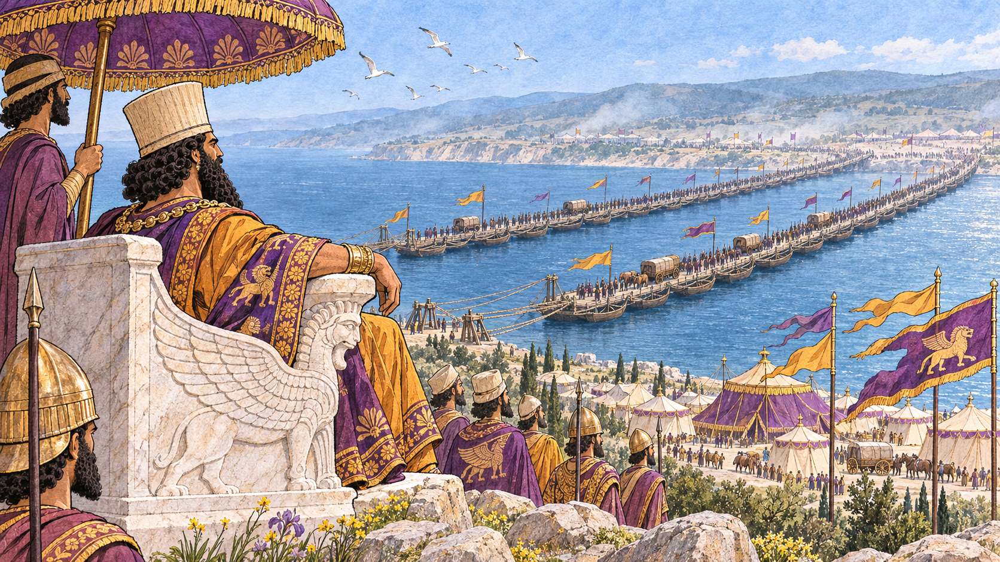
<details><summary>Image Prompt</summary>
(This is Panel 04. Do not include the panel number in the image.)
Style: a hand-drawn travel-sketchbook graphic-novel illustration, with clean dark ink outlines, flat softly shaded color fills and a faint watercolor paper texture, like a page from a traveler's journal; warm, sunlit, painterly lighting; no text, captions, signs, letters or speech bubbles anywhere in the image.

Please generate a 16:9 image in the style above depicting panel 4 of 16. Setting: a hillside above the Hellespont at Abydos, spring of 480 BCE, bright cool morning; palette of marble white, Aegean blue, honey gold and bronze with royal purple and saffron for the Persians. Camera: wide, from behind and to one side of a white marble throne on a rocky ledge, looking out over the strait: two long bridges of boats lashed side by side stretch across the narrow water to the far shore, with dark columns of small marching figures and wagons crossing. Cast: Xerxes, Great King of Persia: a tall, broad-shouldered man of about thirty-eight with a long, carefully curled black beard, a tall upright cream felt tiara, a long saffron-and-purple embroidered robe with wide sleeves, gold bracelets and a gold-chain collar; an aloof, regal, unreadable expression. He sits on the throne watching, a tall purple parasol held over him by an attendant. Details: ships' cables like heavy ropes, banners in saffron and purple, distant tents, a flock of gulls, a hazy opposite shore. Tone: grand, ominous, proud. Keep every character and place consistent with the other images in this story. Generate the image immediately without asking clarifying questions.
</details>

Ten years after Marathon, Darius's son Xerxes comes himself. His army crosses the Hellespont, the narrow strait near modern Çanakkale, on two bridges of boats. Herodotus puts the army at 1.7 million infantry; modern historians, counting what roads, water and food could support, usually estimate far fewer, often 100,000 to 300,000 fighting men, though estimates vary widely. Whatever the number, it is far larger than Athens can match on land.

## Panel 5: The First Answer
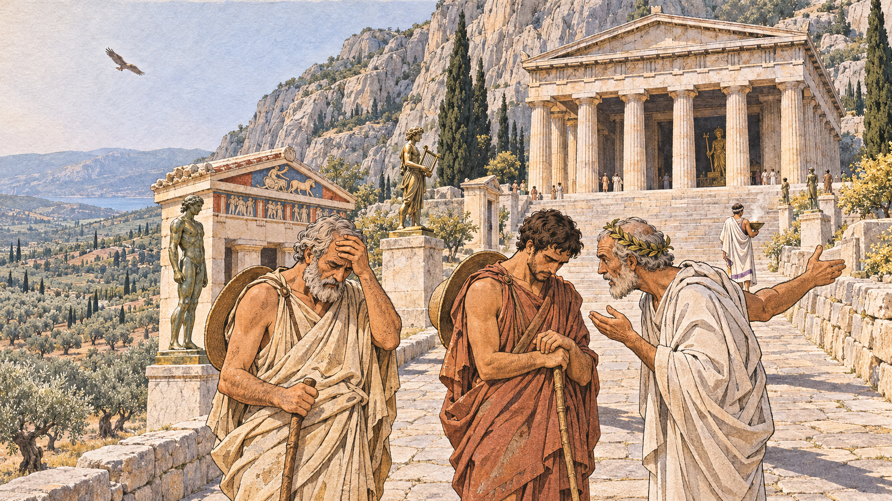
<details><summary>Image Prompt</summary>
(This is Panel 05. Do not include the panel number in the image.)
Style: a hand-drawn travel-sketchbook graphic-novel illustration, with clean dark ink outlines, flat softly shaded color fills and a faint watercolor paper texture, like a page from a traveler's journal; warm, sunlit, painterly lighting; no text, captions, signs, letters or speech bubbles anywhere in the image.

Please generate a 16:9 image in the style above depicting panel 5 of 16. Setting: Delphi in late summer, 481 or 480 BCE, mid-afternoon with a pale hazy light. Delphi, the sanctuary of Apollo: a steep rocky terrace on the slope of Mount Parnassus with a paved winding Sacred Way lined with small treasuries and statues, leading up to the large Doric Temple of Apollo with six columns across the front; behind it steep gray limestone cliffs, below it a deep valley of silver-green olive trees stretching to a distant sea. Camera: medium-wide view from the Sacred Way looking up toward the temple porch. In the foreground, the envoys have just left the temple and stand stunned on the paved terrace; the elder presses a hand to his forehead and the younger stares at the ground. Cast: Two Athenian envoys: a gray-bearded man of about sixty in a travel-stained cream himation, and a younger man of about thirty with short dark hair in a faded rust himation, both with broad-brimmed traveler's hats hanging at their backs, dusty leather sandals and walking staffs; weary and anxious. Beside them an older Delphian in a plain white himation, a laurel sprig in his hair, leans close and speaks quietly, one hand gesturing back toward the temple. Details: small bronze statues and a treasury with a carved pediment, a priest walking away with a bowl, a lone eagle high over the cliffs, long shadows. Palette: marble white, Aegean blue, olive green, honey gold, bronze. Tone: dread, then a flicker of hope. Keep every character and place consistent with the other images in this story. Generate the image immediately without asking clarifying questions.
</details>

Herodotus tells the story in two acts. Athenian envoys ask the Pythia, Apollo's priestess, what to do about Xerxes. The first answer is terrifying: flee to the ends of the earth, for fire and war will destroy the city. A respected Delphian named Timon, Herodotus says, advises them to go back, carrying olive branches as suppliants, and ask again. The date is 481 or 480 BCE.

## Panel 6: The Second Answer
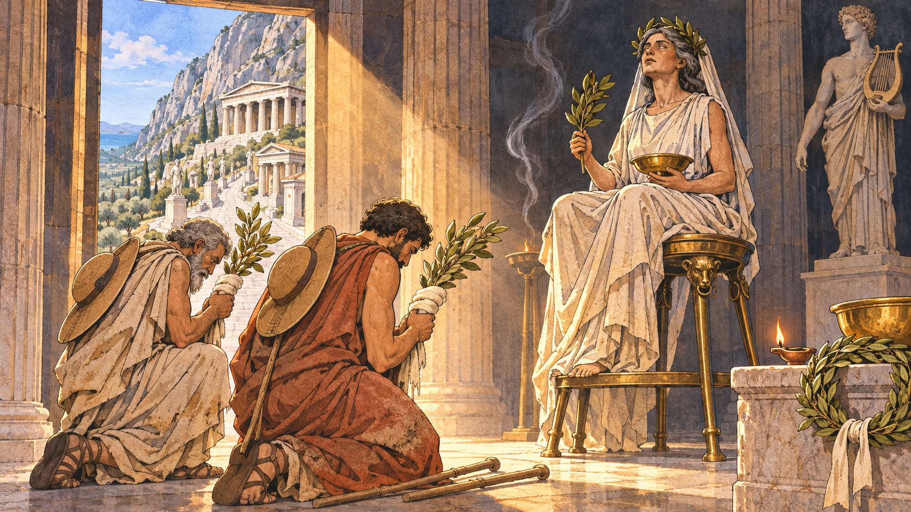
<details><summary>Image Prompt</summary>
(This is Panel 06. Do not include the panel number in the image.)
Style: a hand-drawn travel-sketchbook graphic-novel illustration, with clean dark ink outlines, flat softly shaded color fills and a faint watercolor paper texture, like a page from a traveler's journal; warm, sunlit, painterly lighting; no text, captions, signs, letters or speech bubbles anywhere in the image.

Please generate a 16:9 image in the style above depicting panel 6 of 16. Setting: inside the dim inner chamber of the Temple of Apollo at Delphi, 481 or 480 BCE, lit by a single shaft of gold light from the tall doorway behind the envoys, through which the paved Sacred Way and the cliffs of Delphi are glimpsed. Delphi, the sanctuary of Apollo: a steep rocky terrace on the slope of Mount Parnassus with a paved winding Sacred Way lined with small treasuries and statues, leading up to the large Doric Temple of Apollo with six columns across the front; behind it steep gray limestone cliffs, below it a deep valley of silver-green olive trees stretching to a distant sea. Camera: low three-quarter view. In the center the Pythia sits on a tall bronze tripod, a thin curl of laurel smoke rising beside her, her eyes far away. Cast: The Pythia, Apollo's priestess at Delphi: a dignified woman of about fifty with gray-streaked dark hair under a simple white veil, wearing a plain long white linen gown with a wreath of laurel leaves in her hair, holding a laurel branch in one hand and a shallow bronze offering bowl in the other. Her expression is calm, inward and serious. Kneeling before her, the two envoys now hold long olive branches wrapped in white wool, their heads bowed. Two Athenian envoys: a gray-bearded man of about sixty in a travel-stained cream himation, and a younger man of about thirty with short dark hair in a faded rust himation, both with broad-brimmed traveler's hats hanging at their backs, dusty leather sandals and walking staffs; weary and anxious. Details: a gold offering bowl, laurel wreaths, a small lamp. Palette: marble white, Aegean blue, olive green, honey gold, bronze. Tone: hushed, solemn, charged. Keep every character and place consistent with the other images in this story. Generate the image immediately without asking clarifying questions.
</details>

The second answer is hardly cheerful, but it leaves a door open. Zeus, the Pythia says, will grant Athena a wooden wall that alone will not be taken, and the answer ends: "Divine Salamis, you will destroy the children of women," at the time of sowing or of harvest. It names no side. Whichever fleet sinks, the line comes true.

## Panel 7: The Argument on the Hill
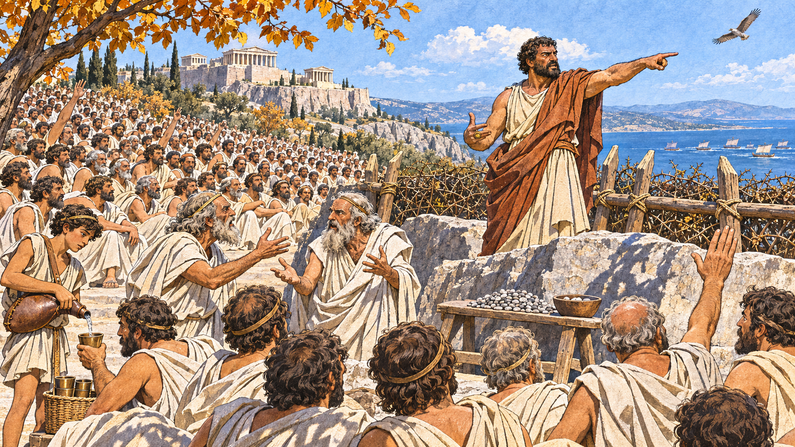
<details><summary>Image Prompt</summary>
(This is Panel 07. Do not include the panel number in the image.)
Style: a hand-drawn travel-sketchbook graphic-novel illustration, with clean dark ink outlines, flat softly shaded color fills and a faint watercolor paper texture, like a page from a traveler's journal; warm, sunlit, painterly lighting; no text, captions, signs, letters or speech bubbles anywhere in the image.

Please generate a 16:9 image in the style above depicting panel 7 of 16. Setting: the Pnyx hill, the open-air meeting place of the Athenian Assembly, autumn 480 BCE, bright midday; the old temples of the Acropolis stand in the distance with a thorn hedge and timber barricade along the rock's edge. Camera: medium-wide view over the shoulders of the crowd toward the speaker's rock. Cast: Themistocles, Athenian statesman and admiral: a stocky, energetic man of about forty-five with a short dark curly beard, sharp dark eyes and a weathered, tanned face, wearing a plain cream chiton and a rust-brown himation draped over one shoulder, a bronze signet ring on his right hand; confident, restless, always mid-gesture. He stands on the speaker's rock mid-gesture, one hand pointing out toward the sea. In the crowd, hundreds of men in cream and white himations sit on the sloping ground, some with raised hands; two gray-bearded oracle interpreters in white robes argue at the front with their hands spread. Details: a pile of voting pebbles on a bench, a boy selling water, a hawk circling, sharp shadows. Palette: marble white, Aegean blue, olive green, honey gold, bronze. Tone: heated, urgent. Keep every character and place consistent with the other images in this story. Generate the image immediately without asking clarifying questions.
</details>

Back in Athens the Assembly argues. Some older men say the wooden wall means the thorn hedge that once circled the Acropolis. The professional oracle interpreters say "divine Salamis" means defeat there. Themistocles replies that if the god had meant Athenian deaths he would have said "cruel Salamis," not "divine"; the dead will be the enemy's, and the wooden wall is the ships. The Assembly votes with him.

> **Myth or Evidence?** Everything here comes from Herodotus, who wrote about fifty years later. Some historians suspect the second answer was polished afterward, or that Themistocles had friends at Delphi. What no one doubts is where the decision was made: in the Assembly, by citizens arguing over two words.

## Panel 8: The Silver Fleet
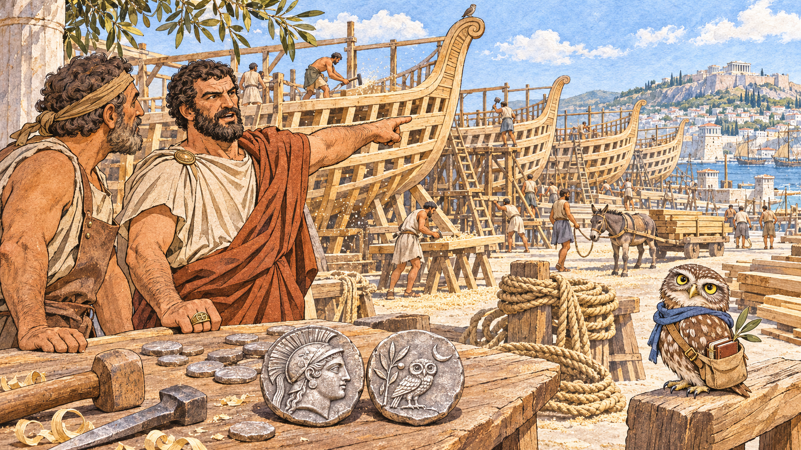
<details><summary>Image Prompt</summary>
(This is Panel 08. Do not include the panel number in the image.)
Style: a hand-drawn travel-sketchbook graphic-novel illustration, with clean dark ink outlines, flat softly shaded color fills and a faint watercolor paper texture, like a page from a traveler's journal; warm, sunlit, painterly lighting; no text, captions, signs, letters or speech bubbles anywhere in the image.

Please generate a 16:9 image in the style above depicting panel 8 of 16. Setting: the shipyards of Piraeus, the port of Athens, in 483 to 480 BCE, bright morning with sawdust drifting in the sun. Camera: a wide view along a row of slipways where half-built triremes show their pale timber ribs; in the foreground, a worktable with a scatter of silver coins. An ancient Athenian silver tetradrachm coin: a thick round silver coin showing the head of Athena in a crested helmet on one side and, on the other, a standing little owl beside an olive sprig and a crescent moon, with a rough, hand-struck edge. Cast: Themistocles, Athenian statesman and admiral: a stocky, energetic man of about forty-five with a short dark curly beard, sharp dark eyes and a weathered, tanned face, wearing a plain cream chiton and a rust-brown himation draped over one shoulder, a bronze signet ring on his right hand; confident, restless, always mid-gesture. He stands at the end of a slipway pointing along the row of hulls, a shipwright in a leather apron beside him. Behind them, long narrow half-built warships stand on slipways with three levels of oar ports and curved raised stern posts, shipwrights swarming over the scaffolds. Details: coils of rope, adzes and mallets, stacks of pine planks, a donkey hauling timber. On the carved stern post of the nearest hull, a tiny owl perches. Glaux the Little Owl: a true little owl (Athene noctua), small, round and compact, with a flat rounded head and no ear tufts, warm earth-brown plumage with cream spots, bright lemon-yellow eyes under pale cream eyebrows, a cream-white throat patch and a short pale greenish-yellow beak. Glaux wears a small Aegean-blue scarf and a tan canvas satchel across the body with a small leather-bound travel notebook peeking out, and a sprig of three olive leaves tucked into the satchel strap. Alert, curious and warm expression. Glaux is drawn small, perched at the edge of the scene, noticeable on a second look. Palette: marble white, Aegean blue, olive green, honey gold, bronze. Tone: industrious, hopeful. Keep every character and place consistent with the other images in this story. Generate the image immediately without asking clarifying questions.
</details>

The "wooden wall" already exists, or nearly. In 483 BCE the state silver mines at Laurion strike a rich new vein. Herodotus says the Athenians are about to hand out the windfall, ten drachmas a citizen, when Themistocles persuades them to build 200 warships instead. Without that silver there would be no Greek fleet able to face Persia.

## Panel 9: Leaving the City
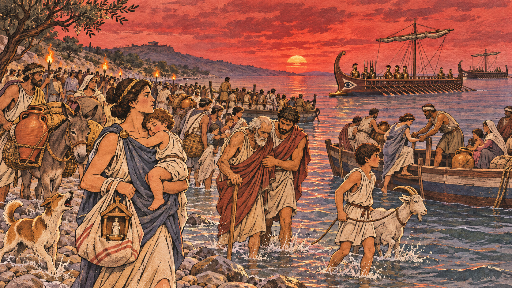
<details><summary>Image Prompt</summary>
(This is Panel 09. Do not include the panel number in the image.)
Style: a hand-drawn travel-sketchbook graphic-novel illustration, with clean dark ink outlines, flat softly shaded color fills and a faint watercolor paper texture, like a page from a traveler's journal; warm, sunlit, painterly lighting; no text, captions, signs, letters or speech bubbles anywhere in the image.

Please generate a 16:9 image in the style above depicting panel 9 of 16. Setting: a rocky beach on the coast of Attica at dusk in late summer 480 BCE. Camera: wide view from the water's edge, looking back toward the land, as long lines of Athenian families wade to small fishing boats and ferry boats: a mother carrying a toddler on her hip, an old man helped by a younger one, a boy leading a goat on a rope, donkeys with bundles and clay storage jars on their backs. Far in the distance behind them the Acropolis stands as a tiny dark shape with a thin line of timber along its edge. Offshore, a pair of triremes at anchor: An Athenian trireme: a long, narrow wooden warship, low in the water, with three staggered banks of oars, a bronze ram at the waterline of the bow, a curved raised stern post, a large painted eye on each side of the bow, a square sail furled on a single mast, and bronze-helmeted marines on the deck. Details: a household shrine in a cloth bundle, a barking dog, torches just lit, a red sky. Palette: marble white, Aegean blue, olive green, honey gold, bronze, with a red evening sky. Tone: sorrowful, determined. Keep every character and place consistent with the other images in this story. Generate the image immediately without asking clarifying questions.
</details>

The Athenians do not defend their walls. Herodotus says they move their families to Salamis, Aegina and Troezen, and put their trust in the fleet. A few defenders barricade the Acropolis with timber, taking the oracle's wooden wall literally. The city is almost empty when the Persians arrive.

## Panel 10: Smoke on the Rock
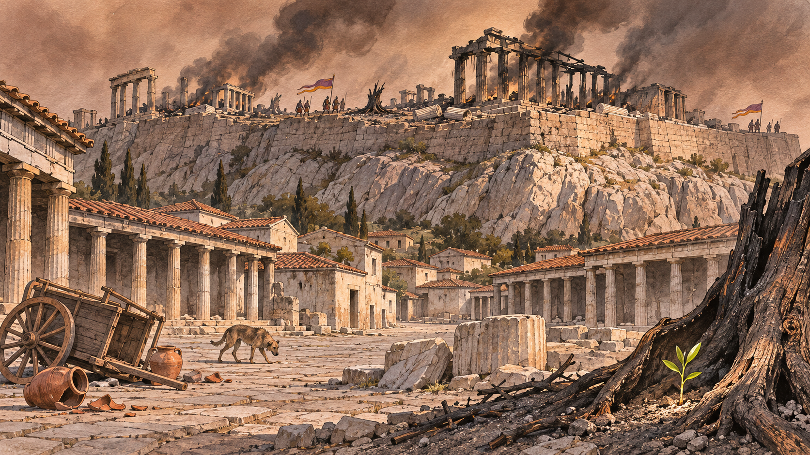
<details><summary>Image Prompt</summary>
(This is Panel 10. Do not include the panel number in the image.)
Style: a hand-drawn travel-sketchbook graphic-novel illustration, with clean dark ink outlines, flat softly shaded color fills and a faint watercolor paper texture, like a page from a traveler's journal; warm, sunlit, painterly lighting; no text, captions, signs, letters or speech bubbles anywhere in the image.

Please generate a 16:9 image in the style above depicting panel 10 of 16. Setting: Athens, September 480 BCE, seen from the Agora below. Palette: marble white gone gray, ash, charred brown and a hazy brown sky, with a hint of royal purple. The Acropolis of Athens after the Persian sack of 480 BCE: the same steep, flat-topped, pale limestone rock above the city, but its old temples are smoking ruins, with blackened broken columns, toppled column drums, scorched marble, charred roof beams, tall columns of dark smoke drifting over the summit and a blackened stump where the sacred olive tree stood; the sky behind is hazy and brown-gray. Camera: wide view from the Agora looking up at the rock. Far up the slope, tiny dark silhouettes of Persian soldiers with their purple-and-saffron banners move among the ruins without any fighting; empty streets of the city in the foreground, an overturned cart, scattered pottery, a stray dog. In the lower corner, a close detail: at the foot of a charred olive stump, one small green shoot has pushed up, bright against the ash. Tone: heavy, desolate, with a spark of hope. No people are harmed. Keep every character and place consistent with the other images in this story. Generate the image immediately without asking clarifying questions.
</details>

The Persians reach Athens and find it nearly empty. They burn the temples on the Acropolis and Athena's sacred olive tree. Herodotus says that on the very next day the Athenians who return to look find a new shoot already about half a meter long. The thirty years of ruins that follow will become Pericles' building site.

## Panel 11: The Trap in the Narrows
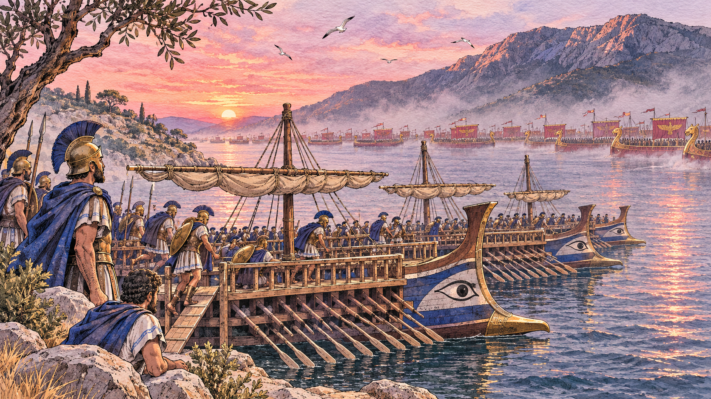
<details><summary>Image Prompt</summary>
(This is Panel 11. Do not include the panel number in the image.)
Style: a hand-drawn travel-sketchbook graphic-novel illustration, with clean dark ink outlines, flat softly shaded color fills and a faint watercolor paper texture, like a page from a traveler's journal; warm, sunlit, painterly lighting; no text, captions, signs, letters or speech bubbles anywhere in the image.

Please generate a 16:9 image in the style above depicting panel 11 of 16. Setting: the narrow strait between the rocky island of Salamis and the mainland of Attica at first light, September 480 BCE; a pink-gold sunrise, pale mist on the water, the dark hump of Mount Aigaleo on the right. Camera: wide view from the Greek shore on the island, raised slightly, looking across the strait. In the foreground, a line of Greek ships at the water's edge with rowers on the benches, oars raised in rest and marines taking their places. An Athenian trireme: a long, narrow wooden warship, low in the water, with three staggered banks of oars, a bronze ram at the waterline of the bow, a curved raised stern post, a large painted eye on each side of the bow, a square sail furled on a single mast, and bronze-helmeted marines on the deck. Across the narrow channel, rows and rows of Persian ships in red and gold crowd into the strait, their oars catching on one another; palette of Aegean blue, marble white, honey gold with royal purple and saffron for the Persians. Details: gulls, the glint of bronze rams, a man at the bow with an arm raised, tiny torches going out. Tone: tense, expectant. No fighting is shown yet. Keep every character and place consistent with the other images in this story. Generate the image immediately without asking clarifying questions.
</details>

Themistocles argues that in open water Persia's numbers would tell, but in the narrows they cannot. Herodotus says he sends a trusted man, an enslaved tutor named Sicinnus, to tell Xerxes the Greeks are about to flee. Xerxes believes it, and his ships spend the night closing both ends of the strait. At dawn the Persian fleet rows into the narrows.

## Panel 12: A Throne on the Shore
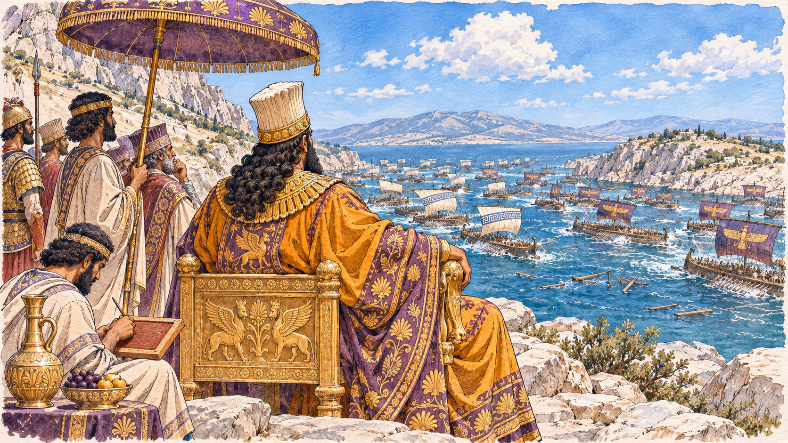
<details><summary>Image Prompt</summary>
(This is Panel 12. Do not include the panel number in the image.)
Style: a hand-drawn travel-sketchbook graphic-novel illustration, with clean dark ink outlines, flat softly shaded color fills and a faint watercolor paper texture, like a page from a traveler's journal; warm, sunlit, painterly lighting; no text, captions, signs, letters or speech bubbles anywhere in the image.

Please generate a 16:9 image in the style above depicting panel 12 of 16. Setting: the foot of Mount Aigaleo on the mainland shore of Attica, midday, September 480 BCE; palette of marble white, Aegean blue, honey gold and bronze with royal purple and saffron. Camera: medium-wide, from behind and slightly to one side of a gilded throne placed on a rocky ledge, looking over the water. Cast: Xerxes, Great King of Persia: a tall, broad-shouldered man of about thirty-eight with a long, carefully curled black beard, a tall upright cream felt tiara, a long saffron-and-purple embroidered robe with wide sleeves, gold bracelets and a gold-chain collar; an aloof, regal, unreadable expression. He sits stiffly forward on the throne, gripping its arms. Behind him, a line of attendants in long robes and a seated scribe with a wax tablet; a tall purple parasol. Far across the narrow water, small in the distance, crowded ships tangle their oars in the narrows, with drifting planks and broken oars on the surface and no figures visible. An Athenian trireme: a long, narrow wooden warship, low in the water, with three staggered banks of oars, a bronze ram at the waterline of the bow, a curved raised stern post, a large painted eye on each side of the bow, a square sail furled on a single mast, and bronze-helmeted marines on the deck. Tone: tense, then dawning dismay. Keep every character and place consistent with the other images in this story. Generate the image immediately without asking clarifying questions.
</details>

Xerxes watches from a seat at the foot of Mount Aigaleo. In the crush, Herodotus says, the Persian ships cannot turn or use their numbers, and the Greek rams find targets. One of the king's commanders that day is Artemisia, queen of Herodotus' own city of Halicarnassus, who had advised him not to fight in the narrows at all.

## Panel 13: Sunset in the Narrows
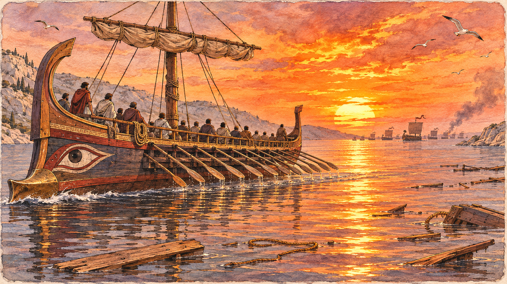
<details><summary>Image Prompt</summary>
(This is Panel 13. Do not include the panel number in the image.)
Style: a hand-drawn travel-sketchbook graphic-novel illustration, with clean dark ink outlines, flat softly shaded color fills and a faint watercolor paper texture, like a page from a traveler's journal; warm, sunlit, painterly lighting; no text, captions, signs, letters or speech bubbles anywhere in the image.

Please generate a 16:9 image in the style above depicting panel 13 of 16. Setting: the strait of Salamis at sunset, September 480 BCE, a blazing gold-and-orange sky reflected on calm water. Camera: low wide view across the water. In the foreground a Greek ship glides home, its oars rising and falling in rhythm, its crew small silhouettes with helmets off. An Athenian trireme: a long, narrow wooden warship, low in the water, with three staggered banks of oars, a bronze ram at the waterline of the bow, a curved raised stern post, a large painted eye on each side of the bow, a square sail furled on a single mast, and bronze-helmeted marines on the deck. The strait is scattered with floating oars, planks, painted ship timbers and tangled rope; in the far distance a dark fleet of Persian ships withdraws toward the open sea, the smoke of the burned Acropolis a thin brown line on the horizon. Details: gulls over the wreckage, the glint of a lost bronze ram, a tattered purple sail. No bodies or people in the water are shown. Palette: marble white, Aegean blue, honey gold, bronze, blazing sunset orange with a touch of royal purple. Tone: weary, triumphant, quiet. Keep every character and place consistent with the other images in this story. Generate the image immediately without asking clarifying questions.
</details>

By evening the Persian fleet has withdrawn with heavy losses. Herodotus lists 378 Greek ships, 180 of them Athenian. With about 170 rowers a ship, Athens needed some 30,000 oarsmen, many of them from the poorest citizens, a fact whose consequences for Athenian democracy Chapter 16 follows. Without a navy to supply his army, Xerxes goes home with much of it.

## Panel 14: Bronze for the God
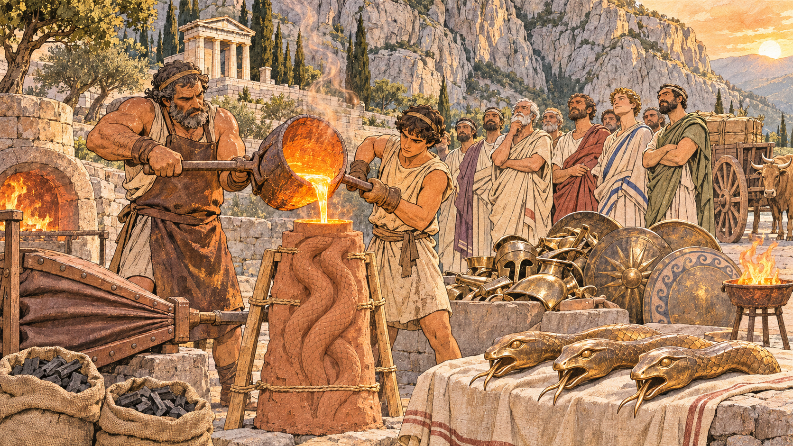
<details><summary>Image Prompt</summary>
(This is Panel 14. Do not include the panel number in the image.)
Style: a hand-drawn travel-sketchbook graphic-novel illustration, with clean dark ink outlines, flat softly shaded color fills and a faint watercolor paper texture, like a page from a traveler's journal; warm, sunlit, painterly lighting; no text, captions, signs, letters or speech bubbles anywhere in the image.

Please generate a 16:9 image in the style above depicting panel 14 of 16. Setting: a bronze founder's yard on a rocky hillside, probably near Delphi, in 479 BCE, late afternoon, with steep gray limestone cliffs behind. Camera: medium wide view. In the foreground a stout founder in a leather apron and a young apprentice tip a crucible so a bright river of molten bronze pours into the mouth of a tall clay mold shaped like three twisted snakes; heat shimmers above it. Around them, details: bellows, a heap of captured bronze and shields set aside as melting stock, sacks of charcoal, a row of finished serpent heads, their tongues forked, laid on a cloth to cool, a brazier, an ox-cart. A small group of delegates from many cities in plain himations stands to one side watching. Palette: marble white, bronze, honey gold, ember orange, olive green. Tone: ceremonial, hot, proud. Keep every character and place consistent with the other images in this story. Generate the image immediately without asking clarifying questions.
</details>

In 479 BCE the Greeks win at Plataea and Mycale, ending the invasion. They dedicate a tenth of the spoils to the god at Delphi, as Herodotus says: a bronze column of three intertwined snakes, probably cast near the sanctuary, to hold a golden tripod. The Greeks had won by standing together, and the monument will say so.

## Panel 15: These Fought the War
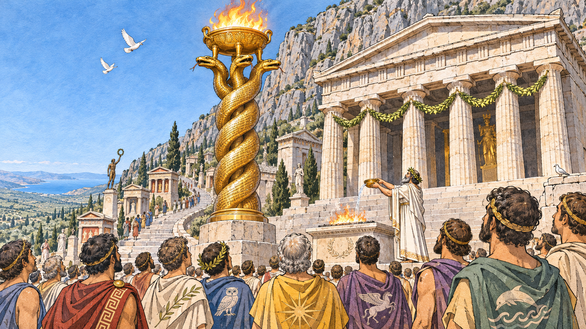
<details><summary>Image Prompt</summary>
(This is Panel 15. Do not include the panel number in the image.)
Style: a hand-drawn travel-sketchbook graphic-novel illustration, with clean dark ink outlines, flat softly shaded color fills and a faint watercolor paper texture, like a page from a traveler's journal; warm, sunlit, painterly lighting; no text, captions, signs, letters or speech bubbles anywhere in the image.

Please generate a 16:9 image in the style above depicting panel 15 of 16. Setting: the Temple of Apollo terrace at Delphi, 479 BCE, a bright clear morning. Delphi, the sanctuary of Apollo: a steep rocky terrace on the slope of Mount Parnassus with a paved winding Sacred Way lined with small treasuries and statues, leading up to the large Doric Temple of Apollo with six columns across the front; behind it steep gray limestone cliffs, below it a deep valley of silver-green olive trees stretching to a distant sea. Camera: low angle from the Sacred Way looking up at the newly dedicated monument beside the temple's altar. The Serpent Column: a tall bronze column made of three snakes twisted together in a spiral, which once held a golden bowl, now with the serpents' heads missing; weathered dark green-bronze, with a worn stone base. In this scene it is brand new, a bright golden-bronze column with all three serpent heads intact and a large golden tripod bowl blazing on top, tiny incised marks covering the coils. In the foreground, a group of delegates from many cities, seen from behind in plain colorful himations, gaze up at it; a priest in white pours a libation from a bowl. Details: white doves, laurel garlands hung on the temple columns, the silver-green olive valley far below. Palette: marble white, Aegean blue, olive green, honey gold, bronze. Tone: triumphant, reverent. Keep every character and place consistent with the other images in this story. Generate the image immediately without asking clarifying questions.
</details>

The column carries the names of the 31 Greek communities that fought, under a heading that means "These fought the war." The Spartan commander Pausanias first has his own name carved on it, and the Spartans erase his boast. The golden tripod does not last: the travel writer Pausanias says the gold was carried off in the Third Sacred War of 356 to 346 BCE, while the bronze serpents stood on.

## Panel 16: Then and Now
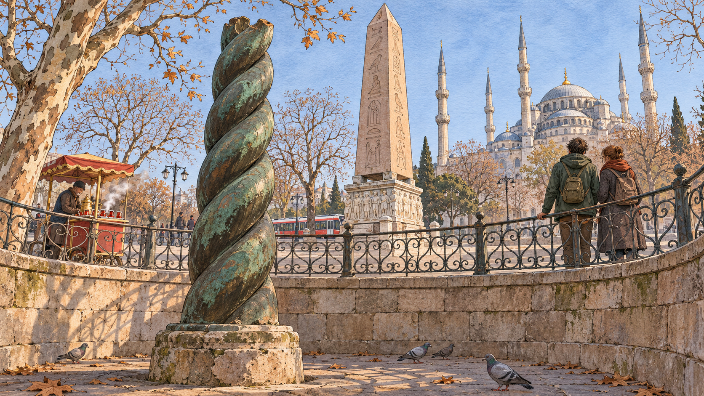
<details><summary>Image Prompt</summary>
(This is Panel 16. Do not include the panel number in the image.)
Style: a hand-drawn travel-sketchbook graphic-novel illustration, with clean dark ink outlines, flat softly shaded color fills and a faint watercolor paper texture, like a page from a traveler's journal; warm, sunlit, painterly lighting; no text, captions, signs, letters or speech bubbles anywhere in the image.

Please generate a 16:9 image in the style above depicting panel 16 of 16, the "Then and Now" panel. Setting: the Hippodrome, Sultanahmet Square, Istanbul, Turkey, today, on a cool, clear November afternoon. Camera: low three-quarter view down into a shallow stone-edged pit where the monument stands, as closely matching panel 15's low upward angle as the pit allows. The Serpent Column: a tall bronze column made of three snakes twisted together in a spiral, which once held a golden bowl, now with the serpents' heads missing; weathered dark green-bronze, with a worn stone base. Behind it rise the pale stone Egyptian obelisk on its carved marble base and, further back, the gray domes and six slender minarets of the Blue Mosque against a pale blue sky. Two adult travelers seen from behind or in distant three-quarter view, dressed for cool November weather: one in a dark green rain jacket, the other in a charcoal wool coat with a rust-colored scarf, both with small daypacks, standing close together and looking at the view. Faces are never shown in detail. They stand at the low railing, small in the frame, looking down at the column. Details: bare plane trees, pigeons, a tram passing in the distance, a tea seller's cart. Palette: natural daylight, sea blue, terracotta, olive, weathered bronze. Tone: quiet wonder, continuity. Keep every character and place consistent with the other images in this story. Generate the image immediately without asking clarifying questions.
</details>

Constantine moved the column to his new capital by 330 CE, and it has stood in the Hippodrome ever since, in a pit because the ground has risen several meters. Its serpent heads are gone; the upper jaw of one lies in the Istanbul Archaeology Museums. Two cities each hold half of the story: Istanbul has the object, and Delphi has the place.

### Epilogue - What the Wooden Wall Taught

A riddle from a god did not save Athens. A forecaster, a vote, a silver vein and thousands of ordinary rowers did. The oracle's words decided nothing by themselves; people decided what they meant, and then did the work. That is why the story rewards a careful reader: ask who decided, who paid and who rowed.

| Challenge | How They Responded | Lesson for Today |
|---|---|---|
| An ambiguous oracle: "a wooden wall" and "divine Salamis" | The Assembly argued over the words; Themistocles read them as the fleet | Ambiguous guidance needs open argument and a clear decision-maker |
| A much larger army with no hope on land | Fight where numbers do not count: the narrows | Choose the ground that cancels the enemy's advantage |
| A silver windfall that could be shared out | Spend it on 200 warships ten years before the need was proven | Invest in the thing the future will demand |
| A fleet that needed tens of thousands of rowers | Poor citizens manned the oars and earned a claim on the city | Those who carry the load deserve a voice |

### Call to Action

When you next stand on the Acropolis, look at the north wall below the Erechtheion: column drums from the burned temples are built into it, a war memorial made of the war's own rubble. Then ask who in your own town gets to argue over the meaning of a riddle. The Learning for All thread of this book asks the same question about every classroom: who gets to read the evidence, and who gets to decide?

---

## Voices from the Sources

These are Herodotus' reports, in the paraphrased translations used in Chapters 15 and 17, not verbatim quotations.

- The second Delphic answer, as Herodotus reports it: "Divine Salamis, you will destroy the children of women." Themistocles argued from the single word "divine."
- The heading on the Serpent Column, as Herodotus and later writers report it: "These fought the war."
- Herodotus on Darius, after Athens helped burn Sardis (about 498 BCE): he ordered a servant to say to him three times at every dinner, "Master, remember the Athenians." (As Herodotus reports it.)

## On the Trip

- **Chapter:** [15. Athens, the Acropolis, and the Persian Wars](../../chapters/15-athens-acropolis/index.md)
- **Where to look:** column drums and carved blocks from the burned temples built into the Acropolis north wall, visible from the streets below in Plaka; the long island across the water from Piraeus, which is Salamis, and the strait beyond it; the bronze copy of the Serpent Column beside Apollo's altar at Delphi, and the original in its pit in Istanbul's Hippodrome.
- **Explore further:** [Xerxes' Road to Salamis](../../sims/persian-wars-campaign-map/index.md) and [Two Ends of the Serpent Column](../../sims/serpent-column-two-ends/index.md)
- **Look Closer:** Glaux says: "Look closer at the north wall of the Acropolis, where round column drums sit among the building blocks." Glaux was perched on the carved stern post of a half-built trireme in Panel 8 (The Silver Fleet), beside a heap of silver coins.

## Characters and Style

This story follows the shared series bible: [Story Characters, Places and House Style](../characters.md). Glaux's identity comes from the mascot's [character sheet](../../img/mascot/character-sheet.md).

## References

1. [Wikipedia: Battle of Salamis](https://en.wikipedia.org/wiki/Battle_of_Salamis) - The 480 BCE sea battle in the strait
2. [Wikipedia: Themistocles](https://en.wikipedia.org/wiki/Themistocles) - The Athenian statesman who built the fleet
3. [Wikipedia: Serpent Column](https://en.wikipedia.org/wiki/Serpent_Column) - The Plataea victory monument, from Delphi to Istanbul
4. [Encyclopaedia Britannica: Themistocles](https://www.britannica.com/biography/Themistocles) - Overview of his life and his role in the Persian Wars
5. [UNESCO World Heritage: Archaeological Site of Delphi](https://whc.unesco.org/en/list/393) - The sanctuary of Apollo and its oracle
